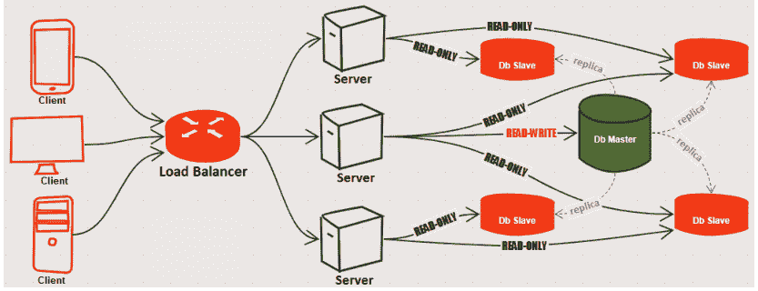
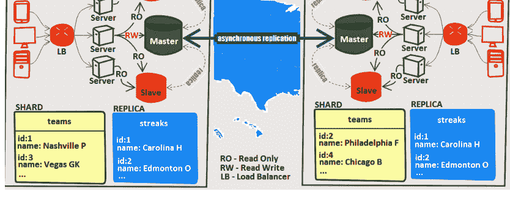
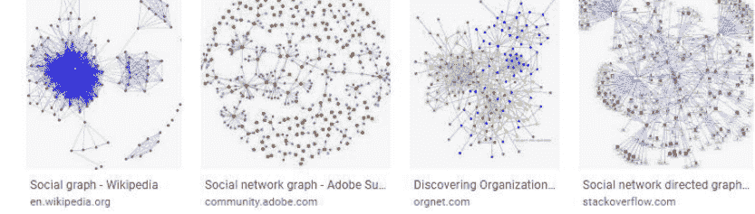
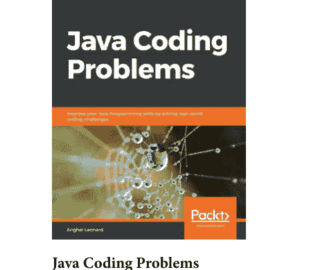
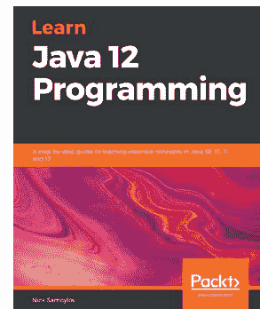

## 系统可扩展性

毫无疑问，可扩展性对于 Web 应用的成功是最关键的需求之一。应用的可扩展能力取决于整个系统架构，而在构建项目时就考虑可扩展性是最佳做法。当业务成功可能因巨大的流量压力而要求应用具备高度可扩展性时，你将会对当初的决策感激不尽。

因此，随着 Web 的发展，设计和构建可扩展应用也变得越来越重要。在本章中，我们涵盖了你在初级/中级面试中可能被问到的所有可扩展性面试题，这些职位包括 Web 应用软件架构师、Java 架构师或软件工程师。如果你求职的职位不涉及软件架构和设计相关任务，那么可扩展性很可能不会成为面试主题。

本章的议程包括以下内容：

- 可扩展性概述
- 问题与编码挑战

让我们开始吧！

## 可扩展性概述

面试官最可能问你的一个既在意料之中又很重要的问题是：什么是可扩展性？可扩展性是指一个过程（系统、网络、应用）在添加资源（通常是硬件）时，应对工作负载增加（所谓工作负载，我们指的是任何将系统推向极限的因素，例如流量、存储容量、最大事务数量等）的能力。可扩展性可以表示为系统性能提升与资源使用增加之间的比率。此外，可扩展性还意味着能够在不影响/修改主要节点结构的情况下添加额外资源。

如果添加更多资源只带来轻微的性能提升，甚至更糟的是，增加资源对性能毫无影响，那么你就面临着所谓的*可扩展性差*。

如何实现可扩展性？在涉及可扩展性问题的面试中，你很可能也会被问到这个问题。给出一个概括、全面且不过于耗时的回答是最好的选择。应该涉及的主要要点如下：

- **利用 12factor**（`https://12factor.net/`）：这种方法论与编程语言无关，对于交付灵活且可扩展的应用非常有用。
- **明智地实现持久化**：从为应用选择合适的数据库、设计最优化的模式，到掌握扩展持久化层的技术（例如集群、副本、分片等），这是值得你全力关注的关键方面之一。
- **不要低估查询**：数据库查询是获得短事务的关键因素。为可扩展性调整你的连接池和查询。例如，注意跨节点连接，它可能迅速降低性能。
- **选择托管和工具**：扩展不仅仅是代码问题！基础设施也同样重要。如今，许多云服务商（例如 Amazon）提供自动扩展和专用工具（Docker、Kubernetes 等）。
- **考虑负载均衡和反向代理**：总有一天，你必须从单服务器架构切换到多服务器架构。在云基础设施（例如 Amazon）下运行，只需几次配置就能轻松获得这些功能（对大多数云服务商而言，负载均衡和反向代理是*即取即用*服务的一部分）。否则，你必须为这一重大变化做好准备。
- **缓存**：在扩展应用时，考虑新的缓存策略、拓扑和工具。
- **减轻后端负担**：尽可能多地将计算从后端迁移到前端。这样，你就能从后端的肩上卸下一些工作。
- **测试与监控**：测试和监控代码将帮助你尽早发现问题。

还有其他很多方面值得讨论，但此时，面试官应该已经准备好将面试推进到下一步了。

## 问题与编码挑战

在本节中，我们涵盖了 13 个问题与编码挑战，它们是初级/中级可扩展性面试中必须掌握的知识点。让我们开始吧！

### 编码挑战 1 – 扩展类型

问题：纵向扩展和横向扩展是什么意思？

解决方案：纵向扩展（或垂直扩展）是通过向现有系统添加更多资源来实现更好的性能，并成功应对更大的工作负载。所谓资源，我们可以理解为更多的存储、更多的内存、更大的网络、更多的线程、更多的连接、更强大的主机、更大的缓存等。一旦添加了新资源，应用就应该能够遵守 SLA。如今，云中的纵向扩展非常高效和快速。AWS、Azure、Oracle、Heroku、Google Cloud 等云平台可以在几分钟内根据阈值计划自动分配更多资源。当流量下降时，AWS 可以停用这些额外资源。这样，你只需为你使用的部分付费。

横向扩展（或水平扩展）通常与分布式架构相关。横向扩展有两种基本形式：

- 以预先打包的基础设施/节点块的形式增加更多基础设施容量（例如超融合）。
- 使用独立的分布式服务来收集关于客户的信息。

拥有集群可以显著降低集群中某台机器发生故障时服务不可用的概率。换句话说，集群的主要目的是实现服务 100% 可用性或零停机时间（高可用性——参见编码挑战 2）。当然，仍然存在很小的可能性是所有集群机器同时故障，但通常可以通过将机器分布在不同的地理位置或由其各自的资源支持来缓解。

### 编码挑战 5 – 延迟、带宽和吞吐量

**问题：** 什么是延迟、带宽和吞吐量？

**解决方案：** 在面试中解释这些概念的最佳方式是用一个简单的管道类比，如下图所示：

图 19.1 – 延迟与带宽与吞吐量

**延迟** 是穿过管道所需的时间，而不是管道的长度。不过，它是作为管道长度的函数来度量的。

**带宽** 是管道的宽度。

**吞吐量** 是流经管道的水量。

### 编码挑战 6 – 负载均衡

**问题：** 什么是负载均衡？

**解决方案：** 负载均衡是一种用于将工作负载分发到多台机器或集群上的技术。负载均衡使用的算法包括轮询、粘性会话（或会话亲和性）和 IP 地址亲和性。一种常见且简单的算法是轮询，它按循环顺序分配工作负载，确保所有可用机器获得相同数量的请求，并且没有机器过载或欠载。

例如，下图标识了负载均衡器在典型主从架构中的位置：

图 19.2 – 主从架构中的负载均衡器

通过在机器之间分配工作，负载均衡努力实现最大吞吐量和响应时间。

### 编码挑战 7 – 粘性会话

问题：什么是粘性会话（或会话亲和性）？

解决方案：粘性会话（或会话亲和性）是负载均衡器中遇到的一个概念。通常，用户信息存储在会话中，并且会话会在集群中的所有机器上复制。但可以通过让同一台机器为特定用户会话请求提供服务来避免会话复制（参见编码挑战 11）。

为此，会话与一台机器相关联。这发生在会话创建时。该会话的所有传入请求始终被重定向到关联的机器。用户数据仅存在于那台机器上。

在 Java 中，粘性会话通常通过 jsessionid cookie 实现。在第一次请求时，cookie 被发送到客户端。对于每个后续请求，客户端请求也会包含该 cookie。这样，cookie 就标识了会话。

粘性会话方法的主要缺点是，如果机器发生故障，用户信息就会丢失，而且该会话无法恢复。如果客户端浏览器不支持 cookie 或禁用了 cookie，则无法通过 cookie 实现粘性会话。

## 编程挑战 8 – 分片

**问题：** 什么是分片？

**解答：** 分片是一种将单一逻辑数据库系统分布到机器集群中的架构技术。以下图示说明了这一点：

图 19.3 – 分片

正如前图所示，分片是关于数据库模式的水平分区。主要来说，数据库表的行（例如，teams）是分开存储的（西数据中心保存奇数行，而东数据中心保存偶数行），而不是将表按列拆分（按列拆分被称为规范化和垂直分区）。

每个分区称为一个分片。正如前图所示，每个分片可以独立地位于物理位置或单独的数据库服务器上。

分片的目标是使数据库系统具有高度可扩展性。每个分片中较少的行数减少了索引大小并提高了读/搜索操作的性能。

分片的缺点如下：

- 应用程序必须知道数据的位置。
- 从系统中添加/移除节点需要重新平衡系统。
- 跨节点连接查询会带来性能惩罚。

## 编程挑战 9 – 无共享架构

**问题：** 什么是无共享架构？

**解答：** 无共享架构（表示为 **SN**）是一种分布式计算技术，其主张每个节点都是独立的并且包含其实现自主所需的一切。此外，系统中不需要单一的争用点。SN 架构的主要方面如下：

- 节点独立工作。
- 节点之间不共享资源（内存、文件等）。
- 如果一个节点失败，则只影响其用户（其他节点继续工作）。

具有线性且理论上无限的可扩展性，无共享架构相当流行。Google 是依赖 SN 的主要参与者之一。

## 编程挑战 10 – 故障转移

**问题：** 什么是故障转移？

**解答：** 故障转移是一种通过在集群中的一台机器失败时切换到另一台机器来实现高可用性的技术。通常，故障转移由负载均衡器通过心跳检查机制自动应用。主要来说，负载均衡器通过确保它们做出响应来检查机器的可用性。如果一台机器的心跳失败（机器未响应），则负载均衡器不会向其发送任何请求并将请求重定向到集群中的另一台机器。

## 编程挑战 11 – 会话复制

**问题：** 什么是会话复制？

**解答：** 会话复制通常出现在应用服务器集群中，其主要目标是实现会话故障转移。

会话复制在用户每次更改当前会话时应用。主要来说，用户会话会自动复制到集群中的其他机器。这样，如果一台机器失败，负载均衡器会将传入请求发送到集群中的另一台机器。由于集群中的每台机器都有用户会话的副本，负载均衡器可以选择其中任何一台机器。

虽然会话复制维持了会话故障转移，但它可能在内存和网络带宽方面产生额外成本。

**解答：** 通常，社交网络是使用图设计的。结果是一个巨大的图，如下图所示（该图通过 Google 图片搜索 *social network graph* 关键词收集）：

图 19.5 – 社交网络图

因此，在两个人之间找到一条路径意味着在这样的图中寻找一条路径。在这种情况下，问题归结为如何在如此巨大的图中高效地找到两个节点之间的路径。

我们可以从一个人开始遍历图以找到另一个人。遍历图可以使用 **BFS（广度优先搜索）** 或 **DFS（深度优先搜索）**。有关这些算法的更多细节，请查阅 *第 13 章，树和图。*

DFS 会非常低效！两个人可能仅相隔一个度，但 DFS 可能在找到这个相对直接的连接之前遍历数百万个节点（人物）。

因此，获胜者是 BFS。更精确地说，我们可以采用双向 BFS。就像两列火车从相反方向驶来并在某个时刻相遇一样，我们使用一个从 A 人（源）开始的 BFS 和一个从 B 人（目标）开始的 BFS。当搜索相撞时，我们就找到了 A 和 B 之间的路径。

为什么不用单向 BFS？因为从 A 到 B 会遍历 p+p*p 人。主要来说，单向 BFS 会遍历 A 的 p 个朋友，然后是他们各自的 p 个朋友。这意味着对于长度为 q 的路径，单向 BFS 的运行时间为 O(p^q)。另一方面，双向 BFS 遍历 2p 个节点：A 的每个 p 个朋友和 B 的每个 p 个朋友。这意味着对于长度为 q 的路径，双向 BFS 的运行时间为 O(p^{q/2}+p^{q/2}) = O(p^{q/2})。显然，O(p^{q/2}) 比 O(p^q) 更好。

让我们考虑一条路径，例如 Ana -> Bob -> Carla -> Dan -> Elvira，其中每个人有 100 个朋友。单向 BFS 会遍历 1 亿个（100^4）节点。双向 BFS 只会遍历 20,000 个节点（2 x 100^2）。

找到高效连接 A 和 B 的方法只是问题之一。另一个问题是由大量人物引起，当数据量如此巨大无法存储在一台机器上时。这意味着我们的图将使用多台机器（例如，一个集群）。如果我们将用户列表表示为 ID 列表，那么我们可以使用分片并在每台机器上存储 ID 范围。这样，我们通过先进入包含该人 ID 的机器来进入路径中的下一个人物。

为了减轻大量随机机器跳转，这会降低性能，我们可以通过考虑国家、城市、州等来在机器之间分配用户。来自同一国家的用户更有可能成为朋友。

需要回答的进一步问题涉及缓存使用、何时停止无结果的搜索、如果机器失败该怎么办等等。

很明显，解决上述这类问题并不是一件容易的任务。它需要解决大量问题和疑难，因此尽可能多地阅读和练习是必须的。

## 练习是成功的关键

本短章节的主题值得一整本书。但，挑战自己解决以下十大问题将提升你对可扩展性的洞察力并增加你成为软件工程师的机会。

### 设计 bitly、TinyURL 和 goo.gl（一个 URL 缩短服务）

需要解决的问题：

- 你如何为每个给定的 URL 分配唯一标识符（ID）？
- 每秒有数千个 URL，你如何在规模上生成唯一标识符（ID）？
- 你如何处理重定向？
- 你如何处理自定义短 URL？
- 你如何处理过期 URL（删除它们）？
- 你如何跟踪统计数据（例如，点击统计）？

### 设计 Netflix、Twitch 和 YouTube（一个全球视频流服务）

需要解决的问题：

- 你如何以适应大量同时用户的方式存储和分发数据（用户可以观看和共享数据）？
- 你如何跟踪统计数据（例如，总观看次数、投票等）？
- 你如何允许用户在视频上添加评论（最好是实时）？

### 设计 WhatsApp 和 Facebook Messenger（一个全球聊天服务）

需要解决的问题：

- 你如何设计用户之间的一对一对话/会议？
- 你如何设计群聊/会议？
- 你如何处理离线用户（未连接到互联网）？
- 何时应发送推送通知？
- 你如何支持端到端加密？

### 设计 Reddit、HackerNews、Quora 和 Voat（一个留言板服务和社交网络）

需要解决的问题：

- 你如何跟踪每个答案的统计数据（总观看次数、投票等）？
- 你如何允许用户关注其他用户或主题？
- 你如何设计由用户热门问题组成的时间线（类似于信息流生成）？

## 设计 Google Drive、Google Photos 和 Dropbox（一个全球文件存储和共享服务）

需要解决的问题：

- 如何设计用户功能，如上传、搜索、查看和共享文件/照片？
- 如何跟踪文件共享的权限？
- 如何允许一组用户编辑同一份文档？

## 设计 Twitter、Facebook 和 Instagram（一个极大规模的社交媒体服务）

需要解决的问题：

- 如何高效地存储和搜索帖子/推文？
- 如何实现信息流生成？
- 如何处理社交图谱（参见 编程挑战 13）？

## 设计 Lyft、Uber 和 RideAustin（一个拼车服务）

需要解决的问题：

- 如何将乘车请求与附近的司机匹配？
- 如何存储数百万个骑手和司机不断移动的位置（地理坐标）？
- 如何更新司机/骑手的位置（每秒更新一次）？

## 设计类型提示和网络爬虫（一个与搜索引擎相关的服务）

需要解决的问题：

- 如何刷新数据？
- 如何存储之前的搜索查询？
- 如何检测已输入字符串的最佳匹配？

## 系统可扩展性

- 当用户输入过快时如何处理？
- 如何找到新页面（网页）？
- 如何为动态变化的网页分配优先级？
- 如何保证爬虫不会永远卡在同一个域名上？

## 设计 API 速率限制器（例如 GitHub 或 Firebase）

- 如何在时间窗口内限制请求数量（例如，每秒 30 个请求）？
- 如何在服务器集群中实现速率限制？
- 如何处理节流（软限制和硬限制）？

## 设计附近地点/朋友和 Yelp（一个邻近服务器）

- 如何搜索附近的朋友或地点？
- 如何对地点进行排名？
- 如何根据人口密度存储位置数据？

回答这些挑战并非易事，需要丰富的经验。然而，如果你是一名初级/中级程序员，并且已经阅读了关于可扩展性的本入门章节，那么你应该能够判断你的职业道路是否应该朝这个方向发展。然而，请记住，设计大规模分布式系统是软件工程面试中一个非常苛刻的领域。

## 总结

这是本书的最后一章。我们刚刚涵盖了一系列属于可扩展性主题的问题。

恭喜你走到这一步！现在，在本书的结尾，记住要尽可能多地练习，对自己的判断充满信心，永不放弃！我真的希望你的下一个 Java 职位能带给你梦想中的工作，并且这本书能为你的成功做出贡献。

## 你可能喜欢的其他书籍

如果你喜欢这本书，你可能对 Packt 出版的其他这些书籍感兴趣：

### Java 编程问题

Anghel Leonard

ISBN: 9781789801415

- 在你的应用程序中采用最新的 JDK 11 和 JDK 12 功能
- 解决与集合和数据结构相关的前沿问题
- 使用 lambda 掌握函数式编程风格
- 执行异步通信和并行数据处理
- 使用最新的 Java API 解决字符串和数字问题
- 熟悉 Java 中对象不可变性的不同方面
- 实施正确的做法和干净代码技术

### 学习 Java 12 编程

Nick Samoylov

ISBN: 9781789957051

- 学习并应用面向对象原则
- 深入了解数据结构并理解它们在 Java 中的使用方式
- 探索多线程、异步、函数式和响应式编程
- 为你的应用程序添加用户友好的图形界面
- 了解流是什么以及它们如何帮助数据处理
- 发现微服务的重要性并使用它们使你的应用更健壮和可扩展
- 探索 Java 设计模式和最佳实践以解决日常问题
- 学习编写高质量 Java 代码的技术和惯用法
