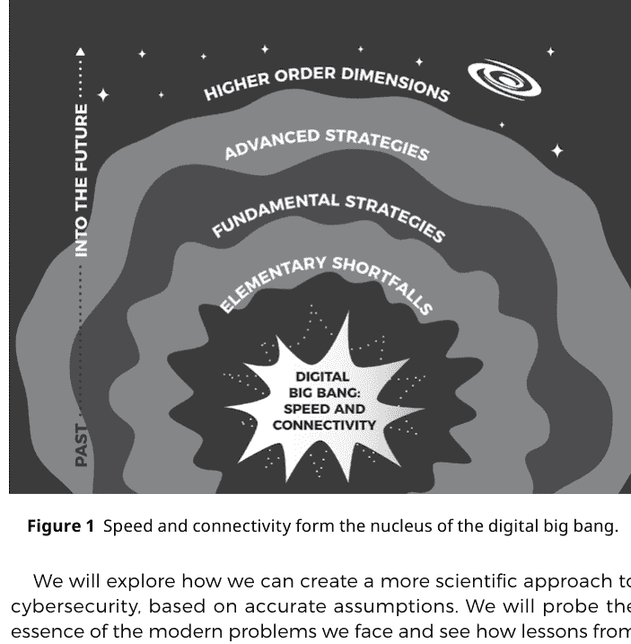
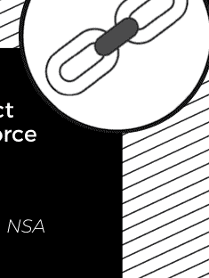

# 引言

> “网络安全最根本的力量是速度和连接。我们的解决方案必须支持并利用这些力量。”
> 
> Phil Quade，
> Fortinet

> “将网络安全视为一门科学，可以成为支撑创新的极其强大且有效的方式。”
> 
> Phil Quade，
> Fortinet

人类在未能认识到物理学和化学的基本原理时，会经历一些最重大的失望和灾难。在解决问题和改进技术时，我们必须顺应而非违背质量、力、能量和化学反应定律的基础——这些定律始于宇宙大爆炸。

与物理世界一样，网络安全也有其自身的一套基本原理：速度和连接。当组织忽视这些基本原理，被复杂的营销或新产品分散注意力时，我们就会承受后果。我们最终得到的解决方案要么只能解决部分问题，要么干脆失效（或在现实条件考验下让我们无法工作）。

这部分是因为，迄今为止，网络安全一直被视作开展业务的成本，而非一套可用来实现更伟大目标的基础原语和规则。要构建一个既能现在发挥作用，又能在速度呈指数级加快、连接更加紧密的世界中持续发挥作用的网络安全基础，我们必须开始更像对待科学一样对待网络安全。我们必须理解其基本要素以及它们如何相互作用。

早期的互联网始建于几十年前，目的是服务于一个小型、紧密且以学术为主的社区，其构建原则是颠覆性的速度和对于连接重要性的深刻理解。对于最初那一小群受信任的用户来说，安全和隐私并非必需，因此也不在最初的设计要求之列。尽管安全和隐私在当今飞速发展的全球网络中已显示出其重要性，但它们并未跟上互联网成熟的步伐。

虽然我们的连接程度比历史上任何时期都呈指数级增长，几乎可以指尖瞬间获取信息，但网络对手——而非防御者——才是掌握了速度和连接并将其转化为自身优势的一方。速度和连接作为通信构建模块为我们服务得很好，但在网络安全中却常常令我们失望，因为我们未能将网络安全的基础建立在这些基本要素之上。

在竞争激烈的商业环境中，网络安全基本原理不仅能保护你，让你不太可能成为恶意行为者的目标，而且还会为你所连接的所有个人和组织投射出保护光环。

当我们基于对基本要素及其协同方式的充分理解来构建网络安全时，我们就能激发并鼓励网络安全领域的科学革命和演进，从而让我们受益良多。

我们正处于对人类社会某个基本要素形成新认识的边缘。正如世界已经认识到，经济安全高度依赖于稳定的化石燃料供应，国家安全依赖于核武器的安全保障一样，今天我们认识到，在这个高度互联的世界中，如果不理解并掌握网络安全科学，就不存在全球安全。

# 数字大爆炸

+   - 人类的统一（人类政治组织逐步整合为一个全球帝国）
+   - 科学革命（约公元1500年，客观科学的出现）

在这些时代中的每一个，人类都在理解其环境方面取得了相对较大的飞跃，有时甚至直接塑造了环境。

# 数字大爆炸：数字宇宙的诞生

如果我们以网络安全史学家的思维方式来看待全局，就能以同样的方式观察并试图理解是什么在推动它前进。请思考以下几点：

+   - 虽然我们所知的物理世界花了数十亿年才创造并维持了人类生命，但自1969年互联网以ARPANet形式诞生以来，仅用了50年，数字速度和连接的爆炸性力量就改变了人类社会。
+   - 世界上有史以来创造的所有数据中，有90%是在过去两年中产生的。砰！
+   - 互联网本身——一个庞大且高度互联的数据传输系统——现在每天产生*2.5 百亿亿*比特的数据。我甚至找不到一个可以理解的类比来形容那到底有多少——但它有18个零。

数字技术已经渗透并推动着现代生活的几乎每一个方面，从让我们的城镇保持供电和运转的运营基础设施，到如今几乎完全由数字驱动的全球金融、安全和能源生产系统。数字信息的快速传递是我们连接、沟通，并且在许多方面维持人类生命、秩序以及地球上一种暂时和平表象的方式。

我们的机会在于描述数字大爆炸如何随时间演进，理解其重要意义，并对此采取明智且富有成效的行动。

## 科学革命

宇宙大爆炸之后，数十亿年过去了，人类才出现，并最终开始试图理解这一切。

在人类历史上，最近也是最重要的时代是科学革命，并非仅仅因为它取得的成就，而是因为它留下了什么。在科学革命中，我们终于承认我们并不了解一切。对无知的承认推动了知识和理性的追求。它使我们能够定义现代物理学和化学定律；以数据驱动的方式解释自然基本元素如何相互作用；并发现忽视这些定律的危险。它激励我们填补数据收集中的空白，而在此之前我们并不觉得有义务去填补。

例如，750 年前的世界地图上有精美的深海漩涡和海怪的绘画——此处有龙——中大陆山脉和其他自然现象。错误的思维，以及想要警告海上探索危险的愿望，导致制图者填补了他们所不知道的内容。

相比之下，科学时代的地图是用大片空白区域绘制的，显示我们没有数据的地方。直到我们承认我们实际上对地平线之外、深海或大陆之外几乎一无所知时，我们才开始探索这些区域并填补缺失的部分，从而对我们的世界有了更深入的理解。

对基本原理的好奇心减少了对未知的恐惧，并推动了物理世界的科学教育黄金时代。

现在我们必须在网络安全方面做出同样的飞跃。我们需要停止对真实和想象的网络威胁感到战栗，开始着手定义如何驾驭和掌握这些威胁。

## 大爆炸开始

作为国际合作的杰作，互联网的根源在于共享计算和信息资源的愿望，以及美国国防部在核攻击摧毁电话系统时通过计算机建立连接的目标。

1969 年 10 月 29 日，第一条信息通过后来成为互联网的网络发送。原本是要发送单词 "login"，字母 "L" 和 "O" 从 UCLA 的研究人员发送到斯坦福的一个团队。然后系统崩溃了。（我们暂停一下，让你对那次首次崩溃发笑。）

在构建和部署时，互联网作为一个通信平台服务于一个严格限制的特定用户群体。

随着分组交换的出现——将信息分割成较小的块进行传输然后重新组装，作为冷战策略的先驱——这种通信成为一种可行但极其有限的现实。

### 我们做对了什么

互联网先驱在速度和连接性方面做对了——数字大爆炸的等价物是物质和能量。他们的目标是一个安全、分布式、广泛的计算机通信系统，并且他们实现了这一目标。

### 我们做错了什么

由于数字信息传输在用户和数据方面都受到严格限制，ARPAnet 的使用受到了共享信任感的约束，这种信任感由安全许可、专业问责制和完全缺乏匿名性来提供信息和执行。

### 不合理的信任假设

有了这种信任假设，一切都偏离了轨道。这种假设阻碍了安全性的并行发展，特别是可信的身份验证，本可以支持使互联网具有变革性的速度和连接性。

随着 1992 年《科学和先进技术法案》的通过，研究和学术机构开始使用这种

不断演变的诈骗操纵收件人以进行大规模盗窃和勒索。从数据损坏到身份盗窃，从恶意软件到中间人攻击，网络安全必须缓解和预防的犯罪种类繁多，似乎只会越来越广。攻击不仅由罪犯发起，也由 rogue 国家发起。随着时间的推移，这些攻击变得更具破坏性，也更容易实施。

网络犯罪范围的扩大直接反映了我们不断扩大的全球攻击面——以及威胁日益商品化。个人和组织都必须抵御的数字犯罪进入门槛比以往任何时候都低。今天，购买一次网络攻击可以像买一杯咖啡一样容易，而且通常更便宜。我们必须抵御几乎持续不断的对我们社会结构进行的静默数字攻击，所有这些都在一个日益互联的世界表面下翻滚。

今天，网络安全与国家安全，甚至全球安全几乎没有区别。正如我们在报告的恶意网络活动中一次又一次看到的——通常在惊险的险些避免攻击的令人心寒的报告中——我们可以在最基础的层面上被几乎任何人、从任何地方触及。

### 我们现在可以做对什么

在如此多的利益相关之下，是时候从科学革命中借鉴一页了：

| 科学革命 | 网络安全科学革命 |
|---|---|
| 承认我们的无知（重绘地球地图）。 | 承认我们做错了什么（身份验证）。 |
| 使用不断增加的策略来成为我们物理领域的掌控者（航行海洋、飞行飞机、探索太空）。 | 实施不断增强的策略来成为网络领域的掌控者。 |
| 用好奇心取代恐惧。 | 用严谨的基本策略取代过时的假设和策略，这些策略可以构建到高级策略。 |

我们需要停止期望我们的网络运营商不断领先于日益复杂的攻击。你无法跑赢光速。

我们可以通过像物理学家和化学家一样思考来实现更好的网络安全，通过假设和概述掌握网络空间领域所需的定理和证明。尽管这些基础至关重要，但它们很容易被一个目光短浅地盯着近期的数字文化所忽视或遗忘，这种文化将短期收益置于长期稳定和可持续性之上。网络安全是一场马拉松——而不是短跑。

随着我们的连接不断扩展和加深，这些基础的强度和不可妥协性变得更加明显。也更加必要。

随着数字连接的指数级增长、网络物理接口（物联网）以及机器学习和人工智能的发展，网络安全比以往任何时候都更重要地被视为一门科学和业务使能者，而不仅仅是做生意的成本。

我们必须揭示基础科学原理与网络安全最佳实践之间的联系。哪些基础原语和规则本应在互联网初期就存在是有益的？如果它们当时就存在，事情会有什么不同？我们如何基于基本力的本质和准确的假设创造更好的网络安全形式？

将网络安全作为一门科学来拥抱，可以成为支撑创新的非常强大和有效的方式。它将使我们能够有效地利用互联网的速度和连接力，以及我们将在本书后面讨论的另一个不可改变的力量：人类的易错性和需求。

将网络安全变得更具科学性是一个大胆的目标，但在我们看来，只要有正确的愿景和工程，它是可以实现的。通过这样做，我们可以进一步延伸速度和连接的力量，在数字世界中蓬勃发展。与其在数十亿年后遭受宇宙大爆炸等价的、由我们太阳死亡导致的行星熔化之苦，不如让我们理解、定义并在网络安全科学的法则内工作。

## 数字核心

如前所述，网络安全最基本的力量是速度和连接性。我们的解决方案必须建立在支持和利用这些力量的基础上。

尽管安全历史上一直减慢速度，但没有速度的安全是注定失败的。同样，安全强度取决于链条中最薄弱的环节，因此安全必须使连接成为可能——具体来说，将你的防御整合起来以利用你的优势。这是一个远比常见替代方案更好的核心策略：期望你的最弱点优于对手的最强方法。要实现不仅最优而且基本可行的网络安全，我们必须拥有速度、连接性和集成的网络安全。

在接下来的页面中，我们将探讨必须塑造我们方法的速度和连接性的科学力量（见图 1）。我们必须展示如何利用和放大这些力量，通过网络安全提供更大的精确度来对抗威胁行为者和网络罪犯日益增长的复杂性。

图 1：速度和连接性构成了数字大爆炸的核心。

我们将探索如何基于准确的假设，创建一种更科学的网络安全方法。我们将探究我们所面临的现代问题的本质，看看科学世界的经验教训如何延伸到网络空间，从而让我们得出一些必然的、开拓思维的结论，关乎网络安全必须如何演进的根本性质与秩序。

本书分为多个部分。第一部分探讨速度与连接性的数字核心。

第二部分详细阐述了身份验证、补丁管理和培训领域的基础性不足，第三部分讨论了访问控制、密码学和分段等基本策略。

第四部分涵盖高级策略，包括可见性、检测和故障恢复，第五部分阐述了更高层次的维度

## 数字大爆炸

我们必须考虑这些维度，包括复杂性管理、隐私和人类脆弱性。

秉承互联网发明的精神，本书是一项协作成果。针对上述每个主题，我们将聆听当今网络安全领域跨行业、跨学科的一些顶尖专家的见解，他们汇聚一堂，分享各自的真知灼见。

我们将成功定义为：让安全领域的创新步伐超越对手不可避免的作恶企图。

我们希望，通过聚焦网络安全科学的基本和基础原理，本书将赋能那些战斗在一线的人们，在未来多年里取得更有效、更高效且更持续的胜利。

## 数字大爆炸

## 第 1 节

## 绑定策略：网络安全的核心

## 数字大爆炸

宇宙大爆炸与数字大爆炸之间的核心相似之处在于它们的起源。宇宙大爆炸释放了物质与能量这两大核心力量，将它们不可阻止地联系在一起，从而塑造并驱动了我们的整个存在。互联网的发明则利用技术创新，将速度与连接性——相当于物质与能量的数字大爆炸的核心力量——熔合为一种强大的通信手段，它有可能改变人类未来的命运。

因为速度和连接性是互联网的两大基本元素，所以利用它们的优势并管理其风险，必须成为任何有效安全策略的首要元素。

但网络安全常常与速度和连接性相悖。

### 对速度的需求

互联网创造了一种颠覆性的手段，提高了信息的流速和业务处理的速度——更快地发送数据，加速我们与他人连接和沟通的频率。还记得通过邮件寄送磁盘来传输数据的日子吗？从那些早期的学术用途开始，这种连接不断扩展。如今，这种连接涵盖了大规模商业和个人利益，包含我们最敏感的健康和财务信息，并横跨私营和公共部门。或者，我们可能仅仅为了娱乐而使用这种连接。

我们现在收发海量数据的速度令人震惊，而且每天都在加快。我们可以搜索冷门知识，几秒内获得答案；与世界各地的用户实时通信；只需轻轻一击即可购买商品。无论用途和应用场景如何，当今的数字数据传输系统在设计时都追求比当时任何其他方式更快，而且它们始终超越了这一目标。

但迄今为止，这种速度一直给防御者带来麻烦。防御系统常常消耗 CPU 周期，迫使通信变慢。一旦发生这种情况，用户往往会直接关闭安全功能，使网络及其数据暴露在攻击者面前。为了成功，我们的安全策略必须建立在利用“以互联网速度行事”这一核心哲学的基础上。

### 连接的驱动力

互联网的诞生证明了协作的力量。研究人员意识到，通过比较和整合彼此的努力，并访问远程计算资源，他们可以取得更具洞察力的成果。

由此产生的架构是围绕丰富而富有弹性的连接性设计的。随着互联网日益成熟，它满足了人们在速度与连接性方面的深层需求——组织性、经济性、物理性、心理性乃至情感性需求——这推动了其前所未有的普及。

但这种备受追捧的连接性也打开了攻击之门。攻击者很快意识到，他们可以利用连接性的优势，在不必接近实际目标的情况下达成恶意目的。如今，对手可以从多个地点发起攻击，将其多方面的火力集中在弱点上。这或许是网络安全的核心困境：如果你能与所有人连接，那么你也会被任何人触达。

防御者应采取同样的架构思路：设计利用连接性的安全方案。

### 驾驭速度与连接性

正如宇宙大爆炸的基本力量——能量和物质——必须谨慎管理才能达到预期结果一样，数字宇宙中的速度与连接性也必须如此。例如，一个分裂的原子可能产生以下两种结果之一：

- 炸毁并加热整座城市——通过核电站的清洁电力，在夏季制造冷气、冬季制造暖气
- 加热并炸毁整座城市——通过核武器产生火焰和冲击波

网络安全的实施必须足够高效，以便始终实现尽可能高的安全速度，以及最大程度的连接范围与覆盖面。

试图构建无法保持速度与连接性的网络安全解决方案注定失败，就像工程师试图无视

## 数字大爆炸

物理和化学定律一样。正如互联网的通信基础设施建立在快速通信机制互联互通的基础之上一样，支撑通信的安全架构也必须基于一套整合的安全策略。因为速度和连接性是互联网的两大基本元素，所以利用它们的优势并管理其风险，必须成为任何有效安全策略的首要元素。

## 速度

> “速度是网络前沿的核心。”
> 
> *Roland Cloutier,*
> *ADP*

> “更强大的连接性、更快的传输与处理速度以及机器算法，会带来更快且可能更准确的决策。”
> 
> *Scott Charney,*
> *Microsoft*

速度必须被当作基本要素来审视和对待。但安全本质上会让事情变慢。当你从事安全行业时，你根本就是在做让人慢下来的工作，而这是一份糟糕的工作。安全必须利用速度的力量来保护信息，同时以同样的速度防御网络攻击。

简而言之，所有网络安全都必须极其快速。没有速度的安全注定失败。事实上，缓慢的安全往往等于没有安全。好的安全策略必须基于利用速度，具体而言

- 实时检测和缓解攻击的原始速度
- 处理能力，即借助更多传感器、更多数据和更多洞察来更高效地解析数据，并发现系统功能中最微小的异常

## 数字大爆炸

- 前向兼容性，为实施可能涉及更快速度的未来解决方案预留空间

好的安全策略必须在尽可能不影响用户已经期待和要求的速度的前提下实现这些目标。这是因为，除了速度在操作层面的原因外，还有一个实际原因：用户不愿意等待。

用户的不耐烦与未将速度作为基本要素的网络安全技术相结合，产生了一个一致的后果：缓慢的安全解决方案会被关闭，要么是因为它们过于繁琐，要么是因为它们根本跟不上。缺乏速度因而被关闭的安全解决方案不会带来任何好处。因此，缓慢的网络安全技术造成的阻碍大于益处。

如果组织被迫采用无法满足快速数据传输需求和标准的工具，那么这些组织很可能不仅会变得不再安全，还会将这种不安全带到它们与其他组织共用的每一个连接点，危及到其他组织。

承认安全与速度之间的固有冲突，要求我们战略性地设计如何、何地以及何时放慢速度，同时尽可能保持并维持最大的速度与效率。

在网络安全领域，没有速度就一切皆无。然而，用户会拥抱以速度为核心组件的解决方案。

## 数字大爆炸

它就像一个活生生的、会呼吸的有机体，总是以各种方式思考、消耗和成长。首先，你所工作的环境并非一个受控且被管理的系统与软件架构，被封装在受保护的数据中心里，暴露面有限。从组织间数据平台的互联，到互联网的扩展组件，甚至通过引入自学习和决策软件，数字基础设施和运营都受到全球连接速度的影响。使这些场景更加复杂的是，人的因素不能被忘记。人类做出的决策和行动可以通过无数潜在的社会和物理互动，轻易且显著地改变你所保护的环境。

速度也是变化节奏中的一个关键要素。从纯粹的业务资产角度来看，技术通常以年为单位来衡量。然而如今，通过将先进技术用于犯罪目的，一些网络防御技术的实际有效性可能只有不到一年，在某些情况下甚至只有几天。威胁行为者的速度、你自身技术环境的速度以及你防御它的能力，完全取决于变化的速度。这种变化速度还包括我们决策速度的必要变化。在数字世界中，阻止、妨碍、中断和应对网络安全风险及影响隐私的事件等关键行动，迫使我们做出以往几十年从未需要过的快速而准确的决策。用于决策支持的数据采集和分析的新方法，是制定这些在数字时代取得成功的新战略的关键方面。

最后，速度是一个重要的财务杠杆。除了对获取时间、部署时间以及管理项目、计划和运营总运营成本的其他会计机制的正常成本考虑之外，现实情况是，下一代数字经济和您所保护的基础设施的速度将从根本上缩短您网络安全防御架构中任何特定技术或资本投资的使用寿命。在标准化的信息技术组合中，技术被合理地规划为三到五年的投资，并配有几十年来一直作为标准的折旧方案。然而，随着技术犯罪用途的发展，保护和防御技术的寿命已大大缩短。

### 第1章：速度

- 3. 提前规划。你的对手资金充足，拥有比你更快的决策能力和决策护栏。就像老式枪战一样，第一个把子弹射中目标的人获胜。这意味着你需要习惯于基于积累的知识而非绝对情况做出快速决策，并拥有预先制定的决策、行动和计划的“枪带”。例如，如果一起勒索软件事件的遏制程度低于x%，你是否会关闭数据中心？如果你正遭受金融犯罪攻击，你是否会联系执法部门？如果会，联系哪个机构？他们的电话号码是多少？诸如桌面推演或预先确定合作伙伴等简单努力，能显著增强你在危机时期快速反应的能力。由你的领导层预先同意并预设的决策，也能确保你的业务在需要时理解、支持并期待你采取明确行动并发挥领导力。

- 4. 着眼全局。你需要超视距威胁建模。我想每个人都会同意，看到一辆飞驰的火车向你驶来，总比被它碾过要好。不幸的是，太多人过于短视地只关注自己的运营环境，从不抬头足够久以看到轨道上驶来的火车。利用情报服务、信息共享伙伴关系，以及能让您窥见业务之外、相邻行业（如竞争对手或协同生态系统）的其他机制，是衡量和准备应对尚未影响您业务的潜在问题的绝佳方式。这大大增加了您准备、计划和对那些常常因孤立行为而错过的情境和机会做出反应的时间。

- 5. 充分利用有限资源。以有限的投资回报率（ROI）、无利润和较小的团队来管理业务，需要不同的方法。并非每个行业都具有核电站那样的任务关键性，或金融部门那样的财务资源，我们大多数人也不会有。但仅仅因为我们无法建立大型运营团队，并不意味着我们就没有可以让自己更加敏捷和适应的方法。例如，有时少即是多。通常，我们使用的许多服务并非持续使用，因此维护它们相关的成本或维护所需的技能被浪费了。为什么不考虑为这些服务提供第三方承包支持呢？这不仅仅限于有限的服务。如果有机会利用或运用供应商生态系统以较低成本提供核心服务，或者使用自动化和基于云的服务来维护运营中更现代、更易于管理的部分，为什么不考虑呢？有时，使用简化的功能而不是整个产品套件，能让你拥有应对最关键问题快速反应所必需的那些功能，同时保持对业务合理的损益（P&L）。

### 赛车的科学：加速、减速、急刹车，以及知道何时应用每一项

人类对速度的自然吸引力，从我们能够直立行走之时起就成为我们历史的一部分。无论是步行穿越陆地、乘船在水上航行，还是被动物拉着走，速度都是我们祖先生存计划、社会结构和持续求知探索的一部分。在现代，数十亿美元被花在几乎一切事物的赛车运动上。但速度与人类最复杂的结合之一，是人与汽车之间的结合。无论是为了在赛道上体验高速刺激的运动，还是穿越陆地的精彩公路赛车，或是作为我们生存的一部分——那些通过快速驾驶来保护和拯救生命的社会守护者，人们已经擅长快速驾驶汽车。

与任何其他事情一样，将车辆操控到超过正常速度需要科学、技能和方法论，而不能理解这一点通常会产生毁灭性的后果。例如，不了解在弯道的哪个点加速或刹车会导致车辆翻滚；不了解运动物体的动力会导致失控；不了解加速惯性延迟会导致你输掉比赛。

在网络安全领域，一位领导者要实现在速度面前保持高效的目标，也是如此。有工具、技能和科学可以创造一种有效的方法，使组织能够快速行动并防御不断变化的对手。许多要素可以帮助你实现这一目标，但以下是一些你从今天就可以开始使用的实用技能。

### 力量倍增的要素

数百年来，自有组织的军事学说出现以来，军方一直使用*力量倍增*这个术语。这个概念相对简单：将额外的资源应用于你共同的核心作战能力（人员），就能加速并扩展其效力。例如，为军队提供情报资源，其作战影响将大于获得该信息之前。为地面部队提供GPS定位能力，他们将比在拥有该技术之前使用相同数量的核心资源时更快、更准确。

作为数字基础设施领导层的从业者，你可以通过同样的力量倍增应用，使你的组织在战略上聚焦于对速度的需求。通过调整最影响你任务范围的速度要素，你可以增加一些杠杆来倍增你的资源能力。也许是情报、自动化或新技术。在某些情况下，可能是使用第三方或访问数据的能力。无论是什么，你都有机会通过简单应用资源要素、资源组合和资源对齐，来操控和加速你当前的能力以满足对速度的需求。

### 惯性

关于运动定律的书籍已经写了很多，通过对运动和速度的研究，科学取得了巨大进步。运动的基本定律仍然适用，“运动的物体保持运动”这一原则的真理是不可否认的。在速度、网络安全、领导力和你的工作的背景下，快速行动的能力始于基本的行动能力。在这个领域，惯性不利于能力和速度随时间增长。通常，由于资金有限、资源有限，或者只是想要一个100%完美的计划，我们等待太久才为组织配备能力。

## Test

测试你的流程，以确保它们满足你的任务所优先考虑的速度要求以及你的运行环境所要求的速度要求。在它们接受测试之前，理论只是理论。除非你测试、拉伸并确保你适应和响应的能力，否则你将基于错误的期望进行运作，而这永远不会有好的结果。

## Accelerate

逐步增加能力以推动加速。也许是数据收集中使用自动化，或使用自动化分析来处理这些数据。也许是舍弃旧技术、项目或服务，这些都不在你的优先清单中，从而使你能够更快行动。不管是什么，首先要理解你做出改变的原因，然后制定衡量标准以确保改变是有意义且有效的。最后，对自己和你的组织保持问责，以维持这种新能力。

## Validate

验证是将一切整合的艺术。一旦你的组织接受了教育、配备了仪器并准备好以高速运行，就该验证它了。没有什么比进行问题、事件、决策或你业务或机构中几乎任何事情的桌面演练（TTXs）更能阻止潜在灾难实时发生。事实上，这些不仅是很好的学习和调整机会，也是不可思议的团队建设练习。知道我可以信任自己的技能以及与我共事者的技能，会带来巨大的信心，这反过来又帮助我们更快地运行、行动和执行。

## Repeat

在这个新的数字商业生态系统中，没有任何东西是静止的。“自满致死”是军事和执法人员接受的第一课之一。如果你的情况在变化，但你的工具、技术、实践和能力没有变化，你将在任何战斗中处于失败的一方。通过实施生命周期方法来审查和改进你向成为以速度为基础的组织的适应，从而避免自满。

## OPERATING LIMITS FOR YOURSELF AND OTHERS

所有这些都不是在真空中发生的。你应用这些原则、在速度使能环境中运作并在下一代数字生态系统中提供服务的能力取决于人。你和你的业务成长的一部分将是了解人们的优势和弱点，以及他们随着时间的推移执行和适应的能力。如果速度没有作为你战略的约束性组成部分而整合，就没有速度的位置，因为一个没有深思熟虑、有目的且计划周密的方法就尝试这样做的组织将会失败。

最后，将你在网络安全运营中的成功建立在对速度的有利应用之上，即你思考、理解、规划和执行的方式，以应对你周围的数字世界。

## ABOUT THE CONTRIBUTOR

Roland Cloutier – SVP and CISO, ADP

作为 ADP 的员工高级副总裁兼首席安全官（CSO），Roland Cloutier 将全球保护和安全领导的理解和知识带到了世界领先的人力资本管理解决方案提供商之一。Cloutier 在军事、执法和商业领域拥有超过 25 年的经验，是企业和企业安全、网络防御项目开发和业务运营保护的领先专家。在 ADP，Cloutier 对网络安全、信息保护、风险、员工保护、危机管理和全球调查安全运营负有职能和运营责任。

在加入 ADP 之前，Cloutier 担任 EMC 的副总裁兼 CSO，领导其全球业务运营的保护，包括在商业和政府部门领导所有信息、业务风险、危机管理和调查安全运营。他曾担任 AimNet Solutions 的网络安全副总裁。他在军事和联邦执法领域拥有超过 14 年的经验，涉及全球航空航天保护、欺诈和转移调查以及特殊活动保护，包括在亚特兰大 1996 年夏季奥运会的任职。

## IS SPEED AN ADVANTAGE?

### IT DEPENDS ON THE CONTEXT

> *Scott Charney, Microsoft*

一句老话警告说：“犹豫不决就会失败。”换句话说，速度至关重要。事实上，速度通常被视为积极的，暗示着从令人兴奋（快车）到竞争优势（更快的股票交易）再到更高效率（飞机优于公共汽车）的一切。是的，可能存在缺点（“欲速则不达”），但我们向前冲。

在信息技术中，速度通常与提高生产力同义。摩尔定律指出，密集集成电路中的晶体管数量大约每两年翻一番，使我们能够在更短的时间内处理更多数据。更快的传输速度，从光纤到 5G，使我们能够在更短的时间内访问更大的数据集。机器学习和人工智能使我们能够利用这些其他技术，并承诺做出更好且更快的决策。

虽然这描绘了一幅美好的图景，但关于速度的另一句老话会让人联想到风险。虽然“犹豫不决就会失败”可能是真的，但我们经常被告诫要“跳之前先看”。也就是说，我们在做决定时需要放慢脚步并更加谨慎。

那么，我们是否真的应该跳之前先看，即使犹豫不决的人会失败呢？哪句传统智慧是正确的？显然，迅速拥抱新技术可以带来巨大的好处，即使同时必须管理新的风险。但速度会引起警惕吗？

哪句谚语正确取决于上下文，在这方面，考虑三个不同但简化的场景可能会有所帮助。第一个涉及信用申请，其中旧流程通过现代化变得更高效；第二个涉及通过引入自动驾驶汽车解锁新的变革性能力；第三个涉及国际事务和自主致命武器的潜在使用。

### CONTEXT: CREDIT APPLICATIONS

在金融交易和信用卡发放领域，我们曾经要求人类收集和分析数据集，然后对是否授予信用做出二元决策。其中两个任务——收集和分析数据——可能相对耗时且劳动密集，即使实际的信用决策相对较快。在后计算机化世界中，该流程可能更加彻底（涉及更多数据），发生得更快，并且可能全部由机器完成。简单来说，更大的连接性、更快的传输和处理速度以及机器算法简化了流程，导致决策更快、可能更准确且成本更低。是的，这种方法存在挑战，从隐私问题到有偏见的数据集再到有缺陷的算法，但通过适当的控制和监督，风险是可控的。

不仅仅是提高交易处理速度，收集、分析和采取行动数据的速度也可能保护消费者和银行。例如，通过更快地分析支出模式，银行可以更快地检测异常交易并提醒消费者潜在的欺诈。更有趣的是，银行本身受益于新的计算机安全保护，特别是当它们采用基于云的服务时。原因很简单：在云中，我们可以利用新的安全能力，将安全响应时间缩短，使其更接近恶意软件传播的速度。这最好通过示例来解释。网络防御者长期强调信息共享的重要性。以金融服务信息共享和分析中心（FS-ISAC）为例，如果银行 A 看到一次攻击，它会通知 ISAC。ISAC 会通知其他银行，然后他们会在自己的网络上寻找入侵指标。其他部门也有 ISAC。

虽然这种模式运作良好，但它存在挑战。首先，它需要信息共享，在某些部门运作良好，但在其他部门则不然。其次，信息分发和分析可能需要时间。第三，信息可能不会流向所有参与者（例如，在金融部门的情况下，较小的银行可能参与度较低）。相比之下，随着银行转向云，响应速度可以大幅提高。例如，Microsoft 的高级威胁保护会从电子邮件中剥离附件并运行

## 数字大爆炸

them in detonation chambers, and looks for malware. If found, that malware can be searched for throughout the cloud. This means if Bank A is attacked, all other banks—and other customers outside the financial sector—can quickly be protected from that attack. Simply put, protections can be broadly deployed to more entities without information-sharing delays. Moreover, as more customers move to the cloud, the amount of telemetry increases and protections improve. Thus, in the context of these financial transactions, speed provides significant benefits.

### CONTEXT: AUTONOMOUS VEHICLES

Autonomous vehicles, which have started cruising the streets of major cities, offer a long list of benefits, including safer streets, more efficient use of vehicles leading to less congestion, increased mobility for seniors, and more. Data collection and analysis speeds are again critical, especially as vehicles analyze data on roads crowded with other cars, bikes, pedestrians, and traffic lights. It is also important that such technologies leverage the cloud (where data from multiple sources can be stored and analyzed) but also make “local” decisions without the latency caused by transmitting data to and from the cloud (this is called the “intelligent cloud/intelligent edge” model).

At the same time, we will be presented with new risks as the technology matures and perhaps comes under attack. Indeed, as of December 17, 2018, the California Department of Motor Vehicles had received 124 Autonomous Vehicle Collision Reports, and there have been reports of researchers hacking automated vehicles. Still, while autonomous vehicles may not be completely “safe,” they will, if correctly designed, undoubtedly be “safer”: Autonomous vehicles can process data far more quickly than humans, they will not panic in an emergency situation, and they are unlikely to be distracted by cell phones.

### CONTEXT: AUTONOMOUS LETHAL WEAPONS

It is in the third scenario, international relations and autonomous lethal weapons, that speed may pose risks to humanity itself. That is a dramatic statement to be sure, but one that is not alarmist when the future of technology is considered in a military context.

The problem is that human times from days to minutes. Since then, the introduction of cyberwarfare capabilities has arguably reduced response times further. As General Joseph Dunford, the outgoing Chairman of the Joint Chiefs of Staff, noted in 2017, “The speed of war has changed, and the nature of these changes makes the global security environment even more unpredictable, dangerous, and unforgiving. Decision space has collapsed and so our processes must adapt to keep pace with the speed of war [emphasis added].” To take advantage of the remaining decision space, Dunford noted, there must be “a common understanding of the threat, providing a clear understanding of the capabilities and limitations of the joint force, and then establishing a framework that enables senior leaders to make decisions in a timely manner.” This suggests the need for greater pre-decisional planning, from collecting better intelligence about adversaries’ capabilities and intentions to better scenario planning so that decisions can be made more quickly.

At the same time that we attempt to adapt, we must also grapple with a fundamental question: As the need for speed increases, will humans delegate decision making—even in lethal situations—to machines? That humans will remain in the loop is not a foregone conclusion. With the creation of autonomous lethal weapons, some countries have announced new policies requiring a “human-in-the-loop” (see Department of Defense Directive Number 3000.09, November 12, 2012). Additionally, concerned individuals and organizations are leading calls for international treaties limiting such weapons (see https://autonomousweapons.org/). But as we have seen with cybersecurity norms, gaining widespread international agreement can be difficult, particularly when technology is new and countries do not want to quickly, and perhaps prematurely, limit their future activities. And as we have seen recently with chemical weapons, ensuring compliance even with agreed-upon rules can be challenging.

## 2
CONNECTIVITY

> “The convenience of IoT devices comes at a cost: a vastly expanded attack surface.”
> 
> Brian Talbert,
> Alaska Airlines

> “The drive to connect is an unstoppable force within cyberspace.”
> 
> Chris Inglis,
> Former Deputy Director, NSA

Enabling and protecting safe connectivity is the core mission of cybersecurity. At its most basic definition, cybersecurity is about allowing or denying access to information. That is how information is protected. And while the extraordinary adoption of the Internet may certainly have been powered by recognition of the incredible benefits of connectivity, it comes with risk.

The triumph of collaboration and connectivity coded into the core of the Internet has been manipulated to attack it. As the connectivity of the early Internet broadened—and with it, new targets—so too did the breadth and depth of the attacks. Every cyberattacker has at least one substantial advantage. As Sun Tzu succinctly stated in The Art of War, “In conflict, direct confrontation will lead to engagement and surprise will lead to victory.” Threat actors can choose when and where to strike.

## THE DIGITAL BIG BANG

When they do attack, they strike from multiple places, focusing their multifaceted approaches on your points of weakness—discovered through relentless attempts to breach the infrastructure that houses whatever data is most valuable for their own intent.

Each attacker may learn from other attacks about what worked, what didn’t, and where the valuable data resides. This is one reason attackers often hold an advantage over defenders.

An integrated defense—a staple of high-end security strategies in all other areas and fields of protection—is an often-neglected cybersecurity fundamental. Too many point solutions offer insufficient defenses that leave the network vulnerable once penetrated. Maginot Line–style defenses, no matter how sophisticated, that focus only on keeping attackers out of the network are doomed to fail just as their namesake failed in 1940—only much, much faster.

The necessity of connectivity mirrors the importance of speed in cybersecurity: Less integration creates more vulnerabilities. For effective cybersecurity, defenders should take the same integrated approach as the architects of the early Internet did (and the attackers who soon followed). The architecture that underpins security must match the cooperative fabric of flexible integration mechanisms of the Internet as a whole. Cybersecurity architects must design security that leverages the connectivity of all defensive components. By leveraging the connectivity among defensive components, defenders can field an entire team of security players from within and beyond their organizations.

Just as security must utilize and enable speed, it must also have and empower strong connectivity.

With properly designed security, defenders can achieve the core mission of cybersecurity: Enabling and protecting safe connectivity and allowing or denying access to information. Defenders who adopt such an integrated defense will gain an advantage.

## MANAGING THE INTENSIFYING CONNECTIVITY OF THE IOT ERA

Brian Talbert, Alaska Airlines

Over the past several years, the reach, scale, and depth of digital connectivity has intensified so dramatically that it has fundamentally changed our conceptions and definitions of what being connected even means.

While many outside the fields of security and information technology still talk of greater levels of digital connection in the context of human beings communicating with one another, chief information security officer (CISOs) and their teams understand that that is merely a small, visible ripple on the very surface of today's hyperconnected world. Things and machines connecting with each other is the bigger picture of connectivity—which gets exponentially bigger each day and now borders on the immeasurable and the unimaginable. And, as many IT teams can attest, it is also increasingly unmanageable—at least by people alone, anyway.

That's because, as the Internet of Things (IoT) grows, the majority of connectivity today occurs between devices. With aims of greater efficiency, cost savings, and convenience, everything from cameras to lightbulbs to household appliances is being augmented with digital capabilities, allowing these things to connect to the Internet and to each other to share relevant information.

It is a level of new-normal functionality that creates a momentum powered by consumer demand: As more smart devices are manufactured, more people come to expect a new device to have that capability. And more companies scramble to enhance their product lines with technology—whether or not they have experience with it.

Today, the IoT comprises more than 8.4 billion devices—with a projection of 20.4 billion deployed by 2020.

What consumers and manufacturers often don't realize, though, is that the convenience of IoT devices comes at a cost. And that cost is a significant one: A vastly expanded attack surface comprising millions of devices with minimal security—manufactured by companies with little experience in securing digital technology.

## 数字大爆炸

许多物联网设备可以轻易被入侵以获取网络访问权限，或者它们可以被串联起来，形成一股规模巨大的攻击力量。再加上用于管理这些设备的云服务，最终呈现出的脆弱性水平极易遭受攻击。由于设备本身的安全性极低，这种攻击可能具有惊人的破坏力，而且几乎不需要什么专业技能。你不需要成为土木工程师就能推倒多米诺骨牌，同样，你也不需要成为网络犯罪大师就能将物联网变成僵尸网络。

以Mirai僵尸网络为例。2016年10月，一场大规模的拒绝服务攻击导致美国东海岸大部分地区无法访问互联网。这次攻击规模之大、破坏性之强——每秒1.1 TB数据的数字海啸——以至于当局起初怀疑这是某个流氓国家或敌对国家发动的战争行为。结果却发现只是几个具备新手级黑客技能的大学生，为了在《我的世界》游戏中获得更大的竞争优势而为之。

这足以说明当今互联格局的规模、威力和风险。

Mirai通过扫描开放端口，然后用几行代码循环尝试61个常见的未更改默认密码来控制设备，从而利用了物联网设备的联合力量——特别是路由器、摄像头、DVR和打印机。在最初的20小时内，它捕获了65,000台设备——每76分钟数量翻一番，最终感染峰值为30万台。总共有164个国家受到影响。

随着物联网的不断普及，IT团队现在面临着组织内部两个主要的连接性挑战。他们必须应对终端用户带来的设备，比如有人放在办公桌上的联网音箱。同时，他们也必须保护摄像头、办公设备和设施设备等商业用途的设备的安防。

尽管这是一项巨大的挑战，但IT团队必须认识到，在大多数情况下，人们并非故意无视安全性来使用这些设备。这是一项新技术，人们只是不知道它会带来哪些风险。然而，无论意图如何，IT部门都必须将每台设备视为不可信，直到其经过验证。

这些结果引发了极其复杂且规模惊人的问题。在物联网中，随着攻击面不断扩大，其边界也变得越来越模糊。当数千台设备都能接入网络时，很难辨别网络的起点和终点——而且这也使得任何能够突破设备有限安全防护的人都能将其作为访问网络的入口。

不幸的是，在这样一个复杂且不断扩展的环境中，许多组织根本缺乏所需的可见性。因此，他们不知道自己不知道什么，更不用说如何保护他们所能检测到的一切了。

随着这一新现实的加剧，将对更好的可见性工具、网络访问控制以及更强的威胁检测、预测和响应能力产生迫切需求。但即使有了所有这些重要的防御措施，也仍然不够。物联网过于庞大，仅靠人力无法管理和缓解。

随着规模扩大和脆弱性变得更加复杂，标准的人工安全运营中心或威胁防御响应人员将不再是可行的第一道防线。成功将取决于更深入的机器智能和自动化。话虽如此，投资技术只是解决方案的一小部分——即便如此，也需要对网络和更广泛的互联格局有深刻的洞察和理解，才能设计出合适的模型。

为了创建可扩展且可持续的解决方案，重要的是认识到这些问题是组织层面的，而非个人或团队层面的。在设计安全策略之前，高管领导层需要充分理解通过跨职能、跨部门的项目系统性解决问题的重要性。

这个项目必须包括良好的安全策略和架构审查流程。但它也必须应对这样一个新现实：软件工程师和应用程序开发人员不能再假设他们构建在天然安全且私密的基础网络之上。安全编码实践必须深深植根于开发理念、流程和部署管道中，以至于它们自然成为开发人员日常实践的一部分。这里的门槛很高，这些人员必须从用户认证到数据混淆和安全数据传输都了然于胸。组织将很快发现需要开发可重复的模式，并配以一致、标准化和可复用的安全代码库。

简而言之，应对连接性挑战将需要整个组织更深层次的合作与协作，以便利用所获得的洞察力来战略性地管理和缓解物联网时代日益增强的连接性。

## 关于撰稿人

Brian Talbert——阿拉斯加航空公司网络与连接解决方案总监

Brian Talbert领导阿拉斯加航空公司的网络与安全工程部门。Brian负责战略方向和平台开发，以保护每年运载3300万名乘客飞往超过115个目的地的关键基础设施。在加入阿拉斯加航空公司之前的20年里，Brian曾供职于领先的服务提供商和企业，构建推动信息安全技术的解决方案和组织。

## 网络空间：理清头绪

Chris Inglis，前美国国家安全局副局长

“网络”这个词在多种语言和文化中得到了广泛使用，很少有词能与之相比。它既可作为名词也可作为形容词，用五个字母（英文cyber）传达了比任何语言中绝大多数对应词汇更多的含义。正是由于这个词的多种用法，许多涉及“网络”的讨论在人类沟通这一最基本目标上就失败了，即无法确保参与者在试图沟通时理解相同或意指相同的事物。

为此，本节将奠定一个基础，帮助理解“网络”作为一个实体空间——以下称为网络空间——的基本要素。值得注意的是，“网络空间”一词包括但不限于通常统称为互联网的硬件、软件和互连的总和。

科学革命中具有好奇心的先驱者们所做出的最重要的事情之一，就是从智力上，有时甚至是字面上，将一个常见的事物——一片叶子、一个寄生虫、一处山坡——拆解开，以便更好地理解它由什么构成以及各部分如何连接，试图理解每一层如何运作并帮助支配整体。

## 将网络空间视为一个领域的理由

一些作者认为网络空间不是一个领域，因为它是人造的，因此缺乏由自然法则、时间和空间的不变性所决定的领域中固有的持久且不变的属性。将网络空间视为一个领域的理由基于一个简单的事实：总体而言，它拥有独特的属性，只有将网络本身作为一个事物来研究，才能理解或有目的地改变这些属性。它是一个集成了多种技术和人类行动的中心点，同时也是一种资源，促进广泛的协作与整合。

## 拆解网络空间的组成部分

在任何原本礼貌的对话中提到“网络空间”这个词，听众脑海中会立刻浮现出一团乱麻：技术、线缆、人和通信跨越时空奔涌，或存储在庞大的存储设备阵列中。由此产生的技术、人员和流程交织成的混乱局面呈现出一种如此复杂且毫无特色的景观，以至于在对话的语境中，进一步使用“网络”这个词可能意味着任何东西，而且往往确实如此。因此，有必要拆解网络空间的各个组成部分，描述它们的特点、它们对整体效果的作用以及它们彼此之间的关系。这反过来将产生一个分类法或路线图，使得能够针对网络空间的离散方面进行集中讨论，并在整体背景下加以考量。

本节尝试在语境中描述网络空间的以下几个离散方面：物理地理、通信路径、控制逻辑与存储、设备以及人员。需要指出的是，网络空间实际上并不是按照这种方式构建的，正如人类不会按照《格雷氏解剖学》中列出的分类法从胚胎成长为成人一样。但这里的目标是理解网络空间的独特特征以及它在各种情景下可能如何运作，而不是描述如何重新构建它。

## 两端的边界：地理与人员

与任何领域一样，网络空间夹在承载它的地球和使用它的人们之间。鉴于人类对这两者——即地理和人员——的长期经验，这一事实既是慰藉之源，也是烦恼之由。要明白为什么，我们只需逐一考虑这两者。

### 地理层

人类对地理的知识常常有助于理解事物如何从一个地方移动到另一个地方，以及各项活动的管辖权如何分布在广袤的地理区域。哪个学童没有背过这样的格言：

# 数字大爆炸

两点之间最短的距离是一条直线？尽管这个想法令人安心，但网络空间对这条规则只有模糊的认知，认为盲目地仅根据物理距离在全球范围内路由通信是低效的。举例来说，在美国工作日的中段，从纽约发送到旧金山的电子邮件将与金融交易和转账、承运商和供应商之间的后勤协调、个人通信，甚至最新的 YouTube 当红猫咪弹钢琴热潮等庞大流量竞争带宽，并且可能从纽约经由其他国家发送到旧金山。

运行在控制网络空间存储设备和路径的数百万台计算机上的软件不断感知各种路由的状态，有时将通信绕地球发送，沿着利用率低的路径传输，以便在最短时间内到达仅相隔数英里的目的地。 不理解指导网络空间路由的非正式但有影响力的规则意味着用户可能会永远对通信所走的路径以及它们在被所有者访问之前存储时实际位于何处感到惊讶。 在大多数情况下，这种违反直觉的现象代表了用户偏好的功能，因为路由和存储的细节会自动处理，而无需用户掌握和指导技术的复杂方面、通信路线和流量。 但对于那些认为自己的数据因存储或路由在完全在其视野范围内的技术和路线中而免受窥探或其他风险的用户来说，弊端是显而易见的。

地理层方面的经验也影响了对谁负责什么的认知。 网络空间无法忽视这样一个现实：规范人类事务的法律、政策和条约几乎总是与地理相关。 当试图弄清哪些法律适用于跨国共享的财产时，这种现实变得尤其具有挑战性，或者更重要的是，当一项活动在毫秒内跨越时空，随后几秒钟后又走不同的路线时，管辖权属于何处。

一个案例有助于说明这一挑战。 如果 A 国（例如虚构的英吉利斯国）的一名人员入侵 B 国（虚构的夸德兰国）的计算机，并利用该被入侵机器攻击第三国（美国）的计算机，那么哪些法律和财产权适用？ 受害者能否伸手攻击昆士兰的机器以进行反击？ 如果可以，美国法律还是昆士兰法律适用？ 如果受害者是第四国的居民怎么办？ 这样一来，基于地理的规则很快就会失效，需要一个允许用户跨国工作的模型，该模型必须满足隐私、尽职调查以及各种司法管辖区法律所体现的其他用户期望的最高共同标准。 网络空间的管辖权问题现在才与网络空间的物理（基于地理）和实际（它实际如何运作）现实相协调。

## 人群层

顶层反映了人们是网络空间不可或缺组成部分这一事实。 事实上，正是人们（而非技术）解释了网络空间动态、不断变化的本质，因为用户以偏离甚至违背组件、软件和系统设计者期望的方式使用其各种功能。

在讨论的模型中，这一层有几个重要的含义。 首先，虽然宪法、法律和政策通常根据公民身份或实际位置分配人们的权利，但网络空间根据在网络空间中形成和验证的身份分配访问权限和特权。 旧笑话中一只狗对另一只狗说“在互联网上，没人知道你是一条狗”在该领域的广大范围内仍然比不更真实。 尽管一个人的身份在物理世界和虚拟世界之间通常会得到协调，但在访问网络空间中的资源和通过网络空间访问资源时，网络空间规则在特权确定方面占主导地位。 这一现实使得将物理世界中定义的法律应用于其网络双胞胎变得具有挑战性，尤其是在网络空间中的身份被伪造或由于用户使用旨在隐藏其身份的应用（有时称为“匿名”功能）而无法确定时。 这并不是说物理世界中定义的区分不重要，或在网络空间中没有管辖权，而只是说在网络空间当前能力下识别用户或分配归属往往困难，有时甚至不可能。 这种困难对于任何希望在网络空间中归因于行动以便识别谁采取了特定行动并将其作为给予相应奖励或后果的基础的愿望具有重大影响。

## 电路层

模型的电路层描绘了通信在网络空间内从一个地方到另一个地方所走的实际路径。 与展开模型的地理和人群层一起，这一层代表了曾经被称为电信领域的总和。

在计算机、复杂软件和无处不在的无线设备推动当今互联网出现之前，电信领域为给定通信在地球上遥远的范围内发送和接收提供了一种简单可靠的手段。 在那个时代，通信的流动仍由人类直接手动控制。 一个人会通过拨打电话、传真消息或按键启动通信来实际选择消息何时、如何发送。 然后通信将沿着通常的直线，通常是专用路径（或链路）从一个位置流向其目的地，并立即被另一端的预期接收者接收。 实际上，通信将从一个位置手动推送到另一个位置，并且只有在传输期间才有被第三方泄露的风险。 在传输之前和之后，通信将驻留在某种圣地： 在一个人的脑海中，在抽屉里，或如果需要，在保险箱中。

随着互联网开始使用这些相同的通信方法传播，并且传输、存储和向世界各地通信者展示的手段在种类、范围和规模上呈指数级增长，电信领域在几个重要方面发生了转变。

首先，关于通信何时以及如何流经两个通信者之间的空间的决策被委托给越来越多地嵌入通信和存储设备中的计算机。

其次，通信被*存储*以供预期接收者稍后检索，或作为发送者的“网络上”资源供使用。 一些读者可能记得电子邮件的最初新颖之处不在于它连接了相距甚远的两个人，而在于它允许人们在双方不必同时“在线”的情况下进行通信。 通信只需等待预期接收者请求访问存储的通信——如果需要，可以永远等待。

最后，通信的丰富性稳步增加，以至于给定的通信开始代表的不仅仅是域外持有的思想或价值观的简单反映。 通信，无论在传输中还是存储，都开始本身具有价值，通常作为思想、财富和宝藏的独特代表。 金融转账、现金账户、公司机密和图片现在都存储在网络空间中，*通常在物理世界中没有备份*。 彩色纸张矩形、印刷股票证书和存折作为代表金融资产的主要手段的时代已经一去不复返了（很可能在 1970 年代广泛使用的术语*存折*对此后出生的人来说完全未知）。 存折已被网络空间中单独存储、交易、赚取和丢失的零和一所取代。

## 控制逻辑层

控制逻辑层代表了嵌入在构成网络空间物理基础设施的数十亿设备、计算机和其他智能组件中的逻辑。 虽然这种逻辑的传播和无处不在的存在使得不可能字面地观察到这一层的物理表现，但其影响并不因此而变得不真实，而且更重要的是，对于理解网络空间基本属性的行为至关重要。 事实上，网络空间在路由、存储、关联和重新路由日益庞大和复杂的海量信息流方面的非凡效率几乎完全取决于将这些任务委托给嵌入在这一层中的逻辑。

## 数字大爆炸

这一层使计算机无需人工干预即可相互交互，因为它们在数十亿通过网络空间相互连接的人类和机器用户之间维持连贯有序互动所需的众多选择中做出决策。其结果催生了越来越多被称为物联网（IoT）的现象：机器与机器交互，所有机器都被编程为预测并超越那些极少直接参与、甚至不了解其中所涉及技术复杂性的人们的期望。

## 设备层

设备层使这一模型变得完整。这也许是网络空间中最显而易见的组成部分，因为设备将用户连接到网络空间内部及来自网络空间所提供的服务。这些设备包括个人计算设备、智能手机、台式机、平板电脑和导航设备——这是一个日益增长的、由硬件、软件和无处不在的应用组成的多样化组合。它们的作用是根据用户的偏好和设计者的规格来捕获、呈现和处理信息。重要的是，这两种影响中的后者并非总是显而易见，因为这些设备捕获和传输的信息远超通信本身，以便更好地实现其所有者委托给它们的数据的路由、存储和恢复（例如所谓的元数据，其中包括路由信息以及地理位置、所使用的操作系统和系统软件规格等属性）。

随着这些设备变得越来越移动化（无论设备或使用者身处何处，都能让使用它们的人保持与网络空间及其各种服务的连接），曾经将设备与人员或位置联系起来的简单任务已经变得复杂得多。随之而来的服务提供商收费方式基础经济模式的变化，使得用户和设备获得了更大的灵活性：按次和基于位置的收费被统一资费套餐取代，后者只是简单地让用户付费，即可接入全球任何地方的通信服务。过去根据设备物理位置来确定隐私规则或财产权地位的法律制度，现在必须厘清数据、设备与人员之间的复杂协调关系——这些数据、设备和人员可能正活跃地在网络空间的各个角落和维度上来回移动、上下起伏。结果非常像一个活的有机体，其特性和范围每时每刻都在变化，使任何静态定义其特征或属性的尝试都无法成立。这一点具有重大的安全意义，因为连接的不断建立和断开，加上软件、硬件和用户行为不可阻挡的变革，使得保卫网络空间简直就是在防守一个移动的目标。因此，用视频作比喻比用静态照片更能真实地刻画这一结果。换句话说，必须考虑各层之间动态且不断变化的交互，才能理解——更重要的是预测——行动中网络空间的真实本质。

## 影响

从整体上看，该模型提供了一种理解由各组成部分相互作用所产生的属性的途径。四个关键属性立刻凸显出来：

## 不仅仅是技术

尽管将网络空间仅仅视为技术颇具诱惑力，但若不考虑人、地理以及与之相关的政策和实践的影响，就不可能理解、预测或有意义地影响其运作。

## 以融合为特征

网络空间的特点是人、技术和数据以指数级规模大规模融合。该模型表明，这种融合既发生在任何一个层面上，也发生在所有层面之间。更重要的是，当你连接到网络空间时，可以理解为整个网络空间都连接到了你。安全专业人员致力于减少或减轻不必要的连接，但连接的动力是网络空间中不可阻挡的力量。这导致“物联网”一词被越来越多地用来描述一种看似不可阻挡的“万物互联”趋势——冰箱、汽车、发电厂等等——全部连接到网络空间，在网络空间之中并通过网络空间彼此相连。因此，系统设计者和用户关于是否连接以及如何连接的选择，必须出于对融合影响的预先考量，而不是采取“等我遇到问题再解决”的方式（用户一旦接入就会遇到那个问题）。此外，如前所述，在一个基于物理位置适用不同规则的世界里，融合与地理并不容易调和。网络空间将需要跨越这些界限进行协作和规范化，尽管那些基于地理行使管辖权的一方如果能明确说明本地预期的行为和后果，将是为跨地区协调做出的宝贵的第一步。

## 财富、宝藏与更多

网络空间实际上包含着——而不仅仅是提及或协调管理着——财富和宝藏。鉴于网络空间在协调人与系统的愿望和行动方面所提供的巨大效率，它正越来越多地被用来协调和执行关键系统的核心功能，从发电到金融市场，再到外交、协作，甚至战争的进行。正如美国海军学院网络中心的马克·哈格罗特博士所指出的那样，人类事务正在发生一场变革：即使是物理空间中的感知、思考和行动，也越来越多地被委托给服务于人类事业的、遍布网络空间各个角落的硬件和软件网络。人类希望对结果施加理性控制的自然愿望，只有在我们超越制定关于技术的规则、进而为人员、技术和系统之间的互动制定更广泛的治理规则（同时考虑植根于地理的规则和政策）时，才能实现。

## 不断变化，永不安全

在过去50年的硅革命中，技术在极大提升处理能力、带宽和用户体验方面所取得的惊人成就，被广泛理解为时代的标志性象征（有时被称为硬件领域的摩尔定律，但在软件、可视化和协作方面也有指数级的进步，它们共同推动网络空间能力迈向新高度）。但较少被认识到的是，功能、能力和行为的变化，由一支庞大的企业家队伍自下而上地驱动，其力量不亚于甚至超过自上而下的推动。这种推动加上用户行为和软件的不同步变化（软件往往滞后于或先于硬件变化），使得几乎不可能定义并强加一套全面而持久的描述来说明网络空间中的事物如何表现，更不用说如何运作了。对于那些期待心仪技术提供商推出下一个奇迹的人来说，这完全可以被视为一种特性；但同样的属性也使得保卫网络空间内所持有的财富和宝藏、以及依赖网络空间韧性和完整性的关键系统和流程，几乎变成一场“追着自己的尾巴”的游戏。每一次技术、软件或用户行为的变化，都预示着覆盖整体的安全架构可能出现裂痕。这种不可阻挡且不同步的变化现实，提出了一个根本性的选择：在网络空间的持续转型中，安全究竟应被视为首要特性还是次要特性。本文作者认为必须是前者，而且在设计或引入任何技术、服务或能力时，必须充分考虑保密性、完整性和可用性这些服务所隐含的安全要求。此外，安全必须考虑所有促成因素，涵盖该模型的所有五层。政策、法律和伦理问题附着于人与地理层，而这两层无法与中间三个（纯技术）层分开定义。

但是，尽管确保网络空间安全的挑战也许是一座难以跨越的桥梁，但它仍是一个极其重要的领域，能够且必须使其具备可防御性，并进而通过运用网络空间内外的各种手段和方法，切实加以防御和支持。在其他复杂的人造系统中可以找到有用的类比，例如航空业所采用的系统。航空业随着时间的推移引入了一套技术创新与治理相结合的系统，既促进了持续的转型和能力提升，又要求对每一项新增内容的安全影响进行前置的、经过设计的充分考量和工程化处理，而不是事后补救。网络空间最好效仿这种做法，不过眼前的问题在于，各领域不会自我治理，而且当前推动和实施安全解决方案的角色与职责在组织和行业之间仍然处于割裂状态。

## 第2章：连接性

尽管网络空间迄今带来的变化令人惊叹，但趋势预示着未来将有更大的变革。这一步伐只会在全球任何地方，而且越来越多地在世界各地加快。虽然网络空间领域能够且必须继续成为创新的引擎和全球协作的手段，以支持私人或公共利益，但这些趋势所带来的机遇，必须伴随在工程、运营和治理方面行使相应的责任，其程度要与从网络空间中获取、存储和利用的价值相称。

## 关于撰稿人

**John C.（Chris）Inglis——前NSA副局长**

克里斯·英格利斯是前美国国家安全局副局长，目前担任美国海军学院Looker杰出网络研究客座教授。他在国家安全局的职业生涯始于国家计算机安全中心的计算机科学家，并于1997年晋升为该机构的高级行政人员。在国家安全局期间，他担任过多种高级领导职务，包括八年的首席运营官，负责指导战略、运营和政策。

英格利斯1976年毕业于美国空军学院，是美国空军退役准将，拥有哥伦比亚大学、约翰霍普金斯大学和乔治华盛顿大学的工程与计算机科学高级学位。2014年至2018年，他在国防部科学委员会关于网络韧性、网络安全和网络战略的研究中任职或共同主持。他是美国战略司令部、国家情报总监和国家安全局战略咨询小组的成员。英格利斯是Paladin Capital Group的董事总经理，并在FedEx、KeyW和Huntington Bank的董事会任职。

## 第2节

### 基本缺陷：我们一开始就没做对的事情

## 数字大爆炸

由于互联网代表了人类进化史上最令人惊叹的创新之一，其创始者常常受到如此尊崇，以至于他们惊人的短视被一笔带过。但当我们停下来反思时，令人困惑的是，这些富有远见的计算机科学家——他们对数字连接的力量和可能性的洞察足以改变历史进程——竟然会忽视或没有回答关于他们发明的最基本问题：如果这真的流行起来，会怎样？

可悲且具有讽刺意味的是，在网络安全领域造成最大破坏的三件事，恰恰是网络运营商控制力最强的事情。

## 未解答的问题

如今，几乎每位网络安全专家和高管都生活在答案所带来的混乱之中。当一个由一小圈学者和工程师设计并为他们服务的通信平台，迅速扩展为供数十亿人使用的全球公共平台时，随之而来的是令人难以置信的挑战，以及那些本应得到更有效解决的基本问题。

例如，身份验证。如果这真的流行起来：
- 如何能够验证谁是谁、什么是什幺？
- 我们如何验证用户身份，以便在这个庞大的网络中规定并限制他们的访问？
- 我们如何对软件与操作系统、操作系统与硬件、软件与软件之间进行身份验证？
- 在一个以信任原则为基础构建的系统中，当没有任何东西可信时，会发生什么？

例如，维护。如果这真的流行起来，并扩展到高级军事和学术用例之外：
- 谁将成为警察、医生、土木工程师和维护人员？
- 我们如何招募、培训并持续、有条不紊地提升必要的劳动力技能，以确保这一创新的正常运作？
- 我们如何对这一劳动力群体进行分层、组织和分类——一个庞大、高度互联的系统，在没有足够人力资源来保护和维护它的情况下，可能产生什么后果？

例如，保护。在这个人类连接的数字乌托邦中：
- 我们是否冒着它变成数字反乌托邦的风险——一种崩溃的信息状态，为最不择手段的人创造真空？
- 我们是否可能在创造一种极其高效的传染模式——由欺诈、骗局和漏洞组成的不稳定潜在连锁反应？
- 我们如何识别漏洞并提供必要的解决方案来缓解它们？
- 我们如何分发这些解决方案，谁来实施它们，以及我们如何确保实施正确？

这些未解决的问题导致了内置于互联网安全DNA中的固有漏洞。反过来，这些漏洞又导致了反复出现的妥协模式，即为了获得令人满意的性能而满足于一定程度的安全。其结果便是深层次的弱点，这些弱点塑造了数字入侵的实际范式。正如我们将在接下来的三章中看到的，这些根本性的结构缺陷构成了几乎所有攻击的共同点，并造成了网络安全领域最棘手的挑战。

当我们分析这些深层次弱点在全球互联网上扩散所引发的后果时，网络安全更宏大、总体性的轨迹便清晰可见。
- 如果修复被忽视或搞砸，责任是否会局限于那些未采取建议改进措施的人？
- 或者，在一个高度互联的系统中，某个人或组织的错误是否会为攻击他人创造立足点和避风港？

## 数字大爆炸

网络运营商无需在猜测外部威胁方面具备极其敏锐的洞察力，也无需无处不在以探测网络入侵。正如第二部分章节所阐明的，如果他们掌握身份验证、补丁管理和用户培训等问题，就能制定出成功的网络安全策略。

## 3

### 身份验证

> “事实是，我们过去使用实物签名或印章所拥有的身份验证程度，实际上高于今天在数字世界中使用0和1所拥有的程度。”
> 
> *迈克·麦康奈尔，前国家情报总监*

> “如果没有现代身份验证，我们很快将无法再信任网络本身。”
> 
> *Shannon Lietz，Intuit*

身份验证是确认个人、系统或实体身份的安全过程。从互联网诞生之初——无论在理念上还是数字基础设施中——身份验证都是一项被忽视的必要事项。这种忽视造成了普遍存在的弱点，并已演变成黑客访问受保护数据的主要方法。

随着互联网在一个孤立的社区中开始并发展——该社区由严格控制访问所管理的信任原则塑造——值得信赖的身份验证滞后，这对现代安全从业者来说虽可理解，却令人苦恼。当新兴网络上的每个人都有安全许可和高度专门、高度可见的批准用途时，何必还要专注于验证用户身份？

*《数字大爆炸：硬核问题、软性问题和网络安全的未来》*，第一版。
菲尔·奎德，Fortinet首席信息安全官。
© 2019 John Wiley & Sons, Inc. 由 John Wiley & Sons, Inc. 于2019年出版。

## 数字大爆炸

- 自互联网诞生以来，缺乏可信赖的身份验证一直是安全的祸根。
- 身份验证需求众多：人到硬件、软件到操作系统、操作系统到硬件、硬件到硬件、软件到软件。
- 可信赖的身份验证仍然难以实现。身份验证失败几乎是所有数字入侵、犯罪和利用的共同点，从盗窃和骚扰到国家支持的间谍活动和恐怖主义。

当把网络安全作为一门科学来对待时，我们必须考虑科学思想的演变。这种演变代表着科学的精炼——无论是科学过程本身，还是它所揭示的信息和事实。

想想看，1500多年来，天文学一直以托勒密的地心说为基础——即太阳、恒星和所有其他行星都围绕地球转动的理论。事后很容易否定这一理论，但重要的是要认识到，包括柏拉图和亚里士多德在内的世界上最受尊敬的思想家，都是基于这个如今已被否定的理论开展工作的。

地心说之所以被接受，并非因为缺乏智慧或洞察力。相反，是推动该理论的核心错误，以及后来常识的离心力使其延续。直到1543年哥白尼在临终前发表《天体运行论》，日心说模型才开始被采用。而这一观点又经过一个多世纪才获得更广泛的支持，最终使天文学取得了更为重大的进步。

同样，网络安全必须严格识别错误前提，以免我们耗费时间、精力和资源去设计那些注定失败的所谓绝妙方案。网络安全中一个最明显的核心错误便是身份验证不足。

除非我们解决这个问题——对人员到机器、软件到硬件、进程到操作系统等有效进行身份验证——否则我们将永远需要用其他基本策略和机制来弥补这一漏洞。

这些机制和策略包括分段、密码学和访问控制，我们将在本书第三部分中介绍。

挑战在于速度——这一点我们会反复看到——既要跟上威胁演化的速度，又要提供能够维持数字通信（尤其是企业级业务通信）当前发生速度与规模的认证解决方案。

好消息是，多因素认证等安全技术能大大提高挫败初始入侵的几率。坏消息则令人不寒而栗：认证具有多米诺骨牌效应。一封随意拼凑、只需几行代码的钓鱼邮件，或是一次不小心点击了罪犯链接，就可能在个人和组织层面泄露并提供海量的个人信息。

让我们从最基本的开始。

想象一下电子邮件账户中存储的个人数据宝库：关于你和许多你认识的人的一些最敏感、最具识别性的信息——这些信息可追溯至多年以前。可能包括银行账户、医疗记录、你和家人的社会安全号码、税务文件等。

一个被猜到或骗取的密码就能打开这一切。一旦攻击者获得了访问权限，他们就能对该信息档案中的每一个关联对象发起更有依据、更复杂、更有针对性的攻击，其能力呈指数级增长。当前统计估计，全球每发送131封电子邮件中就有1封包含恶意软件或恶意链接。只需一封就能导致入侵。

现在想象你不是个人，而是一个组织——拥有100名、1000名或10000名员工。所有这些用户都有电子邮件账户、笔记本电脑、平板电脑、智能手机和其他移动设备，这些设备提供了入口点，可访问网络中最关键的任务数据，从本地服务器到多云网络。

对于负责在企业、国家甚至全球安全层面防止攻击的网络安全专家和高管来说，认证——要在速度和规模上——仍然是最严峻的挑战之一。钓鱼攻击、鱼叉式钓鱼、捕鲸攻击、SQL注入、分布式拒绝服务（DDoS）、暴力破解和中间人攻击在频率和破坏性上都在增加，这是有原因的。

有了更强的认证，我们就能反击。

## 认证、数据完整性、不可否认性、可用性和机密性：安全的五大支柱

迈克·麦康奈尔（Mike McConnell），前国家情报总监

1994年，我担任国家安全局（NSA）局长刚满一年，当时网景（Netscape）的创造者将用于登录网络和跨网络通信的古老而复杂的系统变成了万维网。这几乎在一夜之间成为可能，因为国际无线电通信（主要是卫星通信）被海底光纤电缆（约1990年）取代，光纤电缆不仅能处理语音和数据，还能处理爆炸式增长的网络（即互联网）流量需求。这些网络之所以成为可能，得益于数字处理（计算机和路由器）处理速度的大幅提升。如今，超过95%的互联网流量通过光纤电缆传输。

在那之前，NSA主要专注于拦截和分析外国情报目标通过天线在大气中传输的无线电波通信。这意味着要在正确的地点、正确的时间窗口（通常很短）扫描正确的频率。一切都必须精确计时和校准才能捕获通信。

当光纤有线网络通信爆发式发展时，数据拦截从捕获运动中的数据（数据从天线到天线的传输）扩展到也包括“静态”数据，即数据以数字方式存储，而非打印在纸上存储。由于各组织现在将信息以数字方式存储在计算机中，这些信息即使在“静态”时也变得脆弱。这意味着我们必须改变收集外国情报的方式和地点。

幸运的是，当时NSA拥有全美最集中的数学和计算机科学博士，专注于密码学、数学、安全代码、密码破译和密码编制等领域。而且当时我们的计算能力比世界其他地区加起来还要强。因此我们很快意识到，我们可以通过互联网访问存储在计算机上的信息。

尽管这个想法很诱人，但也面临一些挑战。美国法律规定，在美国上空大气层中收集的外国目标数据是“自由猎场”，因为不存在隐私预期。因此我们可以随意拦截从一个天线传向另一个天线的外国目标数据。但随着互联网的爆发，我们的外国目标开始通过光纤线路上的电子邮件而不是无线电波进行通信。而当时，根据《外国情报监视法》，收集这些数据，即使来自美国境内的外国目标，也需要搜查令。

我们的应对措施是专注于网络利用技术，以访问外国的静态数据。目标是进入网络，定位感兴趣的设备，获取所需的目标信息，然后退出。这就是20世纪90年代信号情报的发展方式。由于NSA的两大主要任务之一是破解密码以利用外国目标，我们发现打开计算机、取走数据且不留下任何指纹是相对容易的。

但NSA使命的另一面是编制密码：保护所有机密信息，使外国实体无法入侵并窃取我们的数据。在1987年的《计算机安全法》中，国会责成NSA提供保护所有机密信息的密码，而国家标准局（1988年更名为国家标准与技术研究院（NIST））则负责保护政府非机密信息。没有任何联邦机构负责保护私营部门关键基础设施的信息。

但向数字光纤有线通信的转变不仅仅影响了政府。关键基础设施和数据，例如由私营金融部门管理的基础设施和数据，也开始暴露。国家离不开银行，因为国家必须拥有可信的交换媒介和可信的管理系统，才能让商业和社会有效运转。破坏银行服务将产生严重的国家后果。

随着信息技术和数字处理的爆炸式发展，银行业正在转向一个以“0”和“1”存储财富、以光速进行交易的环境。在短时间内，美国

然后他问我第二重要的是什么。我说：“一定是加密文本。”他说：“不。第二重要的是数据完整性。一旦导弹操作员验证了发射代码，如果有某个行为者或错误在你的目标指定中更改了一个数字，或将小数点向左或向右移动了一位呢？你就会击中错误的城市。数据完整性确保交易中没有任何内容被更改，因为通过正确的加密，操作员可以在数学上验证它。”

“第三是什么？”他问道。“嗯，这次我猜是机密性，”我回答。他再次说：“嗯，你又错了。下一个是不可否认性。”他解释道：“想象一下，总统下令进行核打击，行动已执行，国会后来发现总统犯了错误。不可否认性意味着他不能说那不是他下的命令。这意味着你不能否认你下达了那个命令的事实。”

我接着说：“既然你给了我认证、数据完整性、不可否认性、可用性和机密性这个清单，我猜接下来是可用性，意思是流程不仅始终可用，而且无限期地以相同方式运行。”我猜对了。然后他说了一句我永远不会忘记的话：“在核指挥与控制中，我们甚至不担心机密性。事实上，我们可能希望对方知道，所以命令甚至可能以明文发送。”

这就是我对信息安全的初步了解。

那是我第一次开始思考信息安全问题。在军队中，我们使用密钥加密和需要查找并验证的代码。但在早期数字世界中，我们都通过计算机登录网络发送信息，包括极具价值的数据，使用代表财富或研发成果或知识产权或专有商业信息的“0”和“1”。所有这些宝贵数据都在网络中传输，而大多数组织甚至还没有考虑过认证、数据完整性和不可否认性的概念。

那时我也开始意识到，这个国家极其脆弱，因为无法将国家安全方法应用于私营部门。而私营部门拥有并运营着全国90%到95%的电信和信息系统。

## 数字大爆炸

我内心的经济学家随即开始从银行业的角度思考这一课。如果你要从东京向纽约转移1亿美元，交易中的身份验证部分至关重要。发送方和接收方真的是他们自称的那个人吗？这意味着身份验证是必不可少的。数据完整性也可以提出同样的论点。你不想移动一位数字，因为1亿美元会突然变成10亿。最后，不可否认性也变得至关重要，因为一旦双方转移了那1亿美元，你不想让接收方说不是他们收到的。

挑战在于，我们今天仍然容易遭受同样的数字风险。我相信我们需要一个全国共识和一套规范性战略——通过立法、法规或政策推动——以保证我们的信息系统通过有效加密得到保护，实现身份验证、数据完整性和不可否认性。这三个组成部分提供的是关于信息有效性和归属的数学确定性。无论是从访问管理、身份管理还是访问控制的角度考虑，这都是在建立一个系统，其中各方的身份得到确认，并且有能够实现数学确定性的归属。如果保密性是一个优先事项，组织可以添加保密措施。使用适当的加密提供了这些属性，并使犯罪分子或国家行为体更难获取关键信息。

## 通信的艺术

所有交易都可以简化为两个或更多实体需要通信、理解并接受信息。这可能是一道军事命令、一笔银行交易、一份合同请求，或两家企业之间的重大合作。这些通信可以从四个维度来考虑：通信、利用（访问）通信、防御通信，以及最后，削弱或摧毁通信。

首先，目标是让这些实体共享信息、理解信息、评估信息，然后做出某种决定，无论是当面还是远距离进行。

下一个要素是拦截该通信以了解各方在谈论什么。目的可能是邪恶的，可能是合法的，甚至可能是自卫。但无论如何，目标是通过拦截并可能解密来理解这些通信。

例如，如今中国正积极进行大规模的情报窃取活动。他们访问计算机系统以窃取源代码、研发信息和商业计划。一些估计认为，这种贸易盗窃的价值每年在五千亿到一万亿美元之间。而且，由于中国拥有规模更大、成本更低的劳动力，不必承担研发相关成本，这使得中国走上了成为世界最大经济体的道路。因此，凭借投资技术以求领先的计划，中国可能在人工智能、密码学、信息处理、纳米技术、3D打印等领域引领下一次工业革命。这些为经济收益而利用系统的努力，是中国公开宣称的在全球市场上超越美国的目标的关键组成部分。而如果不加遏制，这些活动将对美国产生削弱性影响，因为我们的主要能力是创新和创造力。

正是这种活动，使得第三个要素——防御通信——如此关键。除了破译密码以便阅读他人的邮件外，我们还需要加强密码编制方面的努力，以防止他人阅读我们的邮件。

现在，还有通信的第四个要素，即不仅利用系统进行被动分析，还要破坏或摧毁数据和其他关键资源。这推动了国家行为体网络战能力的创建。

## 实现信息完整性

如果外部者能够进入信息系统并在没有归属或身份验证的情况下提取信息，那么国家、企业和个人都将面临风险。无论是总统下令发动核打击，还是合法记录一笔从日本向纽约转移1亿美元的交易，身份验证、数据完整性和不可否认性都是必不可少的。

问题是，你如何实现并维持信息完整性？挑战的一部分在于让行政部门和国会思考我们所面临问题的严重性。我们需要政策和立法框架，使我们能够为数字世界建立起与当前面对面互动相同的身份验证、数据完整性和不可否认性水平——面对面互动需要驾照或护照进行身份验证。事实是，在过去，我们使用物理签名或印章享有的身份验证程度，比今天在数字世界中使用1和0所享有的要更高。

挑战的另一部分在于，并非每个人在这些问题上都有相同的目标。在联合国安理会五个常任理事国中，英国、法国和美国希望利用互联网自由交流思想和创意，以便让公民知情、促进商业并使世界变得更美好。然而，另外两个常任理事国中国和俄罗斯则希望监控其公民并控制他们对信息的访问，这也使他们能够评估公民对党的路线的遵循程度。

当一些国家行为体明显以不同目标运作时，我们如何建立一种全球能力来确保身份验证、数据完整性和不可否认性，以鼓励自由和安全的思想流动？银行业可能是做得最好的行业。他们创建了信息共享与分析中心，前十大银行的信息安全官互相认识，并有一个交流想法的论坛。这种方法不仅需要在其他行业复制，还需要实现自动化，以便组织能够以网络速度交换威胁和漏洞信息。

更大的挑战在于，随着技术和网络的融合，不同行业将不再能够孤立地管理其安全。一旦你能将智能汽车驶入智慧城市，一系列奇妙的设备将开始相互作用。导航、将银行信息关联到收费公路或停车的能力、实时获取路况信息，以及重新规划交通和照明以应对城市中更繁忙的区域——所有这些都要求在所有这些元素之间无缝地进行身份验证。数字企业也面临同样的挑战，包括精通技术的消费者、云和物联网（IoT）网络、IT与运营技术（OT）的融合，以及将用户的个人和职业生活融合在一起并装有数百个可能被利用的应用程序的智能设备。

使用未经正确身份验证和保护的接入点意味着，恶意行为者可能有机会访问关键

## 身份验证与信任模型

Shannon Lietz，Intuit

当网络最初出现时，身份验证开始时是一个相对直接的过程。事物要么在边界内，要么在边界外。很简单。不久之后，对手很容易攻破普通网络，因此防火墙成为必需品。此后不久，虚拟专用网络（VPN）诞生了。如今，网络更具交互性和复杂性，需要多级身份验证才能访问资源。大多数资源都需要单独的身份验证。一些用户抱怨由此产生的生产力挑战，于是创建了单点登录来减轻问题。但现在，应用程序需要相互进行身份验证才能实现更复杂的操作。最后，我们还必须应对物联网。遗憾的是，这只是开始。

甚至访问的概念也变得非常复杂。例如，人们现在正在用数字门锁取代家中的钥匙锁。他们想在开门前看到谁来了。他们想防止包裹被偷，所以向快递服务提供特殊访问代码。他们希望数字锁在家庭成员离开或返回时通过消息以及可能还有照片或视频片段通知他们。他们希望能够远程锁定和解锁门，以及打开和关闭警报。

在最近的智能家居技术创新之前，这种级别的访问控制和授权是永远不可能实现的。所有这些灵活性之所以可能，是因为数字钥匙与物理钥匙根本不同。然而，它也带来了新的风险。在解决新风险的同时扩展信任，需要将数字锁与其他工具配对，例如数字摄像头、运动感应灯和集成的数字报警系统。这种配对控制以安全地扩展信任的概念，对于理解身份验证至关重要。身份验证现在需要工具和技术来增强身份验证，并配合设备识别等控制措施，

多因素认证、隔离、监控、标记和动态加密，这些只是新要求中的几个例子。事实证明，仅靠简单的认证已经不够了。形势已经改变，是时候升级了。

## 将认证与访问密钥或令牌配对的力量

将认证与提供不同访问权限的访问密钥或令牌配对，可以让组织在即使传统边界可能不复存在的情况下，通过认证建立一道边界。网络边缘已变得弹性而通透，使得传统的基于边缘的安全措施效果减弱。然而，如果应用得当，认证与其他技术结合，便能充当一种防火墙，帮助保护无边界环境。

这种方法的影响难以估量。现代或基于信任的认证使我们能够构建更灵敏的环境；将安全控制更深入地扩展到网络中；并开发更好、更个性化的应用，从而完成更多任务。然而，若要让互操作性和互连性达到新水平，就需要在网络结构中构建一种内在的信任能力。

## 代理能力

为实现这一目标，现代认证还需要具备代理能力，能够代表需要认证的人和物进行断言和代理。这不仅仅是简单地批准或拒绝访问，而是要更深入地延伸至：为何批准访问、访问应应用到何种程度，以及何时应调整访问级别。例如，当设备表现良好时，允许它达到新的信任级别以执行某些操作；表现不佳时，则不再允许。这很简单。但是，如果我们把访问权限与那些被断言为能够启用更具体交互的密钥或令牌配对，情况会如何？比如，根据应用需求和使用情况推导出更好、更细粒度的意图，并代表用户进行访问交换。在这种情况下，认证本身与其说是了解你是谁以及你是否应该拥有访问权限，不如说它进一步扩展到了支持你的生态系统之中。

这样，数字生态系统源于认证与数字版权管理的结合，这种结合随着技术日益复杂而变得无处不在。信任是建立在系统*代表*终端用户及其意图所授予的密钥或令牌的交换之上的。拥有一组还能扩展到其他设备、应用和流程的密钥，能让认证为你做更多事。如果某个设备或进程拥有一个与你的身份关联的密钥，那么对网络而言，该设备*就是你*，你将能够以过去从未可能的方式扩展规模。

相比之下，在传统的单体式认证方法中，你可能进入一个系统、输入密码，并通过一组硬编码权限获得访问权。

如今，这已远远不够。你可能拥有数百个与身份关联的认证密钥，以及一组你想要代表自己启用的意图。你可能只需要一个密码或令牌就能访问这些密钥，但一旦你获取了它们，这些密钥就会根据多种因素决定你是否能访问网络资源。

在某些情况下，开发者正在构建能够对访问做出动态决策的应用程序，这意味着传统的授权机制已难以跟上。

当你随后将这些认证密钥与微服务绑定时，它们就能基于信任为应用程序、工作流或类似资源提供不同程度的访问权限。而且正因你拥有如此多的认证密钥，你也就有了更多的开关，让你能够在不妨碍网络完整性的情况下完成工作，即使某个特定密钥出于某种原因需要被关闭。

除了资源访问，认证还可以扩展到服务和能力，使我们得以在特定组织范围之外与数字世界互动。从根本上说，零信任环境对现代认证范式至关重要。这就要求动态认证密钥与灵活多变的授权和参数相连接，以便我们能够访问资源、在高度互联的环境中开展交易——这种访问系于的不是网络，而是它被允许共享的数据和身份。

解决这个问题的一种方式是将认证与应用层加密（ALE）绑定，这使应用程序本身决定加密什么、如何加密以及如何保护数据，从而在数据必须穿越敌对环境时，认证能够动态地确定其加密范围。在该连接的另一端，信任是让你能够通过现代认证方案解密这些信息的关键。当然，所有这些都要求为消费产品增加基于开放标准的新安全功能。驱动力将来自消费者，他们需要更简便的方式来持有和传输敏感数据，以便用自己的数字能力做更多事情，例如让软件代表自己操作。显而易见的是，随着一切日益互联，认证在安全中发挥着越来越关键的作用。

客户驱动的安全面临重大挑战。对现代认证演进而言，最重要的是，它必须对最终用户简单——且几乎不可见——同时不牺牲安全性。这尤其意味着我们需要尽快摒弃目前基于密码的访问策略。多年来，我们一直依赖人工验证来访问应用，而黑客终于追上了这种策略。我们可以花时间转向设备身份验证，但黑客也会在相对较短的时间内追上来。一些迹象已经出现。

想想所有登录Facebook、LinkedIn和Google的人，他们随后又用个人资料登录其他应用和服务。这就是以我们从未考虑过的方式扩展极其脆弱的基于人的身份的例证。当你在身份领域一路前行时，就会明显看出，信任是唯一的前进之路。

## 代理机构作为安全验证生态系统

我们将不得不转向一个安全验证生态系统，经认证的第三方代理机构可以在其中断言、识别、验证并扩展信任。这些代理机构通过安排更高水平的信任，使我们能够利用如今跨越各种环境的应用程序和服务，从而成为我们工作和生活的互联生态系统的骨干。

随着这种规模扩展，我们很快就会面对与广泛信任级别相关的问题，这些信任级别向各种我们尚未设想的方向延伸。要实现这一点，我们必须采用开放的共识模型来应对相关挑战。

协作正迅速成为当今解决问题的关键要素。科学已到了单靠个人专业知识不足以将研究前沿推向更高水平的阶段。同样，在高度互联、智能设备和大数据的世界中解决商业问题，也需要不同团队共同协作。这就是为什么我们看到越来越多的DevOps和DevSecOps团队推动协作来解决复杂问题。我们还看到更强的共享需求，这正在突破商业模式及支撑它们的认证的边界。

然而，一旦你开始推动协作，问题就变成了：“你能信任谁？”协作与认证相辅相成。作为扩展团队的一员解决问题，将要求个人、设备和应用基于多种因素加入信任环，例如身份和授权凭证，并结合人群评分甚至你的明显目标。能够使用目标通过系统认证，然后找到其他拥有相似、相关目标的人，将动态地创建信任环，使我们能够更快前进。只有那些值得信任的人才能参与协作至关重要的环境。在准备好检验自己的想法之前，我不想与目标相左的人打交道。

前进道路上的最大障碍之一，是我们把认证搞得异常复杂。它涉及身份、认证、授权，也涉及IdM（身份管理）和IAM（身份与访问管理）流程。而这种割裂式思考认证的方式，将妨碍我们构建一个能够基于动态需求集打开和锁定信任环的网状系统。这需要一种不同于我们现有任何机制的认证机制。

我一直在进行一项研究，比较那些投资于更高端、更先进安全的公司与那些选择了

用于更基础、更传统的低端防护。迄今为止的数据令人着迷。投资于高级安全的公司不仅通过提高生产力和更有效的协作实现了更高端的收入，而且还在其所处的行业中获得了更重要的地位。我相信未来非常光明。然而，只有利用诸如认证代理和信任模型之类的机制，我们才能实现我们正在创造的互联世界的潜力。适应并采用这些新模型的能力将决定哪些组织和系统不仅能够蓬勃发展，而且能够真正生存下来。

## 关于撰稿人

### 香农·利茨 – Intuit 公司 DevSecOps 负责人

香农·利茨是一位屡获殊荣的创新者，拥有二十多年追求先进安全防御和下一代安全解决方案的经验。作为 Intuit 的 DevSecOps 负责人，利茨负责制定和推动公司的安全工程战略以及为产品创新提供云安全支持。她热衷于利用敏捷和稳健（Rugged）原则，在大型环境中引领安全转型和变更管理。在加入 Intuit 之前，利茨曾就职于多家财富 500 强企业，其中最著名的是索尼和 ServiceNow，她在那里支持参与高级安全项目的重要团队。她还是一位连续创业者，并且是 DevSecOps、HackerGirl 和稳健软件（Rugged Software）相关事务的狂热博主和布道者。

## 4 补丁管理

> “备受瞩目的安全漏洞事件充斥着新闻，其中许多与补丁管理纪律不佳直接相关。”
> 
> 克里斯·里希特，CenturyLink 前全球安全服务副总裁

> “我们需要演进补丁范式，使其不再那么繁重。”
> 
> 蕾妮·塔伦，Fortinet

补丁是针对已知问题的修复。补丁是开发人员在发现或被告知存在弱点时推出的小型软件片段。

补丁管理是修复这些问题并保护这些已暴露漏洞以防止被利用的过程。补丁管理是抵御前国防部长唐纳德·拉姆斯菲尔德曾名言所说的“已知的已知”的第一道防线。

尽管网络安全专业人员必须对新的、不断演变的和新出现的威胁（无论是已知的未知还是未知的未知）保持警惕，但大多数网络安全攻击都是黑客利用那些众所周知但尚未修补的漏洞所致。

正如航天器设计师如果忽视物理定律（重力、热力学、加速度、惯性等）如何削弱其设计及性能，就注定会失败一样，那些忽视补丁“法则”的人也是如此。不修补漏洞是自取灭亡。

网络卫生（cyberhygiene）这一表述的发明是为了将定期修补等同于定期洗澡；这是一种基本行为，很少有人可以豁免。

在绝大多数环境中，补丁带来的收益远大于痛苦。吃药吧。定期且坚决地打补丁。

补丁管理是安全防御的一个鲜明例子，它危险地摇摆于人类基本弱点的支点上。当开发人员发布软件或安全更新、错误修复或服务包时，该发布本质上是“一举两得”：既是一个高度具体的警告，告知用户面临风险，同时又是降低该风险的解决方案。接收者随后未能安装补丁——无论是出于对业务连续性的担忧、遗忘，还是仅仅认为网络攻击只会发生在别人身上——这一点尤其令人不安。后果是严重的。

近年来一些最具破坏性的网络攻击，包括 Heartbleed、WannaCry、NotPetya、Equifax 数据泄露、Spectre 和 Meltdown，都利用了已发布补丁的漏洞。在其他情况下，攻击之所以加剧，是因为即使在攻击被知晓后，安全补丁仍未安装。

当然，在网络或企业层面进行补丁管理远比个人层面复杂得多。对于人手不足、捉襟见肘、压力重重的 IT 团队来说，补丁管理是一项西西弗斯式的任务，需要以令人精疲力竭的持续性将数千块巨石推上数千座山头。即使是较小的企业组织，也常常在不同的系统上运行大量不同的软件程序——有些是当前的，有些是遗留的，有些是购买的，有些是自建的。所有这些都会产生必须修补的漏洞。

与网络安全的许多其他方面一样，补丁管理需要艰难决策和连贯的战略来指导。如果没有这样的战略，IT 团队除了打补丁之外很难做任何其他事情——而且仍然会存在漏洞。

补丁管理的困难揭示了 IT 和安全团队被迫扮演守门员的角色：为损失承担所有责任，而为胜利赢得很少功劳。

在一个日常生活依赖于数字基础设施的全球经济中，这些基础设施远比可用于维护和防御它的人力资源更为庞大，我们关于未能打补丁所了解到的情况，揭示了一个关于人类脆弱性后果的令人不安的事实。

导致无法或不愿修补系统的人类易错性，是我们在一个规模和复杂性不断增长的数字驱动世界中必须正视的更大问题和挑战的征兆。要掌握网络安全，我们必须掌握补丁管理的挑战，并开发出能够以某种方式克服人类忽视补丁这一根本需求倾向的安全解决方案。

## 补丁管理：日益严峻的挑战和必要的纪律

### 克里斯·里希特，CenturyLink 前全球安全服务副总裁

几乎所有成功的攻击和网络入侵都始于危害一个有漏洞的系统，而针对该系统的补丁或更新可能已经发布了数周、数月甚至数年。然而，关于补丁管理最大的误解之一是，它是保护组织免受网络攻击的一项可选任务。使用昂贵的硬件和软件技术控制来保护网络资源免受病毒和恶意软件的侵害，似乎得到了很多关注，也占据了安全预算的很大一部分。但根据最近的研究，近一半被入侵的设备通常根本没有任何恶意软件。这些系统被入侵仅仅是为了建立网络立足点，它们之所以被利用，是因为存在一个本可以修补的漏洞。理解并处理与漏洞相关的风险至关重要。

在过去几年里，我们看到一个严重问题在补丁管理的一致性和纪律性缺乏方面不断增长。部分原因是寻找安全人才变得越来越困难。网络安全领域的职位空缺远多于填补这些职位的人。负责补丁和设备管理以及跟踪补丁计划的人员很快就会精疲力竭。这是一项平凡、重复且不太令人兴奋的工作，因此很难找到能坚持下去的人。此外，给系统打补丁和更新系统很难执行，尤其是在生产环境中，问题不仅仅在于将可能关键的设备离线以便更新，还在于如果该补丁引发其他更严重的问题，会对业务产生什么影响。例如，某些应用程序会直接停止运行，因为 IT 部门没有测试所应用补丁与该应用程序的兼容性。但更重要的问题可能是，由于我们的基础设施正在发生快速变化，维持定期的补丁计划也颇具挑战性。如今架构设计变化迅速，设备需要打补丁，而打补丁可能成为影响正常运行时间的风险。

我曾参与过那些关于补丁相关挑战的讨论。“如果我们因为没有给设备打补丁而丢失了数据，会怎么样？但是，如果补丁导致系统崩溃，使我们停机数小时甚至数天，又该怎么办？我们会被罚款或失去客户吗？这对我们的品牌、声誉或利润会产生什么影响？我们对股东的责任又是什么？”

物联网（IoT）的出现使这个问题变得更加棘手。我最近与一家机构合作，其超过10万个IP地址连接到他们自己都不知道存在的虚拟和物理设备上。如果你甚至不知道一台设备存在，你就不会监控它，当然也不会知道需要给它打补丁。你也不知道设备上有什么数据、这些数据的价值有多大、设备位于何处，或者设备有多老了。这些都是黑客可以利用的风险因素。

数字市场的变化加剧了这一问题，要求组织在有限资源和更少预算的情况下更快行动、做更多事情，尤其是在安全领域。所有这些因素叠加在一起，形成了一场完美风暴，攻击者可以利用这些弱点。我们一次又一次地看到这种情况。影响广泛的黑客攻击和备受关注的入侵事件充斥新闻，其中许多直接与糟糕的安全治理和补丁纪律有关。

## 建立安全治理框架

当然，补丁管理并不是孤立发生的。它必须是更大安全框架的一部分，该框架包含与补丁管理协同运作的不同职能。数据发现和资产发现是任何补丁管理计划的关键组成部分。价值最高的资产需要围绕其构建最多的安全控制。但要想保护这些资产，你必须首先确定哪些系统最重要、它们位于何处、上面驻留着哪些数据、哪些其他设备和应用连接到它们，以及它们所包含数据的年龄和类型，而所有这些往往难以查明。但这些信息对于建立基于优先级的补丁系统，或围绕它们安装其他安全控制以应对没有补丁可用的零日漏洞，都是必不可少的。

遗憾的是，太多组织没有建立坚实的框架。即使他们确实有框架，也只是以文档形式写好后归档，从此再也不会被审阅。因此，很少有组织真正管理对其安全框架的遵守情况。对于首席安全官（CSO）来说，往往很难在整个组织中进行沟通，了解资产在哪里、对它们进行分类，然后确定资产价值，以便开始围绕它们构建控制措施。但真正的工作只有在框架到位后才能开始。

安全治理框架不必复杂。我喜欢并且许多CSO依赖的一个框架是NIST网络安全框架。它用通俗易懂的英文写成，而非技术术语。这是一个很好的起点，而且免费。然而，即使有了这个框架，你仍然必须遵循其中的指导方针和原则，而这正是工作所在。而且它必须能够随着环境变化而调整。这是一个日益严重的问题，因为如此多的设备和应用被连接并分布在整个网络中。再加上多云环境和虚拟设备，问题会呈指数级增长。

当然，让补丁管理比以往任何时候都更加关键的一点是，我们现在要防御的网络与几年前的网络完全不同。过去，我们可以更容易地保护未打补丁的系统，或者从容地为设备打补丁，因为我们已经把它们藏起来，不让外部恶意者发现。那时，我们不信任边界之外的任何东西。但如今边界几乎已经消失，即使它存在，也已是千疮百孔，以至于你仍然必须假定组织内的每个系统都在某种程度上已被攻陷，无论你是否已为其打补丁。

我看到的另一个挑战是，我们管理人员并保持遵守安全治理框架（包括补丁管理等实践）所需纪律的能力在下降。想一想并购中出现的影子IT的增长。当不同组织将它们的网络整合在一起时，它们继承了不同类型的框架，而且往往伴随着某个方面松懈的安全纪律。这些新网络可能已经感染了恶意软件，或者自身存在糟糕的补丁策略。但业务在股东推动下需要非常快速地增长收入，因此管理层最不愿意做的事情就是通过施加严格的安全要求和纪律来拖慢速度。当你的组织把安全视为收入增长的阻碍时，就很难取得成功。

正是这种常见的误解，使得安全框架需要成为整个组织的核心治理文件，并且需要最高层的支持。这样一来，当你因并购而开始扩展网络或整合技术版图时，大家就能就汇聚和清理安全问题达成一致，因为你已经把这些费用计入了交易成本。

## 自动化与补丁管理

在补丁等关键却繁琐的活动中弥合差距的一个选择是自动化。自动化将在整个IT领域（包括安全领域）发挥至关重要的作用。它是我们跟上变革步伐的唯一途径。但就补丁而言，如前所述，最重大的担忧之一就是补丁有时会破坏应用程序。我见过安全专业人员为了保持应用程序运行而接受未打补丁系统的风险。即使经验丰富的安全专业人员也会评估风险，判断网络犯罪分子利用该漏洞的可能性，然后在与因补丁可能破坏应用程序而导致应用离线的风险之间进行权衡。

在补丁破坏应用程序的可能性很小或不会造成中断的系统上，你可以也应该自动化补丁。但对于那些运行关键应用程序的系统，如果中断数据访问或破坏应用程序比潜在攻击更伤害公司，那么它们将迟迟不会采用自动化（如果会启用自动化的话）。归根结底，问题在于风险是否比离线更糟糕。入侵的威胁是否比系统完全宕机更严重？这是风险分级过程的一部分。然而，解决这些挑战超出了当今自动化技术的范畴。

我见过补丁使整个全球网络瘫痪。有人被解雇。有人丢了饭碗。它损害了业务和声誉，而且花了很长时间才恢复。但这往往是补丁纪律差、在将补丁部署到生产系统之前未进行测试的结果。安全控制绝不应拖慢业务。（可用性是CIA三元组的一部分，另外两个是机密性和完整性。）

尽管如此，因为担心补丁会导致应用程序宕机而拒绝给系统打补丁，并不是一个好借口。测试过程应该在冗余、容错的系统上进行，这样你可以在补丁投入生产之前对其进行测试。这需要将关键应用程序或设备置于技术人员或自动化工具可以用于补丁测试的系统上。自动化系统甚至可以检测到故障，并也许还能考虑解决该问题的方案。如果不能，它可以标记出来供人工解决。这种做法需要冗余性，以便在将补丁应用于生产系统之前进行测试。

## 处理无法修补的设备

越来越多的组织正在部署根本无法修补的设备。例如，物联网设备已成为许多组织面临的真正挑战。如果无法打补丁，就必须隔离这些设备。你必须将它们放在独立的网络上，这些网络要与保存关键数据的网络和虚拟局域网（VLAN）在逻辑上隔离。IT与运营技术（OT）融合也面临类似的挑战。传统上部署在完全隔离网络上的工业控制系统（ICS）和数据采集与监控系统（SCADA）设备，现在由于通过IT网络互联而暴露在漏洞之下。

但你必须从一份扎实的风险评估开始，评估可以来自内部或外部合格的风险评估专家，他们能够深入梳理数据发现与分类、网络架构、应用位置、云的使用、访问控制等。每个组织都应该评估一系列此类事项。然后，你需要建立持续治理计划（作为安全框架的一部分），用于执行安全检查并反复核查安全态势和配置文件。

一旦这一切到位，你就会知道哪些需要打补丁，哪些根本不必担心打补丁，以及对于无法修补的系统，需要将哪些应用程序和系统隔离到独立网络上。

## 关于贡献者

Chris Richter – CenturyLink 前全球安全服务副总裁

Chris Richter 是一名独立网络安全顾问，专门帮助组织构建和调整安全框架以适应数字化转型计划。Richter 已撰写多篇 IT 安全文章，是《Security 2020》的撰稿作者，并经常在会议上就外包安全服务主题发表演讲。最近，Richter 担任 CenturyLink 全球安全服务副总裁，负责该公司全球托管和专业安全服务业务。在此之前，他曾担任 Level 3 安全服务高级副总裁，以及 CenturyLink 公司 Savvis 的安全服务副总裁。

Richter 在 IT 领域拥有超过 30 年的经验，曾在多家技术产品和服务组织中担任托管安全、IT 咨询和销售方面的多个领导职位。通过帮助组织重新设计其风险管理计划和安全控制，以适应外包、虚拟化和共享基础设施服务，Richter 帮助众多 IT 组织在提高整体防御态势的同时降低网络安全成本。

## 征服或被征服

Renee Tarun，Fortinet

正如不断扩张的宇宙一样，网络安全格局也在不断增长和变化。随着对更互联世界的推动、新先进技术的出现以及物联网（IoT），越来越多的设备以前所未有的速度连接在线。这种增长为对手提供了更大的战场，因为它扩大了他们访问潜在攻击向量的途径，包括应用程序和系统设计中的各种安全漏洞或弱点。无论您的组织是学术机构、私营企业还是政府实体，没有人能免疫这些漏洞。

零日漏洞，或未知漏洞，在媒体和威胁研究人员中获得了大量关注。然而，开发零日攻击对对手来说成本高昂且耗时。现实是，大多数攻击并不需要对手付出巨大的创造力或工作。今天大多数成功的攻击利用的是软件和系统中未修补的已知漏洞，从而使攻击者占据上风。

我们需要改变策略，让好人占据优势。我们需要发展补丁管理范式，使组织能够以速度和规模更轻松地修补系统。这将要求供应商和组织克服许多技术和文化挑战，但这是可以做到的。

对于许多组织而言，补丁管理的挑战归结为补丁太多，时间太少。每年发现的漏洞数量连同相关补丁，数量以千计，并且不断上升。这对 IT 人员来说造成了相当大的困境，因为补丁只是他们为保持网络和系统运行而负责的众多活动中的一个方面。

为什么这些漏洞会存在？答案很简单：只要人类参与其中，编写计算机必须遵循的软件程序，就始终存在代码中出现漏洞的风险。

### IT 从开发者开始

开发人员糟糕的编码实践导致系统和应用程序中出现安全漏洞。此外，今天大多数开发人员都依赖开源和第三方库来帮助其开发工作。这些库经常会引入漏洞，而开发人员可能不知道他们使用的库的软件更新，从而导致其应用程序中存在未修补的漏洞。

为了减少产品中的漏洞数量，供应商和开发人员需要在其开发生命周期中采用主动方法。这首先要从培训开发人员了解安全编码实践以及如何将其应用于开发工作开始。此外，市场上还有许多自动漏洞扫描器，可以在应用程序发布前扫描漏洞。此外，质量保证测试应包括安全审查以及标准功能审查。

### 补丁的运营影响

组织面临的另一个补丁困境是：“如果没坏，就别修。” 补丁系统可能会导致几种潜在的运营影响，使得组织不愿修补。供应商可以在以下几个方面提供帮助，如下所述。

### 无需重启或重新启动

部署大多数补丁需要停止并重新启动应用程序，甚至需要完全系统重启才能完全安装补丁。随着当今业务对互联性和“始终在线”的需求日益增长，组织越来越难以将关键系统离线任何时间，因为担心收入损失、客户服务能力下降以及组织整体生产力下降。供应商需要设计新的补丁部署方法，允许补丁在无需重启和重新启动系统和应用程序的情况下生效。

### 将补丁与新功能分离

供应商发布的大多数补丁不仅修复漏洞，还包括新的或增强的系统或应用程序功能。一些组织不愿安装补丁，因为新功能不受欢迎或与其它系统或流程不兼容。一些补丁非常大，会对组织的网络造成性能压力。供应商必须放弃对补丁采用全有或全无的方法，并找出方法对其补丁进行细分，以便组织可以选择他们想要应用的部分（例如，安全修复与新功能）。

### 提供回滚补丁的能力

尽管对补丁进行了所有测试，但几乎不可能针对所有设备和软件配置进行测试。因此，旨在修复系统的补丁最终不可避免地会破坏系统。例如，工业控制系统经常使用不仅老旧而且昂贵的旧系统，因此部署备用系统进行补丁测试并不总是可行，如果出现问题，补丁就会有风险。与数据库中的回滚功能类似，该功能允许您撤消操作并将数据库恢复到之前的状态，应用程序或系统如果产生意外的负面影响，需要有一种简单机制来撤消补丁。

### 一个组织优先事项

供应商单独无法解决整个补丁难题。当供应商发布补丁时，组织必须尽其所能，主动确保这些补丁及时应用，因为对手利用未修补系统的时钟始终在滴答作响。补丁必须成为组织的优先事项。

组织内每个人都需要了解补丁在维护系统稳定性和防止泄露方面发挥的重要作用。补丁确实会占用时间和资源，远离其它重要的项目，而这些项目的投资回报可能更直接、更容易量化，但组织必须考虑替代方案。通过这些未修补系统，对手造成的损害以及修复该损害相关的成本，很容易超过投入补丁的资源成本。

## 第 4 章：补丁

升级和更换无法修补的旧系统可能非常值得投资，以确保组织基础设施的安全。定期修补系统和应用程序必须根植于组织的文化中，并且必须成为常规，就像系统备份以及保持防病毒和反恶意软件最新一样。

组织需要通过以可衡量方式实施必要的业务政策和流程来认识到修补的重要性。拥有一份完善记录且得到高层认可的漏洞和补丁管理政策，可以为组织提供解决这些问题的路线图。此外，组织内负责修补的人员必须拥有这样做的权限。你不能让系统管理员对修补负责，然后又让某些系统“禁止触碰”或排除在外，尤其是当应用程序和系统风险很高时。

并非所有漏洞都相同。重点修补最关键的资产和最常用的系统。优先修补最有可能造成严重后果的应用程序，例如机密数据、知识产权、收入或声誉的损失。确保备份到位，并在非关键系统上测试补丁后再应用，是组织可以采取的降低风险的其他步骤。

补丁管理是一个持续的过程，需要知道有哪些补丁可用，哪些补丁对特定系统是必要的，确保它们正确安装并经过测试，并维护与这些程序相关的所有文档。多个供应商都有技术来帮助自动化补丁管理流程。组织应评估这些技术，以了解哪种技术对其环境最有效。

### 不要让你的门敞开

系统中的未修补漏洞就像为试图闯入你家的窃贼敞开大门。如果你知道窃贼要试图闯入你的家，你不会把门敞开。同样，修补是防止对手利用漏洞闯入系统的必须。是否修补的决定归结为风险管理。

## 数字大爆炸

这可能是IT高管和系统管理员必须做出的最艰难的决定之一。一方面，打补丁可能非常具有挑战性；但另一方面，如果他们选择不打补丁，则可能对组织造成损害。

在当今环境中，抵御入侵和破坏需要采用包含良好基本卫生实践的分层防御。打补丁是良好基本卫生实践的基本要素。这是一个永无止境的过程，但疏于打补丁可能会在系统防御中形成最薄弱的环节。只要纪律严明、稍加规划，打补丁就不必那么困难。如果你想保护你的组织，那就把打补丁作为优先事项——你的收入、品牌和声誉都取决于此。

### 关于撰稿人

**Renee Tarun – Fortinet信息安全副总裁**

Renee Tarun是Fortinet的信息安全副总裁。她负责安全合规与治理、企业安全和产品安全。

在此之前，她曾担任美国国家安全局（NSA）网络安全局长的特别助理以及NSA网络任务部队主任。在此岗位上，她通过获取、投资和监督资源，定义和整合任务能力，以及塑造机构战略和国家层面政策，推进了NSA执行其网络安全及网络相关任务的能力。

作为NSA信息保障局首席运营官的助理，她的关注领域包括战略、规划、整合和关系管理，涵盖NSA与美国国防部（DoD）的网络安全及相关学科。

Tarun还曾在DoD-DHS联合组织中担任高级网络战略家，该组织协调美国政府各部门在网络问题上的行动规划、政策和战略。

她曾担任负责信息与身份保障的国防部副助理部长的“保护数据和网络”及“运营韧性”组合的项目负责人。之前的职务包括计算机科学家、信息技术专家，以及各种政策、项目和资源类工作。

Tarun现任乔治梅森大学沃尔格瑙工程学院顾问委员会成员，通过应对劳动力发展需求、行业期望和就业趋势，在学院与专业社群之间建立协同效应。

## 5 培训

> “当今组织面临的最重大挑战之一是网络安全技能缺口。”
> 
> Chris McDaniels, CT Cubed, Inc.

> “我的方法是推动这样一个现实：我们同舟共济，因为我们确实如此。”
> 
> Mo Katibeh, AT&T

> “每个层级的每个人都会带来丰富团队活力的独特贡献。”
> 
> Dave Rankin, Verisign

我们需要更多的网络安全工作者。自动化和人工智能的普及催生了一种奇特而讽刺的说法：“数字技术正在消灭工作岗位”，这一论调在众多文章、专栏和博客中反复出现。

但有充分证据表明，AI和自动化创新正在为人类的洞察力和专业技能带来更大的价值和机会，而不是减少。在我看来，技术是在创造工作岗位，而非抹除它们。其中许多岗位仍然空缺。

没有哪个领域比网络安全更能体现这一点——那里的工作岗位远远多于可填补的人员。网络安全领域的失业率稳定在零百分比，且没有任何迹象表明它会改变——事实上恰恰相反。

每年会新增一百万个网络安全工作岗位。预计未来几年将增加到500万至600万。近期，网络安全岗位发布量增长了74%。其中一半的职位无人填补。

随着网络安全人才的溢价不断升高，成本也随之上升。实力更强的组织有能力支付更高的薪资，而较小的组织则因价格过高而被挤出——这给它们现有的团队带来了更大压力，并扩大了可被攻击的范围。

那些构建并维护如今被称为互联网的小型信息平台的人，是博士级别的计算机科学家和工程师。当时很少考虑到各级别和各技能组合的专业知识需求会如何演变和升级。

在我们以更快的速度奔向一个极其复杂的数字未来时，我们需要一种模式，使网络安全不完全依赖于一小群专家的玄妙技艺。

中世纪的行会模式给了我们一个可借鉴的教训——当时工匠（包括女性）分为学徒、熟练工和大师，以满足当时各种技术的人才需求。当时需要铁匠、锁匠、织工、建筑工等各类手艺人。行会模式最早见于罗马帝国，其有效性足以让它在罗马覆灭后依然幸存，并在今天仍以某些形式发挥作用。大量学徒向少数熟练工学习，而这些熟练工最终会加入数量更少的大师行列。

这一模式绝非勉强残存于历史尘埃之中，或只适用于体力劳动者；它在一些最重要、最复杂的环境中得到了强有力且有效的应用，包括关键基础设施中的运维技术专家，以及世界各地的高端网络安全组织。

我们需要创建一个网络安全人才行会，建立并维持一支具有多级专业水平的人才队伍，使其随时间不断成长，并培训人才专注于其专业水平所对应的任务。这样一种行会模式同时有助于为没有计算机科学学位的人创造通往高薪工作的社会阶梯，并扩大一个长期存在劳动力缺口的领域中网络安全专家的储备量和专业度。

网络安全大师不会被派去处理网络安全日常工作中那些重要但相对容易的任务——那是一种机会成本。学徒也不会被期望去对抗外国情报机构——那不是一场公平的战斗。学徒将有机会学习并逐步晋升，最终目标是有朝一日成为大师。这样的网络安全人才行会将打造一支持久的人才队伍，每个专业层级都各司其职。

随着网络安全人才行会中一支规模更大、技能不断提升并逐步晋升的队伍形成，我们就能克服这个严重人手不足行业所面临的挑战。我们能够扭转效率低下和效能不佳不断升级的趋势。我们能够阻止灾难的发生。

就问题集而言，云可能是新事物，但底层技术仍然完全相同。只是你不必再处理问题的物理部分。许多技能组合可以迁移。对于一位精明的Linux系统管理员来说，管理恰好位于你分支机构通信机房中的Linux服务器，与管理位于亚马逊网络服务（AWS）某处的服务器，本质上并无区别。

挑战在于理解已适配到云环境的解决方案所具有的额外能力或限制。你需要专注于这些差异，而灵活的导师辅导流程意味着每个人都能通过利用团队中云专家的技能更快上手。我认为这是大多数组织都会忽视的培训策略。

五年后我们将谈论的那些最重要的安全技术，如今甚至还没人听说过。而且由于形势变化如此之快，你必须给人们留出时间，去尝试这些正在实施的新技术，然后回来成为常驻专家，并在其他人遇到该技术时提供指导。

### 寻找合适的人

采用这种模式时，选择合适的人比他们可能拥有的教育背景或认证更为重要。你需要的是具有特定心态的人，他们充满好奇，渴望深入探索新技术。我们正在积极招募并留住这样的人才，并确保在正常工作日为他们留出时间去获取新知识，期待他们带回给更广泛的分析师和工程师群体的内容，能让所有人共同进步。

我们将这一方法积极应用于学徒计划——我们招募人才时，对任何IT或网络安全经验完全不做要求。迄今为止，我见过的最成功的实习生之一，实际上是一位Lyft司机，他曾搭载过一家MSSP（托管安全服务提供商）的老板。交谈中，老板问他：“你在家都做些什么？”司机回答说他在研究Python。这激起了老板的好奇心，他问司机当时用的是哪个版本。

## 数字大爆炸

using. Lyft司机震惊了，不禁想：“车后座这个人是谁？这里发生了什么？”

他们聊了一会儿，司机解释说他从亚特兰大搬到凤凰城是为了进入网络安全领域，因为他听说那里有一些机会，但他不知道该如何开始。老板要了司机的简历，他当晚稍后转发给了我。我打电话给那个人，他在我看来有正确的态度。几周后，他进入了安全运营中心（SOC）的学徒项目，开始积累专业知识。

我告诉他：“每个人都会看着你说，‘这不可能行。你没有计算机科学学位。你没有多年的经验。’但我希望你花一到两周的时间跟随一些人，看看你接触到的所有不同的工具集。最后，你会挑选其中一两个，我们会让你深入研究它们，获得尽可能多的专业知识。”

这不是一个学术环境。我们拥有的优势是，我们管理着北美一些最关键网络的生产网络。虽然我们不允许这位新员工执行任何可能影响客户环境的任务，但他获得的接触是尽可能真实的。他在专家肩上观摩，这些专家正在管理真实的网络，用真实的工具为真实的用户服务，这些用户有真实的任务和业务运营需要开展。

两周结束时，他告诉我他想深入研究某个特定解决方案。然后他花了下一个月阅读他能找到的所有文献，在我们为他专门设立的环境中运行该解决方案，以便他可以使用更高级的功能，并在30天内变得极其专业。他还达不到我们三级人员的水平，但他班次上的许多同事开始向他请教关于该解决方案的问题。而且他获得了真正的专业领域专长，而不仅仅是书本知识。他实际上能够以合理的方式使用该系统。而且在他熟练掌握该工具集后，他就转向下一个。

## 挑战资深分析师

对于我们更资深的分析师来说，挑战在于保持他们的参与度。我非常相信自主权的力量，所以我们每周给他们时间投资于自己，通过开发新技术技能。我们也鼓励他们尽可能多地进行自动化和编排。我告诉团队，第一位能够完全自动化自己失业的人，我仍然会付工资。那个人可以做他想做的任何事。还没有人接受我的提议，但他们正在尝试。

与此同时，他们被允许从事新概念的工作，以便他们了解在工程和分析领域可能面临的所有不同问题。即使一个项目以失败告终，例如在花费时间后仍无法提出解决方案，我们也不认为那是失败。我们认为，对未能解决问题的事情进行学习投资，会让我们更接近找到真正有效的解决方案。

## 构建广泛技能

我们采用这种模式的一个原因是，客户使用如此多不同的技术栈，以至于没有一个人能成为所有方面的专家。为了解决这一挑战，我们指定了客户主题专家（SME）和特定工具集 SME。我们还有多个不同的部门都为网络安全做出贡献，例如基于云的安全团队；连接和终端 SME；以及网络入侵检测系统（IDS）、入侵保护系统（IPS）和下一代防火墙 SME。我们也鼓励人们在公司内部流动，如果他们在所在领域已经做得足够多，或者只是想寻求改变。

另一件 MSSP 做得非常好的事情是运行混合模式，他们将现场分析师派驻到客户现场，让他们在环境中走动并与客户团队整合。他们的大多数人最初在拉斯维加斯、凤凰城或波特兰的运营中心开始工作，但当旧金山、夏洛特或洛杉矶出现机会时，他们会举手去做现场工程师。有些人会做一年或两年，然后带着全新的视角和技能组合回来。

stacks 是任何培训计划的关键组成部分。你无法在课堂环境中复制这一点。

## 定义层级和阶段

这种方法需要大量的准备。培训不能随意进行，因为你可能会得到一个拥有许多小技能但对更大问题缺乏连贯理解的人。所以我们定义专家是什么样子的，并将其分解为可消化的层级和阶段。初级阶段有三个级别，我们记录了我们期望初级一级人员应能完成的工作，并延伸到初级二级、初级三级，等等。他们会得到一份他们应该能够完成的事情清单，他们可以做到或做不到。这很明确。然后我们对中级和高级级别也做同样的事情。

在高级层级，我们期望个人能够处理几乎任何问题。他们应该能够独自、未经监督地坐着，管理周围的一群人，并处理我们作为组织所经历的任何问题。即使对于我们尚未遇到的问题，我们也期望他们能够排除故障并找到解决方案。一旦我们开始进入团队负责人和管理职位，当然事情就开始变得有点模糊了。很难为领导力或管理能力给某人一份任务清单。但你必须通过初级层级逐步晋升。

从所有这些中可能最重要的收获是，对于任何培训或内部管理流程要有效，你必须在开始时定义你的问题，建立清晰的发展路径，并在流程的每一步指定导师。这就是许多组织失败的地方。他们继承了一个存在很长时间的系统，相当松散，并且没有对完成工作所需的内容或满足这些期望后会发生什么进行细致的记录。许多人似乎没有纪律来把这样一件事整合起来，所以他们饱受人手不足和工作过度之苦。而这一切都是因为他们没有建立流程来为自己解决网络安全技能差距问题。

## 关于作者

Chris McDaniels – CEO, CT Cubed, Inc.

Chris McDaniels 是 CT Cubed, Inc. 的首席执行官，这是一家网络安全咨询公司。曾担任全国性托管安全服务提供商的首席安全官。McDaniels 也是美国空军退伍军人，拥有超过 16 年的网络安全运营经验，负责防御企业网络。除了是美国空军武器学校享有盛誉的网络战作战武器教官课程的杰出毕业生和教官外，McDaniels 还拥有计算机科学理学学士学位以及工商管理硕士学位。他在领导网络安全运营方面拥有丰富的经验，包括指挥美国空军计算机应急响应队的入侵预防和响应飞行中队。在创立 CT Cubed, Inc. 之前，McDaniels 曾担任美国空军红队的对手网络整合主管和培训主管，指导和培训美国空军、联合部队和联军战士，通过复制当前和新兴的网络空间威胁。

## 员工培训是网络安全的关键

Mo Katibeh, AT&T

问任何企业领导者什么让他们夜不能寐，我会感到惊讶如果网络安全不是他们的首要回应之一。这不是新鲜事；多年来一直如此。但我认为许多人担心的是，一次复杂的攻击设法绕过他们所有精心的安全规划和技术，并使他们的组织运营陷入停滞，不是靠最新、最复杂的攻击，而是靠一封无害但令人信服的电子邮件。

人们意识到诈骗和网络钓鱼，但他们仍然点击恶意链接和感染文件（来自他们不认识的人）或来自朋友或同事的极其令人信服的“假”电子邮件。那么为什么公司不尽一切努力来防止这种情况呢？答案通常分为三个阵营。

第一个担忧是成本太高。但一次针对毫无防备员工的成功攻击的成本很容易超过任何培训计划或你可能实施的技术成本。第二个担忧是培训需要太多精力。然而，我认为你的数据和运营的安全值得任何努力。至于第三个担忧，即这种努力不起作用，我只是不同意。以下是一个现实世界的例子。

AT&T 与一家精品金融服务公司合作，该公司在一次网络钓鱼事件后遭受损失。这不仅仅是某个毫无防备的用户点击猫视频的实例。这是经过精心策划和执行的。表面上看，恶意电子邮件确实看起来像真的。它来自一家客户公司的资深员工，使用该人的姓名和电子邮件地址。电子邮件充满了个人细节，使其听起来合法。因此，当发件人以请求向海外账户转账 10 万美元结束信息时，没有人会怀疑。没有人，那是，直到真正的客户两周后询问一笔未付款项。

## 数字大爆炸

那个网络窃贼利用伪装过的电子邮件地址和从员工社交媒体账户中搜集到的数据，炮制了一个可信的请求。结果，一位经验丰富的投资经理在不知不觉中成了一场金额高达六位数盗窃案的同谋（AT&T 网络安全洞察报告，第 1 卷）。然而，如果定期培训员工如何识别网络钓鱼或鱼叉式网络钓鱼攻击（此次攻击最终被证实正是此类攻击），以及如何应对非常规请求，比如向离岸账户转账 10 万美元，或许能为所有人节省大量时间、金钱和烦恼。

### 无处不在的安全

安全要想有效，就必须做到全面覆盖。它需要触及组织的各个角落。安全之所以是 AT&T 的重中之重，是因为我们始终是攻击目标。每天、每时、每刻，我们都在面临不断的骚扰：有人企图破坏我们的业务、窃取信息，或以其他方式对我们的网络造成严重破坏。为什么？谁知道呢？其实这并不重要！无论是想扬名立万的黑客、受雇窃取商业机密的黑客，还是只想看着世界毁灭的黑客，我们的关注点始终如一，因为公司的健康运营有赖于此。

保护我们多元化的业务运营，要求我们构建多层安全防护。我们利用先进的互联技术，让运营变得更出色、更高效，因为企业、消费者和员工都信任我们能保护他们的数据。我们还与企业合作，帮助他们制定改善自身安全态势的战略计划，并协助他们执行这些计划。我们帮助他们从网络安全事件的余波中恢复过来。

组织面临的威胁多种多样，我们致力于帮助他们跟上节奏。而在我们自己的组织内部，我们通过员工培训与意识提升计划来实现这一目标。

我们或许已经进入了一个这样的世界：遭遇过网络安全事件的企业数量，已经超过了从未遭遇过的企业数量。（2015 年，约 62% 的组织承认曾遭受入侵。——AT&T 网络安全洞察报告，第 3 卷。）

### 问题的范围

如果我们成为攻击目标，那也就意味着我们的员工成为攻击目标。这对任何组织来说都是如此，而这也正是对话需要转变和演进的地方。事实是，任何组织降低网络安全风险的战略中，关键一环都落在员工身上。多项研究报告指出，绝大多数违规事件都与员工行为有关。事实上，91% 的网络攻击及由此导致的数据泄露都始于一封钓鱼邮件。（参见 https://cofense.com/enterprise-phishing-susceptibility-report。）根据 AT&T 网络安全洞察报告第 1 卷，约 78% 的员工不遵守安全政策，另有约 25% 至 30% 的员工仍然会点击可疑链接（AT&T 网络安全洞察报告，第 4 卷）。

然而，邮件钓鱼只是组织和员工需要关注的问题冰山一角。“影子 IT”这个神秘术语所描述的事情，你所在组织中的人可能每天都在做。当员工想要完成工作，却不觉得手头有足够工具时，他们会怎么做？他们会主动出击，自己去下载一个。这就是影子 IT。

也许是另一个网络浏览器，因为公司批准使用的浏览器无法正常访问某个网站或应用程序；也许是文件压缩工具或图片编辑器；又或者他们需要一种传输超过邮件附件大小限制的大文件的方法。具体是什么并不重要。

重要的是，IT 部门并不知道员工在使用这些工具和在线服务。因此，打补丁可能不是用户最先考虑的事情，漏洞也随之悄然而生。大多数组织可能不知道的是，这种情况发生的规模有多大。根据 AT&T 网络安全洞察报告第 1 卷，约 81% 的业务线受访者承认过去曾使用影子 IT。2013 年至 2015 年间，在影子 IT 尚未像如今这样普遍之前，其财务影响估计已达 7.4 亿美元（AT&T 网络安全洞察报告，第 4 卷）。

社交媒体使用则是另一个充斥着钓鱼威胁的渠道。它也可能被有意或无意地用来将公司机密传播给更广泛的外部受众。同样，员工移动办公能力的增强也日益成为漏洞来源。随时随地工作的能力对生产力和效率极为重要，但它可能带来的风险也是巨大的。

这两种趋势的一部分，都涉及允许员工使用自己的设备处理公务。虽然在一部员工自有设备上混用个人与商务活动正变得越来越普遍，但这样做会放弃控制权，并引入新的风险。例如，使用移动设备存储未加密的数据，可能导致数百万美元的监管罚款。更糟糕的是，近 40% 的用户承认，在过去 12 个月里，他们的移动设备偶尔或经常遭到入侵（AT&T 网络安全洞察报告，第 4 卷）。

### 教育员工以降低风险

当然，这听起来好像你的每位员工都是巨大的负担，可能让你的组织暴露在不必要的网络安全风险之下。但我不这么认为。员工不应被视为安全负担。他们应该被视为拼图中有价值的一块，在保障组织安全方面发挥着至关重要的作用。你只需要一个策略。然而，当一次错误点击可能造成数百万美元的损失时，没有哪个组织能独自应对。

制定并实施一项计划，对员工进行网络安全风险教育，这值多少钱？很有可能，无论你给出的价值是多少，你都低估了它。一次被阻止的违规事件，不仅可能为你的组织节省大量金钱，还可能保住它的品牌价值、声誉，甚至生存能力。

我所服务的组织在全球拥有超过 25 万名员工。其中许多人使用移动和联网设备，还有更多人使用 AT&T 邮箱。终端的数量与威胁向量可能都会成十倍地增加。这正是我们将员工纳入整体安全战略关键要素的原因。

你的组织面临风险，并不一定需要一个坚持不懈的黑客花费数月尝试渗透。有时只是某个人某天不走运。想象一位顶级员工，99.9% 的时间里都严格遵守网络安全协议。如果某一天他们没喝咖啡，心不在焉地点了一个本不该点的链接呢？那一次错误就可能导致运营中断，或引发长达数月的麻烦，让你不仅要投入资源进行调查和取证，还要保护和重建声誉。

要防止这类事件，首先要明白员工与你利益攸关。帮助他们认识到自己是组织不可或缺的一部分，会让他们产生主人翁意识和责任感，进而在犯下粗心错误之前三思。要做到这一点，需要一套有效的培训和教育计划，为员工提供以下机会：

-   至少从基础层面了解威胁形势，并掌握应对这些威胁的良好网络安全习惯。
-   拥抱自己在降低风险中的角色。好的安全行为不能让他们觉得是一种负担，否则他们不会付诸实践。他们需要理解安全在他们各自具体岗位中的背景和重要性，并意识到影响组织的网络安全事件同样也会影响他们。
-   持续且警觉地践行行之有效的网络安全重点行为，使之成为肌肉记忆。

### 我们同舟共济

我的做法是倡导一个事实：我们同舟共济，因为我们确实如此。网络犯罪分子拥有一支军队，所以我们也需要一支军队。当技巧和策略延伸到工作场所之外时，也同样大有裨益。为此，我们聚焦于一种被我们称为“边学边参与”的方法。我们以稳定的节奏持续推送有趣且相关的话题，让员工保持参与感，例如识别可疑链接、保管敏感文件、践行安全的社交媒体行为等，这些内容既适用于工作，也适用于家庭。

对我们而言，让员工参与进来意味着在视频和图片中加入引人注目的视觉元素。我们发现，引入游戏化元素可以更好地让员工在享受乐趣和可操作的目标中参与进来。我们还会制作海报、举办现场活动，并

organization, including leadership. The ISMS document is a good place to start. The National Institute of Standards and Technology (NIST) also provides best practice guidelines.

## Train your users

Security awareness courses to teach people about topics like how to avoid phishing attacks and safely use social media are a good starting point. However, for this sort of training to stick, it needs to be both engaging and relevant. You should also consider reinforcing training with an awareness campaign that includes a regular cadence of posters, email and other electronic messages, and even short infomercials that require a quick acknowledgment.

## EDUCATE YOURSELF AND PASS IT ON

While this discussion has centered on businesses and their ability to prepare their workforce for cybersecurity threats and challenges, the conversation is actually much larger. These themes and behaviors can and should extend beyond the workplace. Bad actors looking to steal your information for their own gain often aim for soft targets, whether that is a huge enterprise, a small business, or you. In almost every case, humans turn out to be the weakest link in any security strategy.

Take responsibility for educating yourself on how to best avoid being a victim, and then share that information—and enthusiasm—with others. This approach can also save you a lot of headaches in your personal life, as I’m certain many identity-theft victims can attest. For example, my wife just texted me asking, “Hey, I just received the following message. Should I click on it?” And I told her, “Nope. Don’t click. Never click.”

Herd immunity is why many horrible diseases that have plagued humanity no longer exist. Everyone working together is still the best way to prevent many of the problems that plague our modern society. Inoculating our networks—and digital lives—from cyberattacks, however, will take a little more than a simple vaccine. It will require innovation, along with embracing and adopting new technology. But perhaps most importantly, it means learning. Learn how you’re vulnerable, make simple behavior changes, and then share those insights with others.

## THE DIGITAL BIG BANG

## ABOUT THE CONTRIBUTOR

**Mo Katibeh – CMO, AT&T**

Mo Katibeh’s background includes his recent role as senior vice president, Advanced Solutions, at AT&T, where he oversaw business solutions for cybersecurity, digital, cloud, Wi-Fi, and field services solutions. As part of one of the fastest-growing managed security service providers, his security portfolio spanned solutions ranging from public safety solutions, virtualized security functions, and threat management to a full-service security consulting practice. In 2016, Katibeh’s managed security solutions team launched Threat Manager, providing unique visibility into both known and new cyberthreats, and improving the speed of deploying security protections. In previous AT&T roles, Katibeh managed their digital strategy and platform, strategic technology planning for the global Wireline Network, the Mobility Radio Access Network, and AT&T’s Domain 2.0 initiative; led the AT&T Northeast Construction & Engineering; and managed regional IT.

Katibeh was recently promoted to chief marketing officer for AT&T Business, a $71 billion business unit. He oversees business solutions for cybersecurity and cloud connectivity and is responsible for AT&T’s business marketing organization for traditional telecom services as well as mobility and strategic services, such as Ethernet, IP networking, hosting, software-defined networking in a wide area network (SD-WAN), and applications services.

## TRAINING IS A MINDSET

Dave Rankin, Verisign

The traditional idea of cybersecurity training is now evolving to meet the needs of an increasingly digital-based society. Knowledge, experience, and expertise are still fundamental, but qualities like critical thinking, natural curiosity, problem-solving ability, and diversity of thought are also crucial in the development of a cybersecurity professional. While all education is valuable, cybersecurity training should not be dependent solely on select certifications or specific degrees. Training begins with the mindset that each person at every level brings something unique that enriches the team dynamic.

The training environment should be a highly collaborative place where individuals feel free to ask meaningful questions, raise concerns, suggest alternative approaches, and present new ideas. A successful cybersecurity training program is one that trains the whole person as part of a team. It utilizes strong mentors and maximizes the strengths of each individual in a way that complements the team as they work together to protect the organization from security threats.

## THE CHALLENGE OF SECURITY CERTIFICATIONS

As security began to rapidly rise to the top of corporate priorities in the 1990s, organizations quickly encountered a severe shortage of cybersecurity professionals. The individuals chosen to fill these new positions generally had previous IT experience, often as a system administrator or network engineer. But as cyberthreats escalated and malicious hackers honed their craft, a severe shortage of cybersecurity professionals with deep technical skills became evident. To fill the gap, the market created a certification-based approach to training.

Unfortunately, certification was often a false step in helping organizations find the most qualified candidates to manage the growing threat landscape. Employers began using recruiting practices that focused on certification status rather than experience. At that time, it was commonplace for someone working in a totally unrelated field to attend a cybersecurity boot camp that taught them little more than how to pass a certification test. This led to the hiring and placement of individuals with little to no cybersecurity experience into highly specialized security roles. Despite being certified as experts, many of them lacked real-world cybersecurity experience, a curious mindset, or the benefit of strong mentoring that is essential for success. Given our current reliance on a digital economy, the consequences of having inexperienced people leading the security of our critical infrastructure could be devastating.

A cybersecurity certificate on its own is not enough. Certifications need to be tied to experience. This connection is already a common practice in other professional fields. One example is the Project Management Professional® (PMP®) certification. In addition to passing a test, a PMP® certification requires a minimum level of education and a minimum number of years of experience leading and directing projects. Cybersecurity certifications should follow a similar path. A limited number of cybersecurity certifications have recently started including experience requirements, which is a step in the right direction.

Overall, we must shift our focus from the current “memorize and repeat” mantra for cybersecurity or vendor security certifications and instead focus on training the whole person. Certifications and experience help us to identify potential skillsets, but the overall mindset of a cybersecurity professional is often the determining factor in their success. Ideally, someone with a cybersecurity mindset has a strong curiosity, seeing problems as challenges and using a combination of logic and intuition to identify risks and develop solutions to neutralize threats. It is essential to nurture and develop these qualities with the help of strong mentors.

## THE IMPORTANCE OF MENTORS

Organizations should not underestimate the importance of developing successful mentoring relationships within their security training environment. Training is a mindset for the trainers, too. Being a mentor means being willing to share the benefit of acquired knowledge and experience. Mentoring takes a significant

投入时间和精力，但富有成效的指导关系对双方而言都是积极且有益的。一个成功的指导计划应当引领一种文化转变，让知识得以传递，并重视终身学习和持续的职业发展。

## 充分利用 IT 经验

在未来几年，我们将面临劳动力市场紧张和资深网络安全专业人员短缺的问题。许多组织发现，他们试图填补的安全职位空缺时间远比公司内其他类型的职位更长。解决这种短缺的一个方法是考虑培训那些在 IT 相邻领域已有经验的候选人。如果一个人已经了解路由基础，那么教他如何排查防火墙故障就容易得多。

这种交叉培训策略并不仅适用于入门级职位。IT 架构和工程中培养的许多技能已经包含了安全基础知识。例如，开放组架构框架（TOGAF）使组织能够设计、评估和构建成功的架构。一位精通 TOGAF 原则的优秀 IT 架构师或工程师应该能够顺利转型为安全架构师。培训心态在个人和组织两个层面都促进了这些转变。

组织必须重视指导，并将网络安全作为培训的优先事项；个人则必须利用其天然的好奇心，并坚持实践，除非请求不道德或非法，否则不轻易否定。对安全请求的反复拒绝可能会使各部门陷入"我们对他们"的对立局面，最终降低组织的生产力。安全培训的一个重要部分应该是培养整个业务中以及与业务合作伙伴之间的协作工作关系。我们需要了解业务伙伴的真正需求，以便找到尽我们所能保障其安全的方法。

解释与安全控制相关的"为什么"非常重要。为什么这项特定的安全控制对公司、对利益相关者、对个人的角色或职能如此重要？潜在后果是什么？有哪些其他解决方案？通过有效沟通，网络安全专业人员可以从被视为障碍转变为被视为企业成功的合作伙伴。

## 发展完整的人

网络安全培训不仅仅是一张证书或学位。它是一种思维方式，专注于发展完整的人，最大化他们的天生优势，并赋予他们以创新方式参与和为团队做出贡献的能力。它关乎利用导师的力量，培养在技术快速演进中努力保持与时俱进终身学习者。它关乎有效沟通，能够与业务中的其他部门协作，将风险降低到可接受的水平。总的来说，网络安全培训关乎你的团队成员、他们带来的特质，以及对发展完整的人的关注。

## 关于贡献者

Dave Rankin——Verisign 公司信息安全副总裁

作为信息安全副总裁，Dave Rankin 负责推动 Verisign 信息安全项目的各个方面，以及信息治理风险与合规（GRC）。此外，他还在关注关键基础设施和安全的重点论坛中代表 Verisign。凭借 25 年以上涵盖众多技术领域的经验，Rankin 拥有跨多个行业的独特商业和 IT 专业知识组合，包括商业、国防、军事、金融、咨询和培训。

在加入 Verisign 之前，Rankin 在雷神公司工作了九年，曾担任雷神两个业务部门的首席信息安全官（CISO），以及雷神英国公司的首席信息官（CIO）。他还曾在安永、冠群电脑和房利美担任领导职务。在过往工作中，他设计并实施了巴哈马国际证券交易所的 IT 安全基础设施，在该国历史上首次实现了远程交易。

Rankin 是美国空军退伍军人，也是国防部第一支网络信息战中队（该中队专注于保护美国及中东前沿部署地点的 IT 安全态势）的创始成员。
