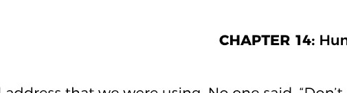

## 第 5 部分：高阶维度

日益增长地，这些技术已不仅仅是计算机之间处理一和零。正在发生网络物理融合，我们触摸的东西、我们穿戴的东西——甚至我们自身——都正在成为网络空间的一部分（想想建筑自动化、物联网 [IoT] 健身追踪器和医疗植入物）。

这种融合引发了问题：

- 在物联网、机器学习和人工智能时代的相对早期，这种增加的连接性、功能性和数据——特别是——会增加还是减少我们整体的幸福感和生产力？
- 从网络安全角度来看，这些令人难以置信的科学成就是否能让我们一劳永逸地执行系统更新，以修补互联网 DNA 中的设计缺陷，而威胁行为者自数字连接诞生以来一直利用这些缺陷？

让我们希望如此。但希望不是策略，更不是科学。我们将在以下章节中看到，这些技术很可能会带来安全挑战，也会解决安全挑战。

人类会持续让机器失败；对此无能为力。如果机器期望完美，机器也会持续让人类失败，而对此有很多可以做的。

### 12
复杂性管理

> “你不再只是管理 IT 和安全；你在管理复杂性。”
> 
> Michael Daniel,
> Cyber Threat Alliance

> “如果你的安全策略无法适应不断变化的业务需求，人们会找到规避它们的方法。”
> 
> Jay Gonzales,
> Samsung


哥白尼和伽利略提出了特殊模型来解释我们太阳系中每个光点，从而大大简化了之前的模型。这种对复杂系统的简单模型开启了探索和解决太空真正未知的大门。当时的科学家不再浪费时间追求他们所观察的行星和恒星网络运动的极其复杂的解释。对网络安全而言也是如此：我们必须消除与管理网络安全相关的复杂性。然后我们就可以专注于发现和掌握更高阶的问题，例如解放人类去追求更先进、更困难的事情。

幸运的是，我们正处于一个日益增长的重要性感和紧迫感关于掌握复杂性管理的时刻，这创造了整理我们囤积房屋的机会。这种秩序带来了灵活性和灵巧性。组织可以根据最有可能面临的威胁的特定性质选择安全工具，然后将这些工具与安全团队的实际资源保持一致。结果是一个效率更高、战略上更能有效应对入侵的响应安全概况。该方法还创造了更轻、更合适的技术足迹。正如我们将在本章的贡献中看到的那样，这种更简单、轻装上阵的方法也使 IT 团队专注于他们最有可能遇到的特定风险，从而实现 IT 与业务本身的更紧密整合。正如我们将看到的那样，对于所有使网络安全复杂化的外部因素，管理复杂性是一项内部工作。做得正确，结果是更少的复杂性和更多网络安全成功的机会。


## 将思维模式转变以管理复杂性

*Michael Daniel, Cyber Threat Alliance*

尽管一家公司管理其 IT 从来都不容易，但当今发生的变革可能显得尤其令人困惑。在相对较短的时间内，我们已从有线桌面的世界转向万物互联的世界，任何设备都可以连接到互联网，通常是无线连接。企业网络仍然包括传统的 IT 设备，例如公司拥有的台式机和笔记本电脑，但至少它已经扩展到包括不属于公司的平板电脑和智能手机。而且在许多企业环境中，网络已进一步扩展，纳入了我们现在称之为物联网（IoT）的设备，但很快我们只会称之为互联网。这一扩展的网络将包括从汽车到冰箱再到灯泡到摄像头的各种设备，在业务方面，还包括库存管理工具和设备传感器以及你能想象到的任何类型的设备。

在有线桌面的情况下维护网络安全已经很困难，但这种超互联网络的出现使其变得更加具有挑战性。特别是，这种扩展的环境带来了新的挑战，因为这些设备彼此都不同。它们运行不同类型的软件，它们具有不同类型的协议和不同的保护程度，然而它们都已连接起来。不仅潜在的攻击面在数量上显著增长，而且该攻击面的可变性和异质性也增加了。

与此同时，你的组织可能越来越依赖于这一系列设备。过去可能只是轻微烦恼的干扰，现在可能变得极具灾难性。仔细、严格地管理这一环境的需求正在增加而不是减少。然而，传统的“技术优先”或“城堡与护城河”式网络安全方法，在有线桌面世界中或许并不奏效或勉强够用，在新的物联网世界中正迅速变得明显过时。

## 数字大爆炸

在试图应对这一挑战时，许多组织都专注于寻找纯粹的技术解决方案。他们希望有一个单一的技术工具来解决挑战并使问题消失。但正如管理企业或组织的任何其他复杂方面一样，一个工具根本无法完成工作。它需要整合来自多个不同学科的方法来解决这个问题，并摆脱“因为这个问题是由 IT 环境产生的，所以解决方案必须来自 IT”的思维定式。换句话说，作为 CIO 或 CISO，你不再只是管理 IT 和安全；你在管理复杂性。

## 开始着手

那么你如何管理这种复杂性呢？第一步是明确使你的业务目标与网络安全运营保持一致。由于网络安全本身并不是目的，你需要确保你的网络安全活动促进和支持公司的业务活动，而不是阻碍它们，并且你的投资有助于遏制复杂性，而不是增加复杂性。它们也必须从业务角度来看是有意义的。你必须了解你为什么要追求某个特定的网络安全项目，而不仅仅是因为它是一个新颖、闪亮的东西或在网络安全会议上流行的最新流行语。虽然这一点可能看起来显而易见，但组织中业务部门和安全部门之间经常存在脱节。当脱节发生时，组织的各个部门会朝不同的方向拉扯，而不是协同工作。

第二步是改变你对问题的思维方式，并说服组织的其余部分跟随这种新方法。在旧的思维方式中，网络安全涉及通过技术将入侵者拒之于网络之外。如果你被困在这种思维模式中，你正在玩一个永远无法获胜的游戏。相反，你需要将网络安全视为你必须管理的长期风险，而目标是使你的组织能够在运营的同时阻止入侵者实现其目标。从这个角度来看，问题发生了转变，你可以以多种方式应用更广泛的工具来管理你的网络复杂性。

## 关键挑战

一旦你将网络安全目标与业务运营保持一致并开始改变组织的思维方式，你将开始遇到一系列新的挑战。但虽然困难重重，这些挑战并非不可克服，而且大多数挑战的解决方案已经存在。

第一个挑战是如何在这种新思维下组织你的工作。谈论风险管理很好，但如何做到呢？最有效的答案是采用风险管理框架。存在多个框架；一个很好的例子是由国家标准与技术研究院推广的《改善关键基础设施网络安全的框架》。该框架并不是安装防火墙的如何操作指南，也不限于管理关键基础设施的风险。相反，它为你提供了一种有条理、合乎逻辑的方式来思考你的数字环境是如何部署的，你将采取的步骤，以及如何以高级管理层能够理解的术语进行沟通。它还使你能够更清晰地定义高级管理人员在整个组织中需要做出的风险权衡。

第二个挑战是组织内部缺乏沟通。很多时候，从事业务线的员工不明白安全人员为什么要做某些事情。同样在安全方面，安全团队根本不明白为什么市场或研发部门等不只是实施看起来非常明显和合理的网络安全措施。为了克服这一挑战，你需要确保你很好地掌握了组织各个部门的目标和目标。你必须了解他们的观点是什么以及他们的业务运营为何如此布局。如果你能从理解和阐述他们的需求开始，你可以促进关于风险的沟通和讨论，这通常能使每个人就缓解和管理已识别风险找到更合理的前进方式。

CISO 最关键的功能不是选择使用哪个闪烁的设备。最有效的 CISO 确保每个人在目标、风险和风险管理框架方面都站在同一页面上。他们促进业务线之间的对话，以便

## 数字大爆炸

正确管理业务目标和安全风险。例如，如果有人正在开发一种需要在尚未锁定环境中部署的新能力，那么网络安全人员——如果他们理解业务需求——可以与这些人员合作，确保环境得到适当构建，并且有适当的沙箱，以便在仍能实现其业务目标的同时不使整个组织面临更大的风险。

我的经验是，当一组人做的事情看起来对另一组人来说完全不负责任时，通常是因为他们不了解对方的工作环境或其目标。如果你能使这些目标保持一致，通常需要弥合的差距比人们意识到的要小得多。然而，如果这种沟通不畅和误解持续存在，那么你就会遇到更大的问题——你的复杂性只会增加。在这种情况下，个人或业务部门往往开始建立自己的影子 IT，并在你甚至没有意识到的情况下增加你的风险。他们可能会想出绕过关键安全措施的变通方法，因为他们认为这些程序干扰了业务目标。

如果 CISO 和网络安全政策不承认并考虑到人们实际工作的方式，人们只会想出规避它们的方法。这就是为什么在 CISO 与其他业务线之间建立和维护沟通渠道如此重要。只有通过开放、定期的沟通和正确的思维方式，你才能改善组织的网络安全。

## 管理复杂性

当然，一旦你解决了挑战的人为因素——让每个人都参与进来并确保他们都看到他们有共同的目标和共同的安全需求——你仍然面临着不同的环境和需求，这些往往需要单独的安全管理方法。业务 IT 系统、运营技术（OT）系统以及你的云环境会产生不同的需求，任何已连接的物联网设备也会带来各自的问题。你可能还拥有一个


## 数字大爆炸

高度流动的员工队伍，以及渴望即时访问数据的应用程序和消费者。

归根结底，这种复杂性意味着你无法提前设想所有可能的需求、配置或威胁。这时，你的网络安全风险管理框架便再次发挥作用。例如，前面提到的网络安全框架为你提供了一种方式，可以根据你所面临的风险选择恰当的工具。它使你能够基于实际风险选择和实施特定类型的流程、业务规则和技术，并采用针对你网络结构的最佳实践，例如身份与凭证管理。风险管理框架还促使你了解自己的信息环境：为什么拥有这些数据、用这些数据做什么、以及应该保留多长时间。

这些关于数据、信息和流程的问题极为重要。例如，作为网络安全从业人员，我经常告诉各个组织：最好的数据就是你并不拥有的数据，因为那样我就不必去保护它。你真的应该认真思考自己存储的数据类型以及存储这些数据的原因。这种理解会让你重新回到与各业务运营团队建立的人际联系上，因为有时最有效的并不是又一项技术，而是一个业务流程解决方案。通过在可行的情况下调整业务流程并制定正确的政策，你可以将精力集中在真正能带来最大投资回报的技术上，而不是只往技术堆栈里再添一个闪烁的小盒子。

这一点之所以关键，是因为你要确保自己不是仅仅对当前的网络安全态势做些小修小补，而是要从整体上审视整个网络安全解决方案和战略。当新问题出现时——例如网络中添加了新的物联网或移动设备，却没有现成的安全解决方案能完全应对——许多组织会直接购买一种能应对该问题的新技术方案。然而，他们很少去考虑这个针对移动设备的新安全方案如何与现有的其他技术集成。最终你会得到一种类似地层堆积的效果：一层又一层地叠加安全措施，却不知道它们之间如何相互作用。你不知道哪里有接缝、哪里有重叠、哪里有缺口。而恶意行为者利用的正是这些：由各类网络安全工具造成的接缝、重叠和缺口。因此，新方案非但没有解决问题，反而只是增加了复杂性。这个问题比大多数人意识到的要大得多、普遍得多，尤其是在规模较大的组织中。

在实施和更新风险管理框架时，你需要定期对整个安全技术栈进行零基审查。这项任务并不轻松。它要求你审视现有解决方案，了解一个方案如何嵌入到已经部署的其他方案中，并判断是否有可能以及如何将所有这些东西串联起来。任务的另一部分不仅是看清可能需要哪些新方案，还要看看是否有可以舍弃的东西。你能用一个业务流程来替代某个工具吗？业务运营或信息需求是否发生了某种变化，从而允许采用一些不同的方法？你还应借此机会与组织的财务部门沟通，确保自己清楚公司为所有这些工具和服务支付了多少钱。你需要决定：新工具是真正为现有工具套件增色添彩的、完全必要的新层级，还是可以放弃某些不再需要的功能，将其从组织中淘汰，从而释放资源去聚焦新能力、新设备、新应用或其他目标。采用这种方法将帮助你管理新方案带来的复杂性，并确保你始终专注于赋能业务达成目标。

在应对这类复杂活动时，你还需要知道自己的局限，并在需要额外专业知识时寻求外部顾问和建议。鉴于当今技术和最佳实践的复杂性，没有任何组织能在内部拥有所需的全部专业知识。这就是为什么高绩效组织也懂得何时引入外部专家。但归根结底，你无法将风险或决策转移给外部人员。公司的领导层始终承担最终责任。

### 事件响应

最后，有效的复杂性管理包括制定一份良好的事件响应计划，并且定期演练。无论你在检测、预防和控制复杂网络威胁方面做得有多好，在某个时刻你终将面对实际发生的事件。而且你需要制定适当的规程来应对这种意外事件。

由于当今环境极其复杂，你永远不可能提前想到每一种潜在的可能性或结果。这似乎有些反直觉，但在这种环境中，规划过程反而变得更加重要。它能帮助你确保自己已经具备应对意外情况的容量和能力。几乎可以肯定的是，当实际事件发生时，它不会按照计划进行。但正是这时，规划过程开始发挥作用——正如德怀特·艾森豪威尔的名言：“计划本身毫无价值，规划过程才是一切。”此外，规划提供了一种系统性的方法，让每一位在计划执行中扮演角色的人从一开始就参与进来——思考整个响应过程会是什么样子，确定所需的能力，并就角色和职责达成共识。这并非说你只要照本宣科地执行事件响应即可，而是说如果规划过程得当，这一过程还将使你的响应能力具备适应性和灵活性。这要求组建协作式规划团队、了解你的资源、明确角色与职责、进行角色演练，并让合适的人员就位，以便当安全事件最终发生时，每个人都知道自己的任务和指挥链，从而避免恐慌和资源僵滞。

我怎么强调最后这一点都不为过。在日益复杂的环境中，拥有足够的灵活性和足够广泛的技能组合，使你能够在事情偏离预期时随时调整计划——尤其是在你未曾预料的地方——这是你武器库中最关键的工具之一，也可能是最难获得的。达到这种状态正是区分优秀首席信息安全官和普通首席信息安全官的分水岭。

### 结论

管理复杂性……嗯，确实是复杂的。它需要技术、业务和人际技能，再加上适应性和灵活性思维。这很难，有时这种复杂性会让你一时失控。然而，只要拥有正确的心态和工具集，你就能够管理组织中的网络安全复杂性。这是一件好事，因为当今世界并没有给你留下选择的余地。

### 关于撰稿人

迈克尔·丹尼尔——网络威胁联盟（CTA）总裁兼首席执行官

迈克尔·丹尼尔领导网络威胁联盟（CTA）团队，并负责该组织的运营工作。在2017年2月加入CTA之前，丹尼尔于2012年6月至2017年1月担任奥巴马总统的特别助理以及国家安全委员会参谋部的网络安全协调员。在这一岗位上，丹尼尔主导了国家网络安全战略和政策的制定，并确保美国政府与私营部门、非政府组织及其他国家开展有效合作。


## 降低复杂性的七个步骤

Jay Gonzales，三星

组织面临的最大挑战之一是如何管理在数字化转型过程中不断增加的复杂性层级。网络正在经历根本性的转型：工作流、软件和基础设施正在向虚拟化和多云环境以及下一代分支机构迁移。自带设备（BYOD）和物联网设备正在涌入网络。越来越多的用户需要通过不断增长和持续变化的应用集来访问关键资源，而敏捷开发正在改变这些应用发布和更新的速率。与此同时，首席信息安全官的角色正在从技术专家转变为业务顾问。

这还只是开始。三星有着常见的行政、销售和营销团队，我们需要保护它们。但与此同时，我们也是一个规模相当庞大的研发组织，拥有多个从事研究、开发或测试评估的实验室，每个实验室都有自己独特且不断变化的网络和资源需求。更复杂的是，这些团队中有许多需要共享网络资源。因此，保护我们的环境需要持续识别网络上正在进行的活动的范围，确定新资源和技术是需要整合到网络的其余部分，还是与之隔离，然后实施适当的控制措施，以确保关键业务功能永不受到损害。

我们的挑战并非特例。越来越多的CISO在自问：“我该如何利用现有资源应对这种复杂性？”为了回答这个问题，我建议以下七点：

### 1. 降低现有复杂性

过去，每当网络发生变化时，企业都会寻找并部署非常特定的安全解决方案来解决非常特定的问题。这意味着许多组织现在正面临一个由数十种不同厂商技术组成的复杂安全环境，每种技术都有自己的流程和管理控制台。

然而如今，大多数安全团队已没有资源再去添加更多解决方案，这意味着他们必须对所要实施的安全工具更具战略性。我的做法是：要么想办法从现有工具中挖掘出更多功能，要么在考虑新设备时，确保它不仅能完成其他工具无法做到的事情，还能替代一些我已经拥有的设备。

降低复杂性还要求准确盘点你已经拥有的工具。为此，我们停止了大约八个月的技术采购，以弄清现有设备是什么，以及我们需要弥补哪些空白。我们现在通过定期的内部和外部评估来维持这一基线，确保始终从网络安全角度清楚自己的处境。

### 2. 调整你的政策

一旦你确定了网络的所有组件和设备，下一步就是建立一个流程，以便处理具体的政策例外请求。如果你的安全政策是规定性的，管理例外情况将更具挑战性。而如果你的政策不能适应不断变化的业务需求，人们就会想办法绕过它们。

建立能够促进当今网络所需的持续宏观/微观对话的政策，使一切保持联系并向前推进。当有人需要做超出其团队特定规则和资源的事情时，你应该能够回应：“我们能帮上什么忙？”

这个行业正在经历从规定性安全政策向交互式安全政策的真正范式转变，首席信息安全官现在更多地考虑广泛的目标和目的，而不是具体规则。因此，当你制定一条规则，要求每个人在前门上加一把锁时，你不需要告诉他们确切是什么类型的锁、装在哪里、应该多高，或者谁应该有钥匙。你只需要设定一个期望，即他们需要锁门，只要门锁着，就可以了。

### 3. 应用分段

大多数网络最初设计时都采用了强大的边界安全策略。安全团队随后会在关键资源（如隔离区（DMZ）、服务器场和数据中心）前部署内联安全设备。内部网络的其余部分则是扁平的，要么基本上不受保护，要么塞满了需要管理和配置的安全设备。这些方法要么增加了风险，要么消耗了额外开销。

如今，为物联网设备或研究实验室等建立内部安全控制不再需要部署新的防火墙。相反，分段和微隔离可以提供丰富的保护，且不影响可见性。内部分段可用于按需动态隔离设备和功能网络区域，而微隔离则可以保护迁移到云中或在数据中心等环境内东西向移动的工作负载。由于分段可以集中管理，因此在减少因大量安全设备部署而造成的复杂性方面可以发挥很大作用。

### 4. 实施NAC

一旦你了解了网络上的情况，简化了政策，并实施了分段以隔离网络区域和资源，下一步就是跟踪持续的变化，包括识别添加到网络中的任何设备。即使在网络分段内，你也需要知道添加了哪些设备，以及应如何对它们进行分类。

网络访问控制（NAC）确保当有人将新设备或系统接入网络时，你知道它是什么类型的设备，以及它将用于什么目的。如果你不知道这个设备是什么，或者NAC系统已将其标记为不符合政策，那么它将被隔离，直到被识别出来，或者有人完成打补丁或更新的过程。这种方法有助于保持网络所需的流动性，而不会给安全人员增加额外的成本或复杂性负担。

### 5. 采用自动化

动态访问控制只是更广泛的自动化理念的一部分。大多数安全团队中的许多人力资源都致力于管理、更新设备配置、设备接入、读取日志或应用补丁等琐碎任务。这就是为什么降低复杂性的下一个关键步骤是尽可能自动化这些流程。

如果你能自动化琐碎的任务，比如能够运行脚本来获取特定事件的日志，那就意味着你可以将以前做这项工作的人分配到更关键的任务上。然而，实施自动化的最大挑战在于，当人们不了解流程、流程不成熟，或者人们根本不遵循流程时，就会出现问题。

### 6. 管理人员

解决建立和执行流程的挑战，需要与你公司内部的其他团队和部门进行互动。在许多组织中，首席信息安全官最重要的职责不是监督安全技术和团队，而是与其他部门建立对等关系，以便在挑战升级为更大问题之前尽早解决。

这种方法之所以至关重要，一个原因是在许多组织中，安全团队并不直接监督网络运营。为了应对这一挑战，安全团队要么直接强制执行安全规则，要么走到IT部门说：“嘿，现在发生了这种情况。发生了什么变化？何时批准的？”

但这是一个相当低效的过程，尤其是在当今攻击和交易都以数字速度进行的情况下。我们需要的是通过与你业务部门的负责人建立关系，在挑战出现之前就走在前面。事实是，每个团队都有自己的需求、要求和挑战，你需要了解


# 数字大爆炸

在他们已经无法做到的事情之上，或者在他们已经疲于应付的事情之上添加任何内容之前，先了解他们。

为了在应对这些挑战时保持领先，我会定期与实验室负责人开会，问一些诸如“发生了什么变化？”的问题。然后我可以解释我们正在尝试做什么，并问：“这将如何影响你们？”

这种互动至关重要。当你没有与各级业务领导和部门主管沟通时，你最终会试图管理一些你完全不了解的事情——而不是走出去收集信息、建立关系，并说：“我们想帮助你们，但你们也需要帮助我们。”如果你不知道他们在做什么，却实施了一项新协议，就可能以意想不到的方式影响他们，而最终你将不得不处理这些后果。

也正是在这个时候，用户开始将你视为阻碍者而非推动者。在许多组织中，这意味着只要安全团队一出现，他们就会认为你已经做出了决定，并且想知道为什么还要开会。他们开始寻找绕过你设下的限制的方法。

我刚到这里时，人们总是说：“哎呀，杰伊来了。他会说不。我们还不如根本别试。”但在表明我真心希望帮助他们成功之后，他们的态度变成了：“嘿，我有个想法。我们能这样做吗？我知道安全策略规定了一些事情，但我们需要能够无视这些规定去做另一些事情。”这就是为什么我相信，管理复杂性最关键的是管理业务内部的关键关系。

但仅仅对话是不够的。如果对每个人的需求和目标没有清晰的理解，对话很快就会变成“这不行。请修复它。”不幸的是，“请修复它”并不能为我的团队提供任何工作范围，因为我不知道哪里出了问题。这些关系需要通过

## 第12章：复杂性管理

定义你的需求来加强。当每个人的需求都有文档记录时，团队之间的互动就更容易管理，因为你可以快速识别问题以及修复所需的工作范围。

### 7. 管理文化复杂性

在管理复杂性中，一个有趣的挑战有时出现在国际或全球组织中，即本地团队与海外团队之间存在文化脱节。在这种情况下，一些复杂性可能仅仅是内部政治和文化的结果。

例如，一个安全团队可能非常注重合规、以合规为驱动力。他们的期望可能包括使用核对表并问“你们在做这些事情吗，是还是否？”，然后以“你们失败了，因为你们没有做A、B和X”给团队或业务单元打分。另一种文化的团队可能将合规仅仅视为起点，并认为他们需要在此基础上增加大量内容。

应对这些挑战需要进行坦诚的对话，并借助当地领导层的认可来推动。这些交流的目标是帮助其他团队理解你的网络安全目标是什么，你的当地文化期望你的网络安全团队做什么，以及他们的努力如何服务于业务。目标是帮助他们看到，如果结果相同，即组织得到了安全保障，那么每个团队实现目标的过程应该是次要的。

这也就是说，你可能需要处理的某些复杂性并不总是以技术为中心。它更多是让包括高管层在内的所有人准确理解你的团队为何存在、他们被期望做什么、他们在满足本地和企业安全需求方面做了什么，以及他们成功需要哪些工具和权限。

## 结论：安全绝不能成为瓶颈

归根结底，安全的目标不仅仅是保护业务，而是让业务得以向前推进。要实现这一点，安全绝不能成为亟待完成事务的瓶颈。

最重大的挑战首先是识别出每一个对网络如何运行有切身利益的群体；其次是识别出那些你并不知道正在发生的事情；最后是识别出那些找到了在环境中让事情正常运转方法的用户群体，尤其是当这涉及绕过设备、策略或协议时。这实际上是一件好事，因为你不仅了解了这些群体需要什么来开展工作，以及你的安全策略在哪些地方成了瓶颈，而且可能最重要的是，你了解了安全实施中存在的空白。

如果你发现某个团队已经弄清楚了如何绕过系统，你需要向他们学习。你最不想做的事情，尤其是在某个系统已经在运行、并且运行得如你所愿时，就是阻止他们。相反，要了解他们为什么需要做他们正在做的事情，并找到一种不绕过安全的方式来实现它。这可能要求他们迁移到一个更受控制的环境，或者可能只需要将他们与其他所有人隔离开来。

最终，减少和管理复杂性始于提出这些问题：“你想做什么？”“你需要做什么？”“你需要什么工具来让它更好地工作？”而对于那些已经有变通方案的团队，一个好问题可能是：“你是在没有告诉任何人你需要什么的情况下，如何让它运转起来的？”这一点可能比你所做的任何其他事情都更能说明你的安全策略。

## 关于撰稿人

杰伊·冈萨雷斯——三星半导体公司首席信息安全官

杰伊·冈萨雷斯在过去18年里一直从事网络安全工作。他的背景和经验主要在政府部门，其中13年担任现役海军陆战队队员，专攻信息保障和计算机网络防御（IA/CND），另有三年在海军刑事调查局（NCIS）工作。在担任现职之前，冈萨雷斯是惠普全球网络安全团队中的一名风险经理。

冈萨雷斯在政府文职部门担任过多个职务。他起初是海军刑事调查局网络安全联络官，直接派驻海军部首席信息官处，定期提供网络威胁情报简报，并为海军和海军陆战队更新部门级网络安全政策。他还为国防部关键基础设施保护政策和规划的制定提供了直接支持。此外，冈萨雷斯曾任阿富汗内政部部长级顾问，在喀布尔为阿富汗国家警察部队制定了信息技术教育和培训计划。

## 13
隐私

> “如果你收集了它，你就必须保护它。”
> 
> 凯文·米勒，
> 美高梅国际酒店集团

> “更强的隐私政策会带来更安全的组织、更受保护的客户和更大的商业成功。”
> 
> 彼得·基南，
> 全球金融服务公司

隐私问题引发了激烈的政策辩论、抗议活动，以及对数字组织实施的最广泛、最严厉的一些监管。尽管许多人将欧盟的《通用数据保护条例》（GDPR）视为元年里程碑，但事实是，隐私问题对于运转正常的社会而言始终是基础性的。

同样，隐私保护必须成为所有网络安全工作不可或缺的组成部分。

正如不考虑速度这一基本要素的安全技术和协议会被直接关闭或弃用，使网络完全失去保护，缺乏隐私也会引发类似反应。如果用户感到隐私受到威胁，他们会找到简单的变通办法，从而创造出庞大且更脆弱的影子IT基础设施，其中包含的设备与系统大多数IT团队甚至看不到，更不用说保护了。如果你打算这样做


## 数字大爆炸

网络安全必须兼顾速度和规模，隐私风险的检测与缓解也同样必须兼顾速度和规模。

展望未来，我们的数字创新将如何影响现代生活最基本的方面之一——作为个体，我们对隐私和自主权的渴望与权利？随着后 GDPR 时代拉开帷幕，人们试图在人类集体拥抱数字创新的背景下保护个体，我们看到，即便是隐私也难逃人类自相矛盾、过度复杂化的弱点。

具有讽刺意味的是，为了有效保护一个源于由 1 和 0 构成的二进制代码的信息系统，我们却常常把安全与隐私描述成非黑即白的选择。成功保障我们的网络，取决于在这两股力量之间找到恰当的平衡。

当安全专家放弃维护这种平衡的责任——往往倾向于采用他们自以为能增强组织安全性的做法——结果通常适得其反。有些 IT 团队动辄归咎于最终用户，但责任其实在于他们自己，直接原因就是那些要求用户屈从于站不住脚、不可持续的虚假选择的错误做法。

出于伦理和务实的双重原因，安全专家绝不应迫使人们在安全与隐私之间二选一。没有隐私的安全往往根本不是安全——对组织而言，它比那些确保隐私的合理让步与折中要危险得多，而且这种危险不可估量。

但除了这种简单的因果关系之外，还有更多理由将隐私关切置于一切安全工作的核心。平衡的隐私方针能够为广泛的安全技术提供依据并增强其效力——从加密级别到检查、认证和可见性技术，仅举数例。保护隐私的网络安全解决方案更强大、更成熟。

人们认为强大的数字企业践踏了隐私权，这种感受促成了 GDPR 及其他法规的出台，而这些法规又给上述所有安全基础带来了极大的复杂性——这绝非巧合。这些法规带来了巨大的挑战，甚至令人费解的矛盾，世界各地的 IT 团队如今每天都要面对。

同样清楚的是，过度重视隐私的矫枉过正反应往往会制造更多风险，甚至可能将更多敏感个人信息暴露给网络犯罪分子，他们非常乐于利用可见性降低来实施信息盗窃。

### 别慌！安全专业人士必须学会拥抱隐私新时代

凯文·米勒，美高梅国际酒店集团

当安全专业人士拼命保护驱动数字业务的、不断扩展的技术格局时，那些从根本上改变其职责的社会和法律剧变可能会仿佛凭空出现。但没必要恐慌。如果安全专业人士拥抱这些变化，结果会非常积极。

我们已经习惯了大型组织因数据泄露而遭受重创的头条新闻。这些泄露事件不仅影响数千万客户，还会以巨额罚款、法律费用和安全升级成本冲击利润底线。更重要的是，这些泄露会导致永久性的品牌损害和客户信任的丧失。由此，网络安全新近成为一项关键的业务风险。高管和董事会成员如今会定期要求一个此前被忽视、资金不足、深藏在 IT 部门之内的安全部门汇报最新情况。

头条新闻和管理层迫切的网络担忧，很容易掩盖一项即将来临的国际隐私法。但随着头版头条上的企业不断更迭，一个隐私新时代正在欧洲到来。欧洲拥有 5 亿居民，是全球最大的市场，也是全球最大的贸易集团，占全球进出口总额的 16%。

2018 年 5 月，欧盟《通用数据保护条例》（GDPR）正式生效。该条例取代了 1995 年的《数据保护指令》，后者曾要求全部 28 个成员国各自通过本国的数据保护法律，结果形成了一堆常常彼此矛盾的法规大杂烩。GDPR 旨在“协调”欧洲各地的数据隐私法律。

该法规的 99 项条款和 173 项序言，将个人权利以及向欧盟（EU）提供商品和服务的企业责任明文规定下来。个人如今被保证有权知道哪些关于自己的信息被收集以及这些信息将如何使用，有权访问和更正这些信息，有权删除这些信息（又称“被遗忘权”），甚至有权反对某些类型的处理。个人享有何种权利，取决于这些信息最初是因何被收集的（称为“处理的合法依据”）。GDPR 的例外情况范围狭窄、具体明确且数量很少，包括执法和国家安全事务、科学分析，以及严格用于个人或家庭活动的数据。

这部复杂而影响深远的法律，其适用范围刻意设得非常庞大。它适用于在欧盟提供商品或服务的每一个组织，无论是非营利组织、小型初创企业还是全球性企业，无论是否涉及付款。即使一个组织只是“设想提供服务”（例如，拥有面向欧盟居民并接受欧元支付的网站），该法律同样适用。而且 GDPR 适用于整个供应链。与第三方（如供应商和经销商）共享的个人信息，也会使这些第三方受到相关要求的约束。

问责制是 GDPR 的主要特征之一，标志着必须遵守该法律的组织在思维方式上的重大转变。尽管问责制并非新概念，但 GDPR 第 24 条的问责原则要求组织不仅实施“适当的技术和组织措施”，还要“证明”其符合该法规。GDPR 中有 39 项条款要求提供合规证据，这对许多企业的安全团队来说是一项全新的任务。

该法规首次通过强有力的执法机制真正拥有了约束力。在 GDPR 执法日期之前的几个月里，头条新闻警告称，违规罚款最高可达 2000 万欧元或全球年收入的 4%（以较高者为准）。人们普遍预期，巨额罚款只会针对公然违规行为征收，但如此大的处罚很容易让一家没有雄厚资源的公司倒闭。

值得庆幸的是，欧洲数据保护机构提供了一些冷静的视角。第 29 条工作组（代表各欧盟成员国负责执行 GDPR 的机构）主席称执法日期是“一个起点”，也是“我们开始合作方式的里程碑”。他们始终强调参与和透明，而不是最后期限和罚款。但即便如此，一家十亿美元级的公司仍可能面临 4000 万美元的罚款——这绝对足以引起全球董事会的担忧。从安全专业人士的角度来看，希望这将有助于影响企业领导者重新考虑其数据保护工作的优先级。

尽管 GDPR 的影响范围和后果确实巨大，但许多问题只能通过执法和诉讼才能得到解答。有一点非常清楚：被视为个人数据的范围已经扩大。GDPR 非常宽泛地将个人信息定义为“与已识别或可识别的自然人相关的任何信息”。尽管该条例没有明确列出哪些信息构成个人数据，但 GDPR 提供了一些澄清：“可识别的自然人是指可以直接或间接被识别的个人，尤其是通过姓名、识别号码、位置数据、在线标识符等标识，或通过该自然人的身体、生理、遗传、心理、经济、文化或社会身份相关的一项或多项特定因素来识别。”对于即使只收集少量客户信息的企业来说，这也是大量需要保护的信息！

在 GDPR 时代，组织必须知道自己收集了哪些信息以及为什么收集——这说起来容易做起来难。以前被认为无害到可以印在名片上的信息，现在也属于受保护数据——姓名、邮政地址、电子邮件、电话号码，以及员工胸卡上的照片。即便是一家小公司，保存的信息也不仅来自客户，还来自现任和潜在员工、承包商、供应商、经销商等等。在遵守 GDPR 时，必须考虑到涉及个人数据的每一个流程。

对许多现代数字企业而言，数据被视为公司最宝贵的资产。但现在，数据也可能被视为一种负债，甚至是一种风险。如果你收集了数据，就必须保护它——从数据被收集的那一刻起，到它如何传输和存储，如何使用和共享，再到如何归档并最终销毁。遵守 GDPR 并不是购买一款新工具就能解决的 IT 问题。该法律的要求将推动那些甚至不涉及技术的流程发生广泛变革。


## 数字大爆炸

为了让合规变得更加复杂，满足 GDPR 的要求涉及两个截然不同但同样困难的问题：隐私和数据安全。

对于欧盟居民而言，GDPR 最明显的结果将体现在隐私方面。首先，许多组织不得不重写其隐私政策以满足法律要求。例如，隐私政策现在必须包括有关收集了哪些个人信息以及原因、共享了哪些信息以及与谁共享、以及个人如何行使其权利的具体信息。该法律甚至坚持政策必须易于理解（没有法律术语）且易于阅读。许多怀疑论者怀疑律师能否胜任这项任务！

无论数据在何处收集，组织都必须对其计划如何使用数据保持透明——法律称之为“公平处理通知”。GDPR 对基于个人同意收集的信息尤其具体，要求其“自愿、具体、知情且明确”。预先选中的“我同意”复选框在 GDPR 下已不再可接受。其结果是，公司必须重新审视接受个人信息的每个流程，并确保正确的通知已到位。对许多人来说，这是一项艰巨的任务。

公司不仅必须公开其计划如何使用数据，而且还必须确保在保留该数据的期间内不会将其用于任何其他目的。这被称为“目的限制”原则，其对企业 IT 系统的影响可能巨大。不仅数据必须得到保护，而且数据的原始目的必须在整个生命周期中以某种方式得以维持。可以肯定的是，许多遗留 IT 系统并未构建为保留此类元数据，更不用说据此采取行动了。

在 GDPR 下，个人对其数据享有某些权利，每个组织必须能够在 30 天内免费满足请求。这些请求称为数据主体访问请求（DSAR）。虽然在理论上很容易理解，但例如为满足被遗忘权请求而删除数据，绝非易事。一家公司可能拥有数百个应用程序连接到数千个数据库，其中包含数百万条个人信息记录。他们不能简单地删除有关个人的数据，而不使整个系统面临失败的风险。而且事情变得更加困难的是，尽管个人可能希望从直接营销名单中删除，但他们可能仍然希望公司兑现多年前购买的产品保修。

例如，当公司收到来自 Katherine Miller 的信息请求时，该怎么办？他们当然不想将信息发送给错误的人。对公司数据库（营销、工资单、客户、忠诚度俱乐部、客户服务等）的搜索可能会产生数十甚至数百个可能的匹配项——例如 Katie Miller 和 K. Miller。不要忘记在 Katherine 结婚前收集的有关她的的信息。一些记录可能有数年前的邮寄地址，一些有当前或过去的电话号码，以及大量电子邮件地址。一些大型公司预计每月会收到近 250 个请求。什么是“彻底”的搜索？执行搜索需要多长时间？重要的是，执行这些搜索需要多少人？这些都不是微不足道的问题。

撇开隐私不谈，许多组织在保护数据方面面临的挑战同样令人望而生畏。虽然注重安全的组织多年来一直保护个人数据，但对于 GDPR 新手来说存在重大障碍。例如，该法律仅在目的地被认为具有“足够”水平的保护时，才允许在欧盟境外（称为 *跨境数据传输*）传输、处理和存储数据。对欧盟而言，美国的数据保护法律不被视为足够。虽然公司可以通过几种方法（如约束性公司规则或美国/欧盟隐私盾）遵守此规则，但对于全球公司来说，这绝非易事。在云计算时代，选择特定数据存储位置并不容易，而且通常也不可能。这将是一场持续的斗争。

当然，如果你不保留数据，就无需保护它。长期以来，数据最小化一直被安全专业人员视为最佳实践，GDPR 特别指出数据最小化以减轻合规负担。仅应收集和处理完成任务绝对必要的数据。任何非必要数据都不应收集，如果已收集，则应删除。加密和存储限制也是法律中的重要概念。加密由来已久，基本上所有可以加密的东西都应该加密。存储限制简单来说就是“保留和销毁”。公司可能有许多原因需要或想要保留数据。例如，政府通常要求保留多年税务信息。但不再需要的数据应被删除。制定明确的数据保留和销毁政策非常有帮助，实施该政策的程序是必不可少的。

GDPR 还鼓励几种可以让安全团队工作更轻松的数据处理技术。匿名化过程并非新鲜事。但不幸的是，它只在有限的情况下才实用，因为它涉及消除所有可以唯一识别个人的数据。如果你真的匿名化数据，其中大部分价值就会消失——对企业、对消费者等等。让我们面对现实吧；人们重视个性化体验，如定向广告，只要它不过分 creepy。

匿名化之下一步是所谓的假名化，这是一个难以发音的词。这是指个人身份信息与其它数据分开保存，但以一种可以重新识别个人的方式链接起来。这是一个相对较新且聪明的概念，将需要时间才能纳入业务应用。

GDPR 甚至影响到许多安全、法律和业务风险团队的组织结构。该法律将隐私在组织内部提升到一个水平，以至于处理大量个人数据的一些组织必须聘请另一位高级领导，即数据保护官（DPO）。这是一个新角色，旨在独立监督公司的数据保护战略，并作为与当地 GDPR 监督机构的联络人。预计全球将聘用多达 75,000 名 DPO。

到目前为止，我们已经看到 GDPR 将如何从根本上改变欧盟以及由此延伸到世界各地隐私和数据保护的监管方式。我们也看到了新法律将如何影响在那里开展业务的大型和小型公司。剩下的就是讨论这将在实地如何实现。GDPR 将如何影响 CISO 角色？普通公司的合规之旅会是什么样的？GDPR 合规真的可以实现吗？

在许多公司中，CISO 角色是一个相对较新的 IT 职位，通常向 CIO 汇报。许多第一代 CISO 来自 IT 背景，技术性很强。但这种情况正在改变。

全球隐私和传统业务日益数字化的趋势推动 CISO 成为“业务”领导者。许多 CISO 现在向总法律顾问、COO、CEO 甚至直接向董事会审计委员会汇报。

这种变化有充分的理由。被要求负责 GDPR 合规的 CISO 可能会发现自己与人力资源、法律、销售和营销部门的合作比与 IT 部门更多。这并不是说 IT 不发挥核心作用。它当然发挥作用！但许多 IT 组织在采用开发和运营的最佳实践时，正在对其数据安全标准进行现代化改造。对企业资源规划（ERP）等关键任务的传统本地应用程序采用云技术，也迫使安全审查达到更高水平。

许多组织所缺乏的是对业务消耗和处理的数据的实质性理解。人力资源从新员工那里收集哪些信息？营销是否正确记录了直接营销的同意？企业电子邮件系统是否用于向供应商发送和接收未加密的个人信息？企业保留和销毁政策是否得到遵守？哪些欧盟数据正在美国传输和存储？组织是否真正满足美国/欧盟隐私盾的要求？

CISO 可能是提出这些问题并帮助组织找到答案的人。很容易感到不知所措，但向前迈进的最佳方式是采取循序渐进、系统的方法。而且你需要非常擅长文档记录！

那么我们从哪里开始呢？

第一项工作是绘制数据流图。与业务团队坐在一起，用白板绘制他们的流程。提出开放式问题，以便你充分了解业务需求。这些地图帮助每个人了解数据流的各个细节：谁提供信息，收集了哪些数据，存储在哪里，如何使用，在哪里共享，沿途谁有权访问信息，以及最终数据会发生什么。受严格监管的企业可能已经拥有这些信息，但许多公司没有。

一旦你有了流程图，或者至少是重要的流程图，你必须确定你的“合法处理依据”。CISO 可能能够对此做出明智的猜测，但合法


## 数字大爆炸

法律依据最好留给法务部门处理。法律依据回答的问题是：“是什么让你的组织拥有合法权利来收集这些信息？”尽早了解这一点很重要，因为你需要设计相应的控制措施，以保障那些在很大程度上依赖这一决定的个人的权利。你可能还需要在数据进入系统时对其进行“分类”，这会影响你在后续步骤中对控制措施的选择。请记住，GDPR 对基于个人同意收集的信息制定了许多规则。最好尽量少用同意（例如在直接营销中）。

接下来，对每个工作流执行*差距分析*。不要陷入细节之中。相反，要对每个工作流进行高层级分析，并评估过程中的每一步。你可能会决定对传输中的数据进行加密，而不必担心如何实现。此时，你需要记录哪些是（GDPR 和其他法规）要求的，哪些是（为了实施最佳实践而）期望的。如果你不熟悉 GDPR 的细节，请咨询你的法律团队或外部专家。这部复杂的法律中有很多要求。寻求帮助并不丢人。

有了差距分析，你现在可以评估工作流的风险并确定优先级。并非所有工作流都相同。它们通常因信息的数量和敏感度而异。特别敏感的工作流包括涉及未成年儿童的信息，或涉及种族或民族出身、宗教信仰、性取向、工会会员身份等信息。较大的公司可能有数百个工作流，因此确定优先级是关键，这可以让你不会感到不知所措。在此阶段，记录风险归属和风险接受情况。代表业务承担风险不是 CISO 的职责。风险属于信息所有者，而这一步是让风险可见的好机会。

现在，你终于准备好迎接大多数技术人员最感兴趣的部分：设计和构建控制措施。从小型、简单的工作流开始，磨练你的技能，然后处理更复杂的工作流。你通常需要让各个技术领域的主题专家参与工作流的每一步。处理差距分析中确定的每一项。如果某个步骤通过未加密的网页表单收集信息，你可能需要部署 HTTPS。为了保护“静态”信息，你可能需要加密 Amazon S3 存储桶。

如果个人数据通常无限期地存储在 NetBIOS 共享上，请创建一个流程来实施你的保留和销毁策略。反复实践！这就是你展示安全能力并在组织安全态势上真正发挥作用的地方。

有些更改微不足道，而其他更改则会催生一个项目并耗时数月才能完成。随着流程的变化，你需要协调培训并更新文档。最终，你将能够将新流程移交给业务部门。但你的工作不会就此结束！为了保持合规，请确保创建一个提醒系统，定期重新评估每个工作流。一个好的治理、风险与合规（GRC）或信息技术基础架构库（ITIL）工具是实现自动化的方式。

尽管所有这些工作看起来像一座大山，但它是可以完成的。不过，你需要调整并重新装备。安全团队通常由技术人员组成。虽然隐私保护通常需要技术来实施必要的控制措施，但要理解如何实现这一点，需要具备业务伙伴思维。这是一个需要付出大量心血的协作过程，需要极大的耐心和沟通。GDPR 合规最困难的方面不是法律或技术，而是人际关系。IT 团队需要培养他们以前从未使用或需要过的技能。

最理想的情况是，公司中的每个人都理解这项新隐私法的必要性、风险以及不遵守所付出的代价。不可避免会出现抵触情绪，尤其是当 GDPR 被视为可以逃避或忽视的麻烦时。但消费者完全有权要求企业尊重、重视并保护他们的个人信息，而我们大家都因粗心大意的数据管理而面临的风险是实实在在的。

在任何合规项目启动之初，CISO 必须做的最重要事情是向 CEO、以及 CIO、COO、总法律顾问和董事会推销这些要求。业务领导层必须了解其中利害关系，并对完成这项工作需要付出什么有现实的理解。无论从流程还是执行来看，合规都是昂贵的，这一事实无法回避。传统的信息安全工具旨在保护系统，而不是信息。要想成功，IT 需要一套完全不同的工具来保护隐私。这不仅需要

资金，还需要在当今快速发展的商业环境中更为珍贵的东西：时间。

不过，这并不能成为推迟隐私合规这项艰苦而繁重工作的理由。事情不会变慢，这类立法也不会消失。随着 GDPR 类法律在世界各地传播，更多国家的公民必然会开始要求保护其个人信息。立法者不会从零开始。他们可能会借鉴 GDPR，进行一些修改，然后在开头换一个名字。正如我们在《中华人民共和国网络安全法》（“网络安全法”或“CSL”）中所看到的，它与 GDPR 有许多共同原则，但这并不意味着遵守其中一项就意味着遵守所有法律。每部新法律都将反映当地民众对隐私的期望，而这种期望在很大程度上是文化性的。

这更加说明，现在就应该建立并确立安全合规的流程和系统，并抛弃不必要的个人数据这一沉重负担！随着违规处罚越来越严厉，监管机构也越来越习惯于处以罚款，一些组织可能会发现个人数据的价值比他们知道的还要高，只是并非以他们想象的方式。隐私的新时代已经到来，而且不可逆转。拥抱它，然后忙碌起来吧！

## 关于撰稿人

**凯文·米勒 – 美高梅国际酒店集团隐私副总裁**

凯文·米勒（CIPP/E、CISSP、CRISC）是内华达州拉斯维加斯全球娱乐公司美高梅国际酒店集团的隐私副总裁。他曾是几本关于瞻博网络和思科技术书籍的特约作者。他的隐私保护背景包括在 Herman Miller（一家国际办公家具制造商）担任 CISO 期间，制定了 GDPR 合规计划。米勒在网络架构和工程方面拥有丰富的背景，并拥有南卡罗来纳州查尔斯顿学院计算机科学理学学士学位。

## 更严格的隐私法规正在推动我们所需的对话与创新

彼得·基南，全球金融服务公司

欧盟《通用数据保护条例》（GDPR）从通过到实施日期之间的时间跨度，促使许多信息安全专家谈论“隐私新时代”。但在金融服务行业，近 30% 的员工都在专注于保持合规，从《银行保密法》的反洗钱法律到经济合作与发展组织（OECD）制定的政策，我们早已明白，隐私保护不仅是有效安全的核心，也是赢得客户信任和推动业务成功的不可或缺的一部分。

不可否认，GDPR 的力度和严厉程度代表了全球企业看待和处理个人信息方式的根本性转变。我们也不能否认，由 GDPR 推动的讨论至关重要，而且对于进步来说确实是必要的。但在其成为法律之前的大规模辩论中——更不用说世界各地公司为合规而在数据保护方面做出的惊人改变——一种特定的说法似乎占据了主导地位。

这个说法很简单：私营部门中强大的企业和组织正在践踏隐私保护原则。因此，需要通过严格的法规来约束它们，以保护个人信息。尽管一些人认为这是对西海岸科技和社交媒体公司的直接警告，但 GDPR 的实际影响要广泛得多。诚然，GDPR 所开辟的道路是一条重要的道路，但它不一定代表数字隐私原则的“元年”。

从历史上看，“最小权限”概念一直是设计信息安全项目时的指导原则。在最基本的层面上，最小权限意味着只有需要查看某条信息的人才能看到它。以任何合理的标准衡量，


这正是隐私的定义。信息保护的CIA三元组模型也体现了这一点：机密性、完整性和可用性。机密性限制对信息的访问，完整性确保信息的准确性，可用性增强授权人员访问该信息的能力。这一模型远在GDPR被采纳之前就已存在。

这并不是说GDPR是多余的或不必要的——远非如此。

近来，企业偏离隐私和安全核心原则的容易程度已被广泛曝光。虽然确定信息政策是否符合企业价值观超出了大多数IT团队的职责范围，但信息安全的很大一部分涉及风险管理，因此也涉及沟通风险的能力。因此，我们看到，强大的隐私法规不仅是保护消费者的有效工具，而且还能保护组织，通常保护它们免受自身的伤害。

这种做法的一个例证是Facebook，选择这家组织是因为其在美国人口中的巨大影响力，并为了突显在个人信息价值日益增加的背景下出现的隐私问题。Facebook的基本商业模式已广为人知。它已被各种社交媒体平台以及不同行业所采用。Facebook获取人们自愿提供的数据，然后以各种方式出售或利用这些信息获利。

尽管这种情况越来越少见，但仍有一些人在注册社交媒体服务时并不了解此类做法。为什么？答案很简单：因为没人会去读最终用户许可协议（EULA）。他们只是点击接受。

否则他们又能怎样呢？EULA包含数千字的晦涩法律术语，这些术语非但没有澄清，反而令人费解。2012年，经测算，普通人需要整整76个八小时工作日才能读完他们一年内注册的所有服务的EULA。每个人只是点击按钮接受条款。如今，我们对此几乎不会多想。

但将这种根深蒂固的盲目点击行为置于个人数据价值日益攀升的背景下。消费者的条件反射行为与其数据价值共同为组织——这些组织负有为利益相关者增加利润的责任——创造了一股强大的引力，使它们将此视为绝佳的创收机会。

想一想你的银行掌握的有关你的深度私密信息。这些信息包括你账户中的金额、信用卡交易、在线购物、健康信息、婚姻状况，甚至往往还有你的位置。你的银行活动可以在极其细致的层面上揭示你生活的方方面面。

只需在没人阅读的EULA中插入两行文字，该金融机构就完全可以合法地将上述所有信息变现。再乘以数百万客户，潜在利润将极其可观。一些金融机构从其所拥有的数据中获得的利润，甚至可能超过其核心业务（如利率）带来的利润。而这基本上就是白捡的钱。

当然，不仅仅是银行。电话公司、有线电视提供商和互联网服务提供商（ISP）等同样适用，这仅是几个能从中获利的例子。如今，在各行各业，都有非常庞大且实力强劲的公司在提供主要服务的过程中吸收大量个人数据。像GDPR这样的隐私法规消除了将这些信息变现的能力。从本质上讲，这通过最小化因诱惑或义务而追逐一切可能利润所产生的张力，保护组织免受自身伤害。

许多组织已经意识到，它们还必须从更字面的意义上保护自己免受自身的伤害。随着越来越多的组织发展为全球性业务，网络也扩展到云端，人们理所当然地将大量注意力投入到保护暴露给外部人员的不断扩大的攻击面上。然而，不断增长的网络也包含了更多拥有合法网络访问权限的内部人员。保护大量日益宝贵的个人信息免受迅速增加的员工、承包商和供应商的侵害，是一个受到的关注较少的问题。但组织要制定有效的安全策略，就必须解决这个问题。

回顾过去五年中登上头条的隐私泄露事件，有30%或更多可以追溯到内部人员。如果将攻击者使用内部人员泄露凭据的事件也包括在内，这个数字可能会超过70%。

## 数字大爆炸

在金融服务行业，公司将客户服务外包给世界各地的呼叫中心，在此过程中，成千上万公司永远不会认识或直接雇佣的人获得了大量数据的访问权限。如果出售这些数据的诱惑在最高管理层都很强烈，那么想象一下它对发展中国家呼叫中心工作人员的吸引力。

正如我们在众多备受关注的案件中所见，被盗数据存在一个庞大的黑市，犯罪分子每条记录只需支付几美分。不可否认性——即将个人与行为关联起来的能力——在应用于在线环境时是一个充满复杂性的问题，这要归因于互联网的初始设计。一个身处没有引渡条约国家的人，完全可以在每个清醒的时刻实施欺诈，被抓住的可能性很小，被起诉的机会几乎没有。

无论未检测到的私人信息泄露是由内部还是外部发起，它仍然是一个规模宏大且影响深远的问题的症状。随着网络、访问点以及真正需要访问的人员不断增多，对于CISO（首席信息安全官）来说，坚持信息安全的关键宗旨——你必须了解你的环境——变得越来越困难。

金融服务行业正是在这一点上提供了前进方向的洞见。它也代表着一个机会，可以利用快速创新的技术和日益严格的隐私法规来创造更强大的安全性。特别是在这方面，金融服务业有一个领域遥遥领先。

十年前，信用卡公司就想通了许多其他行业和垂直领域现在才学会做的事情。他们能够迅速识别信用卡何时被盗并立即停用。这得益于高度复杂的异常检测技术，从点异常（检测正常信用卡使用的个体异常值），到情境异常（结合其他相关信息评估活动），再到集体异常（审查单独可能不会引起注意、但共同出现时可能表明异常的情况）。

这种高度关注背后的动机当然是财务上的。美国商户每年因信用卡欺诈损失约1900亿美元。只要将这一数字减少一到两个

## 14
人性
弱点

> “我们无法阻止人们犯错误。我们需要有技术解决方案来弥补。”
> 
> Kevin Kealy,
> Ingram Micro


> “我们没能做到以人为本的设计，而是设计时绕开了人。”
> 
> Theresa Payton,
> Fortalice

你可能会认为，一本以“将网络安全当作科学来对待”为前提的书，不会有余地讨论所谓的“软性因素”。人类大脑——这三磅血肉，是本书所有思想和有记录历史背后的“湿件”。但让我们走到今天的并不是软件或硬件。

然而，在网络安全中，软性因素往往才是最困难的部分。正如我们在本书中已经看到的，没有任何方法可以将人性弱点完全从技术创新中移除。人性弱点就像DNA链一样嵌入我们所做和所成就的一切之中。用我们时代的话说，这可没有应用能解决。

最重要的是，人的易错性是推动网络犯罪的现实和燃料。无论我们的网络安全工作多么复杂，总会有一些人性弱点方面可以被利用。但也许，正是这一事实也驱动着


## 数字大爆炸

我们对创新和改善自身条件的无止境追求。正如莎士比亚在《朱利叶斯·凯撒》中写道：“过错，亲爱的布鲁图，不在我们的星辰/而在我们自己。”我会在此补充，在网络安全科学中，我们的过错所适用的，也同样适用于我们的解决方案。

我们经常在部署后才发现，人类的脆弱性——从简单的人类疲惫和粗心大意，到更善变的认知偏差、选择偏差、伪确定性和拟人错觉模式——是一个系统的固有弱点。它体现了创新的非凡速度——仅仅在 50 年里，我们的数字、技术进步就超越了它们所源自的人类大脑的能力。

我们三磅重的大脑极其强大且灵活。其 850 亿多个神经元拥有约六十亿伏的电荷。随着时间的推移，我们的大脑已经进化到应对人类所面临的情况。这就是问题所在：我们的大脑是在我们存在数百万年的漫长岁月中优化的，而网络安全诞生至今还不到 50 年。

人类并非设计用来处理超出一定复杂性水平的事物。当我们神经限制器的容量和人类脆弱性的局限被数字世界的复杂性，特别是网络安全所挑战时，结果就是一些最具挑战性和最持久的安全漏洞。因此，网络安全经常因人类操作员的错误决策或糟糕认知而受损。

但这正是计算机被发明的原因：为了处理人类无法应对的复杂性和规模。这也是我们如此不懈、警惕地致力于完善和推广这一能力的原因：为了以人类单独努力不可能达到的速度和规模实现创新和效率。因此，我们不应该惊讶于我们已经到了网络安全链中最薄弱的环节往往不是硬件或软件，而是湿件：我们称之为大脑的、含水 75%、重三磅的器官。

人类易错性将继续成为网络安全机器中的幽灵，制造安全风险。然而，如果安全领导者能够认识并处理人类的脆弱性，他们将更能有效遏制风险。

在网络安全的情况下，数字安全的核心方面，其 sheer 的庞大和速度要求机器学习。

我们也可以并且应该利用机器来帮助弥补人类易错性，通过寻找人类决策或行动中的弱点。

让我们让机器为人服务，而不是人服从机器。

数字和人类信息处理——分歧但都至关重要——必须被清晰且战略性地区分开，以避免矛盾的混乱。随着我们进一步冲入一个将由网络空间与物理便利的融合所定义和主导的时代（想想物联网、自动化、实时分析、人工智能），我们必须认识到人类的脆弱性不仅是需要接受的安全弱点，也是需要同时补偿和利用的东西。通过允许我们毫不眨眼地专注于人类大脑究竟能做什么和不能做什么，我们将更清晰地认识到，有一些任务最适合人类思维的高阶直觉和创造性理解。

人工智能和机器学习的真正潜力最生动地体现在它不能做什么，而不是它能做什么。通过理解何时应用人类思维的力量以及何时应用先进自动化的力量，我们有望在信息防御方面取得巨大飞跃，并迈向一个更协调和高效的世界，在那里，机器不再要求我们不断服务，而是服务我们的需求。

## 对技术解决方案的需求

现实是，你无法阻止人们犯错。那只是人性。在 7% 到 11% 的人中，定期会失败我们的钓鱼演练。而其中，相当一部分人甚至交出了他们的凭证。我们需要技术解决方案来弥补这些问题。以钓鱼为例，我们实施了多因素身份验证并设置成在防火墙外无法以其他方式登录，这意味着当人们向外部攻击者提供其凭证时，我们现在会收到警报。

任何技术解决方案都有两个主要目标。首先，你希望尽可能地从环境中消除弱点，然后，在可能的情况下，将人类从安全流程中移除。这不仅仅是终端用户方面的事情。人类脆弱性也延伸到 IT 部门，人们在管理配置、阅读日志和关联事件。

目标是将海量数据 boil down 到尽可能少的信息量，然后以可操作的形式呈现给熟练的操作员。当一台计算机重启时，它可能会向你的日志系统发送数十页内容。让某人盯着那些日志文件毫无意义，因为它们滚动得太快，任何人都无法辨别出可操作的信息。而且如果你在做补丁，这需要大量重启，你可能会有成千上万页的日志告诉你服务器已重启。指派人类跟上这些数据永远行不通。但机器学习算法可以说：“等一下。我预计会有一些这些重启，但我并不期望同一台机器多次重启。这台机器已重启三次，这可能是一个问题。”就在这里，你增加了价值。

因此，显然，依靠人工智能筛选大量重复数据是有价值的。但一旦人工智能完成了它的工作，你仍然需要人类来查看可能可操作的内容。这是因为人工智能在上下文方面还不是很好。而没有上下文，数据价值不大。在一种上下文中可能完全正常的操作，在另一种上下文中可能是灾难性的，你真的不希望人工智能系统混淆两者。例如，一种名为 Wireshark 的网络嗅探工具是大多数技术人员工具包的标准组成部分。在技术人员的 workstation 或笔记本上，Wireshark 不是问题。但如果你在包含信用卡数据的服务器上发现 Wireshark，那可能是一个非常严重的问题。是上下文造成了差异。因此，安全往往归结为判断。自动化可以减少噪音，让我们集中于重要的事情。但任何时候人工智能无法在好与坏之间做出明确判断时，都需要标记给人类，因为上下文仍然比人类更容易评估。

## 对人员技能的需求

那是技术层面，但首席信息安全官必须处理许多需要人际技能而非技术技能的问题。在太多公司里，安全组织被称为让业务走向死亡的地方，或“首席说不办公室”。在我们的组织中，我们被称为首选之地。而这可能是一个棘手的事情。

我对我的员工的总体指示是，永远、永远不要对请求说“不”。相反，你总是从“可以，如果”开始对话。例如，“可以，你可以做一件非常、非常、非常愚蠢的事情，如果我们把你放在一个房间里，你只会弄脏自己的血。”你必须允许业务继续，但以管理风险的方式进行。

这始于建立关系，让人们看到安全部门是一个可以寻求帮助的地方。当然，我的工作是让业务保持安全。但如果人们回避我们，那么他们伤害自己的可能性就会更大。我必须通过建立帮助人们实现目标的声誉来变得平易近人。对于安全团队来说，这通常需要改变组织思维方式。

首先要记住的是，如果某事看起来对我们很愚蠢，那很可能是因为我们不理解那个人试图实现什么。安全组织需要转换视角，通过请求者的镜头来看待问题，因为他们想要做的事情对他们来说无疑是合理的。他们只是不理解为什么不应该以那种特定方式做那件事的细微差别。指导我的员工用“可以，如果”来回答每一个问题，迫使我的团队进入一种思维框架，即如果客户在询问


## 义务的力量

人类是有趣的生物。我们被义务所支配。每当你去汽车展厅，你会注意到销售人员总是给你提供水或咖啡。总是。这是因为我们天生就会把礼物视为一种义务。所以在潜意识里，如果有人给我们礼物，我们会觉得有必要回报。而销售人员要做的，就是试图说服你通过买车来回报。

这可以很容易地应用到首席信息安全官（CISO）的角色上。如果你曾与某人合作，并为他们带来了成功的业务成果，他们往往会觉得自己有义务回报。所以之后当安全团队的人过来时说：“嘿，我真的需要你在这方面的帮助，”他们很可能会说：“没问题。”

我喜欢用一个很棒的克里奥尔语单词：“lagniappe”。它的意思是“多走一英里”，或者那一点额外的小东西。如果你买了一打甜甜圈，他们又往盒子里多放了一个，凑成面包师的十三只，那就是“lagniappe”。所以每当我们在安全领域做任何事情时，我都会试着加上一点“lagniappe”。

如果我必须取消某些东西，比如人们从办公室访问 Gmail 的权限，我会给他们一个单点登录门户，这样当他们进入 Office 365 时，甚至不会再想要原来的 Gmail，因为一切都如此流畅。也许我必须为任何从外部登录的人添加多因素认证。但当他们到达那里时，他们有一个单点登录门户，就不需要再记住用于报销、HR 系统等的密码了。

我总是试图以“lagniappe”的形式回馈价值。这是我最喜欢的词之一，因为它意味着那一点意想不到的额外之物，让人们说：“哦，那太好了。”

当然，理解威胁趋势和最新的安全技术是这个职位极其重要的一部分。但工作中涉及人的部分也至关重要，却常常被忽视。人们对自己与你的最后一次互动，总是比其余记忆更深刻。如果他们最近一次与你互动是愉快且有帮助的，或者他们感觉自己是安全团队的名誉成员，那么他们就会这样记住你。这也会让你保护业务的工作变得容易得多。

## 关于撰稿人

### Kevin Kealy – 英迈国际首席信息安全官

自称“安全怪咖王子”的 Kevin Kealy 声称自己严重污染了谷歌，并说自己不是兽医，也不是警察局长，不唱《丹尼男孩》，而且绝对不是那个死人。他拥有伦敦大学信息安全硕士学位。

他有一本已出版的书，另一本即将问世。他经常——有人可能会说太频繁——就安全和技术话题发表演讲，也是这些及其他话题炙手可热的权威评论员。

Kealy 在互联网领域工作多年，还涉足过 IP 语音（VoIP）、道德黑客、网络架构和审计缓解。他拥有两项 VoIP 安全方面的专利，除非与安全相关，否则他似乎无法长时间专注于任何事。他参与合著了多本有关互联网、取证和数字证据可采性的书籍。

Kealy 曾在 AT&T 实验室工作 16 年，担任过面向客户和开发方面的角色。他曾担任一家《财富》500 强支付公司、一家大型健身连锁店和一家大型户外零售商的首席信息安全官，并曾临时担任多家公司的首席安全官或首席信息官。他目前是英迈国际的首席信息安全官。

## 以设计克服人性弱点

*Theresa Payton, Fortalice*

无论是糟糕的网络设计、配置错误的设备、应用程序中的漏洞，还是有人只是点击了一个恶意链接或电子邮件附件，人类往往——从设计上讲——是任何网络中最薄弱的一环。这里有一条可怕而令人心碎的标题，展示了我们持续未能主动应对人为错误的代价：“电子邮件失误让芝加哥学校员工丢了工作。”2018 年 6 月 15 日，一名芝加哥公立学校员工在向一个大型邮件列表发送电子邮件时发生意外，邮件中附有一份机密电子表格的链接，暴露了 3700 名学生和家庭的个人信息。如果 IT 社区尽职尽责，这个错误根本不会发生。

几十年来，安全问题日益严重，造成这种情况的因素有很多。一个重要考虑因素是，网络犯罪可以带来惊人的利润，因此依靠网络犯罪养活自己和家人的人数正在上升。国家支持的威胁也在增长，它们不仅针对美国政府，还针对企业和普通公民。一旦你将创新技术叠加在老化基础设施之上，你就面临着真正复杂的安全挑战。现在不是我们依靠人类作为最后防线的时候。

尽管我们几十年前就知道这一点，但今天的安全从根本上仍然是破碎的，我们所做的几乎所有事情实际上都让我们更难以成功避免被入侵。例如，当我们刚开始使用互联网时，我们需要的一切只是一个好记的用户名和密码，而且我们也把它弄得很简单，以便能记住。这就是为什么这么多人用宠物的名字、学校吉祥物、毕业年份或家庭昵称作为密码。而且从来没有人告诉我们需要在不同地方进行保护，这样我们就不会有这些开放式的问题。当时一切都关乎安全、高效、不出错。而今天的问题是，由于将解决方案推向市场的需求加速，安全不再是我们在设计应用和产品时白板讨论的一部分——它只是一个事后的想法，只有在所有其他工作完成后才会实施，而且往往只是要求用户 ID 和密码。最多也就是多因素认证。



- 图片中包含一个JSON格式描述的示例，其结构如下：

# # JSON格式说明

```
```json
{
  "direction": "horizontal|vertical",
  "contents": []
}
```
```

# # “document”字段

- 图片中包含的JSON格式，文档的字段和图元的介绍与描述。

## 数字大爆炸

那是因为企业和消费者要求很高。他们说：“我要快。我要它是最酷、最新、最棒的东西。而且，我不想为它付很多钱，我只想它能用。哦，而且我不想读手册。”人们只期望插上电就用。这些现实并不需要改变：安全社区需要拥抱人类心理并交付安全。

因此，每年我们都会经历有史以来最大、最严重的泄露事件！尽管世界上投入了 1 万亿美元用于最尖端的安全技术，美国人事管理办公室（OPM）、Equifax、索尼、Target、Anthem 等仍遭到入侵。为什么？因为我们围绕保护旧的数字惯例构建了当前的网络安全方法：我们仍然在 ID 卡上使用磁条（约 1970 年代），我们继续试图为“用户 ID 和密码”打造更好的捕鼠器（约 1970–80 年代），我们使用同样的方法来保护电子邮件账户（约 1990 年代）。

这种购买需求的转变创造了一个在设计上不安全的迭代式创新循环。这就是为什么在开发端也必须发生类似的观念转变，要求软件程序员和安全工程师设计安全方案，使人类培训不再是我们对抗人为错误的最后防线。我们必须转变范式，不再单纯地信任人类会选择好密码或不会点击恶意链接，因为我们都清楚那行不通。

在规划和设计以应对人性弱点时，我们需要考虑以下现实：

+   - 网络犯罪的威胁显著提高了组织对网络安全的兴趣，公司花费数十亿美元以保护自己免受快速演变的当前和潜在未来威胁。许多


spend heavily on monitoring, surveillance, and software; however, they often neglect the risk created by their own people, and in this digital age, by their customers as well.

- Cybercriminals gravitate to the weakest spots in institutional defenses, and that often means going after customers.
- As money becomes more mobile, the threat from cyberattackers on the mobility attack vector is likely to increase.
- Corporate networks and systems are also a constant target of cyberattacks. While hackers may be out to steal valuable data, consumer records, account credentials, or trade secrets, the reality is that nearly 80 percent of all cyberattacks start with tricking the user.
- The introduction of new technologies such as cloud-based storage, IoT devices, Software as a Service (SaaS) adoption, and the growth of mobile devices that users are connecting to the network are all driving digital transformation, allowing organizations to compete more effectively in today's connected marketplace. While these additional capabilities and devices provide numerous benefits, it should come as no surprise that they also introduce new vulnerabilities.
- In all of this, humans continue to be the most vulnerable element in any security defense. Not only are 95 percent of all security breaches due to sophisticated attacks that we were unprepared to defend ourselves against, but human error has also caused 95 percent or more of those breaches.

## THE SOLUTION: DESIGN FOR THE HUMAN PSYCHE

Never trust the security of technology, and you will never be disappointed.

Almost all technology today is open. It has to be. You would be upset if that smartphone, tablet computer, smart watch, gaming system, or other really expensive technology you just purchased could not be easily connected to online resources or automatically updated. You'd be upset precisely because you spent a lot of money on it. By design, these devices are open platforms that allow you to download the latest app quickly, update the operating system, perform sensitive transactions, load security patches, and more. But

## THE DIGITAL BIG BANG

because it is open to being updated, it is also open to being hacked, no matter what we do.

One of the reasons why these devices are so vulnerable is that we have established very arcane rules to follow, such as having a 12-character password of nonrepeating numbers or letters, and so on that are so complex that they actually help attackers get in and keep legitimate users out. We’ve worked hard to design security systems that act more as enablers and establish rules that become restrictive for people to gain the network access they need to do their jobs. Naturally, they look for ways to circumvent those roadblocks.

When I was asked to design a security strategy for the Executive Office of the President, I knew we had to address the hearts and minds of the staff if we wanted to protect their privacy and security, and in many cases, also protect national security. Two key questions occurred to me during my first 90 days, and I knew I had to answer them or we could potentially face a major calamity:

- Why, in spite of talented security teams and significant investments in security, do breaches still happen?
- Why is it that, despite hours and hours of boring computer-based training and security campaigns, we still make mistakes and click on exploited links?

It became clear to me that we need a new line of thinking, one that kills boring computer-based training courses and bans the purchase of the latest security tool if we haven’t first tried using innovation to combat the human element of our risk. The underlying path for this new approach is driven by a core principle: Design for the human.

This line of thinking is comparable to installing childproof or safety items when you have small, curious children in your home. You still tell them, “Don’t touch,” but just in case they do, you have already designed safety into your house with them in mind. Likewise, we need to design security for our employees using this same fundamental principle. We already know that users will access free Wi-Fi, recycle passwords, and respond to emails that are tricking them into giving up information—in fact, they will break all the security rules because they are not security employees.

And by the way, I am going to let you in on a little secret: Security employees break the rules too! They get bored and sloppy when reviewing log files or when configuring or patching dozens of devices. They leave ports open or create backdoors so they can get some work done later when they are offsite. In the worst-case scenario, their username is *admin* and their password is *admin*.

## WINNING SECURITY STRATEGIES

I have been looking at cybersecurity challenges my entire career, and I have found that there are six critical approaches that security professionals and the entire security industry need to adopt if we want any chance of getting and staying ahead of the cybercrime challenge:

Life is a Happy Meal. Getting someone to do something they may not want to do often requires adding a “prize” to their lunch box. You have to start by owning the hearts and minds of the people you are trying to protect and whose behavior you are trying to shape. You do that by being seen as an enabler and problem solver. You listen carefully, promise to solve their problem, and then follow through with more than you promised. Then, when you need their help in addressing a security issue, they are already motivated to support you.

Segment to save it. An open network only needs to exist in the eye of the beholder. While you can design networks so that people have access to the tools they need to do their jobs, you also need to establish clear network segmentation. That way, when attackers inevitably compromise a device or group of devices, you already have controls in place to protect critical data and resources, especially when that threat attempts to spread laterally.

Redesign access. Username and password and even multiauthentication access controls are approaching the end of their life cycle. And in many cases, that expiration date was reached long ago. Access needs to be reconsidered based on a number of criteria, including location, type of device, and even behavioral analytics. If a user attempts to access a certain set of data they never requested before or tries to connect from a new location, whether from another part of the world or simply from the wiring closet on the other side of the building, doing so should automatically trigger additional access controls. And once any

## THE DIGITAL BIG BANG

access is granted, that device needs to be automatically directed to a specific network segment where it can be logged, tracked, monitored, and even quarantined.

Implement a digital shredding strategy. When something is deleted or discarded, it needs to really be deleted. We not only need to follow strict rules about the disposal of old or no longer useful or relevant digital data, but that process also has to be automated so that human error doesn’t leave critical information sitting on a hard drive somewhere waiting to be stolen or exploited.

Establish a real education and awareness program. Most security training programs are their own worst enemy. Rather than having the entire company go through the same boring computer-based training (CBT) security program, customize programs for different groups and job functions. Create rewards for participation. Bring groups together for hands-on training and make it an event they look forward to. Include easy and rewarding reporting as part of your security awareness strategy. While human frailty is a real problem, humans can also be critical security allies. Phishing attacks, for example, will continue to slip past security systems. Rather than simply waiting for one of these attacks to be triggered, put in a reward system for employees who notice them and forward them back to the IT team.

Leverage automation and machine learning wherever possible. Things like AI, automation, and machine learning can be critical human safety nets. Hand over as many of the redundant, boring, tedious, labor-intensive jobs to machines as possible to free up humans to do the sort of higher-level processing they are much better at performing. If people are likely to click on a malicious email attachment, identify and remove the risk before it gets to them. If people create simple-to-guess passwords to circumvent complex password requirements, use behavioral analytics and existing data to provide better security while making access to the resources they need to do their job as easy and seamless as possible.


