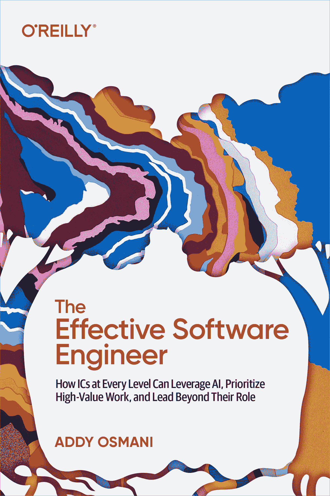

# 高效软件工程师（致 Raymond Rhine）

[*OceanofPDF.com*](https://oceanofpdf.com)

## 对《高效软件工程师》的赞誉

> 不要只做事，要做正确的事：使用这本实用指南来提升你作为工程师的技能和影响力。本书中的具体步骤和实用示例使其成为帮助你提升软件工程师影响力的有用伴侣。

> Lena Reinhard，工程副总裁、领导力及执行教练、创始人

> Osmani 将模糊的“有效性”概念转化为具体、可操作的策略。对于那些想知道为什么自己的出色工作没有转化为职业发展的中级工程师来说，这是必读之作。

> Teal Bauer，创始人兼董事总经理，Starsong Consulting

> 许多工程师难以理解如何产生影响。本书提供了一张地图，包含许多实用工具，帮助工程师提升影响力并在职业生涯中成长。

> Patrick Kua，Tech Lead Academy 创始人

> 本书赋能每一位个人贡献者去思考更大、更有影响力地领导，并提升他们的技术旅程。必读！

> Akanksha Gupta，软件开发经理，AWS—亚马逊

> 一本简洁的指南，提醒个人贡献者如何更有意地引导自己的时间和精力。

> Shawna Martell，首席工程师，Imprint

[*OceanofPDF.com*](https://oceanofpdf.com)

[*OceanofPDF.com*](https://oceanofpdf.com)

## 第一版修订历史

* 2026-02-11：首次发布

有关发布详情，请参阅 [*https://oreilly.com/catalog/errata.csp?isbn=9798341638174*](https://oreilly.com/catalog/errata.csp?isbn=9798341638174)。

\[LSI\]

[*OceanofPDF.com*](https://oceanofpdf.com)

## 前言

在软件工程中，理解 *效率* 与 *有效性* 之间的区别至关重要。正如管理顾问彼得·德鲁克所说：“效率是把事情做对；有效性是做对的事情。” *​*理想情况下，你希望两者都出色。本书《高效软件工程师》旨在帮助各个层级的个人贡献者（IC）最大化其影响力和有效性，而不仅仅是产出。

我们经常陷入编码细节，专注于速度和优雅。然而，真正的有效性超越了技术技能。它意味着理解大局、优先处理有价值的任务、顺畅协作，并做出与业务目标一致的决策。

本书汇集了我多年在软件行业中的经验，充满了经验教训和实用建议。它旨在成为你可以在整个职业生涯中反复查阅的资源，在你成长过程中提供指导。

我们将探讨每个有效工程师所需的基本技能，以及区分高级和员工工程师的战略思维和领导力。我们还将探讨团队动态的细微差别和持续学习的必要性，展示你在各种环境中如何蓬勃发展，包括远程环境。

本书适用于任何希望推进职业生涯或在晋升后在新角色中蓬勃发展的软件工程师。无论你是刚起步的初级工程师还是经验丰富的技术负责人，我希望它能提供宝贵的见解和可操作的策略，以提升你在软件开发中的有效性和影响力。

## 超越“高效”

*高效的工程师把事情做对。有效的工程师做对的事情。理想情况下，做对的事情并把它们做对。*这一原则呼应了彼得·德鲁克的智慧，捕捉到了真正专业所在，而这正是我们将一起探索的旅程。

让我们坦诚地说。作为软件工程师，我们经常痴迷于 *效率*。我们调整集成开发环境（IDE）、学习最新的键盘快捷键，并努力编写简洁优雅的代码。我们为把事情做 *对* 而自豪。这很重要。没有人想与混乱、有 bug 或难以理解的代码共事。效率是基本要求。

## Note

当我们在代码质量的背景下谈论“高效代码”时，我们通常指的是在计算上性能良好的代码。在本书中，我们更广泛地使用“高效”来描述工作富有成效的工程师——这一区别很重要，以避免混淆。

但仅靠效率是不够的。你可以是世界上最快、最技术精湛的编码员，以惊人的速度 churn 出完美优化的代码行……却完全 *无效*。为什么？因为你在构建错误的东西。

本书关乎 *有效性*，这种区别至关重要。

想想看。你是否曾倾注心血于一个项目，精心打造每一个功能，却最终被搁置？或者你可能构建了一个完全符合初始规范的功能，但没人使用它？有时初始的 [需求](https://oreil.ly/xo3pM)（通常更适合被视为协作的起点而非固定规范）发生了变化，市场发生了转变，或者最初的问题甚至不是 *真正* 的问题。即使你已在给定的需求上有效交付，最终结果仍可能不尽如人意。这就是无效的刺痛感。更甚于排期问题，这会耗尽推动真正成果所需的创造性能量和潜力。虽然并非每一次无效的结果都在你的控制范围内——有时项目因自上而下的组织决策而被搁置——但理解什么是有效性有助于你更好地应对这些情况。

## 什么是有效性？

在软件工程中定义“有效性”可能出人意料地棘手。它更细致、更具情境性，坦白说，更 *人性化*，而非简单的指标。

在核心层面，有效性关乎交付价值。它关乎最大化积极成果。它关乎确保你的努力、你的技能和你的时间都指向对你的团队、你的公司、最终对你的用户真正*重要*的事情。这适用于你是在构建面向客户的功能、维护内部工具和平台，还是支持基础设施。这种价值可以以多种方式体现：

### 解决正确的问题

这听起来可能显而易见，但我们却常常惊讶地发现自己陷入了*如何*做，却没有完全理解*为什么*要做。有效的工程师会深入挖掘以理解根本需求、根本原因和期望结果。他们会深思熟虑地问“为什么”——不是为了阻碍或过度怀疑，而是为了确保每个人对所要解决的问题达成一致。

### 交付有影响力的工作

并非所有工作都同等重要。某些工作对用户参与度、收入或战略目标有巨大影响。其他工作……没有。有效的工程师能够（在团队和利益相关者的帮助下）优先排序并专注于能够推动进展的工作。

### 创建可持续的解决方案

有效性不仅仅关乎短期。它关乎构建可维护、可扩展且可适应的解决方案——我们常称之为工程卓越。一个快速的临时方案在当时可能看起来很高效，但如果它制造了技术债务的山脉，那么最终是无效的。这并不意味着过度设计一切；这意味着在你的情境下找到速度与可持续性之间的正确平衡。

### 良好的协作

软件工程很少是单人完成的。有效的个人贡献者也是强大的团队成员。他们沟通清晰、分享知识，并为积极高效的团队环境做出贡献。

### 优化环境

随着工程师在角色中成长，有效性也可能意味着改善更广泛的工程环境——消除瓶颈并为团队优化输入。实践中，这可能意味着简化构建管道、改善持续集成/持续交付或部署（CI/CD）可靠性，或为使每个人更高效的内部开发者平台做出贡献。许多组织现在专门投资“平台工程”团队，以加速软件交付并改善开发者体验。随着你晋升，这变得更相关，尽管对于仍在建立基础技能的初级工程师来说，这并不是期望。

这些原则构成了有效工程师思维的核心。它们引导你不仅解决技术问题，而且以可持续和协作的方式解决正确的技术问题，这正是我们将要探索的核心主题。

## “做正确的事，正确地做”光谱

“做正确的事，正确地做”并不是一个二元开关。它是一个光谱，一个持续的平衡行为。让我们用一些例子来分解：

### 做错事做错

这是最坏的情况。你不仅在构建没人需要的东西，而且还做得很糟糕。例如，构建一个用户从未要求过的复杂功能，且实现有 bug 且没有测试。这就是项目走向死亡的地方。

### 做错事做对

这是“抛光的粪便”场景。你构建的东西很精美，但从根本上是无用的。例如，花三个月构建一个架构完美的微服务，用于用户研究显示没人想要的功能。这通常是由于沟通不畅、缺乏用户研究，或追逐没有明确目的的新技术所致。

### 做对事做错

事情变得有趣了。你正在解决一个真实的需求，但你的执行有缺陷。也许代码有 bug，架构不可持续，或用户体验笨拙。这个类别也包括“快速发布并迭代”的理念——有时“错误”的执行实际上是正确的战略选择，当上市速度比完美更重要时。你将从真实世界的反馈中学习并迭代改进。好消息是，这是可以修复的！提升你的技术技能和流程可以让你更接近理想。

### 做对事做对

这是最佳状态。你正在交付有价值、高质量的解决方案，满足用户和组织的需求。这就是你想要待的地方。

本书将为你提供工具、技术和思维方式，帮助你持续向那个最佳状态迈进——做正确的事，正确地做。它将更少关于如何写一个完美的 for 循环，而更多关于，例如，判断你是否真的需要一个 for 循环。

## 为什么是这本书，为什么是现在？

软件工程领域不断演变。新技术涌现，方法论转变，对工程师的需求持续增长。在这种环境下，仅成为*优秀*的编码者是不够的。你需要成为战略思考者和有效的解决问题者。

本书旨在成为希望提升影响力的个人贡献者的实用指南。它不是理论性论述；它是一系列可操作的见解、真实案例和务实建议，源自软件行业多年经验（以及大量错误！）。

## 你将发现的内容

我们将涵盖一系列主题，全部聚焦于帮助你成为更有效的工程师：

### 理解更大的图景

如何将你的工作与团队和组织的整体目标联系起来。

### 优先级和专注

如何识别最重要的任务并避免被干扰困住。

### 沟通与协作

如何与你的团队、利益相关者和用户有效合作。

### 问题解决和决策

如何应对复杂挑战并做出合理的技术选择。

### 持续学习和成长

如何保持相关性并适应不断变化的软件世界。

### 长期价值

如何在质量与实用主义之间取得平衡，避免累积技术债务。

### 资源和模板

[配套网站](https://effective.addy.ie)提供了贯穿全书引用的实用模板、框架和资源，帮助你立即应用这些概念。

本书是一个起点，而非终点。有效性是一段旅程，而非一份清单。它是一个持续学习、适应并努力产生有意义影响的过程。让我们开始吧。

## 本书使用的约定

本书使用以下排版约定：

*Italic*

表示新术语、URL、电子邮件地址、文件名和文件扩展名。

`Constant width`

用于程序列表，以及在段落中引用程序元素，如变量或函数名、数据库、数据类型、环境变量、语句和关键字。

## 使用代码示例

PROD：请联系作者，确认他们是否会将代码示例上传到 oreilly.com 或其自己的网站（例如 GitHub）。如果没有代码下载，请删除整个章节。如果有，在向 digidist 发送邮件并附上链接时，请告知他们 `title_title` 的填写内容（应尽可能接近书名，例如 `learning_python_2e`）。此信息将决定 digidist 将文件加载到何处。

补充材料（代码示例、练习等）可从 `https://github.com/oreillymedia/title_title` 下载。

如果您在使用代码示例时有技术问题或遇到问题，请发送电子邮件至 `support@oreilly.com`。

本书旨在帮助您完成工作。一般而言，如果本书提供了示例代码，您可以在自己的程序和文档中使用它。除非您要复制代码的很大一部分，否则无需联系我们征求许可。例如，编写一个使用本书中多个代码片段的程序不需要许可。出售或分发 O’Reilly 书籍中的示例需要许可。引用本书并引用示例代码来回答问题不需要许可。将大量示例代码纳入您产品的文档中则需要许可。

我们感谢，但通常不需要署名。署名通常包括标题、作者、出版商和 ISBN。例如：“*Book Title* by Some Author (O’Reilly). Copyright 2012 Some Copyright Holder, 978-0-596-xxxx-x。”

如果您认为自己对代码示例的使用超出了合理使用范围或上述许可范围，请随时联系我们 `permissions@oreilly.com`。

## O’Reilly 在线学习

## Note

40 多年来，*O’Reilly Media* 一直为公司提供技术和商业培训、知识和见解，帮助公司取得成功。

我们独特的专家和创新者网络通过书籍、文章和我们的在线学习平台分享他们的知识和专业技能。O’Reilly 的在线学习平台为您提供按需访问实时培训课程、深入学习路径、交互式编码环境，以及来自 O’Reilly 和 200 多家其他出版商的庞大文本和视频收藏。有关更多信息，请访问 `https://oreilly.com`。

## 如何联系我们

请将有关本书的评论和问题发送给出版商：

* O’Reilly Media, Inc.
* 141 Stony Circle, Suite 195
* Santa Rosa, CA 95401
* 800-889-8969（美国或加拿大境内）
* 707-827-7019（国际或本地）
* 707-829-0104（传真）
* `support@oreilly.com`
* `https://oreilly.com/about/contact.html`

我们为本书设有网页，在该页面上列出勘误表和任何补充信息。您可以通过 `https://oreil.ly/the-effective-software-engineer` 访问此页面。

不要忘记更新上面的链接。

有关我们书籍和课程的新闻和信息，请访问 `https://oreilly.com`。

在 LinkedIn 上找到我们：`https://linkedin.com/company/oreilly-media`。

在 YouTube 上观看我们：`https://youtube.com/oreillymedia`。

## 致谢

特别感谢 Stephen Covey、Daniel Clifford、Jeff Dean、Titus Winters、Hyrum Wright、Ben Collins-Sussman、Sarah Drasner、Fernando Loizides、Malte Ubl、Timothy Jordan、Richard Seroter 以及激励我的众多工程领导者。

`https://oceanofpdf.com`
