## 第一章

### 神圣的福利

#### 一门技艺的演变

DOI: [10.4324/9781003008439-3](https://doi.org/10.4324/9781003008439-3)

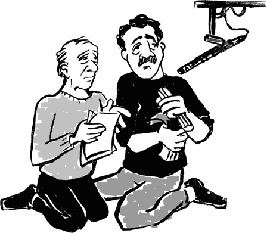

在我开始研究福利的起源和发展时，有几件事变得显而易见。首先，流传着许多神话和不准确的信息，它们加剧了人们对福利起源和发展之谜的误解。其次，这门技艺的从业者非常忙于工作，几乎没有时间记录他们的技艺是如何形成或他们如何开展工作的历史。最后，那些研究和报道福利技艺和起源，或电影声音任何方面的人，如果不属于这一文化，就会通过不同的视角看待这个世界，因此他们的观察和结论与那些“亲身经历”过的人不同。作为曾在电影行业工作并现在拥抱学术报道使命的人，我的目的是在尽可能的基础上，根据文献资料和对几位参与技艺发展和“体系”规范化的关键人物的个人访谈，揭示福利的起源、发展和实践。虽然我只能呈现“反思型研究者”的叙述，但我提供的是电影行业在声音出现初期以及随后演变时期的基本概述，同时也公平地呈现了为福利技艺发展做出贡献的个人，以及为其历史发展提供宝贵见解的人。

### 美国

我们许多电影行业的人都认为，杰克·福利——这门技艺以他命名——是一名音效剪辑师，他开始为自己的胶片表演脚步提示音，从而开始了为那些既没有才华也没有耐心自行完成此事的其他剪辑师服务的职业生涯。据了解，这导致杰克随后表演了一些道具，这些道具更适合由他而非剪辑室来完成。顺着这条线，谣言流传说杰克来自英国，并在 1950 年代和 1960 年代活跃。有人说他来自环球影城，并且人们认为在环球工作过的剪辑师和福利艺术家一定认识那位受人尊敬的福利先生。后制作声音领域几乎每个人对杰克都有某种认识，而我们现在知道这些都是不准确的。我记得 1989 年 7 月我在*《大卫·莱特曼深夜秀》*的出场，当时我在全国电视上继续传播了这个神话。我现在觉得有义务在每个观看该集片段的观众或班级面前纠正记录。那么，让我们从杰克·福利是谁以及为什么他被认为是当今福利技艺的先驱开始。

#### 杰克机敏：多面手杰克

# 杰克·福利

杰克·福利是爱尔兰裔的纽约人，成长于长岛。他的家庭信奉天主教，这对许多爱尔兰移民来说也是如此。长距离锦标赛游泳运动员比阿特丽斯·雷姆与杰克在电话公司共事，而杰克也打半职业棒球。他们通过一位共同朋友相识。她是新教徒，这在双方家庭中都成为冲突的来源。他们秘密结婚并搬到西海岸，杰克希望在较温和的气候中从事棒球事业。不久之后，他们在纽约举行了传统婚礼，据杰克的孙女凯瑟琳·克拉克说，这使双方家庭得以团聚。比娅后来改信天主教。

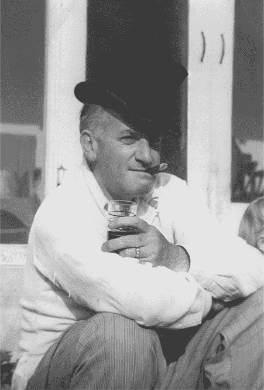

*图 1.2* *杰克·福利展现了他显著的古怪幽默，孙女凯瑟琳·克拉克部分可见，坐在他身旁。* ¶ *来源：照片由凯瑟琳·克拉克提供*

1914 年，杰克和比娅搬到加利福尼亚，先到圣莫尼卡，后来又搬到因约县内陆的一个小镇比什普。一战期间，杰克在美国防卫协会服役，并被指派秘密守护当地供水系统免受破坏。杰克还在当地五金店工作，并在比什普抚养四个孩子。他是当地社区剧院的常客，担任演员、编剧和导演，也在当地报纸撰写文章。他是漫画家，因此也为当地报纸创作漫画条。杰克据所有说法都是一个相当迷人的外向者。他的孙女会不断称他为“a people person”。杰克显然是一个多才多艺的人，所以当该地区农民将农场卖给洛杉矶以换取水权，比什普镇需要收入时，杰克会成为寻找维持他所收养的家乡的创造性方法的人之一也就不足为奇了。

杰克·福利看到了比什普作为西部片拍摄地点的潜力，这是在附近洛杉矶的这项新“电影摄影业务”中。对于一个有企业家精神的人来说，这是一个令人兴奋的时代。电影业是新的，并且每天都在被重新发明。一旦杰克说服当地店主了解外景拍摄对比什普的经济促进作用，他便着手说服洛杉矶地区的小型电影制片厂来到他美丽的小镇。必须指出的是，“电影摄影业务”并没有以任何有组织的流程发展。正如互联网——其社交网络、信息获取以及博客、聊天室和在线游戏的融合——以一种混乱而令人兴奋的方式开始，二十世纪初的电影环境也是如此。对任何拥有“魄力”和独创性的人来说都是开放的季节。许多被传记收录的电影先驱都有这些品质。这很重要，因为必须认识到杰克·福利不仅仅是一个想要为家人提供稳定工作和收入的人。他愿意在一种不可预测的新兴业务上冒险，这种业务需要参与者的灵活性和创造力。

到杰克三十多岁时，他已将自己在电影业务方面的萌芽人脉转化为特技演员和替身的职业。他成为导演威廉·克拉夫特的助手，并最终执导了由本尼·鲁宾主演的短片。当时电影的惯例是，每个人都在自己能力范围内尽力而为，取决于他们的才华和承诺。起初并没有固定的职位。职位头衔不是常见做法，人们根据所需技能在工作之间转换。因此，当环球需要为*Showboat*（1929）配音时，杰克是那些抓住机会参与并帮助解决这一新技术带来的最新问题的人——或视其为机遇，取决于个人的观点。

当*The Jazz Singer*（1927）上映时，华纳兄弟为阿尔·约尔森即兴演唱的表演录制了少量声音片段，同时其余影片仍作为默片制作。所使用的方法是 Vitaphone 唱片声音系统，这是当时两种技术之一。第二种是 Fox-Case 系统，它利用胶片上的声音。环球刚刚制作了默片*Showboat*，该片基于埃德娜·费伯的小说，而不是百老汇音乐剧。这部电影不是著名的克恩-哈默斯坦音乐剧，但借助这种新声音技术，可以添加音乐，以及一些对话和同步音效。正如大卫·尤德尔在其著作*Practical Art of Motion Picture Sound*中所述，环球租用了 Fox-Case 声音装置来为影片录制音乐、声音和音效。杰克与其他各大制片厂的人一起，参加了南加州大学的一门课程，介绍这种新声音技术。当制片厂最终准备为影片配音时，只有一个录音棚，有管弦乐队、歌手和声音人员——包括杰克——实时为影片配音。杰克和一些选定的同事做了拍手、脚步声以及他们能凑到的任何道具的声音，以及影片的背景人声。这是杰克作为该新电影领域先驱的新道路的开始，当时该领域还没有名字。杰克·福利在电影制作方面发展了许多技能，包括导演、演员、编剧、漫画家、棒球运动员和特技演员，但正是他进入新声音技术，使杰克成为发展这一新职业的人。他最初是出于必要而发明的，发展成为一种受人尊敬的手艺，然后后来被他人改进和完善，成为一种细腻且受人尊敬的、以他命名的音效领域。

随着杰克·福利继续为电影配音，专注于道具和脚步声以及一些布料声，这些声音实践发展成为电影制作过程的有机组成部分。杰克在一个常规录音棚工作，享有与制作期间演员在片场所获得的同等声音支持。他有道具人员、录音专家和声音助理。随着技术的发展，他改变了表演技巧。杰克作为一名音效师职业生涯的形成期，声音是原始的。只能录制一轨，这决定了杰克必须使用的方法。他有一块布放在后口袋里，以便为服装声拉出来，他还有一根拐杖，用来制造同时有多人行走的错觉。

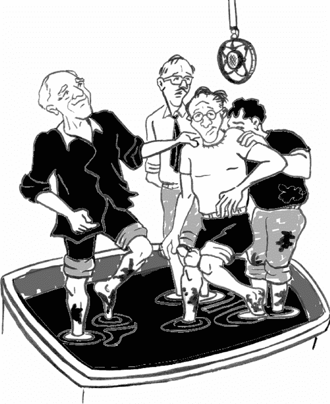

根据他孙女凯瑟琳·克拉克的说法，杰克会在厨房里摆弄各种小玩意儿，看看它们的声音如何。因为在此之前没有人做过，所以没有关于艺术或流程的争论。杰克发展了自己的技巧，这些技巧也成为他助理的标准。克拉克女士说，杰克所做的事情很长一段时间都是秘密，甚至他的家人起初也不清楚他在环球做什么。当他们在片场拜访他时，他通常穿着西装，会坐在长椅上为一家演艺圈贸易报撰写专栏，或在办公室里。他的家人从未见过他工作。直到接近他退休时，他的真正职业才在业界普遍为人所知。

随着其他制片厂聘用了曾与杰克合作过的人，他们开发了自己的为画面配音系统。虽然杰克·福利本人从未担任过剪辑师，但其他音效剪辑师开始采纳他的做法，并为那些希望成为“福利行走师”的人制定了培训规程。 他对表演式音效实践的影响使杰克成为音效界的传奇人物，他被编辑工会吸纳为荣誉会员，并获得了电影音效剪辑师协会颁发的终身成就奖。

如今在电影和电视中实践的福利技术的历史早期起源于杰克·福利，但也有其他人促成了其发展。他们来自不同的背景，在音效方面有不同的经验。音效的现场表演不仅用于电影，也用于广播和电视。从广播剧到电视新闻，音效开始被表演、录制、剪辑并混入媒体的各个方面，视技术所允许。

## 鸡生蛋还是蛋生鸡？

罗伯特·L·莫特比杰克·福利晚一代，是广播和电视领域的音效师。第二次世界大战服役后，他进入纽约大学（NYU）学习编剧。NYU 有一个广播节目，莫特通过在校的人脉关系，学徒并受训成为大学在 WGYN 电台播出的节目的音效师。莫特在其著作 *音效、广播电视与电影* 和 *现场广播！现场电视！* 中记述了他许多经历。莫特已不在人世，但我与他交谈时，发现他是一位令人愉快的绅士，他已退休于加州中部海岸，在职业生涯中拥有丰富的广播和电视节目工作经验。莫特曾是一名鼓手，这促进了他作为电视作家的职业生涯，并培养了他对声音戏剧的兴趣。

据莫特称，受英国音乐厅影响的杂耍，是任何对为广播创作音效感兴趣的人的重要训练基地。在杂耍中，鼓手负责用鼓组突出笑点和戏剧效果。鼓手通常会根据演员的提示进行演奏。观众习惯了某些鼓效被用于特定的笑点音效。当广播开始在广播剧中加入声音时，音效师有时就是这些曾在杂耍中工作的鼓手。这逐渐发展为使用唱片、小玩意和其他道具的使用。正如他们在杂耍中所做的那样，如今的鼓手，即音效师，会根据演员的提示进行演奏。随着广播剧的发展，演员和音效师会相互配合，这自然导致更多的音效来支持演员的动作。

在他著作 *无声电影之声* 中，里克·奥尔特曼提醒我们，音乐被用来模仿屏幕上某些动作的支持音效。让声音支持故事的惯例早在技术进步使其更具体地制作之前就已确立。杂耍利用鼓组来强调音效的同时，无声电影使用风琴、现场管弦乐队或唱片。

对我们而言重要的是，一旦广播音效变得流行，它就影响了电影和电视。很难知道一旦它们同时存在，一个媒介如何影响另一个媒介，但很容易看出广播音效、电影音效以及后来的电视音效如何影响了各自的技术。当时，莫特在广播和电视的工作仅被称为“音效师”，即使从事这项工作的人中有许多是女性。录制音效与道具或现场表演脚步声之间没有区别。一个人员完成所有这些。如今，如果有人看到现场广播节目表演，音效人员可能会被称为福利艺术家。但这在历史上是不准确的。甚至杰克·福利也不被视为福利艺术家；那个术语出现得更晚。福利和莫特都是 *音效师*。

## 制片厂制度

约翰·波斯特是一名音效剪辑师和福利艺术家，在杰克·福利退休后不久就在环球工作。虽然他从未与杰克共事，但通过制片厂制度和编辑工会发展起来的惯例建立了规范的后期制作音效培训体系，波斯特由此成长为受人尊敬的艺术家，并成为后来许多福利艺术家的导师。他是连接杰克·福利时代——他开发了这一流程——到电影音效爆炸式增长时代的重要“纽带”。波斯特退休于电影业，并于 2010 年去世。然而，他对业界的回忆对我们理解福利艺术家生活的变迁具有无价的价值。波斯特为 *Christine*（1983）、*Repo Man*（1984）和 *Salvador*（1986）等影片制作了福利音效。临终前不久，波斯特于 2009 年在美国电影艺术与科学学院举办的关于恐怖片音效的特别活动中获表彰。

波斯特擅长“行走”角色的脚步声，很快就被要求为技巧较差的其他剪辑师“行走”。这种做法发展到波斯特定期表演道具音效，因为他能快速而富有创造性地完成，因此他成为“福利行走师”并停止了剪辑。正如波斯特所说，同时已经有一些人，大多是女性，曾是电影中的舞者，为音效剪辑师表演脚步声和一些道具。这是从音乐片时代自然过渡过来的，当时在拍摄完画面后，会在录音棚里由专门此技能的舞者加入舞蹈音效。这些人大多是女性，因为存在女性更协调的偏见。

在某个时期，约翰·波斯特与另一位从音效剪辑师转为福利行走师的杜安·亨塞尔配对。他们在整个 1970 年代为环球的所有电视节目制作福利音效。作为团队，他们都拥有剪辑音效的视角，知道什么会被剪辑，什么需要“福利化”。这使他们与那些从未剪辑过音效的其他行走师区别开来。在今天电影、电视和流媒体剧集娱乐“重福利”的世界里，大多数福利艺术家专注于福利表演，而没有成为音效剪辑师。

波斯特记得在环球成为福利行走师的培训制度要求在实际剪辑前担任音效剪辑助理长达八年。新剪辑师会被分配简单的剪辑任务。只有经验丰富的剪辑师才被允许为自己或其他剪辑师表演福利。在电影音效的那个时期，工会会员资格和培训有严格要求。一个人要先学徒，然后助理，然后剪辑，最后监督。随着岁月的推移，这些要求已大大放宽。今天，正式的培训和责任晋升几乎已被完全放弃，以适应现代技术迅速变化的要求。

当我还是在训练中的年轻舞者时，我在圣地亚哥的音乐剧制作中表演过。其中一位舞蹈老师，她也执导了一些演出，是一名前*我们的帮派*演员 Bonnie Jean Gore。“教练”Gore 告诉我她在后期制作中无署名替换 Ann Miller 舞蹈声的故事。当时我并不了解这种做法，但一旦我开始为剧情长片替换福利舞步，我对这项技能所包含的内容有了更大的[content]
当我还是在训练中的年轻舞者时，我在圣地亚哥的音乐剧制作中表演过。其中一位舞蹈老师，她也执导了一些演出，是一名前*我们的帮派*演员 Bonnie Jean Gore。“教练”Gore 告诉我她在后期制作中无署名替换 Ann Miller 舞蹈声的故事。当时我并不了解这种做法，但一旦我开始为剧情长片替换福利舞步，我对这项技能所包含的内容有了更大的欣赏。MGM 编舞 Hermes Pan 据称曾为 Fred Astaire 和 Eleanor Powell 制作舞蹈福利。毫无争议且完全符合其性格的是，Gene Kelly 自己做了自己的舞蹈福利。Kelly 先生是一个完美主义者，坚持亲自完成自己的特技工作，也亲自录制了自己舞蹈的声音。舞蹈并不总是现场动作，也不总是人类。在动画电影*猫不会跳舞*（1997）中，动物们跳舞，声音是在福利舞台上完成的。这是 Kelly 先生参与的最后一部电影项目。他是动画舞蹈步伐的顾问。

在 1960 年代和 1970 年代，音效编辑属于工会，但新规范化的福利行走工作不在任何工会中。这一直保持到 2006 年夏天，“福利艺术家”才最终被纳入电影剪辑工会的官方类别。在那之前，任何在剪辑工会中的福利艺术家都被接受为音效编辑类别。一些早期的福利艺术家曾是舞者，他们在美国演员工会中。

在 Jack Foley 在环球影业任职期间，录制声音的场地发生了变化。大多数时候，Jack 会在录音棚里。为他隔离声音而建造了一座建筑物。这将被称作“福利的房间”或“福利的舞台”。现在，表演福利的录音棚正式称为福利舞台——这是一个明显的致敬。Desilu Studios，原本是 RKO，建造了第一个官方福利录音室，根据好莱坞口头传统，正是在那时该术语才成为官方。

Ken Dufva 和 David Lee Fein 多年来是电影行业“寿命最长的福利团队”，他们作为福利艺术家合作了 21 年，直到 1990 年代后期。他们最初在 MGM 工作，后来在派拉蒙工作。他们两人进入系统时，制片厂对电影制作几乎所有工作都有标准化的晋升路径，而工会和行会对员工的培训和工作保护有着强大的影响力。因此，Dufva 和 Fein 单独和共同对福利世界从 1960 年代到现在的成长和变化都有相当有趣的见解。

Dufva 于 1965 年被分配到 MGM 的放映员工作。他在 MGM 的团队中工作了 11 年，在此期间，他以常驻放映员的身份转到福利舞台。当时的做法很常见，通过工会拥有大量的工作保障和保护，Dufva 在 MGM 非常稳固。然而，从一个工会的一个职位转到另一个工会的职位是棘手的。当 Dufva 有机会转到声音部门担任编辑和福利行走者时，该职位 materialize 花了一些时间。Dufva 是从福利放映员的位置上接替即将退休的 Jack Morissette。

David Fein 进入福利的道路实际上始于 Gomillion Sound。他曾在小型独立电影中担任编辑，然后自然而然地进入福利。当他有机会试镜在 MGM 替换 Scott Perry 时，Fein 非常紧张。虽然他在 Gomillion 做过一些福利，但 MGM 提供了巨大的机会，他不想表现糟糕。Fein 回忆在试镜时“感觉背后有某个挑剔的人在盯着”。试镜导致 Fein 被聘为行走福利的音效编辑，几个月后，当 Dufva 加入团队时，他们的合作开始了。最初两年，Dufva 和 Fein 与第三位老将 Lovell Norman 一起工作，直到他退休。Norman 然后被另一位福利艺术家取代，而那位艺术家在退休时也被取代。最终只剩下他们两人——Dufva 和 Fein。即使好莱坞其他地方都采用了标准的两人福利艺术家惯例，Dufva 和 Fein 也是最后失去第三位福利艺术家的人。Jack Foley 可能是好莱坞第一个创造福利艺术家角色的人，但 MGM 将该角色扩展得更加实质化。

“肯尼和戴夫”，业内人士如此称呼他们，两人举止温和，互相尊重，工作态度专业。他们彼此高度尊重，从未发生过任何冲突。他们合作得如此默契，甚至不需要讨论谁来做哪个提示或如何处理。他们拥有一个真正功能性的福利“婚姻”，所有认识他们或与他们合作的人都钦佩这一点。他们将此归因于他们之间缺乏竞争，当两人一起时，很快就能看出他们真诚地喜欢并钦佩彼此。然而，他们也被认为是最好的福利团队之一，他们的工作备受重视。他们处理了大量主要电影，包括*机械战警*（1987）、*人鬼情未了*（1990）和*教父：第三部*（1990），尽管直到 1980 年代后期，福利艺术家才定期获得银幕署名。因此，除非仔细研究或来自后期制作声音，否则他们可能永远不会意识到该团队为多少部电影制作了福利。Dufva 和 Fein 也一直热衷于参与任何关于福利的教育项目，因为他们重视传承传统并向他人介绍这门手艺。

Dufva 和 Fein 开始工作时，福利是录制在一轨上的。大多数道具效果都是后期编辑进去的，所以他们的任务更侧重于角色的脚步声。拥有三个人作为行走者可以同时覆盖多个角色。由于录制和重录技术仍然相当简单，混音不包括立体声混音或声像定位，这是现在常见的做法。只要主要角色脚步提示保持在一起，背景脚步声保持在一起，角色就可以轻松组合或“结婚”。当然，随着技术允许角色和道具的分离更多，这就改变了。

Dufva 和 Fein 开始合作时，MGM 的福利舞台上有九人团队。有三名行走者、一名放映员、一名 boom 人、一名混音师、一名录音师和两名道具人员。这一传统符合制作中可能出现在录音棚的人员。但随着岁月的推移和系统的演变，传统变成了两名行走者、一名混音师、一名录音师和一名放映员。舞台开始积累道具，在一次录制期间很少需要有人去取道具。当 Dufva 和 Fein 没有表演福利时，他们在编辑，因为他们既是编辑也是福利艺术家。

Ross Taylor 和 Kitty Malone 合作了 20 多年，是福利艺术家团队。Taylor 曾是音效编辑，自己编辑过自己的脚步声。类似于 John Post，Taylor 也被分配为编辑为其他编辑做福利脚步声。Malone 是*安迪·威廉姆斯秀*的舞者。当在墨西哥拍摄的*泰山*电视系列剧需要福利脚步声时，一个认识 Malone 的人建议她被聘用来替换丛林英雄的声音。她继续作为福利行走者（无署名）为该系列工作，即使她继续为*斯莫瑟斯兄弟喜剧时间*跳舞。

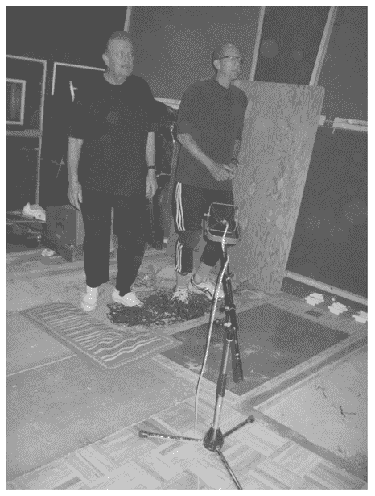

*图 1.4* *资深拟音师 Ken Dufva（左）和 David Fein（右）为一部电影表演脚步声提示。* ¶ *来源：照片由 Steve Lee 提供，Hollywood Lost and Found*

Taylor 和 Malone 组成拟音团队后，他们从 1971 年起全职工作，直到 Taylor 于 1992 年退休。他们是一个独特的团队，因为 Taylor 是一位受人尊敬的剪辑师和拟音师，而 Malone 本身就是一位成名舞者、备受赞誉的拟音师，同时也是一名演员。Malone 继续工作至 2003 年。与 Dufva 和 Fein 相比，使这对组合成为寿命最长的拟音团队的 distinguishing 点在于，他们既单独工作也一起工作，而且 Malone 还担任演员，而 Taylor 也继续从事剪辑。尽管他们的合作持续了同样长的时间，但他们并非在整个期间都像 Dufva 和 Fein 那样是一个单一整体。

拟音界另一支备受认可的团队是 Margie O’Malley（Deneke）和 Fred J. Brown [*《野蛮人柯南》* (1982) and *最后的* *星际战士* (1984)]。而 O’Malley 严格来说是一名拟音师，Brown 则是表演拟音的声音剪辑师。当 O’Malley 开始在旧金山湾区与 Jennifer Myers [*《英国病人》* (1996) 和 *《心灵捕手》* (1997)] 以及 Marnie Moore [*《巧克力》* (2000) 和 *《歌唱侦探》* (2003)] 合作时，Brown 继续在洛杉矶工作至 1997 年。

### 现实主义

Robert Rutledge 被列于此，他属于 John Post 的过渡拟音世代之一，尽管他年纪较轻。他的母亲 Evelyn Rutledge 是最早的女性声音剪辑师之一，而 Rutledge 年轻时曾与母亲共事。虽然他继承了这一职业，但他凭借自己成为了一位受人尊敬且才华横溢的声音和对白剪辑师，并亲自完成了大量拟音工作 [*《狼人》* (1981) 和 *《Fandango》* (1985)]。Rutledge 的特别之处，以及他必须被纳入历史视角的原因在于，他将拟音棚理解为一个让拟音听起来像实拍的地方。由于 Rutledge 知道如何保留实拍声音，他强调拟音只需完成必要部分，并且听起来像是发生在实拍中。Rutledge 与其著名的声音同事 Walter Murch 一同以不喜欢喧宾夺主的拟音而闻名。

Rutledge 知道如何挑选节目、提取效果、监督团队、走位并剪辑拟音、拍摄和剪辑自动对白替换（ADR）、剪辑效果并监督最终混音。他是一位谦逊而低调的人，与其他拟音师合作时更像平等的伙伴而非他们的监督者。他是一个完美主义者，理解拟音如何在声音表演上达到卓越，而剪辑则有其自身任务。Rutledge 是最早说出“你必须把感觉做对。你可以剪同步。你剪不了‘感觉’。”的人之一。Rutledge 认为最好的拟音是直觉性的，他在拟音表演中拥有“成为角色”的特殊天赋。

Rutledge 将这些技艺传授给了他的两个继子 Scott 和 Gary Hecker。Scott 如今是一位获得奥斯卡提名的 supervising sound editor，Gary 则是拓展了富有创意的拟音实践的资深拟音师。

### 优雅先生

如果不提及 Charles L. Campbell，就不可能完整呈现这段好莱坞拟音历史，他留下了非凡的作品。Campbell 的职业生涯始于演员，并在电视和电影中担任声音剪辑师和监督。然而，他对拟音细节的关注以及为电影角色进行的“鞋履试镜”练习是独一无二的。Campbell 监督了诸如 *《米泽里》* (1990)、*《义海雄风》* (1992) 和 *《怒河风云》* (1994) 等电影。

Campbell 以一丝不苟的方法指导拟音师，这转化为许多声音创作。Campbell 与他的拟音师作为同事共同运作。Campbell 于 2013 年去世，但他对拟音的贡献将在未来数十年持续被感受到。他鼓励拟音师将拟音棚用作设计工坊，因此，他的多位常驻拟音师扩展了实践，纳入了更多在拟音棚中创作的特殊音效，而非局限于更典型的为电影角色进行声音具象化表演的做法。

Campbell 将因其温文尔雅的举止和优雅的、类似 Henry Fonda 的步伐而被铭记。然而，人们最会记住的是他坚持将拟音棚用于设计音效，以及他相信用声音突出电影叙事的重要性。

### 纽约，纽约

Elisha Birnbaum 在以色列是一名制作混音师和声音剪辑师。1955 年，他开始在配乐中加入后来才明白是拟音的内容。Birnbaum 是以色列的第一位拟音师。1970 年，他移民到纽约并创办了名为 Image Sound Studio 的声音公司。他拥有一台 Nagra 录音机和一台 Scully 双轨、四分之一英寸盘带录音机。他的公司设在传奇的 Brill Building 内的两间房里，他还带来了大量四分之一英寸的音效磁带。他聘请了一位名叫 Tom Fleischman 的年轻人——出于对年轻人母亲、画面剪辑师 Dede Allen 的情谊——来分类音效并将其整理成音效库。Birnbaum 使用其中一间房进行少量录音，包括拟音。

不久之后，Birnbaum 被一家小型公司 Sound One 的三位老板邀请成为他们的第四位合伙人。当时，Birnbaum 是纽约唯一的拟音师，基本上定义了纽约式的拟音风格——更自然主义，更接近他作为制作混音师所听到的声音。Birnbaum 为诸如 *《非常规追缉令》* (1987)、*《我的蓝色天堂》* (1990) 和 *《阴影与迷雾》* (1991) 等电影监督并亲自进行拟音。Sound One 成为纽约的主要后期制作声音设施，并保持了三十多年。Birnbaum 工作至 1996 年。作为他对拟音艺术的贡献之一，他培养了多位拟音师，包括现居新泽西 c5 的 Marco Costanzo。Costanzo 保持了 Birnbaum 设定的高标准。Birnbaum 曾评价 Costanzo，“我非常以 Marco 为傲。他是我所有拟音学生中最有才华的。”Birnbaum 是一位才华横溢的拟音师。他为许多电影创作了拟音，其中大多数未署名。此外，从 1970 年代起直至退休，Birnbaum 为每一位在纽约工作的声音专业人士提供了就业机会。Sound One 几乎没有竞争对手，直到 1989 年，在 supervising sound editor Skip Lievsay 和拟音师 Ron Bochar 的领导下 c5 开门营业。Tom Fleischman 于 1970 年为 Birnbaum 建立了第一个音效库，他留在了 Sound One——作为重录混音师获得了奥斯卡奖和艾美奖。

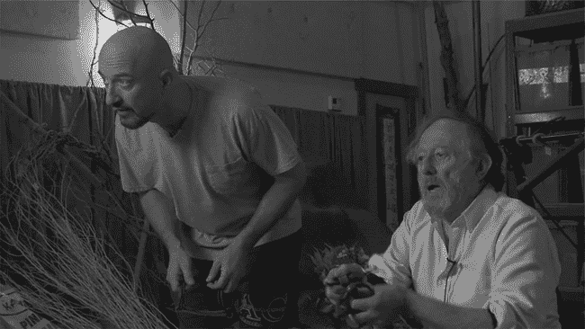

*图 1.5* *Marko Costanzo 和 Elisha Birnbaum 表演道具提示。* ¶ *来源：照片由 George Lara 提供*

### 湾区两岸

在旧金山湾区，曾有两家主要后期制作音效设施因其获奖的原声带而受到认可。Skywalker Sound 坐落在马林县尼卡西奥，是乔治·卢卡斯拥有的田园式圣地，而 Saul Zaentz Film Center 则位于伯克利直至 2018 年，是备受尊敬的电影音效设施，也是 Fantasy Records 的所在地。Skywalker 和 Zaentz 都因音效获得过奥斯卡奖，并且两者在 Foley 方面各有独特的做法。Skywalker Sound 曾聘请 Dennie Thorpe [*壮志凌云* (1983) 和 *拯救大兵瑞恩* (1998)] 担任首席 Foley 艺术家长达 25 多年，并逐步聘用了多位其他艺术家，包括 Jana Vance 和 Ronni Brown。Thorpe 主要自学成才，发展出了自己独特的 Foley 工作流程，并在工作时使用耳机——这对于 Foley 艺术家来说并不常见——并亲自培训了 Vance。Thorpe 和 Vance 从未在其他地方工作过，随着 Thorpe 退休，她将首席艺术家的职责传给了 Vance。Brown 曾与 Margie O’Malley 合作，并在湾区建立职业生涯后，于 2008 年开始在 Skywalker Sound 工作。目前，Skywalker 拥有两支 Foley 团队，其中 Vance 和 Brown 最常作为团队一起表演。更近些时候，John Roesch 和 Shelley Roden 作为迪士尼扩张的一部分加入了 Skywalker Sound。

在 Saul Zaentz Film Center 工作的 Foley 艺术家有时也在好莱坞工作，有时与 Thorpe 在 Skywalker 合作，也在旧金山电影界的其他设施工作。虽然 Skywalker 是音效专业人士的稳定据点，但 Zaentz 的人员同样很可能在伯克利设施之外也在好莱坞工作。

Murch 和 Splet 比其他音效设计师更少依赖 Foley。他们偏爱低调的 Foley，甚至会外出在自然环境中亲自录制 Foley，而不是在棚内录制。重录混音师 Mark Berger [*莫扎特传* (1984) 和 *致命的想法* (1991)] 讲述了一个关于 Foley 在 *教父：第二部* (1974) 中的故事，说明了 Murch 对 Foley 的叛逆做法。为了捕捉有人走上大理石楼梯的脚步声，Murch 和 Berger 使用闪光功能而非滴答声，将节拍器校准为每步一帧。Murch、Berger 和 Pat Jackson 然后去了旧金山的一栋建筑，并在二楼放置了一支麦克风。他们开始与闪光同步上楼。当他们回到剪辑室时，发现他们已经相当接近同步地完成了场景。对于 Murch 来说，这种在自然环境中伴随不可预测性的脚步 Foley 方法，比可能在 Foley 棚中出现的“净化”效果更可取。

# 章节 | 二

## 艺术的演进

### 国际 Foley 实践

DOI: [10.4324/9781003008439-4](https://doi.org/10.4324/9781003008439-4)

#### LES BRUITEURS：法国

Messieurs Pinvin 和 Plasman 是 “Bruiteurs”，即 “噪音制造者”，他们一起为法国的默片创作音效。Pinvin 为影片配音，Plasman 为道具制作音效。Plasman 在第一次世界大战中被烧伤——面部严重毁容——因此他更喜欢在幕后工作。这些人对所有音效只使用一条音轨。他们是经验丰富的马戏团工作人员，懂得使用麦克风并操作 16 毫米胶片。新的美国电影正进入法国，因此他们忙于为电影配音，让法国观众能够欣赏这些新娱乐。

一切必须同时表演。他们会表演声音和对白，然后停止。然后再表演，再停止。如果配音员犯错，Bruiteurs 就会从头开始。这一过程一直持续到技术发展到允许剪辑和多轨录音为止。

Julien Naudin 是法国的资深 Foley 艺术家之一。他的父亲也是如此，他的祖父也是，他师从 M. Plasman。Bruiteur 职业是一种家族传统。Naudin 训练了他的兄弟、妻子和女儿与他一起从事 Foley 工作。

在 Bruiteur 传统中，Foley 工作被视为更像一种艺术形式。不是像好莱坞那样被视为工业福特主义传统的一部分，Foley 被认为叙事的重要组成部分，艺术家与导演密切合作。Naudin 的父亲直接与 Jacques Tati 合作，为 Monsieur Hulot 的声音世界创造了奇思妙想。此外，法国 Foley 传统依赖于设有不同“房间”的棚，以对应房屋的各个区域。不是在单一录音棚录制大部分 Foley，Naudin 的工作室包含由帘子分隔的区域，设有带流水和全套家电的厨房、带可操作方向盘和仪表盘的汽车内饰，以及与任何可预见室内相匹配的家具陈设和表面。Naudin Foley 的一致性依赖于多个欧洲工作室，它们的工作区域和道具配置相似。

#### ACROSS THE POND：大不列颠联合王国

英国有多位 Foley 艺术家定期在电影、电视和纪录片中工作。其中一位艺术家是资深的 Peter Burgis。他的背景对于一名电影制作人来说很不寻常，尤其是对于一名 Foley 艺术家来说。Burgis 在英格兰德文郡开始工作，担任协助学习困难人士的专业人员。作为皇家空军的前成员，Burgis 被吸引去与“绝对是我自己版本”的问题青年工作，而在他参与“志愿者计划”期间，他开始为康沃尔的一家剪辑公司制作公共服务视频。这些努力最终让他为 BBC 主持节目，在那里 Burgis “爱上了镜头背后的工作”。在小型工作室担任跑腿时，他注意到左边的 Foley 棚，并说“[它]对我来说就像打开了阿拉丁的山洞”。

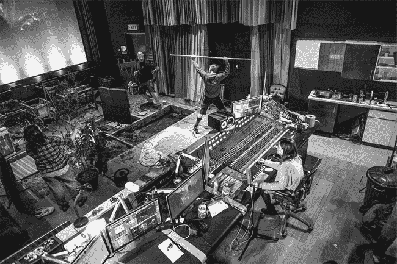

*图 2.2*  *Pete Burgis、Jason Swanscot 和 Zoe Freed，与 Jemma Riley 录音。* ¶ *来源：照片由 Pete Burgis 提供*

Burgis 不认为自己是技术型人才，更喜欢表演 Foley 的身体创造力。然而，他确实在小型工作室与 Foley 艺术家 Pauline Benion 和 Jack Stew 一起混音 Foley。Burgis 钦佩的是“他们两人之间的编排”。Burgis 偶尔会介入帮助这两位艺术家制作背景脚步声。正是 Benion 建议 Burgis：“你需要停止录音，你需要开始成为一名 Foley 艺术家。”这是在 1993 年，当时大不列颠正处于经济衰退，Benion 在“老派态度”占据主导的时期向 Burgis 介绍了会雇佣他的人。

Burgis 和他的好朋友、女演员 Andie Derrick 决定作为团队工作，Derrick “在我公寓练习了三天”以准备她与 Burgis 合作的第一天。作为一名公开的同性恋者，Burgis 在刚开始时在更传统的后期制作音效世界中遇到了一些偏见，并发现自己以对抗的方式回应。然而，随着他变得更有经验并在技艺上更加自信，Burgis 学到的“教育一个人的最好方式是善良”，这使他的职业生涯和专业精神得以提升，成为资深人士，而伦敦的后期制作音效也在技术和美学上不断进步。

Burgis 在制作 Foley 时认为自己是“炼金术士”。他信奉信念的悬置，并且在判断为 Foley 提示音搭配哪些声音组件时，“如果听起来对，并且能讲述我想呈现的故事，我就会用它。”他不会在意为声音使用可识别的道具，如果“另一件物体在动态上更好”。他有几个经常使用的最爱道具：他在皇家空军服役时 19 岁时买的 Zippo 打火机；他祖母的手包——“它发出最美妙的咔嗒声；”他儿子青少年时期的钱包；一些他在《哈利·波特》电影中为丹尼尔·雷德克里夫使用的 Hush Puppies 鞋——“他有阅读障碍，走路有点滑稽；”以及 Clarks 制作的一些莫卡辛鞋。

Meltem Baytok 和 Richard James Hinton 是主要在布里斯托尔工作的 Foley 艺术家。Baytok 原籍土耳其，在英语流利之前就在英国学习了 Foley。她依靠阅读演员的面部、情绪和反应来理解如何进行 Foley。“这就像是失聪并像读手语一样阅读他们的身体，”Baytok 说。

Hinton 既编辑自己的 Foley 也表演 Foley。他的 Foley 调音师最初使用名为 Pyramix 的基于 PC 的数字系统——来自瑞士——但现在他们使用 Pro Tools 以符合行业标准。Hinton 通常在没有提示单的情况下工作，并在录音时密切注意麦克风技术。在较小的房间里，他会把麦克风放置得更近，但在较大的 Foley 舞台上工作时，他喜欢麦克风有更大的距离。

## 靴子里的往昔：意大利
当人们想到意大利的声音时，最可能想到的名字是塞尔吉奥·莱昂内。他的电影以音效、Foley 和替换对白来强调叙事而著称。莱昂内和他的作曲家恩尼奥·莫里康内在拍摄 *西部往事* (1968) 的一帧胶片之前就使用了配乐技巧。演员在片场播放预先录制的配乐表演场景，以增强影片的风格、节奏和戏剧性。意大利有四位被认为是该工艺元老的 Foley 艺术家：Aldo Ciorba、Luciano Anzellotta、Italo Cameraccanna 和 Sergio Basili。莱昂内电影的 Foley 和特殊音效由 Ciorba、Anzellotta 和 Cameraccanna 完成。Basili 的职业生涯比前三位晚了一些，但也被列入最早的意大利 Foley 艺术家名单。Ciorba 的儿子 Marco Ciorba 继续着他父亲的传统和技巧

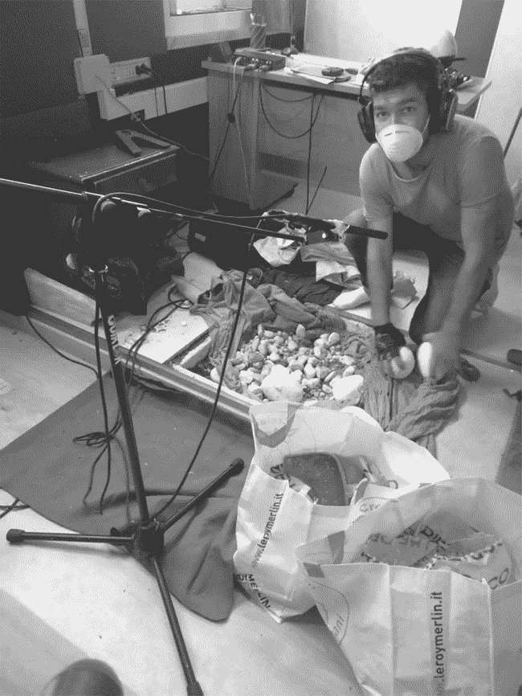

*图 2.3*  *Mauro Eusepi 进行落石 Foley。* ¶ *来源：照片由 Mauro Eusepi 提供*

用于在当今意大利电影中表演 Foley。通过他的翻译、导演 Riccardo Brex 与我交谈，Ciorba 解释了他是如何继承 Foley 职业的。在年长的 Ciorba 之前，其中一位声音创作者是 Tonino Cocciuttuolo。在意大利，对应于 Foley 的传统始于二十世纪早期。Cocciuttuolo 以其表演的音效而闻名。Aldo Ciorba——师从 Cocciuttuolo——也是如此，如今 Marco Ciorba 继续成为备受尊敬的意大利 Foley 艺术家。

在意大利，这种工艺的实践在一点上与法国和美国不同：艺术家有时会到片场观看制作的拍摄过程。这使艺术家熟悉布景、角色和影片风格。此外，Foley 艺术家与导演的关系比在美国更为密切。在大片上，与导演的合作感一直存在，也仍然存在。

罗马另一位 Foley 艺术家是 Mauro Eusepi，他在 Cine Citta 开始了自己的职业生涯，在那里他发现声音是电影制作的重要组成部分。在罗马第二大学学习新媒体和声音科学后，Eusepi 于 2005 年开始在后期制作声音设施 Dreamsound 担任实习生，并在 2009 年致力于自由 Foley 艺术家的职业生涯。目前他在罗马东部的 Pigneto 街区拥有自己的 Foley 舞台。Eusepi 同意 Aldo 的观点，认为在户外录制 Foley 是获得更自然声音和更大道具的首选方法，因为舞台本身相当小，更适合脚步声和小型道具工作。Eusepi 偏好尽可能接近实拍的声音：“\[y\]你能分辨出实拍声和人造声的区别。”为此，他会尽可能保留实拍声音，目的是让音效和 Foley“再现实拍声音的色彩”。他补充说，现代意大利导演通过倾向于使用更多实拍声音改变了早期的声音美学，因为意大利从影片开始到结束完全重建音轨的标志在过去几十年里已经演变。

有时，也许由于意大利新现实主义的影响，Foley 会在自然环境中进行——例如在森林外——以捕捉脚步声的正确声音和氛围。

## 诗人与思想家之国：德国
德国拥有发达的电影工业，因此该国拥有几位知名 Foley 艺术家也就不足为奇，例如 Martin Langenbach 和 Peter Deininger。德国 Foley 艺术家队伍中较新的成员之一是 Niklas Matthaei，他在担任 Foley 艺术家仅几年后就拥有了自己的工作室。Matthaei 曾学习文学、哲学和音乐，但他改变了教育轨迹，进入柏林的 Akademie Deutsche POP 学习声音。此后，Matthaei 尝试在各种声音设计和混音设施找到工作。他发现自己更擅长表演和混音 Foley，到 2019 年，他已全职担任 Foley 艺术家。

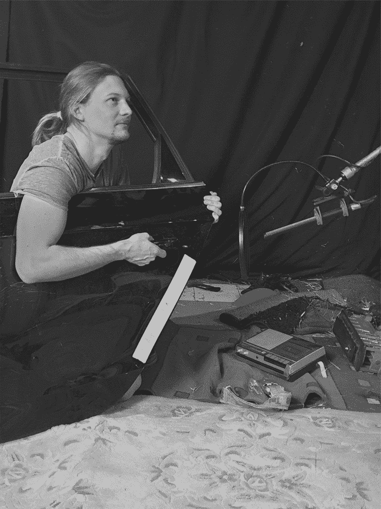

*图 2.4*  *Niklas Matthaei 在 DFM Berlin Foley 舞台上，由 Lisa Schnepp 拍摄。* ¶ *来源：照片由 Niklas Matthaei 提供*

在德国，艺术家自行录音并不罕见。虽然一些德国声音专业人士使用 Nuendo，但 Matthaei 使用 Pro Tools，这已成为公认的行业标准。Foley 的提示是调音师的职责之一，通常与导演进行两次定位会议。Matthaei 没有最喜欢的电影类型，但他更喜欢“有意义且具有挑战性的东西”。此外，他喜欢花时间把声音做好，因为他更喜欢不必重做或修改。“我不太擅长妥协。”虽然有人认为 Foley 艺术家应该使用屏幕上出现的确切道具，而其他人可能会“用那一个键做所有事情”，Matthaei 认为自己“介于两者之间”，更喜欢从导演那里获得大量清晰的信息和指导“以把握好戏剧性”。他喜欢做那些为场景增添细微差别的细小而敏感的道具。谈到表演脚步声时，他认为自己应该“像片场的演员一样付出”，以获得“步伐中的情感”。

## 邻近的奥地利

科内利亚·鲍姆加特纳居住在奥地利的布雷根茨，靠近瑞士和德国，她学习了视觉媒体素养，并是一名作曲家和歌手。这些结合的专业领域使鲍姆加特纳从事了声音设计的各个领域。起初作为电影作曲家，鲍姆加特纳表示她将工作扩展到声音设计，使用声音库并创作“黑暗氛围”的配乐。她作为钢琴家的经验使她开始使用 MIDI 和数字音频工作站（DAW）。

鲍姆加特纳的职业之一是为城市的音频导览设计音效和拟音。“我想在耳朵里创造电影，”她说道。在这些音频导览中，演员扮演历史人物，鲍姆加特纳在她的项目中融入了配音。布雷根茨是一个人口约 30,000 的小城市，周边没有拟音棚，因此鲍姆加特纳在家中安静的区域进行拟音。

鲍姆加特纳为广告代理商寻找动画和广告项目，并最近为一部剧集设计了声音。除了在英格兰布里斯托参加声音设计工作坊外，她还在维也纳的一个小型拟音棚拜访了一位拟音师。通过她的学习和专业经验，她发现自己正处于“寻找完美声音”的状态，并喜欢“增加更多声音层次”以增添超现实感。她分层声音方法的一个例证是使用渔线轮的声音来表现山地自行车的吱嘎声。鲍姆加特纳总结道：“每个物体中都蕴藏着一种声音。”

## 前南斯拉夫：塞尔维亚
米萨·雅科夫列维奇是塞尔维亚的主要拟音师，他在 1995 年担任后期制作设施的助理工程师时接触到了他所称的“拟音魔术”。当时，塞尔维亚正处于政治和社会动荡之中，雅科夫列维奇还年轻。他“错误地”走上了拟音棚，看到了三位拟音师——他们在黑暗中工作以保持手艺神秘——正在做的事情。从那天起，雅科夫列维奇耐心等待着与这三位曾在前南斯拉夫工作并成为他国家首批拟音师的著名艺术家合作的机会。

马尔科·罗迪奇、西尼沙·约万诺维奇和弗拉基米尔·托马诺维奇是那天在棚里的三位拟音师。当时雅科夫列维奇的工作相当于美国的录音师——负责跟踪磁性胶片库存、协调提示单上的提示，并在控制室处理一般性的行政维护工作。他进入拟音“魔术”的转机是在某一天艺术家们难以为“行走的树”制作合适的道具时发生的。雅科夫列维奇说，“我有 \[an\] 想法。我需要光！” 罗迪奇让他进入了舞台的神圣空间，在雅科夫列维奇为艺术家制作了道具后，他们让他离开！但他开始跟随他们三人训练。

罗迪奇是工作室——马尔科尼——的所有者，雅科夫列维奇后来买下了该工作室并在塞尔维亚延续拟音传统。塞尔维亚经济困难，因此他一直是塞尔维亚唯一的拟音师。没有人有时间免费训练而不是去找一份能立即赚钱的工作。雅科夫列维奇热爱自己的工作且爱开玩笑。“我整天独自待在 \[a\] 黑暗的房间里思考如何实现 \[the\] 导演脑海中 \[is\] 的东西，我必须保持安静。当我走出那个房间时，我喜欢说话！”

## 沉思莫斯科电影制片厂：俄罗斯
在苏联俄罗斯的斯大林时代，文化出现了复兴。据在莫斯科电影制片厂声音库工作时学习声音设计技能的帕维尔·多雷乌利称，俄罗斯声音设计的历史起伏不平，但有一些有趣的高峰。这一斯大林复兴“不是来自 \[the\] 之前的俄罗斯，而是来自 \[the\] 新的俄罗斯”，多雷乌利说，“新艺术家、新作曲家、完全新的音乐！” 莫斯科电影制片厂获得了国家资金以发展国家电影工业。虽然俄罗斯没有专门的术语来区分声音设计师或监督，但声音工程师职业得到了发展。该职业包括任何能够为电影编辑或设计音效的人。1970 年代也是莫斯科电影制片厂首次以某种规范化的方式对音效库进行分类的时期。两名女性被聘用，她们一直留在莫斯科电影制片厂直到 2000 年代，为每个音效加上声音分镜并为编辑制定图书馆系统。

曾经充满活力的莫斯科电影制片厂在共产主义崩溃后变得停滞不前。1990 年代，莫斯科电影制片厂试图培育“俄罗斯大片”，始于 *Nightwatch*（1994）。然而，美国大片风格与俄罗斯文化敏感性不一致。“俄罗斯大片”失败了，但美国大片仍然很受欢迎。

2001 年，导演卡伦·沙赫纳扎罗夫开始振兴莫斯科电影制片厂。他将几家独立电影公司合并在一起，并开始数字化音效库的任务。多雷乌利负责数字化任务。在他在莫斯科电影制片厂任职期间，多雷乌利与各种声音工程师合作，并遇到了在那里工作的各种拟音师。这些拟音师从 1970 年代一直到当代始终处于俄罗斯电影制作的前沿。最近，这两位女性之一阿拉·梅奇克和法伊娜·扬波尔斯卡娅开始培训新的年轻艺术家。多雷乌利回忆说，俄罗斯最著名的拟音师是谢尔盖·菲格涅尔和他的父亲埃德加。

## 跨大陆：土耳其
当梅尔特姆·巴伊托克在英国布里斯托开始她的拟音生涯时，她的祖国土耳其还没有拟音师。她开始从事自然纪录片的工作，随着职业生涯的扩展，她为英国电视节目和电影做出了贡献。虽然她在电影工作的早期曾试图将拟音带到土耳其，但她发现环境对这一事业并不友好。

过去十年间，土耳其的专业声音和拟音有所扩展。土耳其 23 岁的拟音师阿莱娜·塞伊门解释了土耳其缺乏拟音的原因：“\[n\]obody in Turkey wants to be a Foley artist.” 塞伊门认识巴伊托克，并同意英国是她开始职业生涯的最佳地点。然而，塞伊门作为其他艺术家的助理开始了她的职业生涯以学习拟音，同时她研究了其他国家的拟音师。她渴望在土耳其这一手艺的萌芽阶段脱颖而出的雄心促使她写信给资深英国拟音师彼得·伯吉斯寻求指导。伯吉斯鼓励他的同事保拉·博拉姆前往伊斯坦布尔指导塞伊门。据塞伊门称，土耳其还有另外两位拟音师，都是男性。作为唯一的女性艺术家，她在声音领域感受到性别歧视，并解释说：“\[t\]hey always try to give me up” 当与男性编辑或调音师合作时。在多次令人沮丧的尝试中，她希望被认真对待并被允许做出创意决策后，塞伊门做出了两个关键决定以增强她的职业自主性：（1）与女性拟音调音师合作；（2）与她的导演密切合作，他们信任她的品味和艺术性。她更喜欢与导演密切合作，以辨别拟音中“他希望我感受到什么”。为此，她喜欢导演在棚里，并认为拟音是一种在导演明确的愿景下表现出色的表演。塞伊门最常为两家声音公司 Melodika 和 1000 Volt Production 工作。拟音的预算往往很小，项目之间存在空档，但这在年轻的电影声音社区中并不罕见。

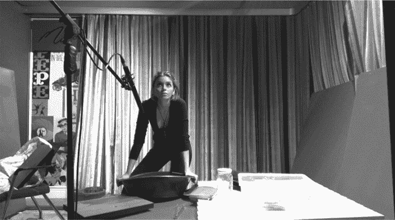

*图 2.5*  *土耳其伊斯坦布尔的 Aleyna Seymen。* ¶ *来源：Aleyna Seymen 友情提供照片*

## 亲和力：加拿大

Andy Malcolm 是加拿大 Uxbridge 的 Foley 艺术家。在成为 Foley 艺术家之前，Malcolm 在多伦多担任助理音效编辑，并师从两位来自英国的音效专业人士 Al Streeter 和 Peter Burgis，他们从伦敦来到加拿大，开启剧情长片、后期制作、音效编辑业务。

Malcolm 学过默剧，这后来证明是从事 Foley 艺术家工作的一个有帮助的前提。默剧教会了他如何将身体分解为基本元素，并在不同配置中重建，以模仿银幕上人物的身体动作。这帮助 Malcolm 更好地理解如何为演员的脚步声赋予重量和[content]

*图 2.5*  *土耳其伊斯坦布尔的 Aleyna Seymen。* ¶ *来源：Aleyna Seymen 友情提供照片*

## 亲和力：加拿大

Andy Malcolm 是加拿大 Uxbridge 的 Foley 艺术家。在成为 Foley 艺术家之前，Malcolm 在多伦多担任助理音效编辑，并师从两位来自英国的音效专业人士 Al Streeter 和 Peter Burgis，他们从伦敦来到加拿大，开启剧情长片、后期制作、音效编辑业务。

Malcolm 学过默剧，这后来证明是从事 Foley 艺术家工作的一个有帮助的前提。默剧教会了他如何将身体分解为基本元素，并在不同配置中重建，以模仿银幕上人物的身体动作。这帮助 Malcolm 更好地理解如何为演员的脚步声赋予重量和[content]

*图 2.5*  *土耳其伊斯坦布尔的 Aleyna Seymen。* ¶ *来源：Aleyna Seymen 友情提供照片*

## 亲和力：加拿大

Andy Malcolm 是加拿大 Uxbridge 的 Foley 艺术家。在成为 Foley 艺术家之前，Malcolm 在多伦多担任助理音效编辑，并师从两位来自英国的音效专业人士 Al Streeter 和 Peter Burgis，他们从伦敦来到加拿大，开启剧情长片、后期制作、音效编辑业务。

Malcolm 学过默剧，这后来证明是从事 Foley 艺术家工作的一个有帮助的前提。默剧教会了他如何将身体分解为基本元素，并在不同配置中重建，以模仿银幕上人物的身体动作。这帮助 Malcolm 更好地理解如何为演员的脚步声赋予重量和[content]

*图 2.5*  *土耳其伊斯坦布尔的 Aleyna Seymen。* ¶ *来源：Aleyna Seymen 友情提供照片*

## 亲和力：加拿大

Andy Malcolm 是加拿大 Uxbridge 的 Foley 艺术家。在成为 Foley 艺术家之前，Malcolm 在多伦多担任助理音效编辑，并师从两位来自英国的音效专业人士 Al Streeter 和 Peter Burgis，他们从伦敦来到加拿大，开启剧情长片、后期制作、音效编辑业务。

Malcolm 学过默剧，这后来证明是从事 Foley 艺术家工作的一个有帮助的前提。默剧教会了他如何将身体分解为基本元素，并在不同配置中重建，以模仿银幕上人物的身体动作。这帮助 Malcolm 更好地理解如何为演员的脚步声赋予重量和[content]

*图 2.5*  *土耳其伊斯坦布尔的 Aleyna Seymen。* ¶ *来源：Aleyna Seymen 友情提供照片*

## 亲和力：加拿大

Andy Malcolm 是加拿大 Uxbridge 的 Foley 艺术家。在成为 Foley 艺术家之前，Malcolm 在多伦多担任助理音效编辑，并师从两位来自英国的音效专业人士 Al Streeter 和 Peter Burgis，他们从伦敦来到加拿大，开启剧情长片、后期制作、音效编辑业务。

Malcolm 学过默剧，这后来证明是从事 Foley 艺术家工作的一个有帮助的前提。默剧教会了他如何将身体分解为基本元素，并在不同配置中重建，以模仿银幕上人物的身体动作。这帮助 Malcolm 更好地理解如何为演员的脚步声赋予重量和[content]

*图 2.5*  *土耳其伊斯坦布尔的 Aleyna Seymen。* ¶ *来源：Aleyna Seymen 友情提供照片*

## 亲和力：加拿大

Andy Malcolm 是加拿大 Uxbridge 的 Foley 艺术家。在成为 Foley 艺术家之前，Malcolm 在多伦多担任助理音效编辑，并师从两位来自英国的音效专业人士 Al Streeter 和 Peter Burgis，他们从伦敦来到加拿大，开启剧情长片、后期制作、音效编辑业务。

Malcolm 学过默剧，这后来证明是从事 Foley 艺术家工作的一个有帮助的前提。默剧教会了他如何将身体分解为基本元素，并在不同配置中重建，以模仿银幕上人物的身体动作。这帮助 Malcolm 更好地理解如何为演员的脚步声赋予重量和[content]

*图 2.5*  *土耳其伊斯坦布尔的 Aleyna Seymen。* ¶ *来源：Aleyna Seymen 友情提供照片*

## 亲和力：加拿大

Andy Malcolm 是加拿大 Uxbridge 的 Foley 艺术家。在成为 Foley 艺术家之前，Malcolm 在多伦多担任助理音效编辑，并师从两位来自英国的音效专业人士 Al Streeter 和 Peter Burgis，他们从伦敦来到加拿大，开启剧情长片、后期制作、音效编辑业务。

Malcolm 学过默剧，这后来证明是从事 Foley 艺术家工作的一个有帮助的前提。默剧教会了他如何将身体分解为基本元素，并在不同配置中重建，以模仿银幕上人物的身体动作。这帮助 Malcolm 更好地理解如何为演员的脚步声赋予重量和个性。

由于 Malcolm 在加拿大享有首屈一指的独立 Foley 艺术家声誉，他设计了自己的工作流程，包括为团队制定不同的协议。他拥有调音师 Don White、Kevin Schultz 和 Jack Heren，一名独立的 Pro Tools 操作员、Foley 编辑 Jenna Dalla Riva，以及他的 Foley 艺术家搭档 Goro Koyamo 和 Sandra Fox。

Malcolm 通过培训爱尔兰的 Foley 艺术家 Caoimhe Doyle，回报了自己曾被培养为加拿大顶尖 Foley 艺术家的经历。Doyle 在爱尔兰观看过 Malcolm 工作。她访问加拿大，在他的设施中与 Malcolm 实习并接受培训。随后 Doyle 回到爱尔兰，在 Ardmore Sound 设计并建造了一个专门的 Foley 舞台，她现在在那里与 Foley 调音师 Jean McGrath 合作。

加拿大埃德蒙顿的 Foley 艺术家 Chris Szott 在 Malcolm 和 Koyamo 手下担任了六个月的学徒开始了他的培训。他“学到了 Andy 团队对细节的敏锐关注”，在完成与 Malcolm 的工作后，他继续建立自己的个人职业生涯。作为 Little Hook Sound 的唯一所有者，Szott 目前是阿尔伯塔省唯一的艺术家。他和他的 Foley 调音师 Isael Huard 作为团队在剧情片、本地制作、纪录片以及 Netflix 的一些系列上合作。Szott 在伦敦学习了录音工程和音乐作曲，他断言 Foley 艺术家是“音效的爵士音乐家”，并补充说“每个声音都需要一个意图”。

对于 Szott 来说，表演道具比完善角色的脚步声更易于掌握的技能。他考虑道具提示的纹理和频率，并将 Foley 比作“学习一种新乐器……这是一项终身追求”。

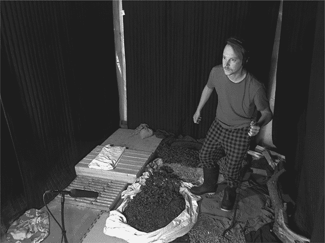

*图 2.6* *Chris Szott 在 Little Hook Sound Foley 舞台上穿靴子表演室外脚步声。* ¶ *来源：Chris Szott 友情提供照片*

Huard 在阿尔伯塔大学学习音乐技术，他认为 Foley 是制作与后期制作之间、以及艺术家与调音师之间高度协作的任务。他喜欢知道制作中使用了什么麦克风，如果可能的话，他会用同样的麦克风录制 Foley。他使用房间麦克风录制，同时使用对准脚步声或道具的麦克风。Szott 和 Huard 在录制 Foley 时会考虑到为最终混音包含预混音轨的可能性。 由于阿尔伯塔省是电影市场较小的地区，团队通常在剧情片上工作 5–7 天，或在 Netflix 一集上工作 4 天。Huard 解释说：“我使用工具来实现我需要的东西。”由于团队独立工作，“我们已经习惯了自己喜欢的东西，并理解我们听到的声音如何融合。”

Huard 和 Szott 都喜欢“纯 Foley”，对他们来说，这意味着“在不依赖插件的情况下获得正确的声音”。在合作近三年后，Foley 的音乐性和情感成为共同目标。Huard 在电声音乐中操纵声音的训练“在很大程度上影响了我如何聆听声音”。Szott 补充说：“有时当你进入节奏时，你需要回到故事。”

## 宝莱坞

作为最具生产力的电影生产国之一，印度拥有悠久的奢华、充满音乐的电影历史。孟买的 Foley 艺术家 Karan Singh 在享有盛誉的 BR Studios 开始了他的职业生涯，他的父亲曾在那里担任保安。1984 年，年仅 12 岁的他学习了电影声音的世界，并会“偷偷进入工作室”观看 Foley 艺术家，包括 Prahlad Salvi，为他们的电影工作。Foley 艺术家一次只能录制到一个模拟音轨，这意味着所有声音都必须同时表演并且同步极佳。Singh 估计印度大约有 15 名 Foley 艺术家，而大多数 Foley 工作是由其中约三名 Foley 艺术家完成的。在 BR Studios 时，ADR 在白天录制，Foley 在夜间进行。大多数艺术家工作 18 小时班次，这与其他国际电影社区相比是不寻常的做法。

2009 年，在担任自由职业 Foley 艺术家多年后，Singh 开设了自己的工作室。Foley 往往是印度音效设计中一个广泛而精细的方面，他经常每月工作四到五部电影。除了宝莱坞电影外，Singh 还为孟加拉国制作的电影表演 Foley。以制作音轨为指导，他在录音期间、在舞台上[content]

*图 2.5*  *土耳其伊斯坦布尔的 Aleyna Seymen。* ¶ *来源：Aleyna Seymen 友情提供照片*

## 亲和力：加拿大

Andy Malcolm 是加拿大 Uxbridge 的 Foley 艺术家。

Foley 在巴基斯坦卡拉奇尚处于萌芽阶段。Kashif Ejaz 在过去十年开始了他的 Foley 职业生涯，同时也是一名音效编辑。小时候，Kashif 记不起自己何时没有对声音感兴趣。在卡拉奇一家电视台工作并在电影学校学习期间，他曾访问伦敦、伊斯坦布尔、曼谷和迪拜的混音棚。他观察了各种声音专业人士的工作流程，以便将其实践应用到自己的声音编辑业务中。除了编辑声音和表演 Foley 外，Ejaz 还为他的项目录制 ADR。“有时导演在场，有时不在。”

巴基斯坦电视公司播出的节目 *Pepsi Battle of the Bands*（2017）让 Ejaz 有机会担任该系列的录音工程师和后期声音主管。巴基斯坦规模较小的电影产业让 Ejaz 有机会身兼数职（编辑、混音师、艺术家、音乐家），他还在 *Zero Dark Thirty*（2012）中录制了特殊音效。Ejaz 喜欢他在后期制作声音方面的工作，但他说，在 Foley 中，“脚步声更具挑战性。将其融入场景很困难。”他会考虑脚步声与屏幕的距离，目标是让脚步声与制作声音相融合。他只使用一支录音棚麦克风，如果觉得有必要，会在另一条音轨上添加混响。

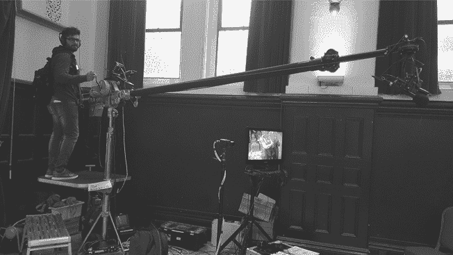

*图 2.7*  *Kashif Ejaz 在 Foley 舞台上调整麦克风。* ¶ *来源：照片由 Kashif Ejaz 提供*

Ejaz 不使用一条音轨录制布料的声音，而这对大多数 Foley 艺术家来说是更常见的标准。相反，他将角色的服装分离到多个音轨上。由于许多巴基斯坦电影需要大量 ADR，这些布料音轨为每个角色增添了生命力。他在动画项目中强调布料。

## TAIWAN

大师胡定一于 1975 年开始在台北中央电影公司工作。中央电影公司成立于 1953 年，曾制作过台湾几位主要导演的电影，包括 Ang Lee 和 Edward Yang。胡大师起初是录音棚助理，学习了制作混音和后期制作声音。他对 Foley 的兴趣促使他仔细观看和学习录音棚里的艺术家，到 20 世纪 80 年代初，他主要担任 Foley 艺术家。

通过翻译林子贤与我交流的胡大师告诉我，当他使用模拟声音时，四五名 Foley 艺术家可能会同时工作以最大化提示中的声音；然而，转向数字 Foley 混音改变了这一工作流程。现在他通常独自工作或与一名助理一起工作。他通常在表演前观看提示一到两次。在电影 *Vive l’Amour*（1994）中，他必须在一镜内为主要女性角色走动 6–7 分钟。他认为脚步声比道具工作更自然：“做声音并不难，但你必须将其融入日常生活，比如无意识地观察周围的声音，”胡大师说。

胡的观点是所表演角色的质量非常重要：“我们必须真正感受角色……就像一个愤怒的男人放下咖啡杯。”他回忆起电影 *Who Killed Cock Robin*（2017）中一个奇怪的道具提示，在一个血腥的场景中，他必须制作“挖出角色眼球”的声音，“而这在音效库中并不存在，所以我必须自己创造。”他补充说声音“必须生动，我喜欢挑战自己使用多样化的道具制作不同的声音。”

虽然胡过去曾参与过许多功夫电影，但他发现台湾现在流行的趋势是强调写实电影。他为香港电影制作 Foley，但仍留在台湾，不会外出。

被问及台湾电视节目的 Foley 有何不同时，胡大师回答：“\[t\]那里没有电视节目的 Foley。”虽然他没有参与台湾或香港制作的任何音乐剧，但他很想尝试。

胡大师分享了他作为 Foley 艺术家的哲学：

> 你必须拥有稳定而坚强的思维。不要惊慌。有时你认为自己做得很好，但 \[mixer\] 要求再来一次，你最好积极地回答“是”。如果 \[mixer\] 说需要更好，就再做一次。否则，你无法因为你有 \[an\] 不稳定的思维而操纵画面中演员的情绪。

胡大师对那些想成为 Foley 艺术家的人有一些想法：

> 声音工作流程数字化后，我们将动作分成许多短段，一段一段完成。这对 \[a\] 新学习者更友好，但在我看来，这并不会让你成为一名优秀的 Foley 艺术家。你必须捕捉整个场景并在一镜内完成。当你学会如何为一个场景操控每种声音时，那就是你知道自己有资格从事这份工作的时候。

## LATIN AMERICA: CHILE AND BRAZIL

拉丁美洲正在发展的专业声音社区最近蓬勃发展，涌现出大量 Foley 艺术家。其中一位艺术家 Mauricio Casteñeda 住在智利，并在本国以及巴西工作。Casteñeda 的父亲经营着一家电台，这激发了他对音乐的热爱，在学习了声音工程后，他对电影声音的兴趣促使他在 1990 年代末在圣地亚哥的 Filmosonido 担任声音助理。当他观看 Foley 舞台上的 Foley 艺术家时，“一见钟情，”Casteñeda 说。一些早期的艺术家在户外表演 Foley。

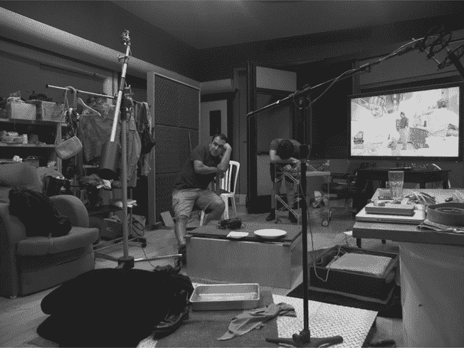

*图 2.8*  *Mauricio Casteñeda 在巴西圣保罗 Mix Sound Studios 的 Foley 会话后。* ¶ *来源：照片由 Mauricio Casteñeda 提供*

编辑 Daniele Fillios 说：“你做错了，”其中一些人于 1999 年底至 2000 年初被派往法国学习新技术。Roberto Espinoza，Casteñeda 的 Foley 老师，是其中学习法国 Foley 方法的人之一。Espinoza 想承担混音工作，Casteñeda 开始了他的 Foley 职业生涯。他感谢自己合作过的混音师鼓励他并帮助他改进技术和艺术。2015 年，他离开了 Filmosonido，因为家庭录音棚损害了业务；他说：“我不得不开设自己的 Foley 工作室。”

Casteñeda 也在巴西工作，正如他所说，“巴西没有对 Foley 的热情”，因此他从智利前往巴西表演 Foley。他对 Foley 的热情以及想“像电影中的另一个角色一样”的愿望促使他“提供更多……我尝试添加一些东西……你必须有自己的时刻。”

## GLOBAL PERSPECTIVE

国际 Foley 艺术家提供了关于表演、混音和编辑 Foley 的不同视角和见解。许多国际 Foley 艺术家使用与美国相似的技术和方法，而其他人则为表演 Foley 适应了自己的方法。

扩展我们对 Foley 世界中存在的文化差异的理解可以增强电影素养并增强对美国以外艺术家的欣赏。

# 章节 | 三

## Foley 的美学

### 噪音、声音、单、婚

DOI: [10.4324/9781003008439-5](https://doi.org/10.4324/9781003008439-5)

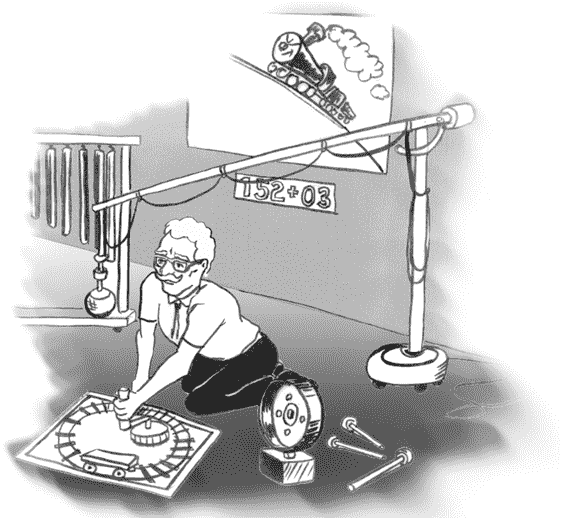

## 噪音与声音：Foley 在各种类型中的使用

当电影或电视观众选择在电影院观看最新大片，或在电视或其他电子设备上流媒体播放电影、纪录片、电视和网络剧集时，他们并不会在想谁做了拟音，或拟音会在原声带中是什么样子。这种微小的执念是声音专家或影迷的领域。然而，观众会在不知不觉中受到精心设计、提示、表演和编辑的声音提示的影响。声音体验要么增强，要么分散注意力。声音设计具有影响力，而拟音是整体音景的关键组成部分。

相当数量的电影因音效出色而备受赞誉。什么构成了卓越的音效工作尚有争议，但有时即使是最受推崇的电影也充斥着如此多的声音，以至于耳朵不堪重负。过于响亮、包含多种噪音的原声带不一定是最好的、最具艺术性或最有品味的音轨。专业声音界的专家和影评人可能会都同意，加入“低频”和混响，或为了戏剧效果而使对白的可懂度复杂化，有助于音轨显得更有力量、更有[content]
当电影或电视观众选择在电影院观看最新大片，或在电视或其他电子设备上流媒体播放电影、纪录片、电视和网络剧集时，他们并不会在想谁做了拟音，或拟音会在原声带中是什么样子。这种微小的执念是声音专家或影迷的领域。然而，观众会在不知不觉中受到精心设计、提示、表演和编辑的声音提示的影响。声音体验要么增强，要么分散注意力。声音设计具有影响力，而拟音是整体音景的关键组成部分。

相当数量的电影因音效出色而备受赞誉。什么构成了卓越的音效工作尚有争议，但有时即使是最受推崇的电影也充斥着如此多的声音，以至于耳朵不堪重负。过于响亮、包含多种噪音的原声带不一定是最好的、最具艺术性或最有品味的音轨。专业声音界的专家和影评人可能会都同意，加入“低频”和混响，或为了戏剧效果而使对白的可懂度复杂化，有助于音轨显得更有力量、更有强调、更大胆，甚至更夸张。然而，这并不一定转化为具有独创性或色彩的音轨。它可能只是响亮、令人反感且自我意识过强。一些最富创造力且令人难忘的原声带在声音元素上更为节制，营造出独特、具体且明显低调的故事世界。可以回想起这种艺术性在诸如 *巴顿·芬克* (1991)、*亡命天涯* (2002)、*迷失* (2013) 和 *荒野猎人* (2015) 等电影中。

同样的审美问题也存在于拟音中，而拟音作为声音设计的一部分，比那些有助于推动电影叙事的更具戏剧性的音效要不那么引人注意，但类似的挑战仍可能出现。可能会强调尽可能做尽可能多的声音来填满拟音音轨。然而，在最终混音时，混音师很少抱怨拟音不够。更常见的抱怨是拟音太多。拟音往往与音效中已妥善涵盖的内容重复。最有经验的拟音师的一个特质是能够甄别什么应该被听到，什么应该被忽略。他们学会用拟音来帮助聚焦场景，而不是使其杂乱。随着技术在更短的时间内提供更多选择，能够辨别什么是必要的、什么是不必要的这种能力变得更加关键。

耳朵一次只能辨别有限数量的声音。针对什么声音应该被听到做出具体决定，而不是对所有移动的东西都制造噪音，这是一个更好的策略。问题不在于实际存在什么声音，也不在于什么 *应该* 被听到或什么 *会* 被听到。正如资深拟音师 Alyson Dee Moore 所指出的，最好的拟音师会问自己：“你 *想要* 听到什么？” Moore 的观点是：你是在设计声音。做出艺术性的决定。电影和电视中最著名的声音专家许多人都持这种看法。目标不是在现实世界中或在制作音轨中录制的那样复制或替换每一个声音。目标是进行拟音以支持叙事，尊重导演的风格和愿景，并与编辑过的音效合作以补充整体声音设计。

许多电影展示了拟音在电影中的有效运用。拟音在这些电影中是配角，可以通过研究来更好地理解其对电影叙事的内在价值。拟音的使用目的各不相同，取决于类型、风格和导演的意图。

### 声音作为说书人

虽然有许多优秀的电影可以说明拟音在支持乃至推动叙事方面的力量，但我仍然更喜欢使用我最喜欢的例子之一，来自 *西部往事* (1968)，塞尔吉奥·莱昂内执导的史诗电影。长约 13 分钟的开场字幕场景以极少的对白引入。声音和对白在后期制作中完全重新制作。编辑过的音效和拟音讲述了故事。通过观看这一场景，人们可以了解到很多关于角色的信息，我们的关键反英雄主角的介绍，以及声音推动故事和唤起情感的重要性。三个人出现在火车站，缓慢而有意地出现并开始等待。他们有条不紊地进入车站，踩在中空的木地板上，尘衣在风中飘动。售票员说了几句话，这些话被替换对白取代，并试图向他们出售火车票，其中一个角色把票扔进了风中。这三个人中的一个（Jack Elam）与一只苍蝇搏斗。因为天气太热，他安静地坐在吱嘎作响的木摇椅上，几乎一动不动地试图把苍蝇从脸上赶走。他最终抓住苍蝇，是把手枪枪管砸向苍蝇落在上面的摇椅时抓到的。苍蝇在他脸上、在长凳上、在手枪枪管中的声音突出了角色等待、消磨时间、尽可能少做的耐心。另一个角色（Woody Strode）头顶有水滴从屋顶漏水处滴落。每滴水都被精心且艺术地设计，以强调场景中动作的缓慢。他注意到水滴，但与其急于阻止滴水或离开位置，不如慢慢摘下帽子，让积聚的水顺着帽檐流进嘴里，因为白天太热，他需要水分。第三个人（Al Mulock）慢慢地把手伸进水槽。我们很清楚这些人是“坏人”。我们从他们令人敬畏的行动和他们对不属于自己的空间的控制中得知这一点。他们显然在等待火车的到来。背景中的风车怪异地吱嘎作响。这是一个编辑进去的音效，具有一种不匹配动作却令人着迷的诡异节奏。脚步声刻意而沉重。木板路嘎吱作响且空旷。场景充满了拟音。声音讲述故事并支撑视觉构图和角色。当火车到达时，这些人看到行李被卸下，旅客下车，但他们等待的人并未出现。最后，在火车开始驶离后，我们因为听到他吹口琴而注意到我们的主角（Charles Bronson）。三个人慢慢转身看他，随后展开了一些对白。Elam 的角色嘲讽 Bronson 的角色，“看起来我们少了一匹马。” Bronson 在慢慢摇头后回答，“你带多了。”枪声响起，尸体倒下，故事开始。这是对电影的大胆开端。

莱昂内在所有电影中都替换了全部声音。他更喜欢影响声音风格并具有刻意的做作感，但声音始终推动动作。拟音和编辑过的音效是他所有电影中不可或缺的角色，而这种不寻常的开场展示了他的艺术技巧。据意大利拟音师 Marco Ciorba 说，他父亲 Aldo 是参与莱昂内电影制作的拟音师之一。据报道，在莱昂内的电影中，惯例是让拟音师前往片场观看演员表演，以便更好地了解他们如何移动以及在什么表面上行走。

另一部包含拟音推动故事的经典范例的电影是*《爵士春秋》*（1979）。在一个关键场景中，我们看到了主角——一位编舞兼导演（以该片导演鲍勃·福斯为原型）——正在参加他最新戏剧的剧本朗读会。乔·吉迪恩（罗伊·施奈德饰）坐在桌旁，接下来的几分钟里，我们听到的完全是他个人视角下的主观声音，这些声音传递着对故事情节至关重要的听觉信息。其他角色的对话和动作是场景的一部分，但我们听不到。吉迪恩正在开始他下一部作品的剧本朗读，当我们看到他的演员们念出剧中的台词，并对剧本表现出热情的反应时，我们被拉进了吉迪恩个人的身体体验中。他的椅子吱吱作响。他用手敲打着桌子。我们听到他手表的滴答声被放大了，因为他显然身体不适，并没有在关注演员们。他走到楼梯旁，抓住金属扶手，然后把手指抠进扶手里。他再次坐下。他把香烟摁灭在烟灰缸里，然后用火柴点燃一支新烟。接着他抓住自己的手腕。他把第二支香烟掉在地上，用脚碾碎。他把铅笔折成两段，扔到地上。他呼吸沉重。他出汗了。我们看到他的前妻脸上露出担忧的表情，因为她正参与着剧本朗读。然后，声音再次变得客观，包括对话和房间里的声音，演员们读完剧本，起身离开，愉快地交谈着。我们刚刚目睹了这个角色心脏病发作，却一个字也没有说。除了少数经过剪辑的音效外，这一切全靠镜头和拟音来表现，由音响专业人士伊莱沙·伯恩鲍姆完成。

喜剧闹剧类型也运用拟音来突出角色、幽默和情节，比如彼得·博格丹诺维奇的*《糊涂戏班》*（1992）。电影开始时，我们看到演员们正在排练一部即将上路巡演、准备在纽约首演的闹剧。随着他们排练该剧的第一幕，我们认识了这些角色，然后我们见证了演员之间的内部戏剧，这为影片增添了闹剧色彩，因为他们要为不同的观众表演。角色、他们之间的关系以及他们的怪癖在前 20 分钟内就建立起来了。在电影的剩余部分，这些关系逐渐恶化。闹剧现在既发生在台上，也发生在幕后。在佛罗里达州一场演出期间，这些角色退到后台，无法说话，他们的瓦解和恶作剧就这样一幕幕地展现在我们面前。他们在布景楼梯上跑上跑下，拿起又放下沙丁鱼盘子，摆弄报纸，摆弄花朵，对着威士忌瓶猛灌一口，脱掉衣服，穿上衣服，互相扇耳光，系鞋带，抓起一把斧头，摔下楼梯，寻找隐形眼镜，然后跌倒在沙发上。舞台上还在继续演出，而电影观众则在观看着台下的活动。电影观众听到的声音几乎全是拟音。后台道具的喜剧性使用和演员们夸张的表情，因拟音而得到加强，它用夸张的手法支撑着喜剧效果。

这三部电影的例子属于不同类型：一部是史诗西部片，一部是剧情音乐剧，第三部是喜剧闹剧。它们以截然不同的风格运用拟音。西部片以风格化的方式使用拟音，音乐剧以写实但强化的方式，喜剧则以打闹剧的方式。然而，这三部电影都有一个明确的愿景让拟音去遵循，以支持剧本、导演和表演。拟音服务于导演的构想，是演员、画面剪辑师和声音剪辑师的辅助角色。

在为项目设计音效、背景声和拟音时，理解类型和风格如何影响选择和执行至关重要。虽然音效库的使用对于剪辑效果来说是必不可少的，但拟音旨在成为一种声音表演，蕴含着演员在场景中所体现的全部生命力和角色特质。与其依赖从音效库中挑选声音、剪辑进去、表演普通的拟音脚步声和手部道具、再添加音乐来推进场景，不如说，完成电影声景的声音交响乐所涉及的内容要多得多。编剧、导演、现场收音师、摄影指导和画面剪辑师都对戏剧的塑造产生了影响，而后期声音团队现在必须用音效、特殊声音设计、拟音、自动对白替换（ADR）和一条精心剪辑的对白音轨来支持它。音轨支撑、推动并影响着故事，而回顾过去，我们可以分析拟音以及剪辑效果是如何被用来以声音的方式呈现不同电影的戏剧目的的。

在*《航越地平线》*（1989）中，我们看到悬念是如何依赖于声音的。在一个场景中，我们看到主角正专注地使用制图工具分析他所乘船只的图纸。每当背景中播放着一盘录像带（录像带中出现的是片中的精神病杀人狂），我们的角色便穿过正在进水的船，下到几乎被淹没的底部。他在水中游动，把刀猛扎进船底。

后来，我们的主角把汽油倒入海中，并将一盏点燃的灯扔到海面上，从而点燃被遗弃的船，以引起正朝他驶来的妻子的注意。与此同时，那个精神病患者正用整个身体撞击他被锁在里面的房间的门，并把手上的绳索磨断。他破门而出，木屑四处飞溅。

声音故事增加了悬念，因为几乎没有对白，音乐配乐也低调克制。导演依靠声音帮助我们进入角色的心理空间。拟音干净、具体、写实。每一个剪辑效果都精确无误。风格自然却又透着不祥。任何过度演绎的音效，无论是剪辑的还是拟音的，都会削弱场景的紧张感。

在约翰·卡朋特的*《怪形》*（1982）中，我们遇到了一只被“怪物”吸收的狗。我们看到一只狗在一个同伴的陪同下，小心翼翼地走进一个有其他狗的围栏区域。人的脚步声清晰而精确。这只“好狗”进入空间时心存疑虑。它的脚步声清晰而突出。房间里另一只狗开始咆哮并发出威胁，身体扭动变形。我们听到了如今已成可预测之物的“喷涌、黏糊和血腥”的声音。伴随血腥的是蝉鸣声，这些是剪辑效果。好狗试图咬穿金属网围栏来挣脱自己，这是拟音效果。结果是一系列精心编排的音效和拟音，共同形成了一种听觉上的“毛骨悚然”，这正是故事所必需的。

在*《鬼驱人》*（1982）中，我们看到许多孩子卧室里的玩具飞过空中，撞进壁橱。音乐配乐响亮而突兀，因此玩具的道具声音也同样响亮而夸张。在场景结尾，角色们一边寻找失踪的女儿，一边拿着一个简单的小丑玩偶。随着动作平息，最糟糕的噪音和混乱结束，小丑作为一个备受喜爱且无害的玩具的反讽意味，通过他帽子上增添的童稚而俏皮的叮当声得以体现。为该场景进行的拟音先加剧了混乱，随后又让这超自然现象的平静之感得以呈现。过于低调和写实的拟音则无法胜任这项任务。

### 音乐之声

老式电影音乐剧在舞蹈场景中大量使用了拟音。在*雨中曲*（1952）中，唐纳德·奥康纳在“Make ‘em Laugh”中的表演结合了现场收音、部分对白的“looping”、舞蹈拟音和道具操作。场景开始时，奥康纳和吉恩·凯利边走边谈，行走在布景前。这段对白引出奥康纳的歌曲，他坐在钢琴上，歌唱、摆弄各种物品并跳舞。他所有的手持道具和舞蹈都是拟音。他踩踏的钢琴键和他的歌声来自预录音轨。值得注意的是，背景道具没有声音。拟音集中在前景道具上。在当今的电影审美中，缺乏背景道具和脚步声显得格外突出。这条音轨具有一种人工感，但在 1950 年代的品味和类型中是完全可以接受的。

*白夜*（1985）另一方面，有一个场景展示了拟音脚步和舞蹈的类似目的，但属于不同的类型。这部电影是一部音乐剧情片。格雷戈里·海因斯饰演一位 1980 年代生活在苏联的美国侨民。他讲述了自己如何带着舞蹈离开美国的苦涩故事。他通过戏剧化童年、在越南的经历以及堕入绝望生活的过程来讲述自己的故事。现场音轨中包含了海因斯的脚步声和摩擦声。他在定制的舞台上增强了舞蹈，我为该场景制作了他的脚步拟音。最终的音轨由现场脚步声、拟音脚步声和拟音舞蹈步伐的混合组成。舞蹈的目的很独特，三层脚步声的混合也很不寻常。目标是听起来自然而细腻。

尽管两部电影都结合了现场收音、舞蹈拟音以及传统的拟音脚步和道具，但风格截然不同。两部电影都实现了其声音目标，因为参与的工匠们理解了电影的目的和风格，并知道如何恰当地利用当时的技术。

当*悲惨世界*于 2012 年上映时，人们对这样一部歌剧式音乐剧采用直接收音所产生的效果充满期待，这让人想起罗伯恩·马莫利安在 1929 年电影*掌声*中尝试过的做法。汤姆·霍 oper 没有使用预录人声，而是在片场以更亲密的方式拍摄了全部人声演唱。人声使用直接收音确实改变了后期声音制作的要求。当演唱被保存为对白而不是作为单独的预录音轨叠加时，就使拟音和音效的设计变得复杂，需要听起来和演唱本身一样自然和“earthy”。

### 分集声音

*纸牌屋*，Netflix 于 2013 年推出的分集剧集系列，改变了“television”对于消费者和制作方的本质。对于后期声音制作人员而言，音效设计的流程发生了巨大变化。与按周播出的常规做法一次制作一集不同，整个系列一次性全部上线。多个团队同时进行后期声音制作。因此，虽然可能由一位声音主管监督，音效设计更难保持一致。在这种任务下，很容易看出不同的拟音艺术家可能同时在同一系列上工作，并对角色应如何进行声音塑造持有不同观点。未来如何解决这一即时的声音挑战尚不明确，但目前它提出了关于质量控制的问题。传统的模式，即一位声音主管带领一致的声音剪辑团队和拟音艺术家共同创造声音故事世界——就像作曲家为节目创作音乐主题一样——创造了更多的艺术稳定性。

### 文化声音

声音风格反映了文化风格。正如莱昂内意大利制作的电影所展示的那样，大多数声音和对白都被替换了。这在意大利电影中屡见不鲜。声音并不是制作中的主要关注点；相反，它主要在后期制作中处理。另一方面，一些法国电影似乎采用了印象主义风格来处理声音。在*再见，孩子们*（1987）中，拟音以指示性的方式添加。当学校里的年轻男孩们踩着高跷走动时，可以感受到道具的整体感觉，但无法真正分辨出一个角色的动作与另一个角色的不同。当他们在食堂进食时，可以感受到碗碟和进食的活动感，但却没有明确说明是谁在做什么。

在*全速追击*（1998）中，快速的交叉剪辑要求音效设计和拟音承担不同的任务。声音具体而精确。洛拉三次“runs”的每个细节对于观众理解剧情至关重要。拟音为洛拉的冒险增添了区分度，使得叙事发展到高潮和结尾时观众能更清晰地理解。

*舞出我人生*（2000）以及拉斯·冯·特里尔的其他电影提供了一些关于拟音使用的有趣情况。作为 Dogme 95 的联合创始人之一，该宣言涉及自然主义电影制作，冯·特里尔在*舞出我人生*中加入了歌唱、人工音效设计和拟音，违背了自己的规则。Julien Naudin 一直是冯·特里尔偏爱的拟音艺术家。

随着全球化在电影界的传播，国际电影社群有机会相互影响。然而，由于文化价值观不同，存在差异。这些价值观体现在剧本、摄影、表演风格、灯光、服装、音乐和声音中。虽然我们在技术上变得更加同质化，但认为这等同于声音上的同质化是错误的。音效设计相对于地理、历史、文化、经济和政治呈现出不同的风格和视角。世界各地的拟音艺术家在目标上相似，但在方法上因其所在地点、电影市场和经济需求而大相径庭。

## 单独或结合的拟音与音效

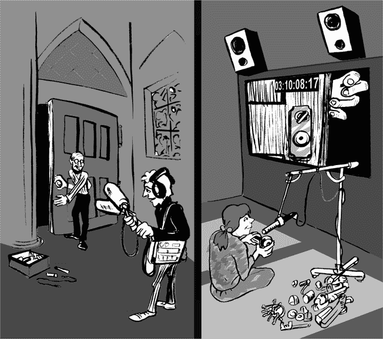

当大多数专业人士开始在音轨中使用拟音时，他们通常想到的就是替换或增强角色的脚步声并制作一些手持道具。这就是拟音的原始角色。必须了解拟音是在何时被用来增强或“sweeten”现场音轨，何时又是音效分层中的重要组成部分。此外，拟音正成为特殊音效设计的可行选择而被依赖。正如任何艺术形式或工艺一样，它不断演变并转变为超越其原始目的的东西。拟音可以独立存在于音轨中并帮助创造故事世界的真实感，可以叠加在现场音轨之上以增强故事世界，也可以与剪辑好的音效结合以创造超真实感。

### 支持真实感

当拟音用于替换或增强脚步声时，可以假设它将与现场音轨一起播放。因此，脚步声必须以与已录制的对白“fitting in”的意图来表演。这意味着要非常仔细地观看同步，并在舞台上将录制的拟音与现场音一起播放，以确保它确实增强效果而不是削弱。

这同样适用于大多数被表演的手持道具。例如，如果艺术家在拿着枪或翻动书中的书页，表演应该逼真且细腻。拟音师必须尽可能精确地复制演员所处理的任何东西。影片中的重杯在拟音棚中也是重杯。如果场景中有精致瓷器，餐具的声音也应同样精致。观察演员的能量和动作并考虑故事。故事决定一切。当拟音师在重现场景中已有的道具时，目标是让拟音与制作音轨中已有的声音无法区分。

然而，拟音越来越多地被用来补充编辑过的音效。例如，一场车祸可能部分来自制作中捕捉到的声音，部分来自音效库中的编辑音效，部分来自专门为该场景定制的实地录音。然后拟音可能被要求为那场特定的车祸增添个性和生命力。甚至有可能——在有足够时间和理想道具的情况下——不知疲倦且才华横溢的拟音师会完全自行制作那场车祸，原因多种多样。这里的教训是什么？没有规则。有一些惯例在使用，但它们并不规定唯一的可能做法。

当拟音效果需要在没有伴随音效的情况下播放时，无论是与制作音轨一起，还是在以 MOS（*无声拍摄*）拍摄的场景中，专业人士称之为单一效果。然而，如果它将被与另一个道具分层，或与另一条拟音音轨或编辑音效预混，则它成为 married 效果。这种区别对于拟音师和混音师来说至关重要。拟音是单独被依赖的吗？这是国内音轨还是“外国”音轨？会有 ADR 吗？保持这些区别清晰。声音团队的哪个部分负责声音的哪个部分？

当两个声音要在同一音轨上同时表演时，也可能出现 married 拟音效果。一位艺术家可能在操作秋千上使用的铰链吱嘎声，而另一位则操作链条。一位可能在操作教室里椅子吱嘎声，而另一位则摩擦椅腿与地板的刮擦声。当拟音在支撑现实时，少即是多。拟音不是主角。

### 增强现实

有时监督会设想让拟音覆盖传统上从音效库音效或定制实地录音中编辑的内容。在《*Sylvester*》（1985）这部关于一个女孩和她的马的电影中，一些场景拥有出色的制作马蹄声。监督不确定他的音效库马蹄音效会如何效果，所以作为替代方案，我为所有的马蹄声做了拟音。这种情况以前也发生过，但有时编辑会为了时间和成本效益而从各种音效库音效中编辑马声。监督决定从多个来源获得额外的“覆盖”，以便在最终混音时做出决定。结果是一些场景是制作声音，一些是音效库音效，一些是拟音（单音轨，单一效果），一些是拟音 married 到音效。拟音师应该做任何最有效的事情。增强现实意味着在声音的现实基础上工作，同时对其进行增添，以赋予其额外的特色，使其更好地与故事配合。

拟音与音效之间典型的 married 效果是无处不在的身体坠落。通常，拟音师会趴在地上，手持一些布料或衬垫，并利用身体躯干的重量有控制地冲向地面。这种表演将与已剪入的音效结合，通常是来自一到两条音轨的重击声。结果是身体坠落具有拟音带来的特征和音效带来的重量。身体坠落的声音永远不像现实生活中的那样。这正是增强现实至关重要的地方。当电影中出现身体坠落时，其目的是制造戏剧效果。目标是创造一个超现实的身体坠落。它听起来比真实的身体坠落更大声，但不会不合逻辑到让观众脱离故事。请注意，在声音方面，故事的重要性不断被强调。声音支撑着叙事。永远如此。

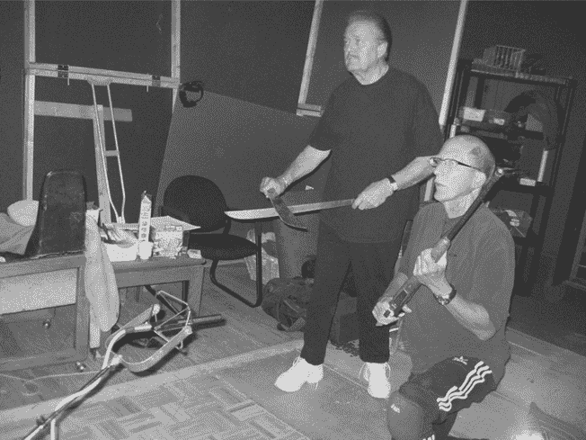

*图 3.3*  *Ken Dufva 和 David Fein 演示了一个 married Foley 提示：两个道具同时为一个音轨表演。* ¶ *来源：照片由 Steve Lee 友情提供，Hollywood Lost and Found*

在《*Die Hard*》（1988）中，有一个场景，友好的洛杉矶警察 Al 有一具尸体落在他的车上。他疯狂地试图开车离开，最终撞毁了他的车。supervising sound editor Steve Flick 让他的编辑剪入了大部分撞车声，但我们用一些拟音棚对车的撞击、金属的嘎吱声和车门的吱嘎声来增色。再一次，这是一个 married 效果。然而，这个场景充满了动作与幽默的结合，以反映剧本中所包含的内容。

### 取代现实

当一部电影或节目需要全新的想象听觉现实时，拟音需要用想象中的角色来反映这种现实。这最常发生在角色不是真人，而是怪物、科幻角色、吸血鬼或需要想象声学生命的其他生物时。拟音是必不可少的。在这一点上，拟音是必不可少的。当拟音承担这一责任时，艺术家需要彻底理解整个叙事。这个角色发生了什么？角色在哪里，其他人如何与这个角色相关？这个角色没有任何简单之处。这是一个挑战，也可能非常有趣。

在《*Predator*》（1987）中，神秘猎人的脚必须先在拟音中表演，然后与从音效中编辑的重击声 married。结果是脚步声非常沉重，冲击力比我们在舞台上能艺术地表现的更大，但具有与角色相匹配的自然感和轻盈感。应该指出的是，Kevin Peter Hall 在黑白复制胶片中穿着紧身衣扮演了掠食者。只有当音效团队更深入项目时，怪物的视觉设计才变得更加明显。这是一个关键点。在这些情况出现时，拟音师可能不知道角色的确切动作。音效专业人员可能在观看穿着奇特紧身衣或类似服装并连接着电线和电缆的人时制作他们的音效设计。他们可能并不总是看到最终的渲染效果。再一次，弄清楚角色最终会是什么样很重要。它可能是像 Andy Serkis 那样使用动作捕捉的人。

与 Richard Anderson 共同监督《*Predator*》的 Dave Stone 回忆了另一个用于取代现实的 married 效果的例子：

> John P. \[Pospisil\] 把掠食者肩上的那把滑稽的枪称为“鹦鹉枪”，因为它看起来像海盗的鹦鹉。他必须为它制作一套特殊的设计音效。它必须听起来像是被“高科技魔法”移动的。因此，在远景镜头中，我们只使用了 John P. 的作品。但在特写镜头中，我们将其与拟音结合，因为它需要更具体的动作。我倾向于使用拟音来将这类事物锚定在现实中。拟音为剪辑音效增添了特色、个性和质感，而没有它这些音效可能会毫无生气。但这有多有意取决于胶片中独特的瞬间。

如果艺术家为电影或电视节目的国内发行制作拟音，那么拟音任务通常会更简单。假设替换声音的时间会更少，因此尽可能多地使用制作现场音。于是，拟音负责的部分就更少了。然而，如果节目的语言将被替换，那么任何无法与对白分离的声音也必须一并替换。在当今的全球市场中，可以合理假设外语可能会取代原语言，并且需要完整的“音乐与效果”音效设计任务。

或早或晚，拟音师会被要求以如此精确的方式进行拟音，以至于他们就像没有 Pro Tools 的音效编辑。他们用身体来创作和编辑。他们制造的声音有时被期望能够独立存在。但通常，他们表演的效果会与他们从未听过的编辑音效结合在一起。灵活性是拟音师的有用品质。艺术家可能需要专注于同步，或完全不顾同步地创造一个想象中的声音。

拟音也可以“野外”录制。这意味着录制一系列道具的各种表演，以便以后作为库音效进行编辑。实际上，最终进入音效库的大多数音效曾经要么是实地录音，要么是拟音效果。玻璃碰撞声、枪械咔嗒声、背景餐具声、背景警察装备声、纸张沙沙声、桌子吱嘎声以及其他此类声音，都是背景音效，它们在某个时期曾由拟音师或音效编辑在舞台上以野外拟音的形式表演出来。已故的、非常伟大的音效设计师 Alan Splet 永远在为他的每一部电影在实地或拟音舞台上拍摄新的音效。为他的项目录制和编辑新鲜声音是他对电影的标志性目标之一。这些录音现在都收录在他全面的音效库中，由他的遗孀兼音效专家 Ann Kroeber 忠实地维护着。

### 创造真实感
在一些更昂贵和史诗般的电影中，拟音经常被依赖来制作许多通常分层和编辑的效果。这种做法的原因各不相同。有时效果非常特殊且具体，并且与角色相关。在 *Explorers*（1985）中，蜘蛛的脚步声必须独一无二。拟音混音师 Tim Sadler 曾是音乐工程师，拥有源于该职业生涯的创意想法。John Roesch 和 Tim 制定了一个计划，让脚步声具有非常音乐化的声音。David Stone 回忆道，“听起来像玻璃纤维管，John 对其进行了处理，使其发出不同的音乐声。每个脚步声都有不同的音高。”起初，Stone 和主管 Mark Mangini 认为他们会将拟音与 Pospisil 设计的音效结合。但他们现在回忆起来，认为他们完全依赖拟音，因为它非常有创意。

Charles L.（Chuck）Campbell 以要求从舞台上获取特殊声音而闻名。Roesch 利用拟音舞台作为实验室为 Campbell 制作了许多 remarkable 定制效果。Campbell 会出席每次拟音 sessions 并将自己的贡献视为拟音“导演”。Campbell 不仅让他的拟音师为每个角色试穿鞋子，而且还对他想要如何设计声音提出了很多意见。

对于场景中更典型的声音，利用音效库是实用且高效的。富有创造力和敬业的编辑可以凭借一些想象力和调校良好的 Pro Tools 为大多数电影和电视项目中所需的大多数声音创造魔力。然而，有人更喜欢使用拟音舞台进行音效设计，这种做法变得越来越普遍。在 1980 年代到 1990 年代中期，拟音舞台花费了时间和金钱而没有太多抱怨。随着日程收紧和资金减少，越来越少的电影允许编辑或艺术家的创意放纵。幸运的是，其中许多创新效果已被保存在库中以便再次使用。

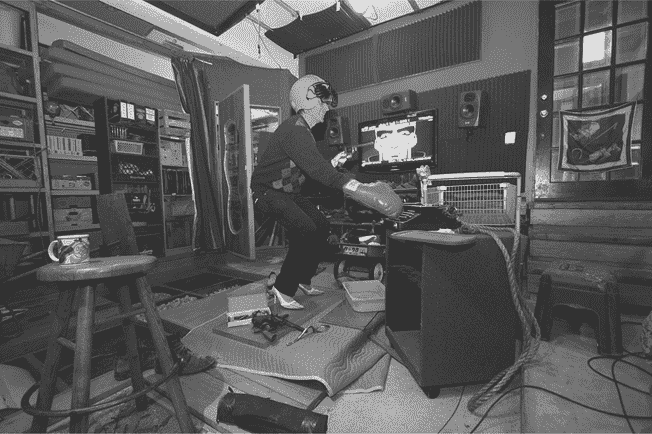
*图 3.4*  *Walter Spencer 一次性完成所有工作。* ¶ *来源：Walter Spencer 和 Hi Fi Foley 友情提供照片*

然而，这种做法在拟音界正在复兴。拟音师被要求在舞台上制作越来越多的效果。由于编辑为其任务所剩时间有限，他们要求拟音师承担更多工作。好处是拟音效果新鲜且与影片个性化。实地录音师和编辑 Charles Maynes 指出，像 Ren Klyce 这样的音效设计师继续在拟音舞台上进行大量音效设计的实践。Maynes 评论道，“Ren 真正利用了拟音能带来的东西。”Maynes 补充说，拟音“很大程度上用于弥补制作没有提供的内容。”缺点是拟音舞台时间昂贵，为电影制作声音需要花费大量时间。这种方法的另一个可能问题是，剪辑室里可能有音效编辑正在用库音效本身来创造魔力。一次又一次，有雄心的拟音师在舞台上创造了美妙的东西，却只因音效早已被预混，效果实际上已被覆盖，而在混音阶段被丢弃。这里的教训是什么？沟通。再次，音轨中谁负责什么？记住，有惯例，但没有硬性规定。
