# 第二部分 | TWO
## 拟音艺术家的工作方式
### 协议、惯例和拟音层级

# 第四章 | four
## 火在洞中
### 参与者及其职责

DOI: [10.4324/9781003008439-7](https://doi.org/10.4324/9781003008439-7)

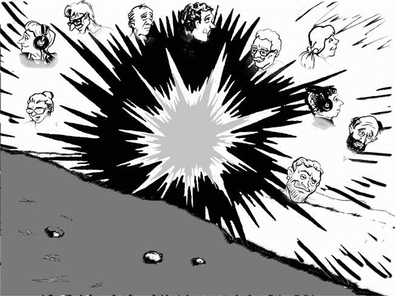

后期制作音效在拥有系统化流程时效果良好。在好莱坞，有一套经过多年发展而形成的规范化体系。该体系会根据项目的预算和允许的时间而有所变化。然而，总的来说，好莱坞大多数专业电影和电视节目遵循相同的范式。存在着被接受的参与者层级和流程的预期惯例。了解这套系统非常重要，它为任何想要一套经过验证的制作原声带蓝图的人提供了常识性方法。通过了解主要参与者如何安排他们的后期制作团队，个人可以更恰当地建立自己的最佳实践。

## 团队领导与团队

大多数影片都有主管音效剪辑师（SSE）。制作公司通常应导演或画面剪辑师的要求聘请此人。有时，在动画和电视领域，制作公司的后期制作主管会负责聘请。重要的是：后期制作音效中聘请的第一人将是主管。一些影片同时设有音效设计师和主管音效剪辑师。这两个职位的目的不同。音效设计师负责非常具体的概念性音效，而主管音效剪辑师则是其余音效团队的团队负责人。SSE 随后为节目聘请必要的剪辑师。影片的预算可能允许配备充足的剪辑师。然而更可能的是，预算会紧张，只会聘请少数几位精心挑选的剪辑师。会有专人负责剪辑对白，专人负责剪辑音效和背景音，专人负责监督和剪辑自动对白替换（ADR），以及专人负责剪辑拟音。音乐则由另一支独立的团队在另一处进行作曲和剪辑。音乐剪辑师会与电影作曲家合作，为每个音乐主题挑选合适的提示。作曲家和音乐剪辑师在好莱坞通常不会与音效团队合作，但也有例外。在其他电影社区，如纽约或旧金山湾区，作曲家和音乐剪辑师确实可能会定期与音效团队合作。

在大型预算的节目中，SSE 将有余裕为每个任务聘请不止一位剪辑师。随着日程变得更紧、更苛刻、更劳动密集，这是有益的。剧组可能需要不断更改影片的剪辑以适应“temp dubs”和画面更改。

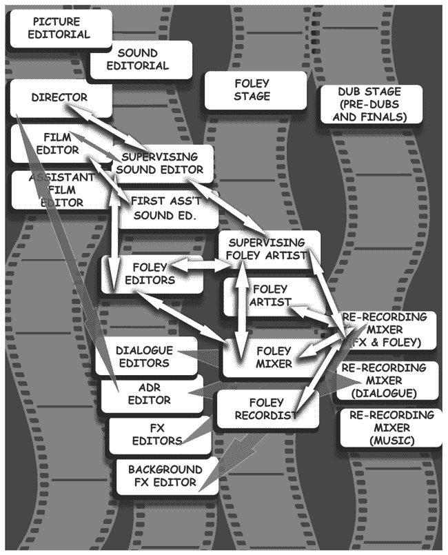

拟音演员通常由 SSE 聘请。通常一部电影或电视节目会有两位拟音演员。然而，如果预算紧张，一个演员独自完成整个节目并不罕见。这不是首选的做法，但预算差异很大，有些节目负担不起两位演员的费用。在纽约，通常只有一位拟音演员。

拟音演员要对主管拟音剪辑师负责。可能还有另一位拟音剪辑师，但主管负责。此剪辑师已与 SSE 一起标注所需的拟音，并为录音棚排定拟音提示。一旦拟音表演并录制完成，就是这位剪辑师确保拟音被剪辑并且所有提示都完成。

### 各团队成员的工作流程

SSE 会与导演和画面剪辑师一起进行影片标注。在此会议上，SSE 会详细记录音效团队的要求。会就风格、重要戏剧性时刻、导演的具体概念想法以及连贯性问题做笔记。SSE 可能会让 ADR 剪辑师在会议上记录演员在 ADR 环节需要替换的台词。如果 ADR 剪辑师未出席此次标注会议，SSE 稍后会另行安排标注会议。主管拟音剪辑师也将与 SSE 进行标注会议。

对白剪辑师会获得画面剪辑师提供的最新版本的影片、电视集数或网络剧集，其中包含选定的音效“takes”。在模拟音效时代，他们会将胶片分段精修，并仔细处理以平滑并分离出影片中的对白。随着向数字音效的过渡，流程相同，但执行方式不同。声音可以在音轨上非破坏性地分离并一起回放。对白剪辑可以为音效团队的其他剪辑师节省大量不必要的工作。通过妥善安排对白，对白剪辑师和重录混音师可以保留在制作中录制的脚步声和道具声。因此，音效剪辑师和拟音剪辑师可以将精力集中在真正需要在音轨上添加的必要效果上。

拟音剪辑师会为需要在拟音棚表演的脚步声、手持道具、布料和特殊道具以及定制效果排定提示。每个行走角色和每种特定类型的道具表演都会分配专用音轨。布料会被放在最后分配的音轨中。传统上，会向拟音棚发送提示表，为拟音混音师和拟音演员制定蓝图。以前，当拟音录制到 24 轨磁带上时，提示表是手写的。如今，它们直接输入到数字会话中（大多数主要电影市场的标准是 Pro Tools）并发送到拟音棚。有时，可以从这些会话中打印出提示表，供拟音演员预览和计划使用什么鞋子和道具。

拟音混音师（或如果棚内有的话是录音师）随后会从驱动器加载会话到电脑，或从服务器下载。一些工作室（以及一些电影学校）拥有上传和下载的服务器，因此永远不会将外部硬盘或闪存驱动器送到棚内。有时，拟音演员更喜欢让拟音混音师“call out”提示给他们。如果这是他们的惯例，他们就不必打印提示表。

在拟音演员在棚内表演提示的同时，音效剪辑师正在剪入他们的效果。传统上，SSE 通常会试听并为影片分配效果，剪辑师会以资料库的形式获得他们的“kit”效果。然而，现在剪辑师可以下载音效，如果时间真的很紧，还可以自行决定使用哪些效果。他们的任务是组织和分层效果，并为每个环节创建音轨。更常见的是，如果时间紧，音效剪辑师也可能会加入“mixing-in-the-box”，因为技术允许他们这样做。Pro Tools 旨在鼓励跨界，工作流程通常依赖于这种灵活性。

与此同时，ADR 剪辑师正在棚内从影片演员处获取所需的替换台词，然后回到剪辑室剪入选定的 takes。然而，这也可以在棚内完成，因为 ADR 混音师拥有 Pro Tools，如果时间有限且是简单修复，可以在那里直接“move”台词。此外，如果 ADR 是远程的——正如在亚特兰大等城市拍摄的电视节目和电影经常出现的情况——ADR 混音师，其工作方式与拟音混音师类似，可以录制 ADR 并在线发送到洛杉矶的工作室，编辑好并在第二天早上即可使用。一次又一次，技术正在允许工作流程的一些改变。

重点是，所有音效剪辑师，无论是剪辑对白、效果、ADR 还是拟音，都在协作但也同时进行各自的任务。他们必须协调各自的会话并了解彼此在做什么。理解这种独特协作方式的最佳方法是，团队协同工作，但不一定在一起。

### 团队协作

音效团队的所有成员都必须对其他成员负责的内容有实际了解，以便工作不重叠，但一切都得到覆盖。音效剪辑师需要知道对白剪辑师在制作中“saving”的内容。拟音剪辑师需要知道音效剪辑师从效果中剪入了什么。音效和拟音剪辑师需要知道音乐会在哪里响亮。所有剪辑师都需要知道哪些台词被替换。每个人工作都影响着其他人。

一旦所有编辑都完成了各自音轨的编辑，这些音轨就会被送到配音阶段进行预混，并与重录混音师一起为最终混音做准备。一个混音师负责对话的预混。该任务可能需要一周或更长时间。另一位混音师负责音效和拟音的预混。然后进行 ADR 预混。在最终混音时，所有重录混音师共同工作。一人专注于对话和 ADR，另一人负责拟音和音效。其中一人还负责混音音乐。在规模较小或预算较低的电影中，或在某些电影市场中，一名混音师会完成所有的混音任务。

每位编辑都必须了解自己的素材将如何配音。编辑对混音师负责。理想情况下，SSE 会在预混期间坐在配音台上监督流程，并确保混音师拥有所需的素材。SSE 可能会在混音阶段修正一些剪辑。负责正在混音的会话的具体编辑可能会进行更改。如果剪辑是轻微的，混音师本人也可能会进行编辑调整。

拟音师和拟音混音师也应清楚地了解拟音在最终混音中将如何配音。拟音师和拟音混音师不仅要注意具体的提示，还必须足够了解编辑和混音师的任务，以便提供帮助。太多的拟音会话到达配音阶段时拟音音轨过多。拟音是声音的一个方面。做所需的拟音。不要多，也不要少。

拟音团队需要记住，在最终配音时，混音师身边有导演、制片人、画面剪辑师和其他人观看并在配音期间提出想法。这是一个压力很大的情况，拟音师、拟音混音师或拟音编辑能做的最好的事情就是在呈现拟音时预见到最终混音。对应包含多少素材以及更重要的是*not*包含多少素材的考量，对重录混音师有很大帮助。

在电视或分集网络剧中，情况类似，只是所有事情同时进行，且时间安排非常紧凑。电视节目在计划播出前一周“交片”并不罕见。当网络剧以计划的单一发布日期制作时，工作流程变得更加关键，并且关于谁将负责声音的哪个方面存在更多变量。一个系列同时拥有多个声音团队和一个重录阶段同时工作的情况并不罕见。在这些情况下，保持一致性最多也只是困难的。

因此，后期声音团队的组织性和对彼此任务的了解变得更加重要。此外，尽量避免音效的重复，或完全不重复也是有帮助的。它应包含在制作音轨、音效音轨或拟音音轨中。

有许多关于配音混音师拥有三种或四种声音版本的说法。也许音效编辑以几种方式覆盖了它，拟音团队也是如此。当声音团队不确定什么效果最好时，可能会提供选项。必须做出决定——在配音台上，在为场地时间付费的制片人注视下，并在巨大的时间压力下——使用什么音效。正如 Dave Stone 所说，Joe Dante 的制片人 Mike Finnell 曾说过，“I have to pay someone to cue it, then pay someone to cut it, then pay someone to get rid of it.”

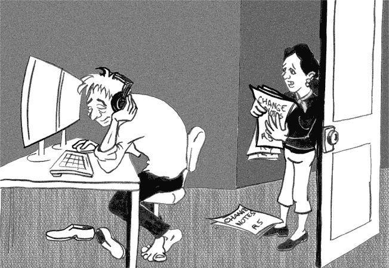

然后，当然，还有一个著名但或许是 apocryphal 的故事，关于备受尊敬的重录混音师 Richard Portman，他直接扔掉了拟音的 13–24 音轨，只配音了 1–12 音轨。这既不是第一次，也不是最后一次混音师被迫处理太多可能根本不需要执行的提示。

## ALTERNATIVE WORKFLOWS

现在你已经读过传统工作流程是如何建立的，在准备项目时，有一些后期声音处理方法的变体可能对你有用。虽然好莱坞系统是最成熟和一致的，但认为它是管理原声带唯一方式是错误的。

对于独立电影，背景不同，因此协议也不同。负责声音的人通常就是作曲或写剧本的人。也许混音师也是编辑。此外，在小成本电影中，团队成员经验不足是很常见的。因此，尽管电影规模较小，预算微不足道，但独立电影人了解“the big show”中的专业人士的做法仍然很有帮助，以便他们能将这些做法适应到自己的项目中。

最重要的一步是有一人负责组织原声带。那个人担任主管。主管也可以编辑，或进行拟音，或混音，但需要有一人担任团队领导和联络人。

## WHAT EFFECTS NEED TO BE COVERED AND BY WHOM

一旦领导者确定，原声带的组织方式可以有所不同。拟音师也可以提示和编辑拟音。这实际上是一个极好的主意。通过自己编辑拟音，甚至混音，你可以学到更多关于什么对项目合适，什么不合适。拟音混音师可以混音最终配音。编辑可以在 Pro Tools 中预混。对话编辑也可以作曲。技能配置可以变化，但任务和责任不能。用于剧情片和电视的系统经过了检验和测试。它工作得非常好，是任何项目的良好模板。主要区别在于人员会更少，他们会多任务处理。好莱坞的一些大牌人物就是通过与 Roger Corman 合作以这种方式学习电影制作的。这是一种很好的学习方式。

当为声音标注项目时，出现的一个首要问题是需要由谁来覆盖哪些音效。经验非常丰富的对话编辑知道如何“挽救”大量制作声音，音效和拟音编辑就不需要覆盖太多素材。更典型的是，制作声音中会有大量问题需要拟音师进行增强。

对话编辑是一门精细的艺术，如果执行不当会产生灾难性后果。对话“过度清理”——即背景噪音不足——会听起来很单调。单调的背景意味着音效、背景和拟音必须承担更多责任。如果对话模糊且剪辑粗糙，那么音效、背景和拟音就必须覆盖制作并添加更多声音层次。

如果剪辑音效的编辑与拟音团队沟通不当，那么拟音台上制作的声音就会重复已在音轨上的音效。对于重录混音师来说，常见的问题是必须放慢预混过程来寻找音效。它们在拟音中被覆盖了吗？制作中？音效中？根本没有？

拟音台是一个创造不寻常声音的绝佳实验室，除了表演普通和不引人注目的声音来创造角色的声音生活之外。它也应保持实用感。拟音师需要直觉和分析能力，但同时兼顾两者并不总是可能的。成为最好的拟音师的关键在于平衡两者。重要的关键是要记住，录制拟音后会有其他人处理拟音。编辑和混音师需要拟音准备充分且艺术性地执行。

# Chapter | five

## Let’s Go Ahead and Go Back

### Spotting, Cueing, and Editing Foley

DOI: [10.4324/9781003008439-8](https://doi.org/10.4324/9781003008439-8)

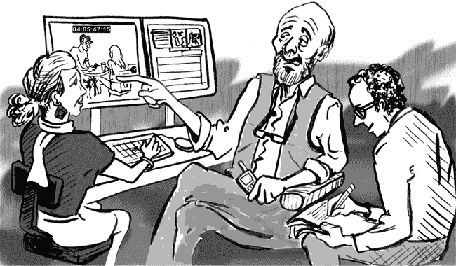

拟音师在拟音棚开始为音效设计做出贡献。他们为本次录制收集鞋子和道具，查看任何提示单，喝着咖啡，或许狼吞虎咽一个贝果，然后开始规划前几个提示点。通常，如果项目是真人或动画电影，会有时间观看节目的开头，以便了解在本次录制结束前需要完成的工作量。

然而，如果本次录制是为电视剧、游戏或由新人执导的独立电影服务，那么这一天——或这一晚——可能会涉及什么内容就难以预测了。原因很简单：院线电影和长篇剧集通常有一个规划阶段，称为定位会议，并且希望拥有某种规范化的提示系统。然而，这对于电视剧、每周播出的卡通节目、游戏或独立电影来说并不常见。随着技术使工作流程加速，像定位会议、提示单以及剪辑师与拟音专业人员之间的清晰沟通这类细微之处和讲究可能会被加快甚至消除。

因此，存在一种概念上的理想情况用于拟音的定位和提示，可以被利用并能证明为什么定位会议以及具体的提示对于高质量拟音如此重要。如果理想情况没有出现也没关系。在娱乐艺术中凑合做事是家常便饭。然而，标准保持得越频繁，必要时就能做出越多的调整和妥协。关键在于知道该修改什么，保留什么。

## 定位会议

定位会议是头脑风暴与日常细节相遇的地方。理想情况下，当聘请一名 supervising sound editor（SSE）领导音效团队时，他们会与导演和画面剪辑师会面。有时，如果时间允许且预算充足，第一助理剪辑和 ADR 监督也可能会参加会议。极少数情况下，拟音监督也会出席第一次定位会议。然而，这类定位会议的日子正变得越来越少。我们现在正处于预算鹰派不愿为他们认为额外甚至微不足道的任何事情付费的时代。即使定位会议可以为一部典型的院线大片在后期节省数千美元，几个音效专业人员围坐讨论音效创意这种想法对大多数会计师来说似乎是不必要的开支。不足为奇的是，他们无法理解前期规划在最终混音阶段末端可以节省时间和金钱的必要性。与其说是随意玩弄音效设计想法的琐碎时光，情况恰恰相反。大多数定位会议比预算鹰派能想象的还要严肃和艰苦得多。

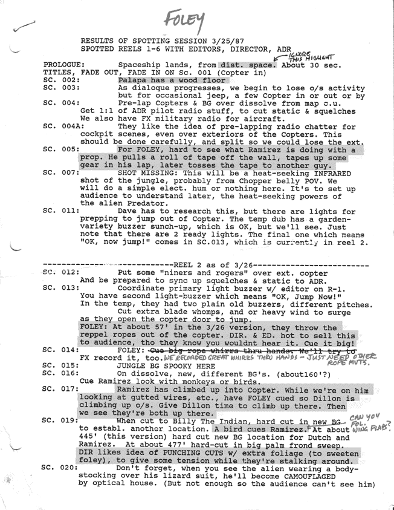

*Figure 5.2* *摘自电影* Predator *的 supervising sound editor 手记，显示了拟音的具体要求。*

导演和剪辑师通常会播放画面并与 SSE 讨论偏好。SSE 做笔记并询问需要 ADR 的内容、特殊关注点和时间表。会有关于临时配音、补拍和画面更改的问题。导演经常会向音效编辑指出关于普通效果的显而易见之处。但关键在于 SSE 能清楚地了解关于音效的期望。

David Stone 讲述了与 Tim Burton 在 *Batman Returns*（1992）合作的故事：

> 所以，我们在 Chris Lebenzon 的剪辑室里和 Tim 在一起，Rich Anderson 和我坐在 KEM 台前，Chris 和 Tim 来回讨论，Tim 会说，“哦，那里有个门。我们得弄到那个门。这里有这个，那里有那个。”然后他突然停下来转向我们说，“哦，我在做什么呢？你们知道该怎么做。为什么我不直接去我有顾虑的地方呢？”Rich 和我互相看了一眼，仿佛在说，“总算有一个有常识和信任的导演！他知道我们懂得如何处理琐碎的事情。这就是他付我们钱的原因。”

Stone 继续说，

> 每部电影都有某些不寻常的顾虑，我们过去称之为“从未听过的声音”，因为很多导演都会提出这一点，好像他们是第一个说这话的人。——你拍过几部电影后，就开始看到这些模式。监督可以通过承认特殊关注点来为导演节省大量时间，并把时间花在真正需要讨论的问题上。按惯例，我们与导演相处的时间并不多，而像 Tim 这样赋权的导演，会明智地利用我们在一起的时间。

在定位会议期间，Stone 会为他的拟音监督写拟音笔记。他随后会向监督——在 *Batman Returns* 中是我的——递上一本笔记本，其中包含每卷胶片的完整书面分解，说明音效关注点是什么，哪些音效会覆盖，拟音需要负责执行什么。他安排了一个与我一起放映电影并讨论概念、风格和日程的会议。我离开会议时知道拟音的期望是什么，效果剪辑师是谁（如果我需要就某个提示点打电话），以及我在棚内每天需要完成多少工作。这是更昂贵的定位方法。

Stone 为 ADR 举行了类似的会议。在这些会议上，ADR 监督会被告知哪些台词会在 ADR 中替换，哪些台词对白剪辑师可能能够在制作音轨中“保留”。所有剪辑师都有笔记本。所有剪辑师都知道团队成员是谁，他们在哪里，以及他们正在剪辑什么。这是一种无缝的方法，因为沟通如此完整，使得剪辑师能够获得最大程度的授权。

每个 SSE 对与团队进行定位的方法各不相同。Stone 说，

> 我 \[会\] 尝试以多次 passes 的方式处理一部作品。例如，我可能会先和负责拟音提示的人坐下来，只讨论“大事”问题。我喜欢分层处理工作。

他继续说，“例如，‘我们要拍一部像 *Predator* 这样的丛林片。让我们谈谈植被。让我们对它进行特殊处理，每天获取新鲜的植被。’然后我会转向另一个具体问题。”

获得奥斯卡最佳音效剪辑奖的 Supervisor Don Sylvester，因其在 *Ford v Ferrari*（2019）中的工作，讨论了他与导演 James Mangold 关于音效的各种经历：

> 拟音完全以角色为驱动。我总是想着“Jim 会怎么做？”它 \[sound\] 如何讲述故事？拟音是 Jim 的一个痛点，因为拟音完全以角色为驱动。它是角色，他知道角色会做什么，如果拟音不知道，他就会生气。在之前的电影 Logan 中，有一个非常强壮的女孩，他试图从她手中夺走背包，他们来回拉扯了几次，最后他把它从她手中扯了出来。对我们来说这很难做到，因为正如 Jim 解释的那样，有两个巨人在战斗，背包根本没有机会……那是我们的指示……我们在建立角色，这是一个情节点……背包被撕裂和撕扯，但这在屏幕上并没有发生……你唯一能让他们战斗的方式显得可信，就是在他们战斗时撕裂背包。

根据 Sylvester 的说法，导演 Mangold 在表达他对电影中音效的偏好时有一种不同类型的流程：

> 他有时会提醒我们注意一些我们忽略的东西……但现在我的目标是先自己找到……所以他要求我们做的就是先过一遍，然后他再进来批评……他事先不会告诉我们他想要什么。这样做效果更好，因为有时我们会做对（笑）。

Sylvester 对《福特大战法拉利》中汽车比赛音效的评论：

> 讲述故事的最佳方式是什么？音效基于角色和故事。它们是否能成为推动情节发展的不可或缺的一部分？例如，响亮的汽车声是有其时间和场合的。我们非常清楚这一点。我不想打破“这不是讲故事，这只是制造声音”的规则。

在担任《3:10 到尤马》（2007）的监督时，Sylvester 提到当本·韦德（Russell Crowe）走下楼梯时，拟音是这样处理的，“甚至楼梯都在对他\[Crowe\]做出反应”。

如今，这种详细的前期准备和美学讨论已很少见。它需要时间和经验，而在当今加速推进且预算紧缩的现实中，许多人并不具备。但重点在于组织和沟通。如果尊重声音工作的基础性事务方面，就能实现最高效率和创造力。虽然这种程度的细心并非总能实现，但最近的历史背景可以提醒我们，我们在关注一流后期制作配乐真正所需方面已经偏离了多远。规划至关重要。无论是剪辑师、艺术家还是混音师能做些什么来把计划写在纸上——或电脑屏幕上——他们都应该这样做。

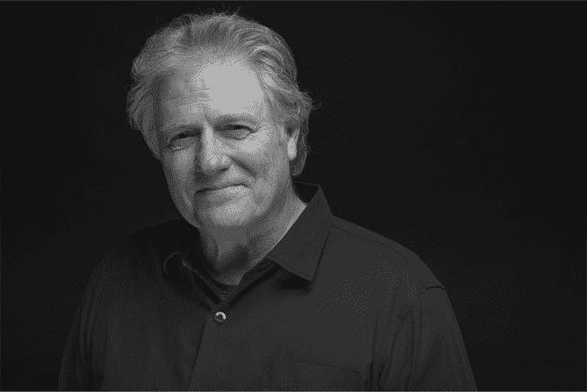
*图 5.3*  *监督音效剪辑师 Don Sylvester。* ¶ *来源：Don Sylvester 友情提供照片*

## 聚焦任务

同样的原则也可适用于中小型或独立电影。关键是必须有一个领导者。表面上，需要有一名 SSE 作为处理一切事务的负责人。经验丰富的第一助理也是必不可少的。即使一个项目只有少数几个人剪辑整部电影，强大的 SSE 和第一助理也能确保节目高效执行。

Mark Pappas 提到，定位会议也在被修改以适应更紧的预算：

> 通常，我们希望节目的监督能与导演一起进行定位，但现在这种情况越来越少。实际情况是，他们可能会与画面剪辑师一起定位。我们从画面剪辑师那里得到指示。然后在第一次临时配乐后，你实际上会听到导演可能会说的话。如果有第二次临时配乐或\[我们\]直接进入预混音，我们希望到那时问题已经得到解决。

一部非常优秀、值得研究的配乐是《失落之路》（2002）。它精妙、优雅且不显眼。Scott Hecker 是 SSE。定位

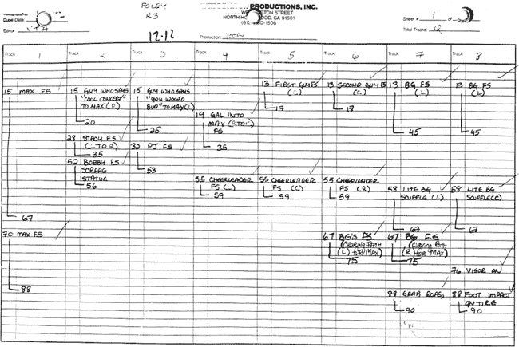
*图 5.4*  *手写拟音提示表，分配了脚步声和道具提示音轨道 1–8。*

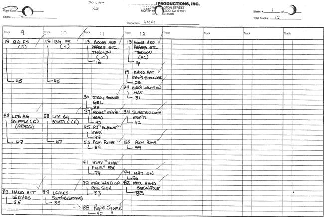
*图 5.5* *手写拟音提示表，分配了脚步声和道具提示音轨道 9–12。*

会议可以揭示导演对声音叙事的概念。这部电影是 Hecker 与导演 Sam Mendes 之间直觉沟通的成果的音效设计范例。Hecker 讲述了 Mendes 在第一次定位会议上如何描述他的声音抱负：“我最初与 Sam 合作时，他说，‘Scott，我希望声音是诗意的，而不是平庸的。我希望它是歌剧式的，而不是分段的。’”当导演给出这样的意象时，至少是令人鼓舞的。Hecker 在该片中的音效监督为他赢得了奥斯卡提名。

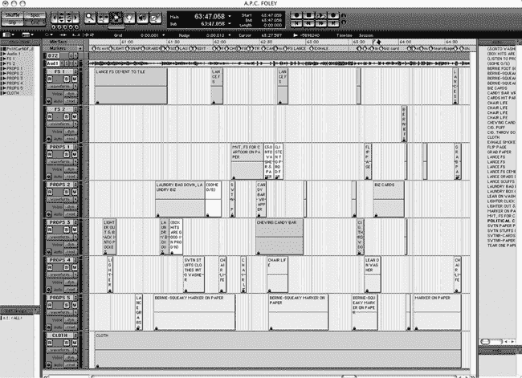
*图 5.6*  *Pro Tools 拟音提示会议，显示提示在拟音会议前如何分配到特定轨道。*

Hecker 监督的另一部电影是《无极限》（1998），由 Robert Towne 导演。该片讲述了奥运选手 Steve Prefontaine 的故事，影片中有几段展示他奔跑的镜头。Hecker 认为他会让拟音（由他的兄弟 Gary 完成）覆盖 Prefontaine 的所有脚步声。Towne 有另一个想法。他告诉 Hecker，他希望奔跑部分用音效设计来完成。不同于现实世界中穿钉鞋的跑者，随着努力脚步声增大（预期做法），他希望每场比赛的声音都不同。

Towne 希望第一场比赛听起来像“鱼在水下觅食”。他希望第二场比赛听起来像“鸟在玻璃板上拍打翅膀”。Hecker 说，“我开始时很害怕，走出\[定位会议\]时想着，这将会很酷！\[Towne\]希望我用开罐器打开我的头顶，跳出思维框架。”虽然 Hecker 的兄弟希望以更传统的方式拟音所有脚步声，但 Hecker 坚定地坚持了 Towne 所表达的概念。

Greg Hedgepath，《诗意正义》（1993）和《塞尔玛》（2014）的 SSE，在准备定位会议时有一套总体哲学。他阅读剧本两遍，为整体音效设计做声音笔记，并自问，“重要的元素是什么？”他关注声音如何穿梭于场景内外。“这就像作画，”他评论道。他可能会把某些声音拿掉，然后再放回去。“它会是运动的吗？会是静止的吗？”他认为背景声非常重要，并在做笔记时也考虑这些声音。对 Hedgepath 来说，拟音最好是在“不引人注意”时，但他很快补充道，“拟音为场景增添了生命……它让场景重新焕发生机。”

F. Hudson Miller，他说“我从未想成为一个声音 guy，但我确实想成为一个电影 guy”，在电影学校学习摄影并发现自己对声音有天赋。在与资深音效剪辑师 Sandy Berman 和 David Yewdall 合作后，他开始剪辑拟音。如今作为 SSE，Miller 表示，“我不对拟音和\[声音\]效果区别对待。拟音美妙之处在于它是对画面进行的表演。”他对拟音的提示和剪辑都以表演为出发点，尽管他承认自己在电影中更喜欢较少的拟音，而不是有些人可能喜欢的那样。“最重要的是其中有多少情感内容……我们为心灵和灵魂讲故事。”在派拉蒙工作期间，他怀念与导演 Tony Scott 的经历，他形容 Scott 是“我曾合作过的关于他想要\[声音\]的方面最精确的导演”。

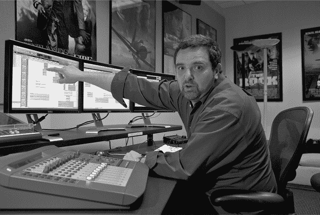
*图 5.7* *监督音效剪辑师 F. Hudson Miller 由 Dan Weeks 拍摄。* ¶ *来源：F. Hudson Miller 友情提供照片*

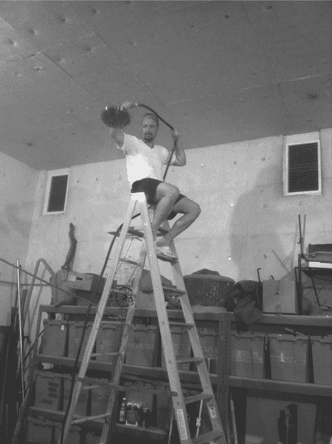
*图 5.8* *Marko Costanzo 演绎雨声提示。* ¶ *来源：George Lara 友情提供照片*

导演 Kevin Lima，他曾执导过动画电影如 *A Goofy Movie* (1995)、*Tarzan* (1999) 和 *Enchanted* (2007)，评论道，“你正在构建一个世界的感知……以及我们自己选择的听觉景观。” 在考虑其电影的声音设计时，他关注的是“如何根据情感语境来编排这些声音。” 与 Miller 一样，Lima 认为情感应该驱动电影中的声音。“太多的声音会变得分散注意力……声音和角色紧密配合。” 他举的例子是“这个角色会如何拿起他的道具？”

在洛杉矶，让导演参与 Foley 表演并不常见，但在纽约就不算罕见了。Coen 兄弟会经常与 Foley 艺术家 Marko Costanzo 合作。回顾电影 *Ishtar* (1987) 的 Foley 制作，Costanzo 回忆称导演 Elaine May 在 Foley 方面非常“亲力亲为”。“她知道自己想要什么，并且会坚持直到满意为止。” 在这些情况下，即使有正式的点位会议，Foley 的实际提示也不会由 Foley 编辑执行。相反，导演将声音表演视为演员角色的一部分，并将其纳入自己的职责。

## SPOTTING REDUX

有时，点位会议的目的是“重新利用”一部已发行的影片。当一部影片要在电视网或有线电视上播出并需要配合广告时段或其他时间要求时，有时必须缩短片长。另一些时候，声音编辑必须添加原版发行中没有的镜头，以延长影片在电视上的时长。这需要编辑音效、制作和编辑 Foley 以及 ADR，并编辑额外的音乐提示。

重新利用影片的点位会议简短而高效。电视网提供简单的说明，我们都按新的要求进行调整。关键在于让新声音与旧声音匹配，以便在混音阶段进行重新混音。

声音编辑会从影片的原始混音母带中获取 stems，并回到素材中查看要求了哪些更改或增补。一旦找到合适且匹配的音效，Foley 艺术家就会演绎必要的提示，编辑再将其剪辑进去。对 ADR 也会做同样的处理。另一位编辑会寻找可以拉伸或添加到新版本中的音乐提示。

还可能为影片的航空版或电视版安排单独的点位会议。这通常对 Foley 影响不大。其目的是用新的 ADR 台词替换令人反感的语言，以覆盖旧台词。如果你听到过“哦，这太他妈棒了”或“快滚开”，就可以确定你正在观看的是航空版或重新利用的电视版。有时你甚至会注意到某些词语被删掉了。现在你知道原因了。

## CUEING FOR SHOEING

一旦 Foley 编辑拿到点位说明，下一步就是将这些概念和限制转化为可在录音棚使用的提示表。直到最近，经验更丰富、更细致的编辑会向棚内的 Foley 团队提供手写的提示表。提示表以垂直列的形式标注，主要的脚步提示从第一、二、三轨开始，依此类推。中间的音轨为背景脚步提示，外侧音轨为各种道具。最后一轨是布料声。

现在，大多数提示都是在 Pro Tools 会话中完成的。音轨是水平的，但方法相同。第一位主要人物的脚步声在第一轨。音轨分配与以前保持一致。主要区别在于，不是手写提示，而是将提示标记到会话中，会话保存在硬盘或闪存驱动器上，有时也会发送到服务器。棚内从服务器或驱动器加载会话。提示随后在 Pro Tools 中标记并标记好的区域内直接录制。提示表可以从 Pro Tools 会话中打印出来。

不必将 Foley 提示到动作的第一个具体时刻。Foley 艺术家会将动作置于场景的上下文中观看。而 ADR 会提示到声音的第一个“起始点”，以便更好地帮助演员实现完美同步，Foley 的提示可以更宽松。只要提示时考虑到帮助艺术家预判动作，提示就会合适。提示过于贴近第一步脚步会有危险。混音师和艺术家喜欢在实际提示开始前有一个“呼吸”空间。有时会在录音设备中编程“提示音”，帮助艺术家对准同步，但许多 Foley 艺术家习惯于“凭目测”。重要的是要接近那个时刻，而不是正好压在上面。

提示的另一个重要技巧是，让提示具有连贯性对 Foley 艺术家更有帮助。如果画面剪辑呈现来回的视角（我们看到 Jane 走下走廊，然后 Max 在厨房，然后 Jane，然后 Max），让 Jane 的提示持续进行，而不是在每次剪切时停止并提示下一个镜头，对 Foley 艺术家来说更容易。行走会感觉更自然，艺术家也会更放松。记住，Foley 是一种表演。为艺术家和混音师提示，而不是为编辑提示，才是最好的做法。

在数字编辑站出现之前，提示是手写的，提示过程缓慢、繁琐、单调，有时甚至枯燥乏味。然而，它也是 Foley 编辑工作流程中最关键的时间使用方式。经验丰富的编辑为 10 分钟的影片做提示大约需要 4 小时。动画片会更长，动作场面也会更长。数字提示更快，因为编辑只需选择录音音轨并输入提示。过去为选择确切音轨而付出的细心程度现在不再那么关键，因为 Foley 混音师可以在棚内轻松移动音轨，并增加额外音轨来构建 Foley 效果。此外，Foley 编辑的日程安排更紧凑，结果是提示所用时间更少。

当编辑为 Foley 做提示时，他们应该多次观看每个场景。所有编辑的方法各不相同，但他们会牢记一些惯例。首先，他们按角色逐一提示场景中的主要角色，尽可能让每个角色保持在一致的音轨上。Mimi 在第一轨，Joe 在第二轨，Maurice 在第三轨，依此类推。如果 Mimi 的行走比较复杂，并在行走过程中从一个表面换到另一个表面，最好让编辑将混凝土脚步声提示在第一轨，然后跳转到第二轨提示草地脚步声。一些 Foley 艺术家可以在一个音轨上轻松完成这种转换。然而，如果艺术家经验不足或混音师在提示上切入技巧不多，编辑可以把行走提示在两条音轨上。

提示的下一步是查看背景角色。他们可能是人群，也可能是个人。如果某个背景人物从右向左或从左向右行走，编辑很可能会在单独的音轨上提示该人物并标明行走方向。如果屏幕左侧、中央和右侧都有角色，Foley 艺术家仅用于这些偶发背景人物（BGs）就需要三条音轨。对于主要演员，最好标明姓名。然而，对于 BGs，使用服装颜色、身高或识别特征可以帮助 Foley 艺术家快速看出已提示的是谁。示例可以是“高个子男人，蓝色衬衫，从右到左”或“两个女孩在中央奔跑”。

尽可能具体但不使用过多词语是另一个最佳实践。如果混音师和拟音师不会使用提示表，而是要从 Pro Tools 或其他数字系统上读取提示，这一点尤其正确。一个说明信息不足有多容易的例子来自电影 *Platoon* (1986) 的提示工作。那位经验丰富且知识渊博的拟音编辑提示了“男人抱着孩子”。虽然这听起来完全没问题，但场景中包括几名男子，每人抱着一个孩子。

提示完脚步声后，下一步是从头开始播放胶片或场景并开始识别道具。最好将相似的道具放在相似的音轨上。例如，纸类提示应与金属提示或皮革椅子提示分在不同音轨。当拟音师在拟音棚时，混音师会调整麦克风以录制特定道具。许多拟音师会一次性完成所有纸类提示，因此如果他们不必为每种相似的提示翻找，就更容易了。用“食物组”的概念来思考会很有帮助，比如纸张、手拍、身体坠落、金属碰撞、警察装备、马蹄声、马鞍和缰绳、碎屑等等。关键是为艺术家和混音师提供清晰的路线图，这样每个人都在“同一页”上，字面意义上和比喻意义上都是如此。

在磁性胶片时代以及后来的 24 音轨录音时代，拟音师会谨慎使用音轨。现在，有了 Pro Tools，音轨使用的限制更少了。好消息是，可以拆分提示并进行更多分层。坏消息是，这会鼓励缺乏纪律的编辑在没有太多思考的情况下把提示随意丢到任何地方。然而，再次强调，考虑工作流程至关重要。在提示之后接手的人需要有明确的方向感和沟通感。提示越精确、越有条理，拟音录制就越放松、越具体。拟音师始终处于巨大的时间压力之下。如果 Pro Tools 崩溃或麦克风开始嗡嗡作响，在解决问题时时间就会被浪费。有组织的提示为失误、重拍和废片留出了空间。

说到拟音提示，编辑是在为拟音师和混音师服务。拟音棚昂贵且通常提前预订。项目预订的拟音录制次数通常在第一次定位会议前就决定了。编辑只应提示需要在棚内完成的项目。如果效果编辑打算为该提示使用素材库音效，则无需为棚内提示。最好进行优先级排序。必须在棚内完成的就是应该被提示的。提示一些不必要的额外提示总是可以接受的。如果要添加“愿望清单”提示，那么明智的做法是将其标注为此类。

拟音混音师 David Jobe 的话说，谈到拟音棚最大的障碍，“就是时间，时间，时间！”

## 即兴提示
为电视或连续剧节目提示时，黄金时段的惯例与卡通片、真人秀或日间电视不同。卡通片几乎没有时间进行提示。因此，它们是在拟音棚“即兴”提示，意思是实时进行。当拟音师观看正在发生的事情时，他们很可能会记下需要完成的内容，混音师也是如此。这些节目制作迅速，使用的是公式化的道具。与为每个声音事件设计特定音效花费时间相反，情况恰恰相反。拟音师正在进行“游击拟音”，尽可能快地完成尽可能多的内容。同步性没有那么关键，质量也不是。

拟音师 Marko Costanzo 和混音师 George Lara 为 *The Marvelous Mrs. Maisel* 录制拟音，该节目由担任监督拟音编辑的 Steven Visscher 进行提示。“他通过在定位内容上保持明智为我们节省了大量时间，”Costanzo 表示。提示并不总是这样，正如 Costanzo 所说，“一切都取决于谁负责。”

前面仔细描述的定位会议是大型预算影片的场景，但它们与观众在平板屏幕、电脑或手机上定期观看的黄金时段电视节目关系不大。即使有拟音提示，也可能只是拟音师的“待办事项”清单。通常没有协调的定位会议。这是一个公式化的流程，演员每周都在相同的场所，因此声音变化很小。

游戏需要短促且仅略有变化的提示。为游戏提示拟音所需的时间更少，通常提示的细节也更少。游戏拟音的重点更多是在拟音表演过程中。玩家可能做出的每一次细微选择变化都可能涉及数十次几乎相同的脚步声和道具提示的录制。因此，提示更简单，但拍摄和编辑非常具体。

其他国家不一定遵循这里概述的相同提示惯例。例如，Julien Naudin 不喜欢遵循提示过的拟音表。他凭直觉做一切，并在表演的瞬间决定提示。Naudin 是第三代拟音师，对自己喜欢的工作方式有成熟的方法。他与导演 Lars von Trier 关系密切，两人本能地沟通拟音在影片中应如何运作。Naudin 前往丹麦与 von Trier 合作，在那里导演在拟音方面扮演了一个罕见的角色，因为他就在附近，可以随时回答任何问题或澄清。

对于任何在任何项目中进行拟音的人来说，这里有一个宝贵的教训。预算、时间、经验、质量、人员和放映方式都会在一定程度上决定拟音师表演声音前能完成多少准备工作。具有灵活、直觉和开放的心态是一项巨大的优势。

## 捕捉甜点：编辑拟音
声音编辑以最现代的技术进入这个行业。在数字时代之前，编辑会在光学声轨或磁性胶片上剪辑。光学声轨有一条视觉线，类似于今天的波形图，可用来判断声音何时开始和结束。编辑有视觉提示来判断剪辑什么。磁性胶片没有视觉参考。编辑必须完全依赖声音本身。在决定声音的剪辑位置或移动拟音提示的同步时，编辑会用白色中国记号笔在磁性胶片上标记剪切位置，然后用剪辑器剪下，将声音片段挂在“修整箱”的架子上，并可能在音轨稍后的位置替换那段磁性胶片。如果更换磁带的目的是仅用于同步，她或他可能需要“翻转”音轨，以免声音与磁头冲突。否则，剩余的声音将被插入到新的提示中。

在磁性胶片上编辑音效的时代，要添加的素材库音效会被放在正在编辑的音轨上，并被编辑以适应场景动作。编辑必须非常有经验和技巧，以至于他们能够想象这个音效

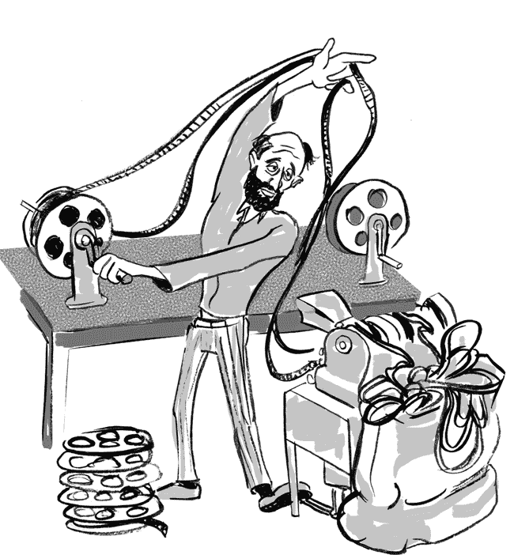

会与随后在未来音轨上编辑并分层以创造声音魔法的效果一起播放。观众可能会认为直升机是一种声音，但实际上，它是由许多互补的声音音轨，一条一条地，在所有编辑者都爱恨交加的庞然大物上制作的：the Moviola。编辑时编辑没有同时播放所有音轨的奢侈。因此，对声音如何共同播放以及想象中的 Foley 和背景音轨的实际工作知识是必不可少的。

现在我们有了数字工作站。我们可以看到每段声音的波形，可以放大波形来“fine-cut”一个音效，或者可以拉远查看整个音轨和剪辑的会话。新技术有很多优点。然而，了解磁性胶片这种更基础的技术如何教会编辑者在寻找声音的正确组合或在编辑 Foley 时处理同步的适当方法时保持选择性、细腻和耐心是有帮助的。

## 初始方法

编辑 Foley 与编辑素材音效是不同的技能。Foley 编辑的任务是取已完成的音轨并对其进行润色。编辑不是为场景的整体设计创建音效，而是精细剪辑 Foley，使其从一个提示到下一个提示流畅优雅。这乍一看似乎是一个简单的任务，任何对 Pro Tools 有基本了解的新手编辑都能胜任，但事实并非如此。

正如画面编辑必须谨慎避免过度剪辑场景而冒着净化表演的风险，Foley 编辑也必须避免过度剪辑 Foley 而冒着净化行走特性的风险。Foley 行走是一种表演。它是演员意图的声音延伸。因此，必须尽可能保留该表演的感觉，就像必须保留演员的台词和面部表情一样。剪辑必须简洁而具体，并且应尊重演员和 Foley 艺术家的原始意图。

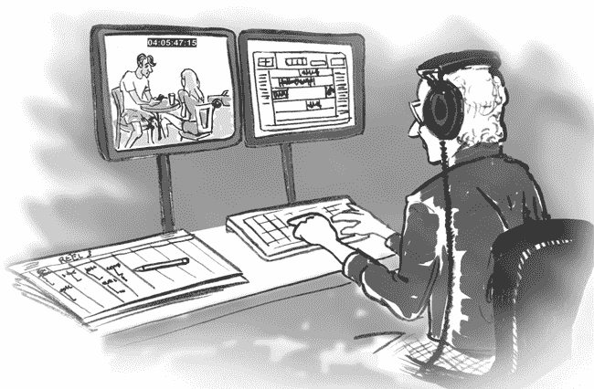

编辑 Foley 的具体技术基于这样一个理念：编辑越少越好。基于此，所有经验丰富的编辑都会遵循一些惯例。首先，查看整个提示。无论多么诱人，都不要立即开始编辑。倾向是只要觉得不对劲就开始“修复”同步。但一旦编辑开始剪辑，提示的其余部分就会受到影响。因为这是一场表演，编辑应该至少观看整场表演两次。他们会注意到提示的甜蜜点在哪里。明智的编辑会查看提示中更具挑战性的部分来润色同步，并会关注真正重要的视觉重点所在。并不是很重要去对齐每一个声音的冲击。关键是将其置于上下文中查看已表演的提示，并注意场景中还会有其他哪些声音。一个脚步提示如果孤立存在，比如果有对话覆盖在上面时就更重要。提示在最终混音中播放的电平并不是编辑在工作站上工作的电平，也不是最可能通过工作站扬声器投射的动态范围。

在观看提示一次并将其置于场景上下文中后，编辑会注意到同步在何处出现问题。它是在开头吗？整个提示是否看起来一直有点晚？这是最常见的问题，也是最容易修复的问题。可能只需要将整个提示上移两帧即可。提示在那时可能会完美地落入位置。

一些 Foley 艺术家在同步上不规律。一些脚步声可能正好同步，然后一两个会很晚，然后一个会提前，然后又恢复到良好同步。用冷静而耐心的眼光，编辑可以注意到不同步的脚步声。它们能通过一次剪辑移动吗？主要目标是避免剪辑每一步，以保留提示的有机生命力。虽然目标始终是在现场获得最佳同步，但表演决定了编辑的方向。

## 编辑中的生活教训

多年前，我是某部棒球电影的 Foley 艺术家。我接到了一位正在剪辑我 Foley 的编辑的电话。那是在编辑各自在一盘胶片上剪辑音效、对话和 Foley 的年代，所以有几位编辑会剪辑我的 Foley。我之前没有和这位编辑合作过，所以他不熟悉我的工作方式，我也不熟悉他。但我知道他更常编辑对话和音效。他对我的同步有问题。他告诉我他会把我表演的 Foley 版本和他剪辑的版本拿下来比较。顺便说一下，虽然这是在 1980 年代，当时有更多时间进行润色，但这仍然是一个相当奇怪的要求。

他来到 Foley 舞台，这让工作室花费了不少钱，并坚持让我去剪辑室查看 Foley。我照做了。我们观看了我未剪辑的版本，就像我走路时那样，以及他剪辑后的版本。值得注意的是，他曾告诉助理再订购一份未剪辑 Foley 的复制品（dupe），再次花费巨大，以便他能证明自己的观点。

他播放了我走路时的 Foley。它是一个脚步提示。主角在整盘胶片中都有简单的行走。它并不具有挑战性或复杂性。对我来说看起来相当不错。然后他向我展示了他剪辑的版本。胶片是磁性胶片，上面有很多接缝。经验丰富的 Foley 编辑已经教会我如何通过看到胶片盘侧面有几个但不过多的接缝来判断 Foley 走得和剪辑得如何。所以，我知道有些严重不对劲。我怀疑 Foley 是否被错误复制。我怀疑舞台上的设备是否使同步滑动。我知道调音师和我一直很细致。我不知所措。然后我看到了发生了什么。他几乎剪掉了每一步。他没有制作音轨可供参考，所以他将每一步都与他认为的脚步声进行匹配。

他剪辑的脚步声让角色看起来走路时膝盖没有弯曲。我试图缓和局面。那天我学到了一个非常重要的问题。对话编辑的剪辑方式往往与 Foley 编辑大不相同。幸运的是，主管音效编辑安慰了我。他对我的工作质量感到满意，并对我的专业精神感到满意。尽管如此，我仍然不太清楚对话编辑和 Foley 编辑有什么不同。

大约一年后，一位聪明但经验不足的初级 Foley 编辑请我查看他正在剪辑的一些 Foley。它是一位舞者在硬木地板上穿着足尖鞋做芭蕾舞步。他的剪辑版本令人困惑，以至于我们花了几个小时才弄清楚出了什么问题。他在出现同步问题迹象时就开始剪辑。他不懂舞蹈，也不知道该怎么办，因为他从场景顶部开始剪辑，事情变得越来越不同步。再次，这是在磁性胶片上。所以，一旦他开始剪辑，后续的同步就会受到影响。如今，有了非破坏性编辑，Foley 编辑可以撤销他们所做的工作并重新开始。但当时，他们不能。

我记不清我坐在那里花了多少小时，试图解读舞蹈声音应如何与画面配合。有一点帮助的是表演该提示的 Foley 艺术家曾是一名舞者。我能看出她在尝试做什么。然而，我认为我对那位可怜的编辑帮助不大。

这两个故事为剪辑拟音提供了宝贵的经验。最佳做法是在编辑任何内容之前先查看整个 cue，然后规划对该 cue 的处理方式。在编辑一帧声音之前，明智的编辑会确认同步良好的地方以及松散的地方。只有在明确拟音艺术家的表演意图时，编辑才开始进行。

后来，当我开始编辑时，我意识到一旦我开始对拟音进行“手术”，我就迷失了方向。更好地放松并花必要的时间。假设大部分工作同步良好，只剪辑那些真正引人注意的部分，可以在时间和艺术上获得回报。总体或粗剪先行。之后有充足的时间回头进行精剪。大多数拟音艺术家，甚至初学者，做的好同步比坏同步多。编辑做得少反而能做得更好。这种理念在大多数情况下都有效。除非编辑在“对齐制作”——将拟音编辑到与制作音轨完美同步——否则完美既不必要，也几乎不可能实现。目标是卓越，而非完美。

Scott Hecker 在与资深编辑兼拟音艺术家 Bob Rutledge 合作时开始剪辑拟音。由于他接受过很好的训练，因此没有犯典型的菜鸟错误：

> 我会在剪辑前先查看 cue 并“聚焦”。你必须在开始剪辑之前就弄清楚要在何处进行编辑，以及在何处重新同步。

Hecker 捍卫让新编辑剪辑拟音的做法：“这是一个学习编辑的好地方，因为它是将声音与画面同步，十次中有九次\[它\]是字面上的应用，无论是有人放下茶杯还是猛敲门。” Scott 也警告说，“但如果你把拟音编辑的艺术纯粹简化为这一点，那么你就错过了其中 80%。” Hecker 的建议在数字音效下更显关键。沉迷于声波并想要匹配它们会让艺术家失去拟音的本质。拟音的存在是为了让角色充满生命力。过度编辑会吸走角色的生命力。

Mark Pappas 经常与 Hecker 合作。他刚开始编辑时犯了很多错误，他的母带从录音棚返回时都需要修复。Pappas 向其他编辑请教过建议，他们给出了各种提示。有人说要匹配每一步的节奏，有人说要更注重韵律感。他不知道该往哪个方向走。然而进一步反思后，这些编辑其实在说同一件事，只是表达不同。他们强调的是拟音的“感觉”，而非同步的刻板。

在编辑的早期，当严重的预算削减还不是现在的驱动力时，Pappas 有时间让别人检查他的工作以指导他。剪完一段磁性胶片后，他可以和主管一起放映，以确保它可以交付。如今，检查工作的机会很少，因此明智的拟音编辑会一丝不苟、细致入微，并在开始时尽可能多地提问。正如 Pappas 所说，

> 真没想到会这么繁琐。你剪完一段序列，几乎要完成了，然后回放一下，它大约十秒钟，而你却在那里坐了几个小时！

初次编辑拟音时很容易陷入细节。正如任何新技能一样，人们倾向于关注每一步、道具 cue 的每个部分、每个爆破音、每个嘶嘶声和每一次呼吸，而忘记了声音过得如此之快，观众不会注意到。此外，牢记这一点非常宝贵：拟音只是场景音效设计的一个方面，声音与对白、音乐、表演、摄影和布景设计相协调。综合来看，除非是只有拟音和制作声音的对白电影，否则所有声音元素的协作令人安心。

### 同步编辑

在编辑任何拟音之前，最好先预览场景。任何用于电影节、独立放映或电影学校项目的影片都应留出时间来真正审视要编辑的内容。然而，大多数经验丰富的编辑在编辑前并不总是观看每个序列。Mark Pappas 以及其他拟音编辑开发了一种方法，经过多年的实践对他很有效。多年的经验使他能够从 cue 的顶部开始剪辑。他了解大多数拟音艺术家以及他们处理 cue 的方式，因此可以预见到同步问题可能出现的地方。此外，日程安排并不总是允许编辑像过去那样预览。如今，最好的编辑会磨练技巧，以找到最快和最好的方式尽可能简化流程。

因为大多数拟音艺术家并不总是同步完美，编辑只会在同步明显过早或过晚时才担心，或者除非需要“对齐制作”或与另一音轨合并。传统观念认为晚一帧几乎无法察觉。

关于同步还有一种替代理论。该理论认为声音比光传播得慢，因此特效和拟音应稍微提前编辑以作补偿。如果我们远距离观看交响乐或合唱表演，会注意到指挥的动作领先于我们听到的声音。到声音传到远处观众席时，他或她已经指挥到下一小节了。这就是支持将声音提前一到两帧编辑的理论。

这种推理的缺陷在于，在现代电影观看中，听众与音轨中的参考点并不遥远。混音音轨通过一组扬声器播放，旨在从不同位置吸引耳朵。声音离观众很近。它不会比画面传播得更慢。更合理的做法是剪辑声音以配合所见内容，而不是试图补偿声音和光传播速度的不同。

剪辑拟音的一个重要方面是将其与制作音轨一起播放，以便迅速看出什么不起作用。在没有整体概念的无菌环境中编辑拟音，编辑很容易陷入细枝末节。必须理解拟音是一门细微的技艺。它不会是观众观看的焦点。它需要不引人注意。表演和编辑糟糕的拟音总会引人注意。好的拟音完美融入，仿佛本就是制作时产生的。在编辑时必须单独聆听拟音。但在离开当前 cue 转向下一个之前，编辑必须用制作音轨聆听编辑后的版本。这将揭示编辑中需要改进的地方。

新工具不断被开发出来“帮助”编辑，但实际上它们可能很危险。一个例子就是名为 Beat Detective 的编辑工具。它最初是为音乐设计的，以确保鼓点同步，但现在也可用于拟音。编辑只需按一下按钮，Beat Detective 就会找到静音点并在那里剪切，以完善拟音的同步。然而，这可能导致声音呆板的拟音。工具和插件旨在让事情变得简单或有趣，但它们实际上可能边缘化拟音编辑的真正艺术。明智的编辑学习经典的编辑方法，并根据自身情况调整方法以提高技能和能力。

## 现代时代

拟音编辑在学习新技术时需要在编辑过程中做出调整。使用磁性胶片时，编辑会一次编辑一段录制的拟音，并牢记其他互补音轨。在编辑过程中无法同时听到所有音轨。编辑必须等到预混音阶段。如今，可以同时听到多条拟音音轨，并清晰地了解它们合在一起会是什么效果。随着 Pro Tools 或任何其他数字系统的每个新版本，都会出现新的插件需要添加和新的快捷键需要学习。这必然意味着拟音编辑不会停滞不前。

在数字工作站之前，编辑只是简单地编辑声音。现在，主管要求编辑提供拟音的预混版本的情况并不少见。虽然这对混音来说是一种节省时间的做法，但它将编辑的视角强加给了混音师。大多数混音师更希望有时间在舞台上微调拟音的音量，同时让音效、音乐和对白触手可及，以贡献于混音的整体平衡。无论是在 Pro Tools 还是其他系统中混音，都建议从保守开始。总可以做更多，但耐心有助于编辑在进行另一项更改之前评估每次更改。

插件很有诱惑力。它们开发只有一个原因：供消费者购买。它们并不总是必要，但如果使用可以节省时间。应谨慎使用。要成为一名熟练的编辑，学习声音叙事编辑的经典课程将带来自信和胜任能力。经验无可替代。

新手编辑也可能对数字工作站产生虚假的胜任感。使用的工具并不能决定产品的质量。工具的目的是让工艺更轻松，而不是取代艺术性和经验。数字编辑鼓励速度，因此编辑可能无法培养将提示音塑造到完美的技巧。拟音编辑可以修改、均衡、扩展或压缩时间并改变声音的音高。这一切听起来很有趣。但在沉迷于花哨功能之前，学习简单纯粹地编辑，仍然是推荐的做法。Mark Pappas 讲述了他从磁性胶片转向数字编辑的经历：

> 我觉得我们以前更像是工匠。你最不想做的就是拿到重印件，因为那意味着把它取出来，用片头带填补空洞以保持相同长度，然后把它 \[该提示音\] 发出去。然后一旦你把它拿回来，你就会把声音重新放上去。做这样的事情要费力得多。相反，我们会尽力让一切以任何方式发挥作用。

然而，数字编辑使将之前的声音编辑与新的画面更改相符合变得容易得多。编辑不必一次放上一段并更改每个编辑，而可以在 Pro Tools 中通过几次编辑更改来更新整个会话。所有音轨都可以快速查看和符合。“使用磁带时，更新提示单可能需要一天时间。现在，只要你完成剪切和更改，提示单也完成了，因为如果你想要它们，它们就会打印出来，”Pappas 解释道。“你需要听它。”

初学拟音编辑倾向于根据计算机屏幕上的波形进行剪切。让我们“回到头部”，正如我们所说，并仔细思考。拟音就是声音。编辑声音需要在与画面的上下文中聆听它。如果编辑观看波形并让其主导编辑过程，编辑会显得不那么自然和可信。最好的做法是观看画面并聆听伴随画面的声音。如果它有效，就不要动它。如果无效，那么查看波形就可以进行精确编辑。

编辑道具提示音与脚步提示音相比，更类似于库音效。许多编辑是为了收紧同步或清除道具提示音中不需要的部分。然而，再次强调，这是一场具有特定于场景个性的表演。专注于编辑的完美而非道具的印象主义流动，风险在于过度剪切并使表演失去生命力。

在当今互联网和可下载音效的世界里，从公司订购一系列音效是很常见的。这实际上是为任何音效库获取一些基本音效的好方法。显而易见的问题是，为什么不直接购买作为套装提供的库存拟音音效呢？答案是，订购任何库存音效都是一个很好的开始。然而，音效库仍然会有拟音特有的表演问题。一旦表演过的拟音音效被保存到音效库中，它们就变成了音效。它们对于项目所需的任何行人提示音都是有价值的。然而，它们并不能很好地替代表演的特定特殊性。如果编辑始终牢记拟音表演有机本质的重要性，他们就会做出明智的选择。拟音和编辑过的音效各有其预期用途和最理想的应用。编辑清楚何时使用其中之一，或何时非常刻意地将两者作为混合体使用。

# 章节 | 六

## 场景转换

### 拟音舞台

DOI: [10.4324/9781003008439-9](https://doi.org/10.4324/9781003008439-9)

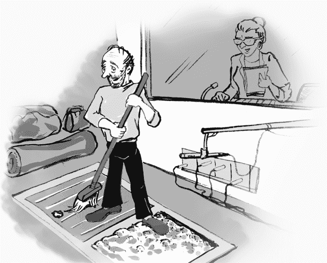

很少有经历比参观拟音舞台更引人入胜。身处黑暗房间的奇特体验——有指定的行走区域，周边摆放着奇怪的物品，地板上堆着一堆不匹配且不吸引人的鞋子，还有穿着奇怪服装的人操纵着各种金属、木材等——是无与伦比的。很少有人会忘记那次邂逅的独特印象。

很少有人会花很多时间思考那个房间是如何构思、设计和实现的。如果有人花时间研究和调查房间本身以及随附的混音室和道具室，建筑的具体细节和技术要求将为“拟音世界”的秘密世界增添另一层欣赏。对于好奇并希望建造或改装一个房间作为拟音舞台的人来说，一旦他们了解必要的组件，原则和要求就相当简单易用。然后他们可以根据自己的意愿进行装饰。

本章将首先给出拟音舞台理想电子和声学情况的详细要求。在这些理想的指导方针之后，将介绍其他拟音艺术家出于不同原因并取得不同效果所使用的许多变化和替代方案。目的是明确指出，虽然好莱坞对标准拟音舞台的认知有一个成文的理想，但它绝不是唯一的标准，也不是唯一的成功方法。此外，关于拟音舞台应该听起来如何以及理想情况下应如何运作，存在各种相互冲突的意见。虽然表达的每一种意见都来自具有权威和可信度的专业人士，但这些专业人士并不都同意。艺术不是客观的，其追求也不是。

## 声学蓝图

一个设计精良且结构合适的 Foley 舞台始于电气需求。尽管大多数房间的电气布线都有常规标准，但 Foley 舞台有其特定的需求。归根结底，无论房间看起来多么漂亮，或录音设备多么令人印象深刻，如果房间的布线不是以专门录制具有各种动态范围的声音效果，并且几乎不受外界噪音和电气嗡鸣干扰为目标，那么就可能花费无数小时追踪噪音并试图消除它们。Foley 舞台的第一条规则是它必须在电子上正常工作。

Jim Fulmis，Fultek Professional Audio 的所有者兼资深电气工程师，设计并布线过许多录音和重录舞台，并亲身经历过试图修复损坏舞台的噩梦。当被问及他希望何时参与 Foley 舞台的建设时，他说，“最好在设计早期阶段就参与，而不是在已经建成的 \[一个 Foley 舞台\]。” 这是大多数工程师的共识。电气专家越早能保证房间的概念可行越好。一旦舞台建设开始，就已经太晚进行最佳的电气应用了。

首先，工程师必须考虑房间的形状。Foley 舞台的最佳形状是矩形而不是正方形。墙壁、天花板和地板不应是完全平行的。建筑中有公式允许墙壁在尺寸上略有偏差，以便打散声波。目标是减少声波反射（弹跳）的机会，使房间的混响更少。大多数声学家同意这一观点。然而，有些人更喜欢混响和生气更强的房间。在 Foley 舞台上，更常见的是希望混响更少。

在为捕捉和录制声音而建造的房间里，电气需求也同样特殊。建造办公楼或住宅时，不必担心麦克风电缆中传来的任何嗡嗡声或哼声。然而，在 Foley 舞台上，嗡嗡声或哼声可能会使操作中断数小时甚至数天。因此，用于麦克风的布线必须远离电气布线，并且不能与其平行。如果麦克风布线和电气布线靠得太近，或者像有时那样捆绑在一起，那么当调音师尝试录音时就会出现哼声。麦克风布线会从电气布线中吸收电流，而由此产生的哼声可能无法消除。

我曾在 Foley 舞台上花费许多天时间，因为我们找不到哼声的来源。有时我们不得不停止工作，直到工程师找到并消除哼声。有时这种修复能维持一段时间；其他时候哼声又会回来。有些舞台是 Foley 艺术家和调音师害怕工作的，因为那里有永远不会消失的哼声。如果一位了解房间用途的专家铺设了布线，这个问题本可以避免。

通过良好的工程设计可以避免的另一个潜在陷阱是麦克风线路中持续的嗡嗡声。当电线正确接地时，就永远不会有嗡嗡声。最好有两种类型的接地。一种是音频接地，另一种是电气接地。有些工程师会使用一个接地同时兼顾两者。接地线尺寸越大越好。电线穿过的管道尺寸充足也很重要。

对于完全依赖电和麦克风高效可靠使用的房间来说，拥有适当的接地和布线是理想的。然而，每位 Foley 艺术家和调音师都有关于哼声和嗡嗡声的恐怖故事。舞台上出现的大多数问题，如果在前期投入时间和金钱正确搭建舞台，就本可以避免。如果房间在用于其他用途后被改造，专家应在建造任何东西之前检查布线。简单的错误可能导致巨大的问题，正如 Fulmis 所举例说明的：

> 我可以举一个例子，他们拉来了一根焊接电缆，铺设了一根铜接地线并又加了一根接地线。舞台停工两天后我被叫来，我说，“我们要断开所有的接地。” 然后我们发现有一根空调管道触碰到了设备所在的机柜，这造成了接地环路。所以，我们在上面放了木块以防止这种情况再次发生，并只保留了一根接地线。舞台比以往任何时候都安静。

目标是房间从按下第一个录音开关的那一刻起就能正常工作。任何舞台的 bug 不一定必须被解决，这永远不是真的。Fulmis 重申，

> 我见过很多地方，他们只是不断地在这个地方加接地，在那个地方加接地，今天这样能工作。但明天你插上别的设备，现在你就有了新的接地环路和新的嗡嗡声或哼声。

如果房间布线良好，就不必在设备上花费巨资。正如 Fulmis 所说，“你可以使用相当便宜的设备，只要它适合工作，就能应付过去。如果你把所有东西正确组装起来，即使是廉价设备也能获得非常好的声音。这才是最重要的。”

## 室内设计

理想的 Foley 舞台结合了功能与形式。它不仅需要具备对艺术家来说合理的[content]
一个设计精良且结构合适的 Foley 舞台始于电气需求。尽管大多数房间的电气布线都有常规标准，但 Foley 舞台有其特定的需求。归根结底，无论房间看起来多么漂亮，或录音设备多么令人印象深刻，如果房间的布线不是以专门录制具有各种动态范围的声音效果，并且几乎不受外界噪音和电气嗡鸣干扰为目标，那么就可能花费无数小时追踪噪音并试图消除它们。Foley 舞台的第一条规则是它必须在电子上正常工作。

Jim Fulmis，Fultek Professional Audio 的所有者兼资深电气工程师，设计并布线过许多录音和重录舞台，并亲身经历过试图修复损坏舞台的噩梦。当被问及他希望何时参与 Foley 舞台的建设时，他说，“最好在设计早期阶段就参与，而不是在已经建成的 \[一个 Foley 舞台\]。” 这是大多数工程师的共识。电气专家越早能保证房间的概念可行越好。一旦舞台建设开始，就已经太晚进行最佳的电气应用了。

首先，工程师必须考虑房间的形状。Foley 舞台的最佳形状是矩形而不是正方形。墙壁、天花板和地板不应是完全平行的。建筑中有公式允许墙壁在尺寸上略有偏差，以便打散声波。目标是减少声波反射（弹跳）的机会，使房间的混响更少。大多数声学家同意这一观点。然而，有些人更喜欢混响和生气更强的房间。在 Foley 舞台上，更常见的是希望混响更少。

在为捕捉和录制声音而建造的房间里，电气需求也同样特殊。建造办公楼或住宅时，不必担心麦克风电缆中传来的任何嗡嗡声或哼声。然而，在 Foley 舞台上，嗡嗡声或哼声可能会使操作中断数小时甚至数天。因此，用于麦克风的布线必须远离电气布线，并且不能与其平行。如果麦克风布线和电气布线靠得太近，或者像有时那样捆绑在一起，那么当调音师尝试录音时就会出现哼声。麦克风布线会从电气布线中吸收电流，而由此产生的哼声可能无法消除。

我曾在 Foley 舞台上花费许多天时间，因为我们找不到哼声的来源。有时我们不得不停止工作，直到工程师找到并消除哼声。有时这种修复能维持一段时间；其他时候哼声又会回来。有些舞台是 Foley 艺术家和调音师害怕工作的，因为那里有永远不会消失的哼声。如果一位了解房间用途的专家铺设了布线，这个问题本可以避免。

通过良好的工程设计可以避免的另一个潜在陷阱是麦克风线路中持续的嗡嗡声。当电线正确接地时，就永远不会有嗡嗡声。最好有两种类型的接地。一种是音频接地，另一种是电气接地。有些工程师会使用一个接地同时兼顾两者。接地线尺寸越大越好。电线穿过的管道尺寸充足也很重要。

对于完全依赖电和麦克风高效可靠使用的房间来说，拥有适当的接地和布线是理想的。然而，每位 Foley 艺术家和调音师都有关于哼声和嗡嗡声的恐怖故事。舞台上出现的大多数问题，如果在前期投入时间和金钱正确搭建舞台，就本可以避免。如果房间在用于其他用途后被改造，专家应在建造任何东西之前检查布线。简单的错误可能导致巨大的问题，正如 Fulmis 所举例说明的：

> 我可以举一个例子，他们拉来了一根焊接电缆，铺设了一根铜接地线并又加了一根接地线。舞台停工两天后我被叫来，我说，“我们要断开所有的接地。” 然后我们发现有一根空调管道触碰到了设备所在的机柜，这造成了接地环路。所以，我们在上面放了木块以防止这种情况再次发生，并只保留了一根接地线。舞台比以往任何时候都安静。

目标是房间从按下第一个录音开关的那一刻起就能正常工作。任何舞台的 bug 不一定必须被解决，这永远不是真的。Fulmis 重申，

> 我见过很多地方，他们只是不断地在这个地方加接地，在那个地方加接地，今天这样能工作。但明天你插上别的设备，现在你就有了新的接地环路和新的嗡嗡声或哼声。

如果房间布线良好，就不必在设备上花费巨资。正如 Fulmis 所说，“你可以使用相当便宜的设备，只要它适合工作，就能应付过去。如果你把所有东西正确组装起来，即使是廉价设备也能获得非常好的声音。这才是最重要的。”

## 室内设计

理想的 Foley 舞台结合了功能与形式。它不仅需要具备对艺术家来说合理的[content]
一个设计精良且结构合适的 Foley 舞台始于电气需求。尽管大多数房间的电气布线都有常规标准，但 Foley 舞台有其特定的需求。归根结底，无论房间看起来多么漂亮，或录音设备多么令人印象深刻，如果房间的布线不是以专门录制具有各种动态范围的声音效果，并且几乎不受外界噪音和电气嗡鸣干扰为目标，那么就可能花费无数小时追踪噪音并试图消除它们。Foley 舞台的第一条规则是它必须在电子上正常工作。

Jim Fulmis，Fultek Professional Audio 的所有者兼资深电气工程师，设计并布线过许多录音和重录舞台，并亲身经历过试图修复损坏舞台的噩梦。当被问及他希望何时参与 Foley 舞台的建设时，他说，“最好在设计早期阶段就参与，而不是在已经建成的 \[一个 Foley 舞台\]。” 这是大多数工程师的共识。电气专家越早能保证房间的概念可行越好。一旦舞台建设开始，就已经太晚进行最佳的电气应用了。

首先，工程师必须考虑房间的形状。Foley 舞台的最佳形状是矩形而不是正方形。墙壁、天花板和地板不应是完全平行的。建筑中有公式允许墙壁在尺寸上略有偏差，以便打散声波。目标是减少声波反射（弹跳）的机会，使房间的混响更少。大多数声学家同意这一观点。然而，有些人更喜欢混响和生气更强的房间。在 Foley 舞台上，更常见的是希望混响更少。

在为捕捉和录制声音而建造的房间里，电气需求也同样特殊。建造办公楼或住宅时，不必担心麦克风电缆中传来的任何嗡嗡声或哼声。然而，在 Foley 舞台上，嗡嗡声或哼声可能会使操作中断数小时甚至数天。因此，用于麦克风的布线必须远离电气布线，并且不能与其平行。如果麦克风布线和电气布线靠得太近，或者像有时那样捆绑在一起，那么当调音师尝试录音时就会出现哼声。麦克风布线会从电气布线中吸收电流，而由此产生的哼声可能无法消除。

我曾在 Foley 舞台上花费许多天时间，因为我们找不到哼声的来源。有时我们不得不停止工作，直到工程师找到并消除哼声。有时这种修复能维持一段时间；其他时候哼声又会回来。有些舞台是 Foley 艺术家和调音师害怕工作的，因为那里有永远不会消失的哼声。如果一位了解房间用途的专家铺设了布线，这个问题本可以避免。

通过良好的工程设计可以避免的另一个潜在陷阱是麦克风线路中持续的嗡嗡声。当电线正确接地时，就永远不会有嗡嗡声。最好有两种类型的接地。一种是音频接地，另一种是电气接地。有些工程师会使用一个接地同时兼顾两者。接地线尺寸越大越好。电线穿过的管道尺寸充足也很重要。

对于完全依赖电和麦克风高效可靠使用的房间来说，拥有适当的接地和布线是理想的。然而，每位 Foley 艺术家和调音师都有关于哼声和嗡嗡声的恐怖故事。舞台上出现的大多数问题，如果在前期投入时间和金钱正确搭建舞台，就本可以避免。如果房间在用于其他用途后被改造，专家应在建造任何东西之前检查布线。简单的错误可能导致巨大的问题，正如 Fulmis 所举例说明的：

> 我可以举一个例子，他们拉来了一根焊接电缆，铺设了一根铜接地线并又加了一根接地线。舞台停工两天后我被叫来，我说，“我们要断开所有的接地。” 然后我们发现有一根空调管道触碰到了设备所在的机柜，这造成了接地环路。所以，我们在上面放了木块以防止这种情况再次发生，并只保留了一根接地线。舞台比以往任何时候都安静。

目标是房间从按下第一个录音开关的那一刻起就能正常工作。任何舞台的 bug 不一定必须被解决，这永远不是真的。Fulmis 重申，

> 我见过很多地方，他们只是不断地在这个地方加接地，在那个地方加接地，今天这样能工作。但明天你插上别的设备，现在你就有了新的接地环路和新的嗡嗡声或哼声。

如果房间布线良好，就不必在设备上花费巨资。正如 Fulmis 所说，“你可以使用相当便宜的设备，只要它适合工作，就能应付过去。如果你把所有东西正确组装起来，即使是廉价设备也能获得非常好的声音。这才是最重要的。”

## 室内设计

理想的 Foley 舞台结合了功能与形式。它不仅需要具备对艺术家来说合理的[content]
一个设计精良且结构合适的 Foley 舞台始于电气需求。尽管大多数房间的电气布线都有常规标准，但 Foley 舞台有其特定的需求。归根结底，无论房间看起来多么漂亮，或录音设备多么令人印象深刻，如果房间的布线不是以专门录制具有各种动态范围的声音效果，并且几乎不受外界噪音和电气嗡鸣干扰为目标，那么就可能花费无数小时追踪噪音并试图消除它们。Foley 舞台的第一条规则是它必须在电子上正常工作。

Jim Fulmis，Fultek Professional Audio 的所有者兼资深电气工程师，设计并布线过许多录音和重录舞台，并亲身经历过试图修复损坏舞台的噩梦。当被问及他希望何时参与 Foley 舞台的建设时，他说，“最好在设计早期阶段就参与，而不是在已经建成的 \[一个 Foley 舞台\]。” 这是大多数工程师的共识。电气专家越早能保证房间的概念可行越好。一旦舞台建设开始，就已经太晚进行最佳的电气应用了。

首先，工程师必须考虑房间的形状。Foley 舞台的最佳形状是矩形而不是正方形。墙壁、天花板和地板不应是完全平行的。建筑中有公式允许墙壁在尺寸上略有偏差，以便打散声波。目标是减少声波反射（弹跳）的机会，使房间的混响更少。大多数声学家同意这一观点。然而，有些人更喜欢混响和生气更强的房间。在 Foley 舞台上，更常见的是希望混响更少。

在为捕捉和录制声音而建造的房间里，电气需求也同样特殊。建造办公楼或住宅时，不必担心麦克风电缆中传来的任何嗡嗡声或哼声。然而，在 Foley 舞台上，嗡嗡声或哼声可能会使操作中断数小时甚至数天。因此，用于麦克风的布线必须远离电气布线，并且不能与其平行。如果麦克风布线和电气布线靠得太近，或者像有时那样捆绑在一起，那么当调音师尝试录音时就会出现哼声。麦克风布线会从电气布线中吸收电流，而由此产生的哼声可能无法消除。

我曾在 Foley 舞台上花费许多天时间，因为我们找不到哼声的来源。有时我们不得不停止工作，直到工程师找到并消除哼声。有时这种修复能维持一段时间；其他时候哼声又会回来。有些舞台是 Foley 艺术家和调音师害怕工作的，因为那里有永远不会消失的哼声。如果一位了解房间用途的专家铺设了布线，这个问题本可以避免。

通过良好的工程设计可以避免的另一个潜在陷阱是麦克风线路中持续的嗡嗡声。当电线正确接地时，就永远不会有嗡嗡声。最好有两种类型的接地。一种是音频接地，另一种是电气接地。有些工程师会使用一个接地同时兼顾两者。接地线尺寸越大越好。电线穿过的管道尺寸充足也很重要。

对于完全依赖电和麦克风高效可靠使用的房间来说，拥有适当的接地和布线是理想的。然而，每位 Foley 艺术家和调音师都有关于哼声和嗡嗡声的恐怖故事。舞台上出现的大多数问题，如果在前期投入时间和金钱正确搭建舞台，就本可以避免。如果房间在用于其他用途后被改造，专家应在建造任何东西之前检查布线。简单的错误可能导致巨大的问题，正如 Fulmis 所举例说明的：

> 我可以举一个例子，他们拉来了一根焊接电缆，铺设了一根铜接地线并又加了一根接地线。舞台停工两天后我被叫来，我说，“我们要断开所有的接地。” 然后我们发现有一根空调管道触碰到了设备所在的机柜，这造成了接地环路。所以，我们在上面放了木块以防止这种情况再次发生，并只保留了一根接地线。舞台比以往任何时候都安静。

目标是房间从按下第一个录音开关的那一刻起就能正常工作。任何舞台的 bug 不一定必须被解决，这永远不是真的。Fulmis 重申，

> 我见过很多地方，他们只是不断地在这个地方加接地，在那个地方加接地，今天这样能工作。但明天你插上别的设备，现在你就有了新的接地环路和新的嗡嗡声或哼声。

如果房间布线良好，就不必在设备上花费巨资。正如 Fulmis 所说，“你可以使用相当便宜的设备，只要它适合工作，就能应付过去。如果你把所有东西正确组装起来，即使是廉价设备也能获得非常好的声音。这才是最重要的。”

## 室内设计

理想的 Foley 舞台结合了功能与形式。它不仅需要具备对艺术家来说合理的[content]
一个设计精良且结构合适的 Foley 舞台始于电气需求。尽管大多数房间的电气布线都有常规标准，但 Foley 舞台有其特定的需求。归根结底，无论房间看起来多么漂亮，或录音设备多么令人印象深刻，如果房间的布线不是以专门录制具有各种动态范围的声音效果，并且几乎不受外界噪音和电气嗡鸣干扰为目标，那么就可能花费无数小时追踪噪音并试图消除它们。Foley 舞台的第一条规则是它必须在电子上正常工作。

Jim Fulmis，Fultek Professional Audio 的所有者兼资深电气工程师，设计并布线过许多录音和重录舞台，并亲身经历过试图修复损坏舞台的噩梦。当被问及他希望何时参与 Foley 舞台的建设时，他说，“最好在设计早期阶段就参与，而不是在已经建成的 \[一个 Foley 舞台\]。” 这是大多数工程师的共识。电气专家越早能保证房间的概念可行越好。一旦舞台建设开始，就已经太晚进行最佳的电气应用了。

首先，工程师必须考虑房间的形状。Foley 舞台的最佳形状是矩形而不是正方形。墙壁、天花板和地板不应是完全平行的。建筑中有公式允许墙壁在尺寸上略有偏差，以便打散声波。目标是减少声波反射（弹跳）的机会，使房间的混响更少。大多数声学家同意这一观点。然而，有些人更喜欢混响和生气更强的房间。在 Foley 舞台上，更常见的是希望混响更少。

在为捕捉和录制声音而建造的房间里，电气需求也同样特殊。建造办公楼或住宅时，不必担心麦克风电缆中传来的任何嗡嗡声或哼声。然而，在 Foley 舞台上，嗡嗡声或哼声可能会使操作中断数小时甚至数天。因此，用于麦克风的布线必须远离电气布线，并且不能与其平行。如果麦克风布线和电气布线靠得太近，或者像有时那样捆绑在一起，那么当调音师尝试录音时就会出现哼声。麦克风布线会从电气布线中吸收电流，而由此产生的哼声可能无法消除。

我曾在 Foley 舞台上花费许多天时间，因为我们找不到哼声的来源。有时我们不得不停止工作，直到工程师找到并消除哼声。有时这种修复能维持一段时间；其他时候哼声又会回来。有些舞台是 Foley 艺术家和调音师害怕工作的，因为那里有永远不会消失的哼声。如果一位了解房间用途的专家铺设了布线，这个问题本可以避免。

通过良好的工程设计可以避免的另一个潜在陷阱是麦克风线路中持续的嗡嗡声。当电线正确接地时，就永远不会有嗡嗡声。最好有两种类型的接地。一种是音频接地，另一种是电气接地。有些工程师会使用一个接地同时兼顾两者。接地线尺寸越大越好。电线穿过的管道尺寸充足也很重要。

对于完全依赖电和麦克风高效可靠使用的房间来说，拥有适当的接地和布线是理想的。然而，每位 Foley 艺术家和调音师都有关于哼声和嗡嗡声的恐怖故事。舞台上出现的大多数问题，如果在前期投入时间和金钱正确搭建舞台，就本可以避免。如果房间在用于其他用途后被改造，专家应在建造任何东西之前检查布线。简单的错误可能导致巨大的问题，正如 Fulmis 所举例说明的：

> 我可以举一个例子，他们拉来了一根焊接电缆，铺设了一根铜接地线并又加了一根接地线。舞台停工两天后我被叫来，我说，“我们要断开所有的接地。” 然后我们发现有一根空调管道触碰到了设备所在的机柜，这造成了接地环路。所以，我们在上面放了木块以防止这种情况再次发生，并只保留了一根接地线。舞台比以往任何时候都安静。

目标是房间从按下第一个录音开关的那一刻起就能正常工作。任何舞台的 bug 不一定必须被解决，这永远不是真的。Fulmis 重申，

> 我见过很多地方，他们只是不断地在这个地方加接地，在那个地方加接地，今天这样能工作。但明天你插上别的设备，现在你就有了新的接地环路和新的嗡嗡声或哼声。

如果房间布线良好，就不必在设备上花费巨资。正如 Fulmis 所说，“你可以使用相当便宜的设备，只要它适合工作，就能应付过去。如果你把所有东西正确组装起来，即使是廉价设备也能获得非常好的声音。这才是最重要的。”

## 室内设计

理想的 Foley 舞台结合了功能与形式。它不仅需要具备对艺术家来说合理的[content]
一个设计精良且结构合适的 Foley 舞台始于电气需求。尽管大多数房间的电气布线都有常规标准，但 Foley 舞台有其特定的需求。归根结底，无论房间看起来多么漂亮，或录音设备多么令人印象深刻，如果房间的布线不是以专门录制具有各种动态范围的声音效果，并且几乎不受外界噪音和电气嗡鸣干扰为目标，那么就可能花费无数小时追踪噪音并试图消除它们。Foley 舞台的第一条规则是它必须在电子上正常工作。

Jim Fulmis，Fultek Professional Audio 的所有者兼资深电气工程师，设计并布线过许多录音和重录舞台，并亲身经历过试图修复损坏舞台的噩梦。当被问及他希望何时参与 Foley 舞台的建设时，他说，“最好在设计早期阶段就参与，而不是在已经建成的 \[一个 Foley 舞台\]。” 这是大多数工程师的共识。电气专家越早能保证房间的概念可行越好。一旦舞台建设开始，就已经太晚进行最佳的电气应用了。

首先，工程师必须考虑房间的形状。Foley 舞台的最佳形状是矩形而不是正方形。墙壁、天花板和地板不应是完全平行的。建筑中有公式允许墙壁在尺寸上略有偏差，以便打散声波。目标是减少声波反射（弹跳）的机会，使房间的混响更少。大多数声学家同意这一观点。然而，有些人更喜欢混响和生气更强的房间。在 Foley 舞台上，更常见的是希望混响更少。

在为捕捉和录制声音而建造的房间里，电气需求也同样特殊。建造办公楼或住宅时，不必担心麦克风电缆中传来的任何嗡嗡声或哼声。然而，在 Foley 舞台上，嗡嗡声或哼声可能会使操作中断数小时甚至数天。因此，用于麦克风的布线必须远离电气布线，并且不能与其平行。如果麦克风布线和电气布线靠得太近，或者像有时那样捆绑在一起，那么当调音师尝试录音时就会出现哼声。麦克风布线会从电气布线中吸收电流，而由此产生的哼声可能无法消除。

我曾在 Foley 舞台上花费许多天时间，因为我们找不到哼声的来源。有时我们不得不停止工作，直到工程师找到并消除哼声。有时这种修复能维持一段时间；其他时候哼声又会回来。有些舞台是 Foley 艺术家和调音师害怕工作的，因为那里有永远不会消失的哼声。如果一位了解房间用途的专家铺设了布线，这个问题本可以避免。

通过良好的工程设计可以避免的另一个潜在陷阱是麦克风线路中持续的嗡嗡声。当电线正确接地时，就永远不会有嗡嗡声。最好有两种类型的接地。一种是音频接地，另一种是电气接地。有些工程师会使用一个接地同时兼顾两者。接地线尺寸越大越好。电线穿过的管道尺寸充足也很重要。

对于完全依赖电和麦克风高效可靠使用的房间来说，拥有适当的接地和布线是理想的。然而，每位 Foley 艺术家和调音师都有关于哼声和嗡嗡声的恐怖故事。舞台上出现的大多数问题，如果在前期投入时间和金钱正确搭建舞台，就本可以避免。如果房间在用于其他用途后被改造，专家应在建造任何东西之前检查布线。简单的错误可能导致巨大的问题，正如 Fulmis 所举例说明的：

> 我可以举一个例子，他们拉来了一根焊接电缆，铺设了一根铜接地线并又加了一根接地线。舞台停工两天后我被叫来，我说，“我们要断开所有的接地。” 然后我们发现有一根空调管道触碰到了设备所在的机柜，这造成了接地环路。所以，我们在上面放了木块以防止这种情况再次发生，并只保留了一根接地线。舞台比以往任何时候都安静。

目标是房间从按下第一个录音开关的那一刻起就能正常工作。任何舞台的 bug 不一定必须被解决，这永远不是真的。Fulmis 重申，

> 我见过很多地方，他们只是不断地在这个地方加接地，在那个地方加接地，今天这样能工作。但明天你插上别的设备，现在你就有了新的接地环路和新的嗡嗡声或哼声。

如果房间布线良好，就不必在设备上花费巨资。正如 Fulmis 所说，“你可以使用相当便宜的设备，只要它适合工作，就能应付过去。如果你把所有东西正确组装起来，即使是廉价设备也能获得非常好的声音。这才是最重要的。”

## 室内设计

理想的 Foley 舞台结合了功能与形式。它不仅需要具备对艺术家来说合理的[content]
一个设计精良且结构合适的 Foley 舞台始于电气需求。尽管大多数房间的电气布线都有常规标准，但 Foley 舞台有其特定的需求。归根结底，无论房间看起来多么漂亮，或录音设备多么令人印象深刻，如果房间的布线不是以专门录制具有各种动态范围的声音效果，并且几乎不受外界噪音和电气嗡鸣干扰为目标，那么就可能花费无数小时追踪噪音并试图消除它们。Foley 舞台的第一条规则是它必须在电子上正常工作。

Jim Fulmis，Fultek Professional Audio 的所有者兼资深电气工程师，设计并布线过许多录音和重录舞台，并亲身经历过试图修复损坏舞台的噩梦。当被问及他希望何时参与 Foley 舞台的建设时，他说，“最好在设计早期阶段就参与，而不是在已经建成的 \[一个 Foley 舞台\]。” 这是大多数工程师的共识。电气专家越早能保证房间的概念可行越好。一旦舞台建设开始，就已经太晚进行最佳的电气应用了。

首先，工程师必须考虑房间的形状。Foley 舞台的最佳形状是矩形而不是正方形。墙壁、天花板和地板不应是完全平行的。建筑中有公式允许墙壁在尺寸上略有偏差，以便打散声波。目标是减少声波反射（弹跳）的机会，使房间的混响更少。大多数声学家同意这一观点。然而，有些人更喜欢混响和生气更强的房间。在 Foley 舞台上，更常见的是希望混响更少。

在为捕捉和录制声音而建造的房间里，电气需求也同样特殊。建造办公楼或住宅时，不必担心麦克风电缆中传来的任何嗡嗡声或哼声。然而，在 Foley 舞台上，嗡嗡声或哼声可能会使操作中断数小时甚至数天。因此，用于麦克风的布线必须远离电气布线，并且不能与其平行。如果麦克风布线和电气布线靠得太近，或者像有时那样捆绑在一起，那么当调音师尝试录音时就会出现哼声。麦克风布线会从电气布线中吸收电流，而由此产生的哼声可能无法消除。

我曾在 Foley 舞台上花费许多天时间，因为我们找不到哼声的来源。有时我们不得不停止工作，直到工程师找到并消除哼声。有时这种修复能维持一段时间；其他时候哼声又会回来。有些舞台是 Foley 艺术家和调音师害怕工作的，因为那里有永远不会消失的哼声。如果一位了解房间用途的专家铺设了布线，这个问题本可以避免。

通过良好的工程设计可以避免的另一个潜在陷阱是麦克风线路中持续的嗡嗡声。当电线正确接地时，就永远不会有嗡嗡声。最好有两种类型的接地。一种是音频接地，另一种是电气接地。有些工程师会使用一个接地同时兼顾两者。接地线尺寸越大越好。电线穿过的管道尺寸充足也很重要。

对于完全依赖电和麦克风高效可靠使用的房间来说，拥有适当的接地和布线是理想的。然而，每位 Foley 艺术家和调音师都有关于哼声和嗡嗡声的恐怖故事。舞台上出现的大多数问题，如果在前期投入时间和金钱正确搭建舞台，就本可以避免。如果房间在用于其他用途后被改造，专家应在建造任何东西之前检查布线。简单的错误可能导致巨大的问题，正如 Fulmis 所举例说明的：

> 我可以举一个例子，他们拉来了一根焊接电缆，铺设了一根铜接地线并又加了一根接地线。舞台停工两天后我被叫来，我说，“我们要断开所有的接地。” 然后我们发现有一根空调管道触碰到了设备所在的机柜，这造成了接地环路。所以，我们在上面放了木块以防止这种情况再次发生，并只保留了一根接地线。舞台比以往任何时候都安静。

目标是房间从按下第一个录音开关的那一刻起就能正常工作。任何舞台的 bug 不一定必须被解决，这永远不是真的。Fulmis 重申，

> 我见过很多地方，他们只是不断地在这个地方加接地，在那个地方加接地，今天这样能工作。但明天你插上别的设备，现在你就有了新的接地环路和新的嗡嗡声或哼声。

如果房间布线良好，就不必在设备上花费巨资。正如 Fulmis 所说，“你可以使用相当便宜的设备，只要它适合工作，就能应付过去。如果你把所有东西正确组装起来，即使是廉价设备也能获得非常好的声音。这才是最重要的。”

## 室内设计

理想的 Foley 舞台结合了功能与形式。它不仅需要具备对艺术家来说合理的[content]
一个设计精良且结构合适的 Foley 舞台始于电气需求。尽管大多数房间的电气布线都有常规标准，但 Foley 舞台有其特定的需求。归根结底，无论房间看起来多么漂亮，或录音设备多么令人印象深刻，如果房间的布线不是以专门录制具有各种动态范围的声音效果，并且几乎不受外界噪音和电气嗡鸣干扰为目标，那么就可能花费无数小时追踪噪音并试图消除它们。Foley 舞台的第一条规则是它必须在电子上正常工作。

Jim Fulmis，Fultek Professional Audio 的所有者兼资深电气工程师，设计并布线过许多录音和重录舞台，并亲身经历过试图修复损坏舞台的噩梦。当被问及他希望何时参与 Foley 舞台的建设时，他说，“最好在设计早期阶段就参与，而不是在已经建成的 \[一个 Foley 舞台\]。” 这是大多数工程师的共识。电气专家越早能保证房间的概念可行越好。一旦舞台建设开始，就已经太晚进行最佳的电气应用了。

首先，工程师必须考虑房间的形状。Foley 舞台的最佳形状是矩形而不是正方形。墙壁、天花板和地板不应是完全平行的。建筑中有公式允许墙壁在尺寸上略有偏差，以便打散声波。目标是减少声波反射（弹跳）的机会，使房间的混响更少。大多数声学家同意这一观点。然而，有些人更喜欢混响和生气更强的房间。在 Foley 舞台上，更常见的是希望混响更少。

在为捕捉和录制声音而建造的房间里，电气需求也同样特殊。建造办公楼或住宅时，不必担心麦克风电缆中传来的任何嗡嗡声或哼声。然而，在 Foley 舞台上，嗡嗡声或哼声可能会使操作中断数小时甚至数天。因此，用于麦克风的布线必须远离电气布线，并且不能与其平行。如果麦克风布线和电气布线靠得太近，或者像有时那样捆绑在一起，那么当调音师尝试录音时就会出现哼声。麦克风布线会从电气布线中吸收电流，而由此产生的哼声可能无法消除。

我曾在 Foley 舞台上花费许多天时间，因为我们找不到哼声的来源。有时我们不得不停止工作，直到工程师找到并消除哼声。有时这种修复能维持一段时间；其他时候哼声又会回来。有些舞台是 Foley 艺术家和调音师害怕工作的，因为那里有永远不会消失的哼声。如果一位了解房间用途的专家铺设了布线，这个问题本可以避免。

通过良好的工程设计可以避免的另一个潜在陷阱是麦克风线路中持续的嗡嗡声。当电线正确接地时，就永远不会有嗡嗡声。最好有两种类型的接地。一种是音频接地，另一种是电气接地。有些工程师会使用一个接地同时兼顾两者。接地线尺寸越大越好。电线穿过的管道尺寸充足也很重要。

对于完全依赖电和麦克风高效可靠使用的房间来说，拥有适当的接地和布线是理想的。然而，每位 Foley 艺术家和调音师都有关于哼声和嗡嗡声的恐怖故事。舞台上出现的大多数问题，如果在前期投入时间和金钱正确搭建舞台，就本可以避免。如果房间在用于其他用途后被改造，专家应在建造任何东西之前检查布线。简单的错误可能导致巨大的问题，正如 Fulmis 所举例说明的：

> 我可以举一个例子，他们拉来了一根焊接电缆，铺设了一根铜接地线并又加了一根接地线。舞台停工两天后我被叫来，我说，“我们要断开所有的接地。” 然后我们发现有一根空调管道触碰到了设备所在的机柜，这造成了接地环路。所以，我们在上面放了木块以防止这种情况再次发生，并只保留了一根接地线。舞台比以往任何时候都安静。

目标是房间从按下第一个录音开关的那一刻起就能正常工作。任何舞台的 bug 不一定必须被解决，这永远不是真的。Fulmis 重申，

> 我见过很多地方，他们只是不断地在这个地方加接地，在那个地方加接地，今天这样能工作。但明天你插上别的设备，现在你就有了新的接地环路和新的嗡嗡声或哼声。

如果房间布线良好，就不必在设备上花费巨资。正如 Fulmis 所说，“你可以使用相当便宜的设备，只要它适合工作，就能应付过去。如果你把所有东西正确组装起来，即使是廉价设备也能获得非常好的声音。这才是最重要的。”

## 室内设计

理想的 Foley 舞台结合了功能与形式。它不仅需要具备对艺术家来说合理的[content]
一个设计精良且结构合适的 Foley 舞台始于电气需求。尽管大多数房间的电气布线都有常规标准，但 Foley 舞台有其特定的需求。归根结底，无论房间看起来多么漂亮，或录音设备多么令人印象深刻，如果房间的布线不是以专门录制具有各种动态范围的声音效果，并且几乎不受外界噪音和电气嗡鸣干扰为目标，那么就可能花费无数小时追踪噪音并试图消除它们。Foley 舞台的第一条规则是它必须在电子上正常工作。

Jim Fulmis，Fultek Professional Audio 的所有者兼资深电气工程师，设计并布线过许多录音和重录舞台，并亲身经历过试图修复损坏舞台的噩梦。当被问及他希望何时参与 Foley 舞台的建设时，他说，“最好在设计早期阶段就参与，而不是在已经建成的 \[一个 Foley 舞台\]。” 这是大多数工程师的共识。电气专家越早能保证房间的概念可行越好。一旦舞台建设开始，就已经太晚进行最佳的电气应用了。

首先，工程师必须考虑房间的形状。Foley 舞台的最佳形状是矩形而不是正方形。墙壁、天花板和地板不应是完全平行的。建筑中有公式允许墙壁在尺寸上略有偏差，以便打散声波。目标是减少声波反射（弹跳）的机会，使房间的混响更少。大多数声学家同意这一观点。然而，有些人更喜欢混响和生气更强的房间。在 Foley 舞台上，更常见的是希望混响更少。

在为捕捉和录制声音而建造的房间里，电气需求也同样特殊。建造办公楼或住宅时，不必担心麦克风电缆中传来的任何嗡嗡声或哼声。然而，在 Foley 舞台上，嗡嗡声或哼声可能会使操作中断数小时甚至数天。因此，用于麦克风的布线必须远离电气布线，并且不能与其平行。如果麦克风布线和电气布线靠得太近，或者像有时那样捆绑在一起，那么当调音师尝试录音时就会出现哼声。麦克风布线会从电气布线中吸收电流，而由此产生的哼声可能无法消除。

我曾在 Foley 舞台上花费许多天时间，因为我们找不到哼声的来源。有时我们不得不停止工作，直到工程师找到并消除哼声。有时这种修复能维持一段时间；其他时候哼声又会回来。有些舞台是 Foley 艺术家和调音师害怕工作的，因为那里有永远不会消失的哼声。如果一位了解房间用途的专家铺设了布线，这个问题本可以避免。

通过良好的工程设计可以避免的另一个潜在陷阱是麦克风线路中持续的嗡嗡声。当电线正确接地时，就永远不会有嗡嗡声。最好有两种类型的接地。一种是音频接地，另一种是电气接地。有些工程师会使用一个接地同时兼顾两者。接地线尺寸越大越好。电线穿过的管道尺寸充足也很重要。

对于完全依赖电和麦克风高效可靠使用的房间来说，拥有适当的接地和布线是理想的。然而，每位 Foley 艺术家和调音师都有关于哼声和嗡嗡声的恐怖故事。舞台上出现的大多数问题，如果在前期投入时间和金钱正确搭建舞台，就本可以避免。如果房间在用于其他用途后被改造，专家应在建造任何东西之前检查布线。简单的错误可能导致巨大的问题，正如 Fulmis 所举例说明的：

> 我可以举一个例子，他们拉来了一根焊接电缆，铺设了一根铜接地线并又加了一根接地线。舞台停工两天后我被叫来，我说，“我们要断开所有的接地。” 然后我们发现有一根空调管道触碰到了设备所在的机柜，这造成了接地环路。所以，我们在上面放了木块以防止这种情况再次发生，并只保留了一根接地线。舞台比以往任何时候都安静。

目标是房间从按下第一个录音开关的那一刻起就能正常工作。任何舞台的 bug 不一定必须被解决，这永远不是真的。Fulmis 重申，

> 我见过很多地方，他们只是不断地在这个地方加接地，在那个地方加接地，今天这样能工作。但明天你插上别的设备，现在你就有了新的接地环路和新的嗡嗡声或哼声。

如果房间布线良好，就不必在设备上花费巨资。正如 Fulmis 所说，“你可以使用相当便宜的设备，只要它适合工作，就能应付过去。如果你把所有东西正确组装起来，即使是廉价设备也能获得非常好的声音。这才是最重要的。”

## 室内设计

理想的 Foley 舞台结合了功能与形式。它不仅需要具备让艺术家觉得合理的[content]
一个设计精良且结构合适的 Foley 舞台始于电气需求。尽管大多数房间的电气布线都有常规标准，但 Foley 舞台有其特定的需求。归根结底，无论房间看起来多么漂亮，或录音设备多么令人印象深刻，如果房间的布线不是以专门录制具有各种动态范围的声音效果，并且几乎不受外界噪音和电气嗡鸣干扰为目标，那么就可能花费无数小时追踪噪音并试图消除它们。Foley 舞台的第一条规则是它必须在电子上正常工作。

Jim Fulmis，Fultek Professional Audio 的所有者兼资深电气工程师，设计并布线过许多录音和重录舞台，并亲身经历过试图修复损坏舞台的噩梦。当被问及他希望何时参与 Foley 舞台的建设时，他说，“最好在设计早期阶段就参与，而不是在已经建成的 \[一个 Foley 舞台\]。” 这是大多数工程师的共识。电气专家越早能保证房间的概念可行越好。一旦舞台建设开始，就已经太晚进行最佳的电气应用了。

首先，工程师必须考虑房间的形状。Foley 舞台的最佳形状是矩形而不是正方形。墙壁、天花板和地板不应是完全平行的。建筑中有公式允许墙壁在尺寸上略有偏差，以便打散声波。目标是减少声波反射（弹跳）的机会，使房间的混响更少。大多数声学家同意这一观点。然而，有些人更喜欢混响和生气更强的房间。在 Foley 舞台上，更常见的是希望混响更少。

在为捕捉和录制声音而建造的房间里，电气需求也同样特殊。建造办公楼或住宅时，不必担心麦克风电缆中传来的任何嗡嗡声或哼声。然而，在 Foley 舞台上，嗡嗡声或哼声可能会使操作中断数小时甚至数天。因此，用于麦克风的布线必须远离电气布线，并且不能与其平行。如果麦克风布线和电气布线靠得太近，或者像有时那样捆绑在一起，那么当调音师尝试录音时就会出现哼声。麦克风布线会从电气布线中吸收电流，而由此产生的哼声可能无法消除。

我曾在 Foley 舞台上花费许多天时间，因为我们找不到哼声的来源。有时我们不得不停止工作，直到工程师找到并消除哼声。有时这种修复能维持一段时间；其他时候哼声又会回来。有些舞台是 Foley 艺术家和调音师害怕工作的，因为那里有永远不会消失的哼声。如果一位了解房间用途的专家铺设了布线，这个问题本可以避免。

通过良好的工程设计可以避免的另一个潜在陷阱是麦克风线路中持续的嗡嗡声。当电线正确接地时，就永远不会有嗡嗡声。最好有两种类型的接地。一种是音频接地，另一种是电气接地。有些工程师会使用一个接地同时兼顾两者。接地线尺寸越大越好。电线穿过的管道尺寸充足也很重要。

对于完全依赖电和麦克风高效可靠使用的房间来说，拥有适当的接地和布线是理想的。然而，每位 Foley 艺术家和调音师都有关于哼声和嗡嗡声的恐怖故事。舞台上出现的大多数问题，如果在前期投入时间和金钱正确搭建舞台，就本可以避免。如果房间在用于其他用途后被改造，专家应在建造任何东西之前检查布线。简单的错误可能导致巨大的问题，正如 Fulmis 所举例说明的：

> 我可以举一个例子，他们拉来了一根焊接电缆，铺设了一根铜接地线并又加了一根接地线。舞台停工两天后我被叫来，我说，“我们要断开所有的接地。” 然后我们发现有一根空调管道触碰到了设备所在的机柜，这造成了接地环路。所以，我们在上面放了木块以防止这种情况再次发生，并只保留了一根接地线。舞台比以往任何时候都安静。

目标是房间从按下第一个录音开关的那一刻起就能正常工作。任何舞台的 bug 不一定必须被解决，这永远不是真的。Fulmis 重申，

> 我见过很多地方，他们只是不断地在这个地方加接地，在那个地方加接地，今天这样能工作。但明天你插上别的设备，现在你就有了新的接地环路和新的嗡嗡声或哼声。

如果房间布线良好，就不必在设备上花费巨资。正如 Fulmis 所说，“你可以使用相当便宜的设备，只要它适合工作，就能应付过去。如果你把所有东西正确组装起来，即使是廉价设备也能获得非常好的声音。这才是最重要的。”

## 室内设计

理想的 Foley 舞台结合了功能与形式。它不仅需要具备让艺术家觉得合理的[content]
一个设计精良且结构合适的 Foley 舞台始于电气需求。尽管大多数房间的电气布线都有常规标准，但 Foley 舞台有其特定的需求。归根结底，无论房间看起来多么漂亮，或录音设备多么令人印象深刻，如果房间的布线不是以专门录制具有各种动态范围的声音效果，并且几乎不受外界噪音和电气嗡鸣干扰为目标，那么就可能花费无数小时追踪噪音并试图消除它们。Foley 舞台的第一条规则是它必须在电子上正常工作。

Jim Fulmis，Fultek Professional Audio 的所有者兼资深电气工程师，设计并布线过许多录音和重录舞台，并亲身经历过试图修复损坏舞台的噩梦。当被问及他希望何时参与 Foley 舞台的建设时，他说，“最好在设计早期阶段就参与，而不是在已经建成的 \[一个 Foley 舞台\]。” 这是大多数工程师的共识。电气专家越早能保证房间的概念可行越好。一旦舞台建设开始，就已经太晚进行最佳的电气应用了。

首先，工程师必须考虑房间的形状。Foley 舞台的最佳形状是矩形而不是正方形。墙壁、天花板和地板不应是完全平行的。建筑中有公式允许墙壁在尺寸上略有偏差，以便打散声波。目标是减少声波反射（弹跳）的机会，使房间的混响更少。大多数声学家同意这一观点。然而，有些人更喜欢混响和生气更强的房间。在 Foley 舞台上，更常见的是希望混响更少。

在为捕捉和录制声音而建造的房间里，电气需求也同样特殊。建造办公楼或住宅时，不必担心麦克风电缆中传来的任何嗡嗡声或哼声。然而，在 Foley 舞台上，嗡嗡声或哼声可能会使操作中断数小时甚至数天。因此，用于麦克风的布线必须远离电气布线，并且不能与其平行。如果麦克风布线和电气布线靠得太近，或者像有时那样捆绑在一起，那么当调音师尝试录音时就会出现哼声。麦克风布线会从电气布线中吸收电流，而由此产生的哼声可能无法消除。

我曾在 Foley 舞台上花费许多天时间，因为我们找不到哼声的来源。有时我们不得不停止工作，直到工程师找到并消除哼声。有时这种修复能维持一段时间；其他时候哼声又会回来。有些舞台是 Foley 艺术家和调音师害怕工作的，因为那里有永远不会消失的哼声。如果一位了解房间用途的专家铺设了布线，这个问题本可以避免。

通过良好的工程设计可以避免的另一个潜在陷阱是麦克风线路中持续的嗡嗡声。当电线正确接地时，就永远不会有嗡嗡声。最好有两种类型的接地。一种是音频接地，另一种是电气接地。有些工程师会使用一个接地同时兼顾两者。接地线尺寸越大越好。电线穿过的管道尺寸充足也很重要。

对于完全依赖电和麦克风高效可靠使用的房间来说，拥有适当的接地和布线是理想的。然而，每位 Foley 艺术家和调音师都有关于哼声和嗡嗡声的恐怖故事。舞台上出现的大多数问题，如果在前期投入时间和金钱正确搭建舞台，就本可以避免。如果房间在用于其他用途后被改造，专家应在建造任何东西之前检查布线。简单的错误可能导致巨大的问题，正如 Fulmis 所举例说明的：

> 我可以举一个例子，他们拉来了一根焊接电缆，铺设了一根铜接地线并又加了一根接地线。舞台停工两天后我被叫来，我说，“我们要断开所有的接地。” 然后我们发现有一根空调管道触碰到了设备所在的机柜，这造成了接地环路。所以，我们在上面放了木块以防止这种情况再次发生，并只保留了一根接地线。舞台比以往任何时候都安静。

目标是房间从按下第一个录音开关的那一刻起就能正常工作。任何舞台的 bug 不一定必须被解决，这永远不是真的。Fulmis 重申，

> 我见过很多地方，他们只是不断地在这个地方加接地，在那个地方加接地，今天这样能工作。但明天你插上别的设备，现在你就有了新的接地环路和新的嗡嗡声或哼声。

如果房间布线良好，就不必在设备上花费巨资。正如 Fulmis 所说，“你可以使用相当便宜的设备，只要它适合工作，就能应付过去。如果你把所有东西正确组装起来，即使是廉价设备也能获得非常好的声音。这才是最重要的。”

## 室内设计

理想的 Foley 舞台结合了功能与形式。它不仅要拥有让艺术家觉得合理的[content]
一个设计精良且结构合适的 Foley 舞台始于电气需求。尽管大多数房间的电气布线都有常规标准，但 Foley 舞台有其特定的需求。归根结底，无论房间看起来多么漂亮，或录音设备多么令人印象深刻，如果房间的布线不是以专门录制具有各种动态范围的声音效果，并且几乎不受外界噪音和电气嗡鸣干扰为目标，那么就可能花费无数小时追踪噪音并试图消除它们。Foley 舞台的第一条规则是它必须在电子上正常工作。

Jim Fulmis，Fultek Professional Audio 的所有者兼资深电气工程师，设计并布线过许多录音和重录舞台，并亲身经历过试图修复损坏舞台的噩梦。当被问及他希望何时参与 Foley 舞台的建设时，他说，“最好在设计早期阶段就参与，而不是在已经建成的 \[一个 Foley 舞台\]。” 这是大多数工程师的共识。电气专家越早能保证房间的概念可行越好。一旦舞台建设开始，就已经太晚进行最佳的电气应用了。

首先，工程师必须考虑房间的形状。Foley 舞台的最佳形状是矩形而不是正方形。墙壁、天花板和地板不应是完全平行的。建筑中有公式允许墙壁在尺寸上略有偏差，以便打散声波。目标是减少声波反射（弹跳）的机会，使房间的混响更少。大多数声学家同意这一观点。然而，有些人更喜欢混响和生气更强的房间。在 Foley 舞台上，更常见的是希望混响更少。

在为捕捉和录制声音而建造的房间里，电气需求也同样特殊。建造办公楼或住宅时，不必担心麦克风电缆中传来的任何嗡嗡声或哼声。然而，在 Foley 舞台上，嗡嗡声或哼声可能会使操作中断数小时甚至数天。因此，用于麦克风的布线必须远离电气布线，并且不能与其平行。如果麦克风布线和电气布线靠得太近，或者像有时那样捆绑在一起，那么当调音师尝试录音时就会出现哼声。麦克风布线会从电气布线中吸收电流，而由此产生的哼声可能无法消除。

我曾在 Foley 舞台上花费许多天时间，因为我们找不到哼声的来源。有时我们不得不停止工作，直到工程师找到并消除哼声。有时这种修复能维持一段时间；其他时候哼声又会回来。有些舞台是 Foley 艺术家和调音师害怕工作的，因为那里有永远不会消失的哼声。如果一位了解房间用途的专家铺设了布线，这个问题本可以避免。

通过良好的工程设计可以避免的另一个潜在陷阱是麦克风线路中持续的嗡嗡声。当电线正确接地时，就永远不会有嗡嗡声。最好有两种类型的接地。一种是音频接地，另一种是电气接地。有些工程师会使用一个接地同时兼顾两者。接地线尺寸越大越好。电线穿过的管道尺寸充足也很重要。

对于完全依赖电和麦克风高效可靠使用的房间来说，拥有适当的接地和布线是理想的。然而，每位 Foley 艺术家和调音师都有关于哼声和嗡嗡声的恐怖故事。舞台上出现的大多数问题，如果在前期投入时间和金钱正确搭建舞台，就本可以避免。如果房间在用于其他用途后被改造，专家应在建造任何东西之前检查布线。简单的错误可能导致巨大的问题，正如 Fulmis 所举例说明的：

> 我可以举一个例子，他们拉来了一根焊接电缆，铺设了一根铜接地线并又加了一根接地线。舞台停工两天后我被叫来，我说，“我们要断开所有的接地。” 然后我们发现有一根空调管道触碰到了设备所在的机柜，这造成了接地环路。所以，我们在上面放了木块以防止这种情况再次发生，并只保留了一根接地线。舞台比以往任何时候都安静。

目标是房间从按下第一个录音开关的那一刻起就能正常工作。任何舞台的 bug 不一定必须被解决，这永远不是真的。Fulmis 重申，

> 我见过很多地方，他们只是不断地在这个地方加接地，在那个地方加接地，今天这样能工作。但明天你插上别的设备，现在你就有了新的接地环路和新的嗡嗡声或哼声。

如果房间布线良好，就不必在设备上花费巨资。正如 Fulmis 所说，“你可以使用相当便宜的设备，只要它适合工作，就能应付过去。如果你把所有东西正确组装起来，即使是廉价设备也能获得非常好的声音。这才是最重要的。”

## 室内设计

理想的 Foley 舞台结合了功能与形式。它不仅要包含艺术家认可的工作空间基本要素，同时也要营造出让艺术家感到舒适高效的氛围。如果舞台设计能最大化艺术家的时间和精力，创造和生产就会更容易。

大多数专家一致认为 Foley 舞台需要尽可能少的反射。虽然可以使用隔音板来软化过于尖锐或反射的声音，但在房间的活跃度不如音乐录音室的房间里工作更容易。如果舞台用于其他用途，那么在声学上就需要做出一些妥协。

如果使用的是已经建成的房间，很可能它有四面专门设计成平行的墙。可以建造内墙来塑造房间的理想形状。Foley 舞台不必受限于原始设计。

除了非平行的墙壁、天花板和地板外，表面还应内置或添加陷阱以增强声波的流动。与硬墙（反射过多）或软墙（吸收过度）不同，舞台应包含两种表面类型的混合。具有不同纹理和形状的陷阱可以帮助吸收声音，可以在不使房间变得死寂而失去个性的情况下添加。放置陷阱的一个好规则是多样化。软硬搭配：软表面与硬表面搭配，等等。把相似材料的两个陷阱放在一起通常不会产生最佳声学效果。也要注意形状的变化。每个房间都有自己的身份。了解房间的声学风格并愿意根据需要调整和修改陷阱是个好主意。设计、建造和工程方式完全相同的两个房间听起来会不同。

建造浮动地板对于 Foley 坑的最佳效果是个好主意。浮动地板与地基之间有空气。泡沫或其他声学材料可以插入该空间，以隔离可能从其他来源通过地板传播的声音。

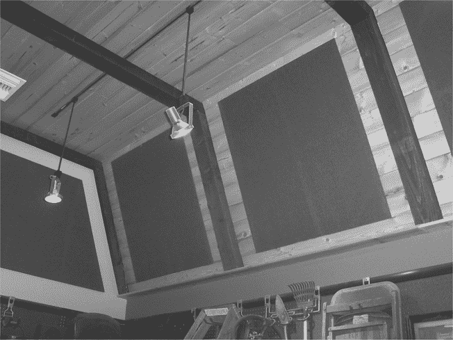

*图 6.2* *带有交替硬质和软质陷阱的斜墙和天花板，以实现声波的最佳移动。* ¶ *来源：作者拍摄的照片*

如果建造浮动地板不切实际，放置在 Foley 坑内以减弱声音的地毯会很有效。隔音板和地毯也应放置在麦克风支架下方。Foley 调音师将是确定什么有效效果的最佳指引。

Jody Thomas 曾是一名故事编辑，现在是一名 Foley 艺术家。她在华纳兄弟的众多电视节目中完成了她的 Foley 训练。她现在专门从事动画电视节目，这些节目她在自家房子旁的自己的 Foley 舞台上进行 Foley 处理。她已经从构思到实际使用，面对了建造舞台的所有问题。她以一座大型预制棚屋作为建筑的外壳开始，并运用了最佳专家的所有智慧为自己建造了一个舞台，以便她可以在家工作并陪伴女儿。由于 Thomas 既制作动画电视节目也制作故事片，她需要一个足够宽敞以便操作但又足够经济的舞台。她的这种方法对任何希望拥有音效良好的可行布置的电影学校或独立电影制作人都有用。

首先，Thomas 办理了获取适当建筑许可的手续。然后她挑选了建造和布线舞台的团队。她仔细规划了 Foley 坑的位置、水坑的建造位置、道具的存放位置以及将使用的技术水平。

Thomas 将她的 Foley 坑建造成嵌入地板的形式。其中一些坑下方有空气，但她的土坑实际上是建在土质地基上的土。Thomas 的家位于洛杉矶较为乡村的地区，所以街道交通并不多。此外，她的家建在山丘上，所以她的地板远离街道。

另一个创新是她有几个可互换的表面，可以滑入坑的顶部。这使她无需大房间和多个定制坑就能拥有更多表面选择。其中一个是浅水花坑，可以在其上放置金属格栅，形成中空金属表面。

Thomas 采用了两个巧妙的想法来最大化道具的存储空间。她的房间有一条看起来像顶线装饰的 Rubbermaid 车库系统轨道。她可以将各种东西夹在轨道上。此外，她的墙上还有洞板。洞板不仅具有声学吸音性，而且她还可以将道具挂在上面。

对于她的调音室玻璃，Thomas 遵循了传统的 Foley 舞台智慧。她有两层玻璃，其中一层是倾斜的，这样声波既不会在舞台内反射，也不会在玻璃之间反射。

Thomas 使用电视显示器作为画面。该显示器带有万向臂，因此她可以将显示器移动到房间内的任何角度。这使她能够利用所有空间来表演提示。显示器比普通电视产生的噪音更少，因此虽然买一台漂亮的电视很诱人，但要从声学角度思考。选择一台可以移动的显示器。这是一个简单而有效的解决方案。

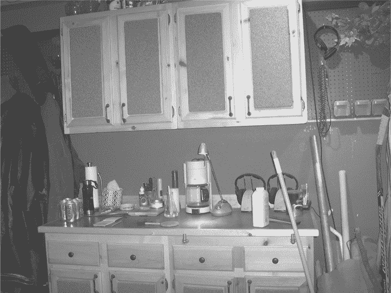

*图 6.3*  *用于悬挂物品的洞板，以及用于表演提示的橱柜和厨房台面。* ¶ *来源：作者拍摄的照片*

她舞台的门是双门。这是减少调音室和外界噪音影响的重要元素。一扇门不足以防止噪音泄漏。两扇门并排放置，中间留有一点空气，提供了隔绝声音的最佳机会。如果所有通往外界或其他房间的门都是双门会更好。

## 这就是坑

Foley 坑理想情况下嵌入地面。尺寸可以变化，但要记住，有时会有不止一个人同时站在坑内或表面上。因此，尺寸需要能够轻松容纳这种情况。坑相对于彼此的位置是个人喜好问题。思考一下最常进出哪些表面并将它们放在一起是有帮助的。请记住，任何带金属的东西都会在提示上产生“ring off”。这将是一个持续的问题。最好将带金属的坑与其他坑分开。地毯或泡沫隔音板可用于覆盖金属。

一些艺术家喜欢将室外表面坑放在一起，室内表面也放在一起。他们还喜欢将混凝土表面放在一两个室内表面附近，例如木材和乙烯基地板或瓷砖。这真的只是逻辑。大多数剧情片在某个时候，角色会从室外进入室内，反之亦然。

一些艺术家如果可能的话喜欢有两个土坑。其中一个含有非常粗糙、颗粒大的土，具有明显干燥的声音。另一个则可能含有较软的土。可尝试分解花岗岩或棕色土。盆栽土不推荐。它很潮湿，这会导致各种生长并产生异味，而且它声音柔软，几乎没有任何特征。最好至少有一个碎石坑。Foley 艺术家可以使用细圆粒碎石，并将一些碎石添加到土坑中以增加土的趣味性。与其在坑里放大量大块碎石，不如存一袋以备偶尔使用。在任何大型家居建材商店购买泥土和碎石。一小块真正的浇筑沥青是很好的补充。将它放在混凝土附近。

除了混凝土表面外，至少应有一个硬木表面，但两种声音对比的硬木会更好。如果可能，有一个栈桥表面非常棒。这个表面需要在坑上建造，以便声音有回声和生命力。另一个实用的表面是工业托盘。拥有瓷砖和/或乙烯基地板的一小块也很实用。金属表面非常棒，如果能内置的话。然而，拥有多种易于存放的金属表面板也很有用，因为电影世界中的金属表面差异很大。想想自动扶梯、地铁格栅、公共汽车、金属桥梁等。以小房间和预算可能无法建造所有这些声音。*要务实*。建造最常用的，剩下的存起来。通常，在制作未来主义、史诗或动画内容时，Foley 艺术家需要几种可能的金属声音。请记住，金属会反射声音并为其周围录制的任何道具增加品质。最好在金属周围放置吸音材料或在不使用时用布覆盖。

拥有用于草地的垫子是有帮助的。一些 Foley 艺术家发现，复活节或夏季展示时使用的草垫是完美的。专门为零售商提供展示材料的批发商通常有几种类似草的材料。人工草皮不是同样的表面，听起来就像它是什么。以前，许多艺术家使用四分之一英寸胶带。它快速、易得且便宜。随着技术的改进，声音录制现在非常灵敏，有时四分之一英寸胶带听起来粗糙而嘶哑；它适合增强某些类型的植被，但对于草来说可能不可接受。如果依赖四分之一英寸胶带，将其放在土坑中的一块布下面可能会改善声音。

任何 Foley 舞台都需要各种地毯和地毯表面。工业地毯块和各种扔毯是必不可少的。一些舞台在坑盖上铺设地毯，这有助于最大限度地减少盖子本身的反射，但并不总是便于行走。多样性和多功能性是目标。

如果可以拥有一个真正的蓄水坑，并配有抽水泵来排空它，那是很好的。声音效果更好如果它与地面齐平，这意味着要切割浮动地板。如果这不可行，那么地面以上的蓄水坑也可以。使用麦克风录制水效时要小心。水拍打在侧面时可能会听起来像浴缸。移动麦克风以找到最佳放置位置，避免反射和飞溅。坑应足够深以模拟海洋。一个好的指导原则是为水留出几英尺的空间，这将防止水溢出或在舞台上到处飞溅。

很多影片中都有水槽里的餐具或水滴音效。因此，设置一个水槽和水龙头的位置是有用的。如果做不到这一点（这种情况更常见），那么工作区就需要包括一个大型容器，用来滴水和溅出少量水。

Foley 舞台会变得很脏。在泥坑中行走会使灰尘进入空气。拥有一个清洁空气的空调系统至关重要。泥坑行走几小时后，空气就不健康了，而且艺术家可能无法在开着空调的情况下工作，因为噪音会被录下，所以要计算如何处理脏空气。此外，灰尘会落在表面上，因此舞台需要定期清洁。这是一个真正的问题。经常 Foley 艺术家被要求使用别人上一班使用过的舞台。因为班次之间没有足够时间清洁，灰尘会累积，可能导致不健康的工作环境。此外，泥坑会充满细菌，因此泥土需要定期清除并更换。保持适当的 Foley 卫生需要时间和纪律。然而，这是有礼貌和专业的做法。

## TOOL TIME

谈到为舞台采购设备，虽然购买最昂贵、配件最多的工具很诱人，但这些对于 Foley 舞台来说真的没有必要。甚至可下载版的 Pro Tools 对大多数用途已足够。重要的是记住手头的任务。调音师需要能够以宽广的动态范围录制道具和脚步声。最好有几种麦克风选择。前置放大器对于录音系统至关重要，以及麦克风放大器。利用时间码的工具包或应用程序以及某种对讲系统，最好能让舞台上的艺术家听到回放并让调音师在提示之间听到艺术家。如果可能，应安装某种音频或视觉系统来提醒 Foley 艺术家即将到来的提示。大多数 Foley 舞台都采用一系列蜂鸣声（与 ADR 中在演员说台词前提示演员的方式相同）或在画面上横穿的视觉流来预测提示。

Thomas 有几支麦克风和一个前置放大器。“我知道我需要什么，也知道我不需要什么，”她说。Sennheiser、Schoeps 和 Neumann 都有在录制 Foley 时通常使用的备受尊敬的麦克风。*《声音效果圣经》*的作者 Ric Viers 也很喜欢 Rode 麦克风。麦克风就像葡萄酒：种类繁多，迎合个人喜好，但有些是标准款。总体使用最广泛、最受欢迎的麦克风是 Sennheiser 416。

## ALTERNATIVE SPACES: WALK A MILE IN MY SHOES

一些音效专业人士喜欢尝试其他录制 Foley 的方法。Mark Mangini 是电影 *《疯狂的麦克斯：狂暴之路》*（2015）的奥斯卡获奖 SSE，并负责许多知名原声带的音效设计。他在监督 *《绿里奇迹》*（1999）的音效时尝试了不同的方法。Mangini 对坐在混音舞台上进行预混音时，重新录音混音师会精细调整 Foley 使其听起来逼真感到沮丧。正如他所说：“它听起来不像它所要代表的东西。它本应代表我们都能产生共鸣的某种声学现实。我们以超现实的方式录制 Foley。”

于是 Mangini 决定尝试不同的做法。他想模仿现实，于是自行展开了选址勘察。他想根据“声学特征”为地点“选角”，并找到一个废弃的军事基地，里面有混凝土走廊和废弃监狱。他对这些空间进行了“试镜”录音，并组装了一套远程 Foley 设备，配备电池供电的 Pro Tools 控制台。他调整预算以允许这种不寻常的 Foley 录制方式，并在预算中留出时间和资金用于错误和意外事件。此时，他确信将以这种新方式录制 Foley。

然而，找到愿意尝试这一新概念的 Foley 艺术家并不容易。如何录制、在哪里存放道具、如何控制声音、技术和工作流程以及其他不可预见的问题等后勤问题，导致 Mangini 接触的大多数 Foley 艺术家兴趣不大。Foley 调音师也有顾虑。调音师习惯于遵循一种动觉例行程序，使用他们的调音台和监听器以实现最佳功能。录制配置的改变对任何调音师来说都是令人不安的问题。

Robert Winder，当时负责 Warner Hollywood Studios（原 Samuel Goldwyn，现归新所有者所有并称为 The Lot Studios）的舞台和运营，提出了一个折中方案。影片是在该片场拍摄的，拍摄舞台仍然可用。它们是按照监狱和办公室真实空间的规格建造的。因此，与导致各声音舞台听起来相似的假表面和墙壁不同，这些布景比大多数布景更具真实的外观和声音。导演 Frank Darabont 坚持在布景中体现这一细节。

于是 Mangini 做了一个测试。他指示 Foley 艺术家 John Roesch 在布景和 Foley 舞台上都做 Foley 样例，并让导演挑选他最喜欢的。导演选择了布景样例。因此，第一个问题得以解决。Foley 将在影片的布景上拍摄。

下一个挑战是如何录制 Foley。据 Mangini 说，细致的 Foley 调音师 Mary Jo Lang 不愿放弃她的混音方法，以免产品受损。她将调音台和监听器的配置放在能够以最佳效率和最大技术专长进行混音的位置。巧合的是，Warner Hollywood 最近已在整个片场升级基础设施，包括声音舞台和所有录音舞台的光纤。这意味着在技术上可以让声音从声音舞台跨越片场传输到 Foley 舞台。也可以将对讲系统、监听器和耳机放在移动设备上，这样 Roesch 和他的 Foley 搭档 Hilda Hodges 就能在布景上表演 Foley，而 Lang 则从她运转良好的混音间观看并指导他们。

Roesch 和 Hodges 还需要做更多调整。Mangini 希望脚步声以非传统的方式行走。通常，麦克风固定在一个位置，艺术家在同一位置行走角色。Mangini 想尝试让角色远离麦克风或走向麦克风，以复制屏幕上的动作。这对于习惯在原地行走角色的 Foley 艺术家来说并不容易。一个人并不太确定要走多远，因为 Foley 艺术家总是知道麦克风在哪里。Mangini 希望 Roesch 和 Hodges 放弃既定做法。Mangini 决定将麦克风放在吊杆上，就像在拍摄中那样，并移动麦克风支架。正如他会对 Roesch 说的：“John，走下那一英里——真的——走 *下* 那一英里。”

然而无论对参与者而言尝试这一过程有多么艰难，有两点是确定的。首先，这部原声带本身就是一流的音效制作，其次，人类的智慧使得实验成为可能。

## 墙内之墙

沃尔特·斯宾塞在靠近洛杉矶市中心的埃科公园买了一栋房子，并开始担任音乐工程师和音效编辑。他从事低成本电影的工作，发现自己负责声音的每一项任务：剪辑、拟音和混音。他问自己一个问题：“我能把这栋房子变成一个能做一切的地方吗？”他决定尝试。

他在地下室建了一个拟音台，面积为 14 英尺×20 英尺。他在墙内建墙，以确保没有直角。他把坑直接挖进地面，并用分解花岗岩和棕色泥土作为坑的材料。他有一个沙坑、水泥、齐全的道具以及遮挡道具的帘子。短短几分钟内他就能清理舞台，并在拉上几块帘子隔绝声音后，可将拟音台改造成 ADR 录音棚。

他的调音台是 Pro Tools 系统，用于混音和编辑，他通过 Craigslist 广告找到了他的拟音师 Mike Horton。他还有一个 5.1 混音室。当然，他问题的答案是肯定的。

## 拟音之家也是一个家

安迪·马尔科姆是加拿大 Uxbridge 的拟音师。在成为拟音师之前，马尔科姆在多伦多担任助理音效编辑，并师从两位来自英国的音效编辑 Al Streeter 和 Peter Burgis，他们从伦敦来到加拿大以推动剧情片后期制作音效编辑业务。

马尔科姆曾学习过默剧，这后来被证明是从事拟音工作很有帮助的先决条件。默剧教会了他如何将身体分解为基本元素并以不同配置重建，以模仿银幕上角色的身体动作。这帮助马尔科姆更好地理解如何为演员的脚步声赋予重量和个性。

马尔科姆搬到 Uxbridge 创建自己的拟音和音效工作室——占地 25 英亩——他将其命名为 The Foley Farm。他已将自己的实际住宅——他和妻子居住的家——改造成一个可工作的拟音台，同时还在该物业上增设了两间额外的录音室。对马尔科姆而言，他的工作不仅仅包括许多艺术家创作的传统拟音，甚至也不仅限于更偏向设计的拟音。相反，马尔科姆认为拟音涵盖了他能为电影创作或制作的任何音效——包括那些更经典地在后期编辑中的声音。

由于马尔科姆在加拿大是一位知名拟音师，他为自己的团队设计了自己的工作流程，包括一套不同的协议。他有一位拟音混音师 Don White、一位独立的 Pro Tools 操作员 Jenna Dalla Riva，以及他的拟音师搭档 Goro Koyamo。

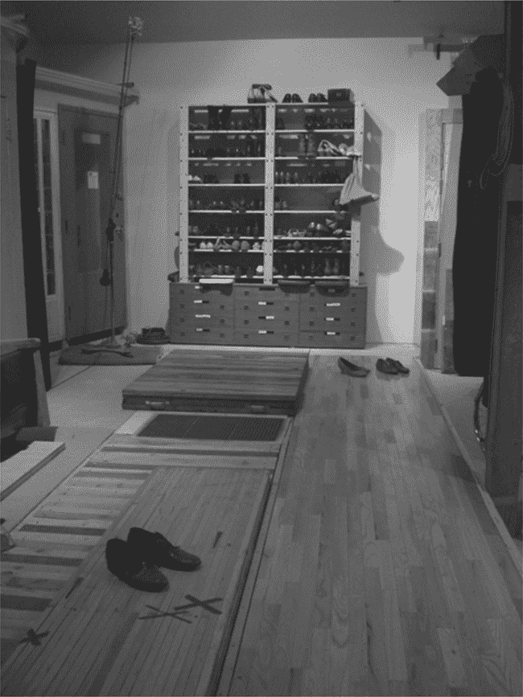

*图 6.4*  *各种木质表面。请注意用于行走视角拟音的长木质表面。* ¶ *来源：照片由 Andy Malcolm 提供，The Foley Farm*

马尔科姆通过培训爱尔兰的一位拟音师 Caoimhe Doyle，回馈了自己被培养为加拿大顶尖拟音师的经历。多伊尔曾在爱尔兰观看马尔科姆工作。她访问加拿大，在他的设施中与马尔科姆学习和培训。随后多伊尔回到爱尔兰，在 Ardmore Sound 设计并建造了一个专门的拟音台，她现在在那里与拟音混音师 Jean McGrath 合作。

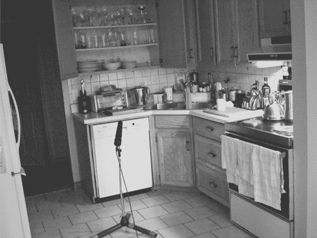

*图 6.5*  *马尔科姆已将整栋房子布线。* ¶ *来源：照片由 Andy Malcolm 提供，The Foley Farm*

## 数个相同的舞台

原本来自巴黎的 Julien Naudin 在多个国家拥有几个完全相同的拟音舞台，供他进行拟音。然而，这并不是他方法中唯一的独特之处。Naudin 设置了多个不同的空间，作为它们所代表的逼真房间。他拥有配备工作电器和自来水的厨房、客厅，甚至还有内部零件可用的汽车。他用帘子分隔这些房间。他的审美感与美国观众习惯的不同，更具自然主义和低调的特点。因此，这些房间被真实地布置，以具有对话片中更典型的声学“声音印记”。

## 真正的精髓

芬兰拟音师 Heikki Kossi 居住在赫尔辛基郊外的一个小镇，在那里他建起了自己的拟音工作室。他有几个小型舞台，每个都布置成真实的房间。它们的布置比 Naudin 的更传统，因为他不使用帘子分隔，而是为每种类型的房间设有实际不同的房间。他把麦克风放在床垫上，因为他的拟音坑是直接挖在地下的。由于他住在一个非常小的城镇，他感到幸运的是找到了一个能够相当熟练地混音拟音的人。

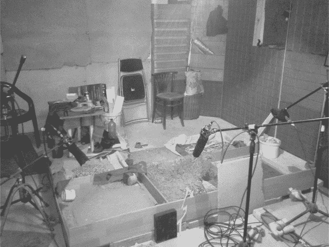

*图 6.6*  *各种泥土和碎石的拟音坑。请注意各种麦克风和墙面处理以及麦克风支架与地面的隔离。* ¶ *来源：照片由 Misa Jakovljevic 提供，Markoni Studio, Serbia*

## 自然的触感

Misa Jakovljevic 有时更喜欢在户外进行拟音。他不在室内为动物脚步拟音，并且经常会在塞尔维亚的地点找到一个僻静区域，以便在荒野中进行脚步拟音。他喜欢户外产生的真实世界声音以及麦克风上的自然空气感。然而，他的录音室提供了进行室内拟音所需的所有组件。

意大利拟音师 Marco Ciorba 也更喜欢在可能的情况下做他所称的“原声”。他喜欢去真实的地方录制拟音。意大利拥有众多历史名城和各种地形，Ciorba 喜欢利用身处那里的这一优势。

不应忘记，Walter Murch 以带他的声音搭档到旧金山湾区各地录制拟音脚步声而闻名。Murch 更喜欢写实且低调的拟音，它能与制作融合，不会引人注意，也不显人工。

## 下一个拟音站点

此时值得注意的是，拟音的公认标准仍然是在拟音台上进行，并依靠重录混音师添加元素以增强环境的真实感，但总会有人想挑战极限。通过跳出舒适区，艺术家可能会发现更好的工作方法。拟音录制的方式有多种可能性。只要记住基本原则：艺术家需要干净的录音，能够与制作声音和编辑好的音效配合使用，并且你需要能够编辑音轨。规则是用来学习的，所以要知道哪些规则可以打破而仍能完成工作。

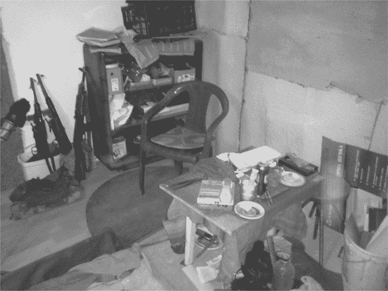

*图 6.7* *各种枪支和小道具。请注意道具电话和脚垫。* ¶ *来源：照片由 Misa Jakovljevic 提供，Markoni Studio, Serbia*

# 第七章

# 混搭

## 拟音混音师与重录混音师

DOI: [10.4324/9781003008439-10](https://doi.org/10.4324/9781003008439-10)

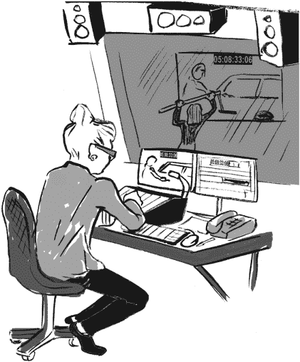

问一位拟音师在工作中最好的朋友是谁，几乎 invariably 答案都会是拟音混音师。一位艺术家可能才华横溢、专业且高效，却仍为项目制作出令人失望的拟音。原因很简单：混音师和艺术家是协作工作的，当他们对工作有相似的理念，并且在片场拥有兼容的个性时，艺术家和混音师都能更合作地工作。拟音师与拟音混音师之间的关系如此共生，以至于这种合作关系可以持续多年，并制作出具有标志性声音的卓越拟音，这种声音在专业声音界得到认可和尊重，同时也能让观影公众产生 visceral 的回应。声音总监依靠自己喜爱的拟音师和拟音混音师团队，逐年提供稳定质量和风格的情况并不罕见。

拟音师与混音师的合作经历有时会令人沮丧，项目的推进也可能变得困难。在拟音片场，艺术家和混音师日复一日地待在黑暗的房间里，为一部电影或剧集制作音效，而监督者可能只有很短的后期声音制作周期，或包含许多电影剪辑更改。艺术家与混音师之间的信任确保所有挑战都能更容易、更迅速地解决，冲突尽可能少。因此，此时详细阐述拟音混音师的角色并解释混音师如何最好地支持并与分配到该剧组的拟音师协同工作就显得很重要。此外，拟音师了解如何成为混音师的最佳合作伙伴也至关重要。

## 混音师是另一双耳朵

通常，当声音总监监督声音编辑 SSE 在组建拟音团队时，拟音师是首要关注点。无论艺术家的决定是基于过去的关系、特定电影类型，还是与公司的合同交易，SSE 通常都会关心拟音师是谁。通常，“主”拟音师是 SSE 的第一联系人，第二位艺术家的责任可能会留给主要拟音师或编辑。此外，有时 SSE 对拟音录制有偏好的拟音片场。有时艺术家会附属于某个特定片场。然而，很少有 SSE 会仅基于拟音混音师是谁就决定由谁来执行拟音；不过，重录混音师的偏好可能会产生影响。话虽如此，没有什么能比得上一位了解如何充分利用房间、声学、麦克风、技术，有时甚至是艺术家的优秀拟音混音师。最好的拟音混音师还具有额外品质，即知道如何激发片场人才的最佳艺术。一位明智的拟音师会重视拟音混音师的意见，并让混音师知道这一点。

几乎每位拟音师都有自己喜爱的混音师。有些人有好几位很喜欢合作的混音师，而有些人只会与一位合作。所有艺术家对自己在混音师身上喜欢什么都有不同的偏好。但他们都更喜欢与有默契的混音师合作。对混音师来说也是如此。拟音混音师努力工作，让拟音师的工作听起来尽可能好。即使是初学者混音师也能为拟音师提供很多帮助。首先，混音师是另一双耳朵。

## 不仅仅是录音

拟音混音师负责实际录制拟音师创造的声音。对业外人士来说通常令人困惑的是，为什么录制声音的人不被称为录音师，或者为什么他们不被称为工程师，就像音乐行业中的对应职位一样。职位名称与混音师所属的工会有关。

在制作中，在录音棚或外景地录制声音的人被称为制作混音师。这是因为此人实际上是在混音制作对白，而不仅仅是录制它。因此，这一惯例被扩展到包括录制拟音和 ADR 以及在最终混音中重录的人。任何在电影中录制声音的人都被称作混音师，除了外景录音师，其专长是外出为特定项目录制定制的音效。拟音片场过去确实有真正的录音师。当拟音录制在磁性胶片或 24 轨磁带上时，录音师会聆听爆音、裂音或因录制介质缺陷而产生的任何磁带 dropout。此外，录音师会保存提示表并设置工作室。但今天，随着所有设备都数字化，录音师已不再需要。有没有提示表需要整理和标记，没有磁性胶片盘需要更换，也没有另一双耳朵需要聆听声音问题。数字录制确保了不需要的声音会以可见于混音师的波形故障的形式出现。无论如何，混音师进行实际录制。

## 拟音混音是一门艺术

拟音混音师通常是通过担任录音师，并在磁性胶片时代担任装片员而逐步晋升的。装片员实际上会将磁性胶片装载到录音机上。录音师会坐在单独的房间里戴着耳机，聆听轨道中的任何问题，并在必要时以任何方式支持混音师。拟音混音师只有在学习了这两个先前的工作后，才会被允许坐在那个位置上。

拟音混音是一门艺术，但混音师需要一些技术知识。今天，由于混音涉及的技术，混音师需要非常了解 Pro Tools 以及可与 Pro Tools 软件一起使用的一些插件，或并行的编辑和混音系统。但一个优秀混音师的主要品质包括具有美学的好耳朵、对同步的出色眼力、在录制和为特殊提示插入时熟练的手法，以及对艺术家工作的理解。正如许多专业拟音师所归纳的那样，拟音师的工作在窗户的一侧，混音师的工作在另一侧。他们需要了解彼此的工作，但不要干涉。

在数字录制和混音在拟音片场成为标准之前，混音师在录制时通常不为拟音添加透视。人们期望拟音混音师以平直的方式录制声音，并且所有声音的透视或反射都会在最终混音中添加。这种行业标准导致了专注于干净混音的做法，对任何特定声音几乎不添加额外特征。目标是听起来真实，有少数例外。重录混音师的任务包括预混拟音，以更好地补充制作音轨、音效、ADR 和音乐。添加到拟音的任何增强或细微差别都留给重录混音师的技能和美学品味。

后来，随着技术的变化，录制到硬盘成为常态，拟声调音师可用的花哨功能也越来越多。因此，一些调音师开始扩展其在拟声舞台上的角色只是时间问题。再加上市场通常偏好最经济且劳动生产率最高的使用方式，以及专业音效工会为允许编辑和混音任务之间更多交叉而做出的修改，结果导致拟声调音师的角色得以扩展。许多拟声调音师现在使用以前属于重录调音师的工具。此外，音效编辑可以在他们的数字工作站上预混音，而调音师可以在将录制的音轨转发给编辑和/或重录调音师之前，对拟声进行一些小的编辑任务。

拟声调音师在工作方法上的差异与拟声艺术家一样大。没有两位调音师或艺术家会完全以相同的方式看待自己的角色，也没有人以相同的方式实践自己的技艺。他们的具体个性、背景和审美偏好差异很大。他们之间唯一的共同点是他们所期望的工作流程和专业流程。

## 经典方法

罗伯特·德尚内在 20 世纪 70 年代初于好莱坞的 Gomillion Sound 开始混音。Ted Gomillion 需要一名工作室经理，因此德尚内被聘用。此时，他对麦克风、电缆、录音或电影混音一无所知。他决定学习工作室里执行的所有工作。“在那个年代，有几家工作室——Producers Sound、Cine Sound、Gomillion Sound——人们可以在那里接受培训。我们挣得不多，但我们工作时间很长，我们学习了自己的手艺，”德尚内回忆道。

不久之后，德尚内开始混音拟声、ADR 和最终混音。他熟悉后期制作声音录制和混音领域的每一项工作。因为他在混音拟声和 ADR 的电影和电视节目中担任重录调音师，所以他对如何最好地混音拟声有着独特的视角。德尚内回忆起 Gomillion 的某个人告诉他，“拟声本应存在，而你不应该把它挑出来。”带着这个想法，他非常注意如何混音拟声使其融入场景。他发现所有拟声艺术家都有不同的风格和方法：“有时有人在脚跟-脚尖或脚尖-脚跟上用力过大，而当我把它带到混音台时，我总能分辨出有人做得不对。”

德尚内学习混音的时期正是拟声进入该领域专业化发展阶段的时候。虽然很多编辑仍在自己进行拟声，但一种新型的拟声行走者被引入其中。此外，在那个时候，拟声被录制到称为全涂层的三轨 35 毫米磁性胶片上。德尚内会在上午 8:00 得到拟声的画面和提示表，并且必须在下午 6:00 前完成，以便为下一次播出日期进行混音：

> 我见过很多 \[拟声艺术家\]，他们非常有才华，能够快速完成并使其同步，我们不需要剪辑它。我们确保当它离开舞台时一切都同步，因为他们 \[编辑\] 没有时间剪辑它。

### 声音叙事应始终是调音师的首要考虑

由于德尚内曾参与制作工作且尚未成为重录调音师，他意识到要让拟声尽可能听起来像制作声音：“我必须学习透视并移动麦克风，就像他们在实地拍摄时麦克风所在的位置。”他注意“不要让它离麦克风太近或太热，希望不会失真。”

德尚内也混音 ADR，而且由于他本人曾是演员，他的过去职业影响了他对拟声和 ADR 的方法。他非常钦佩那些准备充分、为每个项目做功课的拟声艺术家。

> 我会观察这些人，他们会把心思放在演员或女演员身上，并模仿他们。当你最终把所有东西组合在一起时，你会觉得演员或女演员真的在走那场戏。

德尚内还回忆道，“我会在脑海中行走。我会想象自己沉浸在他们的脚里。我必须跟着他们走，这样我才能在他们的脚在空中时进行插入，以免擦除任何东西。”当然，自从磁带或 24 轨时代以来，技术已经取得了长足的进步，因此调音师在舞台上进行插入和编辑的方法各不相同。但由于德尚内是在更原始的设备时期接受训练的，他的技能被磨练得具体而高效。

像德尚内这样背景深厚且经验丰富的调音师可以为拟声舞台带来一种电影感，而许多在数字系统上磨练技艺的人可能需要更多时间才能发展出来。工具总是在变化。但良好的声音叙事应始终是调音师的首要考虑。声音服务于叙事。拟声很少是电影的主角，记住像德尚内这样的资深调音师可以传授给沉迷于技术的年轻拟声调音师的教训至关重要。在不太复杂的工具上学习使德尚内能够在过渡时将自己的技能精炼到不依赖数字的程度。他可以在脚步之间做出美丽而无缝的插入，永远不必让拟声艺术家重复提示。这就是他训练有素的技能所能为他的艺术家做到的。

### 挑战极限

德尚内是经验最丰富的调音师之一，也是最具赋能性的人之一。他是一名忠诚的团队合作者，相信协作，德尚内培养了几位具有良好职业生涯的拟声和 ADR 调音师，他们最初都是与他一起担任录音师。其中一位调音师是 David Jobe，他混音约有 25 年。他在从事电子新闻采集的一家小型公司开始了他的声音事业。随后他在 20 世纪 80 年代末进入华纳好莱坞担任“装片员”。他为在混音台上混音的人装载磁性胶片到录音机。随着职业生涯的进展，他完成任务的速度、他的智慧和他友好的个性使他获得了在 Skywalker South 为德尚内担任 ADR 录音师的职位。德尚内很快就认识到 Jobe 的智慧和纪律，并允许他在德尚内观看和指导的同时在 ADR 舞台上混音几个提示。这曾经是好莱坞培训新调音师的传统方法。工作室是新调音师的训练基地。如果一名录音师似乎有才华且工作态度良好，他们就会被鼓励去混音。

Jobe 很快就掌握了要领，不久后，他来上班时就会被告知必须混音 ADR，因为德尚内生病了。Jobe 至今仍不知道这是否是真实的故事，因为德尚内以慷慨地分享时间和调音师座位而闻名。无论如何，Jobe 被提升为调音师。因此，他经历了火的洗礼。不久之后，他被分配到 Skywalker South 的自己的舞台，并开始了混音拟声的职业生涯。他在那里混音了几年，然后去了伯班克的华纳兄弟，在那里他混音拟声已有 14 年。

### “我选择更靠近悬崖进行混音”

Jobe 是一个不断鞭策自己追求卓越的混音师。即使在 Pro Tools 成为标准混音格式并提供更多选项之前，他就在舞台上使用两到三个麦克风。这是他至今仍喜爱的实践。一个麦克风用于录制道具或脚步声，一个可能用于反射（通过对准天花板或放在相邻房间），有时还会再放置一个“off-axis”。他在麦克风使用上很有冒险精神，但在知道重录混音师希望 Foley 舞台提供较少透视时也会谨慎行事。然而，正如 Jobe 所说，“我选择更接近悬崖混音。这更令人满意。”他很快指出，然而，当他为电视混音 Foley 时，他不太可能进行实验。连续剧流媒体节目和电视节目是为在家中或电脑上观看而混音的，而不是在剧院中，因此它们通常会考虑到各种设备。

一些资深的 SSE 更喜欢将 Foley 平面录制，这一直是传统做法。但也有人依赖 Foley 舞台来添加均衡和透视，这样在 dub bing 舞台上花费的时间就更少。Scott Hecker 发现重录混音师变得更愿意接受在 Foley 舞台上绘制一些透视和反射：

> 现在日程越来越紧，他们最不想做的就是花时间加入空间感。聪明的 Foley 艺术家会适度加入空间处理；不是尽可能多，但至少要使其融入空间。

George Lara 是新泽西州 C-5 的 Marko Costanzo 的 Foley 混音师，他喜欢使用四支麦克风来营造透视效果，使用两支 Sennheiser 416 麦克风和至少一支 Schoeps。“我们有一个大房间，”Lara 表示，而 Costanzo 补充说，他和 Lara 专注于“匹配我们在制作中听到的声音”。Costanzo 和 Lara 喜欢在活房间中混音 Foley，而 Foley 舞台的一部分设计成听起来更像室外，空间感较少。该团队在制作一部主要剧情片时经常会混音 16 条脚步声轨道和 24 条道具轨道，而当他们为 Quibi 工作时，他们混音的音质与剧情片一样。“它们必须足够诱人才能让你继续观看，”Lara 沉思道。

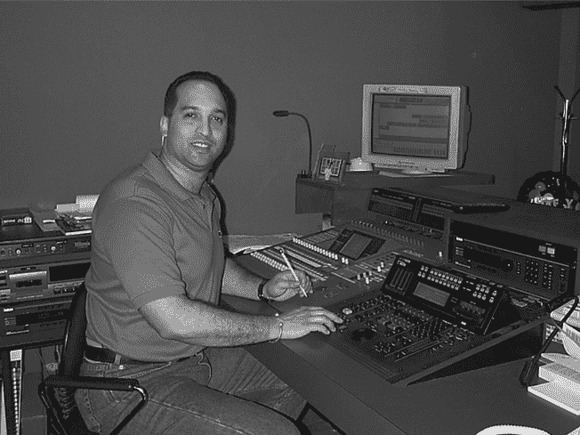

*图 7.2*  *Foley 混音师 George Lara。* ¶ *来源：George Lara 友情提供照片*

## 传统主义者

Karin Roulo 从 1980 年代末起就是 Foley 混音师，她的方法更传统。她作为 Foley 混音师拥有独特的背景（她是业界最早的女性混音师之一），因为她以工程师的身份开始职业生涯。她做事有条理、精确，并且非常了解混音的技术方面。她最初在 Warner Hollywood（前身为 Goldwyn Studios，现称 The Lot）在首席工程师 John Bonner 手下接受培训。她培训了一年，首席重录混音师 Bill Varney 让她旁听最终的 dubbing 混音。她了解到后期制作声音在影片最终混音中的使用方式。随后她转入制作担任电缆牵引员。

电影拍摄现场的电缆牵引员为摄影师手持电缆。电缆可能会碍事、断开、被踩到，甚至出现在画面中。电缆牵引员确保这些情况均不会发生。由于身材娇小（在工程环境中较为罕见），Roulo 被安排在特殊环境中工作，因为她能够进入奇怪的地方，比如桌子底下。

### 她注重录音质量

Roulo 后来在 Ryder Sound 学习维修 Nagras。Nagra 是声音编辑录制现场效果以及制作混音的标准机器。正是在这里，她对 Foley 产生了迷恋。John Roesch 和 Joan Rowe 与 Foley 混音师 Richard Rogers 合作，Roulo 不仅对这个过程着迷，还对 Roesch 和 Rowe 作为团队合作的方式印象深刻。Chuck Campbell 是舞台的监督。“这是个很好的入门，”Roulo 回忆起她第一次接触 Foley 的经历时说。“他 \[Campbell\] 知道自己想要什么，并且能够告诉他们。他能够表达导演希望影片中的角色如何被感知。”

不久之后，Roulo 被请到 Ryder Sound 担任 Foley 录音师。通常与 Richard Rogers 合作的录音师生病了，所以 Roulo 顶替工作。她留任整部影片。

没过多久，她就在 Burbank 的 Larson Sound 混音 Foley。她通过工程生涯认识了老板 Rick Larson，他当场就聘用了她。她与 Hilda Hodges 和 Alyson Moore 在几部电视节目中合作。随着 Roulo 作为混音师经验的增加，Bill Varney 被任命负责 Universal 的录音棚；他把 Roulo 调到 Foley 舞台工作。不久之后，她就在城里多个舞台上混音。Roulo 注重录音质量：

> 我知道设备能承受的电平，我希望尽可能提供饱满的声音，所以我认为我倾向于更多地分层我的声音，尤其是道具。我宁愿把东西分散开，给 dubbing \[rerecording\] 混音师更多灵活性，因为他们可能不会像我一样看待它。

## 惯例与非惯例

一些混音师喜欢反射很少的 Foley 舞台。他们称之为“dead room”。当房间活力过大时，他们会发现很难消除“bounce”或“ping”。虽然艺术家可以在舞台上放置房间隔音板来保护自己免受反射，但有时对于敏感和安静的提示来说，房间不可能死寂到足够。随后还有不断在房间移动隔音板并将其放置在理想位置的问题。Roulo 喜欢在死寂房间中混音。她更喜欢更经典的将 Foley 平面混音的方法，但补充说，“这取决于 dubbing 混音师。我遇到过几个希望我混音更多的人，这通常是在他们预算紧张的时候。”Roulo 曾帮助构建电子部件以解决活房间的问题：“他们可能需要在 dub 舞台上更改剪辑。如果房间太活，他们可能难以匹配声音。”

一些混音师，尤其是在音乐领域起步、乐器在房间更有生命力时得到增强的人，在录制 Foley 时保留了这种感觉。对于这种观点的人来说，对任何 Foley 舞台都不满意并不罕见，因为它们通常设计为具有柔软的墙壁和天花板以减弱声音。Jobe 喜欢活房间，或者正如他喜欢表达的那样，“当我说有活力时，我指的是那些呼吸感更强的舞台。当你有一个死寂的舞台时，它会使声音变色。墙壁会削弱某些频率。”

吉姆·阿什韦尔，原籍堪萨斯州托皮卡，音乐录制生涯由此开始。在洛杉矶的 Dick Grove 音乐学院参加音乐工程工作坊后，他开始在当地的各家音乐录音棚练习技能。其中一家名为 One Step Up 的录音棚给了阿什韦尔担任第二工程师的机会，在那里他曾与 Eagles 等艺人合作。“我待着不走，拒绝回家，”阿什韦尔回忆道。他还在 The Record Plant 工作过，在那里他做的是他所称的“溢出”工作。到 1982 年，他开始独立录制 sessions，并逐渐转型为某些 Foley 录音的 Foley 录音师。1986 年，阿什韦尔成为 Foley 调音师，并与当时洛杉矶许多经验更丰富的 Foley 艺术家合作。这些 Foley 艺术家之一是 Dan O’Connell，他与阿什韦尔有着长期的职业关系。O’Connell 与 John Cucci 合作并开设了自己的 Foley 舞台，巧合的是也命名为 One Step Up。这种讽刺阿什韦尔并不陌生。2012 年，阿什韦尔、O’Connell 和 Cucci 来到 Fox Studios，那里两位 Foley 艺术家仍在工作，而阿什韦尔已退休。

作为调音师，阿什韦尔更关注艺术而非技术。他会以音乐工程师时期培养的美学感性来预混他的 Foley 音轨。他的关注点在于如何构建场景，而非专注于某个具体细节。他经常

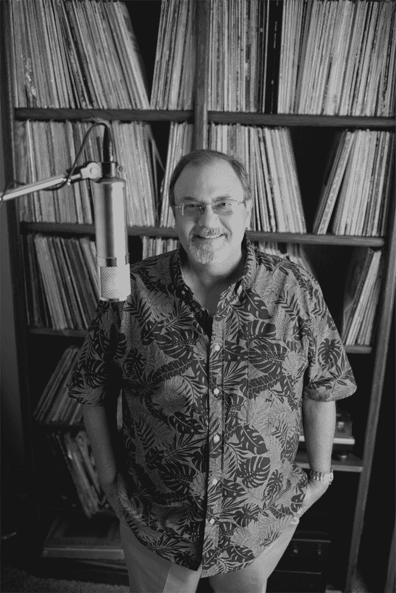

*图 7.3*  *资深 Foley 调音师 Jim Ashwell。* ¶ *来源：照片由 Jim Ashwell 提供*

他在 Foley 舞台上使用谐波器，这使他更具创造性。阿什韦尔回忆道：“与其说是才华，不如说我愿意冒险尝试任何事情。”他补充道：“我只学了做事所需的足够技术知识。”阿什韦尔感谢 O’Connell 给了他创作自由：“他 \[O’Connell\] 是一位艺术家——他以艺术家的眼光和耳朵来对待它。”通过与 O’Connell 合作——阿什韦尔形容他“非正统”，“更关注逐场景构建 Foley 而非连贯性”——阿什韦尔得以更多地体验艺术家与调音师之间的“互动”。阿什韦尔回忆 O’Connell 会如何形容他：“你有一双巨大无比的耳朵。”

### 少即是多

随着日程安排越来越紧，对 Foley 舞台上人员的要求也越来越多，调音师花费更多时间对 Foley 进行微调和部分编辑。数字录音使调音师相对容易完成此项工作，甚至工会调音师也被要求比以往做更多此类工作。编辑与调音师之间的界限正在迅速模糊。编辑们在预混、混音并进行快速修复编辑。新的 Foley 调音师对此不会有任何伦理问题。但值得记住的是，这是一个相对近期的发展，主要源于两个因素：技术变革和经济需求。随着制片方找到更多削减预算的方式，他们依赖技术来决定雇佣条件，而非让实际工艺来划定适当的就业边界。在不评判这一过渡——它是数字融合的结果——的情况下，它确实给调音师带来了更大压力，要求他们学会如何在不削弱其生命力的情况下编辑 Foley。使用编辑工具时要谨慎克制，而非过度兴奋。少即是多。

问 Foley 调音师关于麦克风偏好，虽然意见不一，但普遍认为大多数调音师只有几个最爱，并不会花太多时间试听麦克风。相反，音乐工程师会为每件乐器和每位歌手单独挑选出能发挥其最佳效果的麦克风。有一些标准麦克风通常会出现在 Foley 调音师的常用设备中。Sennheiser 416 是一款明亮的麦克风，中频表现良好。这是 Hi Fi Foley 的 Walter Spencer 的首选麦克风。来自英国布里斯托的 Foley 艺术家 Richard James Hinton 表示，他的调音师偏爱 Sennheiser MK 60。这也是 Foley 艺术家 Julien Naudin 许多音效的喜爱的麦克风。Neumann 是一个熟悉的麦克风品牌，Schoeps 也是如此。偏好因人而异，很大程度上取决于舞台的音质。Jobe 喜欢 Neumann，因为它具有大振膜。他将 Sennheiser 用作房间麦克风，因为它“冲击力十足”，并且他也经常使用 Schoeps 麦克风。“你想要一个品质优良、音色温暖的麦克风，”他说。

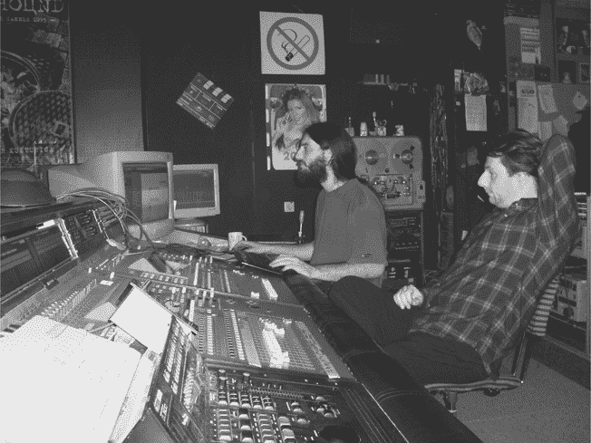

*图 7.4*  *Misa Jakovljevic 的调音师和录音师。在塞尔维亚，他们仍使用模拟和数字格式的混合，需要两位专业人员在控制台。* ¶ *来源：照片由 Misa Jakovljevic 提供*

调音师如何与舞台及其独特特性配合工作，是混音的重要方面。调音师需要有耐心应对舞台地面声出现的任何问题，并且不被这些问题吓倒。实际录音中出现的任何问题都不是艺术家的责任。因此，优秀的调音师总能区分录音不达标是因为设备、房间或操作失误，还是艺术家表演需要改进。优秀的调音师总会明确传达录音问题的缘由，因为 Foley 艺术家如果需要重做音效，天然倾向于改变自己已做的工作。如果调音师希望艺术家重复相同的表演，他们需要进行沟通。

### 这是一段婚姻

优秀 Foley 调音师的另一个品质是对艺术家的尊重，甚至是崇敬。调音师应充分理解艺术家如何对待自己的技艺，以便避免任何误解。重要的是要明白调音师的工作是适应声音。Foley 艺术家创造声音。因此，简单的三段论指出，调音师的工作是适应艺术家。所有 Foley 艺术家都不同，工作方式也各异。优秀的调音师具有灵活性，并努力学习每位艺术家的“秘密语言”，以便工作日顺利进行。如果调音师真心希望艺术家能够自由实验，也有助于打造一次精彩的录制。

艺术家对调音师也同样如此。如果艺术家关注调音师面临的挑战会很有帮助。Foley 调音师最终对录音质量负责，这涉及与房间声学特性的配合以及排查出现的问题。正如在电影制作中一位 Foley 艺术家与另一位之间的关系像婚姻一样，艺术家与调音师之间的关系也是如此。它复杂、细腻，在最佳状态下纯属魔力。

一些 Foley 艺术家可能会对调音师感到不耐烦。如果是这样，最好记住调音师忙于工作的许多技术方面，因此无法始终关注舞台上出现的每一个问题。因此，那些对调音师有耐心并努力满足其技术需求的艺术家将获得最佳合作。

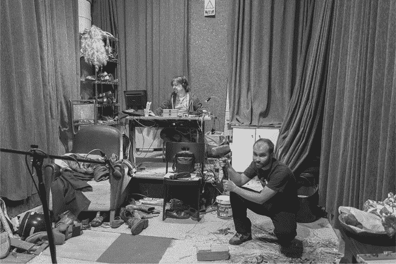

*图 7.5* *Foley 调音师 Diego Staub 与 Foley 艺术家 Miguel Barbosa 在西班牙同一房间混音。* ¶ *来源：照片由 Miguel Barbosa 提供*

混音师各有自己的技巧来与艺术家创造理想的工作环境。多年来，他们学会了如何应对每位艺术家的不同个性、生物节律、优势和弱点。Roulo 在首次与经验不足的 Foley 艺术家合作时有一种具体的方法：

> 我倾向于比与经验丰富的团队时多回放前几个提示音，因为我想让他们对声音的听感有个概念。我可能会把他们叫进操作间，让他们来看一下。

当被问及与新艺术家合作最困难的部分是什么时，她说：“如果我知道他们在同步方面遇到困难，尤其是在脚步声上，而且不让他们的搭档尝试，这就是最困难的事情；当他们变得占有欲强，不愿意看到另一种观点时。”

Roulo 喜欢向她的艺术家学习：

> Jerry \[Trent\] 教我将整个场景可视化，专注于主演并从舞者的角度来看。Greg \[Barbanell\] 对 Foley 采取轻松幽默的方法。他非常专业，在喜剧方面也很出色。对于这样一个大个子来说，他的脚步非常轻盈。

她将学习声音分层归功于这位作者。尽管我很感激这份认可，但我必须承认，是混音师 Richard Rogers 教我将声音元素分层到各个音轨上，以便在 dub 舞台上进行混音和融合。

## 全部主观

David Jobe 解释了他与各种艺术家合作的方法：“我希望 Foley 艺术家和我在审美上保持一致。” 然而，如果出现问题，他补充说：“我会事先选好要争论的点。我会以一种善意和外交的方式，慢慢让他们接受我认为可能更好的方案。这一切都是主观的。”

时间是艺术家和混音师共同的敌人。然而，虽然艺术家可能感到压力要在录制时段完成所需的工作量，但当客户进入混音间时，承受直接压力的是混音师。不可避免地，一旦观众进入操作间，混音师就会被要求指导艺术家，或“帮我回放一下”，或“让他们再做一次”，或提出其他类似的含糊建议。混音师别无选择，只能取悦客户，而艺术家并不总是知道操作间里说了什么。混音师与艺术家之间的信任至关重要。混音师可以保护艺术家免受客户过度管理的有害影响。这一可预测的练习会浪费宝贵的时间，但过错并不在 Foley 混音师身上。成熟的 Foley 艺术家意识到这一点，并会让混音师知道。

直到最近，惯例是让 SSE 或 Foley 编辑来到 Foley 舞台进行回放。这是播放一段素材给编辑听，以确定 Foley 是否令人满意的过程。对所有相关人员来说，这都是时间的良好利用，因为 Foley 团队可以不受干扰地工作，但客户有机会提出意见并评论她或他想要的可能的“修复”。当时间紧迫或预算紧张时，这并不总是惯例。然而，如果可能的话，这是确保编辑从 Foley 获得所需内容，同时让 Foley 团队获得隐私和最佳环境以创造最佳成果的最佳方法。

无论时间压力和金钱限制如何，Foley 混音师始终可以对 Foley 的质量产生巨大影响。混音师与艺术家之间的关系可以是专业的、创造性的，而且绝对是神奇的。

Bob Deschaine 对有志于成为 Foley 混音师的人的建议是：“去 dubbing 舞台看看 Foley 混音后听起来是什么样。” 归根结底，观察 rerecording 混音师的工作是学习如何作为 Foley 艺术家或 Foley 混音师提高自己对音轨贡献的最佳方式。

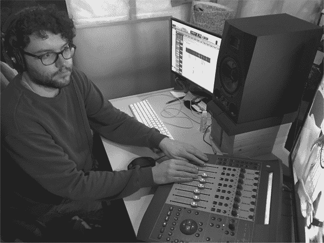

*图 7.6* *Foley 混音师 Isael Huard 为 Chris Szott 混音。* ¶ *来源：照片由 Chris Szott 友情提供*

## 后期修复：杜比

rerecording 混音应该是 Foley 的一个重要方面。毕竟，一旦 Foley 被提示、表演和编辑，似乎焦点就会转向为配音目的而制作的更精细和戏剧化的音效。然而，任何电影制作人或电影声音爱好者都必须记住，所有的道路都通向 rerecording 过程，或业内所知的 dub 舞台。因为混音过程是所有声音的最终目的地，正如亚瑟·米勒在戏剧 *Death of a Salesman* 中所说的那句台词，“必须给予关注。” 因此，清晰理解传统的 Hollywood dubbing 过程以及它与 Foley 艺术家、混音师和编辑的关系至关重要。请记住，随着数字编辑和混音的转型，dubbing 过程也得到了简化。对传统 dub 如何进行的概述有助于理解后期制作声音这一最终过程中涉及的各个组成部分。在 Hollywood 以及其他电影地区，这一过程存在差异。对电影声音感兴趣的人最好了解数字工作流程如何极大地改变了后期制作，以至于惯例不断变化，但该过程仍保留了在电影制作中完成和完善音轨的经典方法。

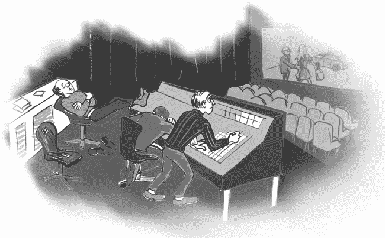

*图 7.7*

### 预混音

后期制作声音的 Predubbing 传统上是 rerecording 混音师的领域。我们身处这样一个时代，新的技术让许多人相信，任何拥有 Pro Tools 的人都能像专业人士一样设计、编辑和混音声音。这种信念可能能卖设备，但在实践中，决定音轨质量的是美学、工艺和经验，而主要不是技术。

在 Hollywood 后期制作体系中，直到 2000 年代，一直有在 dub 舞台上使用三位混音师的惯例。一位主要负责对白（通常是主混音师），一位负责音乐，一位负责 Foley 和音效。通过考察这种经典方法，可以看出它如何在技术模糊了工作职责界限的情况下仍然影响工作流程。

Foley 的制作目的是通过关注导演的愿景、演员的表演以及舞台上 dubbing 混音师的需求来服务叙事。无论是谁录制了制作声音，谁监督了声音编辑，谁设计了任何特殊音效，谁与演员拍摄了 ADR，谁创作和编辑了音乐，谁负责 Foley，最终将所有音频音轨从 predubs 到 final dub 再到 printmaster 组合起来的任务都是 rerecording 混音师的。他们是所有编辑、艺术家、混音师、演员和作曲家的防火墙。rerecording 混音师的任务需要专业知识、审美品味以及调和竞争利益各方各种请求的交际能力。

考虑到这一点，毫不奇怪，“dubbing”混音师是听到抱怨并看到舞台观众情绪的人。由此可以理解，编辑团队的成员需要在大多数工作日理解他们的压力。

# 电影混音中的预混实践

## 传统目的与初始流程
杜比混音棚的前几天传统上主要用于预混。当然，这是在任何临时混音发生之后。临时混音用于引入概念性的声音创意，以进一步推动画面和剪辑的协作。此外，临时混音使制作公司能够向放映观众呈现一个体面的展示，以便了解项目最可能的目标观众群体，以及选定的测试观众可能提出的用于进一步剪辑画面修改的批评。预混在过去曾是混音中一个关键且耗时的环节。混音师会细致地分析和审视每一个声音，并精细调整每段音轨的音色和品质。这个过程需要耐心和专注。

## 预混与最终混音的关系
执行良好的预混有助于最终混音，而最终混音是“做到正确”的最后机会。As David Stone says, “the predubs are like rehearsing a symphony orchestra; details are everything. The final dub is the concert!” “

## 历史上的音轨分组与工作流程
传统上，当为预混分配足够时间时，混音师会取一类声音，将众多音轨混成六轨一组。对白传统上会被混成六轨单声道音轨。ADR 会有六轨主演音轨，也许还有另外六轨群组 ADR。硬效果可能是三到八组六轨，包括任何特殊设计效果。背景效果（BGs）会有一组六轨。拟音会有六轨脚步声和六轨道具声。布料音轨——对于国内混音是可选的，但对于外国“音乐与效果”混音却弥足珍贵——会被单独分离到自己的音轨上，并在最终混音时播放，但在预混时不播放。

## 当代排期与团队变化
大多数预混理想情况下会从对白开始。一切都始于制作音轨中的内容，因此对白预混通常会被给予一周或更长时间来真正精细打磨音轨，使其熠熠生辉。接下来可能是 ADR，然后是音效，然后是拟音。音乐——通常要到最后一刻才完成作曲——不会在最终混音之前加入。如今，随着日程更加紧张、时间更紧凑，甚至可以接受一个混音棚在预混对白的同时，另一个混音棚在预混拟音。在当代混音中，三人团队已不再使用。通常由两位混音师，有时甚至是一位独混师（纽约电影文化中的典型做法）来完成整部作品的混音。许多小型独立电影也采用单混音师模式来完成整部作品的混音。经济因素始终是考虑因素，而数字技术使剪辑师和混音师在执行任务时更具灵活性。

## Foley 预混准备与惯例
当混音师预混拟音时，他们会发现如果剪辑师的准备工作已预见到混音需求，时间会用得更有效。音轨需要正确标记，表格需要打印出来。一些混音师会看表头，一些会查看表格并在上面做标记，注明在预混中分配音轨的位置，而一些则更喜欢查看 Pro Tools。然而，音轨布局的惯例与数字时代之前的混音相似，因为该系统旨在高效利用时间，且所有声音专业人士都理解这种共同的规范。重录混音师会在最左侧声道寻找主演脚步声，在下一个声道寻找背景脚步声，最后是道具，且相似类型的道具放在相似的音轨上。布料音轨会在提示单的最右侧。

## 对白混音哲学
Richard Portman 大部分职业生涯都是作为对白混音师。他会仔细聆听音轨上的嘶嘶声和嗡嗡声：“It all starts with the production dialogue. If it is recorded well then everything else is much easier.” 许多混音师可能仍然会同意 Portman 的观点。虽然他作为工程师的背景使他对制作音轨的技术录音质量更敏感，但大多数混音师更倾向于将制作对白混音作为所有剩余音效的模板。

## Foley 与效果的整合
一些混音师喜欢在对白音轨上进行拟音预混。有时拟音在混音师聆听音效的同时进行混音。这很有优势，因为效果和拟音都可能覆盖同一场景，因此需要相互对照播放，以查看哪一个更好地覆盖了素材。通常，在预混阶段就会做出将拟音效果与剪辑选择结合的决定。预混的目的过去如此，现在依然如此，就是将众多单元精简为更少、更易管理的数量，以便精细打磨最终混音。

## 现代灵活性与从业者观点
在当今众多的技术可能性中，预混并不是一个固定的惯例。根据影片、SSE、混音师和日程安排，预混实际上可能是一次来自 Pro Tools 的剪辑师会话。然而，对白仍然是混音师的领域。虽然音效和拟音可能在呈现在混音棚之前就已预混，但对白——任何影片中最敏感的部分——仍然是重录混音师珍视的领域。虽然其他声音专业人士的工作流程已经改变，但对白混音师仍必须不断打磨对白，直到其熠熠生辉。他们可能希望单独预混对白，或者像纽约混音师 Tom Fleischman 所偏好的那样，加入一些环境音效进行预混，以便评估对白如何融入场景。

Michael Semanick 混音效，当他预混拟音时，他喜欢花大量时间进行预混。Semanick 在成为重录混音师之前从事拟音工作相当长一段时间。他在预混中喜欢将其他元素与拟音对照播放：“When I’m predubbing, I’m trying to use whatever I’ve got to balance against.” 时间，当然，始终是问题。尽管 Semanick 并非总能得到他想要的时间，但他记得有些影片获得了他要求的时长：“Just on *Sweeney Todd* \[2007\] alone, I took about two weeks to predub the Foley, I think, because it was so important.” Semanick 常常与 Peter Jackson 和 David Fincher 等导演合作，他们会在后期声音预算中谨慎地安排更多时间。

Ren Klyce 是多部影片的音效设计师，包括 *The Girl with the Dragon Tattoo* (2011) 和最近的 *Mank* (2020)，他在音效设计上富有艺术性，喜欢拟音听起来像是制作过程中产生的，因此从拟音阶段到混音，他更喜欢留出时间进行实验和精细打磨。Klyce 更关注音效设计中的艺术性随机感，而非技术上的完美。Both Fincher and Klyce will negotiate to get the money necessary for postproduction sound so they have the time to get the quality they both feel the professionals, like Semanick, need to do the best sound possible for the film. 然而，当 Klyce 和 Fincher 在剧集 *House of Cards* 上履行职责时，日程更紧凑，因此他们在剧情片中经常行使的控制权并不存在。多支不同的拟音艺术家团队进行了拟音，不同的音效剪辑团队剪辑并预混了音效，最终混音则在不同的混音棚由不同的混音师完成。然而，Klyce 仍设法让混音师按他所偏好的方式对素材进行预混。最近，Klyce 将重录混音师加入了他的工具箱，这使他对最终混音拥有更大的控制权。

资深电视对白混音师 Larry Benjamin 表示，近几年排期发生了如此剧烈的变化，以至于他在为某节目预混对白时，他的音效混音师却在别处预混音效。然后，他们会“合并”并加入音乐（Benjamin）和 Foley（音效混音师），以准备最终混音。此外，他们在预混模式下还可能会微调同步。排期比几年前少一半甚至更少。

如果一部电影已经进行了多次临时混音，如今大多数电影都是如此，那么预混过程已经发生了好几次。虽然临时混音传统上更像是一个“独立”的工作，并且会为实际混音设计和编辑新的素材，但今天更常见的是临时混音是最终混音的前奏，有时甚至取代预混。一个聪明的剪辑师会保留每次临时混音的素材，只需加入新素材即可。成本节约、技术进步以及更短的后期制作声音排期持续给最终混音带来压力。

### 混音与剪辑的融合
越来越经常，Foley 剪辑师需要在 Pro Tools 中进行预混以节省混音时间和成本。无论是 Foley 混音师在录音棚中添加透视，还是剪辑师在“盒子里”进行预混，配音混音师都必须让最终产品与他们所呈现的内容配合。透视是主观的。这是一个特别的问题，因为在混音棚中从屏幕一侧到另一侧的空间远大于显示器上的空间，而剪辑师在 Pro Tools 中做出的声像定位决策可能无法很好地转换到大屏幕上。再次，市场的决策并不总是带来最佳结果。然而，技术最近已响应了从剪辑室到混音棚更好地衔接的需求。剪辑师在混音时所感知的内容与在混音棚中发生的内容之间的差异已得到最小化，因此剪辑师的会话在混音棚中转换得更好。

一个正在从混音棚中消失的惯例是在预混过程中让剪辑师在棚内微调提示音。导演可能想听到另一种声音，同步可能存在疑问，或者混音师可能有建议来改善提示音的组合。不论原因如何，过去一直是惯例在剪辑师的片段播放时让剪辑师在棚内就座，以防需要修复。

越来越多地，由于时间、预算和技术变化，剪辑师并不总是全程在棚内。以前，剪辑师可以在混音师继续预混的同时对声音进行剪辑更改。如今，混音师可能会被导演要求进行快速剪辑。这可能有问题。不仅大多数配音混音师更习惯于混音而不是剪辑，而且当混音师需要转换任务进入剪辑模式时，混音流程会明显受到干扰。混音有一个流程，能让混音师发挥最大创造力和效率。随着越来越多的重录混音师适应了混音的起伏和细微的剪辑更改，最终混音流程已得到简化。

现在用于混音和剪辑的技术相同，人们会假设任何会使用 Pro Tools 的人都能做这两项工作。这种假设可能导致得出一个人可以做两个人的工作的结论，那为什么还要雇两个人呢？随着我们变得更倾向于让更少的工作人员借助技术完成更多任务，自然而然地会假设混音师可以剪辑，剪辑师可以混音。在这里，技术响应也有了巨大的改进。Fleischman 指出，“现在，回头更改音效或加入 Foley 并不是什么大问题。”

然而，这并不意味着该人擅长、熟练或在两项工艺上都有经验。混音和剪辑是非常不同的技能，需要非常不同的天赋。虽然有人能够并且确实能很好地从事这两个职业，但更可能的是一个人会对其中一个更感兴趣并有天赋。认为这两个工艺在技能上足够接近可以互换的观点，显示出对工艺及其成为专家的要求缺乏理解。然而，另一个需要考虑的观点是，任何剪辑师或混音师越灵活，对项目、工作流程和经济效益都有好处。在这些排期、财务和劳动力整合充满挑战的时代，灵活性已成为一种优质技能。

### 最终混音
当预混完成时，最终混音开始。虽然预混更私密，通常只有混音师和 SSE 在混音棚内，但最终混音通常是意见的喧嚣。这是让所有声音都正确、所有观点都得到表达的最后机会。重录混音师通常会让导演、制片人、画面剪辑师，有时还有工作室委员会在混音棚内提供反馈，同时计算着混音棚的时间和费用。重录混音师通常是这些电影行业决策者所见过的唯一的音效专家。

随着排期加快和对技术的强烈强调，最终混音成为预混甚至临时混音的延续变得越来越常规。界限变得模糊。这使得混音师更难保持对特定任务的专注。最终混音理想情况下应该是整合、润色和精细处理所有“食物组”的地方。它是涂抹在精制陶罐上的精细开发并应用的釉料。

Foley 在最终混音时通常不是主要焦点；相反，最终混音经常关注音乐应该在何处播放以及音效和 Foley 应如何与音乐相关使用。然而，仍然有机会对 Foley 进行更改。一旦音乐加入并观看整部电影，导演决定在某个场景中想听到不同的声音并不罕见。

## 混音师对 Foley 有何看法？
如果重录混音师是关于 Foley 可能的最佳实践和方法的最终裁决者，那么参观混音棚观看混音师如何利用 Foley 轨道将是任何 Foley 艺术家或 Foley 混音师的宝贵体验。能够获得这样机会的人很少。考虑到这一点，重录混音师可以向 Foley 艺术家传授一些宝贵的见解，无论他们是在培养技能还是资深艺术家需要更新视角。

Mark Berger 在 *Apocalypse Now*（1979）、*The Right Stuff*（1983）、*Amadeus*（1984）和 *The English Patient*（1996）中因重录和混音音效获得四项奥斯卡奖，他鼓励 Foley 艺术家“让演员扎根于大地”。他补充说 Foley“创造了一种场所感”。作为对白重录混音师，他喜欢使用与对白相同的设置来混音 Foley，以便创造出角色说话时所处的相同空间感。Berger 以这种方式非常注重透视。

Rick Sanchez 为电影预告片混音，他想提醒 Foley 艺术家和 Foley 混音师务必在轨道上放置同步爆音。虽然这似乎是一个基础的建议，但他表示，“在较小的电影中，它们并不总是存在。” Sanchez 必须非常快速地为电影预告片重录音效。没有同步爆音工作意味着他必须成为一名声音侦探，通过找到可以与画面同步的冲击点来调查硬同步应该在何处。这可能是一项耗时的练习，在这个行业已经经济压力过大的方面会让他花费时间和金钱。

米格尔·巴尔博萨是一位在西班牙从事拟音、剪辑和混音工作的艺术家，他发现麦克风的摆放位置非常重要。“一位比利时混音师告诉我，麦克风贴得太近不好，因为你得不到空气\[足够的距离\]。”

最后，在纽约混音的汤姆·弗莱施曼传达了一个简单而乐观的想法，应该提醒所有拟音师他们的工作有多宝贵：“当你加入拟音时，它真的让音轨变得生动起来！”

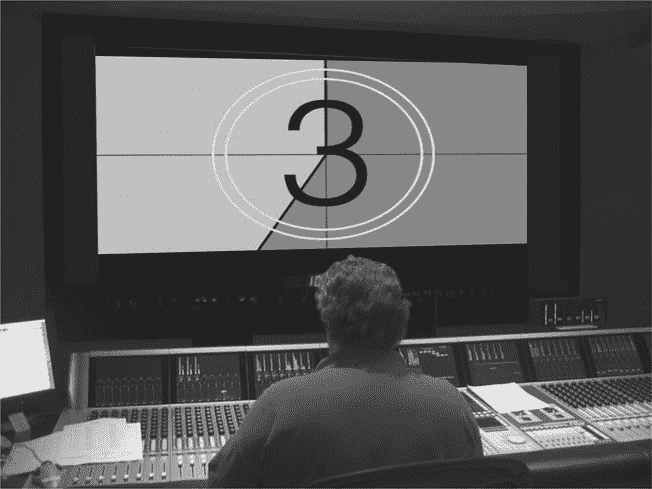

*图 7.8* *汤姆·弗莱施曼坐在纽约的调音台前。* ¶ *来源：照片由汤姆·弗莱施曼提供*
