# 第十二章

## 厨师还是厨夫？

### 食材与食谱

DOI: [10.4324/9781003008439-16](https://doi.org/10.4324/9781003008439-16)

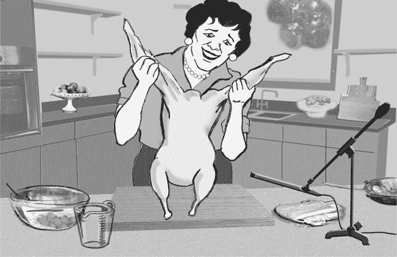

如果有人决定从事 Foley 艺术家的职业，就会有一个时刻，他们意识到创造声音配方的责任落在艺术家身上，而不是别人身上。这时他们必须问自己：“我是厨师还是厨工？”这个问题不容轻视，因为事实上，所有 Foley 艺术家都是两者的某种结合。然而，如果艺术家处于一个阶段，你在问如何制造声音或如何在 Foley 中处理特定技巧，你更倾向于成为厨工，这是一个很好的起点。本章旨在帮助新艺术家更具体地进行指导。

第 9 章，详细介绍了道具的具体使用和操纵，给出了关于 Foley 艺术家如何使用在电影中反复出现的道具的总体指导。我建议在培养道具技巧时复习该章节以获得技巧方面的帮助，以及本章。第 8 章旨在通过 Foley 艺术家的建议提供脚步声方面的见解和指导。

如果，你觉得你需要一些可以分解的真正基础食材和配方，无论是因为你刚刚开始这个过程，还是因为你在 Foley 发展中发现了差距，本章可能对你有帮助。给所有读者一个警告：没有人能告诉你如何成为厨师。你必须发展自己的风格、自己的味道，最终为各种电影、电视节目、游戏、动画项目以及商业或广告片如何创造声音制定自己的配方。在某个时候，你必须放弃任何认为实际上存在一套标准或硬性规则可遵循的想法。没有。Foley 是一门艺术。艺术没有规则，只有指导方针。所以，让我们先从一些食材开始，然后再介绍几个基本配方。我鼓励你进行实验，成为 Foley 界中你可以成为的伟大厨师。Foley 的真正明星从未复制过任何人。他们大胆尝试了别人不敢尝试的事情。最坏的结果会怎样，真的？

## 鞋类配料

| **鞋子**  |
| --- |
| 运动鞋，多种  || 牛仔靴  |
| --- | --- |
| 多双乐福鞋  || 高跟鞋细跟（听起来像）  |
| 重型男鞋  || 凉鞋、人字拖  |
| 男士正装鞋  || 休闲鞋  |
| 女士高跟鞋（听起来像）  || 软底鞋  |
| 小号、儿童鞋（听起来像）  || 会吱嘎作响的鞋  |
| 护士鞋  || 听起来富贵的鞋  |
| 靴子  || 听起来贫穷的鞋  |
| 军用鞋  || 让人发笑的鞋  |
| 军用靴  ||    |

## 道具配料

| **布料类型**  |
| --- |
| 皮夹克  || 尼龙睡衣  |
| --- | --- |
| 婚纱网纱  || 带拉链的裤子  |
| 丝缎  || 棉质连衣裙  |
| 毛毡  || 床单  |
| 帆布  || 被子或床罩  |
| **厨房用品**  |
| --- |
| 烹饪工具  || 木质切菜板  |
| --- | --- |
| 餐盘  || 塑料量杯  |
| 餐具  || 塑料量勺  |
| 精美瓷器  || 金属量杯  |
| 高脚杯  || 金属量勺  |
| 大切菜刀  || 锅和煎锅  |
| **客厅或办公室用品**  |
| --- |
| 电脑键盘  || 书籍：平装本和精装本  |
| --- | --- |
| 各类电话：座机和手机  || 电脑打印机  |
| 纸张  || 眼镜  |
| 打字机  || 滚轮椅  |
| 钢笔  || 皮椅  |
| 铅笔  || 相框：金属和木质  |
| 记号笔  || 杂志：各种尺寸和种类  |
|    || 纸张  |
| 蜡笔  || 软垫  |
| 笔记本  || 木质容器打开和  |
|    || 带特色的关闭  |
| 订书机和订书钉  || 多个公文包  |
| 夹板  ||    |
| **学生用品**  |
| --- |
| 笔记本电脑  || 螺旋笔记本  |
| --- | --- |
| 背包  || 木质学校课桌  |
| 自行车  || 吱嘎作响的木椅  |
| 头盔  || 金属椅子  |
| 滑板  || 金属桌子  |
| 飞盘  ||    |
| **运动和游戏用品**  |
| --- |
| 棒球手套  || 棒球  |
| --- | --- |
| 球棒  || 垒球  |
| 溜冰鞋  || 弹珠和球  |
| 钉鞋  || 发令枪  |
| 足球  || 手枪和步枪（为安全起见已堵塞）  |
| 各类扑克牌  ||    |
| **金属声响**  |
| --- |
| 手铐  || 金属棘轮  |
| --- | --- |
| 门把手  || 螺丝刀  |
| 门插销  || 锤子  |
| 铰链：使其吱嘎作响  || 扳手  |
| 各类金属链条  ||    |
| **杂项大型**  |
| --- |
| 塑料婴儿游泳池  || 汽车车门或后备箱  |
| --- | --- |
| 修剪箱  || 金属板  |
| 空调通风口和管道  || 碎石、大鹅卵石  |
| 清洁泥土  || 碎石、小鹅卵石  |
| 烤箱或冰箱架  || 橡胶垫  |
| 铁丝网围栏  || 小地毯、地毯碎片  |
| 木板  || 零售展示用草垫  |
| 木托盘  ||    |
| **杂项小型**  |
| --- |
| 玉米粉  || 纸板  |
| --- | --- |
| 玉米淀粉  || 报纸  |
| 面粉  || 淋浴帘、杆和环  |
| 咖啡渣  || 乐器盒  |
| 皮包和手提包  || 吉他、小提琴和破旧键盘  |
| 麂皮  || 带钉子的手套在末端  |
|    || 用于动物爪子的手指  |
| 热水袋  || 椰子：肉放回并用热胶粘住  |
| 四分之一英寸音频录音带  || 芭蕾舞鞋用于鸟类和蝙蝠拍打  |
| 军用水壶  || 电视  |
| 按摩或脊椎矫正块  || 任何复古物品  |
| 塑料瓶  || 手杖  |
| DVD 和 CD  || 拐杖  |
| 踢踏舞鞋  || 雨伞  |
| 黑胶唱片  || 马嚼子、衔铁和马刺  |
| 唱机  || 珠宝  |
| 烤面包机  ||    |

## 食谱

1. **警察装备：棒球手套（或皮包）、钥匙、手铐、门闩**
用手以舒适的方式握住。务必安排配置以突出棒球手套的皮革以获得皮革吱嘎声。只有在场景中合适时才使用手铐。否则，请记住金属录音更热。手铐和钥匙的录音会比皮革更热。

2. **枪械晃动声：门插销、门把手、发令枪或已堵塞的手枪**
轻握物品，使其带有一点“枪械感”。晃动太多会显得愚蠢且不真实。目的是为场景增添戏剧感。如果需要，可以同时握住两件物品，但不要相互摩擦。这需要一点练习。

3. **眼镜：墨镜或阅读眼镜**
让眼镜听起来自然的诀窍是用手控制它们，使其听起来像是贴在皮肤上。除非场景中它们是悬挂的，否则不要让它们悬挂。如果它们在桌子上，务必在拿起时发出桌子的声音。始终考虑它们放在什么上面。

4. **纸张声响：报纸、纸张、书写纸**
纸张的诀窍是轻柔使用。令人惊讶的是，纸张录音需要的量有多少。尽可能具体。不要过度，要精确。即使触摸纸张，也要非常具体和清晰地表达触感。我建议每次都回放纸张提示音，直到你确定自己知道如何处理纸张。报纸尤其可能录下比预期更多的皱褶声。

5. **雪：玉米淀粉、玉米粉**

玉米淀粉用于制造吱嘎声。如果音效是在混凝土上，使用一些玉米粉来表现雪的本体，再用一点玉米淀粉来制造吱嘎声。吱嘎声在每个录音棚和每支麦克风上的录制效果都不同，所以这需要反复试验。如果音效在泥土中，在泥土里撒一点玉米淀粉。如果雪是湿滑的，在混凝土上使用湿麂皮，并用一些湿泥来表现雪。如果雪结冰了，尽可能使用刨冰。否则，使用咖啡渣、湿混凝土，并通过反复试验直到声音正确。

### 6. 冰上滑冰：冰块以及冰鞋或重型刀刃刀
这可能有点棘手，但滑冰的动作必须与场景的剪辑相匹配。注意滑冰者的冲击点。此外，笔有时在冰上效果也不错。我也曾使用带水混凝土配合刀或尖笔。

### 7. 船坞：木托盘
在拟音棚里拥有木托盘是无可替代的。它有很多用途，但这个用途至关重要。每块木托盘的吱嘎声各不相同。它们用于搬运家具和大型电器。它们是每个设备齐全的拟音棚必备之物。

### 8. 公交车台阶：带橡胶垫的金属方块
除非公交车处于繁忙交通中，否则效果很好。那就不要用橡胶垫。根据场景的美观度来决定。

### 9. 自动扶梯：带橡胶垫的重金属表面
与公交车台阶相同，但条件是：更昂贵的场所自动扶梯声音更好听。酌情使用。

### 10. 赤脚脚步声
地毯上可能不需要；在硬表面上稍微夸张一点，但以调音师为准。如果录制效果不佳，改用脚尖-脚跟而不是脚跟-脚尖的方式行走。多做实验。

### 11. 儿童脚步声：更轻更小
儿童脚步声的诀窍在于它们更快、更小、更轻。

### 12. 跑步脚步声：要有表现力
并非总能录到每一步脚步声。所以，要捕捉节奏的基本感觉。剪辑不会完全匹配；把握奔跑的基本感觉即可。很可能在有人奔跑的场景中会有音乐。但最大的错误是沉迷于某种节奏并坚持下去。随着剪辑的变化，注意节奏的变化。

### 13. 真皮汽车座椅：整脊师垫块或皮夹克
使用时要得体。想想汽车的品质。

### 14. 马蹄声：内部烤熟肉并用热胶固定的椰子
这需要练习。想出最好的握持方式。你是想抓着保持手腕放松吗？还是想要用带子固定？跟随后蹄。马在奔跑或疾驰时先用后蹄发力，然后落在前蹄上。注意剪辑。与其追求精确，不如追求节奏感。注意马的音乐性。顺便说一下，这对其他动物也适用。
麦克风应放置如下：一个吊杆麦克风置于马的上方，一个小型领夹麦克风埋入泥土中（如果可能）以增加马的重量感。在下方挖松泥土，以免马蹄声空洞。泥土应继续填满椰子内部。

### 15. 猫：带指甲的手或手指内装有小钉子的手套
猫的诀窍在于它们行走时爪子是收起的。它们使用脚垫。所以它们走路非常轻。它们只在爬布料或揉面时才使用爪子。

### 16. 狗：带指甲的赤手、手指内装有小钉子的手套或假指甲
狗的诀窍在于它们比猫更常使用爪子，但并不一致。它们会滑动。所以，使用爪子声来帮助狗保持平衡并确立它们的存在。爪子声太多会显得假。此外，狗项圈和狗链在“塑造”狗的形象时非常有用。

### 17. 水：若无内置水箱，使用塑料水池
这里的诀窍是避免水击中塑料。水池要装得足够深以获得多种音高，但不要太深以至于水溅出时会击中硬表面、溅到混凝土或木头上，或击中麦克风架。深沉的咕噜声听起来不错且低音充足。用平手拍打水面以录制轻微的水花声。尝试不同的音高。务必小心不要让水溅到麦克风上。如果有水听器，那就太好了。大多数艺术家没有。使用吊杆麦克风并向下对准，但不要直接对准水面否则会被溅湿。调音师可以尝试各种位置。另外，尝试使用两支麦克风看看录制效果。大胆尝试。每个房间都不同。

### 18. 黏稠物：湿麂皮、身体乳液、口部噪音、发胶、酸奶油、洗手液
这需要反复试验。真的需要看看什么有效。通常需要多条音轨才能让黏稠物效果恰到好处。
也可以从杂货店买一只鸡。它很贵且充满细菌，所以要谨慎。洗手并清洁使用区域。未煮熟的鸡肉细菌会致命。认真对待此警告并使用 Lysol 消毒。

### 19. 骨头：芹菜
还需要我多说吗？

### 20. 沙砾：罐装咖啡渣
买最便宜的咖啡罐并保持干燥。使用时要节制，如果混凝土 supposed to be 稍微粗糙，用脚踩压。如果表面 supposed to be 在城中治安不佳的区域，用更多。
小心。沙砾在麦克风上会爆音。这就是拟音师使用咖啡而不是泥土的原因。然而，也可以使用泥土，只是要谨慎。

### 21. 亲吻：是的，拟音师会亲吻自己的手
可能会显得粗糙。

### 22. 拥抱：拟音师通常拥抱自己
选择合适的服装。

### 23. 拍手：注意房间内的回声

### 24. 布料摩擦：柔软的蓝色牛仔裤
如果为整个场景做一次布料摩擦以填补任何 ADR，使用牛仔裤或通用布料。如果需要特殊布料，则单独为其制作音轨。规则：少即是多。不要过度使用布料声。我可以保证，如果布料动作过度，混音师不会使用它。

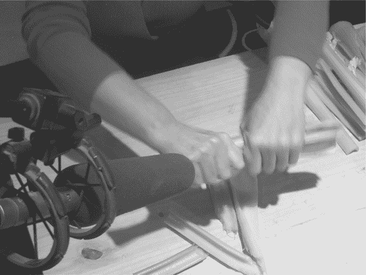
*图 12.2* *芹菜咔嚓！* ¶ *来源：作者照片*

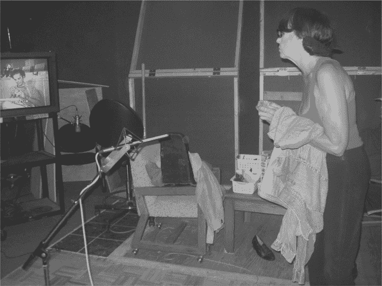
*图 12.3*  *Joan Rowe 准备布料提示。* ¶ *来源：由 Steve Lee 提供，Hollywood Lost and Found*

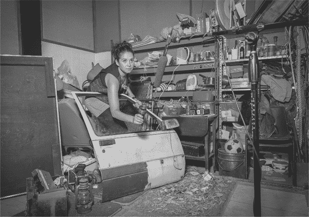
*图 12.4* *Meltem Baytok 非常小心地平衡车门以防止其移动。她正在车门上操作道具，该车门已固定在坑中以避免不必要的共振。请注意 shotgun 麦克风的放置。* ¶ *来源：由 Claudio Ahlers 提供*

## 安全提示
1. 处理木屑或玻璃时使用护目镜。木屑和碎片并不好玩。
2. 处理任何类型的碎屑时手套必不可少。
3. 在进行大量泥土音效时，舞台上应佩戴卫生口罩。肺部需要用一辈子。
4. 舞台上备有扫帚和拖把。保持清洁。
5. 保持道具有序。
6. 不要让自己处于危险之中。这是一部电影。
7. 水会变质并吸引可怕的生物。清洁水箱、水池和容器。
8. 不要在未清洗的情况下喝玻璃杯、杯子或任何东西。

9. 在说“注意你的耳朵”之前，不要在舞台上扔任何响亮或沉重的东西。调音师需要知道将麦克风调低。

10. 始终知道灯开关在哪里。

## 提示

1. 坚定执行提示音。
2. 记住它可以重新做。
3. 保持实验性。
4. 尝试分层叠加声音。
5. 记住道具的声音会根据它们接触的东西而不同。例如：金属会改变道具的声音。木头也是如此。
6. 以组件为思路思考。并不需要完全相同的东西。它是由什么构成的？
7. 跳出思维定式。项目处于什么故事世界？所创造的声音需要支撑该故事世界中的叙事。

# 章节 | 十三

## 魔法之风

### 不寻常的 Foley 请求

DOI: [10.4324/9781003008439-17](https://doi.org/10.4324/9781003008439-17)

我当时在为一位 Foley 艺术家同事代班，影片是 *Pocahontas 2: Journey to a New World*（1998），它是动画电影 *Pocahontas*（1995）的续集。提示音的制作由一位善意但似乎经验不足的剪辑师完成。其中一个提示音，一个道具提示音，被称为“magic wind”。虽然这是一个恰当的声音设计概念，而且原片中的风具有魔幻特质，但这本应是由声音剪辑师执行的特殊设计元素。

当剪辑师打电话到舞台询问我们的进展时，我们礼貌地问他“magic wind”是什么意思。他的回答大致是：“你知道，就是做你所看到的风。”他可能不知道这个请求有两个明显的问题：第一，这是一个将由剪辑效果处理的音效设计，第二，它必须与原片中的效果相匹配。

Foley 艺术家会收到对他们来说不一定有意义的请求。编辑室和 Foley 舞台上流传着大量关于请求的轶事，这些请求要么无法实现，要么更适合由剪辑师或特殊音效设计来完成。有时声音剪辑师不确定自己想要什么，有时他们无法传达自己想象中听到的声音。讲述这个故事的目的是说明，有些 Foley 提示音对艺术家来说可能没有意义，即使对剪辑师来说有意义。沟通始终至关重要，询问更多关于艺术意图的信息可以极大地帮助 Foley 艺术家。

## 从未听过之物

Robert Mott 讲述了一个关于他正在为其准备音效的电视新闻播报的故事：

> 他们想要原子弹的声音。[需要指出的是，没有人以前听过。原子弹在美国本土的测试是一个新现象。] 他们外出实地录音，而炸弹融化了麦克风。他们停得那么远，却把货车掀离了地面。

于是，他们请 Mott 制作原子弹的音效。他只使用过现成的磁带或唱片录音。他观看了画面，看到了蘑菇云。他使用了 Mogambi 瀑布的录音并将其放慢以制作咆哮声。然后他叠加了一层墙壁被拆除的声音并提高了音量。到他完成时，他使用了四张唱片，其中一些被重复使用以产生最终效果。

声音专业人士经常被要求创造不寻常的声音，并且期望在 Foley 舞台上任何事情都能做到。Foley 艺术家通常会凭借创造力和想象力来解决这些难题，从而制作出超越剪辑师要求的音效。有时，结果并不令人满意。这些特殊请求需要花费时间和金钱来执行。

## 放慢的效果令人不祥且怪异

John Post 在制作 The Thing（1982）时，需要为木板下的怪物制作一个声音。主管声音剪辑师 David Yewdall 请他制作怪物在木板下移动的声音，同时木板分开并飞入空中。这是在 Foley 舞台上制作的一个棘手的音效，但 Post 始终乐于接受挑战。因此，他和 Duane Hensel 取了一些短木料并将其铺在舞台上，类似于多米诺骨牌。两人站在木板的每一侧，并与画面同步抓住一块木板，使其与地面和下一块木板碰撞。然后，Post 戴上剪辑师的帽子，在提示音录制后，他将其放慢到蜗牛般的速度，这增加了更多深度。放慢的效果令人不祥且怪异。

顺便提一下，Post 还为同一部电影中狗在雪中奔跑时的狗叫声配音。今天，会聘请 SAG-AFTRA 的演员来做这件事。

David Jobe 是 *Terminator: The Sarah Connor Chronicles* 部分剧集（2008）的 Foley 调音师。在其中一集里，Foley 艺术家被要求为终结者的金属关节臂制作音效。David Fein “抓起一根工字梁并摩擦它。我在 Eventide [和声硬件] 上选择了合唱人声，我们就这样做了，”Jobe 回忆道。

## Foley 幽默源于每个项目

Joan Rowe 讲述了关于 *ET: The Extra-Terrestrial*（1982）的一个请求的故事：

> Spielberg 希望 ET “liquidy and friendly”，而有时“liquidy”听起来很滑腻。用词语描述声音很难。我走进一些商店，听装在扁平容器中的包装肝脏的移动声。它有一种“愉快的轻微声音”。

Rowe 会把这包肝脏作为 ET 身体声音之一来处理。每隔几天，她就会去工作室附近的商店买另一包。她穿着 Foley 装束（紧身衣和 Foley 鞋）走进商店，有一次她听到收银员对他正在聊天的人低声说：“那就是听肝脏的女人！”Rowe 还录制了一段 Jell-O 团在湿毛巾内的音轨，以及一袋爆米花的音轨来增强她的肝脏效果。她随着 ET 的移动，将这三件道具同步移动。

关于 *Predator*（1987）的 Foley 最常见的问题之一是如何制作掠食者的身体。这有一个复杂的答案。掠食者的身体需要几条同时播放的音轨。一条音轨是湿麂皮。另一条是我手上的护手霜。第三条是湿皮革钱包。第四条音轨是一些口部噪音。我们称之为“predabody”。还有“predaface”、“predahands”和“predafeet”。很明显，Foley 幽默源于每个项目。

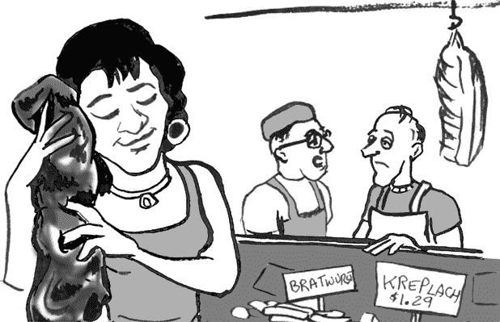

*图 13.2* *“那就是听肝脏的女人！”*

## 同事情谊在艺术中大有裨益

Greg Barbanell 在电影 *Defending Your Life*（1991）中有个奇怪的任务。他花了一天时间尝试找到“在天堂行走”的方法，正如主管所要求的那样。Barbanell 认为这并不是你应该真正听到的声音，但主管坚持这个想法。Barbanell 记不清它是如何解决的，但它花费了舞台时间和金钱 这里的教训？一些想法应该在进入 Foley 舞台之前得到解决。Foley 艺术家并不总是能控制这种情况。

Both *RoboCop* (1987) and *RoboCop 2* (1990) utilized a created contraption for RoboCop’s footsteps. David Fein and Ken Dufva had done the original film, so when I was asked to do the sequel, it was necessary to duplicate the same footstep quality. Fortunately, the mechanical device designed for his footsteps still existed, so I was able to use it. It looked a bit like a mechanical foot and had a heavy springlike action that took both hands to handle properly. It was exhausting to manipulate this ingenious invention, and the microphone had to be placed in a careful way to avoid getting slap back from the metal in the foot. What is essential to understand here is the necessity for continuity in sequels.

The sound is a sonic identifier for the character, and fortunately, the prop still existed and Fein and Dufva were happy to share it. Collegiality goes a long way, especially when collaborating with other Foley artists.

## BEST LAID PLANS

On *The Exorcist III* (1990), there were scenes with nurses walking around a hospital. It is normal and customary for Hollywood Foley artists to do nurses in soft tennis shoes or athletic shoes. Nurses walk a lot and always wear comfortable shoes. Their shoes are not a story point, typically, so Foley artists walk them to give a sense that the nurses are there, but not to distract from the dialogue or action.

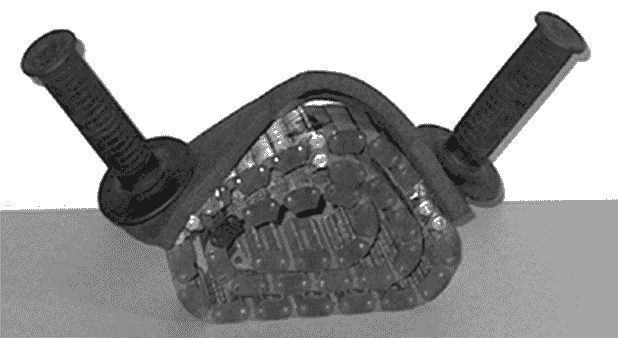

*图 13.3* *RoboCop 脚部装置。* ¶ *来源：照片由 Steve Lee 友情提供，Hollywood Lost and Found*

Sometime during the Foley schedule, Richard Anderson, the SSE, brought actual nurses’ shoes to the stage. He told me that director William Peter Blatty wanted the nurses to be Foleyed in these shoes. The nurses’ footsteps had already been performed but had not been edited and delivered to the stage. Yet it seemed Blatty wanted to contribute an idea for sound. He did not know that the characters had already been walked and that the tracks would fit nicely into the mix, but he knew he wanted literal nurses’ shoes. The rest of this story is that the nurses were performed again in the nurses’ shoes. Because editors were working with magnetic film at the time, there were now duplicate cues performed and this added to the confusion. This illustration is not to disparage any director, but to point out how often directors do not understand what happens in postproduction sound. The essential element is how the footsteps and props *sound*, not what a shoe or prop actually is.

Another nurse story comes from the film *Malice* (1993). Picture editor David Bretherton, who had won the Academy Award for his work on *Cabaret* (1972), was supervising the predubs, while director Harold Becker was shooting ADR in Canada. When Bretherton saw background nurses walking on screen, he decided he wanted to hear them in stiletto heels. If you have not seen the film, you need to know that it is a serious drama. The nurses were in predictable nurses’ shoes, and I have no idea why he wanted to hear high heels. So, I rewalked all the nurses in shoes that sounded like sexy stiletto heels. But I kept the tracks with nurses’ shoes, just in case. When Becker came back, he wanted the tracks with the softer sounding nurses’ shoes and rejected the stilettos. Do not be surprised if a situation like this occurs. It happens more than one might think. Art is mutable, and Foley artists may be asked to do a cue several different ways or to change the way they have done it without explanation.

Joan Rowe tells a story on herself. She is a very creative Foley artist, but admits she sometimes gets herself in trouble with her zeal. While working on *Speed* (1994) for supervisor Stephen Flick, she wanted to do the gears grinding for the elevator. Flick prefers to have the sound effects editors cut in the creative sounds for machinery. Time permitting, he would take great effort to audition and present effects for the editors to design and layer. But Rowe would not be dissuaded. She found a magnetic film rewinder that had a glitch in its mechanical action. When she wound it backward, it “made a good sound,” and she mounted it on a table on the stage. Then she put an editor’s metal trim bin upside down on the table for echo. She wound the rewinder forward for the elevator going up and backward for the elevator gears grinding. Then she banged wires against the trim bin to sweeten the sound for the gears.

When Rowe presented her wonderful creation to Flick, he was impressed with her ingenuity but not as happy with the time she had used to create the effect he had already pulled out of library effects. She is not sure if her Foley was used, but as she puts it, “I did it because I wanted to. My favorite part of doing Foley is that it is an absolutely creative process.” Sometimes, this kind of risk is going to be validated, sometimes not. This kind of Foley artist is valued for their innovative spirit. With more sound design relying on Foley because of smaller budgets or crews, this is a prized talent. Additionally, independent filmmakers often need Foley artists who can create what may not be available in editorial. The other side of this approach is to keep the budget in mind. Always. This fearlessness in trying new sounds was one key reason I asked Rowe to perform the Foley for *A Goofy Movie* (1995).

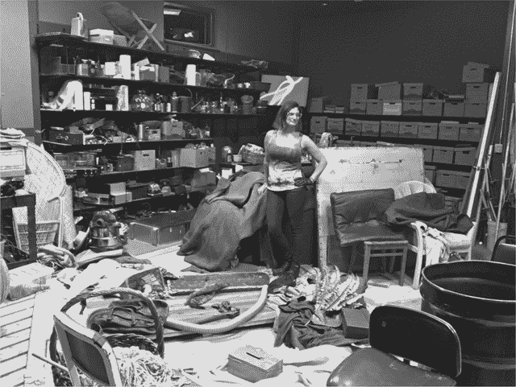

*图 13.4* *Ronni Brown 被道具包围在她的 Foley 舞台上。* ¶ *来源：照片由 Ronni Brown 友情提供*

Misa Jakovljevic works in Serbia. He worked as an assistant to the Foley mixer. (In Serbia, the mixer is called the sound technician, and Jakovljevic assisted him.) The Foley artists worked in the dark and were very “magical” according to Jakovljevic. At one point, they were stymied trying to make a “walking tree.” Jakovljevic, in his exuberance, said, “I have [an] idea!” He went into the studio, put together some props for the cue, and performed the cue successfully. At that point, the Foley artists told him to get out! However, he is now a veteran Foley artist in Serbia. His enthusiasm, his humor, and his impetuous desire to do the work finally availed him the opportunity to get into the work he now loves.

Greg Barbanell once worked on a film that had a lot of scenes in casinos. The supervisor wanted all the chips to sound different, so he brought in chips from many different casinos. Barbanell used all of the chips and manipulated them in as many ways as he could. When asked if the different chips actually sounded different, he replied, with his typical dry humor and without missing a beat, “No, they didn’t. But we did what they wanted.”

## EVERYTHING IS MYSTERIOUS AND SECRET

A similar experience happened when Dan O’Connell was working a prop and the supervisor knew what he was using. Repeatedly, he kept asking O’Connell to change the prop because he did not like the sound. The supervisor did not think it sounded like the prop on the screen. (This was back in the day when Foley artists had time and editors would sometimes visit the stage.) Finally, O’Connell went behind a baffle, used his original prop, and said, “just listen to this and see if you like it.” The supervisor loved it. By obscuring the prop, O’Connell encouraged the supervisor to ignore his own bias about what prop was being used and allow his ears to decide. Now, O’Connell never lets anyone see what he does for props. Everything is mysterious and secret. It might not be necessary to go to such lengths to ensure that one’s artistic integrity is respected, but one might want to try a variation of this method if an onlooker decides the sound is “wrong.”

罗伯特·德尚恩是一位资深的 Foley、ADR 和重录混音师，他正在为一部电影进行 Foley 混音，而剪辑师每天都想要新鲜的草用于 Foley。人们搬来了新鲜的草皮，德尚恩每晚都仔细浇水并把它放在球形灯下。三天后，草死了，声音也不对。有人说，“为什么不用四分之一英寸的胶带然后放一块布在上面呢？”他们照做了，结果出奇地逼真。有时候我们*都*过度思考这个过程。

在为*《安提基督》*（2009）工作时，朱利安·诺丹提到导演拉斯·冯·特里尔想要一个男人身体内部的声音。诺丹说，“我当然做不到。”于是，他把一个麦克风放在一只生鸡里面，另一个麦克风放在离鸡很近的地板上。然后他操纵那只鸡来给冯·特里尔他想要的声音。诺丹认为冯·特里尔很容易合作，因为“他知道自己想要什么。我们在电影开拍前有很多头脑风暴。”大多数导演并没有像冯·特里尔那样深度参与 Foley，但他对电影声音想要什么有着强烈的感觉。诺丹极具创造力，完全知道如何给冯·特里尔他想要的任何东西。

## 你不知道将会发生什么

许多年前，我与一位年轻但聪明的剪辑师共事，当时他刚开始担任主管。他把所有时间都花在棚里并微观管理每一个提示。对每个人来说这都是令人沮丧的经历，因为没有人能进入另一个人的脑海并确切知道他们在想象什么。此外，尽管他努力表达自己想要每个道具的声音如何，似乎他用尽了声音词汇中的每一个词也无济于事。经过数小时试图解读他的概念后，我们开始用幽默来打发时间。最后，在认为我们整天的专业知识被忽视后，我们开始相信我们与剪辑师建立了默契。但我们错了。澄清的时刻发生在他评论他想要街道的声音如何时。他非常认真地说：“只要把它弄乱就行。”

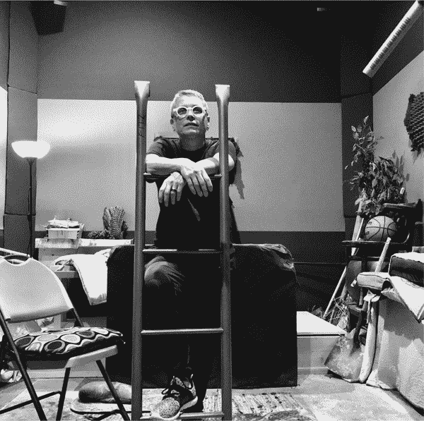

*图 13.5* Susan Fitz-Simon 在为《女子监狱》工作时休息。¶ *来源：Susan Fitz-Simon 友情提供照片*

另一次与 Foley 剪辑师在 Foley 棚进行录音时的工作经历与替换一些脚步声有关。当天的工作接近尾声时，一位剪辑师来到棚里，要求我们在一个场景中间替换几步。她不想要整段走路，只是想要走路本身中间的几步。由于画面剪辑大幅改变了场景，脚步声不再与画面匹配。对我们来说问题在于，由于我们已经完成了所有角色的走路，棚里已经淹水，那个特定的表面已被破坏。我建议我们在不同的表面上重新走完整个场景。我担心新的脚步声与旧的无法匹配。她拒绝了这个想法。所以，我顺从地只替换了她想要的那几步。我至今仍不知道结果如何。这些事件带来的重要教训是：虽然 Foley 艺术家可能有一种解决问题的思路，剪辑师可能有另一种想法。

从所有这些发生过的不可预测实例的例子中，值得带走的重要一点是：你不知道将会发生什么，你也无法控制其他人会如何反应。你不知道会有什么疯狂的想法突然袭来，而你却要在没有解释的情况下去实现，也不是总会因为你的意见或专业知识而受到尊重。你必须找到自己的方式来与艺术家身份中这一部分和解。除非你打算成为一个独自完成一切的独立电影人，否则总会在某个时候有人从你脚下抽走地毯或让你怀疑自己。做一名 Foley 艺术家，或任何类型的艺术家，都要求你去解读那些可能不承认你能力的人的想法。这是我们所有人都必须学会面对的人生教训。

罗伯特·莫特在描述他作为音效师的最终责任时表达得最好。他说：“我必须填补他们想象的东西。”当被问到“做音效你最喜欢的部分是什么？”时，他的回答代表了今天所有从事 Foley 的人：“我认为是有创造性的挑战。”

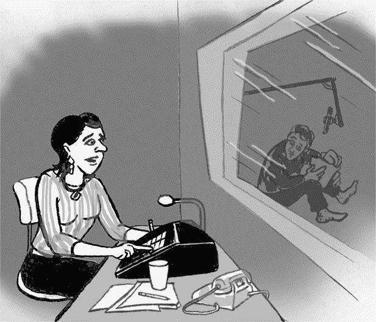

*图 13.6* *它需要听起来更紫。*

# 部分 | 四

## 过去、现在与未来

### 连接 Foley 的点

# 章节 | 十四

## 专业全景

DOI: [10.4324/9781003008439-19](https://doi.org/10.4324/9781003008439-19)

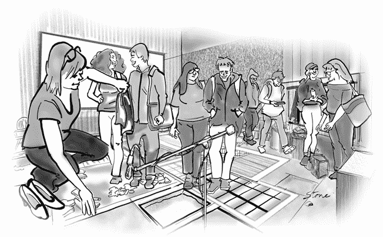

影视专业人士会定期互动，无论是在同一部制作中工作、午餐时聊行业、在音效奖晚宴、艾美奖或奥斯卡奖上共度时光、参加会议或电影节，或出席其他专业活动或聚会。他们会在餐厅、咖啡店和零售店偶遇，甚至可能在同一家杂货市场相遇。当他们共处时，谈话很可能会转向工作、行业，或对共同经历的共同了解。正是基于这一背景，我提供了来自音效专业人士的一些见解和观察，包括一个在同一设施工作的 Foley 专家团队、两位在同一所大学音效设计项目学习并现在一起工作的 Foley 剪辑师，以及一位倡导制作音效中女性地位的制作音效混音师。此外，我还简要提及了两部聚焦从事电影音效工作的女性工作的纪录片，以及一个致力于电影音效博物馆的发展，特别强调 Foley。

## ALCHEMY POST SOUND

这场圆桌讨论的参与者都工作在纽约哈德逊河谷皮克斯基尔的 Alchemy Post Sound。Alchemy 负责制作了令人印象深刻的电影和剧集作品，包括*《我在想结束这一切》*（2020）、*《我所知的一切都是真的》*（2020）、*《弗塞/弗登》*（2019），以及获艾美奖的*《贩毒王国》*（2015）。本次讨论包括 Foley 艺术家 Leslie Bloome 和 Joanna Fang，Foley 混音师 Ryan Collison 和 Connor Nagy，Foley 剪辑师 Nick Seaman 和 Laura Heinzinger，学徒 Annie Taylor，以及 Alchemy 的老板 Andrea Bloome（连同丈夫 Leslie）。公司网站上有一份使命宣言：“APS 通过表演性声音提升观众对故事的体验，结合对 Foley 艺术的深刻了解与创新。”我在 2020 年 4 月通过 Zoom 与 Alchemy Post Sound 的整个团队交谈，当时纽约正处于 Covid-19 大流行的深度危机中。尽管每个人都在自己的“Zoom 盒子”里，但那种 camaraderie 和协作的感觉非常明显。我过去曾多次访问过 Alchemy Post Sound，对该设施、团队以及他们所创造的文化都很熟悉。

Andrea Bloome 被团队其他成员视为“业务背后的大脑”。她努力与所有客户保持积极互动，并认为成功的公司关键在于对工作采取真正协作的方式。她评论道，“你必须聘请合适的人；合适的人选……我的工作是促进他们的创造力。我清除障碍……我们需要成为一个凝聚的整体。”丈夫 Leslie 是一位拥有 30 年经验的 Foley 艺术家，曾在洛杉矶与 Paul Holzborn、John Post、Rick Partlow 和 Kitty Malone 等多位艺术家合作，并在 1990 年代末在伯克利的 Saul Zaentz 电影中心与 Foley 艺术家 Margie O’Malley 和 Marnie Moore 一起工作过。“预算才是真正的问题，”他说，他关心的是“我们能呈现什么以及如何从声音上帮助故事”。他强调，“组建团队对我们来说就是一切。每个人都是一个很棒的补充。”该设施拥有两个带控制室的 Foley 舞台，一个可转换的 Foley-ADR 工作室，以及编辑室，还有 Foley 道具存放区和主接待区。Leslie 笑着说，这些舞台拥有“活空间、死空间和非常干燥的空间”。

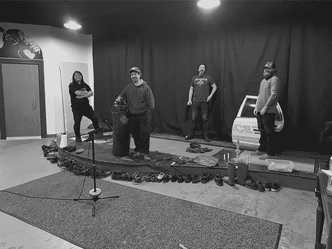

*图 14.2*  *Joanna Fang、Leslie Bloome、Ryan Collison 和 Connor Nagy 在纽约 Peekskill 的 Alchemy Sound。* ¶ *来源：照片由 Andrea Bloome 提供*

Joanna Fang 是纽约大学电影与音乐专业的毕业生，已在 Alchemy 担任 Foley 艺术家超过六年；她表示在大学期间并没有学到很多关于声音的知识。她的大部分经验来自学生和独立电影的工作。她承担了声音编辑、Foley 和重录混音师以及 Foley 艺术家的任务。她发现 Foley 最有趣，并在 Alchemy 找到了归属。她说，虽然在电影学校“他们不会教你适应性……有趣的是事情变得多快就成了教条”，但在 Alchemy 工作的一大好处是“我们不断演进我们的声音……我们天生就知道对方需要什么”。她补充说，对新想法有一种“审慎的开放”。

Nick Seaman，首席 Foley 编辑，说，“很多人可以身兼数职”，而 Alchemy 的首席 Foley 混音师 Ryan Collison 补充道，“我必须放下一切，我的自尊，我的敏感”，因为“每个人都在同一页面上”是至关重要的。Collison 曾在纽约市的 Sound One 工作，现在他从皇后区的家中通勤到 Peekskill。与 Seaman 紧密合作担任 Foley 编辑的 Laura Heinzinger 讨论了他们对 Foley 提示的做法，“预算会发挥作用”。她喜欢挑出电影的关键情节点，同时关注 Foley 会话中“混音师在寻找什么”。Collison 同意当提示“具体且一致，名字拼写正确”时，Foley 会话进行得很顺利，他也喜欢了解表面甚至鞋型的信息。例如表面是湿是干之类的细节很有帮助。Fang 补充道，“每个人都知道每双鞋，每个道具。”学徒 Annie Taylor 是萨凡纳艺术与设计学院（SCAD）的毕业生，曾在 Foley 舞台上与 Leslie Bloome 实习了三个月，并希望成为一名 Foley 艺术家。当全职在 Alchemy 工作机会出现时，前提是她愿意改做编辑，她非常乐意调整自己的期望。她发现提示和表演 Foley 与她在 SCAD 的经历大不相同，后者她认为更偏理论。真实节目的提示比 SCAD 的声音设计课程更严格，她还感慨，在 SCAD，Foley 鞋是“共用的”。

Leslie Bloome、Fang 和 Heinzinger 都是活跃的音乐家。Bloome 弹贝斯，Fang 是吉他手，Heinzinger 是钢琴家。Annie Taylor 是团队最新成员，演奏巴松管。Taylor 笑着说，“巴松管是木管乐器的中提琴”。Fang 和 Heinzinger 也都参与过电影配乐。

Alchemy Post 声音团队值得注意的是他们所享受的非竞争性和支持性的工作环境。正如 Fang 所解释的那样，两位 Bloome 将他们从其他经历中积累的集体商业理念带到了 Alchemy，以创造一个特殊的工作环境。正如 Leslie Bloome 所表达的，“我想创造没有界限的声音。”

## 电影学院流程

Anna Gramlich（*The Goldbergs*、*Madame Secretary*）和 Shaun Burdick（*Empire*、*The Blacklist*）均于 2010 年从 SCAD 的声音设计 MFA 项目毕业。他们随后不久搬到洛杉矶，此后一直是室友。他们都必须通过在 Craig’s List 上寻找各种独立项目来找零散工作。到 2014 年，两人都已在卡尔弗城的索尼影业找到工作。Burdick 和 Gramlich 将他们在 SCAD 的指导归功于教授 John Sisti 和 David Stone。两人都觉得有这两位电影声音专业人士作为老师非常有帮助。Gramlich 感激他们灌输了他们必须现实地“走街串巷”的观念，并回忆起被告知，“不会有人把东西交到你手上”。

这两人都是 Foley 编辑，并在不同的剧集系列中工作（通常与 Foley 艺术家 Sarah Monat Jacobs 和 Robin Harlan 合作），他们发现工作流程与他们在 SCAD 练习的更流畅的工作流程非常不同。“我们知道自己的弱点，”Gramlich 评论道，起初她和 Burdick 互相帮助，以便他们能够完善技能。虽然 Gramlich 更喜欢编辑音效和音乐，但 Burdick 喜欢编辑 Foley 和对白。

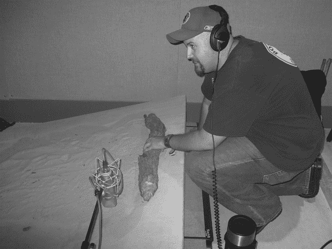

*图 14.3* *Shaun Burdick 在木制斜坡上录制原木。* ¶ *来源：照片由 Shaun Burdick 提供*

Gramlich 和 Burdick 在从学生向职场专业人士过渡时发现的是，工作场所更强调协作。由于两人都有戏剧背景，他们很高兴发现，在电影工作室工作包含团队合作感，而非他们在学校经历的更独立的侧重点。非工会工作，最常见于独立电影，提供了更多创造力，但满足索尼的截止日期和制片人的纪律要求已成为一项必不可少且受欢迎的调整。Burdick 和 Gramlich 都同意代际差异带来了一些挑战。Gramlich 观察到年长的专业人士并不总是喜欢被质疑。她解释说，“他们坚持己见”。

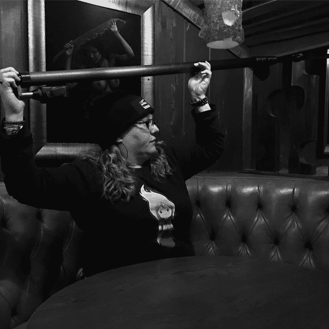

*图 14.4*  *Carrie Sheldon 在制作中操作吊杆麦克风。* ¶ *来源：照片由 Carrie Sheldon 提供*

虽然这对组合声称他们在 SCAD 经历了对工具的过度强调，但他们很快承认技术加快了流程，这既有好也有坏。Gramlich 喜欢在可以更具创造性的节目上工作，并喜欢考虑，“我认为它听起来是什么样”，而 Burdick 发现为 *Blacklist* 工作“很奇怪……抛出非常酷的曲线球”。

## 生产视角

卡丽·谢尔顿（*《随需应变丽莎》*、*《你》*）是一名现场录音挑杆话筒员。在俄勒冈州尤金市莱恩社区学院就读期间，她修读了广播和视觉设计课程，并从一开始就展现出声音方面的天赋。2006 年，谢尔顿同意为一名正在制作关于巴拿马原住民电影论文的学生从事现场录音工作。这段经历促使她决定搬到洛杉矶，从事现场录音职业。与格拉姆利希和伯迪克相似，她接受能找到的任何工作，到 2005 年时已开始稳定工作。尽管她在 2008 年就有资格加入现场混音师工会（第 695 分会），但她一直等到 2016 年，当时她在一档电视节目中获得了一份稳定职位。

谢尔顿发现，她所在行业的惯例是自带设备，并向制作方“报销”费用。随着技术变化，保持设备更新存在持续压力。随着谢尔顿职业生涯的发展，她越来越意识到现场录音中的性别歧视。她察觉到，行业明显偏好雇用男性担任混音师和挑杆话筒员。因此，她与现场录音同事玛丽·乔·德文尼共同创立了“洛杉矶声音姐妹会”，该组织提供支持和建议，并与成员分享工作机会。有时，如果制片人想让她参与低预算节目，谢尔顿解释说：“我会捐出我的设备，并派一位我认识的、正努力进入声音部门且需要经验的[女性]去。”

现场录音混音师和挑杆话筒员负责录制节目现场的对话，是后期声音专业人员必须使用的声音模板的关键环节。一档节目在现场如何混音，会影响声音剪辑师、拟音师、ADR 剪辑师和混音师以及混录师如何开展各自的工作。良好的现场声轨为声音设计奠定了坚实基础，使剪辑师和混音师都能更专注于声音艺术，而不是技术加工，从而克服或补偿不够出色的现场混音。

谢尔顿发现，工会现场录音专业人员中只有 7%是女性。谢尔顿和德文尼决定致力于多元与公平。“我正竭尽全力改变 695 分会[现场录音工会]的面貌，”谢尔顿宣称。“我有可能招募足够多的女性，帮助她们加入工会，并在我有生之年让比例达到 10%……这就是我正在努力做的事。”谢尔顿进一步强调：

> 当我们有更多女性担任导演职位，有更多有色人种……这些人没有男性那么多经验……她们需要多花一点时间，她们可能会犯错之类的，然后你会发现很多剧组人员会说，唉，她根本不知道自己在做什么。他们没有意识到的是，如果你不明白我们需要在场支持她们接受指导，你就是在积极阻碍这些人的多元与包容。她们在工作岗位上工作的时间没有那么多，所以当然会犯一些错误。

尽管谢尔顿对片场一些男性看到女性负责现场录音时的态度感到担忧——“不是每个男人都会给你机会，而这行靠的是口口相传”——但她对自己的工作充满热情：“我最喜欢的事就是给客户戴上麦克风。”

## 声音行业的女性

在印第安纳州曼西的鲍尔州立大学（大卫·莱特曼曾就读于此），弗吉尼亚·鲍尔创意探究中心每年向拥有获选资助的特定项目的教职员工颁发若干项研究金。教授和学生用一个学期专注于这门课的单一目标和项目。我获得了其中一项研究金，与我亲自挑选的 13 名学生合作，制作一部关于从事电影声音工作的女性的短片。我和学生前往纽约和洛杉矶，在我指导他们经历电影制作的工业化方法过程中，我们制作了短片 *《放大：与美国电影声音女性对话》*。谢尔顿、德文尼和其他现场录音女性接受了采访。此外，我们还采访了拟音师、声音剪辑师、混音师和设施所有者。我们发现，谢尔顿所揭示的现象在电影专业声音行业中普遍存在。富有启发性的是，这些女性对于在电影行业中一个经常、有时公然偏袒男性而非女性的领域里如何应对乃至蓬勃发展，给出了各种回应。普遍共识是，电影声音行业中女性的处境正在大大改善，因为进入该行业的年轻男性对女性从事电影制作持有更积极的观点。

另一位出现在 *《放大》* 中的声音行业职业女性是米奇·科斯汀，她是南加州大学凯·罗斯声音艺术与对白剪辑讲席教授。她还制作并执导了自己的关于电影声音的纪录片，该片获得热烈好评、提名和奖项。*《掀起声浪：电影声音的艺术》*（2019）是一部精彩的纪录片，虽然没有特别聚焦女性在电影声音中的角色，但科斯汀确实收录了对该行业一些知名女性的采访。该片由博贝特·巴斯特编剧，艾莉森·纽曼配乐，桑德拉·钱德勒摄影，大卫·J·特纳剪辑。在这部影片中，许多知名电影专业人士讨论了声音设计、剪辑和拟音。

## 好莱坞声音博物馆

2015 年，电影声音专业人士史蒂夫·李反复思考建立一个博物馆的想法，该博物馆将展示和庆祝电影声音的诸多方面以及为这门工艺做出贡献的个人。“我设想了一个富有娱乐性的地方，让人们更多地了解为电影、电视、广播和其他媒体创作声音，”李说。他的愿景正随着好莱坞声音博物馆的建立而实现。该博物馆的特色之一是“一个互动式拟音展览，参观者可以随着自己选择的电影片段同步表演音效——然后听到回放。”李为这项非营利事业筹集了资金，并收集了许多展品用于展示。虽然目标是一座供所有人参观和享受的“实体”博物馆，但在新冠疫情期间，李已调整他的博物馆，让人们可以在 [HollywoodSoundMuseum.org](http://hollywoodsoundmuseum.org) 上虚拟参观和享受。他还定期与电影声音各个领域的专业人士制作网络研讨会。

## 拟音的未来

对拟音作为一种工艺和一种表演艺术的持续兴趣，催生了关于拟音世界以及那些为不断变化的应用而不断完善和调整这门工艺的专业人士的博客、社交媒体页面、学术文章、播客、网络研讨会和电影。电影学校正在纳入更多关于电影声音的课程，越来越多的此类院校将拟音纳入课程，一些学校要么改造房间以容纳拟音，要么设计专门的拟音棚。那些被吸引进入这一职业的人可以找到更多机会创办自己的拟音业务，或利用拟音增强其媒体作品。越来越清楚的是，拟音的演变以及对拟音师这一群体的兴趣，持续为学习、完善、实践、教授、讨论和书写拟音提供机会。

Foley 始于剪辑电影声音的晦涩补充，现已发展成为电影、电视剧、网络剧、游戏、动画、预告片、广播剧和广告中不可或缺的一部分。

1989 年，当我出现在《大卫·莱特曼深夜秀》（*Late Night with David Letterman*）演示 Foley 时，关于 Foley 的文字资料极少，鲜有专业人士接受采访，甚至很少在片尾字幕中获得署名。

虽然仍有大比例的观众对后期制作声音以及创造声景的专业人士知之甚少，但 Foley 是一门引人入胜且神秘的艺术，吸引了极大的关注。

# chapter | fifteen

## Foley Reflections

### Final Thoughts of Experts

DOI: [10.4324/9781003008439-20](https://doi.org/10.4324/9781003008439-20)

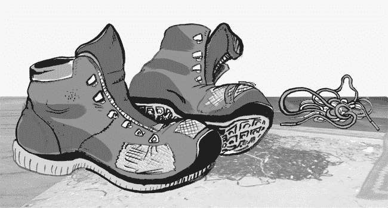

我通常会询问电影和声音专业人士，是否有什么临别赠言送给对 Foley 感兴趣的读者。以下是我收到的一些回复。

#### Mark Mangini

(监制音效剪辑师、音效设计师、重录混音师、音乐家)

声音是一位戏剧演员。它不像我认为的那样是一个互动的过程。

当被问及什么能让人成为声音专家时：

> 他们能接受的最好训练之一是上表演和编剧课。

#### Jody Thomas

(Foley 艺术师、故事编辑、创意总监)

能与我认为很棒的人一起工作，并且我们相处融洽、其乐融融，这真是令人振奋。

#### Karin Roulo

(Foley 和 ADR 混音师、工程师)

当评论一位优秀的 Foley 艺术师在脚步声提示中寻找什么时：

> 你看他或她是如何演绎这个角色的。

#### Robert Deschaine

(Foley 和 ADR 混音师、重录混音师、设施经理、演员)

处理项目有不同的方法。有人以剪辑师的思维，有人则以艺术家或演员的身份去做。

#### Meltem Baytok

(Foley 艺术师)

当被问及她如何看待自己表演 Foley 的过程时：

> 它们是我的玩具，我在玩耍以创造正确的情感。

#### David E. Stone

(监制音效剪辑师、对白剪辑师、音效剪辑师、动画师、教育家)

一切移动并产生摩擦的事物都有不同的语境。

#### Michael Semanick

(重录混音师、Foley 和 ADR 混音师、音乐工程师)

你必须关注艺术家和画面。

你可以将其变为你自己的风格，有时甚至能做得更好。一位优秀的 [Foley] 艺术师会说：“好，这就不错……现在我来润色一下。”

当讨论人们对技术新花样的痴迷时：

> 我觉得他们忘记了真正去聆听。

#### Richard Portman

(重录混音师、工程师、教育家)

我教授声音的美学和理论。我的课是讲座课，然后他们[学生]必须进来坐下，把一切融会贯通。

他们[学生]进来时一无所知。这是巨大的优势。他们脑子里没有预设观念，你不必先打破他们的成见才能教他们该做什么。

首先你是作家，然后是导演。这是一本有声书。这是关键。如果你听不到声音，那就是糟糕的印刷。是模糊不清的。

#### Miguel Barbosa

(Foley 艺术师、剪辑师)

有时我必须赶很多工期。

当被问及如何应对关于 Foley 应该如何制作的各种不同意见时：

> 拥有不同的观点和方法是有帮助的。

#### Mark Pappas

(Foley 剪辑师)

我们现在有能力把事情做得更好，我认为有时我们确实做到了。

我认为最重要的是紧跟技术，因为技术变化太快了。

试着寻找那些在你想做的方向上最顶尖的人。

#### Misa Jakovljevic

(Foley 艺术师、剪辑师)

当被问及表演 Foley 时在想什么：

> 那个声音里的灵魂在哪里？

#### Jerry Trent

(Foley 艺术师、舞者)

大多数真实的东西听起来不像真实的东西。

你必须了解拍电影的过程，了解镜头前和镜头后发生的一切。

#### Tom Fleischman

(重录混音师)

一切皆为故事。

#### Alyson Dee Moore

(Foley 艺术师)

这有点像人们吃玉米棒：有人直着吃，一排排整齐地啃；有人绕着吃；有人乱啃。我更倾向于整齐地一排排啃。

当评论她得到的一个好建议时（来自你这位惭愧的作者）：

> 你就是道具。

#### Aleyna Seymen

(Foley 艺术师)

一切关乎感觉。

#### David Jobe

(Foley 和 ADR 混音师)

Foley 中不存在完美的麦克风。

当被问及录制 Foley 时关注什么：

> 审美选择，他们[Foley 艺术师]描绘声音的质量，声音的透视感和丰富度。

#### Cornelia Baumgartner

(音效设计师、Foley 艺术师、作曲家)

每件物品里都住着一个声音。

#### Andy Malcolm

(Foley 艺术师)

戏剧的终极 Foley 是在外景地录制的。

#### Kevin O’Connell

(重录混音师)

混音师是艺术家。如果灯泡坏了，我们才叫工程师！

#### Julien Naudin

(Foley 艺术师)

当被要求描述美式 Foley 时：

> [俏皮地大笑] 嗖，嗖！

#### Scott Hecker

(监制音效剪辑师)

做到大致准确即可。

当评论 Foley 提示或选择过多时：

> 我最不想要的是我所谓的“堵塞动脉”。那只是太多了。

他给想从事声音事业的人的建议：

> 尽可能多看电影和电视剧，听听你即将从事的工作。在别人的专业精神上“上学”学习。

#### Greg Barbanell

(Foley 艺术师、剪辑师)

为正在做的电影感到开心是加分项。保持简单。

#### Ele Matelan

(Foley 艺术师)

我们都是喜鹊。

#### F. Hudson Miller

(监制音效剪辑师)

那无处不在的调味料。

#### Heikki Kossi

(Foley 艺术师、剪辑师)

可以有规则，但每个项目都不同，你必须重新思考一切。

#### Rick Owens

(Foley 艺术师)

我试着在脑海里听到 Foley，有时我会用声带模拟出来。

#### Don Sylvester

(监制音效剪辑师)

付出要像片场演员一样多。

#### Joan Rowe

(Foley 艺术师、演员)

我不是那种听 Foley 的人。我希望它能支撑起作品的戏剧性。

#### Karan Singh

(Foley 艺术师)

无论何时表演，你都必须成为那个角色，演员的灵魂应当扑面而来。

#### Richard James Hinton

(Foley 艺术师、剪辑师)

前三年这是最令人沮丧的工作。直到有一天你醒来，发现自己更专注于质量了。

#### Hilda Hodges

(Foley 艺术师)

这么多年过去，我依然热爱它。

#### Marco Ciorba

(Foley 艺术师)

Foley 可以给故事注入一些灵魂。

#### Elisha Birnbaum

（制作混音师、拟音师、剪辑师）

如果你能让拟音听起来真实，那就是你作为拟音师能取得的最佳成就。

## **查尔斯·梅恩斯**

（现场录音师、剪辑师）

评论制片厂后期制作主管如何把声音看作电影中的一个“小部件”：

> 你想过这个小部件起了什么作用吗？

## **马尔科·科斯坦佐**

（拟音师）

用你的耳朵。

当被问及他如何决定某个道具用什么来拟音时：

> 就是当时管用的东西。

## **毛罗·欧塞皮**

（拟音师）

拟音对电影而言就像空气对人一样——直到缺失时人们才会想到它。

## **马尔科姆·法夫**

（拟音剪辑师）

在评论如何在受限制的情况下解决问题、同时仍保持艺术性时：

> 那是电影制作的新挑战。如今我们分散各处，而且有一种想法，认为一切皆有可能。

## **道格拉斯·默里**

（声音编辑总监、拟音剪辑师、对白剪辑师、效果剪辑师）

关键不在于声音多，而在于声音对。

## **史蒂夫·李**

（声音采集师，好莱坞失物招领（Hollywood Lost and Found）店主）

我喜欢拟音，因为它能创造一种原汁原味的表演。

## **戈罗·科亚马**

（拟音师）

好的拟音和其他声音元素一样能讲故事。它是没有旋律的音乐，没有台词的对白。

## **格雷格·赫奇帕斯**

（声音编辑总监）

拟音为场景增添生命力。

就像作画一样。

## **克里斯·佐特**

（拟音师）

有时当你进入状态时，你需要回到故事本身。

## **莱斯利·布卢姆**

（拟音师，在乔安娜·方（Joanna Fang）开始在 Alchemy Post 做拟音时给她建议）

你得多去体验生活。

## **彼得·伯吉斯**

（拟音师）

如果它听起来正确，并且表达出我想做的声音，我就用它。

没有规则。
