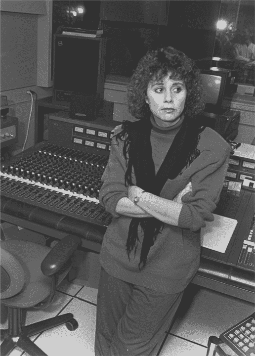

# 关于作者与插画师

*作者于 1989 年在丹佛国际电影节上的照片。照片由 Larry Laszlo & Associates, CoMedia 提供。*

## 关于作者

Vanessa Theme Ament 是一位前拟音师和声音剪辑师，自 1980 年起在电影和电视领域从事拟音工作。她参与制作了多部著名影片，包括 *《铁血战士》*、*《虎胆龙威》*、*《乱套了》*、*《高飞也疯狂》*、*《热泪伤痕》*、*《恶意》*、*《机械战警 2》*，以及曾于 1986 年荣获奥斯卡最佳音响奖的 *《野战排》*。1989 年，她在 *《大卫·莱特曼深夜秀》* 中示范了拟音。她在佐治亚州立大学获得了动态影像研究博士学位，并最近为多本编辑书籍撰写了关于电影声音的章节。她的著作 *《分道扬镳的音轨：三个电影社区如何革新数字电影声音》* 于 2021 年出版。Vanessa 曾任印第安纳州曼西市鲍尔州立大学的 Edwin F. and Virginia B. Ball 电信讲席教授。

## 关于插画师

David Stone 是一位声音剪辑师，参与过 100 多部故事片的制作，包括 *《小精灵》*、*《壮志凌云》*、*《虎胆龙威》* 和 *《十一罗汉》*。他曾担任 *《铁血战士》*、*《剪刀手爱德华》*、*《美女与野兽》* 及 *《蝙蝠侠归来》* 等影片的声音总监。他是五届金卷轴奖得主，并凭借在 *《惊情四百年》* 中的总监工作荣获 1993 年奥斯卡音效剪辑奖。Dave 在沉迷于声音剪辑之前，曾是一名商业艺术家，希望以动画师为业。他为 *《拟音圣杯》* 的前两版以及这第三版绘制了插图，并与 Vanessa Theme Ament 合著了 *《好莱坞声音设计与 Moviesound 通讯：模拟时代终结的案例研究》*。
