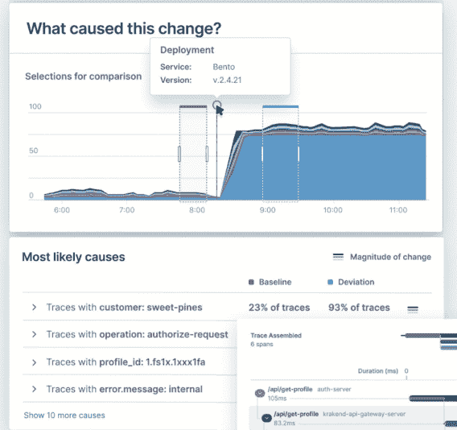

# OpenTelemetry 可观测性未来 1

## 为你的团队提供简单易用的可观测性

不应花费数小时来解决事件或调查性能问题。那是过去的方式。

Lightstep 会自动检测你应用程序、基础设施和用户体验的变化——并突出显示具体的根本原因。

[LSI]

Solution-Specific Instrumentation 24
Applications Are Locked In by Solution-Specific

Is Basically Impossible 26
How Do You Pick a Logging Library? 26
Decomposing the Problem 27
Separation of Concerns Is Fundamental to Good Design 30
5. OpenTelemetry: An Architectural Overview ................. 31
Signals 31
The OpenTelemetry Client Architecture 34
Client Architecture: The Instrumentation API 36
Client Architecture: The SDK 37
Client Architecture: Library Instrumentation 38
The Collector 39
6. Stability and Long-Term Support ........................... 43
Signal Lifecycle 43
API Stability 44
SDK and Collector Stability 45
Upgrading OpenTelemetry Clients 46
7. Suggested Setups and Telemetry Pipelines ................. 47
Installing the OpenTelemetry Client 47
Deploying a Local Collector 48
Deploying a Collector-Processing Pool 49
Adding Additional Processing Pools 50
Managing Existing Telemetry with the Collector 50
Switching Providers 52
8. How to Roll Out OpenTelemetry Across Your Organization ...... 53
The Primary Goal 53
Pick a High-Value Target 54
Centralize Telemetry Management 55
Breadth Before Depth 55
Work with Management 56
Join the Community 56
Thanks for Reading 57
A. OpenTelemetry Project Organization ....................... 59
B. OpenTelemetry Project Roadmap ............................ 63