# 1 传粉者与传粉的基本知识

传粉是我们视若理所当然的事情，但它对地球上的生命至关重要。它是大多数开花植物繁殖的方式。正如你在生物课上所学到的，传粉涉及花粉从植物雄性部分向雌性部分的物理转移。没有传粉，植物就无法受精以形成种子。传粉可以通过多种方式发生：

- 由动物（包括昆虫）传粉
- 由风传粉
- 由水传粉

大多数开花植物依靠动物传粉，昆虫是传粉者中最大的群体。禾本科植物、针叶树和橡树等植物依赖风媒传粉。水媒传粉通常发生在开花水生植物中。

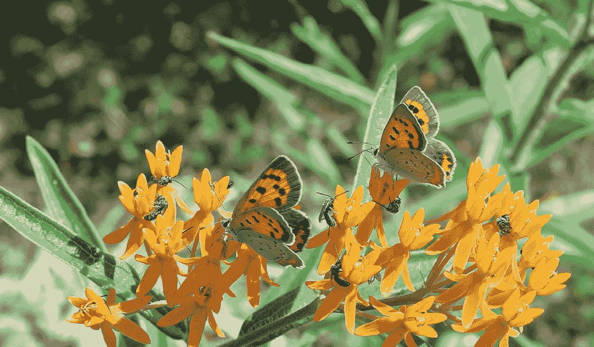

本土植物，如乳草（Asclepias tuberosa），能吸引多种不同的传粉者。

## 动物传粉者的重要性

传粉者与大多数开花植物存在互利共生关系。传粉者访问花朵以饮用花蜜或食用花粉，具体取决于传粉者的类型。在进食过程中，它们会将花粉粒从同一植物的一朵花转移到另一朵花，或从不同植物的一朵花转移到另一朵花。传粉并非传粉者的故意行为，而通常是进食的结果。在某些情况下，花粉是传粉者唯一的食物来源；并非所有传粉者都食用花蜜。取决于植物种类，其花朵可能会吸引多种不同类型的传粉者来访，也可能只吸引一个非常狭窄的传粉者群体。

地球上至少 80% 的开花植物依赖传粉者进行繁殖。传粉者对大多数生态系统至关重要，有些传粉者甚至充当关键物种——即生态系统中其他物种所依赖的物种。如果关键物种灭绝或从其进化所在的生态系统中消失，该生态系统将发生根本性变化，且通常不会变得更好。

除了提供传粉服务，传粉者还是食物网（相互依赖的食物链）的一部分，并可以成为营养丰富的蛋白质餐食

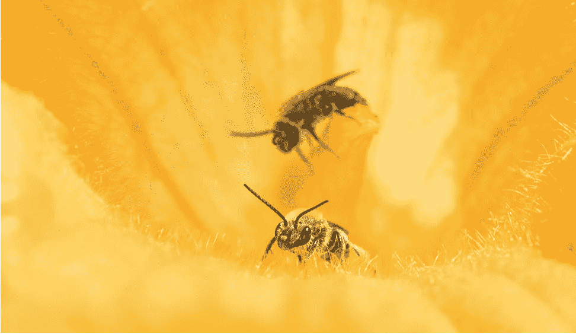

本土南瓜蜂正在给南瓜植物传粉

为食物链上更高位的生物提供食物。虽然看着鸟吃蝴蝶或蜜蜂可能令人痛苦，但每个生物都必须进食。食物网是生态系统的基础，传粉者是其中的一部分。当你园艺时，要考虑到你真正种植的是为了食物网，而不仅仅是为了特定物种。不过，专门传粉者确实需要在我们的花园里获得额外帮助。这些专门传粉者与它们依赖的某些植物共同进化，反之亦然。在你的花园里种植这些植物——例如，槿蜂专门给槿花授粉。世界粮食供应在很大程度上依赖传粉者——主要是蜜蜂。虽然并非所有食用作物都需要传粉，但根据联合国的数据，84% 的用于人类消费的作物需要传粉者来提高产量并改善品质。虽然各种昆虫都会给食用作物传粉，但蜜蜂——包括但不限于西方蜜蜂——是食用作物最重要的传粉者。美国农业部估计，80% 的昆虫媒介作物传粉由蜜蜂完成。著名昆虫学家和蜜蜂专家 Marla Spivak 解释说，如果蜜蜂没有足够的食物，我们也就没有足够的食物。因为我们的许多食用作物是作为巨大的单一种植种植的，而传粉者需要多种多样且丰富的食物，因此我们能在花园中引入的植物多样性越多越好。

- 草坪——传粉者沙漠

## 对传粉者的威胁

传粉者面临着大量威胁其生存的危险，这些威胁似乎与它们作为对地球生命至关重要的生物的生态价值不成比例。对传粉者的许多挑战源于人类活动以及未考虑生态后果的决策。建筑和开发对传粉者造成了影响，因为它们的栖息地、筑巢地点和花蜜资源消失了。最严重的威胁之一是传粉者栖息地的破碎化，当建筑物、道路或砍伐分割自然区域时就会发生这种情况，大大降低了传粉者的生存率。

植物生物多样性的下降、对草坪的强调、本土植物使用量微乎其微以及入侵植物物种的激增，都在对传粉者造成影响。农业以及商业和住宅景观中的农药使用进一步让传粉者的生存雪上加霜。在这些诸多挑战的削弱下，传粉者更容易受到困扰它们的新害虫和疾病的影响。宾夕法尼亚州立大学对传粉者的研究表明，接触农药与营养不良的结合可能使蜜蜂更容易受到蜜蜂衰落的其他主要嫌疑因素：寄生虫和病原体的影响。通过减少对传粉者的人为威胁，我们肯定可以帮助它们恢复。

### 消除威胁

创建你的传粉者胜利花园时，重点是增加传粉者所需的资源并改善它们的栖息地。你可以从减少草坪（一个传粉者荒地）开始，并用多种开花本土植物替代，这些植物不使用农药进行维护。随附的图表详细列出了对传粉者的阻碍（减项）以及你可以采取的帮助他们的改进措施（加项）。

| 对传粉者的阻碍（避免这样做） | 对传粉者的改进（这样做） |
| --- | --- |
| 大草坪（绿色沙漠） | 减少或消除草坪，并用开花本土植物替代。 |
| 花卉稀少的景观 | 种植大量开花的本土树木、灌木和多年生植物。 |
| 没有开花的时期 | 设计在生长季节内持续开花的植物序列。 |
| 单一种植 | 包含许多不同时间开花的不同开花植物物种的多样化种植。 |
| 以非本土植物为主 | 强调传粉者共同进化的区域本土植物。 |
| 入侵植物 | 移除入侵植物（即使传粉者喜欢它们），并用本土植物替代。 |
| 农药使用 | 消除农药；吸引益虫来控制昆虫害虫。 |
| 缺乏筑巢地点 | 提供裸露土壤区域、枯枝堆、枯死树木和原木、髓心茎植物、有裂缝的石墙以及人造蜂房。 |
| 栖息地破碎化 | 与邻居合作，创建从一个景观延伸到下一个景观，再下一个……的传粉者走廊。 |

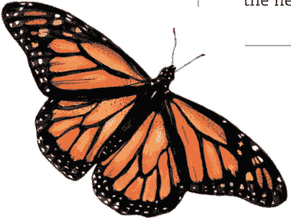

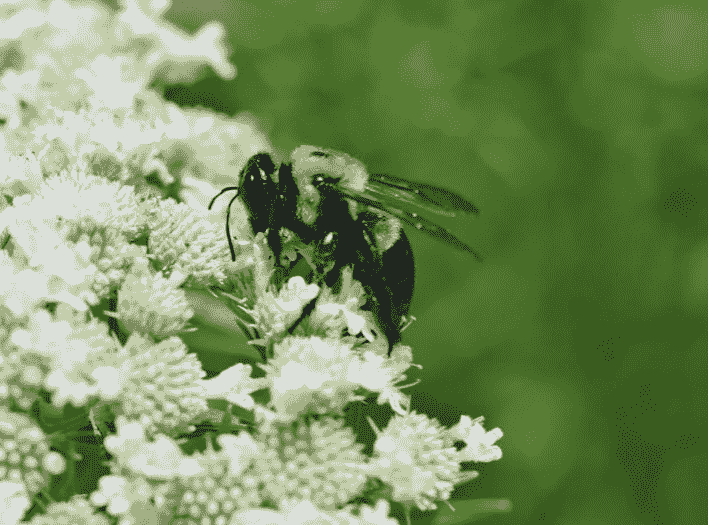

木蜂在山薄荷（Pycnanthemum 属）上采蜜

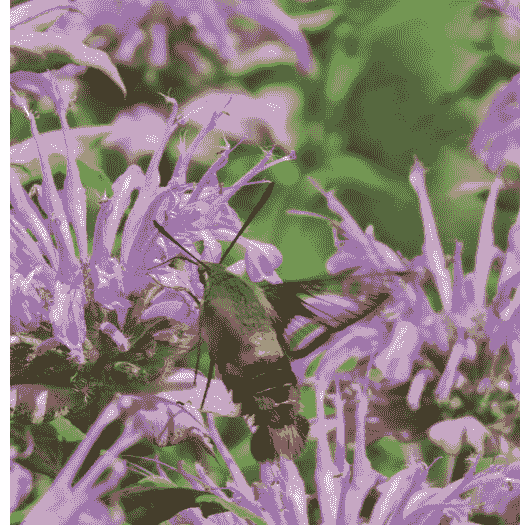

蜂鸟蛾在野生天仙香（Monarda fistulosa）上采蜜

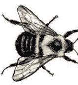

## 传粉者类型

大多数动物传粉者是昆虫。虽然蜜蜂可以说是最著名的动物传粉者，但甲虫、蝴蝶、蛾、苍蝇和胡蜂是你在传粉者胜利花园中最有可能吸引和支持的其他传粉者。你还可以根据你的位置吸引食蜜鸟（花蜜食者），如蜂鸟和黄鹂。蜂鸟是北美最大的授粉鸟类群体，估计有 350 个物种。一些鸟类传粉者甚至专门给特定植物授粉，例如白翅鸽，它是亚利桑那州巨人掌仙人掌的重要传粉者。

在热带和沙漠地区，蝙蝠可能是你景观中需要支持的重要传粉者。包括芒果、香蕉和番石榴在内的 300 多种水果依赖蝙蝠传粉。甚至巨人掌仙人掌和龙舌兰植物也是由蝙蝠授粉的。

较不常见的传粉者包括某些蚊子、蚂蚁，甚至某些哺乳动物和蜥蜴，具体取决于你的国家和地区。哪些传粉者是重要的？所有这些。如果它们在你的当地进化，它们就是你生态系统的一部分，并具有生态价值。

## 传粉者类型

昆虫——动物传粉者中最大的一类。

- 蜜蜂最重要的食物作物授粉群体
- 甲虫最大的昆虫传粉者群体
- 蝴蝶常常是偶然的传粉者，但有些非常重要
- 蛾通常是夜行性的，但有些物种在白天活动
- 蝇类常常拟态为蜜蜂；通过只有一对翅膀来识别
- 胡蜂作为传粉者不如蜜蜂高效；专化胡蜂针对无花果、兰花
- 蚂蚁喜欢花蜜但对授粉效果不佳
- 蚊子是某些本土兰花有限的传粉者

鸟类——授粉鸟类包括蜂鸟、蛛猎鸟、太阳鸟、蜜糖鸟、蜜吸鸟，以及一些鹦鹉。

哺乳动物——授粉哺乳动物包括一些蝙蝠物种、有袋类、猴子、狐猴和啮齿类。

蜥蜴——授粉蜥蜴大多分布在岛屿上。

## 蜜蜂及其他

很难说服人们除了蜜蜂之外还为传粉者打花园。实际上，蜜蜂甚至被考虑纳入花园这一事实，意味着在过去十年左右，我们已经取得了很大进展。不久以前，蝴蝶，或许还有蜂鸟，是大多数景观中真正受欢迎的唯一传粉者。蜜蜂常常被视为养蜂人的管辖范围，或者是应该避免和恐惧其蜇刺的不便野生生物，当然不是应该在管理景观中鼓励的生物。这种对蜜蜂的恐惧很大程度上基于错误信息；大多数蜜蜂非常温顺，通常只有在筑巢区域受到威胁时才会蜇人。

现在家庭园丁开始接受蜜蜂了，我们需要拓宽生态视野，为所有类型的传粉者打花园。如果我们不这样做，将会失去更多物种。生物多样性是健康生态系统的关键，也是应对气候变化的关键工具。一个健康的花园生态系统是充满许多生物的生态系统，包括传粉者。植物多样性 = 动物多样性。在你的花园中，包括多样化的本土植物，如树木、灌木、藤本植物和多年生植物，它们具有多种形状和尺寸，以吸引更大多样性的传粉者。

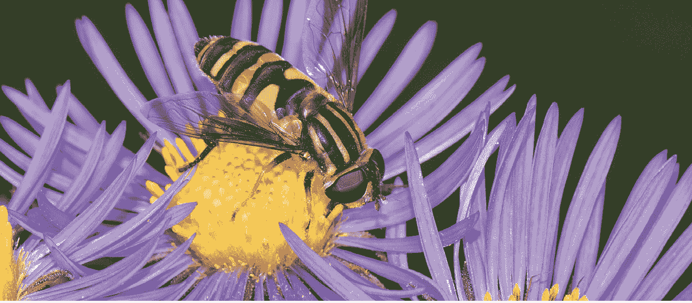

开放、易接近的花朵：本土紫菀（Symphyotrichum 种）上的传粉蝇

## 传粉者差异与花园考量

传粉者在很多方面存在差异，这些差异影响传粉者花园必须提供什么。传粉者的舌长是决定其能获取哪些花朵的主要因素。长舌蜜蜂、蝴蝶或蜂鸟物种能够获取长管花中的花蜜，而短舌传粉者需要更平坦、更开放、易接近的花朵。通过种植具有各种花形的开花植物，您将吸引更大多样性的传粉者。

| 花冠管长度示例 |
|---|
| 蜜蜂舌长范围从 ¼" (2 mm) 到 ½" (14 mm)，取决于物种。 |
| 琉璃苣 (Borago officinalis) | ¹⁄₁₀₀" (1.9 mm) |
| 白三叶草 (Trifolium repens) | ¹⁄₁₀" (2.5 mm) |
| 薰衣草 (Lavandula angustifolia) | ¼" (6.0 mm) |
| 蓝罂粟 (Echium vulgare) | ¼" (6.7 mm) |
| 高山翠雀花 (Delphinium barbeyi) | ½" (14 mm) |

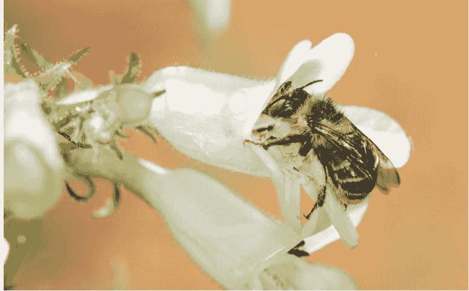

- 管状花示例：胡须舌花 (Penstemon 种)

### 广食性与专食性

像蜜蜂和熊蜂这样的广食性传粉者可以从多种开花植物中吸取花蜜。而且，虽然大多数传粉者是广食性的（大约 75% 的蜜蜂物种），但有些已经进化为专食性，可能依赖于特定的植物物种或一小群植物。专食性春美蜂 (Andrena erigeniae) 只从两种植物中采集花粉：弗吉尼亚春美 (Claytonia virginica) 和卡罗来纳春美 (Claytonia caroliniana)。没有这两种植物，春美蜂可能会灭绝。没有春美蜂，这些植物可能无法繁殖。请确保在您的花园中为广食性和专食性传粉者都包括植物。

在第 3 章中，常见寄主植物及其喂养的毛毛虫列表可以在作者的网站 www.ecobeneficial.com/PVG 上找到。专食性蜜蜂和甲虫的植物更难确定；关于这个主题写得不多。请联系您当地的本土苗圃和本土植物协会寻求帮助，并参考本书中的推荐来源。

蝴蝶毛毛虫也与植物有专食性关系，称为幼虫寄主植物，讨论于

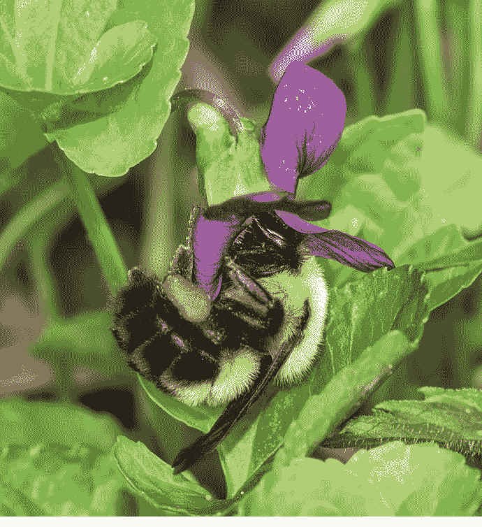

取决于您在哪里园艺，这些早花植物可能包括本土柳树、红枫、香料灌木、鹅耳枥、红垂枝、巫榛、鳟鱼百合、荷兰人裤子、松鼠玉米、野生天葵、春美和紫罗兰。

其他传粉者物种在生长季节较晚时出现；例如，切叶蜂在温暖的夏季天气出现。确保它们在您的花园里有足够的食物。在秋天，交配过的熊蜂蜂王需要额外的花卉食物来越冬。在整个生长季节里提供连续不断的开花植物序列，以供养大量的传粉者物种。

熊蜂蜂王在早花紫罗兰上采蜜

胜利花园，因为您需要创建或促进许多个体蜜蜂可以筑巢的区域。有关提供蜜蜂栖息地的更多信息，请阅读第 2 章。

## 季节性活动

季节性活动根据传粉者物种而有所不同。早期出现的熊蜂蜂王在许多其他昆虫活动之前，在生长季节早期活动。熊蜂可以耐受较冷的天气和较冷气候中有些潮湿的条件。当它们从长冬眠中出来时，它们饥饿并寻找花朵。为了帮助熊蜂和其他早期蜜蜂生存，请在您的花园中包括早花植物，其中许多是开花的树木和灌木。

## 传粉者寿命

传粉者寿命在不同物种之间可能差异很大。大多数成年蝴蝶只活一两周，但成年的帝王蝶或丧钟蝶可能存活九个月或更久。蜜蜂物种的寿命非常不同，有时同一物种内部也有显著差异。一只工蜂可能只活五到七周，而一只蜂王可能活两到五年。独居野生蜜蜂作为成虫可能只活三到四周，尽管它们的发育阶段要长得多，大约十一个月。通过种植持续开花、在整个生长季节始终保持多样化开花来简化供养过程，以供养不同寿命和活动季节的传粉者。

## 传粉者觅食与营养

当传粉者觅食（从花朵中寻找食物）时，花蜜和花粉主要是它们寻求的东西。蜜蜂是主要的造访花朵的昆虫，既喝花蜜，也主动采集和运输花粉。传粉的蝇类和甲虫可能吃花蜜、花粉或花部，取决于物种。蝴蝶和蛾类，有少数例外，只为花蜜觅食，并且意外地传递花粉。蜂鸟和蝙蝠造访花朵以获取花蜜，但可能无意中摄入花粉颗粒。

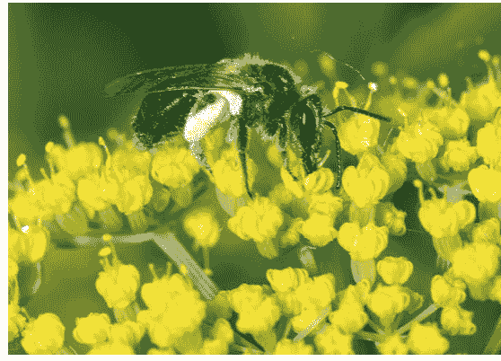

矿蜂在金亚历山大花（Zizia 种）上

有限数量的蜜蜂物种采集其他植物物质来衬里它们的筑巢腔。小树脂蜂采集植物树脂，作为具有抗菌特性的结构和防水元素。其他一些蜜蜂物种觅食由具有特殊花腺的植物产生的花油。蜜蜂将这些油与花粉混合，以衬里它们巢穴中的育幼室，这也添加了一层保护性的抗菌涂层。

就大部分而言，花蜜、花粉和水是传粉者饮食的基本要素（蝴蝶和蛾类的幼虫阶段除外）。

## 花卉多样性

像人类一样，大多数传粉者从多样化的饮食中受益。在大多数情况下，它们吃的花粉和花蜜应来自多种来源。并非所有花蜜和花粉都有完全相同的成分或营养价值。考虑通过为您的众多传粉者客人提供各种不同的开花植物来提供一个传粉者自助餐。不要让它们空肚回家！

## 花卉恒定性与花卉丰富度

花卉多样性很重要，但花卉丰富度也很重要。一些传粉者实践花卉恒定性，意味着它们在一次觅食旅行中只造访一种植物物种。为了成功觅食，这些传粉者需要足够数量的给定开花物种。加州大学伯克利分校城市蜜蜂实验室的研究表明，3 英尺（0.28 米）见方的同一植物物种斑块是传粉者的良好目标。为传粉者良好种植意味着在植物多样性和植物充足度之间取得平衡。

## 传粉者盛宴

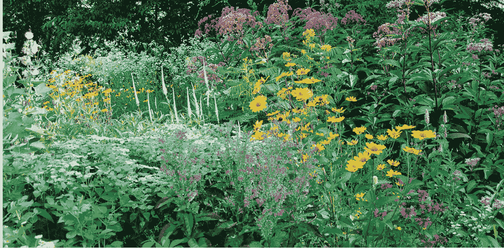

## 觅食范围

并非所有传粉者都能飞行相同的距离去寻找食物。微小的独居蜜蜂可能在距离巢穴几百英尺以内生活；体型更大的、准社会性的蜜蜂如大黄蜂可能会飞出一英里远，而蜜蜂则能飞得更远。蝴蝶和鸟类可能飞行更远的距离来觅食。但旅行对传粉者来说成本高昂——它们会消耗卡路里并消耗能量。通过密集种植你的花园，并说服邻居创建连接你的景观及更远区域的传粉者走廊，帮助传粉者节省能量。

## 花蜜

大多数，但并非所有开花植物都会产生花蜜。有些植物，包括大多数玫瑰，产生很少或不产生花蜜，但却是花粉的重要来源。花蜜是一种甜味物质，主要由水和糖组成，主要包括不同比例的葡萄糖、果糖和蔗糖。花蜜中各种糖的含量因植物而异，且在同一物种内也可能有所不同。有些传粉者似乎对特定糖类型有偏好。据报道，蜂鸟和长舌蜜蜂偏好蔗糖，可能是由于其粘度。苍蝇、甲虫和蝴蝶被认为偏好较低水平的蔗糖，而蝙蝠似乎更倾向于含有葡萄糖和果糖的花蜜。

花蜜还含有少量的氨基酸和其他成分。这种甜美的食物为传粉者提供了重要的能量来源，使它们能够飞行、繁殖和保持温暖。但花蜜中的糖分浓度变化很大，可从10%到75%，这可能会影响传粉者的功能。这是在花园中融入植物多样性的又一理由，以便提供多种花蜜资源。

花朵以不同速率分泌新鲜花蜜，这种分泌和花蜜的可用性可能持续几小时或数天。有些植物只能在白天产生花蜜，而其他植物也能在夜间产生花蜜，因此对夜行性传粉者（如某些吸蜜蛾物种）特别有价值。普通马利筋（Asclepias syriaca）和月见草（Oenothera species）是两种能在夜间提供花蜜的植物示例，但请选择适合你所在地区的植物。

温度和天气状况也会影响植物的花蜜产生；极高或极低温度会导致花蜜产量下降。过多的降雨加上多云天气会导致花蜜稀释。干旱胁迫会显著减少植物产生的花蜜量。不要让植物因缺水而枯萎，因为传粉者将承受后果。当植物既有足够的水分又有足够的阳光时，花蜜供应效果最佳。

## 花粉

花粉是传粉者的蛋白质来源，并提供包括脂肪、碳水化合物、矿物质和维生素在内的其他营养。某些传粉者吃花粉，有些则用它来喂养幼崽。花粉对蜜蜂幼虫发育（即幼蜜蜂的发育）至关重要。几乎所有蜜蜂物种都食用

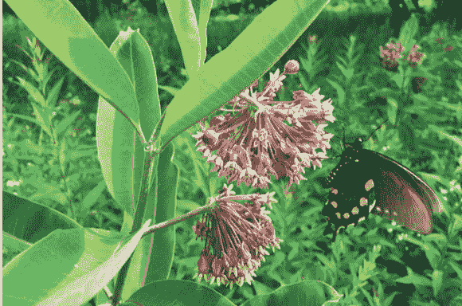

胡枝子凤蝶停在普通马利筋（Asclepias syriaca）上，这是极佳的花蜜来源。

花粉，以及一些甲虫和蝇类物种、少数蝴蝶物种，以及一些鸟类和哺乳动物传粉者。那些主动为自己或后代收集花粉的传粉者会为此消耗大量能量；请务必在花园中种植大量花蜜植物，为它们提供能量。

并非所有植物在其花粉中提供相同数量或质量的成分，且并非所有花粉都同样有营养。花粉中的蛋白质含量可从2.5%到61%不等，但蜜蜂需要平均20%蛋白质的饮食。如果传粉者只能接触到低质量花粉（如风媒植物中的花粉），它们将受害；风媒植物无法使它们达到最低阈值。

大多数花粉食者会从多种来源寻找花粉，但也存在与特定植物共同进化的花粉专门化物种。虽然大多数传粉者是花粉广谱食者，但它们实际上可能对特定植物有偏好。

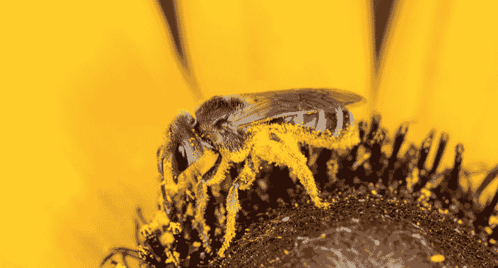

覆盖着花粉颗粒的蜜蜂

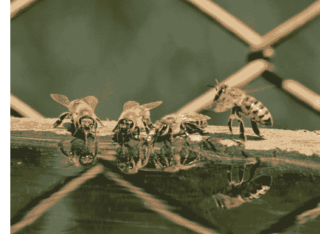

蜜蜂需要干净的水源饮水。

## 水

除了花蜜和花粉，花园中很少提供的一种资源是水。传粉者可能将花蜜作为主要补水来源，但拥有池塘、溪流或河流的景观可以成为传粉者良好的水源，只要有浅滩且水体相对平静。即使是人工水景，例如一个小池塘，也能为传粉者提供饮水，但设计时应牢记相同要求，使其对传粉者友好。

夏天酷热时，一个蜜蜂群落每天可饮用一夸脱（946 毫升）或更多的水。园丁可以提供一些简单的水源，在干旱或炎热天气、花蜜流量低时，这可能尤为重要。鸟浴盆最好留给鸟类使用，但浅陶瓷盘（例如花盆托盘）可以放入小而无色的鹅卵石并加满水。这为昆虫传粉者提供了一个安全的饮水场所，无溺水风险。聪明的养蜂人已经了解到，自动宠物饮水机也可用于蜜蜂；只需在水盘中放入小鹅卵石，使蜜蜂能够从干燥的栖息处安全饮水即可。

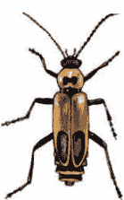

## 植物如何吸引传粉者

开花植物发展出许多特征来吸引传粉者。植物的整体特征，如开花时间、花朵密度、花朵数量、花朵高度和花朵空间分布模式，都会影响哪些传粉者会使用某特定植物。

单朵花的颜色、形状、结构、大小、香气以及花蜜和/或花粉的可用性也有助于确定会来访的传粉者类型。能预测将吸引哪种传粉者的特征组合称为传粉综合征。传粉综合征是种植的有用指南，但例外情况常有发生。更多信息，请参见第78至81页。

## 构成传粉综合征的特征

- 花色
- 花形
- 花香/气味
- 蜜道的存在或缺失
- 花蜜可用性
- 花粉可用性

蜜道可以是传粉综合征的一个因素。它们像跑道一样——花朵上的图案，将传粉者（即蜜蜂和蝴蝶）引向花蜜。但并非所有传粉者都会被蜜道吸引；甲虫、蛾类、苍蝇、鸟类和蝙蝠不需要它们。蜜道与花朵其余部分颜色不同，传粉者可见，但人类通常不可见。

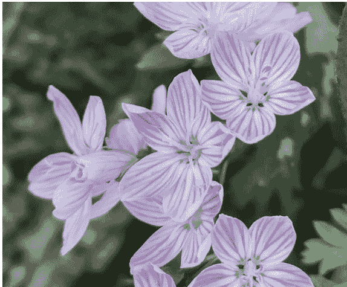

园丁在选择植物时的复杂之处在于，对于传粉者而言并没有“一种尺寸适合所有”的方案。蜜蜂偏好紫罗兰色、紫色、蓝色、黄色和白色的花朵，但蜂鸟偏好红色花朵。香气可能起巨大作用（或不），取决于传粉者类型。例如，花朵浓烈的香气对鸟类来说毫无意义，因为鸟类不能闻气味，但夜行性蛾类可能会被甜美的夜间花朵所吸引。关于吸引不同传粉者类型的特定花卉特征的详细信息，请参见第4章。

蜜道是某些传粉者物种的视觉信号（春美花，Claytonia species）。
