# 2 为传粉者提供栖息地

栖息地是讨论传粉者时经常出现的一个术语。但什么是栖息地？简单来说，栖息地是生物（在此情况下为传粉者）生活的自然环境，也是它能找到所需资源的地方：食物、庇护所、休息场所，以及交配和繁殖的安全场所。栖息地不仅仅包括花朵。

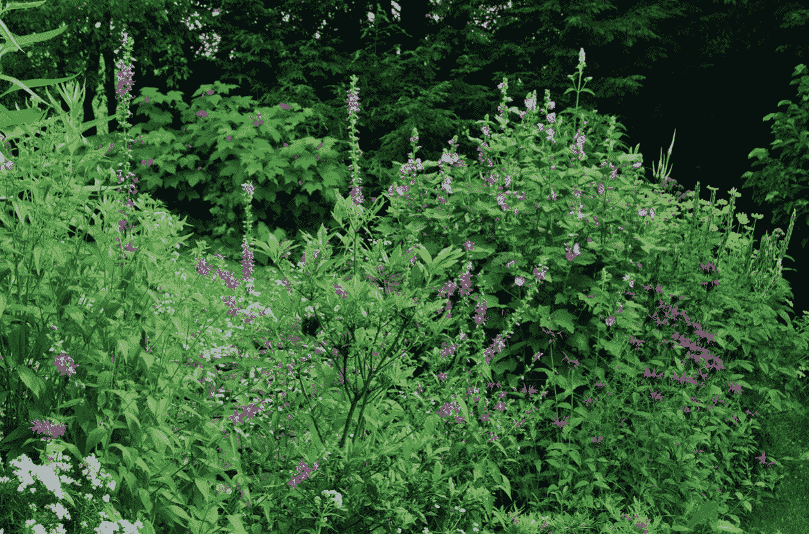

传粉者胜利花园提供多种类型的植物和传粉者栖息地。

## 将栖息地理解为生态系统

任何住宅、商业或机构景观，不仅仅是树木、灌木、多年生植物和（可能的）草坪的组合；它是一个每个生物都相互关联的生态系统。你的生态系统可以为多种野生动物（包括传粉者）提供栖息地。

大多数人的景观至少在一定程度上可以作为传粉者栖息地发挥作用。但是，优质传粉者栖息地与劣质传粉者栖息地之间存在巨大差异。由大面积草皮草坪主导的景观永远不会是高质量的传粉者栖息地；你可以通过允许开花杂草存在于草坪中来改善它，但那仍然不够。通过考虑传粉者的需求，你可以创建卓越而非仅仅勉强凑合的栖息地。

## 传粉者栖息地的关键要素

- 觅食和花卉资源（花蜜、花粉、花卉油和树脂）
- 非花卉植物资源（幼虫寄主植物、筑巢材料用的叶子、蜂胶）
- 清洁淡水源
- 产卵和筑巢区域
- 躲避和越冬区域
- 休息和取暖区域

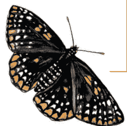

## 栖息地中传粉者需要什么

栖息地并非孤立存在；请将你的整个景观视为栖息地，而不仅仅是多年生花园。是的，花团锦簇的多年生区域会看到更多明显的传粉者活动，但传粉者使用你景观中许多你可能未曾注意到的其他部分。树木和灌木可以提供花蜜回报、蝴蝶和蛾子幼虫的食物、传粉鸟类的筑巢地点、昆虫的休息和越冬场所，以及防强风保护。裸露或稀疏植被的土壤区域、枯枝堆和中空茎秆的植物为一些传粉者提供筑巢地点。本地草丛、树木落叶和枯枝堆可以作为一些传粉者物种的越冬场所。

当你为传粉者改善生态系统时，你景观的整体生态健康状况会提高，造福所有动植物生命。为了保持传粉者和其他野生动物的健康，你的景观理想情况下应无农药。

## 栖息地的区域性

亚利桑那州的传粉者栖息地不应该看起来像新泽西州的传粉者栖息地。当栖息地反映其所在的国家和区域时，最成功。气候、地理、本地传粉者以及它们共同进化的本地植物，因地区而异。使用本书附录中的资源，你可以确定你居住的生态区域，以及该地区的本地植物和动物。这为你所在地最合适的传粉者栖息地类型提供了一些背景。请记住，进化联系很重要。

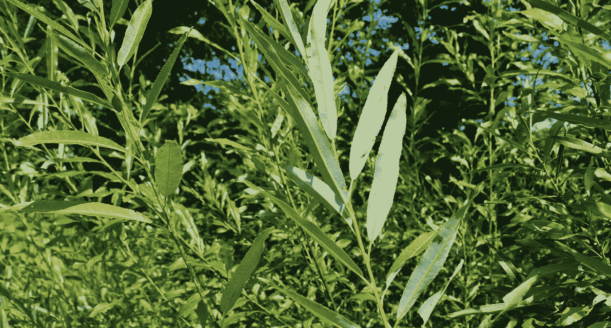

本地柳树（Salix 属）是450多种毛虫的幼虫寄主植物，也是蜜蜂早期花蜜来源。

## 创建产卵和筑巢栖息地

所有传粉者都需要一个安全的繁殖场所，这是你的传粉者胜利花园中最重要的方面之一。仅仅因为你看到传粉者在你的景观中采蜜，并不意味着条件适合产卵和筑巢。

### 蝴蝶和蛾子产卵栖息地

蝴蝶和蛾子不像其他一些传粉者那样筑巢，但它们确实需要一个产卵的地方。大多数蝴蝶和蛾子在特定植物上产卵，这些植物已经进化到能够喂养从这些卵中孵化出的毛虫。这些植物被称为幼虫寄主植物（第3章将详细介绍）。如果毛虫没有幼虫寄主植物，它们无法生存。

什么是良好的蝴蝶和蛾子产卵栖息地？无农药的幼虫寄主植物。如果你只种植供成年蝴蝶和蛾子采蜜的花卉而没有幼虫寄主植物，你就没有一个能支持蝴蝶和蛾子的传粉者花园。

### 本地蜜蜂产卵和筑巢栖息地

北美所有本地蜜蜂都会筑巢，除了杜鹃蜂，它们将卵产在其他蜜蜂物种的巢中。由于绝大多数本地蜜蜂是独居的，大多数蜜蜂独自筑巢，但大黄蜂是个例外；它们以五十到四百只的小群体筑巢。雌性本地蜜蜂筑巢并为巢穴储备幼虫食物，而雄性蜜蜂则寻找其他地方休息和睡觉，包括花朵、茎秆和树枝。

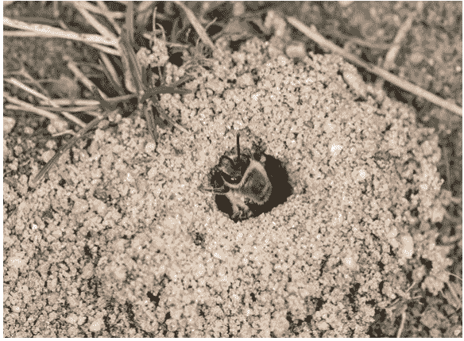

- 大多数本地蜜蜂在地面筑巢。

本地蜜蜂要么在地面筑巢，要么在空腔中筑巢。大多数（北美所有本地蜜蜂物种的70%，即4000种本地蜜蜂中的2800种）是地面筑巢者。另外30%，包括大黄蜂，是空腔筑巢者。你的传粉者花园里有很多蜜蜂需要提供栖息地！你的景观可能有数百甚至数千只单独的蜜蜂在使用。好消息是，你不需要做太多就能为它们提供一个住处。

### 蝴蝶灌木——并非如此

不幸的是，许多园丁认为蝴蝶灌木（Buddleia davidii）以及可能其他少数几种开花植物，就是蝴蝶所需要的一切。蝴蝶灌木是一种在亚洲进化的植物；它不是任何北美蝴蝶物种的幼虫寄主植物。它确实提供花蜜，许多蝴蝶喜欢，但当雌性蝴蝶在蝴蝶灌木上采蜜而该产卵（称为产卵）的时候，真是令人同情可怜的雌性蝴蝶。她本能地意识到这不是能喂养她幼崽的植物，她不会在那里产卵。如果附近没有幼虫寄主植物，所有潜在的后代都将命运多舛。

在北美，蝴蝶灌木作为一种真正的蝴蝶植物显得不足。“花蜜灌木”更准确地描述了该植物实际的功能——它只提供花蜜。有许多本地植物也能做到这一点。关于蝴蝶灌木还需要三思的另一个原因：它可以大量自播，现在在几个州被列为入侵植物或关注物种。

研究一下你所在地区出现的蝴蝶及其偏好的幼虫寄主植物，然后种植那些植物。推荐书籍列表可在附录中找到。常见蝴蝶和蛾子及其幼虫寄主植物列表可在 www.ecobeneficial.com/PVG 上找到。

### 地面筑巢蜜蜂和空腔筑巢蜜蜂示例

| 地面筑巢蜜蜂 | 空腔筑巢蜜蜂 |
| --- | --- |
| • 矿蜂（掘地蜂） | • 大黄蜂（地面或地下） |
| • 汗蜂 | • 泥蜂 |
| • 薄膜蜂 | • 切叶蜂 |
| | • 黄面蜂 |
| | • 木蜂 |
| | • 树脂蜂 |

### 为地面筑巢蜜蜂提供栖息地

大多数本地蜜蜂是地面筑巢者，需要方便地接触土壤来挖掘巢穴。在阳光充足的地方保留现有的裸露土壤斑块，或创建一片裸露土壤区域——即使只有几平方英尺（m）也可以。沙壤土或壤土是首选；富含有机质的土壤和黏土对蜜蜂来说更难挖掘，且可能积水。阳光充足、安静、无割草机、嘈杂设备和人流干扰的地点是理想的。如果裸露土壤看起来太难看，你可以在该区域非常稀疏地种植植物，蜜蜂仍可能使用它。最好让该区域保持裸露，但用一些开花灌木进行遮挡。只要确保不要遮蔽蜜蜂栖息地即可。

避免在蜜蜂筑巢区域使用覆盖物或景观布，因为两者都会驱赶蜜蜂。所有栖息地都应保持安静和不受干扰，即使在非季节也不耕作或清理。请将此区域视为野生栖息地，而不是精心打理的花园。如果你成功了，你可能在地下支持数百只蜜蜂。

### 为空腔筑巢蜜蜂提供栖息地

百分之三十的本地蜜蜂是空腔筑巢者，使用各种资源筑巢。许多喜欢现成的空腔，例如倒木、枯树和树桩中废弃的甲虫隧道；其他可能使用石墙中的缝隙、废弃的鸟巢、中空树木、腐烂木材内部的空间、密集的枯枝堆或植物残渣。有些蜜蜂甚至在多髓（海绵状）植物茎秆内部筑巢。

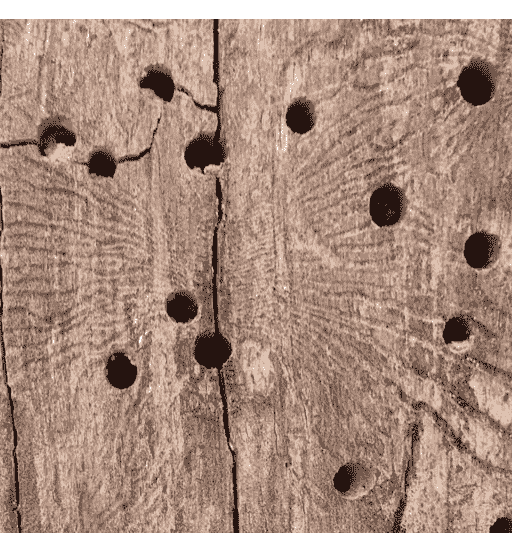

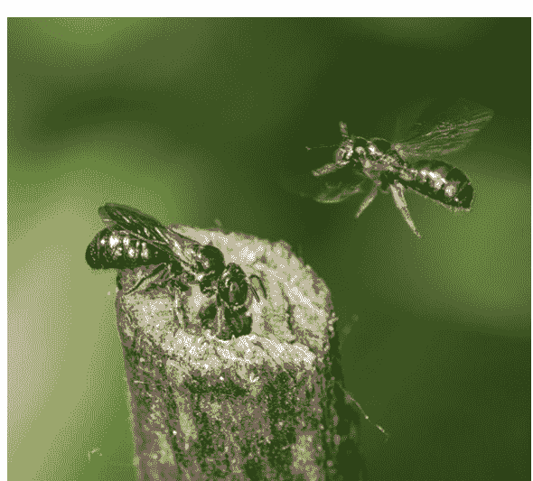

- 死树中老旧的甲虫隧道可为穴巢蜜蜂提供栖息地。
- 锡蜂在髓茎植物植株茎中筑巢。

### 枯立木

考虑保留枯死或濒死的树木作为蜜蜂栖息地。此类树木被称为枯立木，能为传粉者和许多其他生物提供宝贵的栖息地。枯树中的空洞处可为大黄蜂甚至野生蜜蜂提供安全的家园。甲虫喜欢在枯木中钻隧道，为穴巢蜜蜂留下未来的家园。任何远离房屋、倒下也不会伤害人或物的枯立木都值得保留。如果枯立木太高让你不放心，可将其剪短到可管理的高度；野生动物仍会使用它。保留倒下的原木原位，作为栖息资源。随着腐朽，它们常常长满在富含养分的介质中生长的植物，变得相当美丽。只需将它们视为大自然免费的花盆即可。

### 髓茎

接骨木、覆莓、绣球和 Joe Pye 鬼针草等植物的髓茎，对某些穴巢蜜蜂非常有用。你可以让这类植物的枯茎原位越冬，也可以将其收集并扎成束，作为蜜蜂栖息地。作为一般做法，让花园中任何多年生植物在整个冬季保持直立，为昆虫提供栖息地，为鸟类提供种子。之后可在早春将其剪短。最好将早季茎秆修剪分散在一段时间内进行，至少一两周，以确保温度足够升高，使昆虫访客得以活跃。

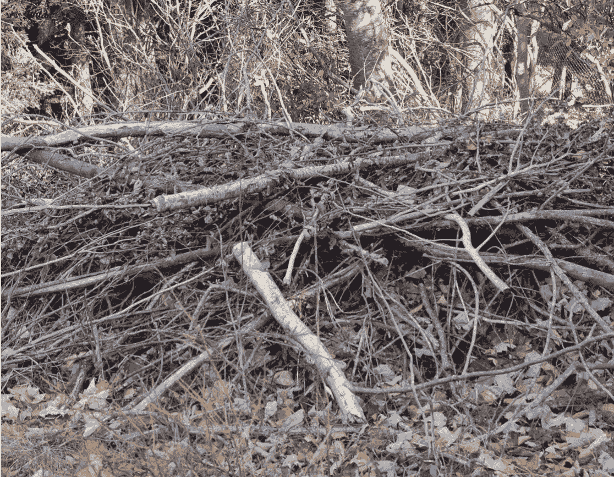

枯枝堆可为大黄蜂提供良好的栖息地。

### 枯枝堆

密集的枯枝堆是大黄蜂良好的潜在栖息地。你可能没有枯枝堆，因为传统观念认为我们应清理景观，移除所有枯死树木和树枝。然而，这种做法与良好的生态实践背道而驰。如果你的景观中没有枯枝堆，那就自己创建！枯枝堆不必很大；每当你修剪木本植物以移除枯木时，就保留树枝。你可以将它们牢固地固定在原处，或将它们捆绑在一起。为了成功为蜜蜂提供庇护，堆体必须相当紧凑密集，提供能遮蔽雨水的空腔。如果你动手能力强，可以尝试制作柳条篱笆，即通过编织细枝形成格栅的木制篱笆，这也能提供庇护。

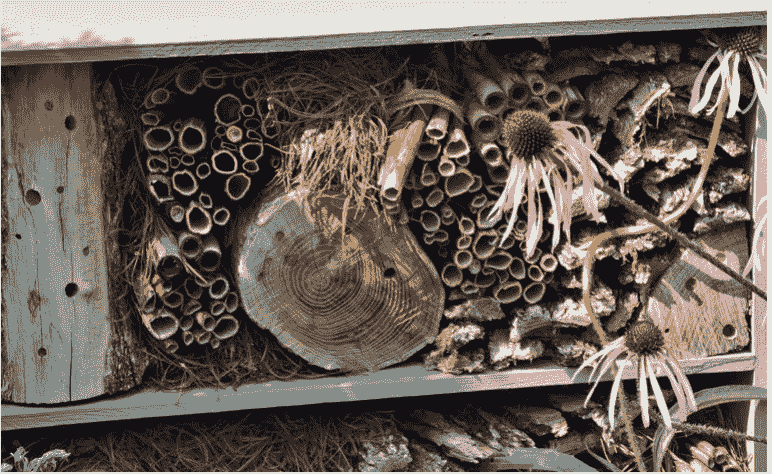

人工蜜蜂旅馆可作为穴巢蜜蜂的栖息地。

### 穴巢筑巢者的人工栖息地

穴巢筑巢者的人工栖息地可以自制或购买。钻有不同直径孔洞的木块称为巢箱。植物空心茎可以捆绑在一起形成茎束。这些人工栖息地既有技巧也有讲究，包括保持适当卫生，建议查阅附录中的推荐资源。

## 为欧洲蜜蜂提供栖息地

欧洲蜜蜂（Apis mellifera）筑巢和抚育幼虫的方式，与北美洲野生本地蜜蜂大不相同。当由养蜂人管理以生产蜂蜜或提供授粉服务时，蜜蜂生活在人工蜂箱中，这些蜂箱通常看起来像叠放的箱子。它们在这些蜂箱中产卵并抚育幼虫。

还有一些不再由养蜂人管理的野生蜜蜂。这些野生蜜蜂常成群结队地在树洞中生活和繁殖，这又是保留枯死或濒死树木的又一理由，只要这些树木不构成危险。

蜜蜂是群居性昆虫，是最社会化的蜜蜂，季节不同，其群落可能包含 50,000 或更多个体。你不必是养蜂人也能帮助蜜蜂。通过保持你的景观无农药且开满花卉植物，你可以支持本地蜜蜂和欧洲蜜蜂。由于本地蜜蜂和蜜蜂之间存在资源竞争，如果你饲养蜜蜂或邻居饲养，请密集种植。

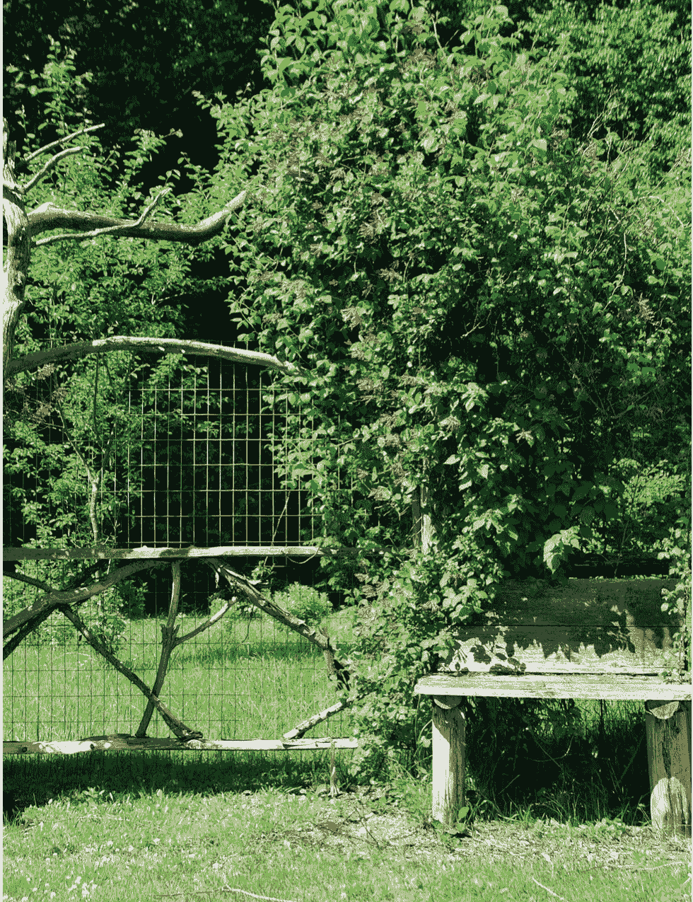

- 附带蜜源奖励的植被防风林——珊瑚金银花（Lonicera sempervirens）

## 为庇护和保暖提供栖息地

在活跃季节，传粉者需要安全的地方休息、温暖身体，并在恶劣天气中庇护。天气好的时候，蜜蜂、蛾类和胡蜂等昆虫可能在花朵上过夜休息或睡觉。对于蜜蜂来说，它们用腿或颚（上颚）抓住花朵休息。有时蜜蜂甚至在夜间合拢的花朵中睡觉，这可能是躲避捕食者的一种方式。我们可以设计景观来满足它们的所有这些需求。

蝴蝶没有巢穴，甚至不睡觉——它们是睁着眼睛休息的。蝴蝶在叶片间寻找受保护的地方休息，或者倒挂在树木和灌木的叶子或嫩枝上。蝴蝶白天活动，而大多数蛾类是夜行性的，白天会寻找类似受保护的地方庇护。

### 庇护与防风林

天气不好时，传粉者非常脆弱。考虑到大多数传粉者体型很小，且暴露在强风中。帝王蝶重量可能轻至 0.009 盎司（255 毫克），而一只蜜蜂可能只有 0.003 盎司（85 毫克）。有巢穴的传粉者，如蜜蜂、胡蜂和蜂鸟，可能无法及时返回安全避风港以避开大风。蝴蝶尤其容易受到风的影响，因为它们没有巢穴。但通过一些规划，你可以种植植被防风林，在风大的日子里帮助庇护和保护传粉者。

防风林具有多种用途。免受风吹后，传粉者不仅生存几率更大，还能节省能量，从而能在花朵上更多地觅食。防风林还能提供稍暖的条件，使蜜蜂等变温昆虫传粉者能够活动更长时间。

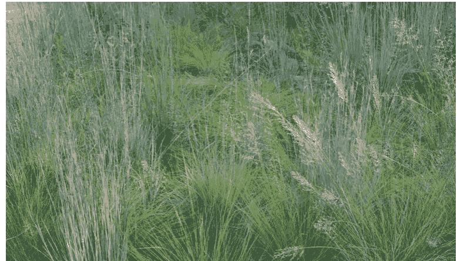

- 本地草本植物既可作为防风林，也可作为蜜蜂筑巢地点。

### 防风林植物

树木和灌木作为防风林特别有效。开花木本植物的额外好处是提供额外的花蜜和花粉，进一步扩大觅食栖息地。在特别多风的地区，常绿树木和灌木的覆盖非常有用，有些还会开花。

高大的本地草本植物不仅可以作为防风林，还可以作为蜜蜂栖息地。本地丛生草，如草原落隙草，是大黄蜂蚁后良好的越冬场所，蚁后可能在草丛基部筑巢。许多本地草本植物是弄蝶（一个大型蝴蝶科）的幼虫寄主植物。本地草本植物的深根能保持水分并减少洪水和水土流失，从而发挥更多生态功能。

### 创建防风林

为传粉者创建植被防风林没有神奇的公式或确切设计，简单的种植即可实现。靠近传粉者筑巢地点的防风林很有帮助，但要确保不要将植物种植在会对筑巢栖息地投射阴影的地方。暖季本地草本植物可以做到这一点，因为它们不太高，但仍足够高以提供庇护。

评估你景观中多风的区域，特别是觅食栖息地周围。在这些地点，错开行种植多样化的开花树木和灌木可能很有用。种植越多样化越好，避免灌木像小士兵一样并排排列的单一种植。你的目标是创建防风林，而不是绿墙！单一种植限制生态系统功能（你的景观本身就是一个生态系统），单一种植可能会被单一害虫或疾病彻底消灭。

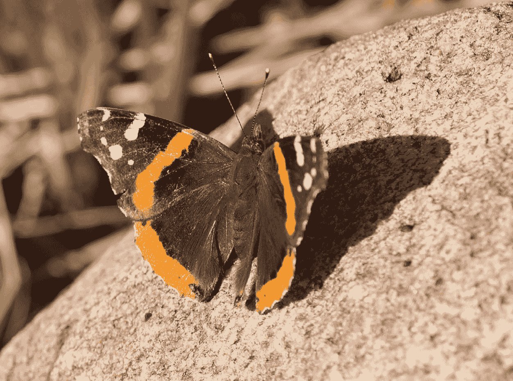

蝴蝶，如这只红带斑蝶，会在岩石上晒太阳以温暖身体。

## 用于取暖的栖息地

传粉昆虫是变温动物，需要升温才能变得活跃。虽然一些蜜蜂，如大黄蜂，能忍受非理想的天气条件，但西蜜蜂可能只有在 54°F（12.2°C）或更高温度时才会活跃，而蝴蝶据报道需要 55°F（12.7°C）或更高的温度才能飞行。在阳光充足的地方提供栖息地，有助于它们在气温不确定的日子里升温；这是在向阳区域种植蜜源植物的主要原因。

岩石也可以作为取暖的辅助手段，但在花园设计中被低估使用。保温更久的巨石和大块岩石，可以巧妙地摆放，与植物相得益彰，并增加花园的视觉趣味。将它们放置在阳光充足的位置，可以创造许多传粉者都会喜爱的晒太阳区域。

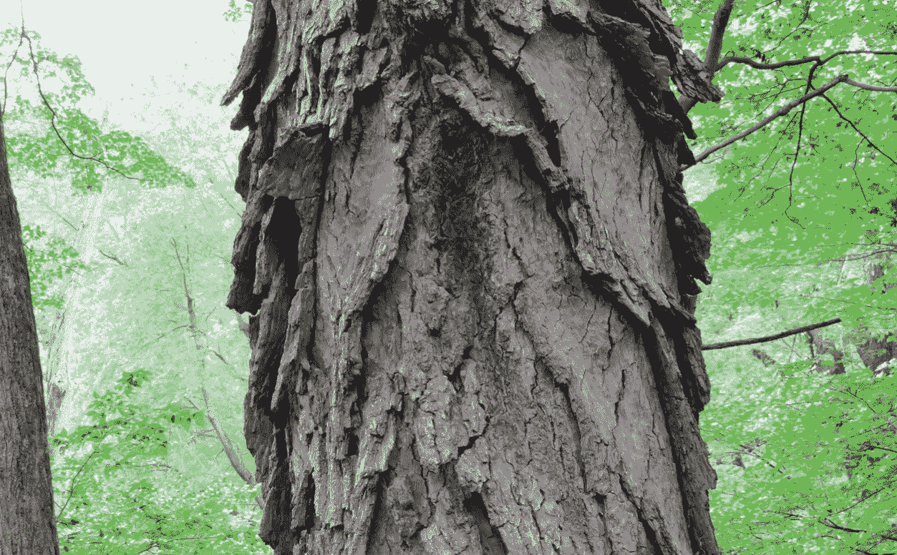

剥落树皮的舌形山胡桃（Carya ovata）为蝴蝶等传粉者提供栖息地。

## 创造越冬栖息地

在寒冷气候中，大多数传粉昆虫在冬季到来前就会死亡。但许多昆虫确实会利用各种生存策略度过冬季。以下是各类传粉者越冬的方式。

## 蝴蝶和蛾

大多数蝴蝶以毛毛虫（幼虫阶段）或蛹（蛹阶段）越冬，但某些物种以卵或成虫越冬。许多物种会经历滞育（diapause），即发育暂停期，通常发生在寒冷的冬季月份。哀蝶（Mourning cloaks）、角蝶（anglewings）、甲蝶（tortoiseshells）和东方逗号蝶（eastern comma butterflies）可以在寒冷气候中以成虫越冬，因为它们体内含有类似防冻剂的特殊化学物质，防止冻结。一些蝴蝶物种会迁徙，包括帝王蝶（monarchs），它们迁徙距离最长；短距离迁徙种包括彩蝶（painted ladies）、眼蝶（buckeyes）和无云硫粉蝶（cloudless sulphurs）。

落叶层可以作为某些传粉者宝贵的越冬栖息地。

## 成虫越冬

以成虫越冬的蝴蝶和蛾常常藏在枯树的裂缝中、空心原木里、岩石之间的大缝隙中，有时也在落叶层中。一些成年蝴蝶躲在树木的剥落树皮下。舌形山胡桃（Shagbark hickory）是美国东部的本土树种，其松散的树皮可以庇护越冬的蝴蝶成虫。原木堆也可以成为成年蝴蝶极佳的冬季栖息地。

## 毛毛虫越冬

许多毛毛虫和几乎所有蛾类毛毛虫在落叶层中越冬；蛹通常悬挂在小枝或树枝上越冬，但也可能出现在枯叶堆中。落叶层不仅是蝴蝶和蛾的庇护所，也是许多昆虫的避难所，这就是为什么在院子里保留落叶是个好主意。抵制粉碎或将那些落叶制成覆盖物的冲动，因为你可能会不小心杀死成虫或幼虫阶段的蝴蝶或蛾。秋季耙地和割草也可能移除对这些生物如此有益的落叶层冬季栖息地。

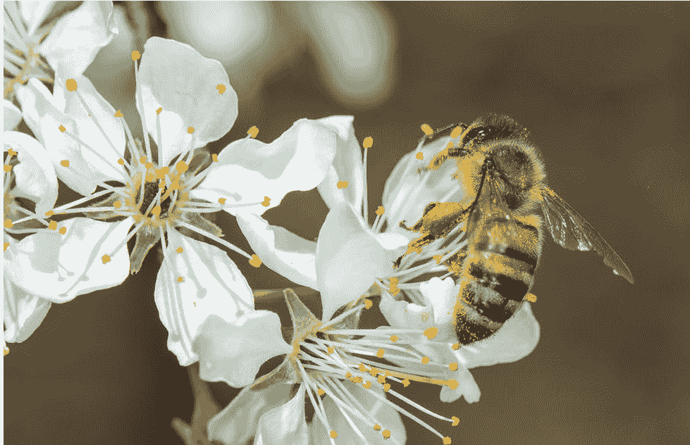

- 野生李树（*Prunus americana*）上的蜜蜂

## 蜜蜂和大黄蜂

蜜蜂是最社会化的蜜蜂，它们在活跃季节筑巢的同一地点越冬，该地点要么是人工蜂箱，要么是野生蜜蜂的空心树或类似空洞。如果冬季天气转暖，蜜蜂会出来觅食。

大黄蜂在活跃季节形成的群落比蜜蜂小得多，但在冬季变得独居。秋季，大黄蜂群落会产出新蜂王和雄蜂。一旦蜂王和雄蜂交配，新交配的蜂王会存活，而群落中的其他蜜蜂则死亡。交配后的蜂王会找一个新巢穴，通常是落叶层遮掩的小型地下地点，在那里独自越冬。有时她会在岩石下、腐烂的原木下或本土草丛基部筑巢。通过保留落叶和原木来保护她的越冬栖息地。越冬的大黄蜂蜂王，就像越冬的成年蝴蝶一样，会产生一种名为甘油（glycerol）的天然化学物质，防止它们在寒冷天气中冻结。早春时节，蜂王从冬眠中出来，找到筑巢地点产卵。

## 独居蜜蜂

独居蜜蜂寿命约为一年，大部分时间都在卵、幼虫和蛹的发育阶段度过。这些蜜蜂作为成虫活跃的时间很短，也许只有三到四周。与蜜蜂和大黄蜂不同，大多数物种的独居蜜蜂在冬季到来前就会作为成虫死亡。独居雌蜂会将卵封在带有花粉和花蜜储备的洞穴或巢穴空腔中。保持它们的栖息地不受打扰，以便新蜜蜂能在春季或夏季成功孵化。

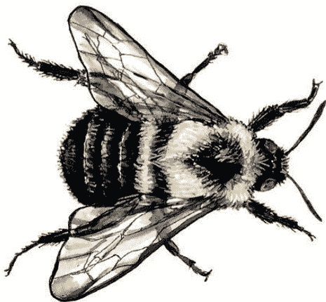

存活的独居穴巢蜜蜂，包括泥蜂（mason bees）、切叶蜂（leafcutter bees）和小木蜂（small carpenter bees），会以成虫状态在原巢穴中以滞育（diapause，或称发育暂停）状态越冬。泥蜂尤其有趣，因为它们可能在防水茧中越冬。为了帮助穴巢蜜蜂，种植具有髓质多孔、海绵状茎秆的植物，如接骨木（elderberry）和乔·派伊 weed（Joe Pye weed）；保留具有空心空洞或甲虫隧道的树木和灌木，并考虑提供束状空心管或人造蜜蜂旅馆（bee hotels）（有关资源请参见附录）。

传粉者胜利花园（Pollinator Victory Garden）里花繁叶茂，但它不仅仅是传粉者进餐的地方。缺乏良好筑巢、庇护和越冬场所的花园不是传粉者胜利花园；它只是一个花卉自助餐。为传粉者提供一个安全、无农药的家园，让它们能够生活和繁衍。
