# 3 为传粉者提供食物

栖息地包括传粉者生活的地方，以及它们进食和获取所需营养以茁壮成长的地方。这些栖息地可能相同，可能重叠，也可能更分离，就像蜜蜂的情况那样，如果有必要，它们会飞行数英里去获取食物。在管理的景观中，生活的地方和进食的地方（两种栖息地）应该重叠，并且同等重要。在大多数情况下，您可以在同一区域为传粉者提供生活的地方和进食的地方。

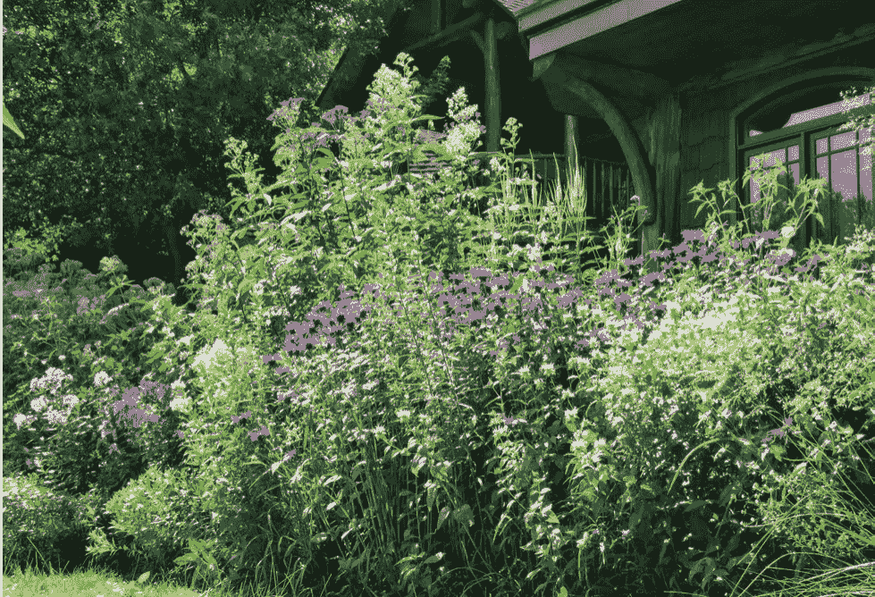

拥有大量传粉蜜源植物的传粉者栖息地

## 传粉者吃什么

蜜源（Forage）是指传粉者从花朵中获取的食物供应。觅食栖息地是您景观中的餐厅，是花园中传粉者可以找到一顿饭的地方。

## 花蜜、花粉和其他食物

传粉者的主要食物是花蜜（提供能量）和花粉（提供蛋白质），由大多数开花植物产生。一些开花植物，如圣约翰草（St. John's wort）和报春星花（shooting star），只产生花粉，但这对传粉者仍有价值。玫瑰常被提及为对传粉者友好的植物，花蜜很少，但主要用花粉奖励传粉者。对于传粉者，请坚持选择花结构简单、花粉丰富的本土玫瑰。避免杂交玫瑰，它们通常花蜜或花粉很少或没有，且花瓣结构更复杂，使任何蜜源都难以获取。

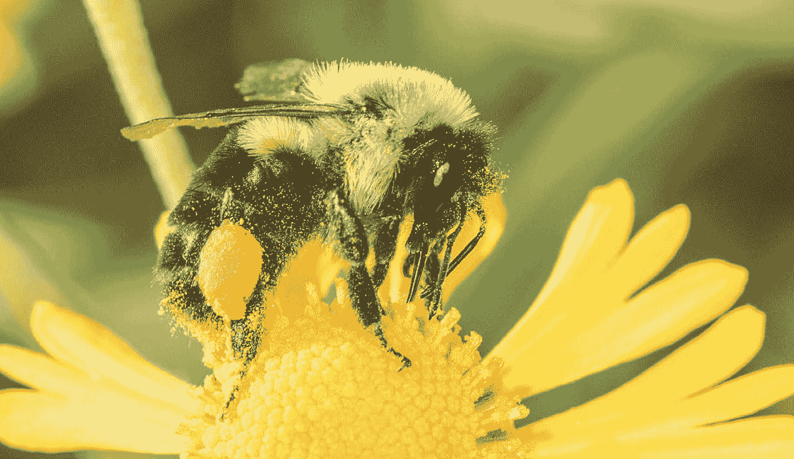

在普通打嗝草（common sneezeweed, Helenium autumnale）上觅食的东部常见大黄蜂

除了花蜜和花粉，一些传粉者还会寻找花朵中的非食物资源。有限数量开花植物产生的花蜜油与专业蜜蜂共同进化，这些蜜蜂在巢穴空腔中使用它们。一些蜜蜂物种会从花朵或植物茎秆中采集植物树脂，用于同样的目的。

## 传粉者饮食的差异

虽然蜜蜂和野生本土蜜蜂都吃花蜜和花粉，但并非所有传粉者都如此。大多数成年蝴蝶只吃花蜜，而一些新热带蝴蝶既吃花蜜也吃花粉。其他蝴蝶物种偏好非花卉食物，包括树汁。大多数成年蛾吃花蜜，但野生蚕蛾（wild silk moths）等物种除外，它们什么都不吃，而是在幼虫阶段获取所需营养。

一些甲虫物种专门吃花粉，而另一些可能吃花的部分，如花瓣，作为饮食的一部分。胡蜂（Wasps）主要是食肉动物，主要捕食昆虫，但它们也可能吃花蜜，尤其是在食物匮乏时。蜂鸟和传粉蝙蝠以昆虫、花蜜和有时花粉为食。

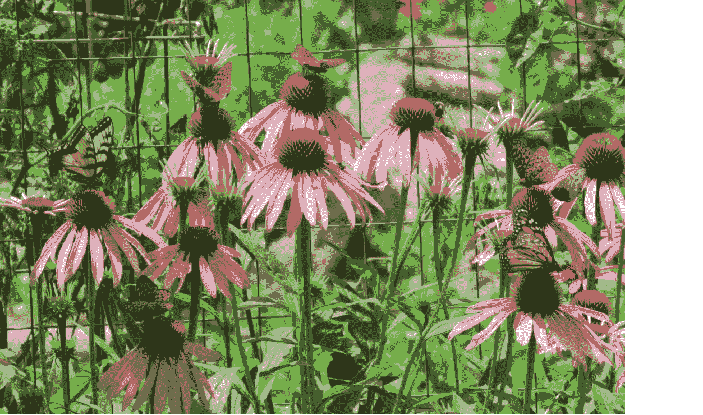

本土植物，如紫锥花（Echinacea purpurea），常常吸引多种传粉者。

## 传粉者如何进食

大多数传粉者每天进食多次，就蜜蜂而言，每天可能进行数十次采食任务。有些传粉者物种是特定植物的专利，而另一些则是广食性的，以多种不同的植物为食。一个有趣的例外是大黄蜂；虽然大黄蜂通常是广食性采食者，但大黄蜂群落中的个体蜜蜂可能会专门采食某些植物。

有些传粉者（包括大黄蜂、蜜蜂和蝴蝶）具有称为花恒性（又称花忠诚度）的进食行为。在每次采食旅行中，它们寻找一种植物作为食物来源。这对园丁的启示是：应种植多于一种特定植物；否则，实行花恒性的传粉者将无法获得足够的营养，并且会在更多采食任务中消耗更多能量。传粉者从至少 3 英尺（0.28 米）见方的植物群落中受益。并非所有花园都有足够的空间来实现这一点——尽力而为即可。

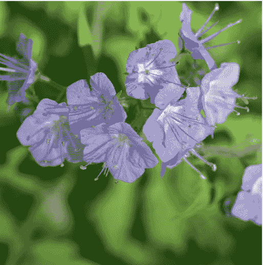
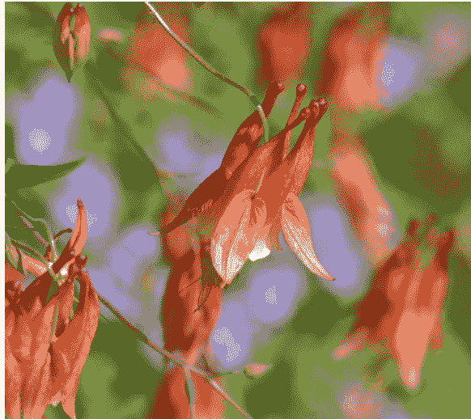

- 蝎子草（Phacelia species）尤其吸引蜜蜂。
- 耧斗菜（Aquilegia canadensis）受蜂鸟喜爱。

## 为传粉者选择植物

当你了解植物类别以及选择特定植物而非其他植物的原因时，为你的传粉者胜利花园选择最佳植物会更容易。本土植物、非本地植物、归化植物、原种植物、栽培种和杂交种在对传粉者友好的景观中都有不同的含义。

![](img/e08b8bbb8ab6f97b27467073323e2da2_48_2.png）

“把合适的植物种在合适的地方”是园艺界值得铭记的格言。你选择的植物应适合你所在的区域，并适合你种植的特定地点。你选择的植物应吸引传粉者，至少吸引某些传粉者。并不存在“一种植物适合所有情况”的植物，因为并非每个传粉者都会被每种传粉植物吸引，或者能够使用每种传粉植物。

一旦你掌握了本章中关于传粉植物选择的关键点，就可以为你的传粉者胜利花园做出最佳选择。剧透一下：为了获得最佳传粉效果，应优先选择适合你所在区域且适合你景观条件的本土原种植物的多样化组合。

![](img/e08b8bbb8ab6f97b27467073323e2da2_49_0.png）

- 凤蝶已演化为本土火焰杜鹃（Rhododendron calendulaceum）的最佳传粉者。

### 本土植物

取决于你询问的是谁，本土、非本地和入侵植物的定义可能存在显著差异。美国联邦行政令 11987 号将本土物种定义为“目前或历史上自然出现在美国任何生态系统中的所有动植物物种。” “自然出现”这一短语的加入是理解什么是本土的关键。

本土植物的一个良好工作定义是：在特定区域或生态系统中自然存在数百或数千年的植物。“本土”一词最好与地理限定词连用（如“本土于东北部”、“本土于纽约”、“本土于韦斯特切斯特县”）。在欧洲人定居之前在美国发现的植物通常被认为是美国本土植物。虽然一种植物可能在某些州是本土的，但在它尚未演化的更遥远的州可能不适合种植。（关于如何确定哪些植物是你所在地区本土植物的提示，请参见第 64 页。）

### 本土植物的益处

本土植物是指在没有人为引入的情况下自然发生，并在当地生态系统中共同演化、与周围生物紧密相互联系的植物。没有本土植物和本土景观，许多其他物种将无法生存。随着景观中充斥着草坪和其他非本地植物，本土植物提供的资源被消除，许多物种遭受痛苦。在过去的一代人中，脊椎动物和无脊椎动物物种都大幅下降。传粉者物种遭受了严重打击。在支持本土传粉者和我们当地生态系统方面，本土植物从未像现在这样重要。

如果进化和生物多样性的重要性无法说服你，以下是本土植物重要的其他一些原因。

### 为什么本土植物很重要？

- 本土植物适应一个地区的土壤、气候和水文。
- 本土植物提供归属感，将我们与自己的地区联系起来。
- 许多本土植物与本土野生动物有密切的进化联系，后者可能依赖于它们。
- 有本土植物的景观中充满生机，包括大量传粉者。
- 本土植物为野生动物（包括传粉者、鸣禽、益虫和本土哺乳动物）提供合适的栖息地和食物。
- 本土植物是完整且运作良好的生态系统的核心。
- 建立后，本土植物低维护；不需要肥料或农药，且经济实惠。
- 许多本土植物也为欧洲蜜蜂提供食物。
- 本土植物消除了修剪以及使用污染环境的燃油设备的需求。
- 本土植物增强了生态系统服务——健康的环境为人类福祉提供的贡献，例如授粉、清洁空气和饮用水。
- 本土植物增加了生物多样性，而生物多样性对应对气候变化至关重要。
- 每种类型的景观都有适合的本土植物。
- 许多本土植物拥有深根系统，有助于减少洪水和水土流失，同时促进富含有机质的肥沃土壤。
- 本土植物处处美丽。当一朵本土花朵被采蜜的传粉者点缀时，它从未如此美丽。

![](img/e08b8bbb8ab6f97b27467073323e2da2_50_0.png）

![](img/e08b8bbb8ab6f97b27467073323e2da2_51_0.png）

研究表明，本土植物对传粉者的吸引力是非本地植物的四倍。在某些情况下，本土物种之间的进化联系非常深远，更不用说本土植物除了花蜜和花粉之外，还能为生态系统提供更多，并且最适应区域条件。

## 使用本土多年生植物和木本植物

本土植物在传粉花园中的益处是毋庸置疑的，但在大多数景观中却被严重利用不足。你的本土植物选择不仅包括多年生植物，还包括本土乔木和灌木。将你的花园视为整个景观，而不仅仅是开花多年生植物生长的独立种植区域。大量开花的本土多年生植物对传粉者大有裨益，你种植的本土乔木和灌木亦是如此。

许多本土乔木和灌木是蝴蝶和蛾类的幼虫寄主植物。你在传粉景观中能包含的寄主植物越多，你将支持的蝴蝶和蛾类物种数量就越多。开花的本土木本植物提供大量花卉，其花量往往难以用多年生植物复制，特别是在小院子里。

## 融入更多本土植物

考虑你景观中可能生长不佳、容易被本土对传粉者友好的替代植物取代的灌木区域。没有任何传粉者光顾的开花非本地灌木是一个很好的替换候选者，可替换为吸引传粉者的本土替代植物——具体取决于你所在的区域，或许可以是九皮树、白刺树或夏甜。许多毫无生气的基础种植正等待转变为传粉者盛宴。不健康的树木和灌木也可以移除，为强健且生态的本土传粉植物腾出空间。

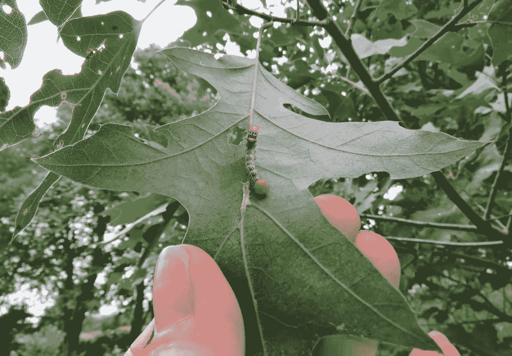

- 橡树（Quercus species）是服务于最多毛毛虫物种的幼虫寄主植物。

在选择本地植物时，考虑景观的层次以及你周围自然区域中看到的本地物种。尝试在你的景观中反映这些层次和物种。在美国东北部的大部分地区，自然区域的层次从乔木层开始，向下过渡到次乔木层、高灌木和矮灌木，然后延伸至开花多年生植物、禾草、莎草和地被植物组成的草本层。即使是草原和沙漠也有层次，尽管它们较难看清。在你自己的景观中，模仿你所在地区看到的自然层次。

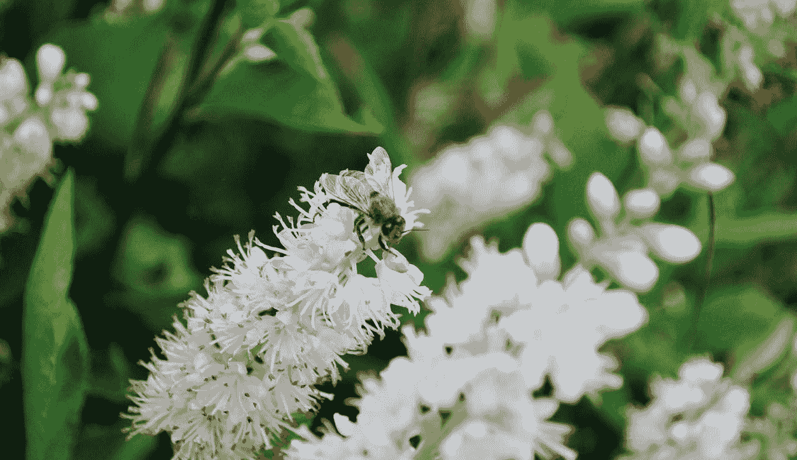

蜜蜂在夏甜（Clethra alnifolia，一种本地植物）上采蜜

## 非本地植物

非本地植物是指在人为帮助下（无论是有意还是无意）被引入到此前未出现过的新地点或新栖息地类型的植物。非本地植物的另一个术语是外来植物；外来植物是指来自不同大陆的非本地植物。并非所有非本地植物都是入侵植物，也并非所有非本地植物都会归化；事实上，有些非本地植物表现良好。尽管开花的非本地植物可能为广食性传粉者提供花蜜和花粉，但它们在生态上可能无法像本地植物那样发挥其他作用——例如作为幼虫寄主植物、首选筑巢地点以及迁徙鸟类的适当营养来源，等等。

在考虑你不熟悉的非本地植物时，首先查询你所在州的入侵物种名单，以确定某植物是否已被宣布为入侵物种或关注物种，或是否列入观察名单。避免种植所有此类植物，并寻找本地替代品。许多入侵植物在其有害影响被认识之前，常被用于花园和市政种植。（有些甚至仍在贸易中出售，因此需谨慎。）

- 入侵植物，如葛藤，会挤占本地植物并消除本地栖息地。

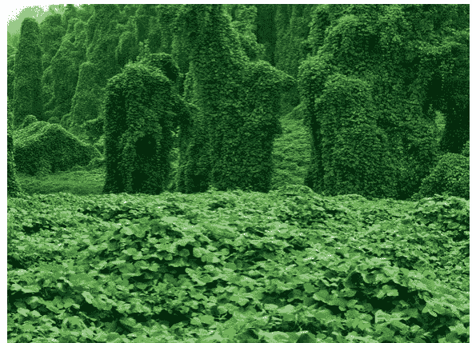

## 归化植物

归化植物是一种非本地植物，能够在没有人为帮助的情况下随时间繁殖并维持自身。不过，即使经过时间，归化植物也不会成为本地植物群落中原生的成员。入侵植物是归化植物的一个子类别，而那些正是你真正需要消除的植物。

在你的景观中，最好避免使用归化植物。有些归化植物未来可能会造成问题，如果它们破坏生态系统，取代本应存在的本地植物。如果你想要扩散的植物，选择具有这种特性的本地植物。

## 入侵植物

入侵植物是一种非本地植物，能在多种地点建立种群，生长迅速，并扩散到足以破坏生态系统的程度。然而，并非每种生长习性强劲的植物都是入侵植物，因为即使是一些本地植物也可能很强劲，这在某些花园场景中是有用的。

美国政府将入侵物种定义为非本地于所考虑生态系统的物种，且其引入造成或可能造成经济危害、环境危害或对人体健康的危害。在美国某一地区具有入侵性的植物，在美国另一地区可能暂时不会造成问题。美国东北部常见的入侵植物包括日本小檗、东方蔓绿茶、挪威槭和日本忍冬。加利福尼亚州常见的入侵植物包括黑金合欢、大芦苇、墨西哥帼尾草和臭椿。

许多随时间成为入侵植物的植物，实际上是在很久以前通过园艺引进的，远在人们怀疑这些植物可能在其原生范围之外造成问题之前。美国大多数州都有自己的入侵物种名单。不要种植这些植物，并清除你可能已有的任何此类植物。此外，还要避免列为关注物种但尚未被定义为入侵物种的植物。

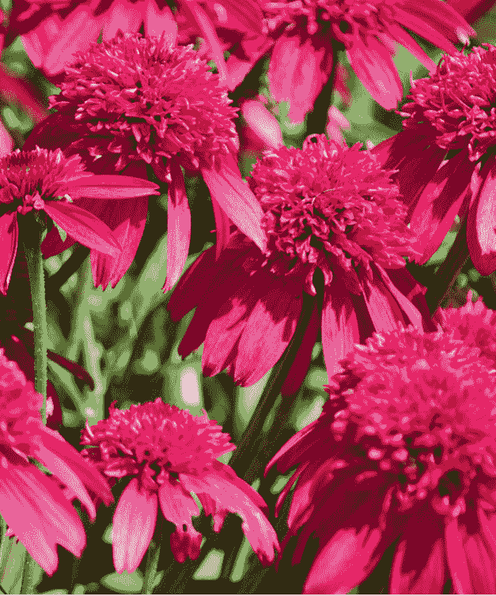

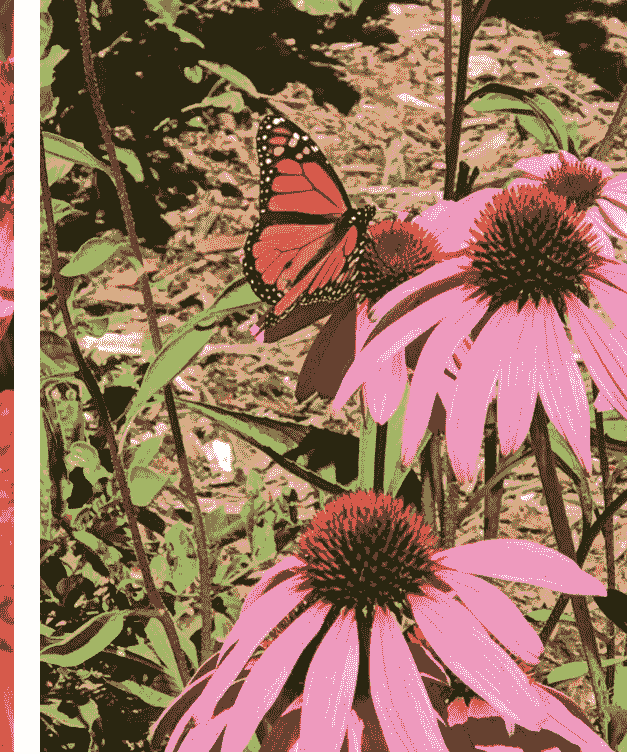

- **重瓣紫锥菊：** 美丽，但不利于传粉者的选择。

- **本地紫锥菊（Echinacea purpurea）：** 非常适合传粉者的选择。

## 植物排除清单

在为你的传粉者胜利花园选择植物时，先从应该排除的植物做出简单的决定开始。你可能会在其他花园中看到许多这些植物——但请不要犯同样的错误。以下是可为传粉者消除或尽量减少的三类植物。

## 为传粉者消除这些植物

- **1 消除你所在州名单中列为入侵或关注物种的植物。**

入侵性非本地植物生长茂盛，足以造成环境或经济危害。这些就是你经常看到的挤占本地植物的植物，尤其是在受干扰地区，有时会形成大片的单一栽培种群，且远离其原产国或原产地区中控制其生长的害虫和疾病。入侵植物通过取代本地野生动物共同演化并依赖的本地植物，造成实际的生态危害。

不幸的是，某些入侵性非本地植物对传粉者非常有吸引力。传粉者是机会主义者，会利用在缺乏本地或表现良好的非本地植物时可用的花蜜和花粉等花卉资源。请时刻关注生态系统的整体健康，并将入侵性非本地植物排除在你的植物选择之外。

- **2 消除重瓣植物或因过度育种而失去大部分花蜜和花粉的植物。**

重瓣植物通常对传粉者几乎没有或没有花蜜或花粉。额外的花瓣取代了植物的生殖器官，最大限度地减少或消除了传粉者所需的花卉资源——花蜜提供能量，花粉提供蛋白质。重瓣花对人类来说可能视觉上很迷人，但对传粉者来说几乎毫无用处。

通常，与其野生相似种长相差异较大的植物并不适合作为传粉者植物。如果你不确定，可以在花卉中心或苗圃询问你考虑的植物是否不育。如果你喜欢一种不育杂交的不寻常植物，可以将其放置在景观的其他地方，但请将其视为观赏花园物品，而非传粉者植物或具有显著生态价值的植物。

- **3 尽量减少风媒植物。**

虽然某些风媒植物，如榛子，可能为传粉者提供有限的低质量花粉，但风媒乔木和灌木最好保留作为蝴蝶和蛾类的幼虫寄主植物，以及鸟类和哺乳动物的筑巢和食物来源。以风媒植物为主的花园是传粉者沙漠。风媒乔木和灌木可以提供重要资源，但不足以供给传粉者足够的食物。

某些风媒多年生植物*确实*值得在传粉者花园中种植。暖季本地禾草就是一个例子。尽管它们不提供花蜜或花粉，但本地禾草常常是弄蝶（一种蝴蝶）的幼虫寄主植物，并具有为传粉者提供良好防风林以及可能成为大黄蜂筑巢地点的额外价值。

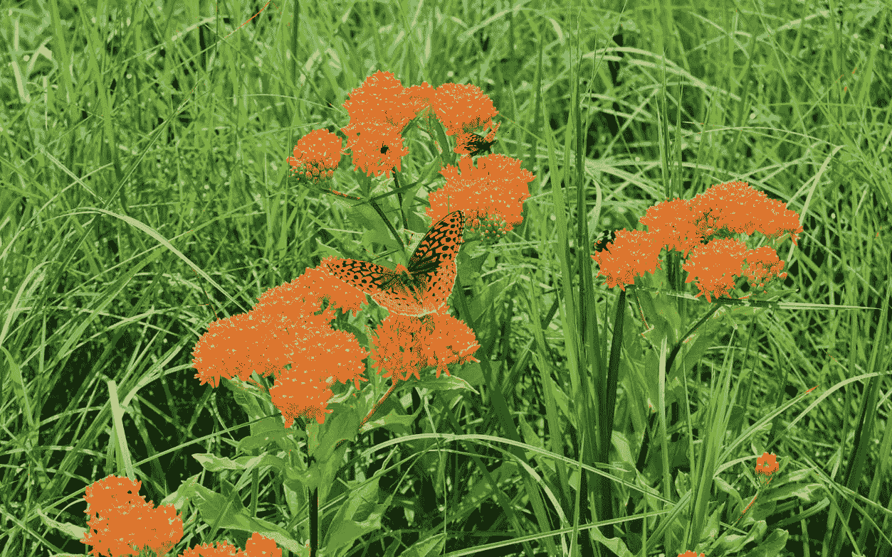

琴脚蝶在天芥菜（Asclepias tuberosa）上采蜜

## 关于选择植物的更多内容：原种、栽培种和杂交种

当你去购买植物时，标签和植物名称可能会让人困惑——你可能不确定自己购买的是什么。如果你知道植物繁殖或育种方面的差异，你就能为传粉者做出最佳选择。

每个成功的传粉者胜利花园背后，都有具有吸引传粉者并提供所需资源特征的植物。一株几乎没有花蜜或花粉的开花植物可能很美丽，但在传粉者花园中价值不大。为奇特的花色或与物种有其他显著差异而培育的植物，可能无法被你试图吸引的传粉者所认可。大自然确实最懂得——选择植物时，遵循她的引导。

## 植物学名称

与植物名称有关，真正鉴定植物的唯一方法是使用其学名。那些在学校里苦苦挣扎于拉丁语课程的人终于可以将部分教育派上用场了。植物的俗名并不总是有帮助，因为它们因国家、州和地区而异很大。说到植物，拉丁语是你的朋友，因为它确保你得到的正是你想要的植物。

学名由两个拉丁单词组成。第一个单词，始终大写并斜体，是属；第二个单词，始终小写并斜体，是种加词。两个单词合起来构成植物的名称，也称为植物种。Asclepias tuberosa 是一个植物种的例子。这种特定植物有无数俗名，包括 butterfly weed、butterfly milkweed、pleurisy root、orange milkweed、chigger flower、fluxroot 和 orange root。植物学拉丁语让事情变得清晰，无论你住在哪里，特定植物到底是什么都一目了然。

随着植物 DNA 分析变得更加复杂，学名有时会发生变化。植物分类学家（那些鉴定、描述、分类和命名植物的人）可能会重新命名植物，以更好地与其真谱系和与其他植物的关系保持一致。这完全合乎逻辑——直到你去花园中心寻找 Aster laevis（光滑紫菀），却只能找到 Symphyotrichum laeve，即同一种植物的新学名。但是，种植者、苗圃和花园中心在植物标签上使用新名称时并不总是一致。购买植物时，最好同时掌握旧的和新的学名！

## 植物选择

物种内部植物的遗传多样性对生态健康也很重要，但并非所有可用的植物选择都能提供这种多样性。与大多数事情一样，在做出植物选择时存在权衡。带上所需的信息去花园中心！

这意味着了解直系种植物、栽培种和杂交种之间的区别。从生态学角度来看，直系种植物提供了最大的生物多样性和最大的生态影响，这两者都是治愈我们面临挑战的环境的重要因素。以下是这三种类型之间的区别。

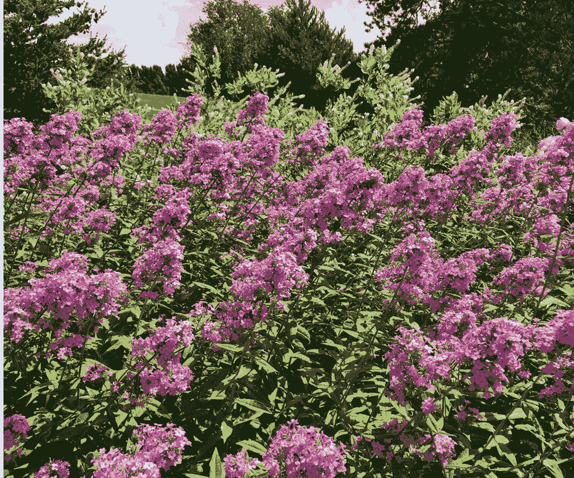

- Phlox paniculata 'Jeana' 是园生 phlox 的一个栽培变种，是一个克隆体。它确实能吸引许多蝴蝶和飞蛾。

## 直系种植物

直系种植物是指在没有育种或杂交的情况下自然发生的一种植物。从种子种植的“开放授粉”植物具有最大的遗传多样性。优先选择区域性的直系种本土植物，并且这些植物是开放授粉的（即由昆虫、风或水自然授粉），以利于增加生物多样性并适应当地地区。

直系种植物的一个例子是 Penstemon hirsutus（毛苣苔草）。有些植物可能有自然存在的亚种或变种，例如 Penstemon hirsutus var. pygmaeus，这是该物种的矮生形式。你还可能会看到植物的亚种被指定为“ssp.”。

## 栽培种与栽培变种

栽培种是植物的栽培变种，通常因所需性状（如抗虫或抗病性、花色、果色、叶色、习性、大小等）而被选出。栽培种可以通过种子或营养繁殖（结果是基因克隆）来繁殖。栽培种用单引号指定——例如 Echinacea purpurea ‘Magnus’。栽培种名称不使用斜体。

栽培变种仅仅是本土植物的栽培种。不幸的是，这往往是苗圃中仅有的“本土”植物类型。栽培变种有些争议，因为与直系种植物相比，它们的遗传多样性较少，并且可能会丧失一些生态功能。

许多栽培变种是从扦插繁殖的基因克隆体，而另一些则是开放授粉并从种子种植的。克隆体就是你所想象的那样——想想多莉羊——它们缺乏遗传多样性。植物标签通常不会披露植物是由种子还是由扦插培育的。购买植物时在网上多做一些调查。

在生态学性价比最高、生物多样性最大方面，直系种植物是首选，开放授粉的栽培变种是次选，而克隆栽培变种排在第三位。

## 杂交种

杂交种一词通常指两个不同植物种之间的有意杂交以创造新植物。杂交种的指定方式是植物名称中缺少第二个拉丁词（其种加词）或存在“x”符号。例如，Baptisia ‘Purple Smoke’ 是 Baptisia alba（白野靛蓝）和 Baptisia australis（蓝色假靛蓝）的杂交种。杂交种在本土园艺界颇具争议，因为它们会导致遗传多样性丧失，尽管某些自然杂交种确实无需人为干预就会发生。有些杂交种，但并非全部，也是不育的。在传粉者胜利花园中，杂交种不是最佳选择。

## 植物选择工具与技巧

正确的植物选择对任何花园（包括传粉者胜利花园）都至关重要。为了获得最佳植物健康、传粉者支持和积极的生态影响，请强调选择本地本土植物并适合你的景观条件。

### 选用本地植物

植物构成当地生态系统的基础，并与当地野生动物（包括传粉者）有进化联系。是的，广食性本土传粉者可能会在非本土植物上吸蜜，非本土西方蜜蜂可能会从本土植物上吸取花蜜，但生态系统复杂，进化联系和生态功能的深度和范围可能并不总是显而易见。同时作为幼虫寄主植物的本土花蜜植物就是这些复杂进化联系的一个例子。

为了获得最佳成功率，请种植当地传粉者共同进化的本土植物。购物时寻找本地种植的本土植物或种子。此外，本土植物将提升你景观的整体生态健康。如果你也想支持西方蜜蜂，不用担心；许多本土植物也能喂养这些广食性传粉者。

### 匹配植物与景观条件

老话“把合适的植物种在合适的地方”很可能是由一位吃过苦头的园丁创造的。这句简洁的话语通常接着是安慰性的格言“在杀死一株植物之前，你才真正认识它”。一开始就把合适的植物种在合适的地方会更好！无论传粉者植物多么出色，如果它不适合你的景观条件，就不要种它。只要是需要全日照和快速排水土壤的植物，种植在阴凉且黏土湿润的花园中，迟早会失败。研究你考虑用于传粉者花园的任何植物，以确定它是否适合你自己的景观条件。本书附录中列出了许多优秀资源，可帮助你研究植物。

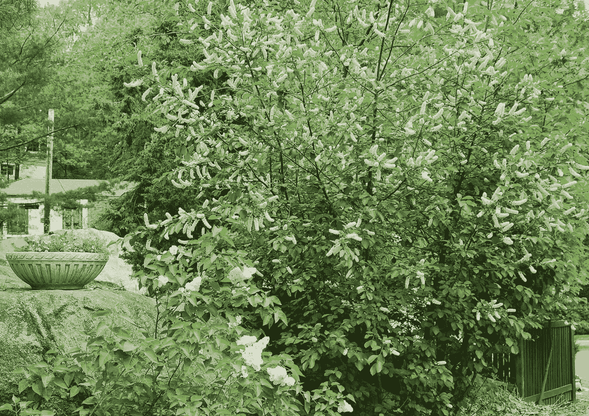

鸸鹋樱（Prunus virginiana）是一种本土植物，既是幼虫寄主植物，也是良好的花蜜植物。

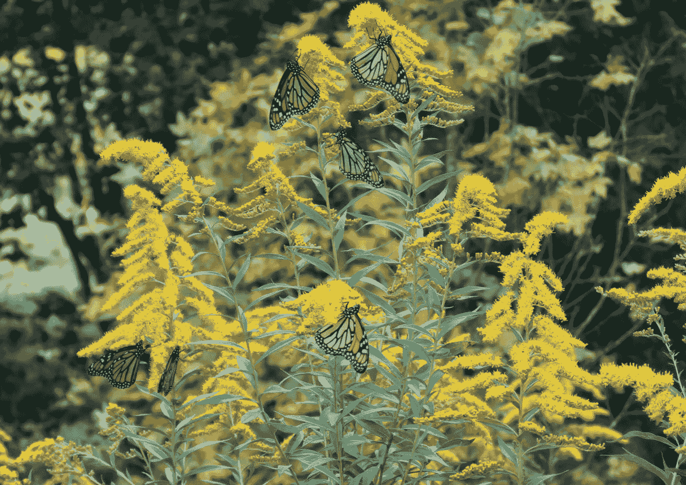

金露花（Solidago 种）是晚季花蜜的重要来源。

## 了解植物的区域性

在为你的传粉者胜利花园选择植物时，区域植物清单可以作为有用的起点。但区域的定义方式可能因来源而异。作为起点，看看你的州是否包含在讨论的区域中。

如果你发现同一植物属（一组相关植物的集体名称）出现在北美的多个区域，不要感到惊讶。例如，属 Solidago（金露花）遍布美国的每个区域，包含超过 100 个物种。但并非每个金露花物种都出现在每个区域或相同的地理条件下。有些物种分布范围很广，适应各种生态区（生态区域）。

Solidago altissima（高穗金絲桃）分布范围广，在美国大部分地区都有发现。其他金絲桃属物种分布范围极其有限——例如，Solidago albopilosa（白毛金絲桃）仅分布于肯塔基州。

由于特定州或地区内部的地理、生态和生长条件可能截然不同，列于该州或地区的并非每一种植物都适合每一处景观。在加利福尼亚州进行园艺种植就凸显了这一点。加州的生态区差异巨大，从炎热干燥的沙漠地区到高海拔山区应有尽有。这些地区自然生长的本土植物各不相同，因此各个地点的授粉花园植物选择也各不相同。

## 参考区域植物列表

作为本书的附赠内容，按区域划分的授粉植物列表可在 www.ecobeneficial.com/PVG 查阅。每个区域列表涵盖多个州，在加利福尼亚州的情况则是一个大州。选植物时，请将您的区域列表作为起点；由于生态区的地理条件不同，特定区域内的物种会有所差异。如果您有兴趣深入了解生态区的细节，请访问 EPA 的生态区网站 www.epa.gov/eco-research/ecoregions。

美国各个地区的列表中都会出现某些植物类群。马利筋（Asclepias 物种）分布于各个地区，美国约有八十种本土马利筋。与任何植物属一样，并非每一种马利筋都适合您的花园。最佳马利筋选择取决于您的位置和景观条件。

仅在加利福尼亚州就发现了十五种具有不同地理适应性的本土马利筋。Asclepias erosa（沙漠马利筋）仅生长在土壤干燥多沙的沙漠地区，而 Asclepias speciosa（绚丽马利筋）通常生长在土壤季节性湿润的山区。这两种植物都无法在对方的景观条件下生长。

种植本地区的马利筋，避免种植非本土热带马利筋（Asclepias curassavica），因为后者可能促进帝王蝶上的寄生虫，并降低迁徙成功率和整体健康状况。有关此主题的详细说明，请访问 Xerces Society 网站 www.xerces.org。

## 精细化您的授粉植物列表

您在 www.ecobeneficial.com/PVG 上的区域植物列表只是一个起点；请将其与这里推荐的其他资源结合使用，以精细化您授粉花园的最佳植物选择。

访问您所在州和地区的本土植物协会网站；这些组织通常会发布本土植物列表或提供可搜索的数据库。新泽西本土植物协会发布该州每个县的植物列表。由纽约植物协会运营的纽约植物图谱（New York Flora Atlas）使用户能够按县搜索本土植物。由加州本土植物协会运营的 Calscape 网站允许用户搜索其精确街道地址所在地的本土植物。

如果您所在地区没有县级专属数据库，请尝试使用北美生物计划（Biota of North America Program）的植物数据库，该数据库覆盖所有州，细化至县级。USDA PLANTS 数据库也很有用，提供可放大到县级的本土植物分布图。

几家非营利组织在其网站上发布授粉植物列表，包括 Xerces Society、Pollinator Partnership 和 Lady Bird Johnson Wildflower Society（按州研究各类本土植物的优秀资源）。

## 在当地购买本土植物

本土苗圃通常是本土植物的最佳来源。在理想情况下，提供的本土植物应为原生种，从当地采集的种子培育而成，确保植物适应区域条件、基因适宜且基因多样。心愿清单上还包括在真实土壤（而非无土介质）中种植、不含合成化学品且绝对不使用农药的植物。具有这种溯源来源的植物难以获取。请愿意为此支付更多费用，因为其种植成本更高。

非营利组织举办的季节性本土植物销售会已变得非常流行，通常在春季和秋季举行。请向您当地的本土植物协会、奥杜邦学会分会、塞拉俱乐部分会、园艺大师团体及其他环保组织查询，看您所在地区是否安排了本土植物销售会。这些销售会通常由知识渊博的志愿者负责，他们将免费为您提供个人购物帮助和建议。

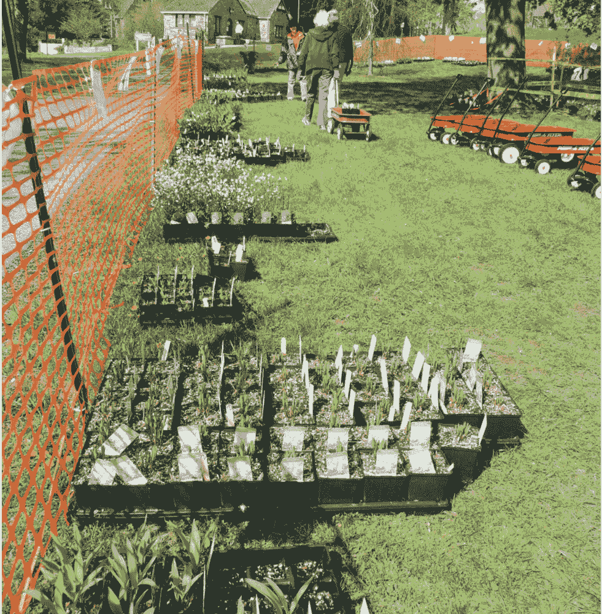

由非营利团体举办的本土植物销售会是寻找本土植物的绝佳场所。

当地的花园中心和苗圃也可能是本土植物的来源。如果他们尚未销售本土植物，请要求他们销售。无论您在哪里购买植物，都要坚持要求植物不含系统性杀虫剂。大型连锁商店已经意识到，新烟碱类杀虫剂（一类系统性杀虫剂）在政治和生态上都不正确。如果您从大型连锁商店购买，请查看植物标签，确保植物标有“新烟碱-free”。

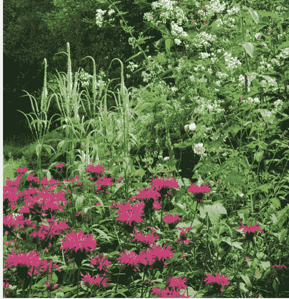

## 种植觅食栖息地的指南

与所有种植一样，在正确的位置种植正确的植物能确保园艺成功。使用与您想要吸引的授粉者共同进化的本土植物，将使您的觅食栖息地相对于种植非本土物种的花园具有优势。

并没有决定完美觅食栖息地的硬性规则，也不是每个地点都能容纳每一个种植目标，但以下是一些一般性指南。

- 多样化的花朵能喂养多样的授粉者。

### 种植指南：觅食栖息地

- 尽可能选择阳光充足、开阔的区域。
- 强调使用本土植物。
- 在整个生长季节种植以实现连续的开花序列。
- 同一时间至少有三种不同的植物物种开花。
- 变化植物的花朵大小、花朵颜色和花朵结构。
- 将每种植物物种种植成 3 英尺（0.28 米）见方或更大的丛状。
- 合理间距种植植物，使其能长至成熟宽度。
- 将植物种植得足够近，以消除成熟时植物之间的大片空隙。
- 组合具有相似生长习性（例如，丛生型与蔓生型）且竞争力相当的植物。

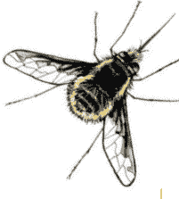

授粉者偏好阳光充足的花园。

## 在哪里为授粉者种植觅食植物

景观的几乎任何部分都可用于种植授粉者花卉，但并非所有地点作为觅食栖息地的价值都相同。您显然会受到景观大小及其整体条件的限制。如果您有幸拥有阳光充足的景观部分，您便占有优势。但即使没有阳光充足的地点，您仍可种植觅食植物。

## 确定觅食栖息地的规模

在决定种植觅食植物的区域规模时，尽可能做大，但或许可以分多个步骤进行。如果您与园艺师合作，工作比自己种植该区域要容易完成。请对自己的时间、精力、预算以及项目规模保持现实态度。将景观拆分为一系列较小的项目，比一次性完成所有工作更容易；您可以在创建它们时连接授粉斑块。即使您只有非常小的景观，例如城市花园，或仅是露台或庭院，您创建的任何授粉栖息地都有价值，包括种满开花本土多年生植物的容器花园。

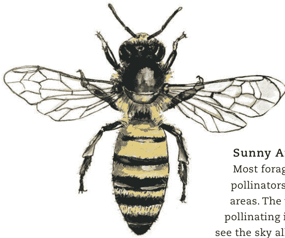

### 阳光充足区域

大多数觅食植物及其相应的授粉者都偏好阳光条件和开阔区域。阳光的温暖使变温授粉昆虫能够活跃，而能够看到天空则让它们能够导航。如果您的景观既有阳光也有阴影，请尽量在阳光区域种植大部分觅食栖息地。一个通常位于阳光充足、开阔位置的明显区域是草坪。将您可以舍弃的任何草坪部分转变为繁花似锦的授粉者自助餐。保留您真正使用的草坪没问题，但要舍弃其余部分，并确保不使用农药进行维护。难以修剪的区域，如山坡（尤其是阳光充足的山坡），当转变为开花地被植物的大片区域、丛生矮小开花灌木，甚至是微型草甸时，对授粉者（以及必须修剪的人）将大有裨益。

### 阴凉区域

如果您的景观缺乏阳光，请不要绝望；您仍可为授粉者种植，但植物选择会有所不同。许多对授粉者友好的植物生长在半阴处甚至全阴处。阴生植物对授粉者可能很有价值，尤其是在周围没有太多其他植物时。在美国东北部，春季开花的林地植物，包括荷兰人裤子（Dicentra cucullaria）、鳟鱼百合（Erythronium americanum）和斑点牻牛儿苗（Geranium maculatum），对早期出现的授粉者（如大黄蜂）至关重要，在授粉者需要时可能是周围唯一的花卉资源。即使是夏季开花的乔·派草和秋季开花的阴生植物，对饥饿的授粉者也可能有价值。林地紫菀和金絲桃（Eurybia divaricata、Symphyotrichum cordifolium、Solidago caesia、Solidago flexicaulis 等）在秋季会吸引许多授粉者访问。

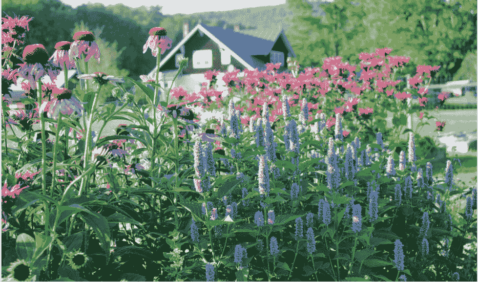

阳光充足的花园吸引许多传粉者。

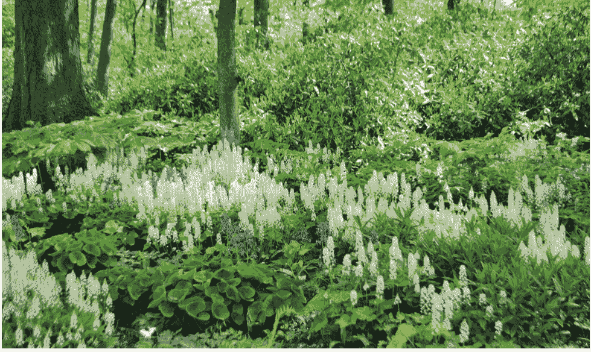

阴凉花园也能吸引传粉者。

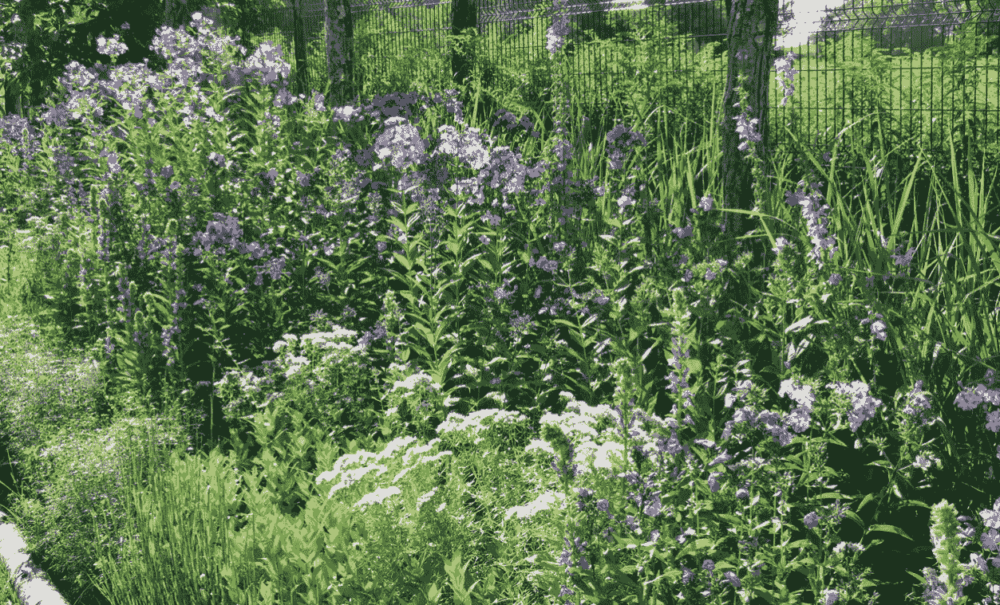

多样化的植栽可增加你能吸引的传粉者物种数量。

## 传粉者胜利花园中的花卉力量

花朵是传粉者最重要的食物来源，但这不仅仅是种花然后等待传粉者出现那么简单。一个成功的传粉者胜利花园在两个看似迥异的原则之间取得了平衡：植物多样性和植物充足性。这可以被视为“实现花卉平衡”。你的花园需要拥有各种各样的植物物种，以满足整个生长季节中不同传粉者的不同需求。同时，每种植物都必须有足够的数量，才能吸引并喂养所有使用它们的传粉者。找出这种平衡可能很棘手，尤其是在较小的景观中。没有完美的公式，但只要牢记这些概念并了解你所在地区哪些传粉者可能被吸引到你的景观，你就可以让你的花园成为一项宝贵资源。

如果你饲养欧洲蜜蜂，或者附近有托管的蜂箱，本地蜜蜂将在花蜜资源方面面临更多竞争。虽然并非所有蜜蜂物种都使用相同的花朵，但广食性采食者会使用许多相同的植物。在大量蜜蜂群落的存在下，要增加你的花卉资源，意思是：种植更多的开花植物。在为传粉者种植景观较少的发达社区，植物充足性也尤其重要。

## 提升植物多样性

多样性对于健康生态系统至关重要。科学家发现，种植许多不同植物物种的景观对害虫和疾病以及气候变化的影响更具抵抗力。我们在景观中面临着这三项重大挑战。大面积种植同一种植物的传统园艺做法可能看起来很壮观，但从生态学角度来看，这是不明智的。为传粉者大规模种植植物时，平衡是关键，否则我们就会失去多样性。

在景观中种植许多不同的植物物种，你就有更大的机会吸引更多样化的传粉者。全球估计有 200,000 种传粉者，包括 20,000 种蜜蜂，任何以生态合理方式种植的景观都可能吸引并支持数百种不同的传粉者物种和数千个不同的传粉者。

并非每个传粉者都会被或能使用相同的植物物种。长舌蜜蜂可以获取长管状花（如飞燕草）中的花蜜，但短舌蜜蜂不能。短舌蜜蜂更喜欢花园中更开放的花朵，特别是花蜜腺较小的花朵（花蜜位于花内）。广食性采食者可以使用比专食性采食者多得多的植物种类，因此要两者兼顾。我们的传粉者花园应该喂养许多不同的传粉者物种，而这需要拥有植物多样性。

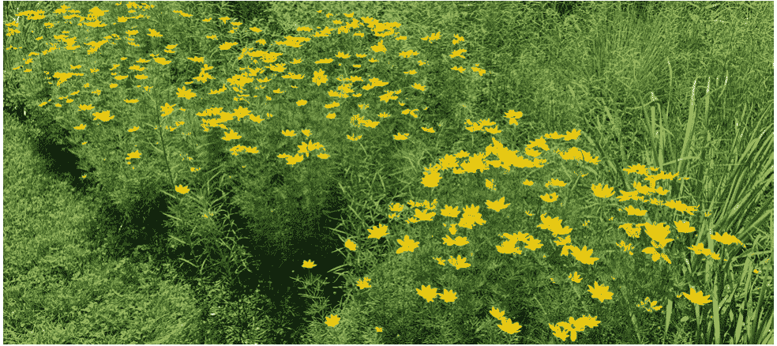

- 花卉靶点帮助传粉者采食（轮叶金鸡菊 Coreopsis verticillata）。

## 实现植物充足性

与多样化种植相辅相成还有一个方面。要成功吸引传粉者，你还必须种植足够，使传粉者容易找到你提供的花朵，并提供足够的该特定资源。植物充足性，即足够的花卉生物量，对于喂养可能造访你景观的各种传粉者至关重要。请记住，如果附近有蜜蜂，它们庞大的群落需要大量花卉食物才能生存。

许多蜜蜂和蝴蝶的花恋性行为凸显了种植足够同种植物的必要性。这些传粉者每天采食多次，但每次采食时，它们寻找一种植物。种植单株多年生植物对它们来说不够。选购植物时要像蜜蜂或蝴蝶一样思考；传粉者需要一顿完整的饭菜，而不仅仅是几口小吃。

提供植物充足性有两种基本的园艺方法。一种是创建传粉者靶点，另一种是创建植物重复。这两种方法都可以用于大多数景观，除了非常小的空间，比如阳台或微小的庭院花园。

## 种植传粉者靶点

传粉者靶点是同种植物的群组，使传粉者能轻松找到所需的花蜜和花粉。你花园中每个靶点可实现的尺寸将取决于你景观的大小。在有足够空间种植许多不同物种的景观中，每种植物种植 3 英尺（0.28 米）见方的靶点可能是一个合理的目标。现实地说，不是每个花园都有空间来实现这个

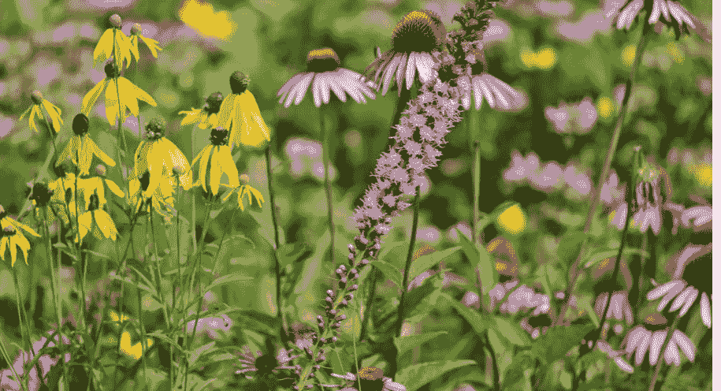

- 草地景观中的植物重复

目标。在多样化种植和充足种植之间总会存在权衡，所以请尽你所能利用你现有的空间。

虽然大多数单株树木和灌木在开花时提供显著的传粉者靶点，但大多数多年生植物需要一些伴生植物。选购开花多年生植物时，至少选择三株同种植物。一株小而孤独的植物在花园中容易被忽略，传粉者也更难找到它。如果你没有空间为每种植物物种包含大型靶点，请考虑在整个景观中重复某种植物。

## 采用植物重复

植物重复是一种可以与传粉者靶点配合使用，或作为景观中独立方法的技术。采用这种方法，无论景观大小，单一植物物种会在整个花园中重复出现。一只欧洲蜜蜂一天可能要进行五十次采食旅行。它会欣然在整个花园中找到这些重复的植物。

并非所有传粉者都以相同的方式寻找花朵。在较小的花园中，一种折中的方法是在整个景观中重复小块的同种植物群组，确保所有传粉者都能找到所需之物。

植物重复的一种方法，特别是在啃食性鹿是个问题的地方很有用，就是创建草地或草地景观（一种类似草地的花园）。天然草地有不规则、反复出现的花卉图案，为传粉者提供花蜜和花粉，同时消除了许多花园已成为的轻松“鹿自助餐”。关于草地景观的更多信息，请参见第 5 章。

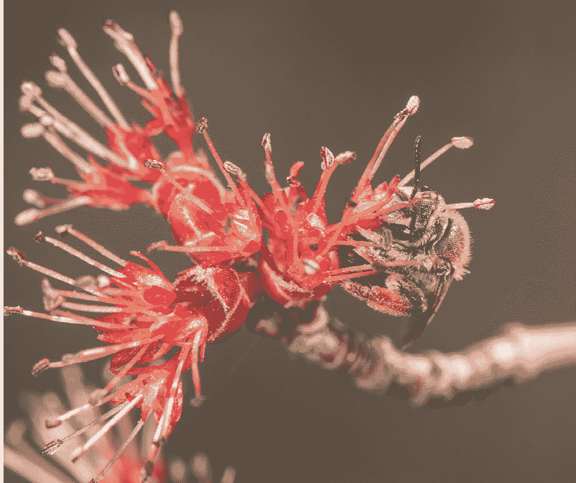

红枫花（红枫 Acer rubrum）是早期的采食来源。

## 规划开花期的继续与重叠

非常常见的是看到花园在一年中的某一两个时间段花期集中，而在生长季节的其余时间几乎不提供任何花朵给传粉者。想想当什么都不开花时，所有挨饿的传粉者吧！在整个生长季节里种植开花期继续的植物，你的传粉者会感谢你的。包括吸引不同类型传粉者的各种花朵，以喂养许多不同的物种，并包括开花时间重叠的植物，以确保花蜜可用。

实现这些目标的第一步是记录你花园中已有的植物及其开花时间。对开花的树木、灌木和多年生植物进行花期清查（但不要包括重瓣植物）。如果你无法凭记忆完成，就等花朵出现时再补充记录。你可以按天具体记录，也可以使用早春、仲春、晚春等时间段来简化过程。要创建花期清查表，请按下面示例记录你花园中所有的开花植物。

花期清查表示例

| 早春 | 仲春 | 晚春 |
| :--- | :--- | :--- |
| 红枫（red maple） 柳荑（pussy willow） 春金缕梅（vernal witch hazel） 悬铃木（serviceberry） 紫荆（redbud） | 金亚历山大（golden Alexanders） 匍匐火焰草（creeping phlox） 斑点牻榄儿（spotted geranium） 弗吉尼亚水叶（Virginia waterleaf） 野生心形花（wild bleeding heart） | 冬berry（winterberry） 蓝野靛蓝（blue wild indigo） 紫露草（spiderwort） 加拿大堇菜（Canada violet） 黑樱桃（black cherry） |
| 初夏 | 仲夏 | 晚夏 |
| 日晷羽扇豆（sundial lupine） 野生金雀花（wild quinine） 胡笳草（beardtongue） 光滑绣球（smooth hydrangea） 按钮 bush（button bush） | 垂葱（nodding onion） 普通萝藦（common milkweed） 紫锥花（coneflower） 乔·派草（Joe Pye weed） 野生佛手柑（wild bergamot） | 紫色巨藿香（purple giant hyssop） 响尾蛇草（rattlesnake master） 假向日葵（false sunflower） 落新妇（obedient plant） 新泽西茶（New Jersey tea） |
| 秋季 | | |
| 假紫菀（false aster） 普通骨节草（common boneset） 白色林地紫菀（white wood aster） | 平顶金葛（flat-top goldenrod） 闭瓶龙胆（closed bottle gentian） 林地向日葵（woodland sunflower） | 喷嚏草（sneezeweed） 之字形金葛（zig-zag goldenrod） 纽约紫菀（New York aster） |

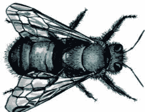

通过进行开花清查，你可以确定开花间隙出现的时间或花量稀少的时期；这些是关键的种植时期。创建一个持续的传粉者自助餐，为各种类型的传粉者提供选择。

非常早开花的植物并不总是被纳入传粉者花园的考虑范围，但它们很重要。大黄蜂和蜜蜂比某些其他蜜蜂物种能在更寒冷的天气中采蜜，并且春季非常早期就可能活跃。确保在这些昆虫从寒冷冬季中苏醒时，有早花本土植物可供它们采集。三月开花的红枫或四月开花的服务莓可能是蜜蜂和其他早蜂的早期盛宴，而松鼠玉米或荷兰人裤子（*Dicentra* 物种）可能是需要建立新群体的大黄蜂女王的关键早期食物。

让花卉盛放持续至生长季结束，对许多地区来说这是深秋。那时仍有相当多的传粉者活跃，并从本土植物如萝芙木和紫菀中受益。晚季开花在花园中常被遗忘。将它们添加到你的传粉者胜利花园中，以喂养准备越冬的交配雌蜂、即将迁徙的帝王蝶，以及在长途南飞前补充能量的蜂鸟。

选择植物时，请考虑并非所有植物的开花持续时间都相同。但不要只种植那些看似开花无穷无尽的物种。早春时节，服务莓（*Amelanchier* 物种）可能只开花一周左右，如果多雨则时间更短。相比之下，紫锥花（*Echinacea purpurea*）的开花期非常长，通常持续数周。然而，这

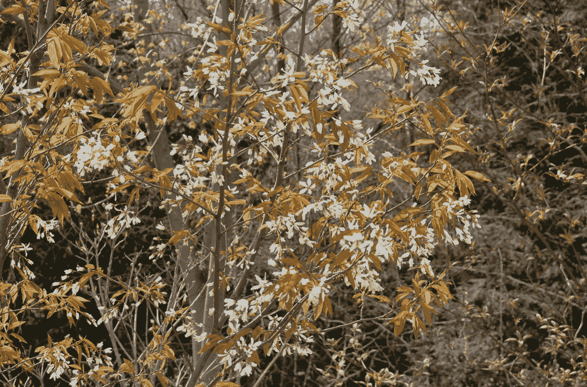

- 服务莓（*Amelanchier* 物种）为传粉者提供早期花卉。

并不意味着与锥花相比，服务莓就是一种不好的传粉者植物。服务莓在季节早期开花，那时周围很少有其他植物能提供花蜜。它是早期出现的矿蜂和汗蜂的重要食物来源，也是幼虫寄主植物。开花持续时间并非选择传粉者植物时的唯一因素。

在传粉者花园中建立持续的开花接力可能需要一些时间，但你的观察和种植终将有回报。

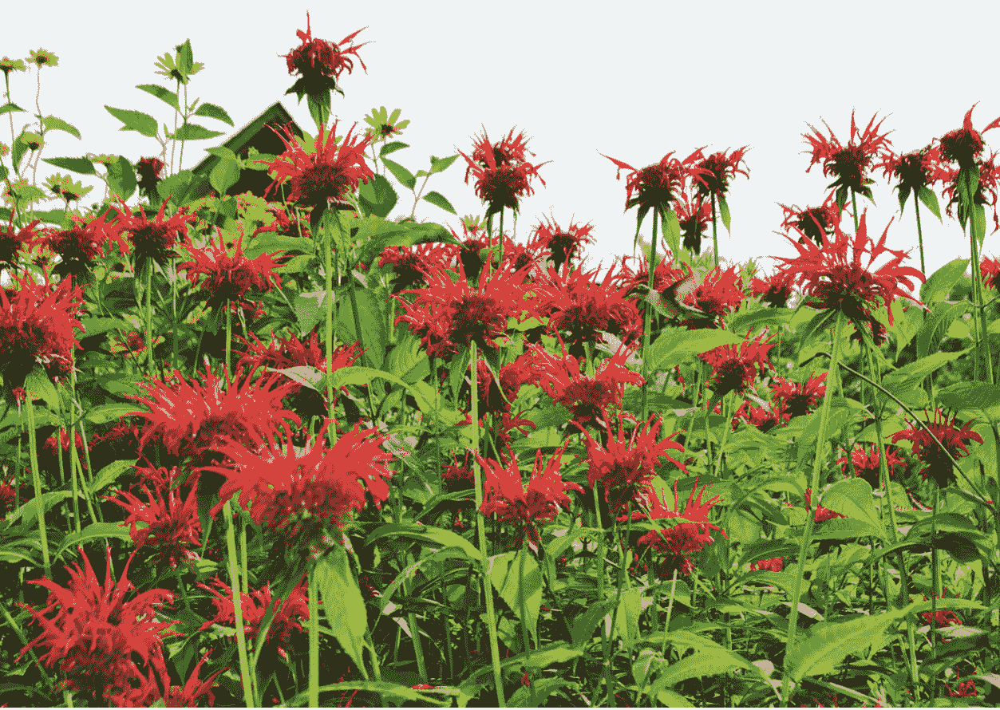

绯红香蜂草（Monarda didyma），蜂鸟的最爱

## 种植以吸引不同类型的传粉者

传粉者和植物共同进化，使双方都获益。通过进化，传粉者适应特定的花卉特征，反之亦然，确保传粉者获得所需食物，同时植物成功授粉并能够繁殖。这些进化出来的花卉特征被称为授粉综合征。花卉颜色、香气、结构和花蜜量，花粉的位置和质量，以及花蜜指引的有无，都是决定哪种传粉者可能使用某朵花的特征。

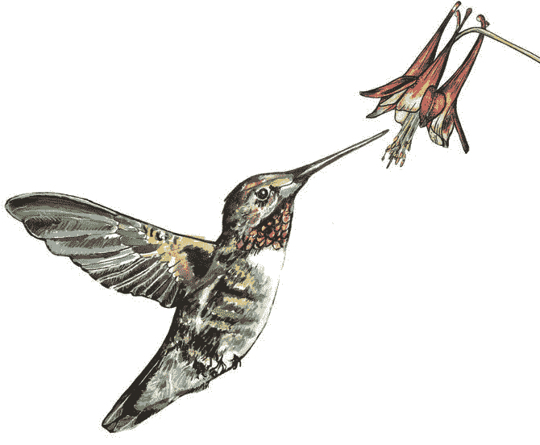

这些授粉综合征确实存在例外，特别是在传粉者缺乏选择的情况下。虽然蜂鸟偏好红色、深筒状花朵，例如绯红香蜂草（Monarda didyma）的花朵，但它们也会使用不具备这些特征的花朵。但为什么不为它们提供便利，给它们偏好的花朵呢？你可能会想要购买珊瑚忍冬（Lonicera sempervirens）的黄色栽培品种，但蜂鸟可能更喜欢直种，其花朵为橙红色筒状，喉部点缀着黄色。了解每种传粉者共同进化而来的花卉特征，将有助于你做出更好的植物选择，创建一个更具吸引力的传粉者花园。

尽管某些花卉特征的偏好在不同传粉者之间会有重叠，但其他特征则不会。花朵散发出的强烈甜香不会吸引鸟类，因为它们没有嗅觉。如果这种香气在夜间出现，对于寻找食物的夜蛾来说通常难以抗拒。清新淡雅的花香会吸引蜜蜂，而通常需要气味难闻的花朵才能吸引传粉的苍蝇。花瓣上的花蜜指引会吸引蜜蜂和蝴蝶，但传粉的甲虫不会注意到它们。为传粉者选择植物时，请考虑这些特征（传粉者综合征）。

请记住，花园中包含的花卉特征越多，吸引的传粉者种类就越广泛。

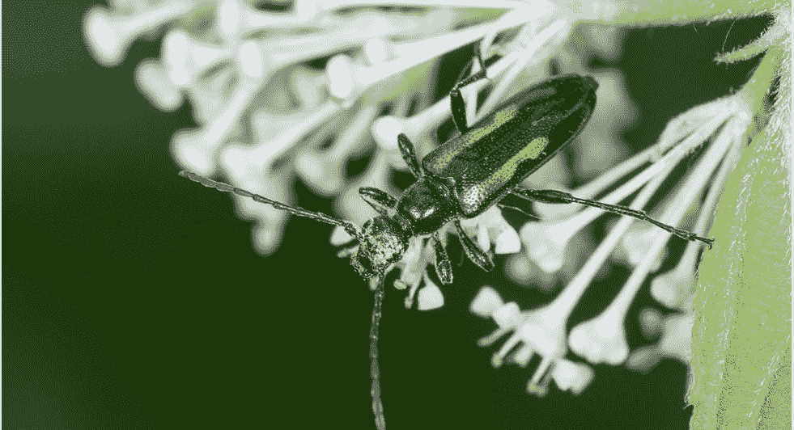

食花甲虫正在吃花粉

## 授粉综合征（按传粉者类型划分的花卉特征）

授粉综合征具有预测性，但并非绝对。

### 蜜蜂授粉花卉

| 颜色： | 鲜艳的白色、黄色、蓝色、紫罗兰色、紫色或紫外线颜色 |
|---|---|
| 结构： | 多样 |
| 香气： | 清淡，芳香 |
| 花蜜指引： | 有 |
| 花蜜： | 通常存在 |
| 花粉： | 通常带有粘性和气味 |

### 蝴蝶授粉花卉

| 颜色： | 通常鲜艳；常为红色、橙色、黄色或紫色 |
|---|---|
| 结构： | 通常带有宽阔的降落平台 |
| 香气： | 淡 |
| 花蜜指引： | 通常存在 |
| 花蜜： | 花蜜丰富，位于深处 |
| 花粉： | 有限 |

### 蛾授粉花卉

| 颜色： | 常为浅色、白色或粉色、暗红色或紫色 |
|---|---|
| 结构： | 簇生，降落平台 |
| 香气： | 夜间强烈甜香 |
| 花蜜指引： | 无 |
| 花蜜： | 大量稀释花蜜，位于深处 |
| 花粉： | 有限 |

### 鸟授粉花卉

| 颜色： | 绯红色、红色、橙色或白色 |
|---|---|
| 结构： | 大型，漏斗形 |
| 香气： | 无 |
| 花蜜指引： | 无 |
| 花蜜： | 花蜜丰富，位于深处 |
| 花粉： | 少量 |

### 蝙蝠授粉花卉

| 颜色： | 常为白色或浅色、绿色或紫色 |
|---|---|
| 结构： | 通常在夜间开放 |
| 香气： | 高度芳香，果味或发酵味 |
| 花蜜指引： | 无 |
| 花蜜： | 大量稀释花蜜 |
| 花粉： | 丰富 |

### 甲虫授粉花卉

| 颜色： | 常为暗淡白色或绿色 |
|---|---|
| 结构： | 常为碗形 |
| 香气： | 强烈，果味或恶臭 |
| 花蜜指引： | 无 |
| 花蜜： | 通常存在 |
| 花粉： | 丰富 |

### 苍蝇授粉花卉

| 颜色： | 常为深棕色、紫色或浅色 |
|---|---|
| 结构： | 常为漏斗形或复杂形状 |
| 香气： | 腐败的，腐肉味 |
| 花蜜指引： | 无 |
| 花蜜： | 通常缺失 |
| 花粉： | 少量 |

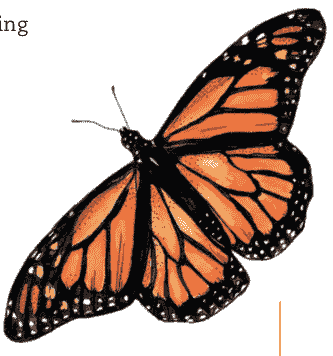

## 蝴蝶和蛾的食物：幼虫寄主植物

花卉或许是传粉者最广为人知且最重要的食物来源，但对于蝴蝶和蛾来说，称为幼虫寄主植物的非花卉食物至关重要，在讨论传粉者食物时不可忽略。蝴蝶和蛾经历完全变态，意味着它们有四个不同的生命阶段：卵、毛虫（幼虫）、蛹（蛹）和成虫（成虫）。虽然大多数成年蝴蝶和蛾以花蜜为食，但它们的大多数毛虫的饮食完全不同。

种植花园时，我们可能未曾考虑过毛虫吃什么，但这对于支持蝴蝶和蛾极为重要。大多数毛虫吃植物部分，通常是幼虫寄主植物的叶子，这些是毛虫与其共同进化的特定植物。一些毛虫物种吃花蕾和花部、果实、种子、其他毛虫，甚至动物粪便。但总的来说，毛虫吃其幼虫寄主植物的叶子。

### 寄主植物的类型

寄主植物可以是乔木、灌木、藤本、多年生草本、禾草或莎草——这取决于所涉及的毛虫物种。乔木和灌木是特别重要的寄主植物——许多，但并非所有本土木本植物都可作为幼虫寄主。一些物种可以支持数百种不同的毛虫物种。特拉华大学教授兼作家道格拉斯·塔拉米博士（Dr. Douglas Tallamy）的研究得出结论，在美国中大西洋地区，本土橡树作为寄主植物支持的毛虫物种比任何其他乔木或灌木都多：共计 557 种毛虫物种。本土樱树和柳树紧随其后，分别为 456 种和 455 种毛虫物种提供食物。

虽然很容易看出成年蝴蝶在哪里吸食花蜜，但要辨别它们的毛虫在哪里取食则要困难得多。由于大多数蛾在夜间取食，通过观察来确定其幼虫食物植物可能更加困难。你确定特定毛虫寄主植物的最佳工具是关于毛虫、蝴蝶和蛾的深入书籍和可信网站。也请查阅本书附录中的资源以及

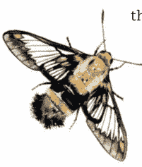

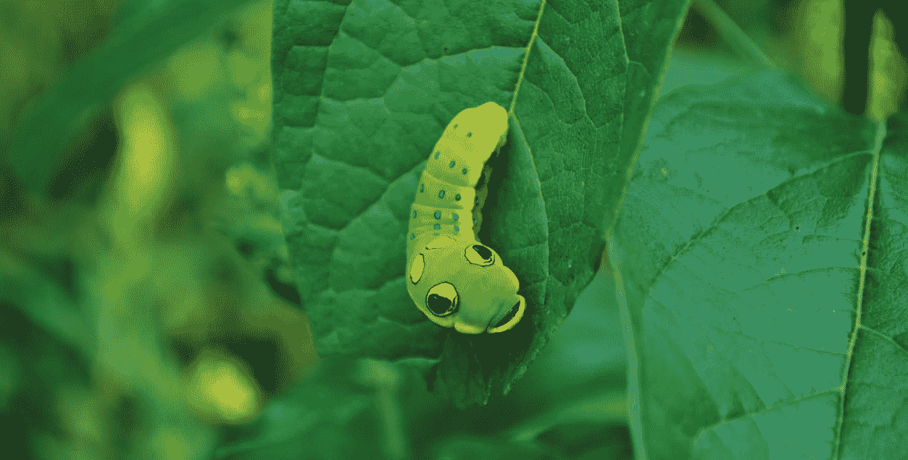

香料灌木凤蝶幼虫正在吃其一种寄主植物香料灌木（Lindera benzoin）的叶子。

常见寄主植物及其所食毛虫列表，可在 www.ecobeneficial.com/PVG 查看。

## 添加寄主植物

如果您拥有一个非常小的花园，没有足够空间种植多种寄主植物，可以与邻居“借用”或“共享”寄主植物。与邻居交谈，制定计划以填补寄主植物空白，从而吸引更多蝴蝶和蛾类。

为确保有合适的幼虫寄主植物可用，为您的景观创建一份寄主植物清单。第一步是确定您所在地区常见的蝴蝶和蛾类物种。有在线和印刷资源可供您参考（参见附录）。设置一个简单的清单，记录您花园中已有的、本地区蝴蝶和蛾类所寻找的寄主植物。您的花园里寄主植物不够多吗？那么是时候种植更多了。

### 寄主植物示例清单
*(spp. = 物种)*

| 蝴蝶 | 寄主植物 | 我的花园里有吗？ |
|---|---|---|
| 东部虎凤蝶 | Betula spp. (白桦) | [ ] |
| | Fraxinus spp. (白蜡树) | [ ] |
| | Liriodendron tulipifera (郁金香树) | [ ] |
| | Magnolia virginiana (甜月桂木兰) | [ ] |
| | Populus spp. (白杨，杨树) | [ ] |
| | Prunus spp. (樱桃，李子) | [ ] |
| | Salix spp. (柳树) | [ ] |
| | Tilia americana (美国椴树) | [ ] |
| 红斑紫蝶 | Betula spp. (白桦) | [ ] |
| | Crataegus spp. (山楂) | [ ] |
| | Populus spp. (白杨，杨树) | [ ] |
| | Prunus spp. (樱桃，李子) | [ ] |
| | Salix spp. (柳树) | [ ] |
| | Quercus spp. (橡树) | [ ] |

从上面的示例清单中，您可以确定现有花园是否能支持所讨论的蝴蝶。通过进行这项简短练习，您还会发现几种植物（加粗）将为您所在地区想要支持的多种毛虫提供食物。这种种植前练习可以节省您的时间、金钱和种植空间，并为更多类型的毛虫提供食物。

### 寄主植物与进化联系

成年蛾类和蝴蝶已进化出本能，能够感知在适合其特定物种的幼虫寄主植物上或附近产卵（oviposit）的位置。这就是本土植物在授粉花园中如此重要的原因之一，因为本土传粉者和本土植物是共同进化的。卵孵化后，毛虫先吃掉自己的卵壳，然后在附近的寄主植物上立即获得食物。虽然有些蝴蝶和蛾类已进化到可以依赖广泛的幼虫寄主植物，但其他物种的饮食非常有限；帝王蝶可能是后者最著名的例子。

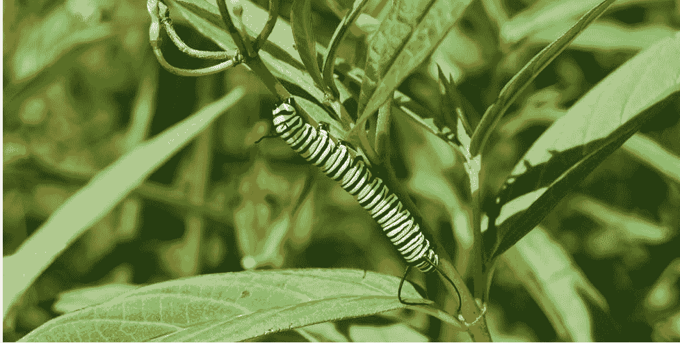

帝王蝶毛虫吃乳草（其寄主植物，Asclepias 属）的叶子。

帝王蝶已进化到使用乳草组（Asclepias 属）植物作为寄主植物。虽然成年帝王蝶会从许多不同的花卉物种（包括乳草）中啜饮花蜜，但其毛虫只吃乳草叶子。如果您想支持帝王蝶（其种群数量自20世纪90年代高峰以来已下降至少70%），请在您的授粉栖息地中包含乳草。本土乳草也是多种传粉者的优良蜜源植物。

## 容忍植物损害

对于许多房主来说，鼓励啃食植物叶子的想法可能有点难以接受，但这正是大多数毛虫所做的。有时毛虫啃食叶子看起来很轻微，而有时可能更为严重。毛虫必须大量进食才能生长；一只新孵化的毛虫可能在短短两周内体重增加10,000倍。如果您想要蝴蝶和蛾类，接受叶片损害是方程式的一部分。当您看到成年蝴蝶在您的景观中茁壮成长时，这一切都将是值得的。

一位自豪的客户曾指出她没有叶子的乳草植物，高兴地宣布那一年她利用我们在她花园里种植的乳草培育了大量帝王蝶。进一步的证据是，一群成年帝王蝶正忙着在周围其他开花植物上采蜜。成为传粉者守护者意味着扩展花园的定义，即一个健康的生态系统，其中为了更大的利益，某些植物损害是完全可以接受的。

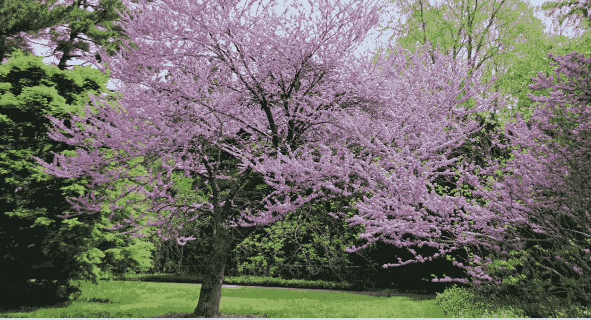

紫荆（Cercis canadensis），早期传粉者的最爱

## 利用树木和灌木增加生物量

虽然开花多年生植物通常是授粉栖息地的主要植物，但不要忘记它们的木本朋友：开花树木和灌木。这些木本奇观作为传粉植物特别有吸引力，单株植物上就有大量花朵。规模较大的开花树木和灌木可以增加您的传粉者觅食资源，这对于大型蜜蜂群落尤其有价值。树木、灌木和藤本植物常常被忽视为传粉植物，这很遗憾。例如，红枫（Acer rubrum）的花朵是美国东北部蜜蜂最早的花蜜和花粉来源之一，使得这种树成为该地区授粉花园中宝贵的补充。

小型树木和灌木可用作房屋旁的基础种植，多样化组合成供传粉者使用的树篱，或种植在您景观中合适的任何地方。它们甚至可以种植在专用授粉花园边缘，只要不遮挡开阔向阳的区域。在种植前，确定植物的成熟高度和宽度，以免以后创造出遮荫花园。

## 为传粉者纳入非花卉食物

并非所有传粉者都能从花朵中获得完整的营养。根据传粉者物种的不同，许多非花卉食物也被传粉者食用。就蝴蝶而言，丧丝蝶、问号蝶、东部逗号蝶和红袖蝶偏好树汁、腐烂水果、蚜虫蜜露（蚜虫的液体排泄物）、鸟粪和动物粪便。即使是腐肉对某些蝴蝶也有吸引力。在北美，有一种食肉蝴蝶，即采蚜蝶，专门吃绵蚜。

蜂鸟主要吃花蜜，但也以树汁和过熟水果的汁液为食。为了获取蛋白质，它们吃花粉和小昆虫。食蜜蝙蝠除了吃花蜜、花粉和花部外，还吃昆虫，具体取决于蝙蝠物种。

提供这些替代食物来源的最佳方式是维持一个健康且平衡的生态系统。包含少数产汁树木、一些结果树木和灌木，以及鸟类的优质栖息地（鸟粪！），并避免使用杀虫剂。在授粉花园中，蚜虫实际上是有价值的，因为它们为蝴蝶产生蜜露，并为瓢虫幼虫提供蛋白质零食（相反，瓢虫幼虫控制蚜虫种群）。

## 人造蝴蝶自助餐

如果您想补充天然食物，可以用腐烂水果创建一个蝴蝶自助餐。将一盘过熟水果放在盘子里，用细绳或钓鱼线将其悬挂在树上，以防止饥饿的哺乳动物偷吃。只在蝴蝶活动的晴天放置，或在夜间放置供夜行蛾类取食。只需将盘子放在易于清洁和补充的地方即可。

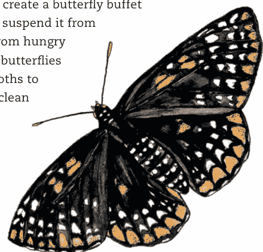

## 蜂鸟喂食器

除了花蜜，蜂鸟还喜欢蜂鸟喂食器，前提是喂食器中的内容物要经常更换，并且 _喂食器保持清洁_。玻璃喂食器比塑料喂食器更容易彻底清洁。省略红色染料，这可能不安全，而是坚持使用标准配方：一份水和四份糖一起煮沸制成糖水混合物。如果您提供一个在蜂鸟采蜜时有栖息之处的喂食器，还能让蜂鸟节省宝贵的能量。

## 泥饮

在大自然中，蝴蝶常聚集在潮湿、多沙或多砾石的地方，用舌头吸食含有盐分和矿物质的水分。这种行为叫做泥饮，主要在雄性蝴蝶中观察到。关于蝴蝶这样做的原因有猜测；可能是它们需要花蜜之外的额外钠和矿物质来源。

这种钠缺乏在雄性蝴蝶交配期间可能更严重，这可能解释了为什么大多数泥饮者是雄性。还有一种推测是，雄性利用泥饮将营养物质纳入精子中，然后在交配时转移给雌性，以此提高卵的存活率。

尽管不清楚泥饮行为究竟代表什么，但它似乎很重要，至少对雄性而言。注意的是，蝴蝶也以动物粪便、尿液、汗液和腐肉为食，这些可能是获取钠的其他方式。

您可以在景观中创建一个泥饮栖息地，方法是将大陶瓷浅盘填满粗沙、砾石和/或泥土，然后加水制成湿润混合物。加入少许完成的叶子或粪肥堆肥，再撒一点盐来增加营养。保持混合物始终湿润，并偶尔补充添加的营养。如果蝴蝶不出现，不要失望；自制泥饮池可能时好时坏。该

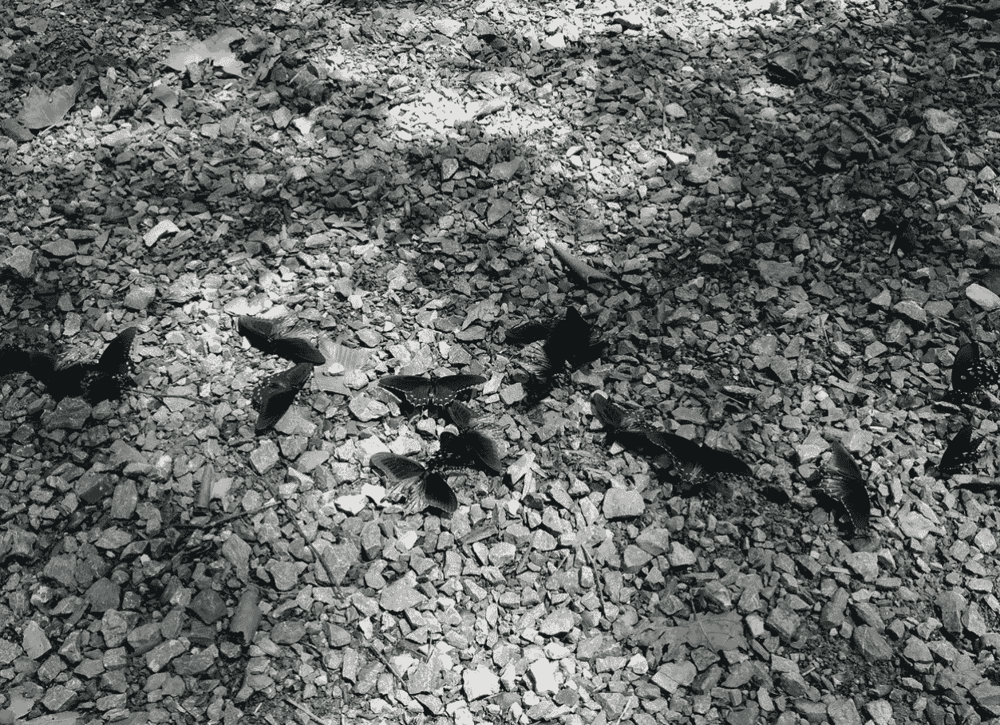

蝴蝶饮水

最简单的方法是保持现有的饮水点不受打扰，并在必要时添加水分，以防止它们干涸。

## 昆虫大餐

一些传粉者，包括蜂鸟、蝙蝠和黄蜂，食性多样，其中包括昆虫。

健康的传粉者花园中充满了许多不同类型的昆虫，它们是重要的蛋白质来源。有时，传粉者本身就会成为饥饿鸟类的蛋白质来源。请记住，你的花园是一个相互关联的食物网，所有生物都要进食。
