# 4 传粉者游行

为花朵授粉的动物包括非常常见的生物，如大黄蜂和蜜蜂，以及不那么明显的动物。有授粉的甲虫、蝙蝠、蝴蝶、蛾子、蜥蜴、啮齿类动物、狐猴、蜜袋鼯，甚至猴子。并不是动物群体中的每个物种都是传粉者。地球上大约 9% 的鸟类和哺乳动物是传粉者。最不寻常的哺乳动物传粉者之一是狐猴，它是世界上最大的传粉者。

响尾蛇草（Eryngium yuccifolium）上的多种传粉者

## 认识传粉者

绝大多数传粉者都是昆虫，它们通常被分为四大类：蜜蜂和黄蜂、苍蝇、蝴蝶和蛾子、甲虫。人们常说，昆虫，尤其是蜜蜂，是地球上最重要的传粉者。蜜蜂确实比其他传粉者为更多农作物授粉，但传粉者的重要性真的取决于具体的植物。如果一种为授粉的蝙蝠物种灭绝——请注意，蝙蝠在全球范围内正在减少——那么依赖该物种授粉的植物也将消失。请将你的景观视为一个可以支持许多不同传粉物种的生态系统。让我们来看看你可能吸引到花园中的一些传粉者。

## 本土蜜蜂

全球大约有 20,000 种蜜蜂；其中 3,600 种原产于美国和加拿大。本土蜜蜂是指在生态系统中自然出现的蜜蜂。这听起来可能显而易见，但许多美国人仍然认为由殖民者于 1622 年引入北美的蜜蜂是美国本土物种。北美还有其他非本土蜜蜂，大约有 40 种是意外或有意引入的。

## 本土蜜蜂的生活方式

本土蜜蜂与社会性蜜蜂非常不同。90% 的本土蜜蜂是独居的，独自筑巢；其余的 10% 是社会性的，但远不如蜜蜂那样社会化。大黄蜂是北美唯一真正社会性的本土蜜蜂，它们以大约 50 到 400 只个体蜜蜂的群体筑巢，具体数量取决于大黄蜂物种。在北美所有本土蜜蜂物种中，大约有 47 种是大黄蜂。

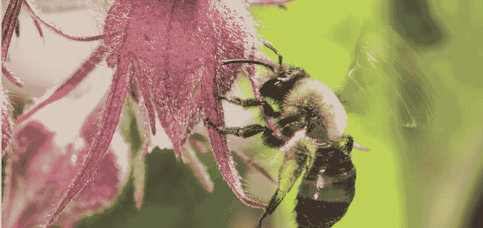

在草原烟草（Geum triflorum）上采蜜的矿蜂

## 本土蜜蜂的生活方式

| 社会性 | 筑巢位置 |
|---|---|
| • 90% 独居 • 10% 社会性 | • 70% 地面筑巢 • 30% 腔室筑巢 |

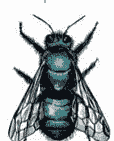

与集中在单个蜂巢中的蜜蜂群落不同，采用独居或准社会性生活方式的本土蜜蜂在你的景观中需要更广阔的栖息地。无论你在哪里园艺，都有大量本土蜜蜂可以支持！据估计，在任何景观（城市或乡村）一英里范围内，可能存在 100 种或更多种本土蜜蜂。

## 人工管理的蜜蜂

蜜蜂并非人类为授粉服务而管理的唯一蜜蜂。虽然使用较少，但几种在特定植物授粉方面表现出色的本土蜜蜂物种可以被某种程度上驯化。泥蜂、切叶蜂、大黄蜂和碱蜂都可以被安置在人工筑巢地点。由于这些是独居蜜蜂，或者在大黄蜂的情况下是准社会性蜜蜂，对这些物种的管理与蜜蜂的管理有很大不同，蜜蜂会一起在大型群体中筑巢。

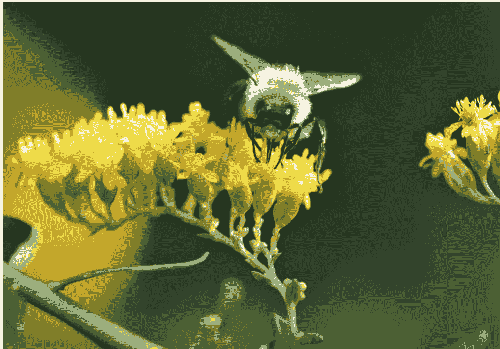

• 在金缕梅（Solidago species）上采蜜的大黄蜂

## 蜜蜂开花期注意事项

由于蜜蜂物种在形状、大小、体力、舌长和花卉偏好方面各不相同，因此需要种植多样化的开花植物来满足它们所有的需求。在种植时，别忘了为那 25% 是花粉专家的蜜蜂物种提供植物。为了让每个人都满意，在大多数地区，要让花卉展示从早春持续到深秋。在亚热带或温带沙漠地区，也要种植冬季开花的植物。

蜜蜂筑巢，必须用花蜜和花粉储备来喂养幼虫。有些蜜蜂会在巢穴中储存花蜜作为成虫的食物储备。它们如何储备取决于蜜蜂物种，但在每种情况下，当花卉资源距离筑巢地点相对较近时，都有助于蜜蜂节省能量。虽然蜜蜂可以飞行几英里（公里），大黄蜂可能能飞行一英里（1.6 公里），但有些非常小的蜜蜂飞行范围只有几百英尺（米）。飞行会消耗能量，所以对传粉者来说，食物越近，它们需要消耗的能量就越少。

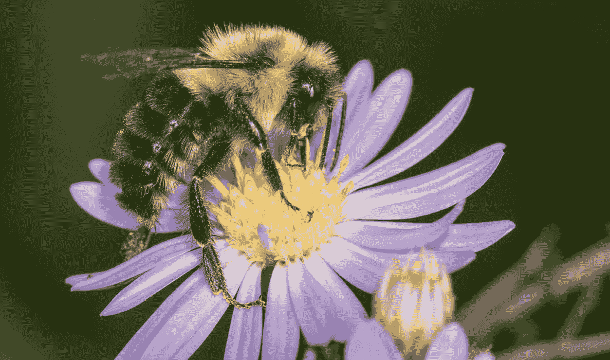

本土紫菀的开放花朵容易被蜜蜂接触到。

## 蜜蜂授粉花卉的特征

被蜜蜂授粉的开花植物往往分为两个不同的类别：

- 简单、开放或碗状的花卉，相对不专门化（例如：本土玫瑰、向日葵）
- 复杂、不对称的花卉，更加专门化（例如：舌罂粟、本土兰花）

两组花卉通常是蓝色、紫罗兰色、黄色或白色；通常带有一些香气；并且在白天开放。紫外线花蜜导引通常出现在这些花卉上。花蜜质量和花粉质量会因植物种类而异。蜜蜂通常偏好花蜜糖分以蔗糖为主的花朵。对蜜蜂友好的花朵花粉可能带有香味且粘稠，并且必须由传粉者从花药上摇落。

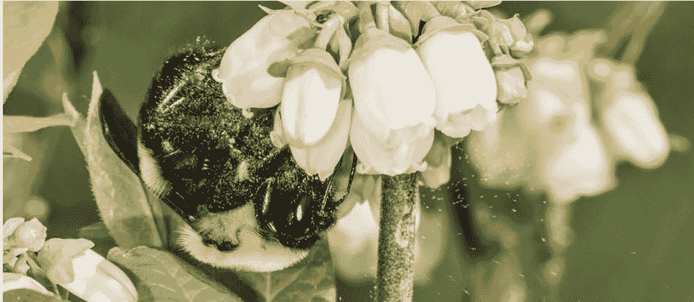

大黄蜂正在为蓝莓植物（Vaccinium species）授粉

## 震动授粉

有时，传粉者在觅食过程中的专门动作可以导致花朵授粉更有效。大黄蜂、木蜂和汗蜂使用一种称为震动授粉（或声振）的行为，可以松动大量花粉。这些蜜蜂收缩间接飞行肌肉并振动身体，从花朵中松动更多花粉。像蓝莓和蔓越莓（Vaccinium spp.）以及报春花（Dodecatheon spp.）等本土植物，以及番茄和辣椒，都能显著受益于这种授粉方式。虽然其他类型的蜜蜂，如蜜蜂，也能为这些植物授粉，但效率要低得多。

## 蜜蜂舌长与花卉

舌长因蜜蜂物种而异，是决定特定物种可以使用哪些花朵的一个因素。珊瑚忍冬（Lonicera sempervirens）和本土飞燕草上的长管状花朵对短舌蜜蜂来说太深了。如果蜜蜂的舌头太短，够不到花朵的花蜜，那只蜜蜂就没办法了。不过，长舌头并不总是更好。长舌头在较短的花朵上可能难以使用，因为没有足够的空间展开。因此，长舌蜜蜂通常是长管状花卉的专家，因为这些花朵对它们来说更容易接触。

## 觅食距离与活跃季节

本土蜜蜂的觅食距离从几百英尺到大约一英里（约 90 米到 1.6 公里）不等，具体取决于物种。小蜜蜂不会飞得很远，但大黄蜂在资源是

## 本地蜜蜂的授粉效率

本地传粉者并不总能获得其提供的授粉服务所应得的认可。大黄蜂对蓝莓的授粉效果是蜜蜂的两倍；本地蜜蜂承担了西瓜90%的授粉量；本地蜜蜂授粉还能提升苹果和西红柿的果实产量。南瓜和葫芦类植物最适合由两种本地南瓜蜂授粉。

蓝色果园泥蜂是苹果和杏仁的惊人授粉者。据认为，仅需250只雌蜂即可为1英亩（0.4公顷）的苹果授粉，而采集蜜蜂则需要15,000到20,000只。目前正在开展研究，利用这些本地蜜蜂使杏仁授粉多样化，而这目前完全依赖蜜蜂完成。

稀缺。飞行会消耗卡路里，因此最好让花蜜资源触手可及。

并非所有蜜蜂种类在同一时间出现，季节长短也不尽相同。独居蜂通常寿命约一年，但活跃期仅几周。准社会性大黄蜂可能活跃数月。蜜蜂活跃的那些周和月，是花园中寻找花蜜和花粉的关键时期。在北美大部分地区，花园中的开花应从早春开始，持续至深秋。

## 本地蜜蜂授粉的本地花卉示例

| Agastache spp. (巨型藿香) | Liatris spp. (燃星草) |
| --- | --- |
| Allium spp. (本地洋葱、大蒜、野韭) | Lupinus spp. (羽扇豆) |
| Asclepias spp. (萝藦) | Monarda spp. (蜜香薄荷、佛手香薄荷) |
| Baptisia spp. (野靛蓝) | Penstemon spp. (胡须舌花) |
| Dalea spp. (草原苜蓿) | Solidago spp. (金线草) |
| Helianthus spp. (向日葵) | Symphyotrichum spp. (紫菀) |

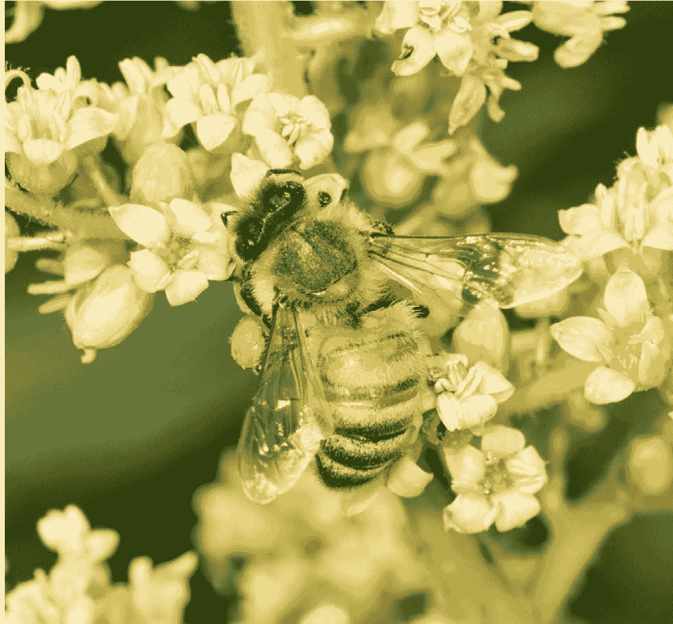

欧洲蜜蜂可以采集许多本地植物，例如芳香漆树（*Rhus aromatica*）。

## 欧洲蜜蜂

1622年，欧洲定居者将蜜蜂带到弗吉尼亚州的詹姆斯敦。毫无疑问，这些殖民者珍视蜜蜂的授粉服务，并享受蜜蜂生产的蜂蜜。蜜蜂是唯一能生产足够供人类分享的蜂蜜的昆虫；蜂蜡和蜂胶是蜜蜂提供给我们的另外两种资源。

## 美国的蜜蜂管理

在引入蜜蜂之前，北美完全依赖本地传粉者提供授粉服务。在美国，蜜蜂现在被管理用于农作物授粉和蜂蜜生产。杏仁现在几乎完全依赖蜜蜂授粉。世界82%的杏仁供应来自加利福尼亚州，这是唯一商业性生产杏仁的州，因此成功的授粉至关重要。（大多数农作物生产的单一种植条件，加上缺乏均衡多样的蜜蜂饮食，是一个生态危机信号——更不用说还在使用农药。）

## 蜜蜂特征

蜜蜂高度社会化，这与本地蜜蜂大不相同。一个蜜蜂群体可能拥有超过50,000只个体蜜蜂。工蜂是不育雌蜂，通常寿命为四到六周。雄蜂是育成雄蜂，通常寿命为一到三个月。蜂后可能寿命为两到五年，甚至更长。与大黄蜂群体不同，蜜蜂群体具有多年生生活周期并能越冬。只要体温足够高，蜜蜂一年中的任何时候，当天气回升到华氏50多度（12至13°C）时，就会从蜂巢中出来。在非生长季节这可能会带来问题，因为此时花卉不可用。这当然为为蜜蜂种植极早开花和极晚开花的植物提供了强有力的理由。

## 蜜蜂、花卉与蜂蜜

蜜蜂是杂食性传粉者（广花粉性），采集多种植物。它们的舌长度中等，使它们能够采集许多，但并非所有本地植物。长筒花或紧闭的花朵对蜜蜂没有用处，除非它们通过啃咬不可触及花朵的基部来“偷取花蜜”。本地植物如紫锥花 (Echinacea spp.)、萝藦 (Asclepias spp.)、火绒草 (Chamerion angustifolium)、旋盘花 (Phacelia spp.) 和金线草 (Solidago spp.) 常受蜜蜂造访，是重要的花蜜来源。各种本地野花通常构成所谓野花蜜的基础，但来自蓝莓、火绒草和金线草等植物的单花源蜂蜜也有生产。

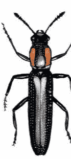

本地乔木和灌木也可以是蜂蜜的主要花蜜来源，包括黑刺豆 (Robinia pseudoacacia)、郁金香树 (Liriodendron tulipifera)、椴树 (Tilia americana)、漆树 (Rhus spp.) 以及覆盆子和黑莓 (Rubus spp.)。来自多种本地树木的单花源蜂蜜尤其美味且备受推崇；酸叶树 (Oxydendron arboreum) 和水龟树 (Nyssa sylvatica) 蜂蜜是两个著名的例子。

早春开花植物如红枫 (Acer rubrum) 和柳树 (Salix spp.) 在几乎没有其他植物开花时，可能是蜜蜂良好的采集资源。如果天气足够暖和，蜜蜂会从这些植物中受益。如果天气寒冷，它们可能会错过这些花朵。

吸引本地蜜蜂的花卉特性也吸引蜜蜂，主要区别在于花的解剖结构。蜜蜂最容易接触到结构简单、较开放的花朵。与本地蜜蜂一样，蜜蜂也从多样化的饮食中受益，获得不同的花蜜和花粉来源。

在炎热干燥天气持续较长时间且花蜜停止流动时，蜜蜂的花蜜资源往往会减少。这些时期被称为夏季花蜜匮乏期。然而，花蜜匮乏也可能在一年中的其他时间发生。通过种植更多杂食性植物，尤其是夏季开花的植物，您可以帮助蜜蜂在困难时期找到所需食物。如果您养蜂，可能希望在景观中加入一些行为良好的非本地植物作为额外的采集资源。

## 帮助蜜蜂

您不必养蜂箱就能帮助蜜蜂。传粉者胜利花园可以为受管养的蜜蜂和野生蜜蜂以及本地蜜蜂提供支持。包括一些蜜蜂可以利用的本地植物。树木和灌木为大型蜜蜂群体提供最多的花量。为夏季匮乏期这一关键时期添加更多开花植物。当然，让您的花园远离农药。如果您住在养蜂人附近，他们会非常感谢您花园中提供的花蜜资源。您甚至可能会得到一些蜂蜜作为回报！

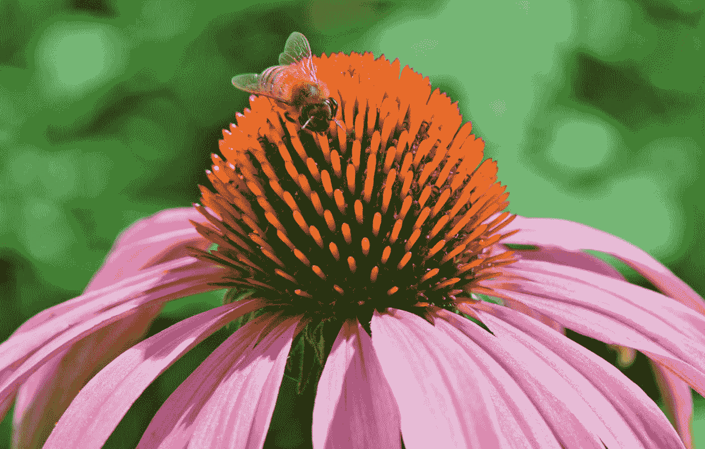

蜜蜂在紫色紫锥花 (*Echinacea purpurea*) 上采集花蜜

| **蜜蜂授粉的本地花卉示例** | |
| --- | --- |
| *Agastache foeniculum* (茴香藿香) | *Phacelia* spp. (旋盘花、天仙翁) |
| *Chamerion angustifolium* (火绒草) | *Rhus* spp. (漆树) |
| *Echinacea* spp. (紫锥花) | *Solidago* spp. (金线草) |
| *Eriogonum* spp. (荞麦) | *Symphyotrichum* spp. (紫菀) |
| *Eutrochium* spp. (乔派草) | *Vernonia* spp. (铁线草) |
| *Helianthus* spp. (向日葵) | *Veronicastrum virginicum* (库尔弗斯根) |

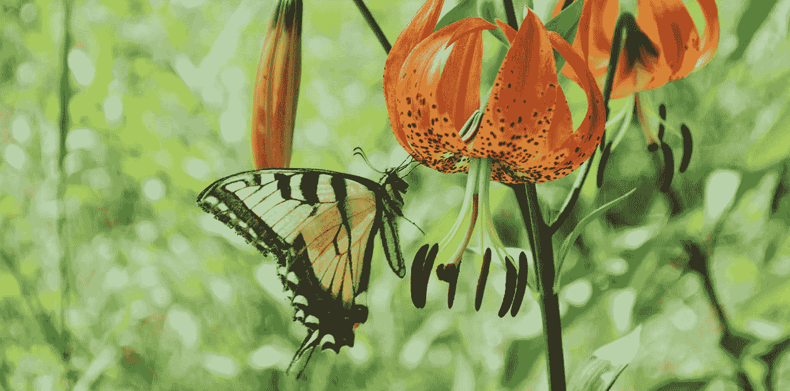

东部虎斑蝶在葶苈子百合 (Lilium superbum) 上采集花蜜

## 蝴蝶

蝴蝶或许是我们花园中最具魅力的访客。与说服别人种植蜜蜂花园相比，说服别人种植蝴蝶花园可能更容易，但幸运的是，这两类生物使用许多相同的植物。在世界20,000种蝴蝶中，725种分布于北美，其中575种分布于四十八个相连州。

蝴蝶通常色彩鲜艳，容易辨认，而另一些，特别是弄蝶，则经常体型小、棕色且像蛾。弄蝶是蝴蝶的一个子类，约占美国本土575种蝴蝶中的270种。蝴蝶并不总能轻易与蛾区分开来，尽管蝴蝶倾向于闭合翅膀或呈V形微张翅膀休息，而蛾在休息时倾向于张开翅膀。大多数蝴蝶的触角末端呈棒状，而大多数蛾则不是。

## 居住种与迁徙种

许多蝴蝶种类是本地种，定居于一地，但其他种类会迁徙。迁徙到一定程度的蝴蝶包括天竺葵粉蝶、赤斑弄蝶、

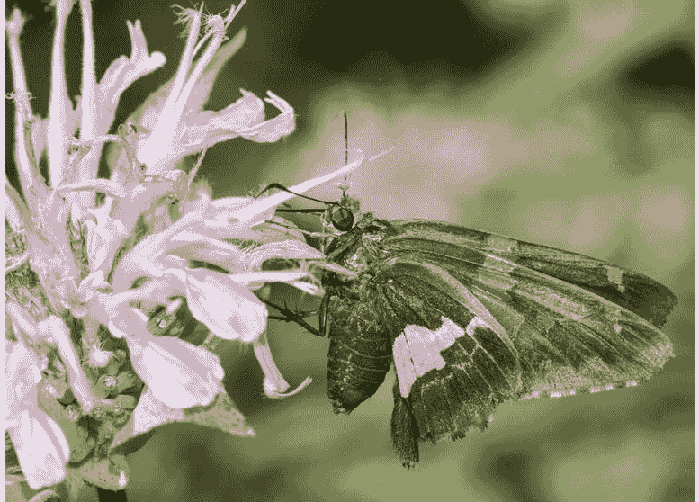

银斑弄蝶在野生牛膝草（Monarda fistulosa）上

无云硫黄蝶、丧服蝶和问号蝶。长途迁徙的蝴蝶冠军是帝王蝶，它可以迁徙惊人的距离以逃避寒冷的冬季。

北美有两种迁徙的帝王蝶种群。那些生活在洛基山脉以西的帝王蝶在太平洋沿岸的加利福尼亚州南部越冬。这一西部种群面临极度濒危。美国东部花园中常见的帝王蝶已经进化出在秋季迁徙到墨西哥的习性，它们在那里的一小片森林中越冬，遗憾的是，这片森林正在减少。

东部帝王蝶种群自20世纪90年代的记录高点以来下降了大约70%。同一只帝王蝶不会在东部和墨西哥之间往返迁徙。第一代帝王蝶是那些在墨西哥越冬的蝴蝶的后代。需要三到四代才能迁徙到美国北部和加拿大。种植乳草（帝王蝶的必需寄主植物），帮助它们克服这些难以置信的困难。曾经非常常见，但现在帝王蝶面临灭绝的威胁。此外，美国还有二十多种其他蝴蝶面临灭绝风险，更多种受到威胁。赶紧为它们种植花卉吧！

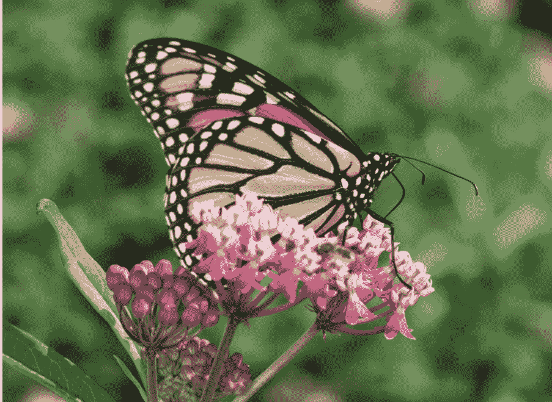

帝王蝶在沼泽乳草（Asclepias incarnata）上

## 蝴蝶栖息地与生命周期

蝴蝶大多独居。它们不筑巢，但会躲藏在小树枝或树叶下、落叶中、树皮剥落处下方、灌木堆里或岩石缝隙中。在阳光充足的地方留出裸露的土壤区域，保留地面上的一些落叶，搭建灌木堆，并分层种植不同高度和类型的植物，将有助于蝴蝶找到所需的栖息地。

对于蝴蝶和蛾子，幼虫寄主植物是产卵的栖息地。卵孵化后，毛毛虫会出来吃寄主植物的叶子。毛毛虫生长迅速，很快就会感觉到该进入蛹期了。这时它们会离开寄主植物，寻找形成蛹的地方。大多数成蝶只能活一两周，而成年的帝王蝶或丧服蝶可以存活九个月或更久。

## 蝴蝶授粉花卉

蝴蝶是花卉广食性，但它们在采蜜的花卉上确实显示出偏好，尽管只有少数蝴蝶吃花粉。蝴蝶喜欢宽阔的着陆平台或花簇，它们可以在上面轻松休息并采蜜。这类花卉的一个例子是乔·派伊草（Eutrochium spp.），这是蝴蝶的最爱。不过，如果花卉很有吸引力且花蜜丰富，着陆平台并非绝对必要。灿烂星花（Liatris spp.）的花呈穗状或纽扣状，是蝴蝶的最爱。蝴蝶有长长的口器（卷吻），可以采食多种花卉。它们会造访许多吸引蜜蜂的同类花卉。

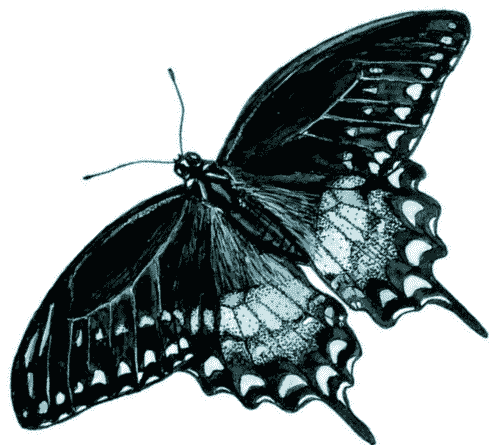

特别吸引蝴蝶的花卉通常颜色鲜艳，多为红色、橙色、黄色或紫色。通常会有蜜路，引导蝴蝶找到甜美的奖赏。蝴蝶花卉的花香通常不明显，花粉也较少，但花蜜丰富。

### 由蝴蝶授粉的本土花卉示例

| | |
|---|---|
| 乳草属（Asclepias spp.，乳草） | 向日葵属（Helianthus spp.，向日葵） |
| 蔓血桫属（Ceanothus spp.，新泽西茶） | 灿烂星花属（Liatris spp.，灿烂星花） |
| 蓝雾花（Conoclinium coelestinum） | 李属（Prunus spp.，樱桃，李子） |
| 巢草属（Dalea spp.，草原三叶草） | 稷草属（Solidago spp.，金丝桃） |
| 紫锥花属（Echinacea spp.，锥花） | 紫菀属（Symphyotrichum spp.，紫菀） |
| 乔派伊草属（Eutrochium spp.，乔·派伊草） | 铁苋菜属（Vernonia spp.，铁苋菜） |

## 蛾子

与蝴蝶表亲相比，蛾子是鳞翅目（*鳞翅目*）中不受重视的成员，该目包括蝴蝶和蛾子。虽然蝴蝶在白天活动，但大多数蛾种在夜间采蜜，尽管有些成年蛾根本不吃东西。迷人的蜂鸟蛾是日行性的（在白天活动）。这种生物的俗名再贴切不过了——它有蛾子般的身体，飞行起来像蜂鸟。

世界上的蛾种比蝴蝶种多得多——全球约有160,000种，美国约有11,000种。区分蛾和蝴蝶最可靠的特征是休息时翅膀的位置；蛾子会张开翅膀。虽然蛾子的颜色通常比蝴蝶暗淡，但也有一些非常壮观的蛾种，例如巨蚕蛾、月亮蛾和白线天蛾。

### 蛾子栖息地与生命周期

像它们的蝴蝶表亲一样，大多数蛾子独居，不筑巢。像蝴蝶一样，蛾子也需要幼虫寄主植物来产卵。从卵中孵化出来的毛毛虫会吃幼虫寄主

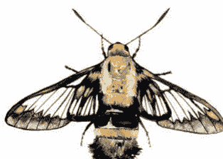
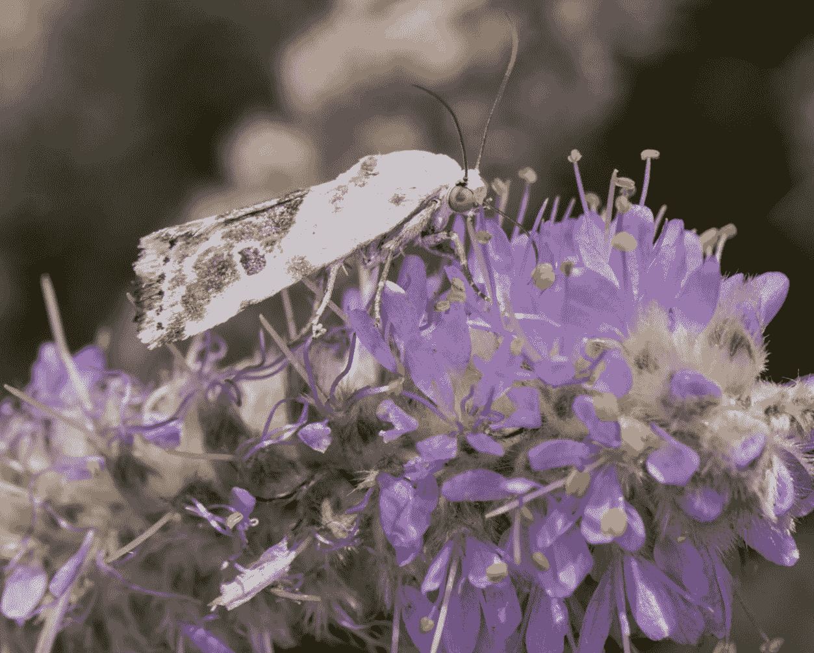

- 鸟粪蛾正在享用丝质草原三叶草（Dalea villosa）的花蜜

植物的叶子，直到毛毛虫长大到意识到该进入下一阶段。然后它们会离开寄主植物，寻找进入下一个生命周期的地方。

有些蛾类毛毛虫会钻进土壤或躲在枯叶下化蛹；其他种类则形成茧，并可能将其附着在植物上。

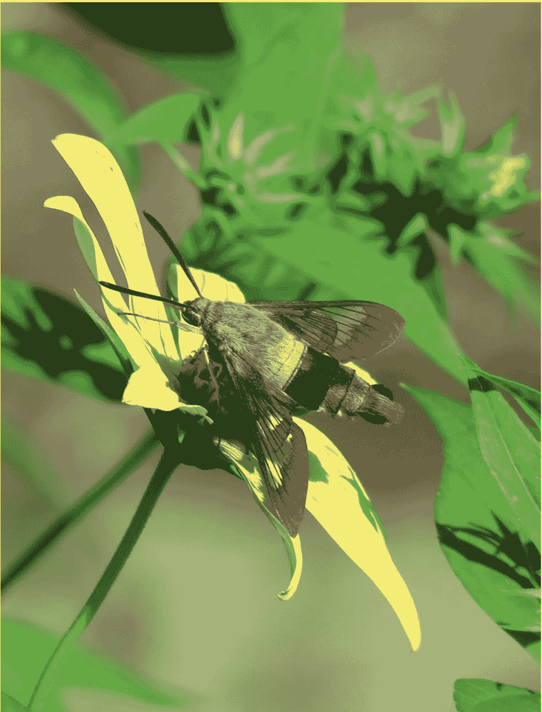

- 蜂鸟蛾是日行性的，在白天进食。

### 蛾子授粉花卉

蛾子会在许多吸引蝴蝶和蜜蜂的植物上采蜜。最诱人的蛾媒花卉通常只在夜间散发浓郁的甜香。颜色没那么重要，花朵通常是淡白色、淡粉色、暗红色或紫色。没有蜜路，因为它们在夜间不可见。花卉结构通常提供花簇或着陆平台。像蝴蝶一样，蛾子有长舌头，喜爱花朵中丰富的花蜜。大多数蛾子不会故意收集花粉，因此蛾媒植物的花粉可能较少。

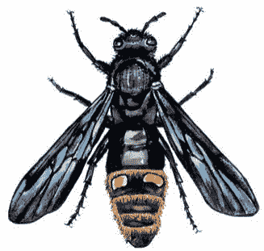

| | |
| --- | --- |
| 乳草属（Asclepias spp.，乳草） | 鸢尾草属（Phlox spp.，蝴蝶草） |
| 牵牛花属（Ipomoea spp.，牵牛花） | 李属（Prunus spp.，樱桃，李子） |
| 灿烂星花属（Liatris spp.，灿烂星花） | 鼠尾草属（Salvia spp.，鼠尾草） |
| 蜜蜂薄荷属（Monarda spp.，蜜蜂薄荷，牛膝草） | 紫堇属（Silene spp.，捕蝇草） |
| 月见草属（Oenothera spp.，月见草） | 稷草属（Solidago spp.，金丝桃） |
| 假橙花属（Philadelphus spp.，假橙花） | 丝兰属（Yucca spp.，丝兰） |

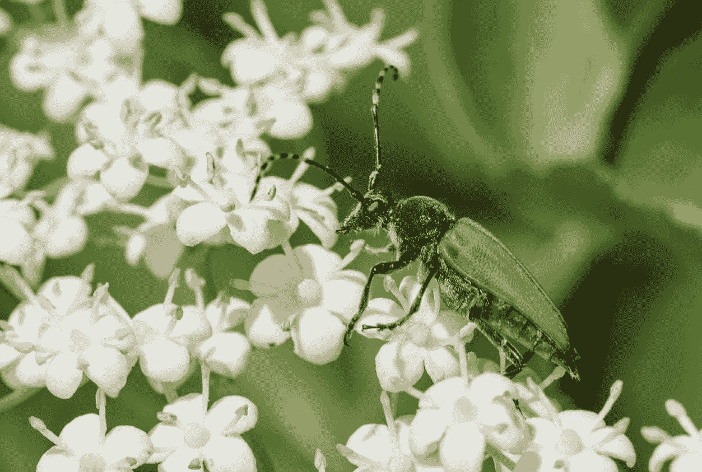

花天牛吃花粉

## 甲虫

被认为是最古老的传粉者之一的是甲虫。它们在1.5亿到2亿年前就开始造访开花植物，比蜜蜂早得多。甲虫也是地球上最大的动物群，全球估计有350,000个物种，其中约30,000个物种分布在美国。然而，并非所有甲虫都是传粉者。虽然很少有植物仅依赖甲虫传粉，但甲虫是木兰（Magnolia spp.）、香绿树（Lindera spp.）和睡莲（Nymphaea spp.）等古老植物物种的重要传粉者。

甲虫行动缓慢，无法像某些其他传粉者那样造访那么多花朵，因此不如其他传粉者群体有效。即便如此，传粉甲虫有毛茸茸的身体可以粘附花粉，并且它们能完成传粉任务。有些甲虫种类既吃花蜜也吃花粉，但有些只吃花粉，因此吸引它们的植物通常有大量花粉和通常一些花蜜（尽管没有蜜路）。甲虫也可能吃花瓣和其他花部。

### 甲虫授粉花卉

虽然甲虫能看见颜色，但它们依靠嗅觉来寻找花朵。甲虫传粉的花卉通常是暗白色或绿色，根据它们造访的花卉，栗红色似乎也对它们有吸引力。如果被气味吸引，甲虫也会从其他颜色的花朵中采蜜。浓烈的果腥味或恶臭吸引甲虫。开放式花朵和碗状花朵最容易被甲虫觅食。

常见的甲虫传粉者包括花天牛、步行甲虫、叶甲虫、花粉甲虫和翻花甲虫。传粉甲虫所需的栖息地与你为蜜蜂和蝴蝶创造的栖息地相匹配。

### 由甲虫授粉的本土花卉示例

| 丁香属（Allium spp.，本地洋葱，大蒜，野韭） | 香绿树属（Lindera spp.，香绿树） |
| --- | --- |
| 天南星属三叶天南星（Arisaema triphyllum，讲道坛天南星） | 木兰属（Magnolia spp.，木兰） |
| 山羊胡须属（Aruncus dioicus，山羊胡须） | 碧桃属（Malus spp.，海棠） |
| 乳草属（Asclepias spp.，乳草） | 睡莲属（Nymphaea spp.，睡莲） |
| 番荔枝属（Asimina spp.，山番荔枝） | 稷草属（Solidago spp.，金丝桃） |
| 木香属（Calycanthus spp.，木香） | 绣线菊属（Spiraea spp.，绣线菊，绣叶茶） |
| 绣球蓟属（Eryngium spp.，绣球蓟，铃蛇草） | 紫菀属（Symphyotrichum spp.，紫菀） |
| 佛罗里达八角属（Illicium floridanum，佛罗里达八角） | |

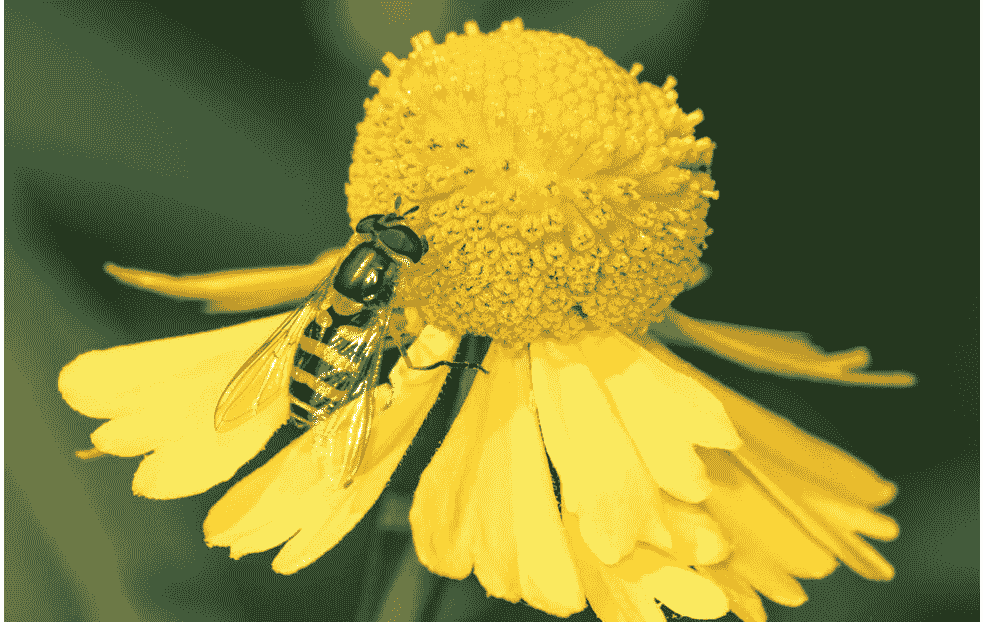

悬蝇在打喷嚏草（*Helenium autumnale*）上采蜜

## 苍蝇

苍蝇是一个庞大且多样的昆虫群体，摄食习性各异。几乎一半的苍蝇科会到花朵上采集花蜜和/或花粉，但并非所有都是有效的传粉者。常见的传粉苍蝇种类包括蜂蝇、寄蝇、大头蝇和悬蝇。

### 悬蝇

悬蝇，也称为花蝇或姬蝇，是一类重要的苍蝇传粉者。成虫非常适应花粉摄食，几乎完全依赖花朵获取食物。它们的一个俗名来源于能在花朵上短暂悬停的能力。悬蝇种类繁多，全球约六千种。悬蝇常外形酷似蜜蜂或胡蜂，但只有一对翅膀，而胡蜂和蜜蜂有两对翅膀。

部分悬蝇具有类似蜜蜂的改良口器，可用来吸啜花蜜。悬蝇通常是花卉杂食性访客，传粉效率极高。此外，大多数悬蝇的幼虫是天敌，会捕食蚜虫等软体昆虫。

## 蜂蝇

蜂蝇是重要的苍蝇传粉者。它们是身被毛茸茸、绒毛般体毛的有趣生物，这使它们能够采集大量花粉。与短口器的苍蝇不同，蜂蝇拥有长口器，可获取花冠管较长花朵中的花蜜。它们能像悬蝇一样在花朵上方短暂悬停。

苍蝇传粉花卉中不一定含有花蜜，但没有蜜导。它们选择的花朵确实含有一些花粉。

## 苍蝇传粉花卉

传粉苍蝇会被深棕色或紫色，有时是浅色或白色的花朵吸引。它们也会采其他颜色植物的花蜜。对苍蝇最具吸引力的花香是腐臭味，一种类似腐肉的气味，尽管它们也会造访气味较淡的花朵。

为传粉苍蝇提供的栖息地应包括大量由多样本土植物吸引的昆虫。其中一些昆虫，尤其是蚜虫和蜘蛛，是悬蝇幼虫的食物。为了满足苍蝇产卵需求，在景观中应留出包含倒木和落叶层的自然区域。

| 苍蝇传粉的本土花卉示例 |
|---|
| Apocynum spp. (萝藦) | Heliopsis spp. (假向日葵) |
| Aristolochia spp. (马兜铃) | Liatris spp. (火星草) |
| Asimina spp. (香蕉番荔枝) | Lysichiton americanus (西方臭白掌) |
| Arisaema triphyllum (三叶天南星) | Parthenium integrifolium (野鸦胆子) |
| Dalea spp. (草原苜蓿) | Symplocarpus foetidus (臭白掌) |
| Helianthus spp. (向日葵) | Trillium erectum (红三叶) |

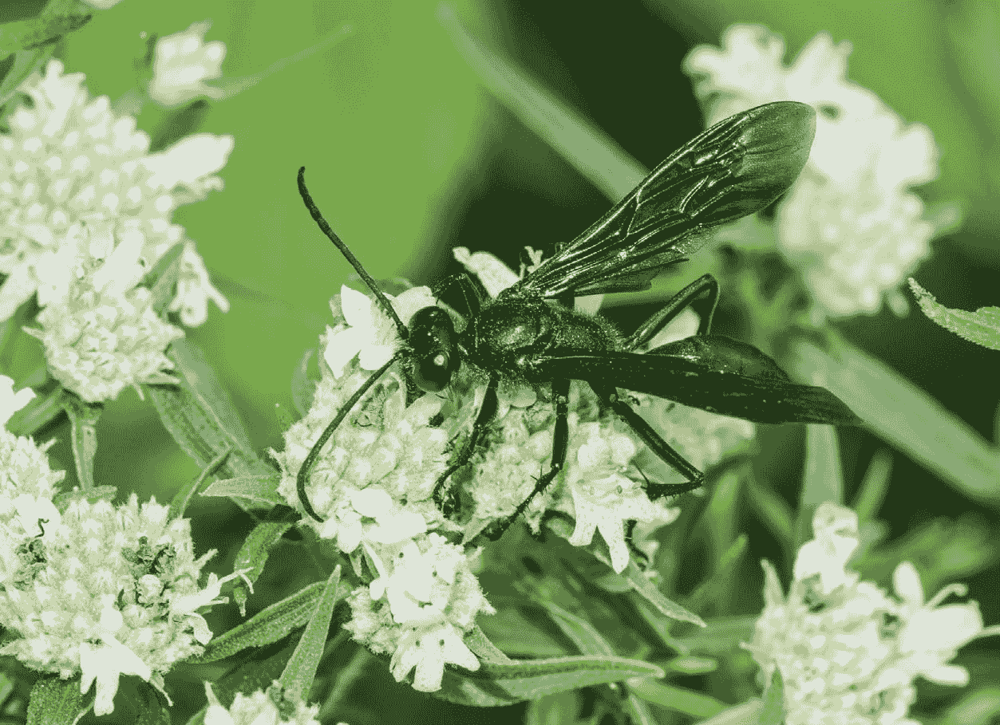

黑大掘胡蜂在山薄荷（*Pycnanthemum* 种）上采蜜

## 胡蜂

很少有人在听说要为胡蜂园艺时会感到兴奋。事实是，胡蜂是景观中有价值的昆虫，尤其是作为昆虫害虫的捕食者和寄生蜂。蜜蜂起源于胡蜂，属于同一昆虫目（*膜翅目*），因此胡蜂和蜜蜂具有相似的生活史和筑巢行为。

胡蜂外观常像蜜蜂，但通常没有使蜜蜂能够采集花粉的同样绒毛状体毛。这意味着附着在它们身上的花粉较少，限制了它们作为传粉者的效率。

### 独居胡蜂 vs. 社会性胡蜂

社会性胡蜂是人们通常想到的胡蜂类昆虫，如纸胡蜂和黄胡蜂。这些昆虫群居筑巢，有些在地面，有些在它们建造的结构中。独居胡蜂占胡蜂的大多数，单独在地面、多髓植物茎秆中，或用泥土建造的结构中筑巢。社会性胡蜂和独居胡蜂都会到花朵上采集花蜜。

寄生胡蜂（寄生蜂或寄生者）是独居的，拥有一种（以某种残忍的方式）引人入胜的生活习性。它们将卵产在其他昆虫体内或体表附近。一旦胡蜂幼虫孵化，就会吃掉昆虫宿主的身体。寄生胡蜂是重要的益虫，作为花园盟友名声显著。

### 胡蜂传粉花卉

胡蜂需要既有筑巢区域、又有大量昆虫供其幼虫取食的栖息地。它们是极佳的捕食者；在幼虫阶段，胡蜂是肉食性的，食用母亲捕获的昆虫猎物。当胡蜂成为成虫后，会到花朵上采集花蜜，但有些也是肉食性的。胡蜂的口器较短，需要比蜜蜂更开放、更易近的花朵。它们会被许多吸引蝴蝶的同类花朵所吸引。

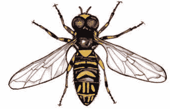

| | |
|---|---|
| *Arnolossum atriplicifolia* (苍灰印度老鸦草) | *Parthenium integrifolium* (野鸦胆子) |
| *Asclepias* spp. (马利筋) | *Pycnanthemum* spp. (山薄荷) |
| *Eryngium* spp. (铁蓝头) | *Solidago* spp. (金缨花) |
| *Eupatorium perfoliatum* (通叶斑鸠菊) | *Symphyotrichum* spp. (紫菀) |
| *Helianthus* spp. (向日葵) | *Zizia* spp. (金樱子) |
| *Heliopsis* spp. (假向日葵) | |

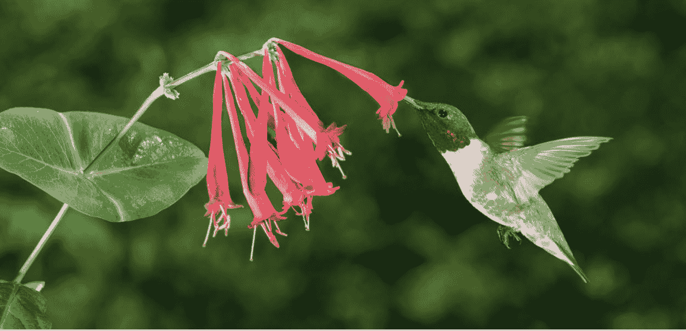

红喉蜂鸟在珊瑚忍冬（*Lonicera sempervirens*）上采蜜

## 蜂鸟

提到传粉鸟类，人们首先想到的就是蜂鸟。事实上，北美洲有五十多种鸟类啜饮花蜜，包括巴尔的摩鹀、黄腹啄木鸟、红唐纳雀和田纳西莺。但蜂鸟备受关注。这些迷人的生物像子弹般穿梭于我们的花园中，活泼且非常有趣。十余种蜂鸟在美国过夏，包括红喉蜂鸟、红腰蜂鸟和安娜蜂鸟。

### 蜂鸟栖息地

蜂鸟需要多种你可以提供的栖息地资源，包括富含花蜜的管状花卉、供筑巢和栖息的较小树木和树枝、如蜘蛛网和地衣之类的筑巢材料、清洁饮用水源，以及大量小昆虫作为蛋白质来源。

### 蜂鸟传粉花卉

蜂鸟会被大型漏斗状或管状花朵吸引，这些花朵能容纳它们的长舌。蜂鸟的舌头非常长，当收回时，会盘绕在鸟类头部内部，环绕着它们的

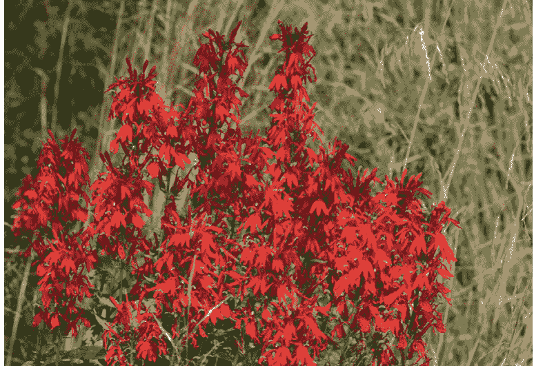

蜂鸟特别喜爱红花，例如红花风铃草（*Lobelia cardinalis*）。

头骨和眼睛！蜂鸟偏好红花，但需要时也会采食其他颜色的花朵。由于鸟类没有嗅觉，蜂鸟选择的花朵通常无香味。对蜂鸟有吸引力的花朵上没有蜜导，但含有大量花蜜和一些花粉。

### 蜂鸟传粉的本土花卉示例

| | |
| :--- | :--- |
| Aesculus pavia (绯红七叶树) | Physostegia spp. (龙头花) |
| Campsis radicans (喇叭藤) | Rhododendron arborescens (芳香杜鹃) 和其他本土杜鹃 |
| Clethra alnifolia (假绣球) | Ruellia spp. (野矾藤) |
| Lonicera sempervirens (珊瑚忍冬) 和其他忍冬属 | Salvia spp. (鼠尾草) |
| Monarda didyma (绯红马里莲) 和其他马里莲属 | Silene spp. (捕蝇堇) |
| Penstemon spp. (胡须舌苣苔) | Spigelia marilandica (马里兰红雀草) |

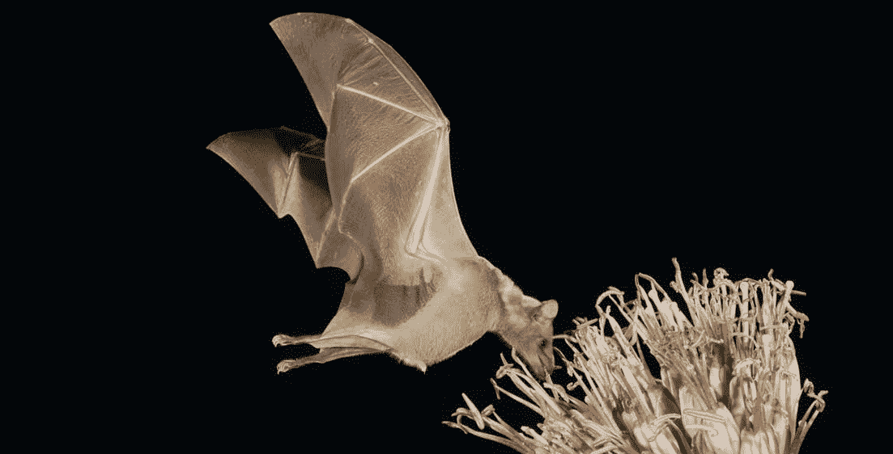

小长鼻蝙蝠在龙舌兰花（*Agave* 种）上采蜜

## 蝙蝠

在全球范围内，约 530 种被子植物依赖传粉蝙蝠作为其专属或主要传粉者。在全球估计的 1300 种蝙蝠中，约五十种蝙蝠只以花蜜或花蜜和花粉为食。有些蝙蝠种类是杂食性动物，除了花蜜还以水果和昆虫为食。

全球大多数传粉花卉的蝙蝠物种分布在热带和亚热带地区。蝙蝠传粉超过 300 种水果，包括香蕉、芒果和番石榴。一些传粉蝙蝠可以在美国西南部和墨西哥等沙漠地区找到，在那里它们是龙舌兰、巨柱仙人掌和管子仙人掌的关键传粉者。

只有三种以花蜜为食（取蜜性）蝙蝠物种分布到美国，处于其分布范围最北部。这些包括：

- **墨西哥长鼻蝙蝠（*Leptonycteris nivalis*）**
  - 联邦列为濒危物种
  - 迁徙物种
  - 分布范围：新墨西哥州和德克萨斯州的小片区域；也分布于墨西哥、洪都拉斯和危地马拉
  - 栖息地：沙漠灌木、疏生针叶栎林和松林
  - 传粉对象：龙舌兰花是这种蝙蝠的主要食物来源。它也取食仙人掌、一些亚热带树木及其他植物的花朵。

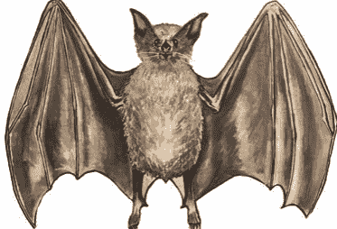

## 小长鼻蝙蝠 (*Leptonycteris curasoae yerbabuenae*)

- 最近被移出濒危物种名录
- 迁徙物种
- 分布：亚利桑那州部分地区；也分布于墨西哥和南美北部
- 栖息地：仙人掌附近的半干旱或干旱环境
- 授粉对象：像萨瓿罗仙人掌和有机管仙人掌这样的柱状仙人掌、龙舌兰、一些热带乔灌木及其他植物

## 墨西哥长舌蝙蝠 (*Choeronycteris mexicana*)

- 未受威胁
- 具有一定迁徙性
- 分布：加利福尼亚州、亚利桑那州、新墨西哥州、德克萨斯州；也分布于墨西哥、中美洲和南美北部
- 栖息地：沙漠、山地、河岸带以及松果松-杜松林地
- 授粉对象：主要是龙舌兰和柱状仙人掌

这三种蝙蝠物种通常在其南部分布区的洞穴中越冬，并在春夏季迁往美国西南部。它们前往和离开美国的迁徙与龙舌兰和柱状仙人掌的开花期重合，两者之间存在互利共生关系。随着龙舌兰和仙人掌种群数量的减少，这些蝙蝠物种也面临威胁。为龙舌兰酒生产而砍伐龙舌兰花蕾，减少了这些蝙蝠的花蜜来源。如果你居住在美国西南部，请考虑在你的庭院中种植龙舌兰和柱状仙人掌。

一般来说，吸引食蜜蝙蝠的花朵通常较大；颜色呈暗淡的白色、绿色或紫色；在蝙蝠活动的夜晚开放；并散发出浓郁的果味或霉味。蝙蝠授粉花朵含有大量花粉和稀释的丰富花蜜；它们没有任何花蜜引导标志。

食蜜蝙蝠也可能会光顾蜂鸟喂食器，尤其是当它们需要的花朵没有开放时。这些口渴的吸蜜动物可能会在一夜之间喝干一个喂食器。如果你居住在这些蝙蝠经常出没的地区，请在它们活跃的季节里增设一些额外的蜂鸟喂食器。由于人造花蜜无法提供蝙蝠可能需要的所有营养或花粉，请务必在你的庭院中同时种植它们所需的植物。
