# 5 创建与培育传粉者胜利花园

既然你已经了解可能会看到的传粉者类型、应提供的栖息地类型以及应提供的觅食资源类型，是时候开始创建你的传粉者胜利花园了。

传粉者胜利花园可以有多种形式。你庭院的大小和条件、你可用的时间以及你的预算将是决定你创建何种类型花园的主要因素。如果你已有一个花卉花园，可以先从对该空间进行简单调整、加入更多传粉者植物和筑巢栖息地开始。但如果你真的想将庭院用于支持传粉者，可能需要进行更详细的更新。

## 场地评估、规划与植栽目标

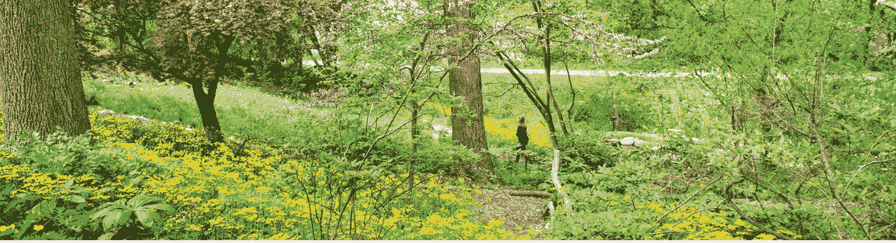

对于任何园丁来说，首要任务是在购买任何植物之前，进行一项检查你庭院各方面情况的场地评估。这一重要过程将为你提供所需信息，帮助你创建一个繁茂而非挣扎求生的花园。额外好处：大部分工作可以在淡季完成。具体做法如下。

### 场地评估步骤

- 明确景观范围及待植栽区域。
- 绘制景观和植栽区域草图，包括尺寸。
- 记录一般地形：斜坡、低洼地区等。
- 记录地表、上方及地下的任何障碍物。
- 确定潜在植栽区域在生长季节内每天获得多少小时的直射日照。一种方法是在一天中的不同时段（早晨、正午和傍晚）拍摄现场照片。请记住，日照水平随季节而变化。
- 确定你的耐寒区和耐热区（可在线查询）。
- 记录任何比其他区域更温暖的遮蔽区域（微气候）。
- 找出任何极度多风的区域。
- 将土壤样本送至检测实验室（如你当地的合作推广服务机构）进行土壤测试，以确定土壤特性。
- 进行排水测试，并/或找出任何积水超过二十四小时的区域。
- 清点现有植物，包括多年生植物、乔木、灌木和藤本植物。
- 确定是否存在应予清除的入侵物种。

### 规划过程中应提出的问题

在评估你的庭院时，请考虑以下问题：

- 是否有现有的种植区域可以添加传粉者植物？
- 你会考虑用传粉者植物花坛替换哪些草坪区域？

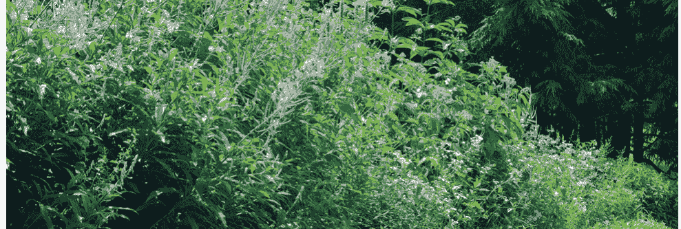

- 将多年生植物成组种植，为传粉者提供易于寻找的花卉目标。

- 是否有难以到达的区域（如山坡）可以种植以供传粉者使用？
- 在生长季节的哪些时候，你的庭院缺乏花卉？
- 你还可以划出哪些其他区域作为传粉者栖息地，包括全日照下的裸露土壤区、有倒木、堆积的灌木和/或枯死树木的区域？

## 传粉者花园的基本植栽目标

尽管植物和传粉者之间存在复杂的关系，但传粉者园艺的基本目标相当简单。一个强大的传粉者胜利花园应提供以下内容：

- 在生长季节内始终开花的树木、灌木和多年生植物
- 侧重于适合你庭院条件的区域性/本地原生植物
- 在生长季节内，同时开花的开花植物种类至少三种
- 在生长季节的每个开花期，花卉颜色、形状和大小多样化
- 为你所在地区常见的蝴蝶提供大量幼虫寄主植物（至少十种）
- 将同一种植物成片种植，每片面积为3英尺（0.28米）见方或更大，并在庭院中重复种植（前提是空间足够）
- 在草坪式花园中，整个区域重复种植相同的花卉，并包含多样化的多年生植物
- 为各类传粉者提供安全、可及的栖息地
- 无农药庭院
- 传粉者栖息地标志

如果你无法实现所有这些目标，请不要难过，尤其是在小型花园和城市景观中。任何传粉者植物都强于一无所有！利用你现有的资源；传粉者将从你的努力中受益。

## 传粉者胜利花园项目

开始进行传粉者园艺可能令人望而生畏。很难决定种植在哪里、种植什么、种植多少，等等。如果一个植栽项目令人感到压力巨大，即使是最热衷的园丁，无论其初衷多么良好，也可能只是将其搁置。

一个解决方案是从一个小项目开始，该项目可以在合理的时间内轻松构思、种植和欣赏。以下是一些可行的传粉者胜利花园项目创意，它们将吸引大量的传粉者来到你的庭院。

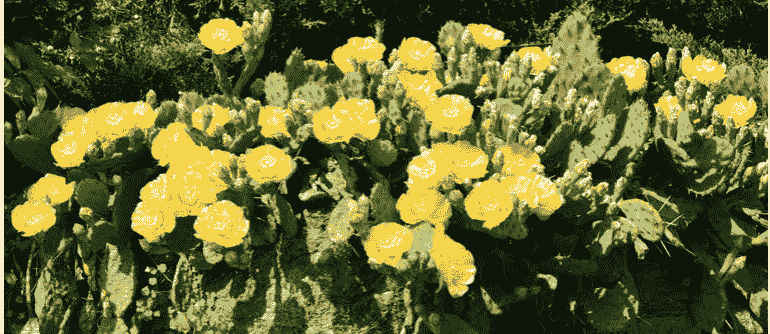

- 考虑使用冷门的传粉者植物，例如用于炎热干燥传粉者孤岛的刺梨仙人掌（*Opuntia humifusa*）。

### 传粉者孤岛

想象一下，在传粉者荒漠中间创建一个传粉者天堂！传粉者孤岛是在支持传粉者的同时减少你物业上草坪（“绿色荒漠”）数量的绝佳方式。由于移除和替换草坪可能很乏味，请先从一个看起来易于管理的小区域开始。

这将提供更传统的外观并创造更好的传粉者目标。

具有蜿蜒曲线的不规则形状总是悦目并能引起旁观者的共鸣，因为它感觉像是一个精心设计的花园。由于任何生态花园的最佳做法是让多年生植物在冬季保持直立，以提供昆虫栖息地和野生动物种子，传粉者孤岛的整齐边界起到了“关怀提示”的作用，并有助于抵消冬季枯死多年生植物被认为不整洁的印象。

创建孤岛或任何新植栽床形状的最简单方法是使用临时粉笔喷漆标记区域。如果你决定改变形状，再次喷洒即可；剩余的粉笔会被冲走。

### 寻找完美位置

为你的第一个传粉者孤岛选择一个容易看到的位置。一旦传粉者出现，你很可能会受到启发去创建更多的传粉者孤岛。考虑选择前院的一个位置，这可能有助于激励邻居、路人甚至邮递员在自己家中尝试传粉者园艺。

### 确定待植栽区域

使传粉者孤岛足够大，以容纳多样化的植物，并确保留出足够的空间来种植每种物种的足够数量。将每种物种聚集在一起

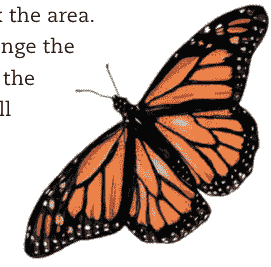

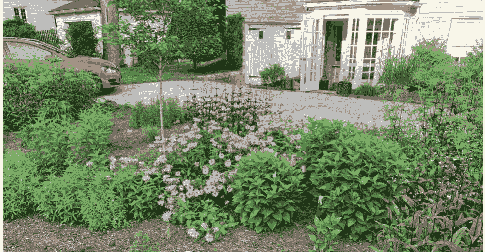

- 传粉者岛屿不必很大也能吸引传粉者。

## 决定种植什么、在哪里种植

在拿起小铲子之前，研究你计划种植的每种对传粉者友好的植物的预期成熟尺寸。年轻植物，尤其是多年生植物苗和年轻木本植物，看起来可能很娇小，具有欺骗性。不要上当。那棵高1英尺（0.3米）的钟梅花可能会长成一棵高20英尺（6米）的树。始终按成熟尺寸种植，这样就不必移动、修剪或赠送不再适合你景观的植物了。

从不同角度查看潜在的岛屿空间，以确定如何最好地安排植物位置。如果四面都能看到岛屿，通常将最高的植物放在中间效果最好。并非所有植物都必须是开花多年生植物；可以考虑使用开花灌木作为焦点并增加结构，同时为传粉者提供大量花朵。如果岛屿的一面或多面被遮挡，可在后部使用较高的植物以营造悦目的设计。与大多数花园一样，除了真正的草地，较高的植物通常放在后部，中等大小的植物放在中间，较矮的植物放在前部。这些多样的层次不仅吸引人类，还能为我们的花园增添更多生态功能。

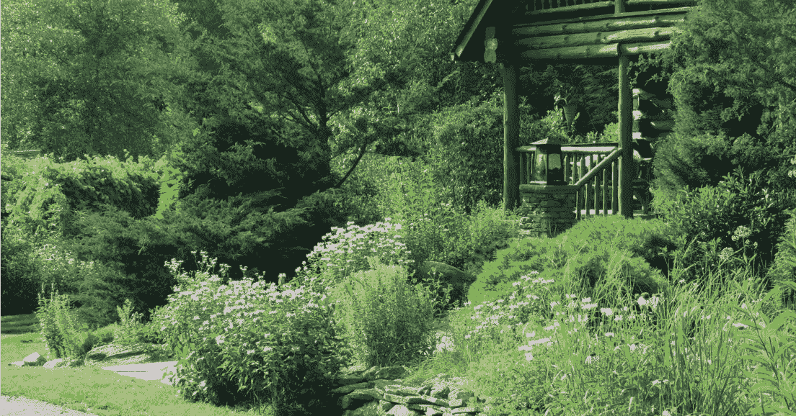

- 增强的基础种植

## 增强型基础种植和丰富的边缘

扩大或改善现有种植是改善景观以利于传粉者的另一种简单方法。许多传统景观缺乏有利于传粉者和其他野生动物的合适植物和植物层次。增强型基础种植和丰富的景观边缘是轻松的入门方式。

### 改造基础种植

大多数房屋甚至许多商业建筑都有基础种植，通常是由一些平凡无奇的植物组成的紧凑绿幕，用于遮掩建筑物的地基。在大多数情况下，基础种植对传粉者的用处不大。这是一个错失的机会，尤其是对于较小的景观。

在基础植物方面，要跳出常规思维；它们远不止是遮掩建筑物底部的绿幕。

### 评估可用空间。

查看你现有的基础植物。如果有枯死、濒死或生长不良的植物，将它们移除，然后用对传粉者友好的植物替换。测量剩余的垂直和水平空间，选择按成熟尺寸适合这些空间的植物。你不希望植物，即使是对传粉者友好的植物，遮挡窗户或阻挡门道。这是一个常被忽略的步骤，导致对本就不应该种植的植物进行无休止的修剪。不必要的修剪还可能剪掉花芽，剥夺传粉者的宝贵资源。

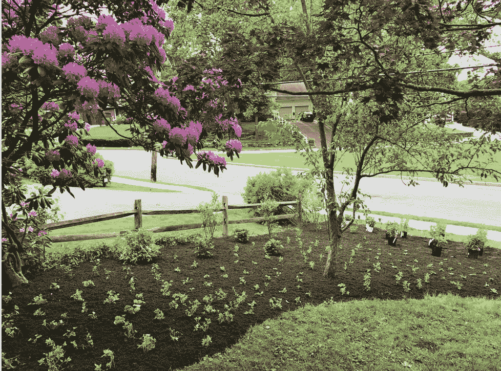

- 沿界线种植丰富的边缘

### 延长花坛并分层种植。

确定你是否可以为基础种植增加深度；是否可以将植物边界向前延长？基础种植没有理由必须瘦长平整。实际上，创造随着远离房屋而层层递减的植物层次在审美上更令人愉悦。灌木和小乔木（视空间而定）可以形成后层，而开花的亚灌木、多年生植物甚至本地草本植物可以向前填充多层。可以考虑在边界最前部使用矮生开花本地地被植物。

### 根据可用空间制定植物清单。

传统上，建筑旁边使用的植物是灌木，尤其是不开花的常绿灌木。你可以使用对传粉者有益的开花本地常绿植物做出更好的选择。在美国东部，冬黑莓（Ilex glabra）和尤庞冬青（Ilex vomitoria）是两个例子。马扎尼塔（Arctostaphylos spp.）在一些西部州可作为对野生动物友好的屏障或树篱使用。为了获得更多对传粉者有益的植物选择，可以混合使用常绿灌木和落叶灌木。如果常绿覆盖的丧失是一个问题，像红枝山桑（Cornus sericea）这样枝叶茂密或有色彩鲜艳冬季茎干的落叶开花灌木可以弥补这一不足。

只要空间允许，你对传粉者友好的基础边境可以随意加深。同样的传粉者种植原则适用：将同一物种集中种植以形成花卉目标，同时在整个生长季节创造多样的开花。你可以将毫无生机的基础种植转变为传粉者天堂！

## 丰富景观边缘

沿界线的景观边缘提供了通过新种植床来增加传粉者资源的机会。一处接一处延伸的毫无生机的草坪是一个过时的概念，生态价值低。沿着你的界线和任何林地边缘添加更多广泛的传粉者花园，既能为传粉者提供更多资源，又能增加视觉趣味和隐私性。

### 使用传粉者植物创造层次。

通过将现有花坛向前延长来增加更多开花植物层次。如果花坛后部的现有植物较矮，你可以在前面添加更矮的层次，也可以移植这些现有植物并将其纳入新的花坛设计中。你选择如何分层将取决于你观察花坛的角度。如果花坛有180度的视野，较高的植物可能放在中间效果更好；否则，较高的植物通常放在后面效果最好。

林地边缘提供了另一个使用传粉者植物分层的机会。通常，这些边缘在高大的树木与平坦的草坪相交处戛然而止。在现有树木前面添加开花灌木层，并继续用高大灌木、较小灌木、开花多年生植物和草本植物，然后是开花地被植物向前延长花坛，以增加更多层次。在任何景观中创建层次时，不要忘记包括幼虫寄主植物，其中许多是树木和灌木。

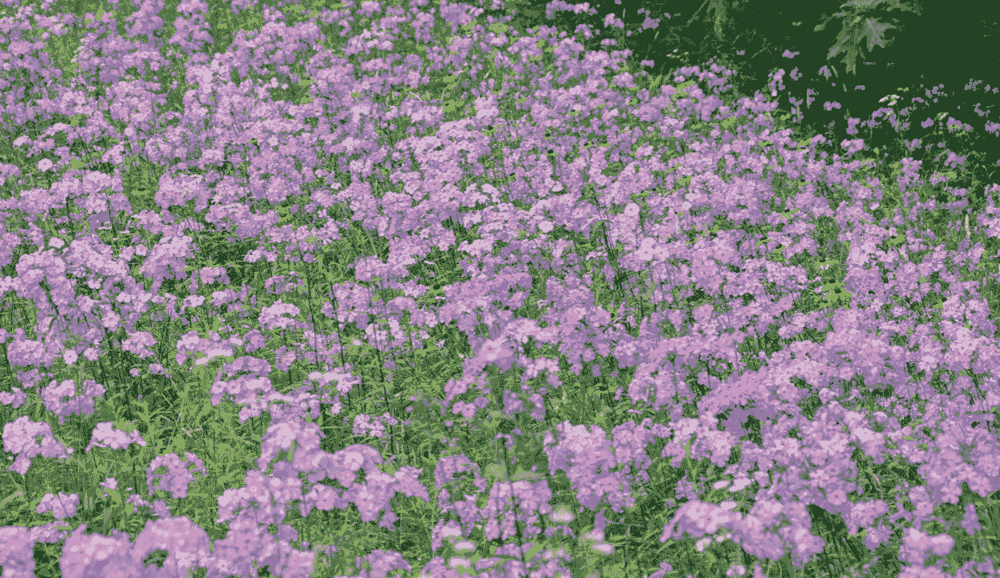

- 较矮的开花多年生植物可以是草坪的良好替代品。

## 对传粉者友好的草坪替代品

减少或消除草皮草坪以支持传粉者花园，可能是我们这个时代最伟大的生态成就。你可以帮助开启这一趋势！公平地说，没有一种本地对传粉者友好的草坪替代品能完全像草皮草坪那样发挥作用。如果你确实有用于宠物或娱乐的草坪，保留你需要的部分，去掉其余部分。无论你保留哪些草坪，都要有机管理（无农药）。

### 确定视线和植物高度

草坪替代品不必看起来像草坪，也不必矮小。在决定草坪替代品时，考虑植物高度和景观的视线。你有哪些不想遮挡的视野？你希望通过种植创造哪些视野——也许是从庭院欣赏开花植物的美景？实际因素，例如倒车出车道时需要清晰视野，是否会限制某些区域的植物高度？你的品味和实际限制将决定草坪替代品是矮、高还是介于两者之间。

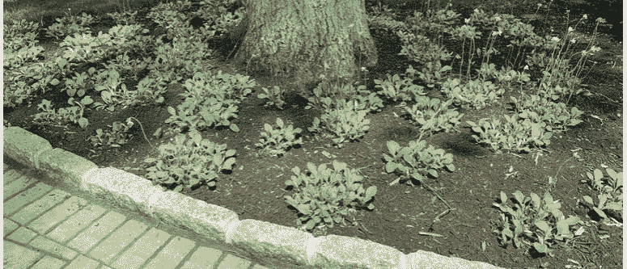

猫趾草（Antennaria plantaginifolia）是一种对传粉者友好的草坪替代品和幼虫寄主植物。

### 决定自然风格还是更正式的外观

如果你偏好较矮的植物和更正式的外观，以较大群组设计的矮生开花地被混合植物可能会吸引你。取决于你所在的地区，像猫趾草（Antennaria spp.）、匍匐福禄考（Phlox stolonifera）或石竹菊（Symphyotrichum ericoides）这样的本地地被植物可能是不错的选择。如果你更喜欢自然风格，也许高大的本地草地配蜿蜒小径会激发你，同时也为传粉者提供食物。

### 移除草皮草

你不必一次替换大片草坪。选择一个要处理的区域并开始准备。避免使用除草剂杀死草皮草；相反，使用纸板或报纸、堆肥和覆盖物分层的表面覆盖技术，随时间窒息并杀死草皮。几个月后材料腐烂后，你可以直接种植其中。为了更快地移除草皮，使用足够深入以挖起草根的草皮切割机，然后进行种植。

### 不要用另一种单一栽培取代一种单一栽培

开始时，请记住这条重要指导原则：不要用另一种单一栽培取代一种单一栽培（草坪）。生物多样性——一种能吸引并支持多样化传粉者和其他野生动物的多样化本地植物——对健康的生态系统至关重要。牢记花卉平衡原则——多样化种植，但要种植足够。

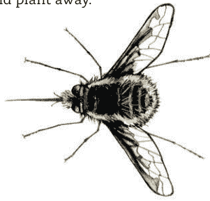

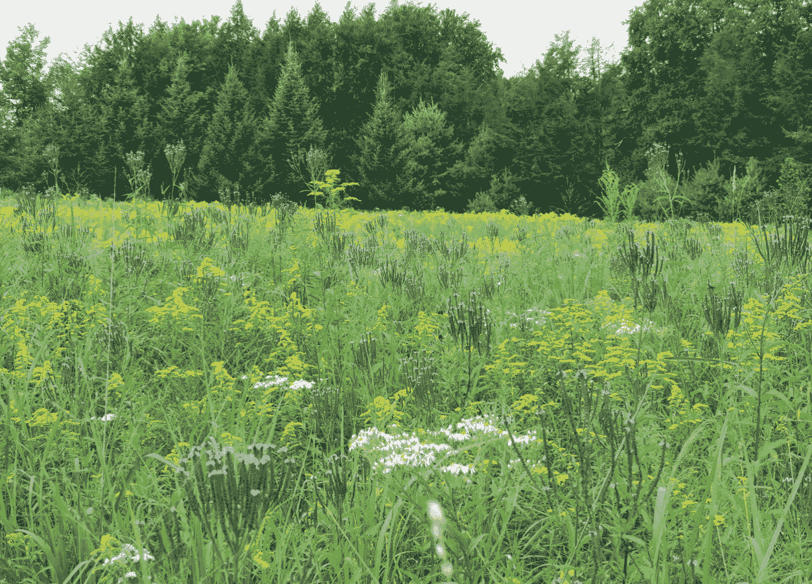

草地景观中的植物重复

## 草地与草地景观

世界上存在多种草地生态系统，但我们通常认为草地是一片生机勃勃的开阔景观，遍布本土草本和开花多年生植物，鲜有树木或灌木。我们不常在郊区或城市景观中考虑种植草地，但草地可以调整规模并加以管理，以适应更精心打理的景观，作为对缺乏生机的草坪的一种对传粉者友好的替代方案。仅仅停止修剪草坪草的“自由”草坪并不构成草地。那只是长有非本土草种和杂草的荒废高草坪。草地需要时间才能建立起来，并且必须进行管理。请参阅附录，获取可提供帮助的更多资源。

## 为传粉者规划你的草地景观

草地景观是一种类似草地的花园，融合了自然草地的许多元素，但可能更有意识地种植和管理。创建草地景观没有绝对的规则，但典型的传粉者胜利花园草地景观具有以下特点：

- 全日照条件（每天直接日照六个小时以上）
- 地形相对平坦（山坡也可通过使用矮生草地植物来实现）
- 无树木或灌木
- 低肥力土壤（有机质含量低）
- 开花的本土多年生和二年生植物（约占60%）
- 本土草本（约占40%）
- 本土植物多样，至少有三个物种同时开花
- 从晚春到秋季的连续开花期
- 植物的随机组合

有些草地生长在干燥地区，有些生长在湿地，有些则兼具不同土壤湿度条件。通常，有机质含量高的非常肥沃的景观（先做土壤测试！）不利于大多数本土草本生长，阴暗条件也不利。存在例外情况。

## 选择你的草地风格

自然形成的草地植物分布杂乱，有时会有特定物种的小片斑块，但整体效果相当随机。草地景观可以这样种植，也可以呈现更具设计感的外观。虽然植物群落对传粉者来说最容易找到，但具有花卉忠诚度的传粉者（如蜜蜂和蝴蝶）也能轻松找到草地或草地景观中反复出现的同一种植物。随机花卉图案的一个优势是减少鹿的啃食；鹿无法找到明显且易啃食的目标。

你选择的植物物种（匍匐型 vs. 丛生型；繁殖力强的自播植物）、使用的植物形式（种子、苗木、小多年生植物）以及植物布置均对设计有所贡献。由于草地和草地景观是动态群落，它们会随时间演变并改变外观。

## 选择草地植物

虽然开花的本土多年生和二年生植物（草本植物）是传粉者的首选植物，但本土草本是本土草地和草地景观的重要组成部分。本土草本在地面上方和下方形成基质，支持并编织成一个复杂且具有互动性的植物群落。它们深长的根系也非常有效地防止水土流失。大多数草地至少由40%的本土草本组成。幸运的是，许多本土草本也是鸟类和小型哺乳动物的幼虫寄主植物和种子来源，同时为许多生物提供栖息地。

## 使用种子或植物种植草地景观

用种子种植的草地景观最具成本效益，也是最随机、最自然的。种子播种的草地还需要最多的初始管理，并且完全建立起来所需时间更长——通常需要几年。

用多年生苗木或小植物种植的草地景观稍贵一些，可以更有意识地进行设计，并可在一个或两个生长季内建立起来，具体取决于种植时间。设计草地时，不妨在其中规划一条小径，以便近距离观察传粉者的活动。

如果你喜欢草地景观的想法，但又希望更整洁的美感，可以尝试“草地化”方法。使用通常出现在草地中的植物物种（如本土胡颓子、紫锥菊、金露花、菊草、草本等），但使用活体植物将每个物种分组成有意识的带状种植；可以把它想象成一个被“草地化”了的多年生花坛。

## 将无法使用的山坡转化为草地

如果你有一个目前种植草坪草的无法使用的山坡，不妨种植一个低矮的草地景观，既能帮助传粉者，又能结束修剪斜坡的噩梦。矮生本土多年生植物和草本，如金鸡菊属（Coreopsis spp.）和草原落芒草（Sporobolus heterolepis）效果很好，密植后能固持土壤并防止水土流失。

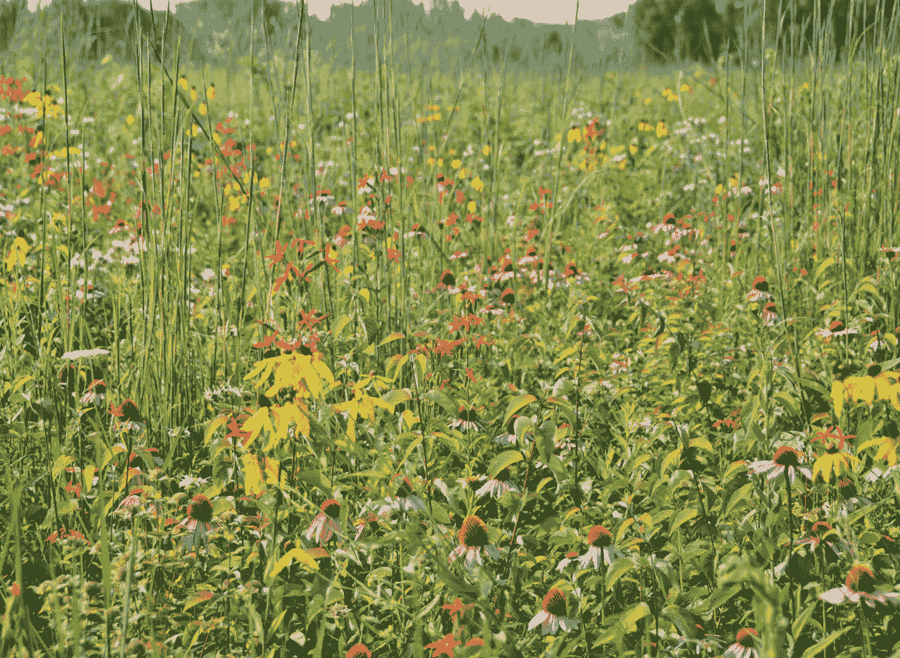

典型的草地/草原植物

## 维护草地以延长寿命

建立完成后（一旦所有植物都生根并覆盖），草地和草地景观必须定期修剪，通常每年在早春进行一次。如果不进行此修剪，木本植物可能会很快入侵草地。让多年生植物和草本在冬季保持直立，为野生动物提供栖息地和种子。

各种草地在春季开始生长都较慢；大多数草地物种，尤其是本土草本，都是暖季植物。春季，对于较大的草地，不妨分几周的时间分区域修剪较小的面积，让冬眠物种在不受伤害的情况下醒来并离开。

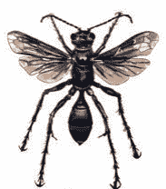

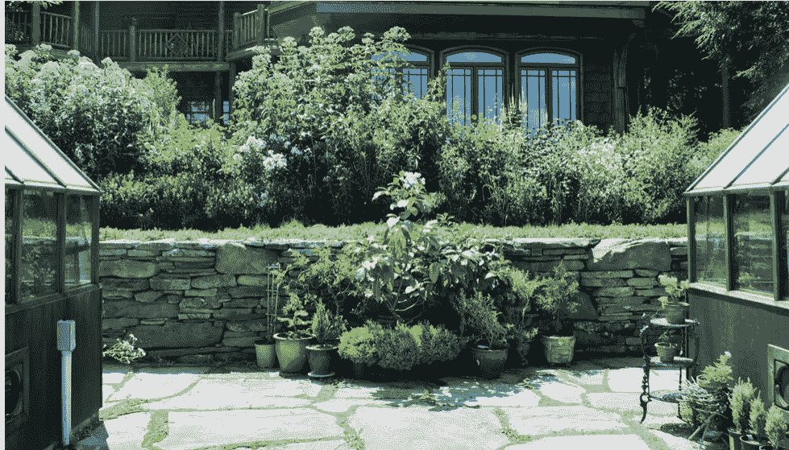

• 传粉者容器花园可以与传粉者景观种植相结合。

## 传粉者容器园艺

没有花园？没关系！你仍然可以拥有一个传粉者花园。露台、门廊甚至屋顶都可以成为传粉者的天堂。即使你有一个可以转化为对传粉者友好花园的景观，你可能也希望通过在容器（花盆）中种植来扩展你的传粉者花园！当花园空间不足时，就在容器中开始种植吧！

容器传粉者园艺有许多好处。花盆通常可以移动，所以你可以改变它们的位置。在没有土壤的地方，你可以在架状墙壁或栅栏上种植开花藤本植物。容器让你能够将植物靠近生活空间，以便欣赏它们并更近距离地观察传粉者。容器中的土壤混合物可以轻松改良，让你种植那些在当地环境中无法茁壮成长的物种。

## 选择容器

选择耐霜冻且可在寒冷天气中留在室外的容器。耐候复合花盆有许多精美设计；有些甚至模仿古老的花园容器。多年生植物可以全年留在这些容器中。这样一来，就不需要昂贵的重新种植；只需定期添加一些堆肥或其他有机质，以维持容器内的土壤生物活性。但不要忘记，盆栽植物需要比露土种植更多的水。

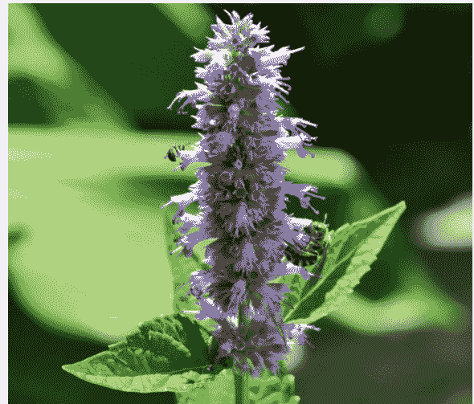

茴香薄荷（Agastache foeniculum），传粉者的最爱

选择尽可能大的容器，既深又宽，适合你现有的空间。某些本土植物的根系（如本土草本）非常发达，生长过程中需要更多空间。大容器还可以让你种植同一物种的群落作为传粉者目标，或者种植多种在生长季不同阶段开花的植物。

## 选择合适的植物

长花期植物（如紫锥菊 Echinacea spp.）是容器传粉者园艺的特别好选择。应重点种植传粉者喜爱的植物，如巨型胡薄荷（Agastache spp.），因为空间限制可能阻止你种植多种多样的植物。虽然它们不是地栽花园的首选，但本土植物的矮生栽培品种在容器中非常有用——但要确保它们不过度育种，且不缺乏花蜜和花粉。高达4英尺（1.25米）的花园飞燕草在盆中可能难以使用，但高1英尺（30厘米）、富含花蜜的本土栽培品种可能非常理想。

容器种植的一种流行方法是“惊艳、垂坠、填充”法，也适用于传粉者植物。使用较高的植物作为惊艳植物，中等高度的植物作为填充植物，以及垂坠生长的植物作为垂坠植物。根据你所在的地区，一种可能的组合是将茴香薄荷（Agastache foeniculum）作为惊艳植物，毛舌唇蕊草（Penstemon hirsutus）作为填充植物，以及石菊（Symphyotrichum ericoides，‘Snow Flurry’）作为垂坠植物。这种组合可以提供春季开花、夏季开花和秋季开花，既能喂养传粉者，又能提供多季节的视觉趣味。

将容器组合在一起以达到更丰满的效果；你会欣赏它们的繁茂，前来寻找花蜜和花粉的传粉者也会如此。

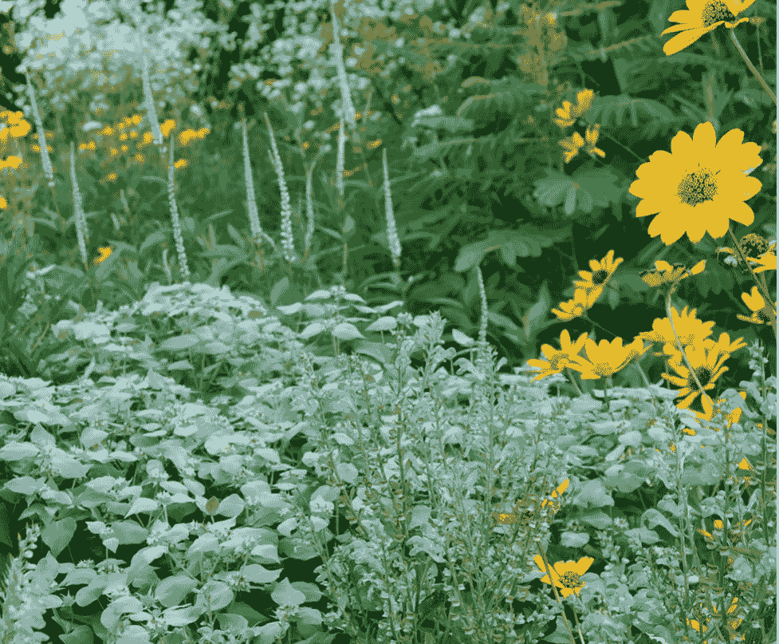

- 通过在正确的地点种植合适的植物并保持适宜的湿度，让花蜜持续流动。

## 培育与维护传粉者胜利花园

即使是本地植物，所有新种植的植物在头一两年也需要你的关注。当大自然未能提供足够的降雨时，请在头两年考虑补充浇水，以确保根系扎根良好。一旦本地植物扎根牢固，它们就非常低维护。如果你是从种子种植，请耐心等待；种子发芽并植株长满可能需要一段时间。

季节性日历将帮助你建立良好的维护常规。右侧是一些技巧，可让你的花园和传粉者在未来多年保持健康快乐。

## 季节性传粉者胜利花园维护

### 春季

- 等到白天气温达到华氏50多度（12至13°C）再修剪去年的多年生植物。你的植物可能仍在为越冬传粉者提供庇护。
- 修剪枯死的多年生植物时，留下6英寸（15厘米）或更长的茬秆作为传粉者栖息地。让一些多髓植物茎秆保持直立，因为它们可能为穴居蜜蜂提供庇护。
- 将修剪工作分批在数天或数周内完成，以便不同类型的传粉者有时间升温并变得活跃。
- 避免踩踏潮湿的土壤，这会导致土壤板结并损害植物根系。等地面稍干后再开始在花园里工作。
- 检查你的花园里有哪些早春开花的传粉者植物，并计划增添更多。早春对传粉者来说可能是一个充满挑战的时期。
- 在气温温和、降雨充足时进行种植。

### 夏季

- 适当浇水，让新种植的植物根系扎根良好。
- 在炎热干旱期间，不要让开花的多年生植物蔫掉——否则花蜜将无法充分流动。
- 记录夏季缺乏开花植物的时期。计划增添在那个时期开花的植物。

### 秋季

- 检查你的花园里有哪些晚秋开花的传粉者植物，并计划增添更多。确保越冬传粉者在进入冬季前饮食充足。
- 在美国大部分地区，秋季是种植的好季节。根据需要在你的传粉者胜利花园中添加更多植物。
- 让落叶就地保留，作为传粉者的栖息地。跳过使用吹叶机，以保护传粉者。
- 秋季不要修剪多年生植物，而是让它们直立越冬，作为栖息地。
- 出于同样的目的，让本地禾草直立越冬。

### 冬季

- 在秋季天气过于炎热不适合种植的温暖地区，向你的花园添加新的传粉者植物。
- 将融雪剂和盐远离你的传粉者胜利花园。许多植物对这些物质不能耐受。
- 开始规划你的传粉者胜利花园的下一阶段。
- 了解春季即将举行的本地植物销售活动。
- 为你的社区、学校、礼拜场所或非营利组织策划传粉者花园提供帮助。
- 购买一个传粉者栖息地标志，待地面解冻后安装。

*在温暖气候区调整此日历。

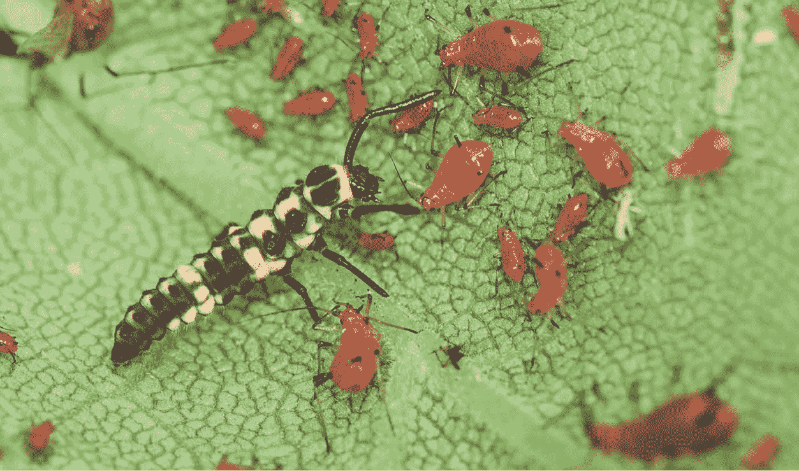

瓢虫幼虫：一种提供天然害虫防治的益虫

## 关于杀虫剂、传粉者及替代方案的一些话

杀虫剂与传粉者并不兼容。将杀虫剂拒之门外，不要让它们进入你的传粉者胜利花园。许多杀虫剂对蜜蜂和其他传粉者有毒，而有些杀虫剂虽不至于致命，却会影响传粉者正常发挥功能。每年，数百万磅的杀虫剂（包括杀虫剂、除草剂、杀菌剂和灭鼠剂）被用于农场和路边，以及住宅、市政和企业景观中。在许多情况下，即使没有明显问题需要处理，杀虫剂也会被自动施用。如果你希望拥有一个安全且支持传粉者的胜利花园，就不要在杀虫剂使用上跟风。

### 避免使用系统性杀虫剂

系统性杀虫剂尤其成问题，因为它们能够持续数月甚至数年。一种名为新烟碱类或新烟碱的较新一类系统性杀虫剂，因其对蜜蜂的致死和亚致死效应而备受关注。新烟碱是广泛使用的杀虫剂，施用后会被植物吸收并进入植物的维管系统。即使在开花前几周施用，花蜜和花粉中也可能含有新烟碱。这些毒药甚至会影响附近未经处理的植物。购买植物时，坚持要求它们不含新烟碱。

### 首先确定是否真的存在需要处理的问题

为了保护传粉者，首先评估你景观中任何看似的损害，以确定它是否真的是损害。叶片上的一个洞可能只是蝴蝶毛毛虫在幼虫寄主植物上取食，或者是切叶蜂为筑巢而取下的叶片碎片。一个健康、繁茂的景观并不是完美的景观。如果你确定自己拥有一种必须处理的植物害虫或疾病，请避免使用合成人造杀虫剂。谨慎、适量地使用有机杀虫剂；它们*并非*无害。如果你觉得必须使用杀虫剂，请选择一种仅针对目标问题而不对传粉者等有益生物造成附带损害的有机产品。

### 用自然方法控制害虫和疾病

传粉者在生存方面面临诸多挑战。从你的花园中清除杀虫剂，就能给它们一线生机。使用这些替代方法来控制害虫和疾病：

- 购买无病植物。
- 通过在正确的地点种植合适的植物来优化植物健康。
- 采用良好的园艺栽培措施防止问题扩散，例如移除感染真菌孢子的枯叶。
- 利用本地植物吸引天敌（捕食性和寄生性益虫），发挥大自然的害虫防治作用。
- 为鸟类种植植物，大多数鸟类会喂食昆虫给幼鸟，并且它们本身也可能食虫。
- 容忍景观中的某些损害。

伏尔泰说得对：完美是美好的敌人。我们并不完美，我们的景观也不必完美。蕾切尔·卡森在其著作*《寂静的春天》*中五十多年前就曾警告过杀虫剂的危害。让我们听从她的警告。如果对传粉者不好，对我们也不好。

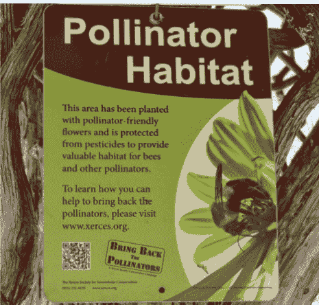

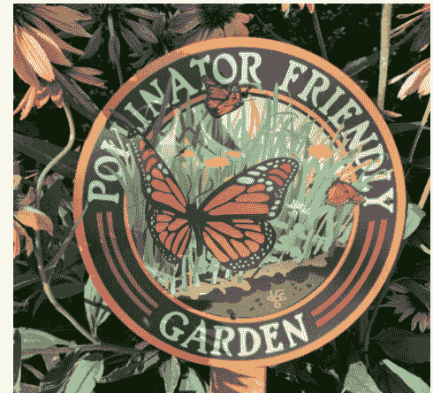

- 激励他人为传粉者园艺：安装一个传粉者标志。

## 安装传粉者标志

标志是生态园艺中一个被低估但强大的工具。一个简单的标志，放在车道尽头、栅栏上，甚至挂在你房子上，宣告你正在为传粉者园艺，将吸引许多人的注意。

值得考虑的一个标志是来自非营利无脊椎动物保护组织“塞西斯学会”（Xerces Society）的“传粉者栖息地”标志。这个9 x 12英寸（23 x 30厘米）的标志上写着：本区域已种植对传粉者友好的花卉，且不使用杀虫剂，为蜜蜂和其他传粉者提供栖息地。这是一个能让人思考、并理想情况下促使行动的信息。

当我们改变景观管理方式，例如更换草坪或让多年生植物直立越冬时，可能会让邻居、家人和朋友感到困惑。一旦你展示出自己是带着目标在进行园艺，其他人就开始连接起生态学的点滴。抓住这个机会，解释传粉者园艺的基础知识及其重要性。

除了塞西斯学会的标志外，还可以购买多种标志。北美蝴蝶协会提供“认证蝴蝶花园”标志（若符合其要求），超越杀虫剂组织（Beyond Pesticides）提供“无杀虫剂区域”标志，你甚至可以在亚马逊上购买“传粉者友好花园”标志。

## 分享你的花园

同样的邻居、家人和朋友很可能会欣赏你的邀请，前来参观你的花园，看看你创造了什么，并学习如何效仿你的努力。是时候举办一场花园派对了！保持简单，或者大胆举办一场传粉者盛宴。你可以在当地苗圃购买一些表现最好的传粉者植物样品，并在活动中出售。联系你当地的园艺大师组织，询问他们是否有演讲者可以前来与你的客人交谈并带领参观你的花园。

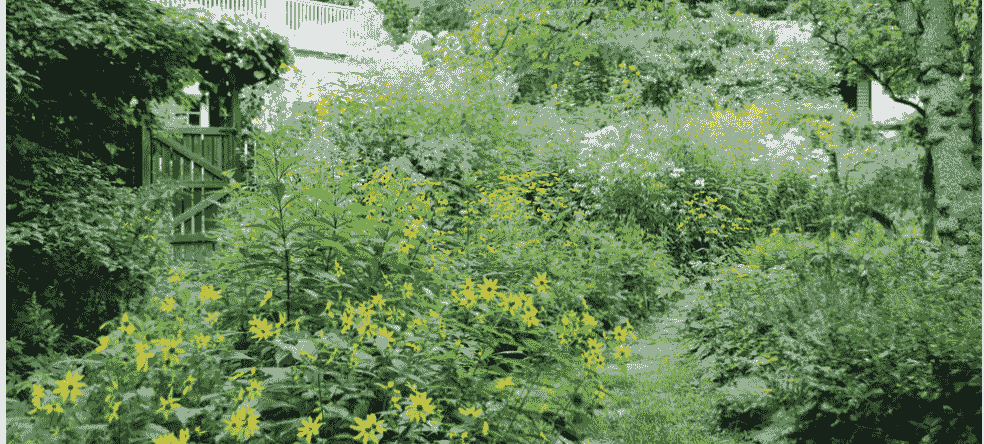

邀请家人、朋友和邻居来到你的传粉者胜利花园。

有些社区协会会组织花园参观；如果你的社区没有，可以建议他们举办一次。你的传粉者胜利花园可以为那些仍在种植入侵植物和使用农药的房主提供宝贵的学习机会。其他组织，如读书俱乐部，也可能感兴趣。读书俱乐部不必在室内聚会，也不必只阅读小说。你可以主动举办一次传粉者胜利花园的阅读与学习体验。

## 寻找志愿者机会

非营利组织、学校、教堂、图书馆、社区花园，甚至市政当局，常常有闲置土地。这些都是将无生机的空间转变为传粉者胜利花园的机会。制定计划，设定预算，并确保有持续的维护，才能让项目取得成功。如果你不想自己启动传粉者项目，可以加入像奥杜邦学会或塞拉俱乐部这样的环保组织，它们可能设有正在进行项目的分支机构。加入当地的园艺俱乐部，帮助带领为传粉者有目的地进行园艺工作。

你是否愿意上门敲门，或者至少在门把上挂上信息标签？美国东北部的一个组织有志愿者，他们在当地居民家门口放置传粉者信息标签，解释为什么传粉者很重要，并提供如何帮助传粉者的建议。

也许你希望为传粉者在更大范围内推动变革。可以考虑作为传粉者倡导者加入当地规划委员会或环境委员会。你可以提议建立一个传粉者示范花园，争取大家的支持。你可以展示传粉者对每个社区在生态和经济上的重要性。

无论你作为传粉者倡导者的努力是地方性的、区域性的还是全国性的，它们都会带来改变！

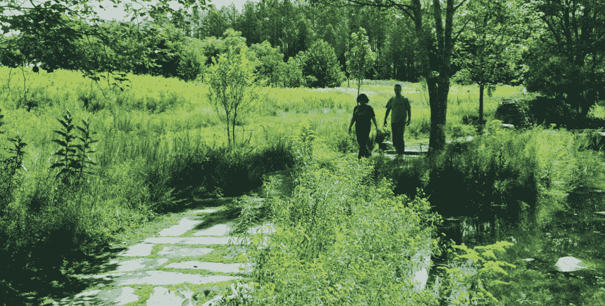

- 创建连接住宅、商业和市政景观的传粉者通道。

### 创建传粉者通道

数十年来，野生动物（包括传粉者）在不同景观之间缺乏连通性一直是一个巨大问题。曾经存在连通自然区域的地方，如今出现了新的住宅开发区、购物中心、办公楼和道路。在我们的现代世界中，连通性似乎持续被破碎化，导致形成传粉者和其他野生动物无法到达的孤立斑块。

当景观破碎化发生时，野生动物会受害，失去栖息地和资源，导致死亡率增加。景观破碎化不仅对野生动物，也对整个生态系统的健康造成影响。利用野生动物走廊重新连接破碎景观的概念已存在数十年，尽管主要用于公共土地。野生动物走廊是两个或更多较大野生动物栖息地之间的连接，为野生动物提供安全通道和所需资源。

同样的方法可用于创建连续的无农药传粉者花园植被走廊，从一片地产延伸到下一片地产，从一个城镇延伸到下一个城镇。2007年底，西雅图的一位名叫莎拉·伯格曼的创新设计师开始创建可能是第一条传粉者通道，一条长1英里（1.6公里）、宽12英尺（3.7米）的传粉者植物走廊。那次努力似乎激发了更多由美国东北部几十个城镇保护组织的志愿者组织的传粉者通道。

另一个帮助连接传粉者景观的绝佳计划是 Bee City USA®，这是 The Xerces Society（塞西斯学会）的一项倡议。该计划于2012年由创始人菲利斯·斯蒂尔斯发起，其使命是动员社区通过提供“丰富多样本土植物且几乎不使用农药的健康栖息地”来维持传粉者。城市、城镇、县和社区可以通过申请、决议和实施流程被指定为 Bee City USA 联盟成员。大学校园同样可以被认证为 Bee Campus USA。在美国，目前已有近100个 Bee City 和80个 Bee Campus。这些联盟成员都始于一位当地的传粉者倡导者。你也可以成为你社区的那位倡导者。

- 关注连通性。带有未连接“传粉者口袋”的破碎景观会限制传粉者资源，甚至可能让传粉者处于危险之中。由连通花园和持续栖息地组成的传粉者通道能显著改善传粉者资源。

- 通过请求（或帮助）隔壁邻居将至少部分草坪转变为传粉者栖息地，来启动你自己的传粉者走廊。在大多数社区，草坪已经是从一块地产到另一块地产的连通走廊。为什么不让这些空间对传粉者产生价值，并对你的生态系统有益呢？

- 在你的传粉者胜利花园中举办传粉者通道派对，让你的社区、邻居和朋友参与进来。与他们分享关于为传粉者进行本土园艺的数字和印刷信息。准备好对传粉者友好的本土植物，让你的客人能够开始行动。

- 使用推广你当地传粉者通道的标识牌。一个写着“我在（城镇名称）传粉者通道上”的牌子，是向邻居、家人和朋友展示你有目的地进行园艺，并且为社区与社区共同园艺的好方式。他们也可能会受到启发！

### 传粉者通道提示

- 与当地保护组织联系，了解你所在城镇是否已有传粉者通道。如果有，就加入它，让你的地产出现在他们的地图上，并询问你的庭院是否有标识牌可用。

- 如果目前没有通道，可以通过与当地保护团体协调来启动一个。你的景观可能成为未来通道的起点。访问 www.pollinator-pathway.org 以获取关于组建、推广和运营传粉者通道的想法。

你可以帮助推动传粉者通道运动——如果更多房主、企业和市政当局创建并连接传粉者花园，传粉者将受益，生态健康将得到改善。

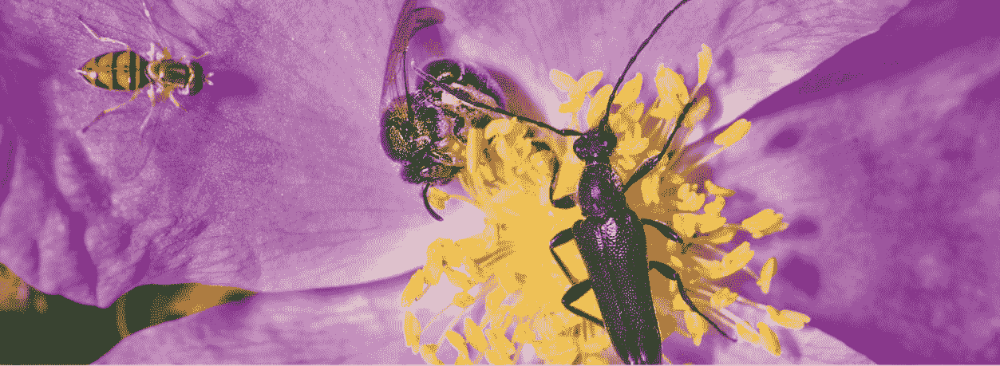

> 种下它们，它们就会来。
