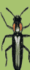
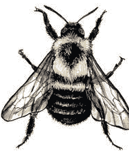
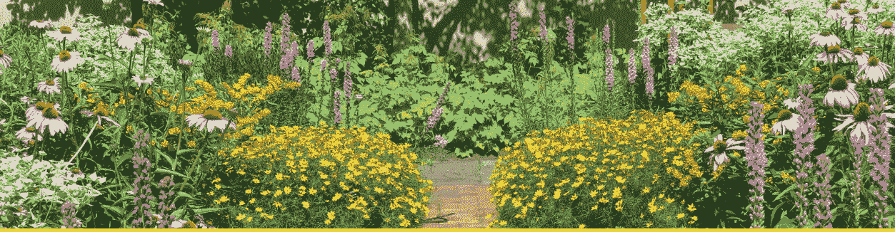

# 附录

## 繁荣传粉者胜利花园的十条提示

在创建和管理你的传粉者胜利花园时，有很多需要考虑的事项。偶尔你可能需要一些快速的复习提示，或者你可能想与他人分享一些简洁而实用的信息。以下是繁荣传粉者胜利花园的十条提示：

- 1. 在整个生长季节里种植开花季节相继的植物。不同的传粉者物种在一年中的不同时间出现，拥有不同的寿命和活跃期。通过种植相继重叠的开花植物，在整个生长季节里打造一个持续的传粉者“自助餐”。在北美大部分地区，生长季节从早春到深秋。

- 2. 跳过重瓣植物——它们的花蜜和花粉很少，有时甚至没有。对人类眼睛来说美丽的东西，可能是蜜蜂或其他传粉者挨饿的根源。要发现植物功能上的美，而不仅仅是外观。强调那些具有传粉者能够识别和利用的自然形态的植物。

- 3. 强调本土植物以支持本土传粉者和你的生态系统。进化很重要！本土传粉者与本土植物共同进化，可能擅长为这些物种授粉。一些研究表明，本地本土传粉者强烈偏好本地本土植物。在某些情况下，传粉者和植物相互依赖。专门传粉者可能依赖一小群植物或单一本土植物物种。本土植物在你的花园中发挥的生态功能比你想象的更多。让大自然成为你植物选择的指南。

- 4. 不要忘记在你的景观中包括开花的乔木、灌木和藤本植物——传粉者需要它们。许多木本植物（乔木、灌木、

and vines) offer a volume of flowers that can feed a large number of pollinators. Some early-blooming trees and shrubs may be the only source of nectar or pollen for early-emerging bees, before flowering perennials emerge. Many flowering trees, shrubs, and vines are also larval host plants for butterfly and moth caterpillars, and provide habitat to birds and other creatures.

Dedicate small areas of your landscape to these ground-nesting bees and keep those zones free of foot traffic. Accommodate the other 30 percent of bees that nest in old mouse holes, tree cavities, pithy plant stems, dead trees, crevices in stone walls, and the like. Other types of pollinators have different habitat needs—a well-layered landscape (trees, shrubs, vines, and perennials) will accommodate most of them.

- 5. Plant a diverse array of plants with different flower shapes, sizes, and colors. Each pollinator type is attracted to different plant characteristics. While a hummingbird favors red flowers, a bee is enticed by other colors, including purple, violet, blue, white, and yellow. Not every pollinator can access the same kind of flower, either—some need very open flowers while others can use more closed flowers or long, tubular flowers. A pollinator's tongue length, body size and shape, and strength help determine what flowers it can use. Plant diversely to accommodate a diverse array of pollinators.

- 8. Eliminate pesticides from your garden. Synthetic, man-made pesticides can be deadly to pollinators. Even some organic products can be lethal to sensitive creatures like bees. A thriving Pollinator Victory Garden is pesticide free. Skip the secret sauce (pesticides) and attract nature's pest control (beneficial insects, a.k.a. natural enemies) to your garden with native plants that support them.

- 6. Create floral targets for pollinators. Make it easier for pollinators to find flowers by planting enough of each plant species to feed them. Sizeable patches of the same plant are the easiest for pollinators to find. A 3 foot (0.28 m) square patch of a single species is a good place to start and can be repeated if the landscape is large enough. In naturalistic gardens or meadowscapes without true groupings, repeat the plant species throughout the area. Some pollinators forage only on a single plant species during a foraging trip, and they need enough to eat. Achieve floral balance in your landscape for pollinators by planting diversely but sufficiently.

- 9. Reduce or eliminate your lawn. Turfgrass lawns, or “green deserts,” are ecological wastelands for pollinators. Determine how much lawn you really need and replace the rest with flowering native plants. For any lawn you keep, let flowering “weeds” such as clover persist, and manage it organically. Pesticide drift has killed many a pollinator. Your family and your pets will benefit too, not only pollinators.

- 7. Provide nesting sites for pollinators in your landscape. Seventy percent of native bee species nest in the ground and need bare or lightly vegetated soil in a sunny spot.

- 10. Add a pollinator habitat sign to your landscape. Help raise awareness about the importance of pollinators and make a point of showing off your Pollinator Victory Garden to family members, friends, and neighbors with a pollinator habitat sign. This visual clue explains that you are gardening with purpose and improving the environment around you. It can also inspire others to create a Pollinator Victory Garden of their own.

## Pollinator Victory Garden Checklist

To get your Pollinator Victory Garden really working and to keep the momentum going, answer the following questions now and over time. This will help you plan and implement the steps needed to have a thriving pollinator garden. Share this checklist with family, neighbors, and friends who want to help pollinators too.

- [ ] Have you removed some of your lawn and replaced it with flowering native plants?

- [ ] What percentage of lawn did you replace? _______________
  Can you replace more? _______ Where and when? _______________

- [ ] Name the flowering native trees, shrubs, and vines (woodies) in your landscape:
  Spring bloomers _______________________________________
  Summer bloomers _______________________________________
  Fall bloomers _______________________________________
  Winter bloomers (if applicable in your region) _______________________________________

- [ ] What flowering native woodies could you add, and when do they bloom?
  _______________________________________
  _______________________________________

- [ ] Name the flowering native perennials, biennials, annuals, and ephemerals in your garden:
  Early spring bloomers _______________________________________
  Late spring bloomers _______________________________________
  Early summer bloomers _______________________________________
  Late summer bloomers _______________________________________
  Early fall bloomers _______________________________________
  Late fall bloomers _______________________________________
  Winter bloomers (if applicable in your region) _______________________________________

- [ ] Do you have at least 3 of each of the plants above? Which ones do you need to add more of? _______________________________________
  _______________________________________

- [ ] Are there any times of the season when not enough plants are in bloom? List the seasons and the plants you could get to fill those gaps:
  Early spring bloomers _______________________________________
  Late spring bloomers _______________________________________
  Early summer bloomers _______________________________________
  Late summer bloomers _______________________________________
  Early fall bloomers _______________________________________
  Late fall bloomers _______________________________________
  Winter bloomers (if applicable in your region) _______________________________________

- [ ] Do you have a diversity of flower colors, shapes and sizes in each season? If not, what are you lacking _______________________________________
  _______________________________________

- [ ] What native plants could you get to fill in what is missing?
  _______________________________________

- [ ] Name the larval host plants in your garden and the butterfly species they feed:

- [ ] What host plants do you need to add for common butterfly and moth species?

- [ ] Have you created (or left) a bare area in full sun for ground-nesting bees? Where is it and do you see pollinators using it?

- [ ] Where could you add more nesting areas for ground-nesting bees?

- [ ] Have you left an area, like a stone wall, dead tree, or brush pile, for cavity-nesting bees? Do you have a man-made habitat for cavity nesters? Do you see pollinators using these habitats?

- [ ] Where could you add more nesting sites for cavity-nesting bees?

- [ ] Do you have a water source for pollinators, like a small saucer filled with small gravel? If not, where could you put one or more?

- [ ] What plants in your garden support hummingbirds and other nectaring birds?

- [ ] What native plants could you add for hummers and other nectaring birds throughout their active season in your garden?

- [ ] Over the growing season, count the pollinators that you have seen nectaring on your flowers or eating your host plants (repeat each year):
  Nectaring:

  _______ Bees
  _______ Butterflies
  _______ Moths
  _______ Hummingbirds
  _______ Other Pollinating Birds
  _______ Bats
  _______ Pollinating Beetles
  _______ Pollinating Flies
  _______ Mystery Pollinator

  Using Host Plants:
  Butterfly and Moth Caterpillars _________

- [ ] Have you banished pesticides from your landscape and planted to attract and support natural enemies (nature's pest control)?

- [ ] Do you have a pollinator habitat sign in your yard (Xerces, etc.)?

- [ ] What friend, family member, neighbor, or organization would you like to help create a Pollinator Victory Garden this year? _________

## 植物列表

请记住，并非所有传粉者都使用每种植物。始终强调适合您所在地区的原生植物，并选择与您景观条件相匹配的植物。请将这些列表与其他推荐资源结合使用，为您的传粉者胜利花园挑选最佳的传粉者植物。

有关按地区划分的植物列表和幼虫寄主植物列表，请访问 www.ecobeneficial.com/PVG。

### 蜜蜂早花期原生乔木和灌木

物种和开花时间可能因地区而异。寄主 = 蝴蝶和/或蛾类的幼虫寄主植物

| 学名 | 俗名 | 花蜜/花粉 | 备注 |
|---|---|---|---|
| Acer rubrum | 红枫 | N & P | 极早开花，寄主 |
| Acer saccharum | 糖枫 | P | 极早开花，寄主 |
| Acer saccharinum | 银枫 | P | 极早开花，寄主 |
| Alnus incana | 斑点桤木 | P | 早花，寄主 |
| Alnus serrulata | 光滑桤木 | P | 早花，寄主 |
| Alnus viridis | 绿桤木 | P | 早花，寄主 |
| Amelanchier arborea | 绒毛安梅兰歇 | N & P | 可食果实，寄主 |
| Amelanchier canadensis | 加拿大安梅兰歇 | N & P | 可食果实，寄主 |
| Amelanchier x grandiflora | 苹果安梅兰歇 | N & P | 可食果实，寄主 |
| Amelanchier laevis | 阿勒格尼安梅兰歇 | N & P | 可食果实，寄主 |
| Celtis occidentalis | 西方鹅耳枥 | P | 早花，寄主 |
| Cercis canadensis | 东部红叶李 | P | 早花，寄主 |
| Cladrastis kentukea | 黄木 | N & P | 芬芳 |
| Cornus alternifolia | 宝塔山茱萸 | N & P | 鸟类食果，寄主 |
| Cornus amomum | 丝山茱萸 | N & P | 鸟类食果，寄主 |
| Cornus florida | 花山茱萸 | N & P | 鸟类食果，寄主 |
| Cornus racemosa | 灰山茱萸 | N & P | 鸟类食果，寄主 |
| Cornus sericea | 红枝山茱萸 | N & P | 鸟类食果，寄主 |
| Corylus americana | 美国榛树 | N & P | 早花，少量花粉，寄主 |
| Corylus cornuta | 喙榛 | N & P | 早花，少量花粉，寄主 |
| Crataegus mollis | 绒毛山楂 | N & P | 鸟类食果，寄主 |
| Crataegus punctata | 斑点山楂 | N & P | 鸟类食果，寄主 |
| Crataegus viridis | 绿山楂 | N & P | 鸟类食果，寄主 |
| Diospyros virginiana | 美国柿 | N & P | 可食果实，寄主 |
| Fraxinus americana | 白蜡树 | P | 绿条斑蠹，寄主 |
| Fraxinus nigra | 黑蜡树 | P | 绿条斑蠹，寄主 |
| Fraxinus pennsylvanica | 绿蜡树 | P | 绿条斑蠹，寄主 |
| Ilex glabra | 墨冬青 | N & P | 鸟类食果，寄主 |
| Ilex opaca | 美国冬青 | N & P | 鸟类食果，寄主 |
| Ilex verticillata | 赤冬青 | N & P | 鸟类食果，寄主 |
| Juglans cinerea | 白胡桃 | P | 可食坚果，寄主 |
| Juglans nigra | 黑胡桃 | P | 可食坚果，寄主 |
| Lindera benzoin | 香花灌木 | N & P | 早花，寄主 |
| Liriodendron tulipifera | 郁金香树 | N & P | 蜂鸟，寄主 |
| Malus coronaria | 美海棠 | N & P | 可食果实/鸟类，寄主 |
| Nyssa sylvatica | 黑山櫧 | N & P | 鸟类食果，寄主 |
| Photinia floribunda | 紫花石楠 | N & P | 鸟类食果，寄主 |
| Photinia melanocarpa | 黑果石楠 | N & P | 鸟类食果，寄主 |
| Photinia pyrifolia | 红果石楠 | N & P | 鸟类食果，寄主 |
| Prunus americana | 野李 | N & P | 高生态价值，寄主 |
| Prunus maritima | 海滨李 | N & P | 高生态价值，寄主 |
| Prunus pensylvanica | 瘤果樱桃 | N & P | 高生态价值，寄主 |
| Prunus serotina | 黑樱桃 | N & P | 高生态价值，寄主 |
| Prunus virginiana | 鸟樱桃 | N & P | 高生态价值，寄主 |
| Quercus alba | 白橡树 | P | 高生态价值，寄主 |
| Quercus palustris | 针果橡树 | P | 高生态价值，寄主 |
| Quercus rubra | 红橡树 | P | 高生态价值，寄主 |
| Robinia pseudoacacia | 黑酸枣 | N & P | 某些州为杂草，寄主 |
| Rhus aromatica | 芳香漆树 | N & P | 鸟类食果，寄主 |
| Salix amygdaloides | 桃叶柳 | N & P | 极早开花，寄主 |
| Salix bebbiana | 灰柳 | N & P | 极早开花，寄主 |
| Salix discolor | 银柳 | N & P | 极早开花，寄主 |
| Salix lucida | 亮柳 | N & P | 极早开花，寄主 |
| Salix nigra | 黑柳 | N & P | 极早开花，寄主 |
| Salix sericea | 丝柳 | N & P | 极早开花，寄主 |
| Sassafras albidum | 桂 | N & P | 鸟类食果，寄主 |
| Ulmus americana | 美国榆树 | P | 抗病栽培品种，寄主 |
| Ulmus rubra | 滑榆 | P | 寄主 |
| Vaccinium angustifolium | 矮生越橘 | N & P | 可食果实，寄主 |
| Vaccinium corymbosum | 高丛越橘 | N & P | 可食果实，寄主 |
| Vaccinium macrocarpon | 蔓越橘 | N & P | 可食果实，寄主 |

## 原生传粉者开花植物

物种和开花时间可能因地区而异。

### 春季开花多年生植物和短命植物

- Allium spp. (洋葱、大蒜、野韭)
- Anemone spp. (银莲花、风铃草)
- Aruncus dioicus spp. (山羊胡子)
- Aquilegia spp. (耧斗菜)
- Baptisia spp. (野靛蓝)
- Blephilia spp. (马薄荷)
- Callirhoe spp. (罂粟锦葵、酒杯花)
- Clarkia spp. (克拉克花)
- Claytonia spp. (春美花)
- Delphinium spp. (翠雀花)
- Dicentra spp. (倒挂金钟、荷兰人裤子、松鼠玉米)
- Dodecatheon spp. (坠星花)
- Erigeron spp. (飞蓬)
- Eriogonum spp. (野荞麦)
- Erythronium spp. (鳟鱼百合)
- Geranium spp. (天竺葵、长喙草)
- Geum spp. (报春花属、草原烟草)
- Hepatica nobilis spp. (肝叶草)
- Hydrophyllum spp. (水叶)
- Lupinus spp. (羽扇豆)
- Maianthemum spp. (加拿大五月花、假所罗门印)
- Mertensia spp. (蓝铃花)
- Penstemon spp. (胡子花)
- Phacelia spp. (旋毛花、蝎子草)
- Phlox spp. (春季开花飞蓬)
- Polemonium spp. (雅各梯子、阶梯花)
- Polygonatum spp. (所罗门印)
- Potentilla spp. (委陵菜)
- Pulsatilla spp. (复活节花)
- Sedum spp. (石莲花)
- Silene spp. (石竹花)
- Spigelia marilandica spp. (印地安粉红)
- Tiarella spp. (泡沫花)
- Tradescantia spp. (紫露草)
- Uvularia spp. (钟wort草)
- Viola spp. (堇菜)
- Zizia spp. (亚历山大、草地防风)

### 春季开花乔木和灌木

- Acer macrophyllum (大叶枫)
- Acer rubrum (红枫)
- Amelanchier spp. (安梅兰歇、沙茨树)
- Arctostaphylos spp. (熊果)
- Ceanothus spp. (加州青橐)
- Celtis occidentalis (西方鹅耳枥)
- Cercis spp. (红叶李)
- Cladrastis kentukea (黄木)
- Cornus spp. (山茱萸)
- Crataegus spp. (山楂)
- Diospyros spp. (柿)
- Fothergilla spp. (金缕梅)
- Gaylussacia spp. (越橘)
- Halesia spp. (银铃花)
- Hamamelis vernalis (早春金缕梅)
- Ilex spp. (冬青)
- Lindera spp. (香花灌木)
- Liriodendron tulipifera (郁金香树)
- Mahonia spp. (俄勒冈葡萄)
- Malus spp. (海棠)
- Nyssa sylvatica (黑山櫧)
- Philadelphus spp. (假橙花)
- Photinia spp. (石楠)
- Prunus spp. (樱桃、李)
- Ptelea trifoliata (三叶蝶麻)
- Rhus aromatica (芳香漆树)
- Ribes spp. (醋栗)
- Robinia spp. (金合欢)
- Salix spp. (柳)
- Tilia americana (美国椴树)
- Sassafras albidum (樟脑树)
- Vaccinium spp. (越橘、鹿越橘、蓝莓)
- Viburnum spp. (花荃)

### 夏季开花多年生植物

- Achillea millefolium (千屈菜)
- Agastache spp. (巨藿香)
- Asclepias spp. (乳草)
- Blephilia spp. (马薄荷)
- Campanula spp. (风铃草、狭叶风铃草)
- Campanulastrum americanum (高风铃花)
- Cardamine spp. (齿根、苦烛草)
- Chamerion spp. (柳叶菜)
- Cirsium spp. (蓟)
- Clarkia spp. (克拉克花)
- Coreopsis spp. (二荆条)
- Dalea spp. (草原三叶草)
- Dasiphora spp. (委陵菜)
- Delphinium spp. (翠雀花)
- Echinacea spp. (紫锥菊)
- Eriogonum spp. (野荞麦)
- Eryngium spp. (蓝蓟)
- Eschscholzia spp. (芙蓉草)
- Eupatorium spp. (骨碎补)
- Eutrochium spp. (乔派草)
- Gaillardia spp. (毯花)
- Heliopsis spp. (假向日葵)
- Hibiscus spp. (锦葵)
- Liatris spp. (燃星草)
- Lobelia spp. (龙胆花)
- Lupinus spp. (羽扇豆)
- Monarda spp. (天竺薄荷)
- Oenothera spp. (月见草)
- Phlox spp. (夏季开花飞蓬)
- Potentilla spp. (委陵菜)
- Pycnanthemum spp. (山薄荷)

- Ratibida spp. (草原锥花)
- Rudbeckia spp. (锥花, 黑眼苏珊)
- Salvia spp. (鼠尾草)
- Sanguisorba canadensis (美洲地锦)
- Sedum spp. (景天)
- Stokesia laevis (斯托克斯菊)
- Tradescantia spp. (鸭跟草)
- Verbena spp. (马鞭草)
- Vernonia spp. (铁苋菜)
- Veronicastrum virginicum (弗吉尼亚猪耳草)

- Symphoricarpos spp. (雪莓)
- Vaccinium spp. (越橘, 鹿越橘, 蓝莓, 蔓越莓)
- Viburnum spp. (荚蒾)

- Verbena spp. (马鞭草)
- Verbesina spp. (冠苎麻, 翼茎菊)
- Vernonia spp. (铁苋菜)

## 夏季开花的乔木和灌木

- Amorpha spp. (铅木, 假紫珠)
- Baccharis spp. (郊狼灌木, 骡脂灌木)
- Ceanothus spp. (金茶树)
- Cephalanthus occidentalis (按钮灌木)
- Clethra alnifolia (白桃金娘)
- Cornus spp. (山茱萸)
- Dasiphora fruticosa (灌木五爪金龙)
- Eriogonum spp. (荞麦属)
- Gaylussacia spp. (越橘属)
- Hydrangea arborescens (光滑绣球)
- Hydrangea quercifolia (橡叶绣球)
- Hypericum spp. (金丝桃)
- Itea virginica (杜鹃茶)
- Opuntia spp. (仙人掌)
- Physocarpus spp. (九皮树)
- Prosopis spp. (刺槐)
- Rhus spp. (漆树)
- Ribes spp. (醉树)
- Rosa spp. (玫瑰)
- Rubus spp. (覆盆子, 黑莓, 露莓)
- Salvia spp. (鼠尾草)
- Spiraea spp. (绣线菊)

## 秋季开花的多年生植物

- Ageratina spp. (蛇根菊)
- Bidens spp. (鬼针草)
- Boltonia spp. (假菊)
- Chamaecrista spp. (山鹌鹑豆)
- Chrysopsis spp. (金菊)
- Chelone spp. (龟头花)
- Cirsium spp. (蓟)
- Conoclinium spp. (雾花)
- Dalea spp. (草原三叶草)
- Dasiphora spp. (五爪金龙)
- Echinacea spp. (紫锥菊)
- Eschscholzia spp. (罂粟)
- Eupatorium spp. (骨头草, 透骨草)
- Eurybia spp. (紫菀属)
- Euthamia spp. (金顶草, 黄芪)
- Gaillardia spp. (毯花)
- Gentiana spp. (龙胆)
- Grindelia spp. (树脂草)
- Helenium spp. (喷嚏草)
- Helianthus spp. (向日葵)
- Hypericum spp. (金丝桃)
- Liatris spp. (火星草)
- Lobelia spp. (半边莲, 红雀花)
- Oenothera spp. (月见草)
- Oligoneuron spp. (金草)
- Physostegia spp. (龙头草, 顺应草)
- Ratibida spp. (草原锥花)
- Rudbeckia spp. (锥花, 黑眼苏珊)
- Salvia spp. (鼠尾草)
- Sanguisorba canadensis (美洲地锦)
- Solidago spp. (一串红)
- Symphyotrichum spp. (紫菀)

## 秋季开花的乔木和灌木

- Baccharis spp. (郊狼灌木, 骡脂灌木)
- Eriogonum spp. (荞麦属)
- Hamamelis virginiana (金缕梅)
- Rosa spp. (玫瑰)

## 适合蜜蜂的本土开花植物

### 多年生植物

- Agastache spp. (大胡薄荷)
- Chamerion angustifolium (柳叶菜)
- Cleome spp. (金凤花)
- Dalea spp. (草原三叶草)
- Echinacea spp. (紫锥菊)
- Erigeron spp. (蓬草)
- Eriogonum spp. (荞麦属)
- Eschscholzia spp. (罂粟)
- Eutrochium spp. (乔派草)
- Gaillardia spp. (毯花)
- Helianthus spp. (向日葵)
- Heliopsis helianthoides (假向日葵, 牛眼菊)
- Liatris spp. (火星草)
- Monarda punctata (斑点香蜂草)
- Oligoneuron spp. (金草)
- Phacelia spp. (虫球草, 蝎子草)
- Pycnanthemum spp. (山薄荷)
- Rudbeckia laciniata (裂叶黑眼苏珊)
- Sanguisorba canadensis (美洲地锦)
- Solidago spp. (一串红)
- Silphium perfoliatum (合生草)
- Stokesia laevis (斯托克斯菊)
- Symphyotrichum spp. (紫菀)
- Verbesina spp. (冠苎麻, 翼茎菊)
- Vernonia spp. (铁苋菜)
- Veronicastrum virginicum (弗吉尼亚猪耳草)

### 乔木和灌木

- Acer macrophyllum (大叶枫)
- Acer negundo (美洲开心木)
- Acer rubrum (红枫)
- Catalpa spp. (梓树)
- Ceanothus spp. (金茶树)
- Cephalanthus spp. (按钮灌木)
- Cercis spp. (紫荆)
- Clethra alnifolia (白桃金娘)
- Crataegus spp. (山楂)
- Dalea spp. (草原三叶草)
- Diospyros spp. (柿)
- Ilex spp. (冬青)
- Itea virginica (杜鹃茶)
- Liriodendron tulipifera (郁金香树)
- Mahonia spp. (小檗, 俄勒冈葡萄)
- Malus spp. (海棠)
- Nyssa spp. (水榆)
- Oxydendron arboreum (酸树)
- Photinia spp. (石楠)
- Physocarpus spp. (九皮树)
- Prosopis spp. (刺槐)
- Prunus spp. (樱桃, 李)
- Rhus spp. (漆树)
- Ribes spp. (醉树)
- Robinia spp. (黄槐)
- Rosa spp. (玫瑰)
- Rubus spp. (覆盆子, 黑莓)
- Salix spp. (柳)
- Tilia americana (美国椴树)

## 适合蜂鸟的本土开花植物

### 多年生植物

- Agastache rupestris (日落胡薄荷)
- Aquilegia canadensis (东部红报春花)
- Aquilegia formosa (西部报春花) 和其他报春花属物种
- Arctostaphylos spp. (熊果)
- Bignonia capreolata (交叉藤)
- Campanula spp. (钟花)
- Campanulastrum americanum (美国钟花)
- Castilleja indivisa (德克萨斯印第安画笔) 和其他印第安画笔属物种
- Chamerion angustifolium (柳叶菜)
- Delphinium spp. (飞燕草)
- Dudleya spp. (长生草)
- Epilobium canum (加州野生灯笼花)
- Erythrina spp. (切洛基豆, 珊瑚豆)
- Hesperaloe parviflora (红花假拟虎尾兰)
- Heuchera sanguinea (珊瑚铃)
- Hibiscus coccineus (绯红葵) 和其他葵属物种
- Impatiens spp. (凤仙花)
- Ipomopsis rubra (直立飞蓬)
- Leucophyllum frutescens (德州银叶)
- Lilium spp. (加拿大百合, 土耳其帽百合, 高山百合)
- Lobelia cardinalis (红雀花)
- Lupinus spp. (芒豆)
- Mertensia spp. (蓝铃花)
- Mimulus spp. (绯红猴花, 猴花)
- Monarda spp. (香蜂草, 绯红香蜂草)
- Monardella spp. (郊狼薄荷)
- Penstemon spp. (胡葫芦)
- Physostegia spp. (顺应草, 龙头草)
- Ruellia spp. (野生矾花)
- Salvia spp. (鼠尾草)
- Silene spp. (秋李子)
- Spigelia marilandica (印第安粉红)
- Stachys coccinea (绯红鱼腥草)

### 乔木、灌木和藤本植物

- Aesculus pavia (绯红七叶树)
- Aesculus parviflora (瓶刷七叶树)
- Anisacanthus quadrifidus var. wrightii (焰刺槐)
- Anisacanthus thurberi (沙漠金银花)
- Bignonia capreolata (交叉藤)
- Bouvardia ternifolia (鞭炮灌木)
- Calliandra spp. (精灵扫帚)
- Campsis radicans (喇叭花)
- Chilopsis linearis (沙漠柳)
- Catalpa spp. (梓树)
- Ceanothus americanus (新泽西茶)
- Clethra alnifolia (白桃金娘)
- Galvezia speciosa (岛屿鱼草)
- Hamelia patens (火焰灌木)
- Justicia californica (蜂鸟灌木)
- Kosteletzkya virginica (弗吉尼亚盐沼葵)
- Liriodendron tulipifera (郁金香树)
- Lonicera sempervirens (常青金银花) 和其他忍冬属物种
- Mahonia spp. (小檗, 俄勒冈葡萄)
- Malvaviscus arboreus (土耳其帽葵)
- Rhododendron arborescens (光滑杜鹃) 和其他本土杜鹃花
- Rhododendron catawbiense (卡塔瓦杜鹃花)
- Ribes malvaceum (灌丛醉树) 和其他醉树属物种
- Ribes speciosum (灯笼花醉树)

## 推荐图书

### 关于本土蜜蜂的书籍

- Buchmann, Stephen, and Gary Paul Nabhan. 被遗忘的传粉者. Washington, DC: Island Press, 1997.
- Droege, Sam, and Laurence Packer. 蜜蜂：近距离观察世界各地的传粉者. Minneapolis, MN: Voyageur Press, 2015.
- Embry, Paige. 我们的本土蜜蜂：北美濒危传粉者与拯救之战. Portland, OR: Timber Press, 2018.
- Frankie, Gordon W., Robbin W. Thorp, Rollin E. Coville, and Barbara Ertter. 加州蜜蜂与花卉：园丁与博物学家指南. Berkeley, CA: Heyday, 2014.
- Goulson, Dave. 尾部的刺：我与大黄蜂的冒险. London: Picador, 2013.
- Griffin, Brian L. 果园泥蜂：北美本土蜜蜂的生活史、生物学、繁殖与利用. Bellingham, WA: Knox Cellars Publishing, 2011.
- Grissell, Eric. 蜜蜂、黄蜂和蚂蚁：园中膜翅目不可或缺的角色. Portland, OR: Timber Press, 2010.
- Hanson, Thor. 嗡嗡声：蜜蜂的本质与必要性. New York: Basic Books, 2018.
- Holm, Heather. 蜜蜂：鉴定与本土植物觅食指南. Minnetonka, MN: Pollination Press, 2017.
- Hunter, Dave, and Jill Lightner. 泥蜂革命：最勤劳的蜜蜂如何一次一个后院拯救世界. Seattle: Skipstone, 2016.
- Moisset, Beatriz. 传粉者及其他花访者入门指南. Lulu.com, 2013.
- Moisset, Beatriz, and Stephen Buchmann. 蜜蜂基础：我们的本土蜜蜂入门. A USDA Forest Service and Pollinator Partnership Publication, 2016.
- Williams, Paul, Robbin Thorp, Leif Richardson, and Sheila Colla. 北美大黄蜂：鉴定指南. Princeton, NJ: Princeton University Press, 2014.
- Wilson, Joseph S., and Olivia Messinger Carril. 你家后院的蜜蜂：北美蜜蜂指南. Princeton, NJ: Princeton University Press, 2016.
- Wilson-Rich, Noah. 蜜蜂：自然史. Princeton, NJ: Princeton University Press, 2014.
- Xerces Society. 吸引本土传粉者：保护北美的蜜蜂和蝴蝶. North Adams, MA: Storey, 2011.
- ——. 100种喂养蜜蜂的植物：提供健康栖息地，帮助传粉者茁壮成长. North Adams, MA: Storey, 2016.

### 关于毛毛虫、蝴蝶和蛾的书籍

- Glassberg, Jeffrey. 透过双筒望远镜看蝴蝶：东部. New York: Oxford University Press, 1999.
- ——. 北美蝴蝶快速指南. Princeton, NJ: Princeton University Press, 2017.
- Halpern, Sue. 四片翅膀与一场祈祷：帝王蝶之谜. New York: Vintage Books, 2001.
- Hurwitz, Jane. 蝴蝶园艺：北美蝴蝶协会指南. Princeton, NJ: Princeton University Press, 2018.
- Opler, Paul A. 彼得森北美蝴蝶和蛾初级指南. New York: Houghton Mifflin, 1994.
- Parejko, Ken. 蝴蝶之王. St. Petersburg, FL: BookLocker.com, 2010.
- Rea, Ba, Karen Oberhauser, and Michael A. Quinn. 萝藿、帝王蝶与更多：萝藿丛中无脊椎动物群落野外指南. Union, WV: Bas Relief Publishing Group, 2011.
- Wagner, David L. 东北美毛毛虫. Princeton, NJ: Princeton University Press, 2005.
- Wagner, David L., Dale F. Schweitzer, J. Bolling Sullivan, and Richard C. Reardon. 东北夜蛾毛毛虫. Princeton, NJ: Princeton University Press, 2011.
- Xerces Society. 吸引本土传粉者：保护北美的蜜蜂和蝴蝶. North Adams, MA: Storey, 2011.
- ——. 为蝴蝶园艺：如何吸引和保护美丽的有益昆虫. Portland, OR: Timber Press, 2016.
- Allen, Thomas J., Jim P. Brock, and Jeffrey Glassberg. 田野与花园中的毛毛虫：北美蝴蝶毛毛虫野外指南. New York: Oxford University Press, 2005.
- Beadle, David, and Seabrooke Leckie. 彼得森东北美蛾类野外指南. New York: Houghton Mifflin Harcourt, 2012.
- Dole, Claire Hagen, ed. 蝴蝶园艺师指南. New York: Brooklyn Botanic Garden, 2003.

## 其他传粉者书籍

- Cranshaw, Whitney, and David Shetlar. Garden Insects of North America: The Ultimate Guide to Backyard Bugs. 第2版. Princeton, NJ: Princeton University Press, 2017.
- Flottum, Kim. The Backyard Beekeeper: An Absolute Beginner’s Guide to Keeping Bees in Your Yard and Garden. 第4版. Beverly, MA: Quarry Books, 2018.
- Grissell, Eric. Bees, Wasps, and Ants: The Indispensable Role of Hymenoptera in Gardens. Portland, OR: Timber Press, 2010.
- ——. Insects and Gardens: In Pursuit of a Garden Ecology. Portland, OR: Timber Press, 2006.
- Holm, Heather. Pollinators of Native Plants: Attract, Observe and Identify Pollinators and Beneficial Insects with Native Plants. Minnetonka, MN: Pollination Press, 2014.
- Jones, Richard, and Sharon Sweeney-Lynch. The Beekeeper’s Bible: Bees, Honey, Recipes & Other Home Uses. New York: Stewart, Tabori and Chang, 2011.
- Moisset, Beatriz. Beginners Guide to Pollinators and Other Flower Visitors. Lulu.com, 2013.

## 本土植物与本土园艺书籍

另请查找关于本土植物的地区或全州书籍。

- Brandenburg, David. National Wildlife Federation Field Guide to Wildflowers of North America. New York: Sterling, 2010.
- Clemants, Steven, and Carol Gracie. Wildflowers in the Field and Forest: A Field Guide to the Northeastern United States. New York: Oxford University Press, 2006.
- Cullina, William. Native Ferns, Moss, and Grasses. New York: Houghton Mifflin, 2008.
- ——. Native Trees, Shrubs, and Vines. New York: Houghton Mifflin, 2002.
- ——. The New England Wild Flower Society Guide to Growing and Propagating Wildflowers of the United States and Canada. New York: Houghton Mifflin, 2000.
- Diekelmann, John, and Robert Schuster. Natural Landscaping: Designing with Native Plant Communities. Madison, WI: University of Wisconsin Press, 2002.
- Dove, Tony, and Ginger Woolridge. Essential Native Trees and Shrubs for the Eastern United States: A Guide to Creating a Sustainable Landscape. Watertown, MA: Charlesbridge, 2018.
- Dunne, Niall (ed.). Great Natives for Tough Places. New York: Brooklyn Botanic Garden, 2009.
- Gracie, Carol. Spring Wildflowers of the Northeast: A Natural History. Princeton, NJ: Princeton University Press, 2012.
- Lawson, Nancy. The Humane Gardener: Nurturing a Backyard Habitat for Wildlife. New York: Princeton Architectural Press, 2017.
- Newcomb, Lawrence. Newcomb’s Wildflower Guide. Boston: Little Brown, 1989.
- Stein, Sara. Noah’s Garden: Restoring the Ecology of Our Own Back Yards. New York: Houghton Mifflin, 1995.
- Summers, Carolyn. Designing Gardens with Flora of the American East. New Brunswick, NJ: Rutgers University Press, 2010.
- Tallamy, Douglas. Bringing Nature Home: How You Can Sustain Wildlife with Native Plants. Portland, OR: Timber Press, 2007.
- Tallamy, Douglas, and Rick Darke. The Living Landscape: Designing for Beauty and Biodiversity in the Home Garden. Portland, OR: Timber Press, 2014.
- Vogt, Benjamin. A New Garden Ethic: Cultivating Defiant Compassion for an Uncertain Future. Gabriola Island, BC: New Society Publishers, 2017.
- Weaner, Larry, and Thomas Christopher. Garden Revolution: How Our Landscapes Can Be a Source of Environmental Change. Portland, OR: Timber Press, 2016.
- Zimmerman, Catherine B. Urban and Suburban Meadows: Bringing Meadowscaping to Big and Small Spaces. Silver Spring, MD: Matrix Media Press, 2010.

## 其他

- Carson, Rachel. Silent Spring, New York, NY: Houghton Mifflin Company, 第1版, 1962.
- Mazza, Charles. Site Assessment for Better Gardens and Landscapes. Ithaca, NY: Plant and Life Sciences Publishing (Cornell University College of Agriculture and Life Sciences), 2013.

## 有用的网站

(plants) = 研究植物的良好来源

- Audubon Native Plants Database (plants) www.audubon.org/native-plants 你所在地区对鸟类最有益的植物，可按邮政编码搜索。
- Bee City USA www.beecityusa.org
  Bee City USA 和 Bee Campus USA 认证项目。
- The Biota of North America Program (BONAP) North American Plant Atlas (plants)
  - bonap.net/napa
  - 可按美国每个州和县搜索的植物。
- Bug Guide
  - bugguide.net
  - 昆虫鉴定和信息。
- Butterflies and Moths of North America (BAMONA)
  - www.butterfliesandmoths.org
  - 蝴蝶和蛾类鉴定及信息；寄主植物信息。
- EcoBeneficial!
  - www.ecobeneficial.com
  - 作者网站，包含关于生态园艺和本土植物的文章、播客和视频。
- EPA: Ecoregions
  - www.epa.gov/eco-research/ecoregions
  - 美国生态区的信息和地图。
- Insect Identification for the Casual Observer
  - www.insectidentification.org
  - 按类型的昆虫鉴定。
- Lady Bird Johnson Wildflower Center (plants)
  - www.wildflower.org
  - 美国具有特殊价值的本土植物可搜索数据库和列表。
- Monarch Watch
  - www.monarchwatch.org
  - 关于帝王蝶的教育、保护和研究。
- National Wildlife Federation, Plants for Pollinators: A Collection of Favorites (plants)
  - www.nwf.org/Magazines/National-Wildlife/2010/Native-Plants-for-Pollinators
  - 来自美国各地野生动物友好型园艺师的本土植物照片和描述。
- North American Butterfly Association
  - www.naba.org
  - 蝴蝶和蝴蝶园艺信息；认证项目。
- North American Native Plant Society (plants)
  - nanps.org
  - 关于本土植物的提示和北美本土植物学会链接。
- Pollinator Partnership (plants)
  - www.pollinator.org
  - 北美和夏威夷按生态区划分的三十二份传粉者植物清单；教育信息。
- Sharp-Eatman Nature Photography, Guide to Wild Bees
  - www.sharpeatmanguides.com/wild-bee-id-guide-new-york
  - 配有精彩照片的纽约野生蜜蜂鉴定指南。
- US Forest Service and Pollinator Partnership
  - “使用本土植物将传粉者吸引到你的花园中”
  - www.fs.fed.us/wildflowers/pollinators/documents/AttractingPollinatorsEasternUS_V1.pdf
  - 关于传粉者友好型园艺关键要素的小册子。
- USDA Natural Resources Conservation Service, Insects and Pollinators
  - www.nrcs.usda.gov/wps/portal/nrcs/main/national/plantsanimals/pollinate
  - 关于传粉者保护工作的信息。
- USDA Plant Hardiness Zone Map
  - https://planthardiness.ars.usda.gov/PHZMWeb/
  - 美国的植物耐寒区，可按邮政编码搜索。
- USDA PLANTS Database (plants)
  - plants.sc.egov.usda.gov/
  - 美国和加拿大本土植物数据库，包括本土分布范围地图。允许放大以查看县级本土植物物种。
- Wild Bee ID
  - www.wildbeelid.org
  - 来自食品安全中心。
  - 本土蜜蜂和本土植物的鉴定和信息。
- Wild Ones
  - wildones.org
  - 促进环境友好型景观实践的会员组织；关于本土植物和自然景观的信息。
- The Xerces Society (plants)
  - www.xerces.org
  - 按地区划分的十份传粉者植物清单；事实资料、研究、教育信息；出售传粉者栖息地标志。

## 蜜蜂房屋/蜜蜂旅馆信息

- Bee Keep Club
  - beekeepclub.com
  - “创建独居蜜蜂旅馆”
  - extensionpublications.unl.edu/assets/pdf/g2256.pdf
- Crown Bees
  - crownbees.com/bee-hotels

## 关于蜜蜂的信息

- Bee Culture magazine
  - www.beeculture.com
- Honey Bee Suite
  - honeybeesuite.com
- Honeybee Conservancy
  - thehoneybeeconservancy.org

## 索引

- 龙舌兰植物，14, 118, 119
- 亚历山大，19, 75, 115
- 杏仁，97, 99
- 动物传粉者，6, 9, 10–11.
  - 另见 传粉者
- 茴香薄荷，101, 137
- 蚂蚁，14, 15
- 蚜虫，87, 113
- 苹果，97
- 紫菀，57, 68, 75, 76, 97, 101, 105, 111, 115, 131, 134, 137
- 杜鹃花（本土），117
- 树皮，39, 104
- 椴树，100
- 蝙蝠，6, 14, 15, 19, 81, 87, 89, 118–119
  - 花的特征，81
  - 适合的本土花卉，118, 119
- 龙口花，75, 97, 117, 137
- 香蜂草，78, 79, 97, 109, 117
- Bee City USA，145
- 蜜蜂旅馆，41
- 蜜蜂，15, 17
  - 生物碱，93
  - 开花期考量，94
  - 大黄蜂，17, 18, 29, 30, 36, 40, 46, 76, 92, 93, 96
  - 木蜂，30, 96
  - 洞穴筑巢，29, 30–33, 41
  - 透明蜡蜂，30
  - 杜鹃蜂，29
  - 数量下降，6
  - 花的特征，23, 80, 95
  - 食用作物与，11
  - 采食，19, 96–97
  - 广食性，17, 46, 71, 99
  - 地面筑巢，29, 30
  - 用于保暖的栖息地，37
  - 产卵和筑巢栖息地，29–33
  - 西方蜜蜂，6, 17, 18, 33, 37, 40, 49, 70, 71, 73, 92, 93, 96, 98–101
  - 切叶蜂，18, 30, 41, 93
  - 寿命，18
  - 泥蜂，30, 41, 93, 97
  - 矿蜂（掘地蜂），17, 30, 77, 93
  - 本土，92–93
  - 适合的本土花卉，97
  - 越冬，40
  - 树脂蜂，19, 30
  - 栖息所，35
  - 社会性蜜蜂，20, 33, 40, 92, 93, 97, 99
  - 独居蜜蜂，18, 29, 41, 92, 93, 97
  - 专化性，17, 45, 46, 94, 96
  - 杂草蜂，30, 77, 96
  - 舌长，96
  - 胡蜂与，114
  - 黄面蜂，30
- 甲虫，6, 14, 15, 19, 31, 110–111
  - 花的特征，79, 81
  - 由其授粉的本土花卉，111
- 甲虫隧道，30, 31, 41
- 香蜂草，7, 45, 97, 70, 103, 109
- 二年生植物，133, 134
- 生物多样性，12, 15, 49, 57, 59, 131
- 生物量，72, 86

- 鸟类，6, 14, 15, 81
  - 花的特征，79, 81
  - 蜜鹀，15
  - 蜂鸟，15
  - 蜂鸟，14, 15, 16, 19, 20, 23, 35, 45, 79, 87, 88, 89, 116–117, 119
  - 䴕，14, 116
  - 太阳鸟，15
- 灿烂星，97, 105, 109, 113
- 开花期，13, 18, 76–77
- 开花期清查，75–76
- 开花期更替，13, 18, 66, 74–77, 133
- 蓝莓，96
- 蓝雾花，105
- 蓝野靛蓝，75
- 枯枝堆，32
- 蝴蝶，6, 14, 15, 18. 另见 帝王蝶
  - 合蝶，38
  - 无云硫蝶，103
  - 珊瑚线蝶，39
  - 东部逗号蝶，38, 87
  - 花的特征，80
  - 食物，82–84, 87
  - 采食，19
  - 大斑粉蝶，39
  - 栖息地和生活史，104
  - 幼虫寄主植物，17, 27, 28, 29, 36, 50, 55, 82–83, 84, 104, 123, 134
  - 蛾 vs.，102
  - 哀蝶，18, 38, 39, 87, 103, 104
  - 适合的本土花卉，105
  - 越冬，38–39
  - 彩蝶，102
  - 饮水行为，88
  - 红带弄蝶，37, 87, 102
  - 红斑紫蝶，84
  - 定居和迁徙，102–103
  - 栖息所，35
  - 弄蝶，36, 55, 102, 103
  - 凤蝶，21, 39, 83, 94, 102, 103
  - 龟蝶，38
- 蝴蝶木，29
- 球果木，75
- 仙人掌，14, 118, 119
- 加利福尼亚，53, 63, 99, 103
- 毛虫，17, 38, 39, 82–84
  - 幼虫寄主植物，17, 28, 82, 84, 104, 106, 141, 141
- 青桦属，50, 105
- 樱桃，61, 75, 82, 105, 109
- 气候变化，7, 15, 49, 70
- 三叶草，7, 147
- 通叶紫菀，75, 115
- 普通萝芙木，21, 75
- 通用名，57
- 紫锥花，46, 75, 76–77, 99, 101, 105, 134, 137
- 容器园艺，136–137
- 珊瑚忍冬，34, 79, 96, 117
- 蔓越莓，96
- 匍匐火焰花，75, 131
- 栽培品种，59, 79, 137
- 蒲公英，7
- 翠雀花，96
- 沙漠地区，14
- 植物多样性，70, 71, 72–73

- 重瓣花，具有重瓣花的植物，54, 55, 146
- 荷兰人马裤，18, 68, 76
- 生态区，62–63
- 生态系统，10–11, 15, 26–27, 36, 48, 53, 92, 144
- 产卵，28, 29–32, 84, 113, 115
- 月见草，21, 109
- 常绿树木和灌木，36, 128–129
- 灭绝，6, 17, 92, 103
- 倒木，30, 31, 113, 123
- 假向日葵，75, 113, 115
- 柳叶罂粟，99, 101
- 苍蝇，6, 14, 15, 19, 112–113
  - 蜂蝇，113
  - 花的特征，79, 81
  - 花蚜蝇，112, 113
- 花卉平衡，70, 131
- 花卉生物量，72
- 花卉恒常性/忠诚度，46, 72
- 花卉资源，12, 13, 70, 71, 100
- 花卉丰度，19
- 花卉和被子植物。另见 花蜜；植物；授粉综合征
  - 蝙蝠授粉，119
  - 蜜蜂授粉，95, 97, 99, 101
  - 甲虫授粉，111
  - 鸟类授粉，81, 116–117
  - 蝴蝶授粉，105
  - 多样性，19, 70, 71, 72
  - 苍蝇授粉，113
  - 蛾授粉，109
  - 开花期重叠，6, 74–77
  - 传粉者采食与，19–20
  - 与传粉者的关系，10–11
  - 开花期更替，18, 74, 77
  - 充足性，70, 71, 72–73
  - 舌长与，96
  - 吸引传粉者的特征，22–23, 80–81
  - 胡蜂授粉，115
- 食用作物，传粉者，11
- 防御性食物花园，7
- 食物网，10–11
- 采食，18–29, 44, 46
  - 传粉者间的差异，45
  - 为采食种植栖息地，66–68
  - 蜜蜂的分布范围和季节，96–97
- 基础种植，127
- 破碎化景观/栖息地，13, 144, 145
- 花香，23, 79, 105
- 果实，14, 87, 118
- 大蒜，97, 111
- 植物属，57, 62
- 巨型香薷，75, 97, 137
- 一串黄，62, 63, 68, 75, 76, 94, 97, 99, 101, 105, 109, 111, 115, 134
- 禾本科植物。另见 本土禾本科植物
- 地被植物，68, 129, 131

- 栖息地
  - 蝙蝠，118, 119
  - 蜜蜂，29–33, 37
  - 蝴蝶，104
  - 定义，25
  - 用于产卵和筑巢，28–33
  - 苍蝇，113
  - 采食，66–68
  - 蜂鸟，116
  - 关键要素，27
  - 蛾，28–29, 106–107
  - 在其中获取食物，43
  - 越冬，38–41
  - 用于庇护，35–36
  - 作为生态系统理解，26–27
  - 用于保暖，37
  - 胡蜂，35, 115
- 毛龙口花，137
- 榛子，55
- 冬青，128
- 蜂蜜，98, 99
- 蜜露，87
- 寄主植物，17, 82–85. 另见 幼虫寄主植物
- 杂交种，59
- 绣球花，31, 75
- 昆虫。另见 特定昆虫
  - 传粉者取食的昆虫，87, 89
  - 传粉者类型，6, 9, 14, 15
- 独立食物链，10–11
- 入侵植物，13, 52, 53, 55
- 清查，开花期，75–76
- 铁苋菜，101, 105
- 天南星，111, 113
- 日本小檗，53
- 日本忍冬，53
- 乔·派伊草，31, 41, 68, 75, 101, 105
- 关键种，10
- 葛藤，53
- 瓢虫幼虫，87, 140
- 幼虫寄主植物，17, 28, 36, 50, 52, 55, 60, 61, 82, 84, 104, 106, 129, 131, 134, 141
- 草坪替代方案，130–131
- 草坪，7, 12, 13, 26
- 落叶层，27, 39, 40, 104
- 生活史，99, 104, 106
- 圆木，30, 31, 39, 40, 113, 123
- 羽扇豆，75, 97
- 木兰，84, 110, 111
- 维护，138–141
- 管理蜜蜂，93
- 人造蜂箱，17, 33, 40
- 人造蝴蝶自助餐，87
- 人造水景，22
- 曼扎尼塔，128–129
- 草地/草地景观，73, 132–135
- 墨西哥羽茅，53
- 墨西哥，103, 118, 119
- 迁徙，38, 102–103, 119

- 乳草，21, 57, 63, 75, 85, 97, 99, 103, 104, 105, 109, 111, 115
- 帝王蝶，18, 35, 38, 39, 63, 85, 103, 104
- 单一种植，13, 36, 131
- 蚊子，6, 14, 15
- 蛾类，6, 14, 15, 102, 106–109
  - 毛虫，27, 28, 39, 82, 84, 106–107
  - 花卉特征，81
  - 食物，82–84
  - 觅食，19
  - 栖息地和生命周期，28–29, 106–107
  - 幼虫寄主植物，82
  - 本地授粉花卉，81, 109
  - 越冬，38–39
  - 庇护所，35
- 山薄荷，14, 114, 115
- 本地栽培种，59
- 本地蜜蜂，71, 92–93, 96–97
- 本地草类，36, 128, 132, 133, 134, 139
- 本地植物，12, 13, 15
  - 益处，48–50
  - 定义，48
  - 融入你的景观，50–51
  - 购买地点，64–65
- 归化植物，53
- 花蜜，16, 19, 20–21, 29, 44, 45, 52, 55, 80–81, 85, 87, 109, 111, 117, 118, 137, 141
- 花蜜死亡，100
- 食蜜鸟，14, 116
- 花蜜引导和授粉综合征，23
- 新烟碱类，65
- 筑巢和筑巢地点，12, 13, 27, 28–33, 36, 92, 93
- 新泽西茶，75, 105
- 非花食物，87–89
- 非食物资源，45
- 非本地蜜蜂，92
- 非本地植物，13, 50, 52–53, 55
- 挪威枫，53
- 顺从草，75, 117
- 洋葱，97, 111
- 开放授粉植物，58
- 东方苦藤，53
- 越冬，38–41
- 种植
  - 吸引传粉者，78–85
  - 容器种植，136–137
  - 景观边缘，丰富，129
  - 觅食栖息地，66–68
  - 基础种植，增强，127–129
  - 传粉者胜利花园的目标，123
  - 草坪替代方案，130–131
  - 分层种植，51, 104, 127, 128, 129
  - 觅食栖息地的位置和大小，67–68
  - 草地和草地景观，132–133
  - 植物繁殖，73
  - 传粉者岛屿，125–126
  - 传粉者目标，72–73
  - 从种子开始，134, 138
  - 开花期连续性和重叠，74–77
- 植物标签，59, 65
- 植物清单，62–64, 128–129, 150–154
- 植物。另见花卉和开花植物
  - 外来植物，52
  - 生物多样性，12
  - 学名，57
  - 穴巢筑巢蜜蜂，41
  - 栽培品种，59
  - 损害，85
  - 异国植物，52
  - 寄主，82–85
  - 杂交种，59
  - 入侵植物，13, 52, 53, 55
  - 本地栽培种，59
  - 本地。见本地植物
  - 归化，53
  - 非本地，13, 50, 52–53, 55
  - 专性和广性传粉者，17
  - 原种，47, 57, 58, 59
  - 应清除，54–55
  - 防风林，36
- 植物选择，23, 56
  - 杂交种，59
  - 名称，57
  - 应清除的植物，54–55
  - 区域性，62–64
  - 工具和技巧，60–65
- 花粉，10, 17, 19, 21, 44, 45, 52, 55, 80–81, 86, 87, 95, 96, 105, 109, 111, 112, 113, 114, 118, 119, 137, 141
- 授粉，9, 96, 99
- 授粉综合征，22–23, 78–81
- 传粉者岛屿，124–126
- 传粉者走廊，144–145
- 传粉者。另见特定类型的传粉者
  - 下降，6–7
  - 取食行为，46
  - 食物，44–45
  - 觅食，19–22
  - 四大主要类别，90
  - 广性，17, 19, 21, 46, 60, 71, 99, 100, 112
  - 改进，113
  - 寿命，18
  - 栖息地需求，27
  - 非花食物，87–89
  - 营养，12, 19, 46, 52, 87
  - 庇护和防风林，35–36
  - 专性，11, 17
  - 威胁，12, 13
  - 舌长，16
  - 类型，6, 14–15
- 传粉者目标，72–73
- 草原三叶草，97, 105, 113
- 草原落种草，36
- 泥水吸食，88
- 紫锥花，76–77, 101
- 柳猫柳，75
- 野韭，97, 111
- 覆盆子，31, 100
- 响尾蛇草，75, 111, 115
- 红荚树，18, 74, 75, 85
- 红枫，18, 74, 75, 76, 86, 100
- 地区植物清单，62–64
- 石头，用于保暖，37
- 玫瑰，20, 44, 95
- 鼠尾草，109, 117
- 分泌树液的树木，87
- 红香薄荷，78, 79, 117
- 蝎尾草，47, 101
- 季节性维护日历，139
- 种子，从种子种植，134, 138
- 服务莓，18, 75, 76–77, 126
- 阴凉区域，68, 69
- 大片核桃，38, 39
- 提供庇护，为...提供栖息地，35–36
- 繁星花，44, 96
- 灌木，128–129。另见树木和灌木
- 标识牌，142, 145
- 场地评估和规划过程，122–123
- 光滑绣球，75
- 喷嚏花，75, 112
- 震动授粉（嗡嗡授粉），96
- 酸木树，100
- 香料灌木，18, 83, 110, 111
- 一品蓝，75
- 斑点牻牛儿苗，68, 75
- 春美花，17, 18
- 松鼠玉米，18, 76
- 连金草，44
- 原种植物，58–59, 79
- 亚种，58–59
- 漆树，100, 101
- 夏甜灌木，50, 117
- 日晷狼豆，75
- 向日葵，75, 97, 101, 105, 113, 115
- 向阳区域，68, 69
- 内吸性杀虫剂，65, 140–141
- “惊艳、垂挂、填充”方法，137
- 番茄，96, 97
- 臭椿，53
- 树木和灌木。另见特定类型的树木
  - 增加生物量，86
  - 作为寄主植物，82
  - 黑金合欢，53
  - 黑刺豆，100
  - 落叶开花灌木，129
  - 本地，50
  - 作为防风林，36
  - 风媒授粉，55
- 树桩（枯树），31
- 鳟鱼百合，18, 68
- 喇叭花，117
- 郁金香树，84, 100
- 水黑桉，100
- 草坪草，26, 130, 131
- 春季金缕梅，75
- 藤本植物，82, 83, 86
- 紫罗兰，18, 75
- 弗吉尼亚水叶，75
- 保暖，栖息地，37
- 黄蜂，6, 14, 15, 35, 45, 89, 114–115
  - 花卉特征，81
  - 本地授粉花卉，115
- 水，9, 19, 21, 22
- 睡莲，110, 111
- 杂草，7, 147
- 西部臭榄菊，113
- 白三叶草，16
- 白野靛，59
- 野佛手，14, 75, 103
- 野碎心草，75
- 野生花蜜，99
- 野牻牛儿苗，18
- 野靛，59, 75, 97
- 野矾丁，117
- 野金鸡纳，75, 113, 115
- 柳树，18, 28, 82, 84, 100
- 防风林，35–36
- 风媒授粉，9, 21, 55
- 红果冬青，75
- 金缕梅，18
- 木本植物，36, 50, 82, 135
- 塞塞斯学会，63, 64, 142, 145
- 杨兰，109

## 关于作者

Kim Eierman 是一位环境园艺师和景观设计师，专长于生态景观和本地植物。她是 EcoBeneficial 的创始人，该公司位于纽约州威斯特彻斯特县，是一家园艺咨询与传播公司。

Kim 在纽约植物园、布鲁克林植物园、本地植物中心和罗格斯家庭园艺学校教授课程，并为高级园艺师讲授进阶教育课程。她是全国范围内多种生态景观主题的活跃演讲者，同时也为商业、市政和住宅客户提供园艺咨询与生态设计服务。

除了通过美国园艺科学学会获得认证园艺师资格外，Kim 还是认证有机土地管理专业人员、本地植物中心指导委员会成员，以及生态景观联盟和 GardenComm 的成员。Kim 曾在 2014 年、2015 年和 2017 年获得园艺作家协会颁发的银色成就奖。

有关传粉者胜利花园、生态景观和本地植物的更多信息，请访问 EcoBeneficial 网站 www.ecobeneficial.com。

> “如果每个人都遵循 Kim Eierman 的建议，我们的传粉者危机就会得到解决。她文笔优美、插图精美的书是一次行动号召。”
> ——Nancy Lawson, *人道园丁：培育后院野生动物栖息地* 作者

> “Kim 考虑到了每一个细节，提供了一本真正全面的指南，以改善家中传粉者的处境。打造一个传粉者胜利花园，加入拯救我们最重要生物的行动吧！”
> ——Dr. Douglas Tallamy, *让自然回家* 和 *自然的最好希望* 的作者，*活的景观* 合著者

> “上帝知道传粉者需要我们能给予的每一点优势——这本书将告诉你，如何利用你的一小片土地，无论多么小，都能产生真正的改变！”
> ——Bill McKibben, 作家、教育家、环保主义者，350.org 联合创始人

## 赢得对抗传粉者减少的战争！

传粉者对我们的粮食供应至关重要，并且负责我们星球上绝大多数开花植物的繁殖。传粉者不仅包括蜜蜂，还包括甲虫、蝙蝠、鸟类、蛾类、蝇类、黄蜂和其他物种。许多传粉者面临困境，而现实是，我们大多数景观能为它们提供的东西很少。

通过稍微改变种植方式并调整你的景观审美，你可以将景观转变为传粉者天堂。

## 在《传粉者胜利花园》中你将发现：

- 传粉者及其喜爱的传粉友好型植物的详细描述
- 将你的景观转变为传粉者天堂的逐步指南
- 美丽的照片、信息丰富的插图和植物清单

