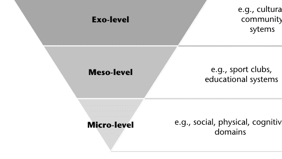
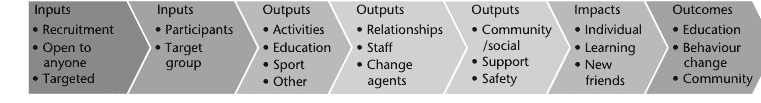
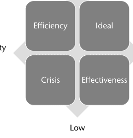

## Part I

### 可持续发展目标 1：
消除贫困

### 可持续发展目标 1 概述

Mitchell McSweeney 和 Lyndsay M.C. Hayhurst

2015 年，所有联合国成员国都通过了联合国可持续发展目标，这是一套 17 项发展目标，旨在到 2030 年“为所有人实现更好、更可持续的未来”（General Assembly, 2015）。值得注意的是，世界在 SDG 1“消除贫困”方面取得了进展——2015 年，极端贫困人口（每天人均不足 1.90 美元）从 1990 年的 36% 下降到 2015 年的 10%（General Assembly, 2015）。2020 年，COVID-19 大流行使超过 1.76 亿人陷入极端贫困，挫败了 SDG 1 取得的任何进展（United Nation OHCHR, 2020）。事实上，联合国大学世界发展经济研究所的估计认为，近 5 亿人可能现在面临极端贫困，其中大多数居住在全球南方国家。

尽管贫困存在了几代人，并且提出了许多减少和消除贫困的建议解决方案，但大多数扶贫计划和战略都因多种原因而失败（例如，以工代赈、配给卡）。例如，一些扶贫战略未能考虑到穷人的观点，对塑造贫困相关发展项目的结构性不平等（例如性别歧视和地方权力动态）考虑甚少。许多贫困根除方法的失败以及贫困在例如位于低收入国家和中等收入至高收入国家农村地区的金字塔底部市场中的持续存在，导致国际发展机构（例如联合国）、非政府组织（NGO）、公司、政府、慈善家、研究人员、从业者、社区和个人寻求新的解决贫困的战略。

例如，在加拿大，政府的减贫战略包括加拿大儿童福利（为需要抚养孩子费用支持的家庭）和保障收入补充（帮助老年人经济安全退休；Government of Canada, 2020）。与世界各地的组织合作伙伴和人民直接合作，非政府组织乐施会通过使用创新战略提供教育、发展项目（例如专注于性别正义和妇女权利）并倡导基本需求服务（例如食物、冲突环境中的人道主义援助）在许多不同国家和地区寻求“结束贫困的不公正”（Oxfam, 2021）。还有许多慈善组织，如比尔和梅琳达·盖茨基金会，参与消除极端贫困的工作（Gates Foundation, 2021）。

因此，体育产业中有各种行为者致力于扶贫。国际奥委会经常吹嘘主办奥运会的好处，与建设基础设施有关， supposedly 会在个人和社区层面提高体育设施的利用率；将世界各地对特定国家社会、文化和政治新颖性的关注吸引过来；并在奥运会举办前后增加旅游业（Leopkey & Parent, 2012; Preuss, 2007）。虽然不是直接的扶贫战略，但主办奥运会部分被视为增强主办国经济发展的一种方式（Owen, 2005）。当然，与多种特定扶贫计划受到批评的方式类似，关于奥运会实际举办及其 perceived 益处也存在许多挑战和问题，包括为建设体育基础设施而搬迁低收入社区的人，以及由于主办体育盛会的成本日益增加而导致国家长期债务（Kennelly, 2015; Whitson & Horne, 2006）。体育学者也展示了参与竞技体育，特别是从例如非洲地区移民到职业体育联赛（例如欧洲冠军联赛）参赛的运动员，可能由于其运动表现和相关财务收入而获得经济安全甚至繁荣。这种经济稳定机会也通过汇款支持家庭和当地社区（Acheampong, 2019; Darby & Van der Meij, 2018）。当然，体育发展与和平（SDP）干预在全球北方和全球南方背景下数量不断增长，越来越突出——也受到批评——体育可能对生计创造和提高就业能力以根除贫困的有用性（例如，McSweeney et al., 2020; Smart et al., 2020; Stewart-Withers & Hapeta, 2020; Stewart-Withers et al., 2017）。

尽管世界范围内对贫困的影响越来越受关注，体育产业内的行为者对贫困的考虑也越来越多，但很少有学者批判性地评估体育（具有潜力）对根除贫困的贡献及其在其中的地位。特别是，仍有机会审视和扩展贫困的多维性质，以及体育在为扶贫工作提供任何贡献方面的潜力。为解决这些空白，本章的目的是介绍可持续生计框架（SLF）及其在理解体育用于应对 SDG 1 的应用。本章按如下方式展开：首先，我们将定义 SDG 及其由联合国概述的具体目标；其次，我们将讨论 SLF 的理论基础及其与体育和 SDG 1 的联系；第三，最后，我们将通过提供体育产业行为者实施应对贫困盛行战略的相关示例，引起人们对 SDG 1 与体育相关性的关注。

### 2.1 可持续发展目标 1 的定义

根据世界银行 2015 年的一份报告，10% 的全球人口（约合 7.36 亿人）生活在每天不足 1.90 美元的极端贫困中（World Bank, 2019）。此外，超过一半生活在极端贫困中的人口位于撒哈拉以南非洲的国家（World Bank, 2019）。尽管自 2013 年以来世界各地的贫困减少了约 11%，自 1990 年以来减少了近 36%（World Bank, 2018），贫困仍然是一个紧迫的国际问题（特别是在各大洲的不均衡性），因此仍然是联合国的重点。作为希望到 2030 年实现的联合国可持续发展目标，消除贫困是列出的 17 项目标之一。

#### 表 2.1 可持续发展目标 1 的目标

| 1.1 | 到 2030 年，消除一切形式和各地的贫困，目前以每天生活费不足 1.25 美元的人口衡量 |
| 1.2 | 到 2030 年，在各层面、各年龄段的男女儿童中，使贫困人口比例至少减半，按照各国自己的定义衡量贫困的各个方面 |
| 1.3 | 实施面向所有人的国家适当社会保障制度和措施，包括社会保障底线，到 2030 年实现对穷人和弱势群体的充分覆盖 |
| 1.4 | 到 2030 年，确保所有男子和妇女，特别是穷人和弱势群体，平等享有经济资源，以及获得基本服务、土地和其他形式财产的所有权和控制权、继承权、自然资源、适当的新技术和金融服务，包括小额信贷 |
| 1.5 | 到 2030 年，增强穷人和处于脆弱状况者的抵御能力，减少他们遭受气候相关极端事件和其他经济、社会和环境冲击和灾害的暴露和脆弱性 |
| 1.a | 确保从各种来源大量动员资源，包括通过加强发展合作，以便为发展中国家，特别是最不发达国家提供充分和可预测的手段，以实施消除一切形式贫困的方案和政策 |
| 1.b | 在国家、区域和国际各级建立健全的政策框架，基于有利于穷人和性别敏感的发展战略，以支持加速投资于扶贫行动 |

来源：大会（2015 年）。

具体而言，SDG 1 的目标是“在全世界消除一切形式的贫困”（大会，2015 年，第 15 页）。该目标中包括具体的目标，列于表 2.1 中。

显然，联合国为实现 SDG 1 而设定的目标范围广泛，需要来自不同领域的多方行为者进行大量工作，特别是那些在国际发展领域工作的人。最终，实现消除贫困需要应用具体的理论和概念框架，这些框架考虑到贫困的多重维度。值得注意的是，我们在以下各节中概述的框架，即 SLF，已被联合国开发计划署在各种发展项目中采用。

### 2.2 可持续生计框架

### 2.2.1 SLF 的简要背景

SLF 是一种研究贫困消除的方法，强调基于实地、扎根的实证调查。SLF 最初由 Chambers 和 Conway（1992 年）提出，随后被联合国开发计划署（UNDP）、国际发展部（DFID）和 CARE（世界上最大的国际非政府组织之一）采用，因其在揭示和情境化贫困状况方面的实用性而获得全球认可。生计被定义为：

> 包括维持生计所需的技能、资产（包括物质和社会资源）和活动。生计是可持续的，当它能够应对和从压力和冲击中恢复时，保持或增强其能力和资产，同时不破坏自然资源基础。（Scoones，1998 年，第 5 页）

该定义中有三个要素必须与贫困相关联加以澄清。首先，虽然经济增长通常对减贫至关重要，但“两者之间并没有自动关系，因为一切都取决于穷人利用不断扩大的经济机会的能力”（Krantz，2001 年，第 2 页）。其次，贫困并非仅仅被理解为低收入，而是涉及多个维度，包括健康、缺乏社会服务、受教育机会的可及性、脆弱性，以及更广泛的无力感。第三，贫困者在概念化贫困方面必须被纳入其中，特别是因为他们最了解自己的需求和处境，“因此必须参与旨在改善他们处境的政策和项目的设计”（Krantz，2001 年，第 2 页）。

SLF 的应用没有通用方法；然而它确实具有三个重要的基本特征，包括：（1）关注穷人的生计；（2）关注地方层面和能动性；以及（3）强调人（即被认定为贫困的人）在特定生计活动的选择和实施中的作用（Krantz，2001；Scoones，2009）。SLF 在方法上是整体性的，因为它强调了对贫困人口至关重要的资源组合，例如社会和人力资本以及物质和自然资源（Scoones，1998）。该框架进而揭示了影响人们获取生计资源和资产的（不）能力的潜在结构和因素（跨越个人、组织和政策等不同层面），超越了对贫困单一维度如收入生产力的关注（Chambers & Conway，1992）。在下一节中，我们通过总结 Scoones（1998）的奠基性文章，更清晰地概述和描述 SLF 的多个组成部分。

### 2.2.2 SLF 的组成部分

SLF 是一种可在多个不同层面应用的方法。例如，它可应用于个人、家庭、社区、区域甚至国家层面，以评估生计（Scoones，1998）。还有五个关键要素，或子维度，涉及可持续生计的概念化。正如 Scoones 所指出的：

> 可以识别出定义中的五个关键要素，每个要素都与更广泛的文献相关，在某些情况下有既定的评估结果方法。前三个要素关注生计，将对工作和就业的关注与减贫联系起来，并与充足性、安全、福祉和能力等更广泛问题联系起来。后两个要素增加了可持续性维度，依次考察生计的韧性以及它们部分依赖的自然资源基础。（第 5 页）

在表 2.2 中，我们提供了定义中五个关键子组成部分的概述。

可持续生计子组成部分的范围多样，从可利用定量评估评估的具体指标，到范围更大需要定性调查的子组成部分（Scoones，1998）。此外，组成部分高度选择性，取决于对生计的调查水平、不同指标的适用性，总体上始终取决于谈判，因为该框架由来自发展文献不同分支的各种思想和利益构成。正如 Scoones 所强调的，

> 不同的人不可避免地会对优先指标有不同的看法，在冲突被突出时，就必须做出选择。然而，通过将定义分解为一系列指标，这些选择变得明确，使得在任何以可持续生计问题为中心的政策制定、规划或实施过程中，成果可能性之间的谈判成为可能。（第 7 页）

#### 表 2.2 SLF 定义的五个关键子组成部分

| 子组成部分 | 定义 |
|---|---|
| 工作日创造 | 定义为生计战略能够在一年中一段时间内带来有效就业的能力，通常被广泛视为至少约 200 天。Sen（1975）概述了就业的三个特征：收入（即工资）、生产（即产出）和认可（即从事有价值的事情）。 |
| 减贫 | 有许多衡量减贫的措施，可在收入或消费水平方面创建“贫困线”衡量。定量和定性评估和指标都很有用，但在衡量减贫方面仍存在许多挑战。 |
| 福祉与能力 | 该子组成部分代表了 Sen（1984，1987）对能力的理解，超越了对收入和人力资本的关注，扩展到人们对其自身福祉最看重的内容（人们应自行定义福祉标准，如自尊、愉悦、权力或压力）。 |
| 生计适应、脆弱性和韧性 | 如果生计能够应对（即因变化而做出调整）和适应（即在生计战略上做出转变）以从压力源（最小且可预测的干扰，具有总体影响）和冲击（大、非规律性干扰，具有直接影响）中恢复，而不是导致避免冲击和压力源。 |
| 自然资源基础可持续性 | 一些生计，特别是农村生计如农业，部分依赖于自然资源基础。了解自然资源基础以及耗尽其资源的任何冲击或压力源（例如洪水、土壤水平）对于衡量某些生计战略的可持续性目的很重要。 |

来源：改编自 Scoones（1998）。

当然，体育产业包括支持利用体育进行扶贫、经济发展和生计创造的多个行为者。因此，SLF 如何与对体育在扶贫中作用（以及实现 SDG 1）的更具体调查联系起来，取决于各组成部分在特定情境中的相关性。例如，在对举办大型赛事的作用进行审查时，这些赛事在某些情况下可能有助于降低国家贫困水平（例如通过就业机会），SLF 的规模和用途水平将与用于考察地方体育发展组织如何教授就业技能以创造贫困人口生计的用途有所不同。应用 SLF 的体育产业行为者因此必须做出明确的指标选择，并明确说明他们所做的决定以及它们与 SLF 组成部分的关系。

#### 表 2.3 资本类型

| 子组成部分 | 定义 |
|---|---|
| 自然资本 | 包括可用于创造和维持生计的自然资源（如土壤、水）和环境便利条件。 |
| 经济资本 | 包括可用于追求生计的可用金融资本（如现金、储蓄、贷款、技术）。 |
| 人力资本 | 追求生计所需的知识、能力、健康和身体能力。 |
| 社会资本 | 人们为追求生计而使用的网络、社会关系、联系和与他人的纽带。 |

来源：改编自 Scoones（1998）。

可持续生计框架 SLF 的附加组成部分包括不同类型的资本、生计策略，以及制度和组织（Chambers & Conway, 1992）。就资本而言，SLF 将多种类型的资本结合起来进行衡量，并用于理解生计是如何基于“人们所拥有的基本物质和社会、有形和无形资产”构建的（Scoones, 1998, 第 7 页）。在表 2.3 中，提供了四种资本类型的概述。重要的是要记住，四种资本类型并非穷尽；根据 SLF 应用的调查水平，还可能确定其他形式的资本（Chambers & Conway, 1992）。

SLF 中纳入资本尤其值得注意的是其在实现可持续发展目标 1 方面的用途。例如，前文列出的目标 1.4 和 1.a 强调，生活在贫困中的人有权获得谋生的资源和权利，而且发展行为者要与合作伙伴合作，确保资源可供被认定为贫困的人使用。因此，分析贫困人口可获得的（或不可获得的）不同类型的资本，对于理解他们生活的条件以及他们如何构建生计至关重要。

此外，SLF 中不同形式资本的结合与体育领域的持续研究直接相关。例如，Spaaij（2009, 2012a, 2012b）以及其他人（如 Theeboom et al., 2020）对参与体育项目的人可能积累并利用的各种形式的资本以获得就业提供了见解。最近，研究人员还阐明了体育如何影响参与体育的各类人群的生计（Smart et al., 2020; Stewart-Withers & Hapeta, 2020）。这包括从业者关于体育可能为难以谋生的人提供潜力和他们参与基于体育的发展项目的关键评论（DeMartini & Belasik, 2020; Warner et al., 2020）。这里的核心是要强调，体育以多种方式确实涉及资本的积累，这些资本与 SLF 直接相连，有助于提高贫困人口获取资源的可及性，正如可持续发展目标 1 所概述的那样。

SLF 的第二个组成部分是理解生计策略的组合和路径（Scoones, 1998）。尽管该组成部分是在农村可持续生计的背景下发展起来的，但其要素适用于 SLF 的更一般情况和其他生计策略。对于 SLF 的这一组成部分，可能发生农业集约化（即增加资本投入和劳动）或粗放化（耕种更多土地或农业资源）以从生计中获得更多收益（如林业、畜牧业）。事实上，仍有很少的研究考察农业与体育的关系——更少的研究专门调查体育发展项目参与者的生计（有一些例外；见 Kaur, 2016）。这仍然是一个值得进一步研究的富有成果的领域，尤其是在最近关于农村人口（其中许多人是农业工人）使用自行车促进发展以进入市场并扩大获取生计资源能力的见解（Ardizzi et al., 2020; McSweeney et al., 2020）。此外，许多体育发展项目参与者生活在农村地区和社区，特别是在全球南方（Svensson & Woods, 2017），在那里人们更有可能参与与农业相关的生计策略。因此，未来关注 SLF 如何提供特定指导以审视体育、贫困、农业和生计之间的联系将是有价值的。

多样化是另一种生计策略。这是指一个人从事的各种创收活动的多样性，以应对其主要生计策略所面临的任何冲击和压力。反过来，一个人可能会，例如，通过多样化生计来发展更多创收活动的机会。SLF 的组合和路径组成部分的最后一个要素是迁移，涉及自愿和非自愿的流动性及其对生计策略的影响（例如，搬迁以追求生计策略的集约化；Scoones, 1998）。这三种组合和路径并不总是独立运作，而是可能重叠和相互关联。总体而言，活动和路径的组合通过“生计组合”联系在一起，该组合可能高度专业化，也可能相当多样化。

最后，虽然上述讨论强调了 SLF 的要素与其相关的策略和可能（或可能不）实现的差异化结果，但 SLF 还考虑了作为催化剂的结构和过程，这些结构和过程通过多方面和复杂的进程影响实现可持续生计的（不）能力（Scoones, 1998）。先前的生计研究框架通常侧重于定量评估和特定可衡量变量（通常是经济指标）之间的关系。如果不了解生计策略发生的社会结构和过程，这种定量调查会限制人们充分理解可持续生计以及制约可持续生计机会的障碍的能力（Scoones, 1998）。因此，SLF 结合了结构和制度的考察。

制度既是正式的也是非正式的，并且既不稳定也不具体——也就是说，它们与权力关系交织在一起并由其产生，这使得结构和制度具有可塑性、动态性并不断被（再）塑造（Clegg, 2010; Scoones, 2009）。生计机会和策略以及其中塑造的资本因此通过影响生活在贫困中的人们使生计可持续的结构和制度来适应和采用。社会过程和关系最终构成可持续生计的基础，包括性别结构、贫困不平等、正式法律和政府法规（如与非正规部门工作相关）以及社会网络（Scoones, 1998）。阐明并理解特定制度环境以及个人、家庭、区域和国际背景下生计背后的复杂规范和规则，尽管不是容易的任务，但在应用 SLF 时可实现更深入的分析。

理解可持续生计的结构和制度在考虑与体育和可持续发展目标 1 相关的贫困人口的生计时至关重要。研究体育的学者持续强调结构和制度在利用体育促进发展尝试中的重要性（Darnell, 2012; Hayhurst, 2013, 2014; McSweeney et al., 2019）。由于体育组织通常在制度层面（例如组织、区域、国家、国际）跨层面运作，阻碍或必须在追求发展目标——在此为可持续生计——时加以挑战的结构性不平等至关重要。事实上，可持续发展目标 1 的目标强调，必须打破和挑战消除贫困的限制或障碍，例如制度结构，才能在 2030 年实现无贫困。尽管如此，正如我们在下一节中讨论的那样，SLF 存在一些弱点，需要加以剖析，以确保对与体育和贫困相关的生计进行稳健分析。

### 2.2.3 SLF 的弱点及前行之道

为了推进 SLF，Ian Scoones（2009）提出了多种应用该框架的方式，包括关注知识、政治、尺度与动态。就本章而言，我们简要突出其中两个（关注知识和政治），它们对于在考虑生计、体育和可持续发展目标 1 时应用 SLF 具有重要意义。

首先，对生计的理解往往建立在明确的规范性承诺和原则之上，这些原则以人、情境以及能力与潜能为中心，而非强调需求、贫困和边缘化（Scoones, 2009）。此外，生计通常被理解为基于国际实体（如世界银行）政策文件和报告的“中性术语”，这些文件通过“好”与“坏”生计或“积极”与“消极”的乡村未来等二元对立来框定生计。这种框架以一种假设某些状态优于其他状态的方式定义“进步”。因此，对生计的主导性概念化不应被视为中立，而应被视为一种知识生产，它基于历史价值观、政治和制度性承诺，需要被挑战、质疑、剖析并重新构建（Keeley & Scoones, 2003）。关于生计框架的包容性审议能够使变革得以凸显，并摆脱基于政治议程的理性主义理解。正如 Scoones（2009）简洁地指出：

> 作为一个可塑的概念，它 [生计] 打开了如此丰富的经验描述多样性，同样也可以被压缩成规划格式和规划表格的狭隘工具主义，或被特定政治承诺所部署，近年来以新自由主义改革为主导。为了避免这种封闭，并保持一个保持开放的评估、评估和干预过程，需要关注生计知识是如何被协商和使用的过程（cf. Stirling, 2008）。（第 185 页）

其次，与上述观点相关的是，需要在生计分析中凸显权力和政治（Clarke & Carney, 2008）。SLF 通常被用于微观层面的分析，侧重于地方具体情况并强调行动和能动性，而非将此类分析与构成可持续生计制约和机会的结构性条件和政治经济过程相联系（Scoones, 2009）。尽管 SLF 包含对结构和制度的关注，但通过考察个体和集体行动在不同尺度（例如个人、社区、国家）上的展开，以与批判理论（如女性主义理论；Kabeer, 1994）建立联系和互联，有机会拓宽其范围。这对于推进 SLF 并拓宽其在全球化、结构性不平等和政治经济方面的分析至关重要。同样，Scoones（2009）明确指出在 SLF 和生计与贫困关系中考虑权力和政治的必要性：

> 关注生计如何被阶级、种姓、性别、种族、宗教和文化身份的关系所构建是核心的 [...] 社会关系不可避免地支配着财产（包括土地）的分配、工作的模式和劳动的分工、收入的分配以及消费和积累的动态。（第 186 页）

对于可持续发展目标 1，以及寻求缓解贫困的体育组织和行为者而言，利用 SLF 并关注知识以及权力和政治，是应对联合国所设目标的关键。例如，将 SLF 与更广泛的政治经济、全球化、气候变化以及可能阻碍贫困人口可持续生计的冲击和压力源联系起来理解，将有助于实现目标 1.5 并增强脆弱境况下人群的韧性。在本章的最后一部分，我们将转向体育组织如何实施策略以实现可持续发展目标 1，并讨论体育产业需要进一步参与的工作以实现其目标。

### 2.3 将体育与可持续发展目标 1 相连

尽管关于生计、贫困和体育的研究有限，但世界各地有各种组织利用体育来缓解贫困。我们首先将突出其中一些组织，以提供体育与可持续发展目标 1 之间的联系，然后简要讨论仍需完成的工作——其中一些工作可通过采用 SLF 而得到加强——以消除世界各地的贫困。

一些职业体育组织通过支持地方和区域社会正义倡议，以及通过其组织的企业慈善分支，已参与（主要是在提供财务能力方面）贫困减少战略。例如，美国国家橄榄球联盟的底特律雄狮队已向饮用水运动捐款，以帮助改善底特律的饮用水质量（Detroit Lions, 2016）。具体而言，球队和个人球员均筹集了捐款，以资助底特律公立学校社区区的一项计划，安装永久性水过滤系统（Campelli, 2019）。底特律雄狮队还与众多提供教育和食物供给服务的当地慈善机构合作，以应对城市内的贫困水平和教育可及性问题。其他职业体育队伍，如利物浦足球俱乐部、埃弗顿足球俱乐部以及其他英国足球俱乐部已承诺成为认可的生活工资雇主——意味着他们向俱乐部员工提供生活工资而非最低工资（Campelli, 2019）。这些社区项目虽然可能不被视为消除贫困，但旨在为当地社区提供获得就业的机会，特别是在贫困率高的地区。

许多不同国家和社区的青少年体育项目也利用体育应对贫困，通常通过教育性倡议教授生活技能，帮助当地青年获得未来就业。例如，哥伦比亚的 Tiempo de Juego 与当地学校和家庭合作，利用足球提供社会机会并培训青年掌握技术和心理社会技能（Tiempo de Juego, 2019）。此外，该组织通过提供资源（例如摊贩机会；Niz, 2019）支持家庭和青年开展小企业活动。Waves for Change 是另一家总部位于南非开普敦的青少年体育组织，它利用冲浪来增强经历过创伤的青年心理健康。该组织与心理健康基金会合作，并使用以自我关怀为基础的项目，结合实践来解决心理和情感健康问题，以支持青年改善未来。该组织还雇佣前参与者作为项目教练，这提供了赚取额外收入的机会（Waves for Change, 2021）。

在体育促进发展领域，有众多组织采用体育来增强生计机会以应对贫困。除了提供参与性体育体验外，这些组织中的许多还与其他非政府组织和发展行为者建立伙伴关系，以提供实习和就业岗位。例如，Peace Players International 在 15 个国家开展工作，并根据当地情况调整相关或流行的体育项目。青年参与教育项目，学习有关 HIV/AIDS、毒品和酒精滥用、失业和社会凝聚力的知识，以提高参与者对就业结构性障碍的理解（Hinteregger, 2017）。加拿大多伦多的 MLSE Launchpad 采用“工作就绪”项目，将体育活动与课堂课程相结合，课程旨在提供与特定领域工作相关的技能，如电信和 STEM（MLSE Launchpad, 2021）。

还有许多其他在体育产业中工作的组织，从政府行为者到职业体育组织，再到各种地理位置的体育促进发展项目，都利用体育并寻求破坏和应对贫困。这些组织共同旨在应对可持续发展目标 1 中确定的目标。例如，以高于最低工资雇佣个人解决了根除极端贫困的需要，确保每天生活在 1.25 美元以下的人（目标 1.1）能够谋生。许多体育和体育促进发展组织对青年的关注可能有助于降低失业率并解决儿童和家庭的贫困水平（参见目标 1.2）。许多体育组织还专注于接触可能没有安全学习就业技能空间的青年。这直接补充了目标 1.3，该目标侧重于为贫困和脆弱境况下的人群创建社会保障体系。通过与广泛的非政府组织和发展行为者建立强大的伙伴关系（如上所述），体育提供了从各种来源动员资源并通过众多行为者之间的增强合作来应对贫困的可能性（目标 1.a）。最后，鉴于许多体育组织专注于提供基本服务，如教育以及在某些情况下的金融服务（例如通过小额信贷；Hayhurst, 2014），体育产业内的行为者也在应对目标 1.4，以确保贫困人口能够获得经济和基本服务。因此，体育组织寻求超越仅关注体育，在实现可持续发展目标 1 方面发挥作用的方式有很多。

虽然我们支持体育产业内正在进行的重要工作，但正如其他学者所强调的那样，迫切需要考虑影响通过体育实现发展的多重因素和结构（Coalter, 2010; McSweeney & van Luijk, 2019; Schulenkorf, 2017）。总体而言，关于可持续发展目标 1 及其与 SLF 的联系，很明显，（不）直接支撑贫困以及缓解贫困的策略的多重组成部分必须被整体性地考虑，才能实现联合国设定的目标。正如我们所建议的，那么 SLF 的应用——以及在利用体育诱导就业机会和寻求解决贫困时考虑哪些组成部分的决策和反思——对于应对可持续发展目标 1 至关重要。我们希望本章能为体育组织和研究人员提供一个起点，以增强分析和策略，从而在全世界消除各种形式的贫困。

### 参考文献

Acheampong, E. Y. (2019). Giving back to society: Evidence from African sports migrants. Sport in Society, 22(12), 2045–2064. doi: 10.1080/17430437.2018.1551367

Ardizzi, M., Wilson, B., Hayhurst, L., & Otte, J. (2021). “People still believe a bicycle is for a poor person”: Features of “bicycles for development” organizations in Uganda and perspectives of practitioners. Sociology of Sport Journal, 38, 36–49. doi: 10.1123/ssj.2019-0167

Campelli, M. (2019). Professional sports teams battle poverty in their communities. Sport Sustainability Journal. https://sportsustainabilityjournal.com/analysis/professional-sports-teams-battle-poverty-in-their-communities/

Chambers, R., & Conway, G. (1992). Sustainable rural livelihoods: Practical concepts for the 21st century. IDS discussion paper, 296. IDS.

Clarke, J., & Carney, D. (2008). *可持续生计方法——我们学到了什么？* 背景论文，ESRC 生计研讨会，2008年10月13日。Livelihoods Connect。IDS。
Clegg, S. (2010). 国家、权力与能动性：制度理论中缺失的部分？. *Journal of Management Inquiry*, 19(1), 4–13。
Coalter, F. (2010). 体育促进发展的政治：有限重点项目与广泛的难题？. *International Review for the Sociology of Sport*, 45(3), 295–314. doi: 10.1177/1012690210366791
Darby, P., & Van der Meij, N. (2018). *非洲、移民与足球：非洲世界中的体育*. Routledge。
Darnell, S. C. (2012). *体育促进发展与和平：批判性社会学*. Bloomsbury。
Darnell, S. C., & Dao, M. (2017). 通过能力方法思考体育促进发展与和平. *Third World Thematics: A TWQ Journal*, 2(1), 23–36. doi: 10.1080/23802014.2017.1314772
DeMartini, A., & Belasik, W. (2020). CrossFit 搭档训练：为 SDP 增肌. Journal of Sport for Development, 8(15), 40–49. https://jsfd.org/2020/07/31/crossfit-partner-work-strength-building-for-sdp/
Detroit Lions. (2016). Glover Quin 为密歇根州弗林特捐赠水. https://www.detroitlions.com/news/glover-quin-donates-water-for-flint-mi-16759563
Gates Foundation. (2021). 为贫困者提供金融服务. https://www.gatesfoundation.org/What-We-Do/Global-Growth-and-Opportunity/Financial-Services-for-the-Poor
General Assembly. (2015). *改变我们的世界：2030年可持续发展议程* (A/RES/70/1). United Nations. undocs.org/en/A/RES/70/1
Glavovic, B. C., & Boonzaier, S. (2007). 面对沿海贫困：建设南非可持续沿海生计. *Ocean & Coastal Management*, 50(1–2), 1–23. doi: 10.1016/j.ocecoaman.2006.07.001
Government of Canada. (2020). 加拿大减贫战略. https://www.canada.ca/en/employment-social-development/programs/poverty-reduction.html
Gutierrez-Montes, I., Emery, M., & Fernandez-Baca, E. (2009). 可持续生计方法与社区资本框架：社区变革努力中系统层级方法的重要性. *Community Development*, 40(2), 106–113. doi: 10.1080/15575330903011785
Hayhurst, L. M. (2013). 女孩作为“新的”社会变革推动者？通过乌干达体育、性别与发展项目探索“女孩效应”. *Sociological Research Online*, 18(2), 192–203. doi: 10.5153/sro.2959
Hayhurst, L. M. (2014). “女孩效应”与武术：社会企业家精神与乌干达体育、性别与发展. *Gender, Place & Culture*, 21(3), 297–315. doi: 10.1080/0966369X.2013.802674
Hinteregger, T. (2017). 4个通过体育终结贫困的组织. *The Borgen Project*. https://borgenproject.org/organizations-ending-poverty-through-sport/
Kabeer, N. (1994). *逆转的现实：发展思想中的性别等级*. Verso Press。
Kaur, T. (2016). *体育生活与“发展”议程：以西开普省农场工人背景下体育与“发展”关系之批判性分析*. 未发表硕士论文，University of Western Cape。
Keeley, J., & Scoones, I. (2003). *理解环境政策过程：来自非洲的案例*. Earthscan Publications。
Kennelly, J. (2015). “你们让我们的城市看起来很糟糕”：奥运安保、新自由主义城市化与无家可归青年. *Ethnography*, 16(1), 3–24. doi: 10.1177/1466138113513526
Kolk, A., Rivera-Santos, M., & Rufin, C. (2014). 审视“金字塔底/底层”概念十年的研究. *Business & Society*, 53(3), 338–377. doi: 10.1177/0007650312474928
Krantz, L. (2001). 可持续生计方法在减贫中的应用. 瑞典国际发展合作署报告。
Leopkey, B., & Parent, M. M. (2012). 奥运会遗产：从一般利益到可持续的长期遗产. *The International Journal of the History of Sport*, 29(6), 924–943. doi: 10.1080/09523367.2011.623006
Lloyd-Jones, T., & Rakodi, C. (2014). *城市生计：以人为本的减贫方法*. Routledge。
McSweeney, M., & van Luijk, N. (2019). 走出舒适区：体育促进发展与和平研究中制度民族志的应用. *Qualitative Research in Sport, Exercise and Health*, 11(4), 559–572. doi: 10.1080/2159676X.2019.1578254
McSweeney, M., Kikulis, L., Thibault, L., Hayhurst, L., & van Ingen, C. (2019). 维持和破坏全球北方霸权/全球南方依赖于一个当地非洲体育促进发展组织：制度工作的作用. International Journal of Sport Policy and Politics, 11(3), 521–537. doi: 10.1080/19406940.2018.1550797
McSweeney, M., Millington, B., Hayhurst, L., Wilson, B., Ardizzi, M., & Otte, J. (2021). “自行车坏了：他们会怎么办？” 行动者网络与发展自行车运动. International Review for the Sociology of Sport, 56(2), 194–211. doi: 10.1177/1012690220904921
McSweeney, M., Oxford, S., Spaaij, R., & Hayhurst, L. (2020). 体育与生计：特刊导言. Journal of Sport for Development, 8(15), 1–9. https://www.sportanddev.org/sites/default/files/downloads/mcsweeney.sport_livelihoods.editorial.pdf
MLSE Launchpad. (2021). 体育与就业准备. http://mlselaunchpad.org/Programs-Services/Sport-for-Development/Sport-Employment
Nussbaum, M. (2011). 创造能力：人类发展方法. The Belknap Press of Harvard University Press。
Niz, S. (2019). 五个缓解贫困的青少年体育项目. The Borgen Project. https://borgenproject.org/5-youth-sports-programs-alleviating-poverty/
Owen, J. G. (2005). 估算举办奥运会的成本与收益：北京2008年奥运会能带来什么. The Industrial Geographer, 3(1), 1–18. http://igeographer.lib.indstate.edu/owen.pdf
Oxfam. (2021). 终结贫困. https://www.oxfam.org/en/what-we-do/issues
Preuss, H. (2007). 传递增长信号：中国举办2008年北京奥运会的主要收益. Harvard Asia Pacific Review, 9(1), 45–49。
Scoones, I. (1998). 可持续农村生计：分析框架. IDS 工作论文，72。IDS。
Scoones, I. (2009). 生计视角与农村发展. The Journal of Peasant Studies, 36(1), 171–196. doi: 10.1080/03066150902820503
Schulenkorf, N. (2017). 管理体育促进发展：反思与展望. Sport Management Review, 20(3), 243–251. doi: 10.1016/j.smr.2016.11.003
Sen, A. (1975). 发展即自由. Oxford University Press。
Sen, A. (1984). 权利与能力. In A. Sen (Ed.), Resources, values and development (pp. 307–324). Basil Blackwell。
Sen, A. (1987). 生活水平. Cambridge University Press。
Smart, S., Rich, K., & Lauzon, A. (2020). 探索移民家庭在加拿大的文化适应与生计及体育参与的作用. Journal of Sport for Development, 8(15), 25–39. https://jsfd.files.wordpress.com/2020/12/smart.exploring.migrant.families.acculturation.sport_.pdf
Spaaij, R. (2009). 体育作为弱势城市青年社会流动与管控的载体：来自鹿特丹的经验教训. International Review for the Sociology of Sport, 44(2–3), 247–264. doi: 10.1177/1012690209338415
Spaaij, R. (2012a). 超越赛场：澳大利亚索马里人体育、社会资本与融合的经验. Ethnic and Racial Studies, 35(9), 1519–1538. doi: 10.1080/01419870.2011.592205
Spaaij, R. (2012b). 在弱势社区中促进青年社会与文化资本建设：来自巴西体育干预项目的经验教训. Sport, Education and Society, 17(1), 77–95. doi: 10.1080/13573322.2011.607913
Stewart-Withers, R., & Hapeta, J. (2020). 使用生计与资本分析审视新西兰毛利人/新西兰加体育教育伙伴关系. Journal of Sport for Development, 8(15), 50–65. https://jsfd.files.wordpress.com/2020/12/stewart.withers.newzealand.plussport.livelihoods.pdf
Stewart-Withers, R., Sewabu, K., & Richardson, S. (2017). 橄榄球驱动的迁移作为可持续生计创造的手段：iTaukei、斐济土著人的案例研究. Journal of Sport for Development, 5(9), 1–20. https://jsfd.files.wordpress.com/2020/12/stewart-withers.rugby_livelihoods.pdf
Stirling, A. (2008). “开放”与“封闭”：技术社会评估中的权力、参与与多元主义. Science Technology and Human Values, 33(2), 262–294. doi: 10.1177/0162243907311265
Svensson, P. G., & Levine, J. (2017). 重新思考体育促进发展与和平：能力方法. Sport in Society, 20(7), 905–923. doi: 10.1080/17430437.2016.1269083
Svensson, P. G., & Woods, H. (2017). 体育促进发展与和平组织的系统性概述. Journal of Sport for Development, 5(9), 36–48. https://jsfd.files.wordpress.com/2020/08/svensson.systematic.overview.sdp_organisations.pdf
Tiempo de Juego. (2019). 领导力学校. https://tiempodejuego.org/en/en/escuela-liderazgo/
Theeboom, M., Coalter, F., Truyens, J., Soendgen, N., Gonzalez-Valles, E., Vukasinovic, N., & Vanden Berghe, S. (2020). 体育对青年就业能力贡献的研究：在

Europe 2020 strategy: Final report. Vrije Universiteit Brussel. https://op.europa.eu/en/publication-detail/-/publication/e189cc96-b543-11e7-837e-01aa75ed71a1
联合国 [UN]. (2020). 可持续发展. https://www.un.org/sustainabledevelopment/poverty/
联合国 [UN]. (2020a). 可持续发展. https://www.un.org/sustainabledevelopment/poverty/
联合国人权事务高级专员办事处 [UN OHCHR]. (2020). 联合国专家表示，到2030年消除贫困正成为一个逐渐消退的梦想. https://www.ohchr.org/EN/NewsEvents/Pages/DisplayNews.aspx?NewsID=26043&LangID=E#:~:text=GENEVA%20(7%20July%202020)%20E2%80%93,in%20a%20report%20published%20today.
Warner, M., Robinson, J., Heal, B., Lloyd, J., O’Connell, P., & Rose, L. (2020). 利用协作伙伴关系促进面临障碍的青年就业的综合体育发展战略. Journal of Sport for Development, 8(15), 10–24. https://jsfd.files.wordpress.com/2020/12/warner.comprehensive.sfd_strategy.version.pdf
Waves for Change. (2021). W4C 影响. https://www.waves-for-change.org/w4c-impact/
Whitson, D., & Horne, J. (2006). 低估成本和高估收益？加拿大和日本体育盛事成果的比较. The Sociological Review, 54(2_suppl), 73–89. doi: 10.1111/j.1467-954X.2006.00654.x
世界银行. (2018). 年度回顾. https://www.worldbank.org/en/news/feature/2018/12/21/year-in-review-2018-in-14-charts#:~:text=1..Extreme%20poverty%20is%20at%20the%20lowest%20level%20in%20recorded%20history,lowest%20level%20in%20recorded%20history.
世界银行. (2019). 贫困. https://www.worldbank.org/en/topic/poverty/overview
Zipp, S., Smith, T., & Darnell, S. (2019). 发展、性别与体育：体育发展中能力方法的女权主义实践理论. Journal of Sport Management, 33(5), 440–449. doi: 10.1123/jsm.2019-0126

## 衡量可持续发展目标 1

Hanhan Xue, Ryan Chen, Shushan Dai, and Joshua I. Newman

从一个角度来看，结束全球贫困的斗争进展良好。根据秘书长《可持续发展目标进展报告》（联合国经济及社会理事会，2019年），国际社会为“在全世界消除一切形式的贫困”所做的努力持续有效，尽管近年来的速度有所放缓。事实上，在过去一代人中，世界在打击最严重的贫困方面取得了迅速进展。极端贫困人口从1990年的近19亿人（占世界人口的36%）下降到2018年的约6.5亿人（不足10%）。联合国设定的目标是到2030年使生活在极端贫困中的人口比例降至3%以下。为此，许多专家认为，尽管最近的COVID-19全球大流行可能会进一步加剧放缓（甚至可能逆转），但未来几年全球极端贫困的总体下降趋势仍应继续。

从更批判性的角度来看，学者和联合国内的关键行为者对全球消除贫困倡议被认为过度夸大的有效性日益持怀疑态度。在题为《贫困消除的危殆状态》的2020年报告中，联合国特别报告员菲利普·阿尔斯通警告称，各国和国际组织在实现2030年目标方面“完全偏离轨道”。他认为，“即使在新冠疫情之前，我们在反贫困斗争中浪费了十年，错误的自满阻碍了本可以防止疫情最严重影响的改革”（引自 Alston, 2020, 第2段）。阿尔斯通和其他评估者对联合国依赖的用于衡量极端贫困的关键指标之一尤其持怀疑态度：世界银行的国际贫困线，即每天1.90美元（1.52英镑）收入作为衡量极端贫困的指标。在报告中，阿尔斯通指出，世界人口的很大一部分生活在接近该限额的高不稳定状态，近半数世界人口的日收入低于5.50美元。此外，在许多发展中经济体中，1.90美元的标准并不能准确反映个人满足需求的能力：“结果是惨胜，产生不应有的极大满足感和危险的自满。用更现实的衡量标准，全球贫困的程度要高得多，趋势也极其令人沮丧，”阿尔斯通指出。“即使在疫情之前，34亿人，几乎占世界人口的一半，生活在每天不到5.50美元的水平上。这一数字自1990年以来几乎没有下降”（引自 Alston, 2020, 第7段）。

因此，全球贫困的复杂性因如何准确衡量贫困以及正在采取什么措施而加剧，或因以下相互关系而加剧：（1）“全球极端贫困”的定义，（2）其衡量方式，以及（3）确定最有效消除贫困的具体战略、项目或干预措施。在表面上，全球贫困的定义很简单（Roser & Ortiz-Ospina, 2013）。1.90美元的贫困衡量标准基于个人消费能力（通常以购买力平价衡量）的货币价值。然而，该收入衡量标准并不总是准确反映个人维持自身的能力，更一般地说，收入也许不是评估个人是否贫困的最佳指标。一些机构采用福利的替代衡量标准，包括主观观点（例如，自报生活满意度）、基本需求（例如，热量需求）、能力（例如，受教育机会）和最低权利（例如，人权），以更全面地评估国家贫困率（Bradshaw et al., 2017; Chzhen et al., 2018; Lang & Lingnau, 2015）。总之，各种贫困定义可以归纳为一个共同假设：当个人可获得的资源低于满足最低生活标准所需的资源时，该个人就生活在贫困中（Ferreira et al., 2016）。

尽管如此，联合国评估和评价活动的普遍起点和终点仍然是每天1.90美元的标准（因此贫困最常以定量方式根据收入水平进行衡量）。几十年来，联合国一直认为，国家就业水平提高与国家贫困率下降直接相关。换句话说，在各自的国民经济中，收入者的比例越高，在该背景下生活在贫困条件中的人就越少。然而，收入在两个层面上往往是贫困不准确的衡量标准：许多有工作的工资劳动者——特别是在发展中的全球南方——赚取的工资仍低于、而且通常远低于满足需求或实现生存所需的水平。此外，在提供高水平社会福利的国家中，有许多非就业人口被归类为低于贫困线，但通过此类社会支持，他们的需求得到满足，生活水平合理。最后，按个人层面衡量贫困率（每天收入低于1.90美元的人数）往往几乎无法告诉我们关于系统性问题（例如，腐败、结构性不平等）和系统性解决方案（市场或政府干预的比较效应）以及非系统性问题的短期或长期影响（例如，自然灾害、战争）的信息。

### 3.1 在各地消除贫困：体育中的衡量

贫困定义与衡量之间的这种联系很重要，因为它关系到我们如何评估体育项目的有效性。指导大多数体育发展项目的基本假设是这样的：地方和外国机构可以在服务不足、发展中或高贫困地区建立体育项目，利用体育让儿童和/或成年人聚在一起进行游戏——并且在此过程中为这些参与者提供补充项目，旨在创造社会流动、教育提升和其他促进福祉活动的机会（Jarvie, 2011）。在许多国家背景下，体育发展项目被用来促进经济或社会发展。这些项目通常隐含地，有时明确地，与联合国可持续发展目标中的消除贫困目标相联系。较少情况下，体育项目是为了直接改善当地经济、创造就业（进而假设导致消除贫困）或提高当地或区域人口的生产力、劳动能力或人力资本而设立的。根据国际体育发展机构 Right to Play（2006），这两种类型的体育项目都可以帮助消除贫困，使得：

- 参与者、志愿者和教练获得了可转移的生活技能，从而提高了他们的就业能力，
- 弱势群体通过基于体育的外展项目与社区服务和支持建立联系，
- 体育项目和体育器材生产提供就业和技能发展，
- 体育可以帮助预防阻碍人们工作并给个人和社区带来医疗保健成本的疾病，以及
- 体育可以帮助减少污名并提高自尊、自信心和社会技能，从而提高就业能力。

世界各地的一系列基于体育的项目都建立在这些原则之上。例如，Street Soccer USA（美国）和无家可归者世界杯（国际，首次在奥地利举办）成立的目的是利用足球作为平台，帮助无家可归的男性和女性以及青少年获得所需的社会和教育支持系统，以摆脱无家可归并重返有偿就业。另一个国际足球项目 Football in the Streets 利用这项运动作为切入点，通过足球、品格发展、指导和就业能力项目来赋能服务不足的青少年。在英国，Cricket for Change 自 1981 年以来一直提供板球参与机会以及支持系统，帮助全国各地的弱势儿童。南非项目 Hoops 4 Hope 利用篮球运动为全国数千名年轻人建设能力。Sports Plus Global 项目利用各种体育项目促进亚洲、北美和欧洲参与者的积极人类发展。

在此需要指出的是，回到我们关于定义-衡量-实施关联性复杂性的观点，这些项目在干预水平方面往往存在根本差异。许多项目在运作时假设体育可以用来建设个人能力。许多旨在帮助根除贫困的体育项目遵循了由加里·贝克尔和其他芝加哥学派经济学家推广的人力资本模型，其目标和衡量标准设定在个人层面。这些衡量标准通常包括增加受教育机会（人力资本）、社会发展项目、获得工作或就业的机会，在少数情况下，还包括直接获得基于工资的收入。通常情况下，工资水平、生活满意度衡量指标、城市、区域或国家公共卫生变化，或自给自足率的提高，都是在评估体育项目在该领域的成功时考虑的因素。

相比之下，许多项目基于社区层面的支持或干预。这些体育发展倡议往往利用体育作为催化剂，为社区创造新就业、直接资本流入，或提供必要的服务或基础设施，而这些服务或基础设施反过来应能带来新的就业、新的社会发展形式或新的增长模式。例如，中国共产党（CCP）——与当地非政府组织（NGO）合作——近年来一直在寻求利用体育项目和活动作为社区层面发展和减贫的引擎。过去三十年中，贫困根除的最大减少发生在亚洲，特别是中国。据世界银行称，超过 8.5 亿中国人摆脱了极端贫困。的确，中国的贫困率从 1981 年的 88% 下降到 2015 年的 0.7%（FAO、IFAD、UNICEF、WFP & WHO，2019）。中国的一项体育战略是开发数百个“体育小镇”——当地、省级或国家政府围绕特定运动（例如电子竞技、足球）开展的大规模基础设施项目（例如新体育场、比赛场馆、数字或实体体育网络），旨在促进该地区的旅游和商业活动（Upton，2019）。

这种类型的体育发展项目的明显例子可以在中国中部四川省的山河村找到。位于新都区斑竹园镇，距成都市区约 27 公里，山河村由 15 个子村组和约 50 个住宅区组成，有 751 户家庭和 2,137 人（Cddyjy.com，2018）。山河村历史上一直是一个经济欠发达地区，严重依赖自给自足农业，缺乏基本基础设施。村里的主干道是一条未改良的泥泞小路（Global Times，2017）。即使进入 21 世纪，也经常报道大多数村民遭受剥夺（Chengdu Nongye Hao，2019）。然而，自 2013 年以来，在新领导下启动了一系列足球发展项目后，村庄发生了重大变化，如下文进一步讨论。

### 3.1.1 第一阶段

在初始阶段，山河村寻求建设足球设施并发展基层锦标赛，以吸引来自村外的参与者——以及资本和消费者。2013 年，村里首先成立了一个由当地居民组成的农民足球俱乐部，成为成都首个注册的农民足球俱乐部（新华社，2017）。后来，在 2014 年，村里的新主任 Jie Tan 决定为训练和比赛目的建设相关足球设施（Chengdu Nongye Hao，2019）。该项目曾因资金短缺而一度搁置。据 Tan 介绍，建设预算估计近 50 万人民币（约 70,700 美元），而当时村里本身没有足够的资金来资助该项目（新华社，2017）。Tan 与村委会进行了协商，并说服他们相信建设足球设施所带来的潜在经济机会，例如租金收益。委员会随后启动了财务计划，包括寻求国家财政支持和募集社会捐款。长 53 米、宽 38 米的七人制天然草足球场的建设最终于 2015 年完成（新华社，2017）。一年后，村里又建了第二块人工草皮球场（新华社，2019）。

足球场一经建成，村领导团队就开始（1）招募有才华的教练和年轻球员，以及（2）举办足球锦标赛，他们认为通过发展基层足球，只要建立起“足球村”的声誉，就能获得更高的盈利能力。村里首先与德国公司 GR 合作开发青少年足球项目，通过该项目，在村足球学院训练的球员将有机会访问德国足球俱乐部并在那里学习（Zhong & Wang，2017）。其次，村里在足球比赛管理中战略性地融入了销售当地特产——葡萄柚。锦标赛名为 Baoyou（“珍贵葡萄柚”）杯，获胜奖品包括葡萄柚（例如，获胜者获得 12,000 人民币现金——约 2,120 美元——和 3,000 人民币——约 424 美元——葡萄柚代金券），不仅支持和推广当地农业社区，而且建立新的可持续商业生态系统（Zhong & Wang，2017）。

足球场的建设以及青少年足球和锦标赛的发展（1）帮助村庄产生租金收入并从当地水果销售中获得收入，（2）更重要的是成为当地村庄营销战略的一部分。设施每周产生约 1,600–1,920 人民币（约 225–270 美元）的租金收入（Zhong & Wang，2017），而足球锦标赛促进了葡萄柚和其他当地农产品的销售。例如，一位村民说，他在锦标赛期间可以从销售葡萄柚中赚取 30,000 人民币（约 4,239 美元），而在此之前很难卖出任何东西（Chengdu Nongye Hao，2019；Zhong & Wang，2017）。最后，村里已注册 1,078

足球运动员，每年约有 100,000 名观众前往该村观看 248 场比赛（cddyjy.com, 2018; Zhong & Wang, 2017）。通过吸引全国媒体关注，宝友杯已成为三合村的地标，也是该地区业余足球爱好者的节日。据媒体报道，三合村已成为成都“足球第一村”（Zhong & Wang, 2017）。

### 3.1.2 第二阶段

随着足球锦标赛人气的提升，三合村领导将创业计划扩展到当地旅游和娱乐，以将村庄打造为具有吸引力的形象，并最终实现经济增长（Zhong & Wang, 2017）。

#### 3.1.2.1 旅游

三合村领导与乡镇官员合作，专门设计了“互联网+体育健身+生态旅游”模式（Chen, 2015, para. 5），通过将技术（例如社交媒体平台如微信）整合到体育设施（例如篮球和网球场）的开发以及相关休闲设施中，包括足球餐厅、农产品超市、钓鱼场、农家乐和现代风格民宿（Beike Soccer, 2018; Cddyjy.com, 2018）。

#### 3.1.2.2 音乐

音乐节和活动也已部署以促进村庄的创业转型。2019 年 3 月，第一届星光音乐节举办，当地村民组成乐队并在超过 100,000 名观众面前演唱歌曲（Peng, 2020）。该村还与四川音乐学院合作吸引著名乐队。据村委会主任谭先生介绍，推广这些音乐活动的理由再次是为了吸引游客并促进消费，例如将顾客带到当地咖啡店（Xinhua News Agency, 2019）。

在三合村，体育项目对消除贫困的因果关系，与大多数全球体育发展项目评估一样，大多是暗示性的或隐含的。显然，在三合村案例中，当地政府领导已利用基于体育的创业转型作为实现可持续经济增长从而减少当地贫困的有效途径。据报道，投资从 2018 年的 200 万人民币（约 28.6 万美元）增长到 1000 万人民币（约 140 万美元）（Beike Soccer, 2018）。同时，随着乡镇内更多人参与，以及相关基础设施项目的扩展（例如道路、旅游景点），收入水平也随之上升。例如，餐厅和博物馆等创业项目的建设为当地村民创造了超过 200 个就业岗位（Chen, 2019）。当地村民的平均年收入总额从 2014 年的 12,700 元人民币增加到 2019 年的 23,400 元人民币（从约 1,816 美元增加到 3,346 美元；Peng, 2020）。然而，由于缺乏可靠数据，我们可能无法断言贫困已在三合村被根除。但就这些数字而言，认为该项目期间当地村民的生活条件显著改善是合理的。然而，支持该地区收入低于贫困线的民众的国家援助水平也在提高。因此，虽然足球可能确实使一个城镇变得更好，但对此类主张应有所节制或限定，以承认其他可能共同构成当地社区这些变化的因素和事件的影响。

### 3.2 实施挑战

从许多方面来看，实施以消除贫困为重点的体育项目的挑战与准确衡量其有效性的挑战不可分割地联系在一起。在上述三合村案例中，与大多数体育发展倡议一样，很明显，一个基于体育的项目被创建以在当地社区带来变革。体育项目导致国家支持（例如基础设施）增加，也导致私人经济活动（例如旅游、水果销售）增加。然而，三合村的挑战与其他区域和国家背景中的挑战一致：准确衡量体育项目在多大程度上直接促进了贫困的减少（或任何可持续发展目标；Lindsey & Darby, 2019）。这些衡量上的困难随后又循环地限制了项目本身的可持续性，因为项目管理者有时难以说服资助机构（例如国家、地方、基金会、非政府组织）续签对现有或新项目的承诺，因为没有证据表明其直接消除贫困的影响（Black, 2017）。此外，项目管理者常常夸大项目的影响——体育项目被认为在贫困减少方面发生了显著变化，而事实上教育、技术培训、基础设施等方面的更大投资是重要的促成因素，而体育项目更多地是作为补充，而不是这些变化的催化剂。

### 参考文献

Alston, P. (2020, July 5). Philip Alston condemns failed global poverty eradication efforts. CHR & GJ. https://chr gj.org/2020/07/05/philip-alston-condemns-failed-global-poverty-eradication-efforts/

Beike Soccer. (2018, March 4). Difang zuqiu chanye fazhan de biaogan, sanhe cun shi ruhe chengwei zuqiu diyicun de [Benchmark for the development of local soccer industry: How did Sanhe village become the top soccer village]. Eastday. https://sports.eastday.com/a/180304175742737000000.html

Black, D. R. (2017). The challenges of articulating ‘top down’and ‘bottom up’ development through sport. Third World Thematics: A TWQ Journal, 2(1), 7–22. doi: 10.1080/23802014.2017.1314771

Bradshaw, S., Chant, S., & Linneker, B. (2017). Gender and poverty: What we know, don’t know, and need to know for Agenda 2030. Gender, Place & Culture, 24(12), 1667–1688. doi: 10.1080/09663 69X.2017.1395821

Cddyjy.com (2018, July 12). Banzhuyuan zhen Sanhe cun dangzongzhi xianjin shiji baogao cailiao [Banzhuyuan town Sanhe village party branch achievement report]. https://www.cddyjy.com/website/contents/733/42192.html

Chen, H. (2015, September 5). Chengdushi shouge nongcun zuqiubeisai zai xindu juxing [The first village soccer tournament in Chengdu was hosted in Xindu]. Sichuan Online. https://sichuan.scol.com.cn/ ffy/201509/54008389.html

Chen, Y. (2019, September 11). Banzhuyuan zhen neiwa jianxiu dazao meili xiangcun [Banzhuyuan town got refined internally and externally and built beautiful village]. Xindurong Media Center. http://www.viewxd.cn/arc_arc.html?id=31351

Chengdu Nongye Hao. (2019, December 27). Balinhou cunguan tizhe zuqiu changzhe ge: Daizhen cunmin 5nian zengshou 80% [Post-80 village official played soccer and sang songs: Increased villagers’ earnings by 80% in 5 years]. Solu. https://www.sohu.com/a/363141352_100002588

Chzhen, Y., Gordon, D., & Handa, S. (2018). Measuring multidimensional child poverty in the era of the sustainable development goals. Child Indicators Research, 11(3), 707–709. doi: 10.1007/s11287-017-94 90-7

FAO, IFAD, UNICEF, WFP & WHO. (2019). *The state of food security and nutrition in the world 2019: Safeguarding against economic slowdowns and downturns.* FAO.

Ferreira, H., Chen, S., Dabalen, A., Dikhanov, Y., Hamadeh, N., Jolliffe, D., Narayan, A., Prydz, E. B., Revenga, A., Sangraula, P., Serajuddin, U., & Yoshida, N. (2016). Measuring global poverty past, present and future. *Journal of Economic Inequality, 14*(2), 141–172. doi: 10.1007/s10888-016-9326-6

Global Times. (2017, December 27). China’s soccer renaissance transforms impoverished Chinese village into modern, thriving community. http://www.globaltimes.cn/content/1082293.shtml

Jarvie, G. (2011). Sport, development and social aid: Can sport make a difference? *Sport in Society, 14*(2), 241–252. doi: 10.1080/17430437.2011.546535

Lang, V. F., & Lingnau, H. (2015). Defining and measuring poverty and inequality post-2015. *Journal of International Development, 27*(3), 399–414. doi: 10.1002/jid.3084

Lindsey, I., & Darby, P. (2019). Sport and the Sustainable Development Goals: Where is the policy coherence? *International Review for the Sociology of Sport, 54*(7), 793–812. doi: 10.1177/1012690217752651

Peng, R. (2020, January 13). Wanzhuan nong shang wen lv ti: “Chengdu zuqiu diyicun” zhengxing fazhan you sheng you se [“The top soccer village in Chengdu” developed in agriculture, business, culture, tourism, and sport]. *Tencent.* https://kuaibao.qq.com/s/20200113A0FWD500?refer=spider

Right to Play. (2006). What is sport for development and peace? https://www.sportanddev.org/sites/default/files/downloads/what_is_sport_for_development_and_peace.pdf

Roser, M., & Ortiz-Ospina, E. (2013). Global extreme poverty. *OurWorldInData.org.* https://ourworldindata.org/extreme-poverty

United Nations Economic and Social Council. (2019). Special edition: Progress towards the sustainable development goals report. https://unstats.un.org/sdgs/files/report/2019/secretary-general-sdg-report-2019–EN.pdf

Upton, P. (2019, September 25). Opportunity for big growth in China’s sports industry. *China Briefing.* https://www.china-briefing.com/news/opportunity-big-growth-chinas-sports-industry/

Xinhua News Agency. (2017, December 7). Yige “houjincun” de zuqiumeng [The soccer dream of a “backward village”]. http://www.xinhuanet.com/mrdx/2017-12/07/c_136806997.htm

Xinhua News Agency. (2019, November 16). Baihua qifang fengsheng shuiqi—Chengdu xiangcun “nixi” lu [Hundred flowers bloom; wind rises and water ascends—A Chengdu village’s “counterstrike” path]. http://www.xinhuanet.com/politics/2019/11/16/c_1125240013.htm

Zhong, M. L., & Wang, Q. (2017, December 13). Cong houjincun dao zuqiu diyicun: Yinian 248 chang liansai, youxiu miaozifu de tiqiu [From a backward village to the top soccer village: 248 matches per year, talented youth players play in Germany]. *The Paper.* https://www.thepaper.cn/newsDetail_forward_1903345

### 应用可持续发展目标 1

Marika Warner

MLSE（Maple Leaf Sports & Entertainment）LaunchPad 是一个面向多伦多、加拿大面临障碍的青少年的体育促进发展（SFD）设施。位于多伦多市中心 Moss Park 社区，自 2017 年起运营，该组织采用协作伙伴关系模式，与其他当地服务青少年的组织一起支持青少年。通过这种方法，MLSE LaunchPad 致力于在四个支柱领域实现积极的青少年发展成果：健康身体、健康心智、准备好上学和准备好工作。通过将以青少年为中心的价值观应用于在 SFD 语境下提供的各类免费项目和服务，MLSE LaunchPad 使面临多重且交叉发展的障碍的青少年能够利用体育来认识并实现其潜力（Warner et al., 2019）。

#### 4.1 在全世界范围内消除一切形式的贫困

Moss Park 社区拥有令人难以置信的人类生活多样性，包括大量高入住率的补贴住房综合体和加拿大无家可归者收容所的最高集中度（James, 2010; Kumbi, 2013）。生活在贫困中的家庭比例很高（City of Toronto, 2016）。该地区人口密集居住着因系统性不平等而更有可能经历贫困的群体，包括黑人和其他种族化人群、原住民以及新近移居加拿大的人（Dhungana, 2012; James, 2010）。该社区也以高于平均水平的贫困犯罪类型的犯罪活动而闻名（CBC News, 2012）。

贫困对青少年、家庭和社区的深远负面影响范围广泛且有充分记录，影响着身体健康、心理健康、学业成就和职业获得的多个方面（Benner & Wang, 2014; Garner et al., 2012）。SFD 干预措施已证明有潜力影响与生活轨迹的这些基础要素相关的短期和长期结果（Schulenkorf et al., 2016; Svensson & Woods, 2017; Whitley et al., 2017）。在多伦多，生活在贫困中的青少年不太可能获得高质量的体育或 SFD 体验，而这些体验可能支持与健康和福祉、学校和工作相关的积极结果的发展和维持。性别、种族和宗教少数群体身份等交叉性因素使得参与有影响力的 SFD 活动的机会和参与度更不可能（Toronto Foundation, 2019）。

SFD 能够通过可及且公平的项目、就业以及为青少年有意设计和提供的其他机会所创造的个人和社区影响，为实现第一个可持续发展目标做出贡献（Schulenkorf et al., 2016; Svensson & Woods, 2017; Whitley et al., 2017）。通过倡导和干预努力解决所服务的青少年和家庭中的贫困及相关问题，MLSE LaunchPad 支持面临障碍的青少年在体育、教育、职业和个人福祉方面追求目标。

#### 4.2 MLSE LaunchPad 消除贫困的发展方法

MLSE LaunchPad 为 6–29 岁的青少年及其家庭提供服务。该组织的变革理论独特地考虑了所服务每个年龄段的需求（Warner et al., 2019）。6–10 岁青少年的主要关注结果包括生活技能的发展，如身体素养和自尊以及持续的体育参与。这些基础促进了有利的结果，可能在青少年成长过程中缓冲不良后果的风险，并降低成年后贫困风险增加的指标的可能性：慢性病、精神疾病和社会孤立（Danese & McEwen, 2012; Bolíbar et al., 2019）。对于 11–14 岁的青少年，生活技能的发展仍然是首要任务，重点是直接支持学业参与和成就的生活技能，如批判性思维、社会能力以及韧性。社区参与也是这一年龄段的主要结果，通过志愿服务、公民参与和其他建立并累积社会资本的领导力活动得以实现。对于 15–18 岁的青少年，工作准备能力增加了关键结果的清单。通过项目、专业发展机会、直接就业机会以及适当的成功支持，以及跨部门倡导，青少年探索其潜力并开始追求与工作相关的目标。就业成为 19–29 岁青少年的核心关注，体育参与、福祉和社区参与相关结果也被视为必不可少。该年龄段最年长的群体的项目涉及与青年就业领域公认领导者的重大合作，共同开发利用体育和身体活动与传统和实践学习方法同步的课程。MLSE LaunchPad 还通过开展研究和分享利用体育实现与生计相关的青年成果的循证实践，为市、省和联邦政策做出贡献，并已成为青年就业支持服务实践的部门催化剂（Warner et al., 2020）。

MLSE LaunchPad 的小时工团队是全面消除贫困战略的另一个分支。小时工团队由教练、主管、青年导师以及行政和运营人员组成——他们本身就是面临障碍的青少年，通常从当地社区或人口统计相似的社区招聘。为小时工团队提供的支持和机会是广泛的，基于创新的人力资源管理方法。该方法包括持续的指导、支持性的班前集会、与主管的频繁检查、旨在赋能小时工作为领导者和贡献者的全员会议、以价值观为基础的绩效评估流程、任命小时工担任高调咨询委员会，以及制度化的内部晋升机会。

#### 4.3 经验教训

在六个月的随访中，78% 的参与就业重点 SFD 项目的参与者实现了可持续就业，而基线时仅为 3%（Warner et al., 2020）。就业水平的这一增长在一年随访时得以维持，表明强劲的留任归因于与团队合作、领导力和自尊相关的技能提升，有助于青少年在面试和职场中取得成功（Ross et al., 2018）。这些项目的青少年在六个月和一年随访时个人收入也显示出统计学上的显著增长（Warner et al., 2020）。个人收入的增加帮助青少年脱离贫困线，实现粮食安全、住房安全和获得额外社会资本，从而带来积极的健康和福祉结果，并常常打破贫困的代际循环。同一批青少年在一年随访时身体活动量也显示出统计学上的显著增长（Warner et al., 2020）。持续且充足的身体活动参与是与身体健康、心理健康和工作成功相关的积极结果的基础。活跃的青少年患慢性病的风险较低，物质使用的可能性也降低（Bradley & Corwyn, 2002; Kroenke, 2008）。身体活动还降低抑郁、焦虑和压力的发生率，增加认知功能和自尊（Liang et al., 2017）。积极的员工表现出更好的领导力、工作表现和出勤率（Sack & Allen, 2019）。上述结果通常是收入稳定、职位保留和职业发展的关键先决条件（Matsuba et al., 2008）。

MLSE LaunchPad 认识到贫困具有重大的结构性和系统性原因，不能仅通过青年就业机会和相关支持以及 SFD 方法来解决（PwC, 2018; Sabeel Rahman, 2018; Santos-Brien, 2018; The Balgrave Trust, 2018）。除个人技能发展和相关倡导外，住房、城市规划、交通和托儿等社会包容要素必须在项目和政策制定中予以考虑，以真实且可持续地解决贫困这一复杂社会问题（Coalter, 2015; St. Stephen’s Community House & Access Alliance, 2016）。MLSE LaunchPad 敦促 SFD 组织与精通倡导和行动主义的慈善基金会和反贫困组织保持一致，并创造一种项目文化，支持青少年作为贫困消除的合作伙伴和领导者茁壮成长。

### 参考文献

Benner, A.D., & Wang, Y. (2014). Demographic marginalization, social integration, and adolescents’ educational success. Journal of Youth and Adolescence, 43(10), 1611–1627. doi: 10.1007/s10964-014-0151-6

Bolíbar, M., Verd, J. M., & Barranco, O. (2019). The downward spiral of youth unemployment: An approach considering social networks and family background. Work, Employment and Society, 33(3), 401–421. doi: 10.1177/0950017018822918

Bradley, R., & Corwyn, R. (2002). Socioeconomic status and child development. Annual Review of Psychology, 53, 371–399. doi: 10.1146/annurev.psych.53.100901.135233

CBC News. (2012, October 24). 10 neighbourhoods for most per capita crime in 2011. CBC News. https://www.cbc.ca/news/canada/toronto/10-neighbourhoods-for-most-per-capita-crime-in-2011-1.1295873

City of Toronto. (2016). 2016 neighbourhood profile: Moss Park. https://www.toronto.ca/ext/sdfa/Neighbourhood%20Profiles/pdf/2016/pdf1/cpa73.pdf

Coalter, F. (2015). Sport-for-change: Some thoughts from a sceptic. Social Inclusion, 3(3), 19–23. doi: 10.17645/si.v3i3.222

Danese, A., & McEwen, B. S. (2012). Adverse childhood experiences, allostasis, allostatic load, and age-related disease. Physiology & Behavior, 106(1), 29–39. doi: 10.1016/j.physbeh.2011.08.019

Dhungana, I. S. (2012). St. James Town community needs assessment report. Toronto Centre for Community Learning and Development. http://test.tccld.org/wp-content/uploads/2012/11/StJamesTown_2011-12_CRNA.pdf

Garner, A. S., Shonkoff, J. P., Siegel, B. S., Dobbins, M. I., Earls, M. F., Gerner, A. S., McGuinn, L., Pascoe, J., & Wood, D. L. (2012). Early childhood adversity, toxic stress, and the role of the pediatrician: Translating developmental science into lifelong health. Pediatrics, 129(1), 224–231. doi: 10.1542/peds.2011-2662
James, R. K. (2010). From ‘slum clearance’ to ‘revitalisation’: Planning, expertise and moral regulation in Toronto’s Regent Park. Planning Perspectives, 25(1), 69–86. doi: 10.1080/02665430903421742
Kroenke, C. (2008). Socioeconomic status and health: Youth development and neomaterialist and psychosocial mechanisms. Social Science & Medicine, 66(1), 31–42. doi: 10.1016/j.socscimed.2007.07.018
Kumbi, S. (2013). Welcome to Moss Park Neighbourhood wellbeing survey report. The Centre for Community Learning and Development. http://www.tccld.org/wp-content/uploads/2012/11/MossPark_2012-2013_CRNA-Sara.pdf
Liang, J., Ng, G. T., Tsui, M., Yan, M. C., & Lam, C. M. (2017). Youth unemployment: Implications for social work practice. Journal of Social Work, 17(5), 560–578. doi: 10.1177/1468017316649357
Matsuba, M. K., Elder, G. J., Petrucci, F., & Marleau, T. (2008). Employment training for at-risk youth: A program evaluation focusing on changes in psychological well-being. Child and Youth Care Forum, 37(1), 15–26. doi: 10.1007/s10566-007-9045-z
PwC. (2018). Youth employment index: Understanding how organizational impacts can drive systems change. https://www.pwc.com/ca/en/corporate-responsibility/publications/PwC-Youth-Employment-Index-Web-ENG.pdf
Ross, M., Anderson Moore, K., Murphy, K., Bateman, N., DeMand, A., & Sacks, V. (2018). Pathways to high-quality jobs for young adults. Metropolitan Policy Program at Brookings. https://www.brookings.edu/wp-content/uploads/2018/10/Brookings_Child-Trends_Pathways-for-High-Quality-Jobs-FINAL.pdf
Sabeel Rahman, K. (2018). Constructing and contesting structural inequality. Critical Analysis of Law, 5(1), 99–126. https://cal.library.utoronto.ca/index.php/cal/article/view/29507
Sack, M., & Allen, L. (2019, March). Connecting apprenticeships to the young people who need them most: The role of community-based organizations. Center for Apprenticeship and Work-Based Learning. https://jfforg-prime.s3.amazonaws.com/media/documents/Connecting_RA_to_Youth_-_03-04-2019_-_FINAL.pdf
Santos-Brien, R. (2018). Activation measures for young people in vulnerable situations: Experience from the ground. (Catalogue no. KE-01-18-813-EN-N). European Commission.
Schulenkorf, N., Sherry, E., & Rowe, K. (2016). Sport-for-development: An integrated literature review. Journal of Sport Management, 30(1), 22–39. doi: 10.1123/jsm.2014-0263
St. Stephen’s Community House & Access Alliance. (2016). Tired of the hustle: Youth voices on unemployment. https://www.sscto.ca/SSCH/storage/medialibrary/media/Youth%20Action/employment%20research/Tired ofthe Hustle Report.pdf
Svensson, P. G., & Woods, H. (2017). A systematic overview of sport for development and peace organisations. Journal of Sport for Development, 5(9), 36–48. https://jsfd.files.wordpress.com/2020/08/svensson.systematic.overview.sdp_organisations.pdf
The Balgrave Trust. (2018). Literature review: Young people’s transition to a stable adulthood. https://www.blagravetrust.org/wp-content/uploads/2018/03/Lit-Review-March-2018.pdf
Toronto Foundation. (2019). Toronto’s vital signs. https://torontofoundation.ca/wp-content/uploads/2019/10/VitalSigns2019.pdf
Warner, M., Robinson, J., Heal, B., Lloyd, J., O’Connell, P., & Rose, L. (2020). A comprehensive sport for development strategy using collaborative partnerships to facilitate employment among youth facing barriers. Journal of Sport for Development, 8(15), 10–24. https://jsfd.files.wordpress.com/2020/12/warner.comprehensive.sfd_strategy.version.pdf
Warner, M., White, G., Robinson, J., Cairney, J., & Fraser-Thomas, J. (2019). Study protocol for a 2-year longitudinal study of positive youth development at an urban sport for development facility. BMC Public Health, 19, 1480. doi: 10.1186/s12889-019-7843-5
Whitley, M. A., Massey, W., Blom, L., Camiré, M., Hayden, L., & Darnell, S. (2017, November 20). Sport for development in the United States: A systematic review and comparative analysis. https://www.laureususa.com/wp-content/uploads/2018/07/Final-Report-by-Whitley-et-al.pdf

### Part II

### 可持续发展目标 2：
零饥饿

Taylor & Francis
Taylor & Francis Group
http://taylorandfrancis.com

### 可持续发展目标 2 概述

Lizzy Anast and Nicole Civita

> 守门员够不到的足球越过球门的那一刻。
> 激动比赛结束时人群的涌动。
> 队友们的击掌。

体育将人们聚集在一起，建立起基于集体努力、激情澎湃的付出和共同兴趣的社区。体育的力量可以从一所中学后方的棒球场迅速散发出来，也可以从季后赛的满座体育场中散发出来。体育不仅仅关注精英运动员的非凡壮举，也在于人们沉浸于当人类致力于实现需要坚持、决心和近乎不合理的乐观主义才能完成的事情时所能实现的可能性。换句话说，体育跨越了平凡与非凡：父亲与女儿之间踢来踢去的足球；踢进FIFA世界杯制胜进球的完美射门。体育既支持福祉，也颂扬人类潜能。

> 晚夏番茄的香气。
> 酱汁缓慢 simmer 的声音。
> 第一口的味道，下一次的滋养。

使体育如此令人共鸣的平凡与非凡之间的强烈邻近性，也存在于食物中。最基本地说，食物是空虚的解药，是推动人类生命基本生理过程的燃料。食物还能传递祖先的美好回忆，并在地域和时间上建立文化联系。一盘意面可能在周二晚上棒球训练后匆忙端给饥肠辘辘的孩子。但在烛光和酒的映衬下，相似的一道菜可以成为难忘的餐食的核心。食物在各种情境中支持人类福祉并颂扬我们的感官体验。

体育和食物也通过它们与身体健康的联系而相互关联——两者都极大地促进人类福祉。这种联系是单向依赖的：在没有足够食物的情况下，体育就会消失。活跃的身体需要食物作为燃料。在缺乏足够食物的情况下，关注点必须放在获取足以维持生命的营养上；根本没有余地用于娱乐，也没有多余的精力用于额外付出。此外，良好的营养还能增强运动表现和恢复等重要过程 [Pruna & Lizarraga, 2019]。因此，参与或推广体育的人也应明智地加入努力，以提高对以支持人类和地球健康的方式生产的有营养食物的公平获取 [Demaio & Rockström, 2015; Whitmee et al., 2015]。随着消除饥饿和可持续生产食物的努力加剧，获得充足营养的途径增加——以及随之而来的自我锻炼能力——可能会增加参与体育相关活动的机会和热情，为体育组织和粮食不安全社区创造双赢局面。

在理想形式下，体育和食物也可以成为社区的重要创造者。体育的吸引力之一在于其提供逃离社会复杂性的潜力，成为一个价值观清晰、共享且统一的区域 [Houlihan, 2008]。同样，地方农业和食物交换，即托马斯·莱森 [Thomas Lyson, 2004] 所称的“公民农业”，可以与社区的社会和经济发展紧密联系并提供支持。

不幸的是，这些理想化的体育和食物版本往往未能实现。在体育中，竞争可以扩展为敌意——获胜的驱动力压倒了连接的冲动。成就和荣誉的积累，尤其是在组织或联赛层面，可以演变成对声望和利润的无情、单一追求，这加剧了性别、种族和民族不平等等社会问题，以及其他形式的排斥 [Houlihan, 2008]。例如，几乎在世界各国，女性的体育参与度都低于男性，并且常常促进对传统女性气质观念的遵从 [Kay & Jeanes, 2010]。此外，[正如本卷中所示]，体育可能具有实质性的环境足迹 [Anast & Mullen, 2020]。这种有害足迹的一部分与在场馆中供应、消费并经常浪费的食物有关——这些食物往往偏向不健康且不可持续生产的食物 [Koenigstorfer, 2018; Wooster, 2020]。

现代粮食系统也是如此：受全球市场逻辑驱动并围绕利润产生 imperative 组织，粮食系统行为者造成了广泛的严重生态社会危害，使生产者和消费者陷入伦理困境，并未能确保公平获取充足营养 [Goldberg, 2020; Patel & Moore, 2017]。

对于体育和食物而言，问题行为及其伴随的危害往往在规模上被放大。全球主要体育联赛中共有 61 位亿万富翁控制着球队所有权 [Badenhausen, n.d.]。他们控制的职业体育组织是带来大量资金的一部分。例如，在 2018-19 赛季 NBA 期间，总收入达到 87.6 亿美元 [Reiff, 2020]。其中很大一部分收入使所有者致富。至少 50% 的收入用于球员薪水 [Wertheim, 2018]，几乎没有流向维持企业运转的普通员工。在这种竞技水平上，数百万美元的薪水强化了以获取为导向的伦理，掩盖了游戏的基础价值，并导致财富和收入不平等被正常化和加剧。大学体育也是利润中心。这里的区别在于，少数大学生运动员因其贡献而获得报酬——这种状况进一步加剧了不平等并限制了代际财富积累的机会 [Armstrong & Jennings, 2018; Islam, 2020; Nadkarni, 2020]。此外，体育通过商业与其它资金充足的企业相连。各种知名品牌在场馆、转播中以及通过企业赞助进行广告宣传 [Pyun & James, 2011]。2017 年，这类安排为全球体育产业创造了 910 亿美元的收入 [Starnes, 2018]。体育组织和提供赞助资金的公司有机会建立伙伴关系，并将营销资金转向有效的反饥饿努力。例如，科罗拉多大学博尔德分校的体育部门和长期赞助商 Google 使用一部分

of marketing dollars to provide support to the community. Recently, an activation involved increasing public transportation within the city of Boulder, which can in turn help lower-income people living in neighborhoods without ready access to a grocery store or other fresh food retailers attain physical access to food.

Similarly, the globalization of food and the corporate food regime tends to drive “accumulation by dispossession” through a combination of structural adjustment and displacement of smallholder agriculture (McMichael, 2013). Food production and provisioning activities that might otherwise be a place-centered and relational activity must contend with an influx of surplus foods from the global north, agro-industrial supermarkets, and foreign investment in land for export commodity production or other forms of resource extraction. In combination, these forces constrain opportunities for smallholding farmers to support themselves and meet their own basic needs (McMichael, 2013). At the same time, in wealthier nations and urban regions, people have come to view themselves as consumers first. They are separated from their food by a long chain (or complex web) of intermediaries driven by profit motives over a desire to nourish in the full sense of the word (Levkoe, 2006).

This need not always be the case. The Olympic games, for example, ritually remind global citizens of peace, cohesion, and stewardship, encouraging athletes and spectators alike to “build…friendships and draw…lines of respect across borders” (International Olympic Committee, 2016). Even in a world marked by poverty, inequality, hunger, war, and loss, the Olympics represent the best of what people can offer each other: motivational challenge, mutual respect, common cause, and an equal playing field. Assuredly, competition is present—and often centered—but the competition motivates achievement and pushes people to accomplish audacious goals.

Indeed, it may be the audacity of sport that makes the sector well-suited to pursuing bold goals like the one in SDG 2, which aims to “end hunger, achieve food security and improve nutrition and promote sustainable agriculture” (General Assembly, 2015, p. 14). This goal, like many of the SDGs, is at once straightforward and ambitious. It is straightforward because humans have figured out how to produce more than enough food to meet the needs of all people currently living today (Holt-Giménez et al., 2012). Yet, it is ambitious because, even in the context of significant surplus, hunger persists at consistently unacceptable and once-again rising levels (Fitzpatrick et al., 2020). Climate-related shocks, anticipated migration, more numerous conflicts (including conflicts over food and the land and water resources needed to produce it) can be expected to make it more difficult to produce food as the 21st century goes on (FAO, 2020). Additionally, areas without significant conflict or climate-related incidents may still experience disrupted access to food due to economic slowdowns and, as we now know all too well, global pandemics (FAO, 2020).

### 5.1 Defining Sustainable Development Goal 2

SDG 2 sets a goal to “end hunger, achieve food security and improve nutrition and promote sustainable agriculture” (General Assembly, 2015, p. 14). Hunger is a public health problem of moral significance (Rush, 2013), evidence that the internationally recognized right to food has been abrogated, and a substantial barrier to sustainable development. The UN notes:

> Extreme hunger and malnutrition remain a barrier to sustainable development and creates a trap from which people cannot easily escape. Hunger and malnutrition mean less productive individuals, who are more prone to disease and thus often unable to earn more and improve their livelihoods. (United Nations, 2020a, p. 1)

#### Table 5.1 Targets of Sustainable Development Goal 2

| Target | Description |
|---|---|
| 2.1 | By 2030, end hunger and ensure access by all people, in particular the poor and people in vulnerable situations, including infants, to safe, nutritious and sufficient food all year round |
| 2.2 | By 2030, end all forms of malnutrition, including achieving, by 2025, the internationally agreed targets on stunting and wasting in children under 5 years of age, and address the nutritional needs of adolescent girls, pregnant and lactating women, and older persons |
| 2.3 | By 2030, double the agricultural productivity and incomes of small-scale food producers, in particular women, indigenous peoples, family farmers, pastoralists and fishers, including through secure and equal access to land, other productive resources and inputs, knowledge, financial services, markets and opportunities for value addition and non-farm employment |
| 2.4 | By 2030, ensure sustainable food production systems and implement resilient agricultural practices that increase productivity and production, that help maintain ecosystems, that strengthen capacity for adaptation to climate change, extreme weather, drought, flooding and other disasters and that progressively improve land and soil quality |
| 2.5 | By 2020, maintain the genetic diversity of seeds, cultivated plants and farmed and domesticated animals and their related wild species, including through soundly managed and diversified seed and plant banks at the national, regional and international levels, and promote access to and fair and equitable sharing of benefits arising from the utilization of genetic resources and associated traditional knowledge, as internationally agreed |
| 2.a | Increase investment, including through enhanced international cooperation, in rural infrastructure, agricultural research and extension services, technology development and plant and livestock gene banks in order to enhance agricultural productive capacity in developing countries, in particular least developed countries |
| 2.b | Correct and prevent trade restrictions and distortions in world agricultural markets, including through the parallel elimination of all forms of agricultural export subsidies and all export measures with equivalent effect, in accordance with the mandate of the Doha Development Round |
| 2.c | Adopt measures to ensure the proper functioning of food commodity markets and their derivatives and facilitate timely access to market information, including on food reserves, in order to help limit extreme food price volatility |

Source: General Assembly (2015).

Around the time that the SDGs were launched, nearly 690 million people (8.9% of the global population) were undernourished. The majority of the world's undernourished resided in Asia, followed by Africa, where the ranks of the undernourished are growing more rapidly than anywhere else in the world. 2019 estimates revealed a worsening problem: close to 750 million—nearly 1 in 10 humans—experienced severe levels of food insecurity and some 2 billion did not have regular access to safe, nutritious, and sufficient food. Of particular concern are the 144 million children under age 5 who were affected by stunting and the 47 million affected by wasting, or acute undernutrition, a condition caused by limited nutrient intake and infection.

At the dawn of the 2020s, the Food and Agriculture Organization of the United Nations (the FAO) projected that the number of people affected by hunger would surpass 840 million by the turn of the next decade. In other words, the FAO projected that the global community would not only fall short of SDG 2's marquee goal but that hunger would spread unchecked. This unsettling projection would soon be seen as a rosy underestimate. As COVID-19 rampages across the globe, ravaging bodies, interrupting livelihoods, crashing economies, complicating harvest, and disrupting supply chains, hunger rates have reached alarming levels. While

official estimates of global increases have not yet been published, in December 2020, David Beasley, the Executive Director of the World Food Programme, warned that the number of people “marching towards starvation” (i.e., suffering from acute starvation) spiked from 135 million to 270 million during the pandemic—a terrifying 82% increase. Beasley grimly predicted that 2021 would almost certainly play host to catastrophic famine, making it the “worst humanitarian crisis year since the founding of the United Nations” (United Nations, 2020b). Additionally, the coronavirus economic crisis has also caused food insecurity rates to skyrocket in wealthy nations. For example, prior to March of 2020, food insecurity within the United States hovered between 11% and 12% (Wolfson & Leung, 2020); during the onset of the pandemic, food insecurity rose to 38% (Fitzpatrick et al., 2020).

In this context, focused attention to the targets under SDG 2 is even more critical today than at the time that the SDGs were drafted. SDG 2, at its core, is focused on the achievement of food security, which exists “when all people, at all times, have physical and economic access to sufficient, safe, nutritious food to meet their dietary needs and good preferences for an active and healthy life” (IFPRI, 2021). The four pillars of food security are:

- *availability*, which refers to the supply side of food and is determined by production, stock levels, and net trade;
- *access*, which refers to individual households having adequate money and knowledge to purchase food;
- *utilization*, which refers to community-level or household processing, storage, preparation, and consumption; and
- *stability of supply*, which refers to both the reliability and consistency of food access and consumption (Gross et al., 2000).

To drive toward the achievement of SDG 2, the United Nations has set five key targets, as listed fully in Table 5.1 and summarized here.

Target 2.1 embraces all people but places special emphasis on the poor and people in vulnerable situations, including infants. The UN uses hunger to capture the specific times or periods when populations experience food insecurity and describe the psycho-emotional distress associated with lack of food (FSIN, 2020). In other words, hunger is the product of food insecurity. It is essential for all people to have access to sufficient food for an active and healthy lifestyle. Access and availability to foods that promote a healthy lifestyle is the only way to fully end hunger.

Target 2.2 focuses on ending all forms of malnutrition by 2030, with interim goals of achieving internationally agreed targets on stunting and wasting in children under 5 years of age by 2025. According to 1,000 Days, the leading advocacy group for early nutrition interventions:

> Poor nutrition in the first 1,000 days can cause irreversible damage to a child’s growing brain, affecting her ability to do well in school and earn a good living—and making it harder for a child and her family to rise out of poverty. It can also set the stage for later obesity, diabetes, and other chronic diseases which can lead to a lifetime of health problems. (1,000 Days, 2021, para. 3)

Recognizing that this early window is a time of tremendous potential and vulnerability, target 2.2 focuses particular attention on the special nutritional needs of adolescent girls and pregnant and lactating women. It is also concerned with the needs of older persons, who may have a

difficult time accessing food and are at risk of exacerbating illnesses associated with aging if they are malnourished (General Assembly, 2015).

目标 2.3 的重点是到 2030 年将小规模粮食生产者的农业生产率和收入提高一倍。联合国关注的是提高相对于其地理区域内其他生产者的、经营小块土地的生产者的生产率和收入。就背景而言，全球至少有 5.7 亿个农场，其中 4.75 亿个是面积不足 2 公顷的非常小的家庭经营农场（Lowder et al., 2014）。保守估计显示，全球而言，这些最小的小农经营农场仅在 24% 的农业总面积上就负责 28–31% 的总作物产量和 30–34% 的粮食供应（Ricciardi et al., 2018）。其他估计表明，它们生产了发展中国家消费的粮食的最高达 80%（IFAD, 2011）。这些多样化的农场将资源集中于生产多种粮食作物，并对全球和区域粮食供应做出重要贡献。尽管如此，小农占世界营养不良人口的多数，也是生活在绝对贫困中的大多数人（IFAD, 2011; UN Millennium Project, 2005）。使小农处于经济边缘的因素因地区而异，但包括产量低、定期冲击导致产量下降以及应对策略不足（Harvey et al., 2014），以及年龄、迁移和资产拥有情况（或缺乏；Alpízar et al., 2020）。

小农也极易受到气候危机影响，因为他们依赖雨养农业、土地小且日益碎片化、资产最少、教育水平相对较低、技术援助和信贷获取不稳定，以及缺乏资金用于适应措施。假设小农农业生产率更低且小农贫困随着气候波动加剧而上升。在这种情况下，对全球粮食安全的影响将是双重有害的——在已经最挣扎于饥饿的地区可获得的粮食更少，而经济上已处于边缘的农民的粮食不安全更严重（IFAD, 2011）。

目标 2.4 与到 2030 年确保可持续粮食生产系统并实施具有韧性的农业做法有关。可持续和有韧性的农业粮食做法和系统提高生产率和产量，逐步改善土地和土壤质量，并有助于维持生态系统。它们还加强适应气候变化、极端天气、干旱、洪水和其他灾害的能力。有韧性的农业促进健康的社区并使他们能够获得负担得起且营养丰富的食物，这在人口、收入增长和快速城市化将推动全球粮食需求到本世纪中叶至少比 2006 年水平增长 60% 的预测下是必不可少的条件（FAO, 2016）。在此背景下，与气候波动相关的预计生产率下降对粮食安全具有极其有害的影响。目标 2.4 进一步基于这样一种认识，即全球温室气体排放的五分之一可归因于农业、林业和土地利用变化。除非迅速转向排放强度更低的可持续粮食生产系统——在某些情况下甚至提高土壤碳固存潜力（Ranganathan et al., 2020）——否则我们现在生产粮食的方式将继续危及我们未来生产粮食的能力。该目标还拥抱增强单个农场和整个粮食系统从日益频繁的冲击中恢复能力的努力（Civita, 2015）。

目标 2.5 侧重于到 2020 年保持种子、栽培植物以及饲养和驯化动物及其相关野生物种的遗传多样性。遗传多样性是营养丰富、充足且有韧性的粮食供应的基础。但在世界许多地区，我们的粮食供应实际上是同质的。例如，美国消耗的热量约有 60% 来自仅四种作物（Food Forever, 2019）。依赖如此少的作物可能在加工和贸易中产生效率，但它会削弱营养并使粮食系统暴露于灾难性损失（例如，如果一种主导作物受到疾病影响或极端天气袭击某个地区并损害其单一作物。）为促进遗传多样性——粮食韧性的基石——目标 2.5 呼吁在国家、区域和国际层面建立和维护健全管理且多样化的种子和植物库。这些库将更好地使农民和科学家能够种植或培育能够耐受高温、干旱和疾病的新作物和牲畜品种。此外，必须努力促进获取遗传资源和相关传统知识，以及公平和公正地分享由此产生的利益。

当我们考虑到人类生产的粮食（以热量计）是养活地球上每个人所需量的 1.5 倍时（Holt-Giménez et al., 2012），这种普遍、恶化和急性的饥饿持续的存在更难以接受。热量丰富的粮食供应可能不等于营养适当的供应，这表明粮食不安全更多是分配不当而非供应不足的功能（Holt-Giménez et al., 2012）。地球上粮食是可获得的，但贫困人口无法以稳定方式可靠地获取或利用。在此背景下，对可持续发展目标 2 特别是目标 2.1 和 2.2 产生持久进展潜力最大的干预措施是那些确认粮食权的、促进粮食资源公平分配、并优先生产文化适宜的主食作物而非必须通过牲畜和鱼类循环后才能成为适宜人类食物的能量和投入效率更低的饲料作物（FABLE, 2020）。同时，重新本地化更大比例的粮食相关活动并支持社区层面的能力和韧性、尊重土著智慧和传统生态知识，以及为合作社商业模式提供资金和技术援助的努力，可以预期支持目标 2.3、2.4 和 2.5 的进展，而不会复制企业粮食体制的 flawed 和掠夺性逻辑。

### 5.2 特征化有效的反饥饿和促营养努力（在可持续发展目标 2 上取得有意义的进展）

饥饿是一个独特的挑战，因为它需要立即解决以避免对个人造成急性伤害，尤其是在人类生理和神经生物学发育敏感阶段。但如果反饥饿努力仅专注于向有需要的人提供热量配给甚至营养补充，产生饥饿的条件将持续存在。饥饿也是一个令人信服的问题——它牵动有能力的人和组织的心弦，迫使他们“做点什么”。面对饥饿，最明显的干预是无偿提供食物。向没有食物的人提供食物——或更频繁地，向构成国家和全球层面粮食银行和营养援助网络的大型组织提供食物，然后这些组织再将食物分发给有需要的人——往往是一种相对无争议的社会影响行动。无论是在和谐多元还是极度两极分化的社会中，很少有人反对为喂养慈善机构筹集食物和捐赠食物的活动，这些活动旨在解决个人即时的粮食缺乏（Fisher & Jayaraman, 2017; Poppentdieck, 1998）。然而，慈善性的努力并不打算也不能有效解决贫困和机会不平等的根源，也无意解决允许饥饿和粮食浪费并存的一系列后勤和市场失灵（Fisher & Jayaraman, 2017）。经常，收集和分发数磅甚至数吨食物的人和组织感到有所成就并摆脱了对粮食获取差距的内疚。拥有其有益影响的证据以及对其利他努力的积极强化，慈善粮食系统的捐赠者以及志愿者和工作人员仍然不了解或不愿面对贫困和饥饿的更大结构性驱动因素

(Caraher & Furey, 2017)。从事反饥饿工作25年的安德鲁·费舍尔很好地概括了这一点：“应急食品系统在道德意义上并非不好，而是与其被使用的目的不相适应”（Fisher & Jayaraman, 2017, p. 261）。

同样，改善饮食、减少营养不良和营养过剩的流行方法也侧重于禁欲式的个人行为，而非结构性变革。例如，这类干预措施鼓励多吃新鲜农产品，减少添加糖、脂肪和油的摄入，并抵制高度加工食品的诱惑（Thomas, 1991）。这些建议虽然出于善意且有依据，但要求个人发挥高度的个人能动性才能受益。它们还取决于个人能否付诸实践，而这又受到教育水平、收入、时间、食物可得性等因素的影响。因此，高度依赖能动性的干预措施比需要较少能动性的替代方案效果更差、公平性更低（Adams et al., 2016），例如禁止有害健康的成分如反式脂肪的政策、食品制造商主导的开发更健康产品举措（如低盐或低糖产品；维生素和矿物质强化产品），或“助推”干预措施，利用行为心理学洞见来改变食物环境（如将新鲜蔬菜放在自助餐容易够到的位置，或使用较小盘子控制份量并遏制暴饮暴食；Adams et al., 2016）。

鉴于我们知道应急供餐努力和高度依赖能动性的干预措施都无法有效解决饥饿和营养不良的根源，我们鼓励为实现可持续发展目标2而努力的各方考虑他们如何能支持与《粮食权》相一致的系统性变革（例如，“《粮食权》准则”；FAO, 2016）。正如联合国经济、社会及文化权利委员会所阐述的，“充足粮食权是指每个男人、女人和儿童单独或与他人共同，始终能够在身体上和经济上获得充足粮食或获取粮食的手段”（CESCR, 1999）。虽然《粮食权》准则面向公共部门行为体并以国家层面为目标，但它们鼓励采取多部门方法（FAO, 2016）。

综合起来，与基于人权的粮食方法相比，对企业粮食体制、应急食品系统以及需要高度个人能动性的公共卫生/营养干预措施的批评，凸显了需要替代性方法的需求。尤其是在全球饥饿统计数据趋势下——既有努力在（即使在新冠疫情前）也未对实现零饥饿取得有意义的进展。我们认为，所有寻求在可持续发展目标2上取得有意义进展的人，包括体育界人士，都必须超越以慈善为中心和个人主义的遏制饥饿方法，而转向创造系统性变革、重新平衡资源并支持社区在粮食方面拥有更大能动性的努力。

二十多年前，威尔士和麦克雷（Welsh and MacRae, 1998）主张转向“粮食公民”概念，即一种实现粮食安全的途径，它打破了将粮食视为商品、将人民视为消费者的主流观念；他们还建议加强政策发展与社区行动的配对。他们的研究反映了早期的粮食正义运动，该运动设想的食物系统具有包容性、由社区主导和参与性，且不剥削人民、土地或环境。粮食正义倡导者更倾向于通过解决粮食和经济系统中存在的并被其强化的结构性不平等来应对饥饿。随着体育界更坚定地将注意力转向旨在终结饥饿和营养不良、同时促进向更可持续生产和更具韧性的全球粮食系统转型的举措，有巨大的机会同时推进可持续发展目标10（减少不平等）。

受威尔士和麦克雷推荐的最佳实践的启发，并结合此后十多年粮食正义实践的经验，我们建议推动可持续发展目标2的体育组织采取以下以公平和正义为基础的步骤来终结饥饿：

- 1. 避免完全基于慈善的策略（除遵循源头减量稳健尝试后的粮食救援努力外）。
- 2. 旨在同时在共同原因上解决多个问题，认识到粮食正义与种族正义以及粮食主权与去殖民化运动之间的紧密联系。
- 3. 将反饥饿工作建立在健康促进之上，且不使用妖魔化肥胖或羞辱身体的言论。
- 4. 将反饥饿工作与环境保护、农业生态农业和可持续粮食生产实践相结合。
- 5. 强调支持共同开发粮食、体育和公民技能的努力。
- 6. 支持在投资不足、粮食不安全率高且剥夺程度高的地区，重新夺回对粮食生产、加工和分配的某种程度的合作地方控制权，使粮食交易中的价值在社区内循环并倍增。

由于上述类型的粮食正义努力往往资源匮乏，拥有剩余资源的精明体育组织非常适合提供“改变游戏规则”式的支持。我们建议职业体育组织利用其财务资源、公众形象和政治影响力来放大或建立在追求结构性变革、赋能社区用公平的粮食获取取代饥饿的社区粮食安全和粮食正义活动家的基础之上。例如，NFL球员萨姆·阿乔（Sam Acho）和联盟专员罗杰·古德尔（Roger Goodell）与几位当地领导人联手，解决芝加哥西区奥斯汀社区的粮食不安全问题。美国农业部将该地区指定为粮食荒漠：在半英里半径内有17家酒类商店，但只有两家零售商出售杂货（USDA, 2020）。阿乔动员其他芝加哥职业运动员为当地非营利组织By The Hand筹款并与其合作，购买其中一家酒类商店并将其改造成杂货店，为该地区许多生活在低收入、粮食不安全家庭的居民改善获得负担得起、新鲜、健康食品的物理通道（National Football League, 2020）。

## 5.3 运动员和体育组织应对饥饿的近期努力评估

体育组织和运动员为应对可持续发展目标2所关注的问题而采取的近期努力通常采取以下形式：（1）组织、运动员或球迷主导的粮食捐赠努力；（2）场馆主导的粮食救援和捐赠努力；以及（3）主要由运动员主导的行为改变宣传和教育项目，旨在共同促进体育活动和健康饮食。在本倒数第二节中，我们提供了此类努力的一些示例，并评论了如何在可持续发展目标2的背景下提高其有效性。我们还强调了少数近期体育相关案例，运动员以倾向于粮食公民、粮食正义或粮食主权的伦理来开展反饥饿工作。

#### 5.3.1 经典的粮食慈善努力

目前，有许多体育组织与食物银行和其他当地慈善机构合作，为社区中的个人提供食物。例如：

- - 在2018年“给予星期二”期间，洛杉矶闪电队与Lift Up America和泰森食品合作，向洛杉矶地区食物银行提供了17,850磅泰森蛋白（Los Angeles Regional Food Bank, 2018）。
- - 在其城市，克利夫兰布朗队举办了一场由当地名人、球员和厨师参与的筹款活动，筹集了超过35万美元，为超过140万人提供餐食（Greater Cleveland Food Bank GCFB, 2019）。
- - 在联盟层面，NFL以*Huddle for 100*倡议拉开其第100个赛季的序幕，并帮助Bridge to Kids包装和分发了8,000个装满食物的背包给有需要的儿童（National Football League, 2019）。
- - 在注意到食物银行货架存货不足后，一群利物浦和埃弗顿足球迷发起了*Fans Supporting Food Banks*倡议，该倡议获得了其对手球队教练和球员的支持，并扩展到其他俱乐部（Everton, 2019; Goulding, 2019）。

要明确的是，上述列出的努力只是更大趋势的几个例子。我们重申，慈善努力就像贴在未消毒伤口上的创可贴。我们对这些项目持两种态度：我们认识到它们满足了非常真实且迫切的需求，并且它们制造了这样一种印象，即一个社会的饥饿问题可以（并且也许应该）仅由私营部门解决，从而使政府的作用非常狭窄，并默许现状（Fisher & Jayaraman, 2017）。这有助于强化一种持久的文化叙事，即在面对饥饿时如何体面地回应：动员更多捐赠！虽然这种粮食急救有其位置——并且在破坏粮食获取的真正紧急情况（如火灾、飓风、洪水）中，慈善在应对方面可能始终有作用——但批判性地审视这些努力的框架和信息传递至关重要。例如，当Fans Supporting Foodbanks敦促支持者发挥自己的作用帮助“赢得对抗粮食贫困的战斗”时，人们可能会认为这项努力将推动世界走向零饥饿。相反，它更有可能让我们陷入费舍尔所称的“慈善陷阱”（Fisher & Jayaraman, 2017）。

为了避免陷入陷阱同时不忽视即时需求，与食物银行和慈善供餐项目合作的体育组织和运动员应更具策略性地开展这些努力。借鉴费舍尔对应急食品组织的建议（为支持此类组织提供了有用的见解），我们建议体育组织和行为体实施以下措施，使其努力朝着根除而非缓解饥饿的方向发展。

- 1. 仔细审查潜在合作伙伴。仅与已制定并正在实施长期、基准化的战略计划以转变慈善粮食分发/国际粮食援助的应急供餐组织合作。如果您想支持的组织尚未做到这一点，首先与他们合作并为其提供资金以制定此类计划。换句话说，仅与愿意在长期内使自己不再存在的慈善供餐组织合作。
- 2. 将粮食或购买餐食的资金捐赠与用于政策倡导、社区组织或当地粮食系统基础设施发展的资金相匹配。询问除粮食和粮食分发运营支持外，组织还需要什么支持。
- 3. 避免将通过其努力提供的食物磅数或餐食数量作为成就来庆祝。相反，应传达您捐赠所在地区贫困、粮食不安全和饥饿的驱动因素。明确表示需要采取什么措施来解决这些问题。直接承认您在应对饥饿方面的努力的双重性：大胆声明您不应该不断资助慈善餐食，但您正在这样做以避免急性饥饿和痛苦，同时放大您为

### 5.3.2 食物救援与捐赠工作

解决根本原因。提供信息，说明你的利益相关者和粉丝如何支持政策和社区行动，以持久地终结饥饿。

- 4. 将结束饥饿的六项以公平和正义为基础的步骤（上文已讨论）纳入你的工作。

食物救援工作是食物慈善的一种有趣变体。最终，食物救援，也称为食物回收和捐赠，仍然是一种捐赠性方法，旨在满足即时的食物需求（Civita, 2016; Dou et al., 2016）。然而，食物救援与典型的食物募捐不同，它不仅旨在为饥饿的人提供食物，还旨在避免将安全、可食用的剩余食物送往垃圾填埋场，在那里它无法发挥其预期用途，反而会在分解过程中排放变暖的甲烷。避免食物浪费的重要性如此之大，以至于它在可持续生产和消费模式（General Assembly, 2015）为重点的 SDG 12 下拥有其专属目标（12.3）。目标 12.3 旨在将零售和消费者层面的全球食物浪费减半，同时减少生产和供应过程中的食物损失。每年生产的食物中有三分之一被浪费，而全球约有 10% 的人口吃不饱（USDA, 2021）——这是全球粮食系统失灵和市场失灵的明显迹象。

此外，食物浪费对环境和温室气体足迹有极其负面的影响：食物浪费现在占总淡水消耗的四分之一以上，每年约消耗 3 亿桶石油（Hall et al., 2009）。此外，食物浪费占总温室气体排放量的 6%（Ritchie, 2021）。由于气候危机加速以及食物浪费导致资源枯竭的后果加剧了未来粮食生产的挑战，今天的粮食浪费既错失了满足当代人类营养需求的机会，也使养活未来世代的任务变得复杂。因此，食物救援和捐赠工作比其他更标准的食物慈善形式更具吸引力和有效性。然而，就推进 SDG 2 而言，并非所有食物救援项目都是一样的。理想情况下，食物救援项目应与源头减量工作配对——即避免生产远超可能被消费的食物量（EPA, 2020）。它们还应以明确的标准运营，以避免传递不可食用、受污染、不安全或即将变质的食物，这些食物最终仍需由接收组织处置（Feeding America, 2021）。

全球各地的体育队伍和场馆都已主动通过向当地食物回收组织捐赠剩余食物来减少食物浪费。然后食物会被分发给社区中最需要的人。例如，NHL 是食物救援领域的早期参与者；该联盟承诺减少所有场馆的食物浪费，并在 2010 年发布了全联盟的强制令，要求将所有未动用的食物捐赠给全国各地的不同食物回收项目（Green, 2015）。其他体育组织使用第三方公司来帮助食物回收。例如，“Rock and Wrap It Up!” 是总部位于纽约的 501(c)(3) 反贫困智库，其目标是找到创新方法帮助抗击饥饿（Rock and Wrap it Up!, 2020）。其倡议“ Sports Wrap!” 专注于从体育赛事中回收食物。他们目前与专业体育领域的 74 个特许经营机构合作，帮助回收食物。该公司会与小贩和当地食物银行会面，以促进关系并提供一种轻松的方式将赛事剩余物送出。此外，“We Don’t Waste” 是科罗拉多州的一家非营利组织，从体育赛事（包括洛基山脉、雪崩、野马和掘金队的赛事）中回收多余食物，并将食物重新分配给前山地区当地的非营利组织（We Don’t Waste, 2020）。自 2009 年以来，We Don’t Waste 已向有需要的人捐赠了超过 1 亿份食物。这种模式体现了通过将慈善供餐与环境保护相结合来解决多个问题。当与在场馆提供更健康、更可持续采购食物的努力配对时，体育赛事的食物救援会更有帮助。

### 5.3.3 行为改变与健康教育工作

高知名度的职业运动员志愿奉献时间和在某些情况下的领导才能用于高度自主的营养和健康工作并不少见（例如，前美国职业篮球运动员保罗·皮尔斯推出了“ The Truth on Health” 活动，鼓励青少年进行体育锻炼和健康饮食；J.J. Watt 创立了 JJ Watt Foundation，旨在为中学生提供参与体育运动的机会；以及迈克尔·菲尔普斯基金会通过让儿童有机会参与游泳运动来促进健康生活方式）。同样，这些工作不值得指责，并且可能在多个方面确实做出了一些真正的贡献——但它们不太可能对终结饥饿或为日益不稳定的未来建立更安全的粮食系统做出有意义的进展。

我们欣赏在体育背景下基于个人能动性的干预措施的内在吸引力，在那里勤奋的个人努力具有巨大的价值、需求和回报。虽然毫无疑问，在某些情况下，前述计划的核心信息既具有激励性又可操作，但事实是，我们中最缺乏粮食安全的人不应该被期望通过“良好行为”摆脱饥饿、贫困、偏见和长期边缘化。我们无意给人留下这样的印象：针对个人行动的信息永远无效或不合适；一切都取决于受众和背景——以及这些信息是否与能力建设支持相配。一个积极的例子：作为救助儿童会的大使，葡萄牙足球明星克里斯蒂亚诺·罗纳尔多已资助并推广了重新培训和支持小农户的努力，使他们能够生产多样化的植物性食物和山羊奶来滋养他们的幼儿（Save The Children USA, 2013）。

### 5.3.4 以公民身份、正义和主权为导向的工作

粮食正义与在美国不断升高的社会和种族正义更广泛的社会运动相一致，并与全球行动主义相关联（Rosenblatt, 2020; Schlosberg & Coles, 2016）。事实上，将以正义为基础的方法应用于体育中的 SDG 2 有一个突出的近期先例：在英国， Marcus Rashford 利用他作为有史以来最伟大足球运动员之一的影响力来应对 COVID-19 大流行造成的青少年饥饿激增（Perrigo, 2020）。作为一名儿童，Rashford 亲身感受到了真正的饥饿，并依靠学校免费午餐来缓解饥饿。作为成年人，他被激励帮助与他有相同挣扎的青少年。最初，与他的母亲一起，Rashford 与他的母亲启动了一个项目，为 40 万当地儿童提供食物。尽管他的慈善工作喂饱了许多儿童，Rashford 认识到仅提供食物不足以创造可持续的改变。因此，他发起了一项请愿，要求英国政府扩大免费学校餐的获取，提供假期期间的餐食和活动以防止饥饿，并扩大健康启动计划以向福利上的年轻母亲提供更多支持（Rashford, 2020）。在公众支持 Rashford 运动后，英国政府允许 130 万儿童在为期六周的期间内领取免费学校餐券，英国女王伊丽莎白二世授予 Rashford MBE，以表彰他在 COVID-19 期间为英国弱势儿童服务的贡献（Perrigo, 2020）。当英国政府随着大流行的持续拒绝进一步延长青少年供餐项目时，Rashford 断言：“这不是政治，这是人道……这些孩子很重要。这些孩子是这个国家未来的希望。他们不仅仅是一个统计数字。而只要他们没有发言权，他们就将拥有我的声音”（Rashford, 2020）。在报道 Rashford 努力将饥饿提升为国家关注和公共部门责任的问题时，记者 Dave Zirin 观察到：

> 如果这一代运动员能够证明我们需要的是活动家和组织者，而不是慈善家，那将是远离特朗普时代虚无主义、迈向我们将需要为确保濒临崩溃的社区的生存而进行的战斗的重要一步。 (Zirin, 2020)

体育组织，尤其是在大学和精英层面，近几十年来极大地受益于黑人、原住民和有色人种人才的才华，却未能充分 reckon with 种族主义、边缘化和由此产生的经济不平等和粮食不安全的复杂历史。更糟的是，当这些问题由有色人种运动员及其盟友提出时，行业中的有影响力的声音最初要么试图压制信息，要么抵制它，要么以苍白的套话回应（Starnes, 2018）。尽管如此，正如诺特丹大学体育社会研究中心执行主任 Dan Lebowitz 所观察到的：

> [在美国，] 运动员已经拥抱了 [体育] 构建共同立场的潜力，以及他们集体声音的力量来提高我们的国家意识，并开始了关于系统性种族主义的长期 overdue 的对话，系统性种族主义造成了难以言喻的不平等，对有色人种施加了持续的历史暴力，困扰着我们的国家并危及我们的未来。 (Callahan, 2017)

因此，在短短几年内，该部门主要令人失望、缺乏支持的回应变得不可持续（Callahan, 2017; PAC-12, 2020）。随着体育跟上更广泛的社会运动，它应转向以正义为框架的饥饿应对方法，以适应对系统性变革日益增长的需求的呼声（Love et al., 2019）。为了开展变革性的种族正义和粮食正义工作（包括推进 SDG 2 的努力），体育部门的领导者必须勇敢地加深对种族身份、隐性偏见以及体育部门和粮食系统中制度性种族主义的理解。为此，我们推荐体育社会研究中心（特别是其 Don’t Hate the Player Program）的资源以及 HEAL Food Alliance。

### 5.4 为体育部门采取大胆行动终结饥饿而提出论据

虽然许多可持续发展目标彼此交织，但必须指出的是，如果没有所有人获得足够的营养，在其他可持续发展目标上取得有意义进展的前景将被急剧削弱。例如，SDG 3（良好健康与福祉）建立在适当的营养之上。此外，当人们能够获取不含农业污染物的空气、水和食物时，SDG 3、SDG 6（清洁饮水）和 SDG 12（负责任的生产和消费）都会得到推进（Mateo-Sagasta et al., 2018）。此外，SDG 4 旨在使优质教育广泛可及，而没有适当的营养就难以实现，因为早期的营养不良会损害大脑发育和认知能力，肚子空空的孩子难以集中注意力学习（Alaimo et al., 2001; Evans & Schamberg, 2009; McIntyre et al., 2018）。当然，那些营养不良到无法学习的人将难以

qualify for decent work or contribute to economic growth (Cook & Poblacion, 2016; Torero, 2014). Sport organizations committed to realizing any of the 17 SDGs should place a heavy emphasis on SDG 2 both because such progress enables more people to contribute to sustainable practices of all kinds and because stable, uninterrupted access to adequate nutrition is necessary for an active and healthy life.

In a world of hunger, there is little space for sport. Athletes are not built in a day; their prowess is honed over years and decades of calorically expensive training, practice, and competition. Because youth who lack access to adequate nutrition are less able to participate in sport (Gundersen & Ziliak, 2015), failure to achieve global food security could prevent future star athletes from cultivating a passion for and skill in sport. Beyond posing a “pipeline problem,” lack of youth participation in sport has the potential to suppress fanship, driving a reinforcing feedback loop that undermines the very future of sport or at least limits its potential future. Thus, it is especially mission-aligned for sport organizations and actors to support anti-hunger efforts that are not merely palliative and status-quo enabling but curative and justice-seeking.

### References

Adams, J., Mytton, O., White, M., & Monsivais, P. (2016). Why are some population interventions for diet and obesity more equitable and effective than others? The role of individual agency. PLoS Medicine, 13(4), e1001990. doi: 10.1371/journal.pmed.1001990

Alaimo, K., Olson, C. M., & Frongillo, E. A. (2001). Food insufficiency and American school-aged children’s cognitive, academic, and psychosocial development. Pediatrics, 108(1), 44–53. https://pediatrics.aappublications.org/content/108/1/44

Alpizar, F., Saborío-Rodríguez, M., Martínez-Rodríguez, M. R., Viguera, B., Vignola, R., Capitán, T., & Harvey, C. A. (2020). Determinants of food insecurity among smallholder farmer households in Central America: Recurrent versus extreme weather-driven events. Regional Environmental Change, 20(1), 22. doi: 10.1007/s10113-020-01592-y

Anast, L., & Mullen, E. (2020). Collegiate zero waste playbook. Green Sports Alliance. https://greensportsalliance.org/wp-content/uploads/2020/11/Collegiate-Zero-Waste-Playbook-.pdf

Armstrong, K. L., & Jennings, M. A. (2018). Race, sport, and sociocognitive “place” in higher education: Black male student-athletes as critical theorists. Journal of Black Studies, 49(4), 349–369. doi: 10.1177/0021934760721

Badenhausen, K. (n.d.). The world’s richest sports team owners 2020. Forbes. https://www.forbes.com/sites/kurtbadenhausen/2020/04/07/the-worlds-richest-sports-team-owners-2020/

Callahan, M. (2017, October 2). Will NFL protests be seen as moment ‘the tide turned’ on race, social justice? Northeastern University. https://news.northeastern.edu/2017/10/02/will-nfl-protests-be-seen-as-moment-the-tide-turned-on-race-social-justice/

Caraher, M., & Furey, S., (2017). Is it appropriate to use surplus food to feed people in hunger? Short-term band-aid to more deep rooted problems of poverty. Food Research Collaboration Policy Brief. https://foodresearch.org.uk/publications/is-it-appropriate-to-use-surplus-food-to-feed-people-in-hunger/

CESCR. (1999). The right to adequate food. United Nations.

Civita, N. M. (2015). Resilience: The food policy imperative for a volatile future. Environmental Law Reporter News & Analysis, 45, 10663.

Civita, N. M. (2016). Food recovery, donation, and the law. In Z. Dou, J. D. Ferguson, D. T. Galligan, A. M. Kelly, S. M. Finn, & R. Giegensack (Eds.), Foodwaste across the supply chain: A US perspective on a global problem (pp. 299–324). Council for Agricultural Science and Technology.

Cook, J., & Poblacion, P. (2016). Appendix 2: Estimating the health-related costs of food insecurity and hunger. Bread for the World Institute. https://www.bread.org/sites/default/files/downloads/cost_of_hunger_study.pdf

Demaio, A. R., & Rockström, J. (2015). Human and planetary health: Towards a common language. The Lancet, 386(10007), e36–e37. doi: 10.1016/S0140-6736(15)61044-3

Dou, Z., Ferguson, J., Galligan, D., Kelly, A., Finn, S., & Giegensack, R. (2016). Food waste across the supply chain: A US perspective of a global problem. Council for Agriculture Science and Technology (CAST). https://www.cast-science.org/wp-content/uploads/2016/03/CAST-Food-Waste-Across-the-Supply-Chain-2016.pdf

Environmental Protection Agency. (2020). How to prevent wasted food through source reduction. https://www.epa.gov/sustainable-management-food/how-prevent-wasted-food-through-source-reduction

Evans, G. W., & Schamberg, M. A. (2009). Childhood poverty, chronic poverty, and adult working memory. Proceedings of the National Academy of Sciences, 106(16), 6545–6549. doi: 10.1073/pnas.0811910106

Everton. (2019, October 17). Help make a difference by donating to fans supporting foodbanks. https://www.evertonfc.com/news/1454409/help-make-a-difference-by-donating-to-fans-supporting-foodbanks

FABLE (2020). Pathways to sustainable land-use and food systems: 2020 Report of the FABLE Consortium. International Institute for Applied Systems Analysis (IIASA) and Sustainable Development Solutions Network (SDSN).

FAO. (2016). The state of food and agriculture. United Nations.

FAO, IFAD, UNICEF, WFP, & WHO. (2020). The State of food security and nutrition in the world 2020: Transforming food systems for affordable healthy diets. Food and Agriculture Organization of the United Nations.

Feeding America. (2021). Food safety guidelines for food banks. https://www.feedingamerica.org/about-us/partners/become-a-product-partner/food-safety

Fisher, A., & Jayaraman, S. (2017). Big hunger: The unholy alliance between corporate America and anti-hunger groups. The MIT Press.

Fitzpatrick, K., Harris, C., & Drawve, G. (2020). Assessing US food insecurity in the United States during COVID-19 pandemic. https://fulbright.uark.edu/departments/sociology/research-centers/community-family-institute/_resources/community-and-family-institute/revised-assessing-food-insecurity-brief.pdf

Food Forever. (2019, October 28). Food forever. https://www.food4ever.org/

Food Security Information Network (FSIN). (2020). 2020 Global report on food crises: Joint analysis for better decisions. Food and Agriculture Organization (FAO); World Food Programme (WFP); and International Food Policy Research Institute (IFPRI).

General Assembly. (2015). Transforming our world: the 2030 Agenda for Sustainable Development (A/RES/70/1). United Nations. undocs.org/en/A/RES/70/1

Goldberg, A. M. (2020). Feeding the world well: A framework for ethical food systems. Johns Hopkins University Press.

Goulding, J. (2019, November 5). Fans supporting foodbanks: “It’s not charity, it’s solidarity.” https://www.thisisanfield.com/2019/10/fans-supporting-foodbanks-its-not-charity-its-solidarity

Greater Cleveland Food Bank (GCFB). (2019). Taste of the Browns. The Greater Cleveland Food Bank. https://www.greaterclevelandfoodbank.org/give-help/taste-of-the-browns

Green, N. (2015, May 27). NHL receives EPA food recovery challenge award. National Hockey League. https://www.nhl.com/news/nhl-receives-epa-food-recovery-challenge-award/c-39992

Gross, R., Schöneberger, H., Pfeifer, H., & Preuss, H. (2000). Four dimensions of food and nutrition security: Definitions and concepts. http://fpmu.gov.bd/agrirdrupal/sites/default/files/Four_Dimension_of_FS_0.pdf

Gundersen, C., & Ziliak, J. P. (2015). Food insecurity and health outcomes. Health Affairs, 34(11), 1830–1839. doi: 10.1077/hlthaff.2015.0645

Hall, K. D., Guo, J., Dore, M., & Chow, C. C. (2009). The progressive increase of food waste in america and its environmental impact. PLoS One, 4(11), e7940–e7940. doi: 10.1371/journal.pone.0007940

Harvey, C. A., Rakotobe, Z. L., Rao, N. S., Dave, R., Razafimahatratra, H., Rabarijohn, R. H., Rajaofara, H., & Mackinnon, J. L. (2014). Extreme vulnerability of smallholder farmers to agricultural risks and climate change in Madagascar. Philosophical Transactions of the Biological Sciences B, 369(1639), 20130089–20130089. doi: 10.1098/rstb.2013.0089

Holt-Giménez, E., Shattuck, A., Altieri, M., Herren, H., & Gliessman, S. (2012). We already grow enough food for 10 billion people...and still can’t end hunger. Journal of Sustainable Agriculture, 36(6), 595–598. doi: 10.1080/10440046.2012.695331

Houlihan, B. (2008). Sport and society: A student introduction. SAGE.

IFAD. (2011). Rural groups and the commercialization of smallholder farming: Targeting and development strategies. International Fund for Agricultural Development

International Food Policy Research Institute (IFPRI). (2021). Food security. https://www.ifpri.org/topic/food-security

International Olympic Committee. (2016). Together we can change the world. https://www.olympic.org/peace/#/

Islam, N. (2020, October 14). College sports and riding on the backs of Black athletes to riches. *Final Call News*. https://new.finalcall.com/2020/09/29/college-sports-and-riding-on-the-backs-of-black-athletes-to-riches/
Kay, T., & Jeanes, R. (2010). Women, sport and gender inequity. In B. Houlihan (Ed.), *Sport and society: A student introduction* (pp. 130–154). SAGE Publications Ltd.
Koenigstorfer J. (2018). Childhood experiences and sporting event visitors’ preference for unhealthy versus healthy foods: Priming the route to obesity? *Nutrients*, 10(11), 1670. doi: 10.3390/nu10111670
Levkoye, C. Z. (2006). Learning democracy through food justice movements. *Agriculture and Human Values*, 23(1), 89–98. doi: 10.1007/s10460-005-5871-5
Los Angeles Regional Food Bank. (2018, December 20). Los Angeles Chargers. https://www.lafoodbank.org/stories/programs/los-angeles-chargers/
Love, A. Deeb, A., & Waller, S. N. (2019). Social justice, sport and racism: A position statement, *Quest*, 71(2), 227–238. https://doi.org/10.1080/00336297.2019.1608268
Lowder, S. K., Skoet, J., & Singh, S. (2014). What do we really know about the number and distribution of farms and family farms worldwide? ESA Working Paper No. 14-02. FAO.
Lyson, T. A. (2004). *Civic agriculture: Reconnecting farm, food, and community*. University Press of New England.
Mateo-Sagasta, J., Marjani Zadeh, S., & Turral, H. (2018). *More people, more food, worse water? A global review of water pollution from agriculture*. FAO.
McMichael, P. (2013). *Food regimes and agrarian questions*. Fernwood Publishing.
McIntyre, L., Kwok, C., & Patten, S. B. (2018). The effect of child hunger on educational attainment and early childbearing outcomes in a longitudinal population sample of Canadian youth. *Paediatrics & Child Health*, 23(5), e77–e84. doi: 10.1093/pch/pxx177
Nadkarni, R. (2020, July 31). Study: NCAA ‘robs predominantly Black athletes’ opportunity to build generational wealth. *Sports Illustrated*. https://www.si.com/college/2020/07/31/ncaa-athlete-compensation-cost-revenue-study
National Football League. (2019, April 24). NFL 100. https://www.nfl.com/100/huddlefor100/story-huddleagainsthunger
National Football League. (2020, July 7). Sam Acho and group of professional athletes to bring healthy food options to west Chicago. https://nflcommunications.com/Pages/Sam-Acho-and-group-of-professional-ATHLETES-to-bring-Healthy-Food-options-to-West-Chicago.aspx
1,000 Days 2021 1,000 Days. (2021, January 4). 1,000 Days. https://thousanddays.org/
PAC-12. (2020, December 1). With tipoff of Pac-12 men’s basketball conference play, student-athletes, universities and the Pac-12 continue drum beat for social justice on campus and in communities. https://pac-12.com/article/2020/12/01/tipoff-pac-12-mens-basketball-conference-play-student-athletes-universities-and
Patel, R., & Moore, J. W. (2017). *A history of the world in seven cheap things: A guide to capitalism, nature, and the future of the planet*. University of California Press.
Perrigo, B. (2020, October 23). The UK is facing a child hunger crisis: A sports star won’t wait for the government to act. *Time*. https://time.com/5903453/marcus-rashford-child-food-poverty/
Poppendieck, J. (1998). *Sweet charity?: Emergency food and the end of entitlement*. Viking.
Pruna, R., & Lizarraga, A. (2019). Nutrition and sport: New conceptual approaches today. *Medicina Clínica*, 153(7), 281–283. doi:10.1016/j.medcle.2019.03.015
Pyun, D. Y., & James, J. D. (2011). Attitude toward advertising through sport: A theoretical framework. *Sport Management Review*, 14(1), 33–41. doi: 10.1016/j.smr.2009.12.002
Ranganathan, J., Waite, R., Searchinger, T., & Zionts, J. (2020, May 12). *Regenerative agriculture: Good for soil health, but limited potential to mitigate climate change*. World Resources Institute. https://www.wri.org/blog/2020/05/regenerative-agriculture-climate-change
Rashford, M. (2020). End child food poverty – no child should be going hungry. https://petition.parliament.uk/petitions/554276/
Rashford, M. [@MarcusRashford]. (2020, October 21). Time we worked together [Image of text attached] [Tweet]. Twitter. https://twitter.com/MarcusRashford/status/1318980281999761408
Reiff, N. (2020, September 18). How the NBA makes money: The second-largest sport in the country. Investopedia. https://www.investopedia.com/articles/personal-finance/071415/how-nba-makes-money.asp#:~:text=The%20NBA%20makes%20money%20primarily,about%20%24248.76%20billion%20in%20revenue
Ricciardi, V., Ramankutty, N., Mehrabi, Z., Jarvis, L., & Chookolingo, B. (2018). How much of the world’s food do smallholders produce? Global Food Security, 17, 64–72. doi: 10.1016/j.gfs.2018.05.002
Ritchie, H. (2021). Food waste is responsible for 6% of global greenhouse gas emissions. Our World in Data. https://ourworldindata.org/food-waste-emissions
Rock and Wrap It Up! (2020). Sports wrap. https://www.rockandwrapitup.org/sports-wrap
Rosenblatt, K. (2020, September 26). A summer of digital protest: How 2020 became the summer of activism both online and offline. NBC News. https://www.nbcnews.com/news/us-news/summer-digital-protest-how-2020-became-summer-activism-both-online-n1241001
Rush, E. (2013) Ethics of food security. In Q. Farmar-Bowers, V. Higgins, & J. Millar (Eds.), Food security in Australia. Springer.
Save The Children USA. (2013, March 14). Save the Children fights child hunger in Guatemala | Save the Children [Video]. YouTube. https://www.youtube.com/watch?v=g8172SOyAo0
Schlosberg, D., & Coles, R. (2016). The new environmentalism of everyday life: Sustainability, material flows and movements. Contemporary Political Theory, 15(2), 160–181. doi: 10.1057/cpt.2015.34
Starnes, T. (2018, September 4). Colin Kaepernick is only qualified to endorse knee pads. Fox News. https://www.foxnews.com/opinion/todd-starnes-colin-kaepernick-is-only-qualified-to-endorse-knee-pads
Thomas, P. R. (Ed.). (1991). Improving America’s diet and health: From recommendations to action. National Academy Press.
Torero, M. (2014, October 15). Food security brings economic growth — not the other way around. International Food Policy Research Institute (IFPRI). https://www.ifpri.org/blog/food-security-brings-economic-growth-not-other-way-around
UN Millennium Project. (2005). Halving hunger: It can be done. Earthscan.
United Nations. (2020a). Goal 2: Zero hunger. https://www.un.org/sustainabledevelopment/hunger/
United Nations. (2020b, December 4). Amid threat of catastrophic global famine, COVID-19 response must prioritize food security, humanitarian needs, experts tell general assembly. https://www.un.org/press/en/2020/ga12294.doc.htm
U.S. Department of Agriculture (USDA). (2020, December 18). USDA ERS – Go to the atlas. https://www.ers.usda.gov/data-products/food-access-research-atlas/go-to-the-atlas/
U.S. Department of Agriculture (USDA). (2021). Food waste FAQs. https://www.usda.gov/foodwaste/faqs#:%7E:text=In%20the%20United%20States%2C%20food%2C%20worth%20of%20food%20in%202010.
We Don’t Waste. (2020, December 3). About us. https://www.wedontwaste.org/about-us/
Welsh, J., & MacRae, R. (1998). Food citizenship and community food security: Lessons from Toronto Canada. Canadian Journal of Development Studies / Revue canadienne d’études du développement, 19(4), 237–255. doi: 10.1080/02255189.1998.9669786
Wertheim, J. (2018, September). How do NBA franchises spend their revenue? Team executives reveal financial info. Sports Illustrated. https://www.si.com/nba/2018/09/21/nba-teams-revenue-spending-breakdown-small-large-market
Whitmee, S., Haines, A., Beyrer, C., Boltz, F., Capon, A. G., de Sousa Dias, B. F., Ezeh, A., Frumkin, H., Gong, P., Head, P., Horton, R., Mace, G. M., Marten, R., Myers, S. S., Nishtar, S., Osofsky, S. A., Pattanayak, S. K., Pongsiri, M., Romanelli, C., ... Soucat, A. (2015). Safeguarding human health in the Anthropocene epoch: Report of The Rockefeller Foundation–Lancet commission on planetary health. The Lancet, 386(10007), 1973–2028. doi: 10.1016/S0140-6736(15)60901-1
Wolfson, J. A., & Leung, C. W. (2020). Food insecurity during COVID-19: An acute crisis with long-term health implications. American Journal of Public Health, 110(12), 1763–1765. doi: 10.2105/ajph.2020.305953
Wooster, J. (2020, September 16). Rethinking waste management systems at large-scale sporting events. Environment + Energy Leader. https://www.environmentalleader.com/2020/02/rethinking-waste-management-systems-at-large-scale-sporting-events/
Zirin, D. (2020, November 11). Who will be the Marcus Rashford of the USA? The Nation. https://www.thenation.com/article/society/marcus-rashford/

### 衡量可持续发展目标 2

Lizzy Anast, Elias Berbari, and Nicole Civita

联合国经济及社会理事会跟踪所有可持续发展目标的进展并发布年度报告。本节强调了秘书长报告 E/2019/68 中所述的进展。然而，由于秘书长报告对某些指标的相关数据很少，在必要时，我们用其他联合国附属机构的数据进行补充。如第 5 章所述，COVID-19 大流行及其引发的经济危机导致饥饿在一段令人担忧的上升期后急剧飙升。E/2019/68 早于大流行，因此，本节所传达的数据中并未反映出该问题近期急剧恶化的情况。

### 6.1 进展指标

为了更清晰地了解 SDG 2 的进展，我们将目标 2.1–2.5 及其各自的指标与下面所列的关于实现进展的可用证据配对。指标的完整列表见表 6.1。

#### 6.1.1 目标 2.1

2017 年，全球估计有 8.21 亿人营养不良（UN ECOSOC, 2019），高于 2015 年的 7.84 亿人。非洲面临着最高的营养不良患病率——近五分之一的非洲大陆人口缺乏充足的粮食获取。联合国通过两个具体资源和指标监测 SDG 2.1 的实现情况：2.1.1 使用营养不良患病率（PoU），2.1.2 采用粮食不安全体验量表（FIES；FAO, 2019）。

自 2015 年以来，PoU 基本保持不变，略低于 11%（FAO, 2019）。然而，营养不良人数（NoU）已连续数年稳步增加。2019 年报告的数据显示，略多于 8.2 亿人遭受饥饿。这相当于世界上每九人中就有一人面临饥饿。PoU 上升幅度最大的地区是中部和东部非洲，分别为 25.6% 和 30.8%。

此外，自 2015 年以来，非洲大多数地区的 PoU 和 NoU 水平一直在稳步上升。指标 2.1.2 关注所有粮食不安全情况，包括中等水平。FIES 量表通常用于政府和领导人制定政策，以增加所有个人的粮食获取。根据 FAO 的数据，2018 年，9.2%，即 7 亿世界人口，暴露于严重粮食不安全水平（2019）。

这两个指标的关键区别在于，PoU 关注影响粮食获取和可获得性不平等结构性因素。同时，FIES 关注限制获取的短期情况或事件。遵循第 5 章建议的体育组织可能会发现 PoU 是一个更有意义的指标。它更与粮食正义和防止饥饿产生的不平等持续的持久解决方案相关。也就是说，仍以应对危机时期的迫切需求为导向的组织可能会关注 FIES。

#### 表 6.1 可持续发展目标 2 指标

| 2.1.1 | Prevalence of undernourishment |
| 2.1.2 | Prevalence of moderate or severe food insecurity in the population, based on the Food Insecurity Experience Scale (FIES) |
| 2.2.1 | Prevalence of stunting (height for age <=-2 standard deviation from the median of the World Health Organization (WHO) Child Growth Standards) among children under five years of age |
| 2.2.2 | Prevalence of malnutrition (weight for height >+2 or <=-2 standard deviation from the median of the WHO Child Growth Standards) among children under five years of age, by type (wasting and overweight) |
| 2.3.1 | Volume of production per labor unit by classes of farming/pastoral/forestry enterprise size |
| 2.3.2 | Average income of small-scale food producers, by sex and indigenous status |
| 2.4.1 | Proportion of agricultural area under productive and sustainable agriculture |
| 2.5.1 | Number of plant and animal genetic resources for food and agriculture secured in either medium or long-term conservation facilities |
| 2.5.2 | Proportion of local breeds classified as being at risk, not-at-risk or at unknown level of risk of extinction |
| 2.a.1 | The agriculture orientation index for government expenditures |
| 2.a.2 | Total official flows (official development assistance plus other official flows) to the agriculture sector |
| 2.b.1 | Producer Support Estimate |
| 2.b.2 | Agricultural export subsidies |
| 2.c.1 | Indicator of food price anomalies |

Source: General Assembly (2017).

#### 6.1.2 目标 2.2

自 2000 年以来，几乎每个地区的发育迟缓都在下降，这一趋势反映了有意将粮食和营养援助定向以支持孕产妇、胎儿和婴儿健康，以及专注于妇女和女孩教育、母乳喂养支持、一般卫生措施和体面生计的干预措施（WHO, 2014）。然而，2018 年，149 百万名五岁以下儿童（超过五分之一）发育迟缓（UN ECOSOC, 2019）。此外，2018 年，4000 万名儿童超重；虽然这并不等同于不健康，但超重和肥胖也可能是营养不良和营养不良的指标。在生命早期，营养不良会导致新陈代谢和生理变化，可能造成终身问题，并对终身收入潜力产生不利影响（FAO, 2019）。

#### 6.1.3 目标 2.3

FAO 估计全球近有 5.7 亿个农场，其中大多数是小规模的。小规模生产者的生产率、劳动力和收入系统性地低于大规模生产者。此外，在大多数国家，小规模生产者的收入不到大规模生产者的二分之一（FAO, 2019）。由于农场规模小，如果气候相关事件影响作物产量，这些生产者及其所在地区的人们更容易出现粮食不安全。在非洲、亚洲和拉丁美洲，小规模生产者占农业经营总数的 40% 至 85%。相比之下，在欧洲，小农户占农业经营的比例不到 10%。

虽然秘书长报告传达了小规模生产者的当前水平，但它并未跟踪该人口规模随时间的变化。

#### 6.1.4 目标 2.4

支持小农户和向可持续粮食生产实践转型的资金正在急剧下降，而本应增加。具体而言，秘书长报告指出，政府对农业的支出与农业对总经济的贡献相比，从 2001 年到 2007 年下降了 37%（UN ECOSOC, 2019）。此外，“对发展中国家农业的援助从 20 世纪 80 年代中期所有捐助者可分配部门援助的近 25% 下降到 2017 年的仅 5%，减少了 126 亿美元”（UN ECOSOC, 2019）。作为背景，对发展中国家农业的援助在 20 世纪 80 年代中期达到顶峰，当时捐助者可分配部门援助达到 20%，此后稳步下降到 2017 年的 5%。此外，政府对农业的支出与农业对总经济的贡献相比，从 2001 年的 42% 下降到 2017 年全球的 26%。

#### 6.1.5 目标 2.5

全球范围内，作物和牲畜的遗传多样性随着长达数十年的标准化和商品化进程而下降。在全球报告的 7,600 个牲畜品种中，只有 101 个品种储存了足够的材料以便在灭绝时重新构成，且 73% 的评估物种面临灭绝风险（United Nations, 2020）。尽管这些统计数据令人黯淡，但植物遗传材料保护的趋势正在朝着正确的方向缓慢前进。截至 2019 年底，基因库中保存了 540 万份植物遗传材料，比 2018 年增加了 1.3%（United Nations, 2020）。

### 6.2 体育中的衡量

虽然一些体育组织目前正在努力解决饥饿问题，但仍没有广泛使用的指标来确定这些努力是否直接与 SDG 2 对齐或对其取得实质性进展。对 SDG 2 的报告对全球政府和公共部门实体来说具有挑战性，更不用说私营组织了。衡量困难的原因在于数据可能在各国之间被拆分，通常在不同的时间框架内收集，并且根据不同的指标进行评估（UN ECOSOC, 2019）。

相关挑战同样困扰着试图制定并追踪 SDG 2 进展的体育组织——即使其努力更为 modest 且具有区域性或社区导向。例如，联赛内部频繁的旅行和球员流动给维持持续的社区工作带来挑战，尤其是在此类工作依赖于某位球员的名人效应或善行时。此外，观看体育赛事的球迷出席不规律，且可能来自球队所在城市或城镇以外的地区。COVID-19 大流行也使体育组织与球迷和追随者隔绝，仅剩社交媒体作为联系方式，因为全球各地的联赛都不得不在没有观众的场馆或“泡泡”环境中比赛。虽然许多球员和球队 readily 加入了 2020 年夏季的社会正义运动，但我们可以合理推断，对于面临后勤障碍的体育组织而言，收集有关饥饿和粮食不安全方面的社区数据变得更加困难。

虽然毫无疑问，使用严格的定量方法来评估饥饿和营养不良的普遍程度以及 SDG 2 目标的总体进展非常重要，但体育对社会和社区发展的[content]
相关挑战同样困扰着试图制定并追踪 SDG 2 进展的体育组织——即使其努力更为 modest 且具有区域性或社区导向。例如，联赛内部频繁的旅行和球员流动给维持持续的社区工作带来挑战，尤其是在此类工作依赖于某位球员的名人效应或善行时。此外，观看体育赛事的球迷出席不规律，且可能来自球队所在城市或城镇以外的地区。COVID-19 大流行也使体育组织与球迷和追随者隔绝，仅剩社交媒体作为联系方式，因为全球各地的联赛都不得不在没有观众的场馆或“泡泡”环境中比赛。虽然许多球员和球队 readily 加入了 2020 年夏季的社会正义运动，但我们可以合理推断，对于面临后勤障碍的体育组织而言，收集有关饥饿和粮食不安全方面的社区数据变得更加困难。

虽然毫无疑问，使用严格的定量方法来评估饥饿和营养不良的普遍程度以及 SDG 2 目标的总体进展非常重要，但体育对社会和社区发展的

在校园中，食物不安全的人占了一部分，而另有 16% 的人处于风险之中（Payne-Sturges 等，2018）。另一项 2019 年的研究报告了类似的数字，其中 19% 的一年级学生经历了食物不安全，另外 25.3% 的学生对食物短缺感到焦虑（El Zein 等，2019）。学生食物不安全并非仅限于美国：在希腊进行的一项 2018 年研究发现，只有 17.8% 的受访学生是食物安全的，这意味着绝大多数学生难以获取食物，且可能很少能获得充足的食物（Theodoridis 等，2018）。一项最近的英国研究考察了 COVID-19 对学生食物不安全的影响，发现超过 34% 的学生报告食物安全水平低或非常低（Owens 等，2020）。在这种情况下，学院和大学有机会开始直接在校园内解决食物不安全问题。（在欧洲，学院体育俱乐部在很大程度上是独立的，并且完全与大学分离；此类努力将需要在体育组织与大学之间进行合作，以提高场上和场外的表现；Miller，2020）。为此，学院和大学可以聘请一名食物安全主任，并组建一个覆盖全校的食物安全工作组，其中体育部门和以体育为重点的学术单位应有强有力的代表（CUNY UFPI 等，2020）。有了推进食物安全项目的额外能力，学院可以严格衡量校园社区内的食物不安全情况，也许还可以衡量与校园相关人员通过一两个层级联系的更广泛的家庭和社区网络中的情况，以及设计、实施和评估干预措施的有效性。

先前通过查看不同举措的使用率来评估社区内或校园内食物安全干预措施有效性的尝试表明，需要更多上游解决方案。例如，餐食计划和食物储藏室是常见的救济干预措施。然而，El Zein 等（2018、2019）发现，70% 的食物不安全学生报告已注册餐食计划。另一项研究发现，只有 38% 的食物不安全学生在使用其大学的食物储藏室。虽然这些研究讨论了增加食物储藏室使用的方法，但很明显，紧急救济形式并不是一种吸引人、覆盖面广或持久的解决方案。为了确保餐食计划和其他食物来源充足、负担得起且可及，大学应考虑采用“以权利为基础”的食物不安全方法，该方法使管理机构承担责任，并强调将新政策与具体成果联系起来（Chilton & Rose，2009）。通过将良好营养作为一种职责和义务，将会出现更积极主动的政策。然后，大学可以使用上述研究中概述的调查方法定期获取有关学生食物不安全或对食物短缺焦虑的数据。最后，由于在某些情况下，食物不安全与住房、失业或家庭成员失业等因素相关，大学可以通过投资其更大的社区来增加为投资于他们的家庭提供机会，从而更进一步（Defeyter 等，2020；Theodoridis 等，2018）。

最后，虽然前面关于校园食物不安全和大学干预的讨论乍一看似乎仅适用于高等教育背景，但值得注意的是，对校园食物不安全的认识只是在最近几年才出现。很有可能，在调查后，其他体育组织及其密切相关的机构会发现其中隐藏的饥饿，并可能从校园内正在积聚势头的食物安全和反饥饿努力中汲取灵感，以解决机构内部的挑战，然后在其他更迫切需要的世界各地支持类似的努力。

### 6.2.3 替代指标

联合国设定的指标很难与体育组织的范围和运营相整合，但我们认为有大量其他资源被用来解决和跟踪食物不安全，这些资源可能更符合与体育相关的社区和文化固有方面。

首先，密歇根州立大学区域食品系统中心创建了一种衡量和跟踪与食品系统内种族不公正相关进展的方法。该报告提供了 34 项与食物获取相关的指标，范围从不同人口群体的食物不安全直接衡量，到可能延续或打破常规的组织结构（Rodman-Alvarez & Colasanti，2019）。

其次，Gustafson 等（2016）观察到，可持续性考虑在食物不安全衡量中经常缺失。他们认为，与粮食安全相关的大多数工作主要关注卡路里，而没有解决食物的健康状况或养活不断增长的人口的环境、社会和经济影响。他们提出的监测版本侧重于他们所称的“可持续营养安全”（SNS），通过七项指标识别，揭示食品系统的熟练程度和营养结果。指标包括：（i）食物营养充足性；（ii）生态系统稳定性；（iii）食物可负担性和可获得性；（iv）社会文化福祉；（v）食品安全；（vi）韧性；以及（vii）食物浪费和损失减少。SNS 评估方法可由体育组织用于创建基线评估，然后制定有意义的目标以跟踪进展并改善可持续性和人类营养结果。

第三，加拿大公共卫生局创建了一份指南，用于评估社区食品行动的结果（Newberry & Taylor，2012）。该指南使用四步方法。首先，它提示确定目标，询问“你的社区食品行动试图实现什么？”然后，它提出一系列评估问题，旨在评估参与度。接下来，它引导用户收集有关结果的证据。最后，它指导分析数据，利用数据改进项目并传达结果。

通过清晰地阐明和识别导致食物不安全的社会和经济因素，体育组织将能够更轻松地确定他们可以在其社区和地区采取的行动，以促进结构性改善。

### 6.3 实施挑战

如上所述，我们呼吁追踪饥饿和营养不良在食品系统中的因果链（以及其他相互交叉和重叠的社会政治系统），并将干预措施瞄准根本原因，这在很大程度上与联合国用于跟踪 SDG 2 进展的标准衡量形式正交。因此，我们指出了用于指导和评估基于社区的食品干预和以正义为动机的项目的新型模式和指标。这些方法的相对新颖性可能使其实施略有挑战，很大程度上是因为它们将要求体育组织收集其数据。此外，组织收集的数据需要明确的边界；划定此类边界必然需要谨慎，因为体育组织的覆盖范围是动态的、无边界的且难以衡量。由于体育组织在收集 SDG 进展数据方面存在固有挑战，仅仅更好地了解哪些类型的举措往往能产生更持久和可持续的改变，可能更能使这些组织直接支持——或动员支持——正确的运动。

此外，由于 COVID-19 大流行造成的破坏和意外后果，在短期内，很可能难以准确了解 SDG 2 指标的现状。这可能会增加对最迫切需要投资和行动的地方的不确定性。它也可能鼓励那些原本可能对将 SDG 2 努力转向结构性变革感兴趣的体育组织，继续进行

focused on immediate relief. In closing, it is worth emphasizing the value of making simultaneous progress on both tracks at the same time. The saying, “give a man a fish, and you feed him for a day; teach a man to fish and you feed him for a lifetime,” is a bit reductionist and sets up a false dichotomy. Instead, give a person a fish while teaching them to fish and make sure they have the resources to do so (e.g., access to a fishing pole or access to a clean body of water with healthy fish populations). In other words, sport organizations should make efforts and engage in a partnership to address immediate needs, support the capacity to learn, provide tools for self- and community-sufficiency, and make sure that our environments are able to support food foraging and production into the future.

### References

Cameron, J. E. (2004). A three-factor model of social identity. Self and Identity, 3(3), 239–262. doi: 10.1080/13576500444000047

Campo, M., Mackie, D. M., & Sanchez, X. (2019). Emotions in group sports: A narrative review from a social identity perspective. Frontiers in Psychology, 10, 666. doi: 10.3389/fpsyg.2019.00666

Chilton, M., & Rose, D. (2009). A Rights-based approach to food insecurity in the United States. American Journal of Public Health, 99(7), 1203–1211. doi: 10.2105/AJPH.2007.130229

CUNY Urban Food Policy Institute (URFPI), Healthy CUNY, The Hope Center, & CUNY Graduate School of Public Health and Health Policy. (2020). The state of food security at CUNY in 2020: An assessment and recommendations. https://static1.squarespace.com/static/572d0fcc2b8dde9e10ab59d4/t/5ee271f44361d4425414a3d/1591898403740/CUNY-UFPI_food-security_v07_Final.pdf

El Zein, A., Mathews, A. E., House, L., & Shelnutt, K. P. (2018). Why are hungry college students not seeking help? Predictors of and barriers to using an on-campus food pantry. Nutrients, 10(9), 1163. doi: 10.3390/nu10091163

El Zein, A., Shelnutt, K. P., Colby, S., Vilaro, M. J., Zhou, W., Greene, G., Olfert, M. D., Riggsbee, K., Morrell, J. S., & Mathews, A. E. (2019). Prevalence and correlates of food insecurity among U.S. college students: A multi-institutional study. BMC Public Health, 19(1), 660. doi: 10.1186/s12889-019-6943-6

Food and Agriculture Organization (FAO). (2019). Tracking progress on food and agriculture-related SDG indicators: A report on the indicators under FAO custodianship. http://www.fao.org/fileadmin/templates/SDG-progress-report/2019-final/sdg-progress-report-print.pdf

General Assembly. (2017). Global Indicator Framework for the Sustainable Development Goals and targets of the 2030 Agenda for Sustainable Development (A/RES/71/313). United Nations. undocs.org/en/A/RES/71/313

Goldrick-Rab, S., Richardson, B., & Baker-Smith, C. (2019, April). Hungry to win: A first look at food and housing insecurity among student-athletes. The Hope Center.

Gustafson, D., Gutman, A., Leet, W., Drewnowski, A., Fanzo, J., & Ingram, J. (2016). Seven food system metrics of sustainable nutrition security. Sustainability, 8(3), 196. doi: 10.3390/su8030196

Hayat, T., Galily, Y., & Samuel-Aznar, T. (2020). Can celebrity athletes burst the echo chamber bubble? The case of LeBron James and Lady Gaga. International Review for the Sociology of Sport, 55(7), 900–914. doi: 10.1177/1012690219855913

Mander, J. (2018, January 6). 65% in the US, and 38% globally, are NFL fans. GWI. https://blog.globalwebindex.com/chart-of-the-day/65-in-the-us-and-38-globally-are-nfl-fans/

Mervosh, S., & Caron, C. (2019, March 11). 8 times women in sports fought for equality. The New York Times. https://www.nytimes.com/2019/03/08/sports/women-sports-equality.html

Miller, A. (2020, December 14). In Europe, you don’t play high school or college sports: Some think US should follow suit. Post and Courier. https://www.postandcourier.com/sports/in-europe-you-dont-play-high-school-or-college-sports-some-think-u-s-should-follow-suit/article_92ad84ba-a5c8-11e8-86ae-df88215ac3a1.html

Newberry, J., & Taylor, A. (2012). Evaluating outcomes of community food actions: A guide. The Public Health Agency of Canada. https://sustainontario.com/greenhouse/custom/uploads/2016/09/Public-Health-Agency-of-Canada-Evaluating-Outcomes-of-Community-Food-Actions-A-Guide-June-2012.pdf

Owens, M. R., Brito-Silva, F., Kirkland, T., Moore, C. E., Davis, K. E., Patterson, M. A., Miketinas, D. C., & Tucker, W. J. (2020). Prevalence and social determinants of food insecurity among college students during the COVID-19 pandemic. Nutrients, 12(9), 2515. 10.3390/nu12092515.

Pavlovich, L. (2017, March 30). The gender equality debate; a boost for women in sport. Athlete Assessments. https://www.athleteassessments.com/gender-equality-debate/

Payne-Sturges, D. C., Tjaden, A., Caldeira, K. M., Vincent, K. B., & Arria, A. M. (2018). Student hunger on campus: Food insecurity among college students and implications for academic institutions. American Journal of Health Promotion, 32(2), 349–354. 10.1177/0890117117719620

Peter, J., Schad, T., & Zillgitt, J. (2020, November 13). How sports arenas ran up score on 2020 election, hosting hundreds of thousands of voters. USA TODAY. https://www.usatoday.com/story/sports/2020/11/13/how-sports-arenas-ran-up-score-election-thousands-voters/6175568002/

Peterfy, A., & Carron, K. (2020). Show me the money!: NCAA considering paying student-athletes. Journal of the Missouri Bar, 76(2), 68–102. https://news.mobar.org/show-me-the-money-ncaa-considering-paying-student-athletes/

Robbins, L. (2020, December 16). In 2020, sports was about staying safe and speaking out. The New York Times. https://www.nytimes.com/2020/12/16/sports/year-bubble-coronavirus-moments.html

Rodman-Alvarez, S., & Colasanti, K. (2019). Measuring racial equity in the food system: Established and suggested metrics. Michigan State University Center for Regional Food Systems. http://foodsystems.msu.edu/resources/measuring-racial-equity-in-the-food-system

The highest-paid college football coaches in 2020, ranked. (n.d.). 247Sports. https://247sports.com/ContentGallery/Highest-paid-college-football-coaches-ranked-154935994/

Theodoridis, X., Grammatikopoulou, M. G., Gkiouras, K., Papadopoulou, S. E., Agarastou, T., Gkika, I., Maraki, M. I., Dardavesis, T., & Chourdakis, M. (2018). Food insecurity and Mediterranean diet adherence among Greek university students. Nutrition, Metabolism, and Cardiovascular Diseases: NMCD, 28(5), 477–485. doi: 10.1016/j.numecd.2018.02.007

United Nations. (2020). The sustainable development goals report 2020. https://unstats.un.org/sdgs/report/2020/The-Sustainable-Development-Goals-Report-2020.pdf

United Nations Economic and Social Council, Special edition: Progress towards the Sustainable Development Goals: Report of the Secretary-General, E/2019/68 (8 May 2019). http://undocs.org/en/E/2019/68

WHO. (2014). Global Nutrition Targets 2025: Stunting policy brief. http://www.who.int/nutrition/publications/globaltargets2025_policybrief_stunting/en/

### Applying Sustainable Development Goal 2

Garry Gilliam and Kristen Fulmer

The Bridge Eco-Village is a real estate development company that renovates abandoned buildings in under-resourced neighborhoods, providing basic needs that allow its community to thrive. The Eco-Village provides elements of Work, Eat, Live, Learn, and Play in one centrally-located resource hub. Each Bridge location is not only environmentally sustainable in energy use, carbon emissions, supply chain, and more, but is also a place for “systematic empowerment,” aimed to be equitably accessible, combat racism, and overcome systematic oppression.

The Bridge’s financial structure is modeled from an indoor shopping mall. A successful mall owner sources tenants that will provide a product or service that resonates with their clientele. Similarly, though not aimed to provide material goods, The Bridge is a physical structure placed on a plot of land. To provide the elements of Work, Eat, Live, Learn, and Play, the development company partners with local organizations and experts to provide services that fulfill the surrounding community’s needs.

While an Eco-Village, in concept, offers tremendous opportunities to address the intersection of SDGs through various community engagement strategies, a critical element will be achieving SDG 2: Zero Hunger, especially in community youth, through the power of sports in The Bridge’s “Play” area.

#### 7.1 Relationship to SDG 2: zero hunger

While playing in the NFL, Garry Gilliam, Founder and CEO of The Bridge, transitioned to a plant-based diet to support his physical health. After learning more about the benefits, Garry often uses his platform to speak about the physical toll that processed foods and non-organic meat can have on human bodies. He’ll often highlight the environmental toll of conventional agriculture as well. Unfortunately, these negative externalities on people and the planet are often racially unjust. People of color tend to live in communities that lack access to fresh food, education about the importance of healthy eating, and adverse environmental effects.

One of the top priorities of The Bridge’s acquisitions is to identify these communities, typically located in “food deserts” where there is no grocery store within a 1-mile radius. Due to income disparity and population density, grocery stores can’t justify enough demand in their business plan to build a location, so the community is simply overlooked. To fill the gap left by

grocery stores, the “Eat” branch is one of the central elements for The Bridge. The Eco-Village has solidified two strategic partners to efficiently grow fresh vegetables on site and disperse them to the community in need, as discussed further next.

### 7.1.1 On-site vertical garden

Vertical gardens are an efficient solution to space-constrained areas because they produce more fresh produce per acre than a traditional garden. Given the critical need for fresh, local produce, The Bridge has partnered with a vertical garden operator to build an on-site facility. This facility is projected to produce over 1 million pounds of fresh produce per year, including greens and tomatoes. The efficient vertical crop is projected to feed 33,000 people per year, which is nearly one-third of the population of the pilot site’s entire surrounding city. Crop output and distribution will be tracked to measure positive impact, identify distribution improvements, and highlight any areas of waste.

### 7.1.2 Plant-based fast food

The Bridge recognizes that many community members are not accustomed to eating a tomato directly from a vine. To make these healthier options more accessible, The Bridge has partnered with a plant-based fast-food company to create affordable recipes that may be more familiar to the community. This restaurant will coordinate with the on-site vertical garden to source ingredients and will provide culinary classes to showcase delicious examples of local farm-to-table solutions. Success will be measured in annual revenue and the location of customers. While the restaurant will be accessible to the broader community, it will be critical to ensure that the immediate community utilizes this healthy food option.

### 7.2 Leveraging sports to achieve SDG 2

The Eco-Village’s “Play” element is designed to provide children with a place to recreate through curated programming with new, safe equipment and even “travel” via virtual reality that allows kids to “travel” when they may not otherwise have that ability. As an NFL player, Garry is explicit that the “Play” area is not about encouraging more football stars but more about showcasing the power of sport as a tool to learn responsibilities, understand teamwork, and make healthier choices. While the Eco-Village will not force visitors of the “Play” area—or any other area within The Bridge—to eat healthier options, the visibility and proximity to these options will be critical components of behavior change over time.

To physically gain access to the “Play” area at The Bridge’s pilot location, one must travel on a sidewalk that skirts the vertical garden building designed with a glass facade to transparently show visitors what is inside. This intentional design strategy is a passive education tool to engage visitors of The Bridge. During early community engagement efforts, the team realized that many children have never had access to healthy eating—some have never eaten fresh, unprocessed vegetables—and some do not know where vegetables come from or how they’re grown. When someone comes to a program in the “Play” area, they are now faced directly with examples of the origins of fresh food. By leveraging all five senses, visitors will also be able to see the crop, smell the plant-based food restaurant, and of course, can taste the quality of these healthier options.

### 7.3 Making The Bridge a reality

At its core, The Bridge is about making connections where they had not previously existed. In its pilot location in Harrisburg, Pennsylvania, the Eco-Village creates a bridge between its surrounding community to resources that allow the neighborhood to thrive. By integrating these basic physiological needs into safe and engaging resources, the project will build trust in the community, achieving UN SDG 2 through accessible alternatives to unhealthy and expensive eating.

Taylor & Francis
Taylor & Francis Group
http://taylorandfrancis.com

### Part III

### Sustainable Development Goal 3:
good health and well-being

Taylor & Francis
Taylor & Francis Group
http://taylorandfrancis.com

### An overview of Sustainable Development Goal 3

Eric Brymer and Anne-Marie Lacaze

Health has been identified as a key indicator of international and national development, as evidenced by its inclusion in the United Nations Sustainable Development Goals. The SDGs are a continuation of the UN Millennium Declaration, representing a transformative call to action for individuals, organizations, and governments. The SDGs propose a greater set of challenges—integrated and indivisible—to balance the three dimensions of sustainable development: economic, social, and environmental. The SDGs represent an aspirational set of goals and targets designed to influence policy development and economic investment to address some of the most pressing global issues, including promoting health and well-being across all ages (General Assembly, 2015).

Global health reforms are now more important than ever (World Health Organization, 2020). As highlighted by the 2020 COVID-19 pandemic, global health is everyone’s concern. Whether in relation to developed or developing nations, every nation has opportunities to improve healthcare. The reforms in health systems across the world vary depending upon different trends within any nation. This chapter defines SDG 3, including its sub-elements, to frame an exploration of how various forms of sport can provide a more integrated approach to increasing participation in sports activities. The simultaneous incorporation of multiple forms of sports will provide a more comprehensive response across several subcategories of SDG 3, which will produce more integrated successes in relation to other SDGs. This will bring a more holistic sports-based approach to health and well-being and allow sport to provide a more effective contribution under the SDG framework.

### 8.1 Global health and the sustainable development goals

The United Nations 2030 Agenda for Sustainable Development is an ambitious plan of action designed to simultaneously confront several 21st-century challenges relating to people, the planet, and prosperity. The 17 SDGs are also interconnected, whereby the key to success will involve tackling issues more commonly associated with another. The UN has stated it is essential that each country, depending upon its ecological, historical, and political circumstances, determine the best approach for the preparation and implementation of its national sustainable development strategies. While it is neither possible nor desirable to recommend a “blueprint” approach across nations, a national strategy must incorporate the underlying values that characterize an SDG. This will be easier to achieve if the economic, social, and environmental objectives are balanced and well-integrated.

Ensuring the growth and successful increase of human health and wellness is essential to developing prosperous societies. SDG 3 pertains to good health and well-being to promote global efforts to “ensuring healthy lives and promoting wellbeing at all ages is essential to sustainable development” and works toward eliminating the injustices that underlie poor health and development outcomes (General Assembly, 2015).

As listed in Table 8.1, SDG 3 includes nine health-specific targets and four “means of implementation” targets, all of which relate to identifiable health issues across developing and developed nation-states. The 13 health targets provide a framework to address the global burdens pertaining to illness, disability, and premature mortality. However, these targets are not

#### Table 8.1 Targets of Sustainable Development Goal 3

| 3.1 | 到2030年，将全球孕产妇死亡率降低至每10万活产少于70例 |
| 3.2 | 到2030年，终结新生儿和5岁以下儿童的可预防死亡，各国均努力将新生儿死亡率至少降至每1000活产12例以下，并将5岁以下儿童死亡率至少降至每1000活产25例以下 |
| 3.3 | 到2030年，终结艾滋病、结核病、疟疾和被忽视的热带病等流行病，并对抗肝炎、水媒疾病和其他传染病 |
| 3.4 | 到2030年，通过预防和治疗将非传染性疾病的过早死亡率降低三分之一，并促进心理健康和福祉 |
| 3.5 | 加强对药物滥用包括麻醉药品滥用和有害饮酒的预防和治疗 |
| 3.6 | 到2020年，将道路交通事故死亡和受伤人数减半 |
| 3.7 | 到2030年，确保普遍获得性健康服务，包括计划生育、信息和教育，以及将生殖健康纳入国家战略和方案 |
| 3.8 | 实现全民健康覆盖，包括财务风险保护、获得优质基本卫生服务，以及人人都能获得安全、有效、优质和负担得起的基本药物和疫苗 |
| 3.9 | 到2030年，大幅减少因危险化学品以及空气、水和土壤污染与污染造成的死亡和疾病 |
| 3.a | 加强各国在适当情况下对世界卫生组织《烟草控制框架公约》的执行 |
| 3.b | 支持针对主要影响发展中国家的传染性和非传染性疾病的疫苗和药品的研究与开发，提供负担得起的基本药物和疫苗的获取，符合《与贸易有关的知识产权协定》多哈宣言和公共卫生，确认发展中国家有权充分利用《与贸易有关的知识产权协定》关于保护公共健康的灵活性条款，特别是为所有人提供获取药品的机会 |
| 3.c | 大幅增加卫生融资，并在发展中国家特别是最不发达国家和小岛屿发展中国家招募、培养、培训和留住卫生工作者 |
| 3.d | 加强所有国家特别是发展中国家对国家和全球健康风险的预警、风险减少和管理能力 |

> Source: General Assembly (2015).

necessarily designed to force limits on the broader realization of SDG 3. For example, while the COVID pandemic was not explicitly mentioned as a target, it became a focus (Mukherjee & Bonini, 2020).

### 8.2 The problem with physical inactivity

One of the most common and prevailing global trends afflicting developing and developed countries, directly affecting a range of health issues associated with SDG 3, is the increase in sedentary behavior and physical activity reduction. As countries develop economically, they are accompanied by rapid urbanization, a growing reliance on technology, and changes in transportation patterns, resulting in changes to lifestyle choices and culture that create rising levels of inactivity (Gostin, 2014; Masdeu-Yelamos et al., 2019). These increasing levels of physical inactivity are a significant contributor to global mortality rates. According to the Australian Government, physical inactivity and sedentary behavior are the fourth leading attributable factors for cancer. They are also strongly connected to dementia, diabetes, and heart disease (Dunford & Prescott, 2017). As well as the more well-known relationship between low levels of physical activity and cardiovascular diseases, research has shown that physical activity can be the primary prevention for a total of 35 different chronic diseases, including colon cancer, breast cancer, endometrial cancer, accelerated biological aging and premature death, sarcopenia, obesity, insulin resistance, prediabetes, type 2 diabetes, non-alcoholic fatty liver disease, peripheral artery disease, hypertension, endothelial dysfunction, arterial dyslipidemia, hemostasis, deep vein thrombosis, osteoporosis, osteoarthritis, balance, bone fracture, rheumatoid arthritis, gestational diabetes, preeclampsia, polycystic ovary syndrome, erectile dysfunction, pain, diverticulitis, constipation, and gallbladder diseases (Booth et al., 2012). Sedentary behavior and physical inactivity are often the aggregate results of insufficient participation in physical leisure time activities coupled with an increase in sedentary behaviors across occupational and domestic life aspects (Brymer & Davids, 2016). For these reasons, physical activity has been promoted by governments across the world as a means to minimize the onset of non-communicable diseases and enhance well-being across multiple domains (Brymer et al., 2010)

One of the solutions proposed to increase physical activity is to encourage more individuals to participate in sport. This argument is premised on the idea that positive effects of physical activity are primarily achieved from participating in sport. Still, secondary effects also bring a range of interrelated health benefits. Both younger and older participants experience greater psychosocial and personal development (Malm et al., 2019). Individuals who play sport demonstrate higher physical activity levels later in life (Kjonniksen et al., 2009). Sport also provides the opportunities to educate individuals in relation to nutrition, exercise, and general health (Khan et al., 2012). Participation in sport contributes to preventing and reducing obesity predominantly through increasing energy expenditure (Wiklund, 2016). Sport and physical activity can reduce the onset of cardiovascular disease by improving blood circulation, keeping the heart muscle toned, lowering blood pressure, raising high-density lipoprotein levels, and generally strengthening the cardiovascular system (Nystoriak & Bhatnagar, 2018)

Research has demonstrated that exercise alleviates mental illness symptoms because exercise releases endorphins and other brain chemicals that positively impact mood (Biddle, 2016; Craft & Perna, 2004). Physical activity can help slow the onset of dementia by stabilizing cerebral choline concentrations, whereas raised levels are directly associated with increased chances of dementia (Black Dog Institute, 2012; Farrow & Ellis, 2013). Physical activity has also been linked to improvements in mental health and well-being, such as reductions in cognitive dysfunction, depression, and anxiety. However, the evidence suggests the relationship is nuanced (Biddle, 2016) and is related to the type of activity, the activity environment, and individual differences (Davids et al., 2016). As part of the global increase in physical inactivity, national trends also indicate declining participation and interest in traditional sports (Eime et al., 2016). For the international community to successfully attain goals where health is a determinant, outcome, and sustainable development indicator, a significant global paradigm shift is required. Rather than relying on activities that only respond to a pathogenic healthcare treatment model, society must incorporate a more holistic salutogenic approach to protecting and promoting health and well-being (Buse & Hawkes, 2015).

Beyond the direct relationship between physical activity and individuals’ health, sport has a role in reducing the impact on national health systems more broadly. For example, conservative estimates suggest that physical inactivity will cost billions of dollars (e.g., India: $7.5 billion, UK: $26 billion by 2030) that could be spent in more productive ways. As these estimations usually only consider physical health and chronic diseases, without incorporating the impacts on mental health, the real costs are likely to be much higher. The popularity of sport and the influence that sport has on multiple communities means that sport has been identified to be an ideal medium for education toward healthy lifestyle choices and behaviors.

### 8.3 Sport and the SDGs

The importance of healthy lifestyles is prioritized in the Sustainable Development Agenda. As noted above, participating in physical activity and sport in all its forms can motivate people to be more active, contributing to the reduction of premature mortality and associated healthcare costs (target 3.4). Evidence shows that an integrated approach to physical activity involving physical education, physical activity, recreation, and sport is connected with improved social health, such as social skills and increased self-esteem, because of sport’s social nature. For these reasons, regular participation in physical activity while young supports children and adolescents’ healthy development, including their cognitive and psychosocial development. The relationship between sport and the reduction of alcohol and substance abuse is a little more complicated but most likely associated with physical changes in the brain (target 3.5; Volkow, 2011).

Sport events and large-scale physical activity programs can provide a platform for community health messaging and empowerment, engaging a diverse range of people who might otherwise not be reached through conventional health delivery. This supports efforts to address infectious disease and improve access to sexual and reproductive healthcare services (targets 3.3 and 3.7). Nations that bid on the Olympic or Commonwealth Games often do to increase investment in infrastructure development, get economic incentives, and increase public health promotion (target 3.8; Burgo & Cromartie, 2018). High-profile athletes can also effectively assist with the distribution of information on sexual and reproductive health, alcohol and substance abuse, and infectious diseases such as malaria and HIV/AIDS (targets 3.3 and 3.7). While relying on different approaches, youth who play sport are more proactive in relation to sexual health and contraception (Miller et al., 1999). These local efforts become embedded in community attitudes, thereby supporting national policies designed to address infectious disease and improve access to sexual and reproductive healthcare services (targets 3.3 and 3.7)

Sport can help reduce infant, child, and maternal mortality and improve post-natal recovery. For example, the enhanced cardiovascular strength from physical activity and increased personal fitness of mothers has been linked to multiple benefits for both mother and their developing baby (Gebreziabher et al., 2019). However, many countries in the Global South, cultural, lifestyle, and environmental conditions have traditionally impacted physical activity during pregnancy (Harrison et al., 2018). Sport can also be useful for providing opportunities for

女性赋权是因为其社会效益以及体育与身体技能和体能之间的联系。例如，伊朗是第一个非西方国家之一，促成了仅限女性的冲浪协会（Wynarczyk, 2020）。体育还与减少儿童期健康相关问题和自杀念头相关联（Merkel, 2013）。

考虑到体育对身体、心理和社会健康的广泛益处，研究表明即使在 COVID 大流行之前，越来越多成年人和儿童选择不参与传统竞技体育（Levine, 2017）。尽管体育具有显著的健康益处，但仍有一系列障碍影响着体育参与。体育参与的障碍通常包括基于种族、阶级或民族缺乏设施或体育俱乐部的可及性（McGovern, 2020; Sawrikar & Muir, 2010）；性别（Lopez, 2019）；年龄（Eime et al., 2016）；残疾（Jaarsma et al., 2014）；缺乏自信或技能（Somerset & Hoare, 2018），个人或家庭对体育的态度（Corning et al., 2020）；或财务因素（Holt et al., 2011）。其他体育障碍包括与潜在伤害相关的认知（如果无法轻松获得医疗服务，则是更严重的障碍；Drew & Finch, 2016）以及与过度关注竞争相关的负面因素（Eime et al., 2015）。要实现满足可持续发展目标所需的协同效应，需要在体育中采用更具创新性和整合性的方法来克服这些障碍，同时仍鼓励人们在整个生命周期中参与不同类型的体育。

#### 8.3.1 体育的动态性

自可持续发展目标形成以来，体育方面出现了一些重大的全球转变，包括不同形式体育的出现和被接受。全球有超过 800 种被认可的体育类型，体育风格和活动仍在不断演变（Wood, 2008）。同样，体育也有许多不同的定义。国际体育联合会总会（GAISF）是所有奥运和非奥运国际体育联合会、多项运动会组织者以及体育相关国际协会的主要组织。他们的体育定义概述如下：

-   所提议的体育应包含竞争元素，
-   体育不应依赖于明确融入体育的任何“运气”元素，
-   体育不应被判定对运动员或参与者的健康和安全构成不当风险，
-   所提议的体育在任何情况下都不应损害任何活体生物，且
-   体育不应依赖于单一供应商提供的设备。

关于体育对可持续发展目标贡献的假设主要集中于涉及传统体育组织，例如足球俱乐部、精英运动员、基金会、社区信托、足球协会和体育联赛。传统上，参与一项运动意味着它由一个组织管理（例如学校、协会、国家委员会），需要团队成员资格，涉及一定程度的竞争，并提供一定程度的娱乐。然而，为了使体育实现改善长期身心健康的期望和多方面影响，体育的乐趣、福祉和终身身体活动等要素需要被强调，而非传统的竞争重点（Merkel, 2013）。忽视这些发现很可能对体育参与产生严重的不利影响，进而影响终身身体活动。

当代研究强调了传统体育模式的局限性，并为对体育、身体活动和人类健康更广阔的视角提供了机会（Allan et al., 2020）。更广泛地说，Immonen 等人（2017）批评了将体育视为与结构化竞争同义的观念。他们追溯了体育的国际词源路线，该词源自 disport，一个更准确地表示“消遣”的古法语单词。芬兰语的对应词指的是任何用于休闲、保持健康或竞争的活动。他们进一步确定，对体育更恰当的全球认可需要承认体育是个人发展，以及由“多方面、跨界活动”组成的任务导向概念，这些活动“不一定涉及结构化竞争活动、受监管的绩效环境、规则或机构”（Immonen et al., 2017, p.2）。

#### 8.3.2 创建更健康的体育解决方案

与其仅仅试图增加传统体育的参与度，对可持续发展目标 3 的更全面回应表明需要更广泛地理解什么是体育和身体活动。人们对体育的作用及其在提供关键健康益处以抵消身体活动显著下降方面的核心作用有了新的关注。这种新的关注必须超越少数精英选手和庞大观众；这种新的关注需要增加参与鼓励终身身体活动的活动。传统体育通常在操作上被其与竞争、身体锻炼、外部规章、规则、受限的身体环境和绩效衡量相关联所定义。然而，有不同形式的体育，所有这些都因新的社会规范、流行趋势和新兴方向而演变，在应对可持续发展目标 3 时也应产生影响（Peacock & Brymer, 2020; Richards & May, 2020; Sharma-Brymer & Brymer, 2018; Sharma-Brymer et al., 2018）。

根据联合国体育促进发展与和平跨机构特设工作组（2003 年）的定义，体育的定义要广泛得多，其中体育是“所有有助于身体健康、心理健康和社会互动的身体活动形式。这些包括游戏、休闲、有组织的、休闲的或竞争性的体育，以及土著运动或游戏。”从这个角度来看，体育供给可以并且应该超越传统上具有正式结构、外部规章、规则限制边界的活动概念，而诸如跑酷、极限运动、冒险、户外休闲和土著游戏等超出常规规范的活动也应被纳入其中（Richards & May, 2020）。同样，这一更广泛的定义为传统体育提供了空间，使其能够适应、扩展和发展新举措，并为全球健康倡议做出贡献，例如全球资助体育活动，包括为全球南方发展中国家边缘化群体的体育举措。

改良体育操纵传统体育设备和规则以促进技能学习和表现，扩大参与基础并提高包容性（Buszard et al., 2020）。因此，改良体育旨在吸引各种参与群体，例如儿童、成熟年龄或时间不足的个人、残疾人士，以及任何想要尝试新运动或社交参与活动的人（Richards & May, 2020）。改良体育项目在全球范围内不断增加，通常由俱乐部、学校或社区组织提供交付，并且通常与国家或州体育组织合作（Buszard et al., 2020; Richards & May, 2020）。知名运动员可以推广这种类型的改良体育，例如板球运动员推广海滩板球或后院板球。Cote 和 Hay（2002）报告称，儿童使用改良体育来“尝试”体育和体育活动。随着儿童年龄增长，他们选择专注于一到两种运动，此时体育活动变得更像“投资”或“休闲”活动。

休闲体育和社会体育具有相似之处，并且经常相互关联。休闲体育最显著的特征是人们参与的时间（Richards & May, 2020）。在社会体育中，对成绩表现的强调较少，而对参与者之间关系的强调更大。休闲体育和社会体育通常在闲暇时间进行。然而，非正式社交团队建设或社区团体组织的活动也可以将社会体育纳入筹款活动中。休闲体育和社会体育主要是促进不同群体之间互动的社会性活动。定期和适度的参与休闲体育和社会体育会影响生活方式选择。它降低了糖尿病、心血管疾病和癌症的风险，并且通过其他健康指标影响死亡率（Chen et al., 2017）。休闲体育可以提高身体和心理健康，减轻心理压力，增强自我肯定，促进积极的认知和心理发展，并降低与抑郁症状相关的风险（Jonsdottir et al., 2010）。在过去十年中出现的最突出的休闲趋势是，从传统的有组织体育转向基于自然的休闲体育活动（Brymer & Schweitzer, 2017）。

参与户外、基于自然和冒险体育（ONAS）为整体性、终身参与体育活动以及培养有利于环境的行为（Sharma-Brymer & Brymer, 2018）提供了最有趣的机会，并为应对可持续发展目标 3 提供了理想的媒介（Peacock & Brymer, 2020; Sharma-Brymer & Brymer, 2018）。本质上，这些类型的体育不仅提供了在通常受限且受规则约束的传统体育之外进行身体活动的机会，而且正如名称所示，ONAS 提供了更多积极参与自然环境的機會。全球 ONAS 的参与率表明，这些活动正变得比许多传统体育更受欢迎，主要是因为它们通常是非竞争性的，并且不受外部规则、法规或环境的严格约束（Brymer & Schweitzer, 2017）。基于自然的休闲体育允许用户多样性最大化，范围涵盖寻找萤虫的儿童、参加越野马拉松的跑者、从悬崖跳跃的极限运动爱好者以及参与软性冒险活动的老年人。过去几十年的研究表明，在自然环境中或沉浸于自然环境中进行的身体活动具有额外益处（Brymer et al., 2010）。这是因为自然环境以深刻的方式影响心理和生理机制（Brymer et al., 2019）。

探索自然世界益处的理论和研究提供了不同的视角来解释自然环境和基于自然的活动如何为人类健康和福祉创造益处。虽然理论和实证研究表明自然世界中的不同体验如何改善个人福祉的各个维度，但研究也表明自然还提供多维度的福祉益处。这些益处反映了重新连接、恢复状态、反思条件以及意识的改变状态或巅峰体验的结合，所有这些以任何组合方式都导致高度个性化、整体性的福祉结果。

从进化角度来看，人类被认为与自然世界有着深厚的联系，因为人类的大部分存在都在自然环境中。生物学家 E.O Wilson 的（1984）生物亲和假说提出了与所有其他生命以及自然环境的所有维度建立联系的潜意识冲动的存在；动物、海洋、景观、植物、风，甚至天气。Kaplan 和 Kaplan 的（1989）注意恢复理论（ART）提出，自然具有特殊的特征，能够诱发独特的恢复效果。这种恢复体验基于迷恋（一种毫不费力且非自愿的注意力形式，能激发好奇心）、“远离感”提供暂时逃离、与个人偏好的兼容性，以及一种广延感，让个体感受到自己是比日常生活更大更丰富的整体的一部分（Greenleaf et al., 2014）。

Ulrich 的心理进化理论（PET）提出，人类的行为、认知、情绪和态度是由自然选择力量所导致的进化适应所塑造的。随着工业化和城市环境的迅速兴起，人类与自然的深层和重要联系日益疏远，同时对控制和开发自然资源的需求也在增加（Hay, 2005）。生态心理学家提出，这种状况构成了一种“存在性冲击”，产生否认和疏离感，只能通过在基于自然的环境中的直接体验来弥补。Roszak（2001，转引自 Snell et al., 2011）概述了生态心理学如何关注心理学与生态学之间发生的脱节。心理学通常强调人际关系的重要性，包括人对自我、人对人、人对家庭，甚至人对工作的关系。生态心理学认为人与自然的关系极其重要，并且人类与自然之间的联系是深厚、强大且对生存至关重要的（Roszak, 2001）。

Kjellgren 和 Buhrkall（2010）确定了自然如何通过提供一系列非凡人类体验（EHEs；Palmer & Hastings, 2013）诱发意识的改变状态。在超个人心理学领域，这些体验因其意义和转化潜力而被研究。现象学分析已确定了来自自然环境的六类积极体验，包括感觉感知增强；与自然和谐统一的感觉；福祉和生活质量；精力恢复和觉醒；“此时此地”的思维，以及“宁静感”（Roscoe, 2009）。巅峰体验（被描述为最佳心理健康状态）、荒野体验和冒险体验也具有生态心理学的要素，能唤起超个人体验（Brymer, 2005; Davis, 1998）。此类体验的范围从短暂事件且影响甚微到强烈事件并产生改变人生的后果。巅峰体验通常以敬畏和崇敬为特征，感觉世界是统一的、难以言表，以及幸福和狂喜的感觉（Davis, 1998）。Schreyer 等人（1990）强调了这些荒野价值在自我概念形成过程中的作用，得出结论荒野环境对增强人类福祉至关重要。

在最基本层面上，与自然的互动会增加身体活动和身体健康（Booth et al., 2000; Brymer et al., 2020; Pretty et al., 2003）。观看自然已被证明会增加愉悦的情绪状态，以至于诱发对参与不健康行为欲望的相互减少（Lawrence, 2004）。然而，它也有助于减轻身体疼痛，加速愈合过程并改善恢复时间（Lechtzin et al., 2010; Ulrich, 1984）。探索自然与心理健康之间关系的研究表明，接触自然会改善情绪健康，降低压力水平（Leather et al., 1998），并增加积极情绪（Maller et al., 2006）。自然还可以缓解精神疲劳，改善注意力和认知功能（Maller et al., 2008），减少攻击行为的倾向（Kuo & Sullivan, 2001），并增强生活技能（Mayer & Frantz, 2005）。

许多传统体育是在“户外”进行，但是在体育场馆等人造结构内。然而，在自然中进行体育活动通常对个人而言更具成本效益（想想后院板球或篮球），对当地社区和政府也同样如此。自然环境中的身体活动也与物有所值和从健康益处角度看的出色投资回报相关。扩展体育的定义并增加在自然中进行的体育和身体活动数量，最有可能产生与参与体育相关的多维益处

and engaging with the natural world. As these multidimensional benefits include ecopsychology benefits this would assist with linking SDG 3 outcomes with the SDGs related to sustainability and the environment.

Broadening the definition of sport to include ONAS activities and promoting the incorporation of ONAS across the lifespan and within the community would open the doors to opportunities for greater collaborations between governments, government departments, sporting bodies, and local communities. By forging greater partnerships around recognizing different types of sports activities in nature-based environments, sport can assist with the promotion of sustainable lifestyles, raising awareness around the needs for sustainable consumption to maintain healthy lives. Using this approach further emphasizes and promotes the importance of clean air required for good health. It is making these vital connections that the aspirational synergies of the SDGs could be met.

### 8.4 Conclusion

The historical positing of health as part of a healthcare and treatment-focused model, coupled with sport being narrowly defined in a more traditional and competitive sphere, has stunted the development and integration of both. To increase success in achieving the SDG framework targets, meeting this aspiration will require paradigm shifts in both areas. This will include creating a broader, more profound understanding of sport and integrating it with a much more holistic and salutogenic approach to health promotion and protection. This will mean careful thought to ensure that all aspects of sport are associated with health-enhancing behaviors and choices—not only that projects and events have health-related messages, but that less apparent aspects such as the definition of sport, culture of different professional sports and teams, sponsorship, sport policy, and access will also need to reflect a pro-health focus. The effectiveness of sport as a medium for encouraging health-enhancing choices that reduce the burden on health systems might require cultural shifts beyond those that some sporting organizations are ready to make.

A new approach to managing the commercial determinants of ill-health and a shift to a more salutogenic approach is required. A cornerstone of the SDG agenda of “leaving no one behind” represents a significant shift in relation to thinking and achieving global challenges. Available data indicate that there are still significant challenges in relation to essential areas such as reducing maternal and child mortality, improving nutrition, and attaining greater progress in containing infectious diseases. The situational analysis provides evidence in relation to the need to address non-communicable conditions and their risk factors, including tobacco use, mental health issues, road traffic injuries, and environmental health. In progressing or attaining the SDG 3 targets, the health sector’s implications will include the development of a series of equitable, coherent, and integrated approaches in conjunction with multisectoral action. Achieving many health targets will require embracing new approaches across global, regional, and country levels. Ministries of health will be unable to attain these targets alone. They will require increased leadership from other ministries, organizations, and community groups to drive locally-led, financially viable, politically savvy, and globally supported approaches and initiatives integrated across multiple policy domains.

### References

Allan, J., Hardwell, A., Kay, C., Peacock, S., Hart, M., Dillon, M., & Brymer, E. (2020). Health and Wellbeing in an outdoor and adventure sports context. Sports, 8(50). doi: 10.3390/sports8040050

Biddle, S. (2016). Physical activity and mental health: Evidence is growing. World Psychiatry, 15(2), 176–177. doi: 10.1002/wps.20331
Black Dog Institute. (2012). Exercise and depression factsheet. https://www.blackdoginstitute.org.au/wp-content/uploads/2020/04/5-exercise_depression.pdf
Booth, F. W., Roberts, C. K., & Laye, M. J. (2012). Lack of exercise is a major cause of chronic diseases. Comprehensive Physiology, 2(2), 1143–1211. doi: 10.1002/cphy.c110025
Booth, M. L., Owen, N., Bauman, A., Clavisi, O., & Leslie, A. (2000). Social-cognitive and perceived environment influences associated with physical activity in older Australians. Preventive Medicine, 31(1), 15–22. doi: 10.1006/pmed.2000.0661
Brymer, E. (2005). Extreme dude! A phenomenological perspective on the extreme sport experience [Unpublished doctoral dissertation], University of Wollongong.
Brymer E., Araújo, D., Davids, K., & Pepping, G.-J. (2020). Conceptualizing the human health outcomes of acting in natural environments: An ecological perspective. Frontiers in Psychology, 11, 1362. doi: 10.3389/fpsyg.2020.01362
Brymer, E., Cuddihy, T. F., & Sharma-Brymer, V. (2010). The role of nature-based experiences in the development and maintenance of wellness. Asia-Pacific Journal of Health, Sport and Physical Education, 1(2), 21–28. doi: 10.1080/18377122.2010.9730328
Brymer, E., & Davids, K. (2016). Designing environments to enhance physical activity and psychological benefits of physical activity: A multidisciplinary perspective. Sports Medicine, 46(7), 925–926. doi: 10.1007/s40279-016-0535-8
Bryman, E., Freeman, E., & Richardson, M. (2019). One Health: The well-being impacts of human–nature relationships. Frontiers in Psychology. doi: 10.3389/fpsyg.2019.01611
Brymer, E., & Schweitzer, R. (2017). Phenomenology and the extreme sport experience. Routledge.
Burgo, E., & Cromartie, F. J. (2018). The benefits of bidding and hosting the Olympic Games are difficult to justify due to the overall costs. The Sport Journal, 20, 1–12.
Buse, K., & Hawkes, S. (2015). Health in the sustainable development goals: Ready for a paradigm shift? Globalization and Health, 11(1), 13. doi: 10.1186/s12992-015-0098-8
Buszard, T., Oppici, L., Westerbeek, H., & Farrow, D. (2020). Implementation of a modified sport programme to increase participation: Key stakeholder perspectives. Journal of Sports Sciences, 38(8), 945–952. doi: 10.1186/s12889-015-2012-y
Chen, C., Tsai, L.-T., Lin, C.-F., Huang, C.-C., Chang, Y.-T., Chen, R.-Y., & Lyu, S.-Y. (2017). Factors influencing interest in recreational sports participation and its rural-urban disparity. PLoS One, 12(5), doi: 10.1371/journal.pone.0178052
Corning, S. E., Ketcham, C. J., & Hall, E. E. (2020). Striking down barriers: Parents’ perspectives of youth sport programs for their children with disabilities. Advances in Physical Education, 10(4), 459–475. doi: 10.4236/ape.2020.104036
Cote, J., & Hay, J. (2002). Children’s involvement in sport: A developmental perspective. In J. Silva (Ed.), Psychological foundations of sport (pp. 484–502). Allyn & Bacon.
Craft, L. L., & Perna, F. M. (2004). The benefits of exercise for the clinically depressed. Primary Care Companion to the Journal of Clinical Psychiatry, 6(3), 104–111. doi: 10.4088/pcc.v06n0301
Davids, K., Araujo, D., & Brymer, E. (2016). Designing affordances for health-enhancing physical activity and exercise in sedentary individuals. Sports Medicine, 46(7), 933–938. doi: 10.1007/s40279-016-0511-3
Davis, J. (1998). The transpersonal dimensions of ecopsychology. The Humanistic Psychologist, 26(1–3), 69–100. doi: 10.1080/08873267.1998.9976967
Drew, M. K., & Finch, C. F. (2016). The relationship between training load and injury, illness and soreness: A systematic and literature review. Sports Medicine, 46(6), 861–883. doi: 10.1007/s40279-015-0459-8
Dunford, M., & Prescott, V. (2017). Impact of physical inactivity as a risk factor for chronic conditions: Australian Burden of Disease Study. Australian Institute of Health and Welfare.
Eime, R. M., Casey, M. M., Harvey, J. T., Charity, M. J., Young, J. A., & Payne, W. R. (2015). Participation in modified sports programs: A longitudinal study of children’s transition to club sport competition. BMC Public Health, 15(1), 649. doi: 10.1186/s12889-015-2012-y
Eime, R. M., Harvey, J. T., Charity, M. J., & Payne, W. R. (2016). Population levels of sport participation: Implications for sport policy. BMC Public Health, 16(1), 752. doi: 10.1186/s12889-016-3463-5
Farrow, M., & Ellis, K. (2013). Physical activity for brain health and fighting dementia. Alzheimer’s Australia Incorporated.

Gebregziabher, D., Berhe, H., Kassa, M., & Berhanie, E. (2019). 怀孕期间的身体活动水平及相关因素：在提格雷公共区域医院分娩的妇女。BMC Research Notes, 12(1), 454–454. doi: 10.1186/s13104-019-4496-5
General Assembly. (2015). 改变我们的世界：可持续发展议程2030 (A/RES/70/1). United Nations. undocs.org/en/A/RES/70/1
Gostin, L. O. (2014). 非传染性疾病：健康生活需要全球治理。Nature News, 511(7508), 147–149. doi: 10.1038/511147a
Greenleaf, A. T., Bryant, R. M., & Pollock, J. B. (2014). 基于自然的咨询：将自然的疗愈益处融入实践。International Journal of Advanced Counselling, 36, 162–174. doi: 10.1007/s10447-013-9198-4
Harrison, A. L., Taylor, N. F., Shields, N., & Frawley, H. C. (2018). 孕妇参与体育活动的态度、障碍和促进因素：系统综述。Journal of Physiotherapy, 64(1), 24–32. doi: 10.1016/j.jphys.2017.11.012
Hay, R. (2005). 成为生态同步者，第一部分。我们不可持续生活方式的根源。Sustainable Development, 13(5), 311–325. doi: 10.1002/sd.256
Holt, N. L., Kingsley, B. C., Tink, L. N., & Scherer, J. (2011). 低收入家庭儿童和父母参与体育运动的益处与挑战。Psychology of Sport and Exercise, 12(5), 490–499. doi: 10.1016/j.psychsport.2011.05.007
Immonen, T., Brymer, E., Orth, D., Davids, K., Feletti, F., Liukkonen, J., & Jaakkola, T. (2017). 理解行动与冒险运动参与——生态动力学视角。Sports Medicine–Open, 3(1), 18. doi: 10.1186/s40798-017-0084-1
Jaarsma, E. A., Dijkstra, P. U., Geertzen, J. H. B., & Dekker, R. (2014). 身体残疾人士参与体育运动的障碍与促进因素：系统综述。Scandinavian Journal of Medicine & Science in Sports, 24(6), 871–881. doi: 10.1111/sms.12218
Jonsdottir, I. H., Rödjer, L., Hadzibajramovic, E., Börjesson, M., & Ahlborg, J. G. (2010). 休闲时间身体活动与心理健康的前瞻性研究：瑞典医疗保健工作者和社会保险官员。Preventive Medicine, 51(5), 373–377. doi: 10.1016/j.ypmed.2010.07.019
Kaplan, R., & Kaplan, S. (1989). 自然的体验：心理视角。Cambridge University Press.
Khan, K. M., Thompson, A. M., Blair, S. N., Sallis, J. F., Powell, K. E., Bull, F. C., & Bauman, A. E. (2012). 体育和运动作为国家健康的贡献者。Lancet, 380(9836), 59–64. doi: 10.1016/s0140-6736(12)60865-4
Kjellgren, A., & Burkhal, H. (2010). 自然环境与模拟环境的恢复效果比较。Journal of Environmental Psychology, 30(4), 464–472. doi: 10.1016/j.jenvp.2010.01.011
Kjonniksen, L., Anderssen, N., & Wold, B. (2009). 有组织的青少年体育作为成年期身体活动的预测因子。Scandinavian Journal of Medicine & Science in Sports, 19(5), 646–654. doi: 10.1111/j.1600-0838.2008.00850.x
Kuo, F. E., & Sullivan, W. C. (2001). 内城的攻击与暴力：环境通过精神疲劳的影响。Environment and Behavior, 33(4), 543–571. doi: 10.1177/00139160121973124
Lawrence, K. (2004). 转介与回头客。The Canadian Appraiser, 48(4), 37.
Leather, P., Pyrgas, M., Beale, D., & Lawrence, C. (1998). 工作场所的窗户：阳光、视野与职业压力。Journal of Environment and Behavior, 30(6), 739–762. doi: 10.1177/001391659803000601
Lechtzin, N., Busse, A. M., Smith, M. T., Grossman, S., Nesbit, A., & Diette, G. B. (2010). 自然景观和声音与城市景观和声音减少骨髓穿刺和活检成人疼痛的随机试验。Journal of Alternative and Complementary Medicine, 16(9), 965–972. doi: 10.1089/acm.2009.0531
Levine, M. (2017). 澳大利亚人正在失去对体育的竞争精神。Roy Morgan http://www.roymorgan.com/findings/7182-decline-in-competitive-sports-participation-australia-december-2016-201703200905
Lopez, V. (2019). 不允许拉丁裔女孩：学校体育和身体活动环境中的性别欺凌。Youth & Society, 51(3), 377–393. doi: 10.1177/0044118X18767772
Maller, C., Townsend, M., Pryor, A., Brown, P., & St Leger, L. (2006). 健康的自然健康的社会：‘与自然接触’作为人群的上游健康促进干预。Health Promotion International, 21(1), 45–54. doi: 10.1093/heapro/dai032
Maller, C., Townsend, M., St Ledger, L., Henderson-Wilson, C., Pryor, A., Prosser, L., & Moore, M. (2008). 健康公园健康人群：公园环境中接触自然的健康益处。The George Wright Forum, 26(2), 51–83. https://www.jstor.org/stable/43598108
Malm, C., Jakobsson, J., & Isaksson, A. (2019). 体育锻炼与运动——真正的健康益处：瑞典公共卫生的见解综述。Sports, 7(5), 127. doi: 10.3390/sports7050127
Masdeu-Yelamos, G., Carty, C., & Clardy, A. (2019). 体育：可持续发展的驱动力、人权的促进者和全民健康与福祉的载体。Sport, Business and Management: An International Journal, 9(4), 315–327. doi: 10.1108/SBM-10-2018-0090
Mayer, F. S., & Frantz, C. (2005). 与自然的连结量表：衡量个人与自然共同体感的工具。Journal of Environmental Psychology, 24, 503–515. doi: 10.1016/j.jenvp.2004.10.001
McGovern, J. (2020). 阶级、种族、性别和世代的交集如何塑造拉丁裔女性的体育经历。Sociological Spectrum, 41(1), 1–19. doi: 10.1080/02732173.2020.1850378
Merkel, D. L. (2013). 青少年体育：对年轻运动员的积极与消极影响。Open Access Journal of Sports Medicine, 2013(4), 151–160. doi: 10.2147/OAJSM.S33556
Miller, K. E., Farrell, M. P., Sabo, D. F., Barnes, G. M., & Melick, M. J. (1999). 体育、性行为、避孕使用和怀孕在高中男女生中的情况：检验文化资源理论。Sociology of Sport Journal, 16(4), 366–387. doi: 10.1123/ssj.16.4.366
Mukherjee, S., & Bonini, A. (2020).UN/DESA Policy Brief #78: 通过应对和复苏新冠疫情实现可持续发展目标。Division for Sustainable Development Goals, UN DESA. https://www.un.org/development/desa/dpad/publication/un-desa-policy-brief-78-achieving-the-sdgs-through-the-covid-19-response-and-recovery/
Nystoriak, M. A., & Bhatnagar, A. (2018). 运动的心血管效应和益处。Frontiers in Cardiovascular Medicine, 5, 135–135. doi: 10.3389/fcvm.2018.00135
Palmer, G., & Hastings, A. (2013). 探索非凡人类体验的本质。In H. L. Friedman & G. Hartelius (Eds.), The Wiley-Blackwell handbook of transpersonal psychology. John Wiley & Sons, Ltd.
Peacock, S., & Brymer, E. (2020). 促进心理健康。In W. Leal Filho, T. Wall, A. M. Azul, L. Brandli & P. G. Özuyar (Eds.), Good health and well-being (pp. 193–204). Springer International Publishing.
Pretty, J., Griffin, M., Sellens, M., & Pretty, C. (2003). 绿色运动：自然、运动和饮食在身心健康中的互补作用及其对公共卫生政策的启示。Centre for Environment and Society.
Richards, R., & May, C. (2020). 什么是体育。Clearing House for Sport. https://www.clearinghouseforsport.gov.au/knowledge_base/sport_participation/Sport_a_new_fit/what_is_sport
Roscoe, L. J. (2009). 健康：咨询师的理论与测量综述。Journal of Counseling and Development, 87(2), 216–226. doi: 10.1002/j.1556-6678.2009.tb00570.x
Roszak, T. (2001). 大地的声音：生态心理学探索。Phanes Press.
Sawrikar, P., & Muir, K. (2010). ‘公平机会’的神话：澳大利亚印度及其他少数族裔女性参与体育和休闲活动的障碍。Sport Management Review, 13(4), 355–367. doi: 10.1016/j.smr.2010.01.005
Schreyer, R., Williams, D., & Haggard, L. (1990). 间歇性与持续性荒野参与——对自我概念提升的启示。In A. T. Easley, J. F. Passineau, & B. L. Driver (Eds.), The use of wilderness for personal growth, therapy and education (pp. 23–25). U.S. Department of Agriculture.
Sharma-Brymer, V., & Brymer, E. (2018). 联合国可持续发展目标中的良好健康与福祉：繁荣与自我实现福祉。In H. C. Filho (Ed.), Encyclopedia of the UN Sustainable Development Goals: Good health and wellbeing. Springer.
Sharma-Brymer, V., Gray, T., & Brymer, E. (2018). 体育参与以建立更深的环境认同与亲环境行为。In B. P. McCullough & T. B. Kellison (Eds.), Routledge handbook of sport and the environment (pp. 330–339). Routledge.
Snell, T. L., Simmonds, J. G., & Webster, R. S. (2011). Theodore Roszak 的工作中的灵性：当代生态心理学启示。Ecopsychology, 3(2), 105–113. doi: 10.1089/eco.2010.0073
Somerset, S., & Hoare, D. J. (2018). 儿童自愿参与体育的障碍：系统综述。BMC Pediatrics, 18(1), 47. doi: 10.1186/s12887-018-1014-1
Ulrich, R. S. (1984). 通过窗户的视野可能影响手术恢复。Science, 224(4647), 420–421. doi: 10.1126/science.6143402

联合国. (2003). *体育促进发展与和平：实现千年发展目标：联合国体育促进发展与和平跨机构工作组报告.* https://digitallibrary.un.org/record/503601?ln=en
Volkow, N. D. (2011). *体育活动可能预防物质滥用.* 国家药物滥用研究所. https://archives.drugabuse.gov/news-events/nida-notes/2011/03/physical-activity-may-prevent-substance-abuse
WHO. (2020). 下一个十年的紧迫健康挑战. https://www.who.int/news-room/photo-story/photo-story-detail/urgent-health-challenges-for-the-next-decade
Wiklund, P. (2016). 体育活动和锻炼在肥胖和体重管理中的作用：是时候进行批判性评估了. *Journal of Sport and Health Science*, 2(5), 151–154. doi: 10.1016/j.jshs.2016.04.001
Williams, D. R., Haggard, L., & Schreyer, R. (1989). *荒野在人类发展中的作用.* 美国农业部，林务局，东南林业实验站.
Wilson, E. O. (1984). *生物亲和力：人类与其他物种的纽带.* Harvard University Press.
Wood, R. (2008). *运动列表：来自世界各地的每项运动.* Topend Sports Network. https://www.topendsports.com/sport/list/index.htm
Wynarczyk, N. (2020). *乘着女权主义的浪潮：认识伊朗的女性冲浪者.* Vice Media Group. https://www.vice.com/en/article/ypaygx/riding-the-wave-of-feminism-meet-the-female-surfers-of-iran

### 衡量可持续发展目标 3

Anne-Marie Lacaze 和 Eric Brymer

联合国大会于 2015 年制定的可持续发展目标（SDGs）旨在到 2030 年消除饥饿、改善健康、消除极端贫困、减少不平等、应对气候变化并遏制生物多样性和生态系统的丧失。虽然目前实现大多数可持续发展目标的进展比理想情况慢，但改善数百万人的健康并提高其预期寿命的显著进展正在进行中。孕产妇和儿童死亡率已大幅下降，多种主要传染病也得到减少（联合国经济及社会理事会，2019 年），尽管 2020 年 COVID-19 大流行除外。全球仍需进行重大改进，以确保更大比例的个人能够在健康环境中获得基本卫生服务。健康紧急情况甚至可能使普通民众陷入破产、贫困生活条件或长期贫困。仍需集中努力实现全民健康覆盖，为卫生倡议获取创新和可持续的资金，确定应对慢性非传染性疾病（NCDs）日益增加负担的新方法，包括精神疾病，并管理导致此类疾病的环境因素，如空气污染、水资源和卫生（联合国经济及社会理事会，2019 年）。实现这些目标所需的教育、生活方式和环境变化可能由与体育相关的各个方面所促进。

大会（2015 年）在《2030 年可持续发展议程》中将体育确定为“可持续发展的[content]

联合国. (2003). *Sport for development and peace: Towards achieving the millennium development goals: Report from the United Nations Inter-Agency Task Force on Sport for Development and Peace.* https://digitallibrary.un.org/record/503601?ln=en
Volkow, N. D. (2011). *Physical activity may prevent substance abuse.* National Institute on Drug Abuse. https://archives.drugabuse.gov/news-events/nida-notes/2011/03/physical-activity-may-prevent-substance-abuse
WHO. (2020). Urgent health challenges for the next decade. https://www.who.int/news-room/photo-story/photo-story-detail/urgent-health-challenges-for-the-next-decade
Wiklund, P. (2016). The role of physical activity and exercise in obesity and weight management: Time for critical appraisal. *Journal of Sport and Health Science*, 2(5), 151–154. doi: 10.1016/j.jshs.2016.04.001
Williams, D. R., Haggard, L., & Schreyer, R. (1989). *The role of wilderness in human development.* US Department of Agriculture, Forest Service, Southeastern Forest Experiment Station.
Wilson, E. O. (1984). *Biophilia: The human bond with other species.* Harvard University Press.
Wood, R. (2008). *List of Sports: Every sport from around the world.* Topend Sports Network. https://www.topendsports.com/sport/list/index.htm
Wynarczyk, N. (2020). *Riding the wave of feminism: Meet the female surfers of Iran.* Vice Media Group. https://www.vice.com/en/article/ypaygx/riding-the-wave-of-feminism-meet-the-female-surfers-of-iran

### Measuring Sustainable Development Goal 3

Anne-Marie Lacaze and Eric Brymer

The UN General Assembly's (2015) landmark formation of the Sustainable Development Goals (SDGs) was designed to end hunger, improve health, eliminate extreme poverty, reduce inequality, address climate change, and halt the loss of biodiversity and ecosystems by 2030. While current progress toward achieving the majority of the SDGs is slower than desirable, significant progress in improving millions of people's health and increasing their life expectancy is underway. There have been substantial reductions in maternal and child mortality and reductions across several leading communicable, infectious diseases (United Nations Economic and Social Council, 2019), the 2020 COVID-19 pandemic notwithstanding. Significant improvements are still required worldwide to ensure that larger percentages of individuals can access essential health services within healthy environments. Health emergencies can even thrust everyday people into bankruptcy, impoverished living conditions, or long-term poverty. Concentrated efforts are still required for attaining universal health coverage, acquiring innovative and sustainable funding for health initiatives, determining new methods to address the increasing burden of chronic, non-communicable diseases (NCDs), including mental illness, and managing the environmental factors that contribute to such as air pollution, water resourcing, and sanitation (United Nations Economic and Social Council, 2019). The education, lifestyle, and environmental changes required to help achieve these targets could be enabled by various facets associated with sport.

The General Assembly (2015) identified sport as “an important enabler of sustainable development” in the 2030 Agenda for Sustainable Development. This was the first time any overarching policy for global development included such a comprehensive statement in relation to sport. In contrast to the Millennium Development Goals (MDGs) that focused on the Global South, the SDGs have been created as a “universal” set of aspirations across developed and developing countries alike (Lindsey & Darby, 2018). This complexity has meant that many in the global health and development community question whether it is possible to honestly assess the progress in attaining SDG targets (Maurice, 2016). Inadequate measures will restrict the SDGs’ usefulness as a useful tool for global development (Davis et al., 2015). This chapter outlines how some current sport measurement methods align with SDG 3 and explore possibilities for enhancing measurement strategies.

### 9.1 Measuring comparative sport development

Despite advancements in comparative sport policy analysis, comparative analysis within sport development and participation remains limited and challenging (Dowling et al., 2018). Measuring the impact of international, national, and local-based sport development; participation; and related outcomes on SDG 3 targets represents a series of complex activities that rely on collaborative, cooperative approaches across multiple societal domains such as governments, business, social enterprise, and societal groups.

Governmental public policy planners and corporate events professionals often measure sporting outcomes using legacy impacts. Due to globalization and digitalization, coupled with 24-hour media and entertainment streaming cycles, mega sporting events have evolved into multi-billion dollar projects (Preuss, 2007). Legacy impacts refer to both hard and soft outcomes that are supposedly linked to long-term benefits relating to infrastructure, knowledge, image, emotions, and cultural change (Preuss, 2007). For the most part, measurement is in terms of economic significance and assumed national pride in relation to competitive outcomes of “elite performance achievement” and “winning” associated with tally boards, medals, and other high-profile recognition processes. Mega-sporting events have also been associated with increases in national participation in sport and physical activity (PA) post-event (Girginov & Hills, 2008; Kokolakakis & Lera-Lopez, 2020; Veal et al., 2012), and volunteers often report short-term well-being benefits. However, research has not always supported these outcomes (Cleland et al., 2020; Pawlowski et al., 2014).

The diverse range of organizations worldwide that support sport provides challenges for data collection, measurement, and evaluation. Sporting organizations can be large for-profit originations or local not-for-profit organizations run by volunteers. When it exists, measurement and assessment of organizational effectiveness often focus on how an organization acquires and processes financial, physical, and human resources, as well as how the organization undertakes processes such as institutional communication, relations with other organizations, service quality, and volume, and in the case of national sporting bodies, the international performance of athletes. This entails gathering and analyzing input and process variables and output measures (Barth et al., 2018; Madella et al., 2005). Many of these measures and evaluations are aimed at securing ongoing funding from government bodies or other sponsors. These underlying needs drive indicators of organizational and elite athlete performance (Barth et al., 2018)—often at the expense of athlete well-being (Giles et al., 2020).

The traditional approach to measurement in sport at the athlete level often focuses on how an individual athlete or a team of athletes reaches optimal performance at precisely the right time. Athletes in high-performance contexts are often supported by teams of specialists, including coaches, psychologists, nutritionists, and physiologists who monitor and quantify performance-related criteria to assess readiness and design strategies to enhance performance. In these instances, athletes might be tested for competitive anxiety, hydration, or injury to determine the best performance levels and, if required, potential remedies (Hudson, 2012). In more recent years, there has been increasing recognition of the importance of measuring, protecting, and enhancing athletes’ physical, social, and mental well-being (Giles et al., 2020). Critics point to the need for sport-specific measurement tools rather than the adoption of generic measurement because of athletic populations’ specific needs (Rice et al., 2019). Athletes’ physical well-being is compromised when they overtrain, become injured and ill, or engage in substance abuse or unhealthy nutritional or supplement practices (Giles et al., 2020). Social well-being is threatened by unsupportive environments, controlling practices, abuse, bullying, conflict, harassment, discrimination, and isolation. Additionally, factors such as

期望、压力、倦怠、表现不佳以及适应不良心理症状的发展都会对心理健康产生不利影响。根据 Giles 等人（2020 年）的研究，福祉的概念尚未得到充分理解，且不存在专门的心理测量工具。

总体而言，可持续发展目标 3 突出了对所有全球人民都共通而同时又针对不同需求和要求而具体的健康与福祉观念。提高对规律性身体活动（PA）的参与度和坚持度将对可持续发展目标 3 产生强有力的影响。为了最大化体育和 PA 对实现可持续发展目标 3 的影响，体育和 PA 管理者必须采用预防性和促进性健康政策框架（Sherry 等人，2019 年）。胜利、经济遗产以及其他常见的成功体育参与指标的观念需要在一个更大、更具包容性的体育框架内以不同的方式进行协调。这种方法意味着与体育和 PA 相关的政策需要在整个生命周期内优先考虑包容性 PA（Sherry 等人，2019 年）以及健康、福祉和社会影响在多个社区中的其他相关衡量指标。然而，证据表明，即使国家、组织和当地社区团体意识到这些需求，这些团体的大多数衡量方法目前仍不充分（Beneforti & Cunningham，2005 年）。

开发用于衡量体育和休闲项目中项目有效性成果的工具，针对普通人群，尤其是原住民、妇女、种族或民族少数群体以及残疾人，目前仍处于起步阶段。关于体育和休闲项目与各种健康和社会结果之间的联系的实证证据也有限。迄今为止，大多数研究都集中于探索 PA 与不同健康结果之间的关系。这项工作基本上局限于有针对性的研究领域，并未扩展到服务交付的常规监测和评估。在尝试项目评估时，结果往往不确定。轶事和定性证据表明，体育和休闲可以直接或间接影响原住民社区中的若干社会关注领域，例如犯罪、学校出勤率、物质滥用、自伤、暴力和社会凝聚力。然而，需要更多研究来提供这些关系更强有力的证据（Beneforti & Cunningham，2005 年）。全球不同体育系统和结果比较的改进将需要使用创新方法。

### 9.2 与可持续发展目标 3 相关的体育测量对齐

在可持续发展目标框架内，可持续发展目标 17 致力于实施手段，通过在融资、能力建设、政策一致性、技术、贸易、数据监测和问责方面的全球伙伴关系促进整个议程的进展（Buse & Hawkes，2015 年）。还制定了指导方针以帮助实施流程，促进实现可持续发展目标 3 的活动增加（WHO，2018 年）。世界卫生组织概述了四个战略政策目标（即创造积极的社会、环境、人民和系统）以及 20 项政策行动，以支持有效的国家行动。最近关于衡量可持续发展目标进展的研究集中在对更大问责制、报告流程一致性、专门监测系统的创建以及新的数据收集方法的需求（Maurice，2016 年）。

虽然体育促进可持续发展目标 3 的能力尚处于起步阶段且进展缓慢，但已开发出模型指标来指导在所有可持续发展目标的体育领域设计和实施基于结果的管理（RBM）系统（“Model Indicators”，2020 年）。使用 RBM 管理策略可确保所有利益相关者在多个活动层面上都将自己定位为朝着共同目标努力（Pazvakavambwa & Steyn，2014 年）。联合国已推广这种方法作为一个足够灵活的框架，可在国际、国家或地方各级政府、私营部门行业、民间社会组织和当地社区之间实现多样化活动衡量。结果是可描述或可衡量的变化，是特定因果关系的结果。实施体育项目以促进可持续发展目标 3 的一个例子是健康中国计划，其中体育被用于对抗非传染性疾病（NCDs）（Dai & Menhas，2020 年）。然而，该模型在体育背景下的使用，特别是关于体育对可持续发展目标 3 的影响，却很少见。

为应对这一全球挑战，一个基于系统的框架用于增强和衡量体育对可持续发展目标的贡献，该框架以喀山行动计划（KAP；UNESCO，2017 年）和世界卫生组织（2018 年）全球行动计划为框架。关于可持续发展目标 3，世界卫生组织全球行动计划概述了六项政策目标，以增强社区和生命周期各阶段的 PA 参与度。特别是，该报告记录了鼓励与各国相关的社区参与的全球目标。虽然信息包括主动交通、开放的蓝色和绿色空间以及城市设计作为关键发展需求，但它也指出体育是“被低估但对各年龄段 PA 具有重要贡献的因素”（第 17 页）。这不仅显而易见，因为它提供了增加 PA 的机会和潜在动机，而且因为体育部门是大型雇主并影响旅游和基础设施发展。采取强调公平和循证实践的人权方法，该报告建议建立有效的实施伙伴关系。由此产生的含义是，衡量工作需要考虑多个利益相关者和合作伙伴，同时考虑到物理环境、社会环境以及系统和人员。衡量工作需要评估不同社区和整个生命周期内的当前 PA 水平，以确定 PA 参与度的变化。

一份关于体育对太平洋岛屿社区影响的报告强调了彻底检验体育对萨摩亚和斐济背景下可持续发展目标 3 影响所需的数据（Amosa 等人，2018 年）。该报告确定了重大的健康结果差距。人口层面的 PA 参与数据很差，在某些情况下甚至不存在，要么是因为组织不了解收集数据的必要性，要么是收集的数据与可持续发展目标指标不一致。提出了若干建议以加强与可持续发展目标相关的数据分析的实施，包括在国家层面建立与可持续发展目标指标一致的数据收集协议、衡量人口 PA 水平并创建基线指标、分析不同群体的体育劳动力，并在标准家庭调查中增加体育和 PA 特定数据收集问题（Amosa 等人，2018 年）。

项目可行性和可持续性指标应使用来自健康、教育、劳动和人权等其他部门的现有工具来衡量体育对解决能力问题和避免重复的贡献。项目可行性和可持续性指标衡量项目运作的各个方面，包括体育和休闲官员的流动率；资金水平和稳定性；社区咨询和支持；当地人员的参与、就业和培训；继任计划；设施和设备的充足性；以及在关键时刻获取这些设施和设备。 这些指标增强了对可能导致积极结果的流程的理解，因此，如何重复这些流程。参与和参与度指标提供了社区参与体育和休闲项目和 PA 的汇总衡量指标。在相关情况下，提供特定目标群体（例如，妇女、成年人、青少年罪犯、吸毒者）的参与情况。结果指标提供了对健康和社会领域的改变的见解，包括犯罪、学校出勤率、就业、健康状况、物质滥用、自伤和暴力。

虽然证据显示 PA 与众多健康和福祉结果之间存在强有力联系，但 PA 的参与率只是整体情况的一部分。参与的类型、强度、频率和多样性对结果有强大影响，PA 的

environment. PA 在自然环境中具有促健康的身心健康益处。研究已确定，接触绿色环境可增强身体活动的参与度，恢复心理生理压力和注意力疲劳，提高社区满意度，并降低死亡率，且在城市和受社会经济挑战的地区均观察到强关联。增加在自然中进行的体育运动和 PA 将强化维持健康、可持续、适合人类活动的自然环境的需求。同样，更活跃的社会可以产生额外的投资回报，包括减少化石燃料使用、更清洁的空气，以及道路更少拥堵、更安全。然而，批评者指出，要实现高度互联的预防性成果，所有治理、战略规划和实施都必须以健全、相关的变革理论为支撑，以指导项目设计和项目有效性的衡量（Seidman, 2017）。

### 9.3 应对衡量体育和 PA 对 SDG 3 影响的挑战

实施对体育和 PA 对 SDG 3 影响的适当评估面临一系列重大挑战。这些挑战包括政策一致性、财务限制以及与数据收集相关资源。对于衡量结果要反映 SDG 3 的真正愿景，衡量方法需要同时反映致病性和促生性结果。促生性健康关注健康源于个体与不可避免的社会、经济、文化、物理、心理和生化压力源之间持续的日常生活互动这一理念（Antonovsky, 1996）。虽然衡量疾病的减少至关重要，但与 SDG 3 相一致的促生性衡量包括衡量动机、初始行为（例如初始参与）、过程（例如运动量多少、乐趣）以及结果（例如幸福感、心血管指标），这些将诱发预防性健康行为和所有人的积极健康结果。政府一直在使用一系列健康促进或行为经济学策略来改善人群健康，但并未产生期望的健康结果（Matjasko et al., 2016）。迄今为止，这些举措被采纳来应对不断上升的致病性结果的决定因素，而非依赖人群数据来了解什么会鼓励或激励他们改变行为。由于使用传统体育实现 SDG 3 最大的挑战是人们对传统体育参与兴趣的下降，SDG 3 的衡量策略需要超越高可见度的体育项目，考虑基层和社区活动。需要更多关注衡量体育政策与实践之间有效的功能性、关键联系，以纳入不同形式体育之间的更广泛关注。虽然传统的、主流的大型体育赛事继续蓬勃发展，但规模较小的社区体育和基于 PA 的活动难以跟上，需要政府、行业、慈善或众筹资金来维持运营。研究已确定健康和体育部门都存在重大的资金问题，这阻碍了协同促生性解决方案的发展。

体育作为鼓励促进健康选择、减轻卫生系统负担的媒介的有效性，可能需要超出一些体育组织准备做出的文化转变（Sport Information and Resource Center, 2020）。这些转变可能必须包括认识到某些类型的体育参与会对个人健康和福祉产生负面影响（Malm et al., 2019）。出于这些原因，确保提供体育和 PA 机会的组织认识到 PA 正在进行并衡量活动对特定福祉结果的影响非常重要。虽然活动量的增加可能是改善健康的主要驱动力之一，但对致病性和促生性结果的衡量，包括体育参与的积极和负面影响，将需要比仅仅衡量与活动细节（例如强度、频率、类型）或参与者基本人口统计（例如女性、社会经济或残疾状况）相关的百分比更复杂的方法。与其试图建立方法来应对衡量致病性结果的挑战，首选的战略规划方法，在 SDG 实现的这一初始阶段可进行调整，将是确定如何使用相同的方法同时衡量致病性和促生性结果，从而以相同的努力和成本产生两倍的数据。

许多社区、体育协会和政府在衡量体育参与、身体活动、汇总数据以及监测进展方面面临一系列挑战，以确保与健康决定因素相关的体育发展政策的持续性。需要加大对数据收集工作的投资，并得到数字健康技术的支持，以增加与社区、州或国家数据收集机构相一致的个人报告机制。因此，需要更大程度地获取用户友好的数据捕获技术方法。在适当设计的情况下，同一种数字工具可用于个人或团体数据收集和健康教育信息的分发，同时为每个健康教育方面包括数据捕获功能。对此类技术数据捕获方法的资金限制最容易通过结合社会、企业和众筹投资策略来克服。与此同时，实际的数据录入由个人报告完成。

建立更广泛的体育定义与体育动态特征之间的协同作用，将提高人们对体育参与的全球认可。这将影响未来的体育发展，以纳入一系列预防健康和可持续性政策，从而为从参与体育中实现健康目标提供更好的实践。政府的初始投资和激励资源丰富的企业、组织和慈善个人将能够创建创新的资金举措和用户友好的数据捕获技术。通过这种方式收集的数据随后将指导跨一系列特定致病性和促生性健康决定因素的研究。随着政府在实施这些想法方面遇到困难，一个全球性的企业举措已经提供了一个高度可适应的项目，包含教育工具和数据捕获方法：Virgin Pulse 全球企业挑战（GCC）。

GCC 在十多年前于澳大利亚创建，是一项企业健康举措，旨在增强身体活动的参与度（Scherrer et al., 2010）。该举措挑战由七名员工组成的团队在 100 天的环球虚拟步行中每天步行至少 10,000 步。GCC 体现了传统体育的竞争性和团队结构，结合了个人参与者增加身体活动的选择——无论是个体还是团队、在健身房、家中或在自然中进行。项目期间还推广了旨在改善营养、睡眠卫生、心理健康和整体健康素养的额外健康教育信息。参与者使用计步器或与 GCC 网站同步的个人健身设备监测其活动水平、每日步数、卡路里摄入量和每晚睡眠时间。GCC 应用还提供自我测试机会（活动前、中、后），包括视觉衡量和对捕获数据的健康解读，使参与者易于理解其健康缺陷、动机和成功。比赛结束后，参与者可使用 GCC 的在线平台获取额外的激励和健康教育材料。据其网站称，GCC 已与 185 个国家的 4,700 个组织中的近两百万参与者建立联系。每年，该项目都在前一年的成功基础上不断发展，随参与者需求而演变，重新构想项目以纳入相关健康信息，同时继续创造更整体和高度个性化的福祉体验。这

该计划为政府试图激发民众的想象力和参与度，同时展示如何利用技术收集健康信息和数据提供了范例。

《2030年可持续发展议程》、喀山行动计划以及世界卫生组织全球行动计划，结合体育运动领域的关联发展，为重新审视、重新构想和重新调整体育与健康之间的定义、政策目标和实践提供了新的机会。实现体育与健康之间相互关联和整体关系的认识，将带来创新性的健康政策、发展经济的改善，以及对自然世界的可证明益处。

### 参考文献

Amosa, M. D. U., Mariner, C. A., Rokoura, L., & Dorovolomo, J. (2018). 体育对太平洋岛国经济和社会发展的贡献最大化：斐济和萨摩亚的案例。 http://www.sportmatters.org.au/news_72_2573173403.pdf

Antonovsky, A. (1996). 健康促进的指导理论： salutogenic 模型。 Health Promotion International, 11(1), 11–18. doi: 10.1093/heapro/11.1.11

Barth, M., Emrich, E., & Daumann, F. (2018). 1986 年至 2014 年国家体育管理机构组织绩效衡量所使用的方法和途径：系统化综述。 Current Issues in Sport Science, 3. doi: 10.15203/CISS_2018.010

Beneforti, M., & Cunningham, J. (2005). 调查澳大利亚原住民社区体育和休闲项目健康和社会影响衡量的指标。 International Review for the Sociology of Sport, 40(1), 89–98. doi: 10.1177/1012690205052170

Buse, K., & Hawkes, S. (2015). 可持续发展目标中的健康：准备好范式转变了吗？ Globalization and Health, 11, 13. doi: 10.1186/s12992-015-0098-8

Cleland, C. L., Ellaway, A. J. C., & Kearns, A. (2020). 格拉斯哥 2014 年是鼓舞人心的吗？通过理论化的示范和节日效应探索大型体育赛事的遗产影响。 Sport in Society, 25(5), 810–831. doi: 10.1080/17430437.2019.1571044

Dai, J., & Menhas, R. (2020). 可持续发展目标、体育和身体活动：中国通过体育实现健康相关可持续发展目标的本土化：叙事综述。 Risk Management and Healthcare Policy, 2020(13), 1419–1430. doi: 10.2147/RMHP.S257844

Davis, A., Matthews, Z., Szabo, S., & Fogstad, H. (2015). 衡量可持续发展目标：双轨解决方案。 The Lancet, 386(9990), 221–222. doi: 10.1016/S0140-6736(15)61081-9

Dowling, M., Brown, P., Legg, D., & Grix, J. (2018). 剖析比较体育政策分析：假设、挑战和新方向。 International Journal of Sport Policy and Politics, 10, 687–704. doi: 10.1080/19406940.2018.1530276

General Assembly. (2015). 改变我们的世界：2030 年可持续发展议程 (A/RES/70/1)。 United Nations. undocs.org/en/A/RES/70/1

Giles, S., Fletcher, D., Arnold, R., Ashfield, A., & Harrison, J. (2020). 衡量体育运动员的幸福感：我们现在处于何种状态以及如何进步？ Sports Medicine, 50(7), 1255–1270. doi: 10.1007/s40279-020-01274-z

Girginov, V., & Hills, L. (2008). 可持续的体育遗产：将伦敦奥运会与体育参与联系起来。 The International Journal of the History of Sport, 25(14), 2091–2116. doi: 10.1080/09523360802439015

Hudson, J. (2012). 体育中的测量：导论。 Measurement and Control, 45(6), 176. doi: 10.1177/002029401204500602

Kokolakakis, T., & Lera-Lopez, F. (2020). 通过体育大型赛事促进体育：伦敦 2012 年奥运会体育项目类型的分析。 International Journal of Environmental Research and Public Health, 17(17), 6193. doi: 10.3390/ijerph17176193

Lindsey, I., & Darby, P. (2018). 体育与可持续发展目标：政策一致性在哪里？ International Review for the Sociology of Sport, 54(7), 793–812. doi: 10.1177/10126902177522651

Madella, A., Bayle, E., & Tome, J.-L. (2005). 欧洲体育国家组织的绩效衡量：四家国家游泳联合会的比较分析。 European Journal of Sport Science, 5(4), 207–220. doi: 10.1080/17461390500344644

Malm, C., Jakobsson, J., & Isaksson, A. (2019). 身体活动和体育——真正的健康益处：瑞典公共卫生的见解综述。 Sports, 7(5), 127. doi: 10.3390/sports7050127

Matjasko, J. L., Cawley, J. H., Baker-Goering, M. M., & Yokum, D. V. (2016). 将行为经济学应用于公共卫生政策：说明性示例和有前景的方向。 American Journal of Preventive Medicine, 50(5), S13–S19. doi: 10.1016/j.amepre.2016.02.007

Maurice, J. (2016). 衡量实现可持续发展目标的进展——一门新的重要科学。 The Lancet, 388(10053), 1455–1458. doi: 10.1016/S0140-6736(16)31791-3

Model indicators on sport, physical education and physical activity. (n.d.). https://www.sportanddev.org/en/learn-more/sport-and-sustainable-development-goals/measuring-contribution-sport-sustainable-2

Pawlowski, T., Downward, P., & Rascute, S. (2014). 国际体育成功的国家自豪感是否有助于福祉？一项国际调查。 Sport Management Review, 17(2), 121–132. doi: 10.1016/j.smr.2013.06.007

Pazvakavamba, A., & Steyn, G. (2014). 在发展中国家公共部门实施基于结果的管理：应考虑什么？ Mediterranean Journal of Social Sciences, 5(20), 245–257. doi: 10.5901/mjss.2014.v5n20p245

Preuss, H. (2007). 大型体育赛事遗产的概念化和衡量。 Journal of Sport & Tourism, 12(3–4), 207–228. doi: 10.1080/14775080701736957

Rice, S. M., Parker, A. G., Mawren, D., Clifton, P., Harcourt, P., Lloyd, M., Kountouris, A., Smith, B., McGorry, P. D., & Purcell, R. (2019). 运动员心理健康简短筛查工具的初步心理测量验证：男性精英运动员的运动员心理应激问卷。 International Journal of Sport and Exercise Psychology, 18(6), 850–865. doi: 10.1080/1612197X.2019.1611900

Scherrer, P., Sheridan, L., Sibson, R., Ryan, M., & Henley, N. (2010). 企业体育活动计划的员工参与度：全球企业挑战。 International Journal of Business Studies, 18(1), 125–139.

Seidman, G. (2017). 可持续发展目标 3 是否具有改善卫生系统绩效的充分变革理论？ Journal of Global Health, 7(1), 010302. doi: 10.7189/jogh.07.010302

Sherry, E., Agius, C., Topple, C., & Clark, S. (2019). 衡量体育政策与可持续发展目标的一致性和意图性。 The Commonwealth.

Sport Information Resource Centre. (2020). 体育、体育教育和身体活动的模型指标。 The International Platform on Sport and Development. https://www.sportanddev.org/en/learn-more/sport-and-sustainable-development-goals/measuring-contribution-sport-sustainable-2

UNESCO. (2017). 喀山行动计划。 https://en.unesco.org/mineps6/kazan-action-plan

United Nations Economic and Social Council. (2019). 推进可持续发展目标：秘书长报告，E/2019/68 (2019 年 5 月 8 日)。 http://undocs.org/en/E/2019/68

Veal, A. J., Toohey, K., & Frawley, S. (2012). 悉尼 2000 年奥运会及其他在澳大利亚举办的国际体育赛事的体育参与遗产。 Journal of Policy Research in Tourism, Leisure and Events, 4(2), 155–184. doi: 10.1080/19407963.2012.662619

WHO. (2018). 2018–2030 年身体活动全球行动计划：更活跃的人群，更健康的世界。 World Health Organization.

### 应用可持续发展目标 3

Shane O’Reilly

O’Reilly’s Rainforest Retreat 是一家已有 95 年历史的家族企业，专门从事以其周边的自然环境为重点的偏远地区旅游。世界遗产名录中的拉明顿国家公园提供了在亚热带雨林环境中体验和学习自然的多种机会。地处布里斯班和黄金海岸日益增长的人口基地附近，它非常适合吸引家庭和其他可能不会被吸引到更远自然景点的人。它也是第二次或第三次到访的国际游客以及国内外自然爱好者的标志性目的地。

#### 10.1 与可持续发展目标 3 的关系

我们生态度假村的经营年限和运营情况充分体现了我们对可持续发展的业务关注。许多可持续发展目标及其相互联系反映了我们在 O’Reilly’s 日常提供的服务，而这并不是我们组织有意针对的目标——更确切地说，这就是“我们所做的事情，也是我们一直以来所做的事情”。我们让人们体验和学习他们周围的自然和自然环境，从而培养他们对其保护和保育的理解和热情。

#### 10.2 解决方案头脑风暴和评估

由于 O’Reilly’s Rainforest Retreat 在可持续发展目标战略概念化之前已存在数十年，该组织的战略较少关注实现可持续发展目标指标，而更集中于“存在的理由”概念。例如，我们要求体验和发展在长期内对游客具有内在意义，即与他们的价值观产生联系。

我们现已举办 46 年的观鸟周，向人们传授鸟类的生活知识，并包含围绕识别和目击的健康竞争元素。活动包含教育和身体活动成分，但最重要的是，该活动带来了一种社区感。100 多名参与者中有许多人已参加了 46 次观鸟周中的 40 次以上。他们可能仍会学习并偶尔体验到新事物，但他们主要回来是为了观鸟周的社区。他们将与 12 个月未见的朋友重新联系

and with whom they share a common love of nature and support each other in furthering their quest for more. This is an SDG outcome—more than a goal itself.

### 10.3 Execution

The SDGs promote the five Ps—People, Planet, Prosperity, Peace, and Partnership. O’Reilly’s has always been focused on people, our guests, our staff, and our family. One of our core values is to “treat strangers as friends, friends as family and family as gold.” When people come into a nature-based environment, they become part of a more extensive ecosystem, forcing them to reconnect with the concept that the planet is much bigger, more diverse, and requires more care than they are reminded of in their everyday limited experience of the world.

The range of activities at O’Reilly’s gives people the opportunity to participate in different levels of nature-based adventure, from kids’ investigative experiences to challenging walking experiences for the very fit to soft adventure options for the elderly. Our activities provide a range of holistic wellness experiences that encourage physical activity, social and emotional well-being, and nature-based learning opportunities across the lifespan. Every year we embrace both old and new ways of bringing people and the planet together. The way for people to understand the importance of eco-sustainability in their everyday lives is to understand what it means when they experience a pristine environment like Lamington National Park and O’Reilly’s Plateau.

The challenge for any government or organization is that they need to focus more on longer-term outcomes. At O’Reilly’s, many of the challenges lie in being able to balance the requirements of maintaining a pristine ecosystem with the demand by visitors. Through nature-based research, we found that some of our business practices needed to be modified to ensure the sustainability of the experiences we are offering. For example, in our bird-feeding area, before the number of day visitors increased, it was less important for us to monitor what everyone was feeding the birds. As our day visitor patronage increased, it became essential to ensure that we were contributing to the health of the local bird population, not hindering it by them being overfed with the types of seeds that could, would, and did affect their health. Likewise, we learned that it was not sustainable to take large groups out into the rainforest. This meant that we had to determine new economies of scale to ensure the profitability of taking groups on guided walks. While we would make a greater profit only using one guide for 30 guests, it would in the long term affect the pristine nature of the rainforest, thereby also reducing the quality of the experience for our future guests. Similarly, the short-term benefits associated with quick profits are usually not sustainable in business or for the planet. These longer-term outcomes often require lower but more consistent profit margins, along with a constant review.

While some of the eco-tourism literature proposes that tourists have little interest in sustainability (Wheeler, 2005) and that O’Reilly’s would be best served by marketing to only target environmentally “careful treaders” so as to manage the environment–visitor balance more easily (Perkins & Grace, 2007), at O’Reilly’s the best outcome is that we are responsible for creating future eco-tourists who are interested in their health and global sustainability for their whole lives.

### References

Perkins, H. E., & Grace, D. (2007). Ecotourists: Do they really care more about environmental sustainability? [Unpublished manuscript]. Griffith Business School.

Wheeler, B. (2005). Ecotourism/egotourism and development. In C. M. Hall & S. Boyd (Eds.), Nature-based tourism in peripheral areas: Development or disaster? (pp. 263–272). Channel View Publications.

Taylor & Francis
Taylor & Francis Group
http://taylorandfrancis.com

### Part IV

### Sustainable Development Goal 4:
quality education

Taylor & Francis
Taylor & Francis Group
http://taylorandfrancis.com

### An overview of Sustainable Development Goal 4

Katherine Raw and Emma Sherry

This chapter focuses upon sport and the United Nations’ Sustainable Development Goal 4. As such, we examine a diverse range of initiatives that aim to use sport as a vehicle to promote education and lifelong learning among a variety of international communities. First, this chapter aims to define SDG 4 and examine its specific targets. Following this, we turn to explore the theoretical foundations and conceptual frameworks associated with this space. Finally, we describe how sport organizations can connect to SDG 4 and provide examples of how sport organizations have engaged with communities in promoting SDG 4.

Despite significant improvements in educational access and engagement over recent years, research indicates that the majority of children and youth struggle to meet minimum proficiency standards in reading and mathematics (UN Economic and Social Council, 2019). Further, in 2017 there were 262 million children and youth aged 6 to 17 years that were disengaged from school (UN Economic and Social Council, 2019). It is because of these challenges that the UN continues to target education as a core component of the SDGs agenda. Specifically, the UN defines SDG 4 as “ensure inclusive and equitable quality education and promote lifelong learning opportunities for all” (General Assembly, 2015, p. 17). In establishing this call to action, the UN has developed several targets associated with SDG 4. We explore these targets in the following section.

### 11.1 Targets

In order to help achieve the SDGs, the UN developed a suite of targets associated with each goal. Specifically, with regard to SDG 4, the UN established 10 targets, as listed in Table 11.1.

With the above definition and targets in mind, we now turn to explore the theoretical and conceptual foundations of sport in association with SDG 4. Following this, we provide practical examples of how sport organizations can work toward educational outcomes, and thus SDG 4.

## 11.2 Theoretical foundations

To better understand the idea of SDG 4 in the context of this chapter, it is important to also consider the broader role of sport in education. In particular, there are a number of conceptual

and theoretical frameworks that can help to unpack the notion of sport and learning. For example, Brown's (2013) reexamination of Peter Arnold's foundational work helps to elucidate the multifaceted relationship between movement and education, and vice versa. Specifically, within this framework, there are thought to be three key dimensions, including:

- 1. education “about” movement, which typically involves learning about physical, social or philosophical elements of physical activity and or sport;
- 2. education “through” movement, which usually centers around leveraging sport or physical activity as a vehicle for educational outcomes; and
- 3. education “in” movement, whereby personal development occurs via engagement in sport or physical activity. (Brown, 2013)

These interdependent dimensions help to holistically conceptualize the practice of physical education, and as a result, have contributed to a wide range of physical activity frameworks and curricula (Brown, 2013). Interestingly, while the latter of the three above dimensions (education “in” movement) predominantly aligns with traditional forms of physical education, the

#### Table 11.1 Targets of Sustainable Development Goal 4

| Target | Description |
|---|---|
| 4.1 | 到2030年，确保所有女孩和男孩都能完成免费、公平且有质量的小学和中学教育，实现相关且有效的学习成果 |
| 4.2 | 到2030年，确保所有女孩和男孩都能获得有质量的早期儿童发展、照护和学前教育，以便为小学教育做好准备 |
| 4.3 | 到2030年，确保所有妇女和男子都能平等获得负担得起且有质量的技术、职业和高等教育，包括大学教育 |
| 4.4 | 到2030年，大幅提高拥有相关技能的青年和成人人数，包括技术和职业技能，以实现就业体面工作和创业 |
| 4.5 | 到2030年，消除教育中的性别差距，确保弱势群体，包括残疾人、土著人民和处境脆弱的儿童获得所有教育和职业培训的平等机会 |
| 4.6 | 到2030年，确保所有青年和相当比例的成年男女都能达到读写和算术能力 |
| 4.7 | 到2030年，确保所有学习者获得促进可持续发展的知识和技能，包括通过可持续发展教育和可持续生活方式、人类权利、性别平等、促进和平与非暴力文化、全球公民意识以及对文化多样性和文化对可持续发展贡献的欣赏等 |
| 4.a | 建设和升级符合儿童、残疾和性别敏感的教育设施，提供安全、无暴力、包容且有效的学习环境供所有人使用 |
| 4.b | 到2020年，全球大幅扩大为发展中国家，特别是最不发达国家、小岛屿发展中国家和非洲国家提供奖学金的数量，以便在发达国家和其他发展中国家攻读高等教育，包括职业培训和信息通信技术、技术、工程和科学课程 |
| 4.c | 到2030年，大幅提高合格教师的数量，包括通过国际合作在发展中国家进行教师培训，特别是最不发达国家和小岛屿发展中国家 |

*Source: General Assembly (2015).*

前两个（“关于”教育和“通过”教育运动）也与许多体育发展（SFD）组织的实践相一致（Svensson et al., 2016）。因此，本章主要聚焦于这两个维度以及 SFD 理论，因为它们有助于阐明体育与 SDG 4 之间的联系。学者们对 SFD 提出了广泛的定义，描述其为：

> 利用体育对公共健康、儿童、青少年和成人的社会化、弱势群体的社会融合、地区和国家的经济发展，以及促进跨文化交流和冲突解决产生积极影响。（Lyras & Welty Peachey, 2011, p. 311）

虽然 SFD 有多种理论框架，但 Coalter（2006）的开创性工作概述了两种主导方法，即体育加和加体育方法：

- 体育加，即对体育进行调整（例如，消除障碍、培训教练、提供机会）以实现更广泛的发展目标。
- 加体育，即以补充的方式使用体育来吸引青年参与项目，对系统性体育发展关注极少。

这两种方法之间的关键区别在于，“体育加”是以体育为重点的项目，同时也可能提供其他附属的教育或社会发展机会（Bowers & Green, 2016）。相比之下，“加体育”项目通常利用体育或身体活动作为“诱饵”，以吸引原本脱节、边缘化的人进入项目（Hartmann & Kwauk, 2011）。在使用这种方法时，组织会将教育项目嵌入体育项目中，从而利用体育作为促进学习的方式，围绕广泛的主题和社会问题在脱离参与的社区中开展学习。

许多 SFD 学者已在研究体育在教育成果中的作用时对这些框架进行了扩展。例如，通过应用生态系统理论，Burnett（2015）研究了南非一项基于学校、激励驱动的 SFD 项目的“采纳”情况。使用这一概念框架，研究探讨了项目的微观、中观和外层水平，发现了多种实施模式。虽然模型可能因不同的研究项目和背景而有所不同，但其价值在于能够突出项目中个人、即时和环境互动的细微差别（Duerden & Witt, 2010）。当应用于 SFD 教育项目时，该模型的微观层面被认为代表个体因素和影响，例如一个人的社会、身体、心理和认知领域（Burnett, 2008, 2015）。在此基础上，中观层面表示制度性维度和因素，包括体育团队或设施、学校和教育获取（Burnett, 2015; Kay & Spaaij, 2012）。位于其之外的外系统，则存在更广泛的文化系统，包括与家庭和社区的扩展关系（Burnett, 2015; Kay & Spaaij, 2012）。图 11.1 在此提供了一个该模型简易三层版本的示例。

支撑这些微观、中观和外系统域的是这样一种观念：当适当的因素和情境通过精心设计的 SFD 项目相契合时，社会发展就可以发生，教育成果更有可能实现。为此，学者们解释说，如果“...一项 SFD 干预要实现预期成果，变革理论是必不可少的”（Hills et al., 2019, p. 416）。因此，Coalter（2012, 2013）对项目逻辑理论的考察在阐明结构和影响方面发挥了重要作用

#### 图 11.1 生态系统理论（改编自 Burnett, 2015）

#### 图 11.2 问题逻辑模型（改编自 Coalter, 2013）

支撑 SFD 干预措施。具体而言，该模型有助于展示地方社会问题、项目目标、目标群体、资源、活动、过程和结构之间 presumed 关系，以及对参与者的中间影响（例如，教育成果），和更广泛的成果（例如，个人行为改变，或社区内的社会变革；Coalter, 2012）。图 11.2 有助于展示该模型相互关联的要素。

该模型的发展不仅有助于作为设计和识别项目结构和条件的初步基础，而且有助于展示项目与成果之间的联系，因此也为测量和评估提供了参考框架（见第 12 章讨论）。例如，Hills 等人（2019）应用了该模型来研究伦敦一项旨在让参与者参与社会情感教育的 SFD 倡议。在此过程中，作者不仅能够审视项目实施，还能够揭示根本的项目设计问题，例如未能识别和解决当地社会问题（Hills et al., 2019）。

除了项目逻辑理论之外，教授个人和社会责任（TPSR）理论也被应用于研究如何利用体育通过体育教育（Mandigo et al., 2016; Wright et al., 2016）以及 SFD 项目（Whiteley et al., 2017; Wright et al., 2018）为教育成果做出贡献。这种特定模型是一种赋权方法，经过 40 多年的实践发展，旨在利用体育作为载体教授可在多种生活和社区环境中应用的生活技能（Hellison, 2011; Wright et al., 2018）。例如，Wright 等人（2018）研究了在伯利兹实施的一项 SFD 教练教育项目的实施情况和成果。作者解释说，TPSR 模型是该项目的关键特征，因为它有助于形成一种赋权方法，旨在教授价值观和生活技能。在这种情况下，TPSR 旨在让参与者在 SFD 项目中培养个人（例如，韧性、动机、目标设定）和社会（例如，尊重、领导、和平解决冲突）责任，然后在生活的其他方面（例如，在学校、当地社区或家中）发展和应用这些观念。同样，Whitley 等人（2017）研究了一项旨在通过以优势为基础的发展赋予青年权力的体育项目，特别关注教育和职业探索。通过有针对性的项目，该倡议引导青年通过 TPSR 模型的五个渐进水平，包括尊重、努力和合作、自我导向、领导和帮助他人，以及转移到生活的其他方面（例如，教育和职业道路）。

除了 TPSR 之外，Ryan 和 Deci（2000）的自我决定理论也被应用于作为概念框架，以帮助利用和审视体育为教育成果做出贡献的能力。该框架被描述为“一种在社会情境中关于人类动机和人格的经验性理论，将动机区分为自主和受控”（Deci & Ryan, 2012, p. 416）。本质上，该理论以这样一种观念为基础：人们通过培养三种基本心理需求来追求发展机会：自主性、胜任感和归属感（Ryan & Deci, 2000）。为了解释这三个维度，自主性被认为是在个人对其个人方向有选择时发生，胜任感是在一个人对其追求感到有效时发生，而归属感则是通过与其他人的联系而发生。因此，在利用体育实现教育成果时，学者们强调了培养与当地社区领导者的自主性很重要，他们可以帮助社区成员进入项目（Pate et al., 2019）。与此一致，社区领导者应能够培养他们与其他也在努力实现类似社区成果的领导者之间的联系（例如，归属感）。同样，项目应以有助于培养参与者自主性和归属感的方式设计（Farello et al., 2019）。

### 11.3 与体育的联系

组织和倡议可以通过实施一系列实际行动和策略来更好地将体育与教育联系起来，并为 SDG 4 做出贡献。研究在各种全球背景下提供了许多例子。因此，在本节中，我们考察了在不同国家和背景下体育促进教育项目的管理和交付。

首先，使用体育促进教育成果时一个重要考虑因素是需要了解当地社区和目标群体。这样，项目就可以以识别和减少障碍并鼓励参与的方式设计。例如，在一项针对美国女性难民青年的体育教育项目研究中，研究人员强调了最大程度减少参与障碍的重要性，例如感知的运动无能或缺乏可及性和选择（Farello et al., 2019）。为此，作者建议项目应直接解决这些障碍，通过促进成长型思维、培养同伴支持并提供充足的活动选择（Farello et al., 2019）。此外，人们还认为促进适当的同伴和成人关系、归属感和参与者的自主性具有价值（Farello et al., 2019）。

同样，针对比利时青年参与的 SFD 倡议的研究表明，项目可以提供一个空间，让青年做自己、感到受尊重和宾至如归、学会反思和形成观点，并能够逃避日常挑战，例如歧视（Nols et al., 2019）。其他研究解释说，项目受益者

可以成为了解参与障碍的重要信息来源（Rivard, 2013）。例如，对卢旺达女孩在体育和体育教育方面的经历进行的一项研究使用了摄影发声法和半结构化访谈方法，以更好地理解参与障碍。在此过程中，作者能够提出女孩的声音和观点，更好地理解障碍（例如，缺乏机会、文化规范），并使参与者能够提出解决这些问题的建议（例如，机会、支持、安全；Rivard, 2013）。

除了了解目标群体和减少参与障碍之外，研究人员还解释说，体育促进教育项目必须营造有意的项目氛围（Whitley et al., 2017）。具体而言，项目需要在设计上能够识别并理解社区内的一个当地社会问题，然后通过有意地围绕潜在参与者的需求设计项目和活动（例如，教育和体育）来解决该问题（Hills et al., 2019）。为此，了解项目相对于这些当地问题的教育目标，是项目设计中的一个重要考虑因素。例如，对美国 SFD 项目的一项调查表明，体育可以潜在贡献的广泛教育目标，例如：让青年重新参与现有的教育过程和体系、学业成功、职业发展以及健康与福祉（Svansson et al., 2016）。

除了界定目标之外，项目结构必须以直接解决这些目标的方式进行设计和利用。例如，Seal 和 Sherry（2018）的研究考察了在巴布亚新几内亚实施的一项 SFD 项目，该项目旨在赋权年轻女性并就与性别不平等和家庭暴力相关的社会文化问题对参与者进行教育。为了实现这些目标，项目设计中的一个关键考虑因素是聘用来自当地社区的女性工作人员和管理人员。研究结果表明，项目设计的这一特定要素是板球项目成功的核心，因为这有助于建立当地领导力、提高自我效能，并挑战传统的性别期望（Seal & Sherry, 2018）。同样，对一项针对美国青年教育和职业成果的倡议的调查指出，项目设计的重要方面包括以青年为中心的理念、任务导向的氛围，以及有效的领导和导师策略（Whitley et al., 2017）。如果没有这种有针对性的设计和战略过程，倡议很可能难以营造适当的项目环境，从而降低产生任何显著积极影响的可能性（Hills et al., 2019）。

除了有针对性的设计之外，研究还强调了在体育促进教育和社会变革倡议中采用适当教学策略的重要性。特别是，研究人员强调了将课程适应当地环境的重要性（Collison et al., 2016; Spaaij & Jeanes, 2013）。例如，对卢旺达一项 SFD 项目的调查指出，在设计项目时必须考虑到当地的历史和社会文化背景（Collison et al., 2016）。在这一特定背景下，卢旺达的大屠杀历史是一个重要考虑因素，因为项目利用足球旨在促进战后社会发展和教育。通过这一实施过程，课程并非被视为静态的，而是被设计为在三年内随着项目发展而演变。因此，希望项目领导者和参与者能够调整课程，使其更好地适应他们自己的当地社会文化和教育环境，并在此过程中创造出有影响力且合适的课程（Collison et al., 2016）。

其他研究提供了对位于赞比亚和巴西的 SFD 倡议中使用的教学方法的见解。具体而言，Spaaij 和 Jeanes（2013）强调了在课程开发中保持灵活性的必要性，该灵活性以当地环境为基础。也就是说，体育促进教育倡议需要处理当地问题，而不是像 SFD 中经常优先考虑的那样标准化课程。例如，在低收入至中等收入背景下的项目需要识别文化和政治背景，并围绕此设计课程，以帮助解决当地问题（例如，赞比亚的艾滋病毒/艾滋病和健康教育）。最后，作者解释说，这些倡议需要提高其为 SFD 参与者提供变革性教育体验的能力。同样，其他研究强调了审视教学法的必要性，并建议从业者应警惕教育中的银行式方法，因为事实信息的传递不应必然优先于更缓慢、更具变革性的教育体验（Spaaij et al., 2016）。解释如下，从业者应谨慎使用依赖“信息存款”的说教式教学策略（Spaaij & Jeanes, 2013）。相反，应更强调变革性实践，即从业者促进“行动–反思–变革性行动”的学习过程（第 446 页）。这样，学习者被鼓励反思自己的生活，并被提问以发现其意义和价值。

除了教学方面的考虑之外，研究人员还解释说，合作伙伴、利益相关者和组织结构也会影响这些倡议实现预期成果的能力（Sherry & Schulenkorf, 2016; Svensson et al., 2016）。这在体育促进教育倡议中尤其重要，因为许多此类组织会通过与教育机构和以教育为重点的非营利组织建立合作伙伴关系来增强其学术能力（Svensson et al., 2016）。例如，巴布亚新几内亚的一项 SFD 倡议是由当地教育部、澳大利亚政府和澳大利亚国家橄榄球联盟三方合作成立的。通过与当地学校和教师合作，该倡议旨在提高学生的参与度并加强有关尊重和性别平等积极社会信息的传达。研究表明，虽然在角色和责任的清晰度方面存在一些初步挑战，但在利益相关者参与程度和优先考虑项目成果和长期可持续性的严格设计过程方面也取得了成功（Sherry & Schulenkorf, 2016）。对以色列一项体育促进教育项目的调查提供了类似的见解。特别是，该研究强调，虽然管理流程给人一种项目参与者具有主体性的印象，但也存在误沟通和不一致的情况，削弱了利益相关者之间的对话。因此，项目合作伙伴和行为者之间的清晰沟通应被视为至关重要（Wahrman & Zach, 2018）。

同样，Burnett（2015）考察了南非西开普省和东开普省贫困社区中的一项基于学校的 SFD。虽然结果取决于特定于每个项目背景的各种交付模式，但本研究提出了一些建议。具体而言，关于合作伙伴关系，学校的品牌提供了“可识别的标志。 在相对资源匮乏的环境中，‘他者’的标签化和相关能力的关联吸引了学习者并动员家长参与学校（体育）活动”（第 832 页）。就成果而言，在价值观教育和生活技能方面产生了积极影响，例如纪律、诚实、承担责任、目标设定和坚持不懈。然而，这些技能的可转移性仅限于项目内部。此外，关于排他性和以绩效为导向的所有权方法（尽管资金合作伙伴具有当地嵌入性）的局限性也很明显。因此，即使有跨国合作伙伴的参与，倡议也必须努力将所有权和管理权力转移给当地项目领导者和组织。

此外，一些学者认为，倡议应更自觉地努力培养参与者的自我决定能力，并在此过程中试图打破主导的权力关系（Hayhurst et al., 2016）。例如，在对两个 SFD 倡议（其中一个

in Canada and one in Australia), researchers explained that the initiatives’ aims revolved around engaging Indigenous young women and girls in educational and employment programming. In doing so, the initiatives hoped to increase the chances of participants’ employment, post-secondary education, and healthy active living. However, the researchers explained that these “forms of ‘success’ fall within neoliberal logic, where the focus is on the individual being able to provide for oneself” (p. 549). Consequently, it has been argued that SFD programming should do more to promote self-determination via local Indigenous leadership, and amplifying Indigenous voices, epistemologies, concerns, and standpoints (Hayhurst et al., 2016). Rynne’s (2016) exploration of the pedagogical possibilities of Indigenous SFD in Australia demonstrated how this could be achieved through fostering learning with nature, and connections with Indigenous peers and Indigenous community members. In addition, it was suggested that learning can relate “to spiritual (re)connection with land and ocean, the (re)development of Indigenous and surf-specific cultural knowledge, and the (re)establishment of familial and community bonds” (p. 605).

### 11.4 Limitations

Despite the potential benefits of sport for education-focused initiatives, there are some limitations that should be considered within this field. In particular, scholars have noted that much of the preliminary literature focusing upon sport and physical education programming was largely uncritical of the use of physical activity and sport in achieving development goals (Njelesani, 2011). Consequently, more recent research efforts have questioned whether we as a society should continue to assume that the institutions of sport and education are naturally compatible, complementary, and mutually beneficial (Kwauk, 2016). In a study of social attitudes toward sport, education, and development in the Pacific island nation of Samoa, findings led researchers to question the dynamic between sport and education. Specifically, the authors noted that while viewing sport and SFD as an alternative to traditional forms of education can help to reengage underperforming youth, it can also serve to deskill youth and perpetuate their marginalized positions within society (Kwauk, 2016). Consequently, as noted earlier, many of these sport for education initiatives are at risk of reinforcing neoliberal ideologies (Burnett, 2015, 2016; Hayhurst et al., 2016; Seal & Sherry, 2018), and in doing so, would be promoting “sameness” (e.g., educational and vocational pursuits) as a form of success. Burnett (2015) explained that:

> as long as neoliberal ideas persuasively inform programmes, learning outcomes and sport practices, the emphasis will be on recognising and highlighting the positive aspects of an intervention. Such positive outcomes should not be taken at face value, but understood as fitting into complex social worlds where teachers might confirm programme claims, only to be contradicted by the very participants whose voices reflect a different reality. (p. 834)

To sense check these potential neoliberal ideals, practitioners and researchers should continue to engage with participants and encourage them to share their perspectives on program successes and limitations. One study has made an effort to do just this, and found that despite prevailing neoliberal logics, participants argued that their participation in programming helped to prepare them to challenge negative stereotypes, navigate Eurocentric institutions (e.g., employment, post-secondary education), and thereby assist them in contributing to social change (Hayhurst et al., 2016).

In addition to navigating neoliberal ideals, scholars have also pointed to the need to foster more transformative educational processes through sporting environments (Spaaij & Jeanes, 2013; Spaaij et al., 2016). While sport for education initiatives may foster new opportunities for participants, these changes do not necessarily equate to broader social changes (Spaaij et al., 2016). Instead, more transformative approaches should be founded upon dialogue and problem posing rather than maintaining the status quo or implementing standardized curriculum. As such, educators and SFD practitioners should not simply implement predetermined program steps with participants and assume this will automatically lead to transformative action. Rather, practitioners should aim to look beyond engaging participants in existing socio-economic and political systems, and foster critical consciousness and transformative action by educating learners around issues such as health, gender equality, and employability (Spaaij et al., 2016). Hence, there is an inherent value in supporting the relational, nuanced, and embodied processes occurring in day-to-day practices, as they can help foster transformative change in localized community settings (Seal & Sherry, 2018). While there are multiple limitations that practitioners need to consider within this field, overall, researchers argue that the benefits of using sport for educational and developmental outcomes outweigh any potential disadvantages (Nanayakkara, 2016).

### 11.5 Summary

In summary, there are a number of ways in which staff and stakeholders can improve connections between sport and education, and thereby increase the chances of positive outcomes for all involved. First, understanding local community contexts and target groups is thought to be critical. This is because initiatives must first understand their prospective participants’ needs and barriers to engagement in sport or education. In line with this, programming must adopt a targeted design that specifically identifies local issues in the community, defines and understands aims and outcomes in association with this, and then provides appropriate programming in line with local issues and educational goals. Consequently, pedagogy within programming should not be static or standardized, and instead should be evolving and adaptive in response to the needs of participant groups and the surrounding sociocultural contexts.

In order to best support this pedagogical approach, managers of sport for education initiatives should seek to engage with external partnerships that will improve educational expertise and programmatic capacity. However, engaging with external partnerships should not be done in a manner that shifts power relations away from local staff and stakeholders. In fact, there should be a priority placed upon efforts to shift leadership, ownership, and capacity toward local communities, participants, and those most engaged on the ground within programs. Alongside this, local Indigenous input into program design, management, and governance should be sought out where possible and appropriate. Hence, taking the time to encourage local ownership and listen to participants will help navigate some of the neoliberal ideals that often tend to permeate these types of sport for education programs.

### References

Bowers, M. T., & Green, B. C. (2016). Theory of development of and through sport. In N. Schulenkorf, E. Sherry, & P. Phillips (Eds.), Managing sport development: An international approach (pp. 12–27). Routledge.

Brown, T. D. (2013). A vision lost? (Re)articulating an Arnoldian conception of education ‘in’ movement in physical education. Sport, Education and Society, 18(1), 21–37. doi: 10.1080/13573322.2012.716758
Burnett, C. (2008). Participatory action research (PAR) in monitoring and evaluation of sport-for-development programmes. African Journal for Physical, Health Education, Recreation and Dance, 14(3), 225–239. doi: 10.4314/ajpherd.v14i3.24805
Burnett, C. (2015). The ‘uptake’ of a sport-for-development programme in South Africa. Sport, Education and Society, 20(7), 819–837. doi: 10.1080/13573322.2013.833505
Burnett, C. (2016). Relevance of olympism education and sport-for-development programmes in South African schools. South African Journal for Research in Sport, Physical Education and Recreation, 38(3), 15–26. https://www.ajol.info/index.php/sajrs/article/view/149798
Coalter, F. (2006). Sport-in-development: A monitoring and evaluation manual. UK Sport.
Coalter, F. (2012). “There is loads of relationships here”: Developing a programme theory for sport-for-change programmes. International Review for the Sociology of Sport, 48(5), 594–612. doi: 10.1177/1012690212466143
Coalter, F. (2013). Sport for development: What game are we playing? Routledge.
Collison, H., Darnell, S., Giulianotti, R., & Howe, P. D. (2016). Sport for social change and development: Sustaining transnational partnerships and adapting international curriculums to local contexts in Rwanda. International Journal of the History of Sport, 33(15), 1685–1699. doi: 10.1080/09523367.2017.1318850
Deci, E. L., & Ryan, R. M. (2012). Self-determination theory. In P. A. M. Van Lange, A. W. Kruglanski, & E. T. Higgins (Eds.), Handbook of theories of social psychology (1st ed., pp. 416–436). SAGE Publications.
Duerden, M., & Witt, P. (2010). An ecological systems theory perspective on youth programming. Journal of Park and Recreation Administration, 28(2), 108–120. https://js.sagamorepub.com/jpra/article/view/1255
Farello, A., Blom, L., Mulvihill, T., & Erickson, J. (2019). Understanding female youth refugees’ experiences in sport and physical education through the self-determination theory. Journal of Sport for Development, 7(13), 55–72. https://jsfd.files.wordpress.com/2020/09/farello.female.youth_refugee.experiences.pdf
General Assembly. (2015). Transforming our world: The 2030 Agenda for Sustainable Development (A/RES/70/1). United Nations. undocs.org/en/A/RES/70/1
Hartmann, D., & Kwauk, C. (2011). Sport and development: An overview, critique, and reconstruction. Journal of Sport & Social Issues, 35(3), 284–305. doi: 10.1177/0193723511416986
Hayhurst, L. M. C., Giles, A. R., & Wright, J. (2016). Biopedagogies and Indigenous knowledge: Examining sport for development and peace for urban Indigenous young women in Canada and Australia. Sport, Education and Society, 21(4), 549–569. doi: 10.1080/13573322.2015.1110132
Hellison, D. (2011). Teaching personal and social responsibility through physical activity (3rd ed.). Human Kinetics.
Hills, S., Walker, M., & Dixon, M. (2019). The importance of theorizing social change in sport for development: A case study of Magic Bus in London. Journal of Sport Management, 33(5), 415–425. doi: 10.1123/jsm.2019-0013
Kay, T., & Spaaij, R. (2012). The mediating effects of family on sport in international development contexts. International Review for the Sociology of Sport, 47(1), 77–94. doi: 10.1177/1012690210389250
Kwauk, C. T. (2016). ‘Let them see a different path’: Social attitudes towards sport, education and development in Samoa. Sport, Education and Society, 21(4), 644–660. doi: 10.1080/13573322.2015.1071250
Lyras, A., & Welty Peachey, J. (2011). Integrating sport-for-development theory and praxis. Sport Management Review, 14(4), 311–326. doi: 10.1016/j.smr.2011.05.006
Mandigo, J., Corlett, J., & Ticas, P. (2016). Examining the role of life skills developed through Salvadoran physical education programs on the prevention of youth violence. Journal of Sport for Development, 4(7), 25–38. https://jsfd.org/2016/12/21/examining-the-role-of-life-skills-developed-through-salvadoran-physical-education-programs-on-the-prevention-of-youth-violence/
Nanayakkara, S. (2016). Human integration through Olympism education: A pragmatic engagement of youths in a war-torn society. Sport, Education and Society, 21(4), 623–643. doi: 10.1080/13573322.2016.1159956
Nols, Z., Haudenhuyse, R., Spaaij, R., & Theeboom, M. (2019). Social change through an urban sport for development initiative? Investigating critical pedagogy through the voices of young people. Sport, Education and Society, 24(7), 727–741. doi: 10.1080/13573322.2018.1459536
Njelesani, D. (2011). Preventive HIV/AIDS education through physical education: Reflections from Zambia. Third World Quarterly, 32(3), 435–452. doi: 10.1080/01436597.2011.573939

Pate, J. R., Schedadler, T., Spellings, C., Malnati, A., & Hillyer, S. (2019). Sport as a tool for community leaders of people with disabilities: Exploring an innovative, immersive exchange training program. Managing Sport and Leisure, 25(3), 146–160. doi: 10.1080/23750472.2019.1653219
Rivard, L. (2013). Girls’ perspectives on their lived experiences of physical activity and sport in secondary schools: A Rwandan case study. The International Journal of Sport and Society, 3(4), 153–165. doi: 10.18848/2152-7857/cgp/v03i04/53954
Ryan, R. M., & Deci, E. L. (2000). Self-determination theory and the facilitation of intrinsic motivation, social development, and well-being. American Psychologist, 55(1), 68–78. doi: 10.1037/0003-066X.55.1.68
Rynne, S. (2016). Exploring the pedagogical possibilities of Indigenous sport-for-development programmes using a socio-personal approach. Sport, Education and Society, 21(4), 605–622. doi: 10.1080/13573322.2015.1107830
Seal, E., & Sherry, E. (2018). Exploring empowerment and gender relations in a sport for development program in Papua New Guinea. Sociology of Sport Journal, 35(3), 247–257. doi: 10.1123/ssj.2017-0166
Sherry, E., & Schulenkorf, N. (2016). League Bilong Laif: Rugby, education and sport-for-development partnerships in Papua New Guinea. Sport, Education and Society, 21(4), 513–530. doi: 10.1080/13573322.2015.1112780
Spaaij, R., & Jeanes, R. (2013). Education for social change? A Freirean critique of sport for development and peace. Physical Education and Sport Pedagogy, 18(4), 442–457. doi: 10.1080/17408989.2012.690378
Spaaij, R., Oxford, S., & Jeanes, R. (2016). Transforming communities through sport? Critical pedagogy and sport for development. Sport, Education and Society, 21(4), 570–587. doi: 10.1080/13573322.2015.1082127
Svensson, P. G., Hancock, M. G., & Hums, M. A. (2016). Examining the educative aims and practices of decision-makers in sport for development and peace organizations. Sport, Education and Society, 21(4), 495–512. doi: 10.1080/13573322.2015.1102723
UN Economic and Social Council. (2019). Special edition: Progress towards the Sustainable Development Goals, E/2019/68. Retrieved from undocs.org/E/2019/68
Wahrman, H., & Zach, S. (2018). The value of emic research in sport for development and peace programs. Sport, Education and Society, 23(4), 354–366. doi: 10.1080/13573322.2016.1183192
Whitley, M. A., Massey, W. V., & Farrell, K. (2017). A programme evaluation of ‘Exploring Our Strengths and Our Future’: Making sport relevant to the educational, social, and emotional needs of youth. Journal of Sport for Development, 5(9), 21–35. https://jsfd.org/2017/10/11/a-programme-evaluation-of-exploring-our-strengths-and-our-future-making-sport-relevant-to-the-educational-social-and-emotional-needs-of-youth/
Wright, P. M., Jacobs, J. M., Howell, S., & Ressler, J. D. (2018). Immediate outcomes and implementation of a sport for development coach education programme in Belize. Journal of Sport for Development, 6(10), 51–65. https://jsfd.files.wordpress.com/2020/08/wright.immediate.outcomes.pdf
Wright, P. M., Jacobs, J. M., Ressler, J. D., & Jung, J. (2016). Teaching for transformative educational experience in a sport for development program. Sport, Education and Society, 21(4), 531–548. doi: 10.1080/13573322.2016.1142433

### 衡量可持续发展目标 4

Emma Sherry

SDG 4 的重点是确保包容且有质量的教育，并促进所有人的终身学习机会，其指标侧重于确保从学前教育到高等教育所有人都能公平获得教育。期望的成果包括实现读写和算术成果、获得对可持续发展的理解，以及获取未来就业和创业所需的技能。这些指标将通过适当的设施、向最不发达国家的奖学金以及教师培训得以实现。

正如 2020 年联合国秘书长《可持续发展目标进展报告》中关于目标 4 的描述，全球新冠肺炎大流行明显影响了进展，严重放缓了全球实现可持续发展目标的进程。该报告指出在这些目标和指标方面的以下进展：

-   截至 2019 年底，仍有数百万儿童和年轻人失学，而在校学生中超过一半未达到阅读和算术的最低熟练标准。为遏制新冠肺炎传播而关闭学校对学习成果以及儿童和青少年的社会和行为发展产生了不利影响。它影响了全球超过 90% 的学生人口，15 亿儿童和年轻人。虽然许多学生获得了远程学习，但生活在偏远地区、极端贫困、脆弱国家和难民营等弱势和不利社区的儿童和年轻人无法同等获得远程学习。数字鸿沟将加剧教育方面的平等差距。
-   在 2011–2019 年期间具有可比数据的 74 个国家中，约 7/10 的三岁和四岁儿童在以下至少三个领域处于发展良好轨道：读写算术、身体发育、社会情感发展和学习。
-   在正式小学入学年龄前一年参加有组织的学习的参与率稳步增长，从 2010 年的 62% 增长到 2018 年的 67%。然而，各国之间的差异仍然很大，数值从 9% 到近 100% 不等。
-   小学完成率在 2018 年达到 84%，高于 2000 年的 70%。按当前趋势，2030 年全球的完成率预计将达到 89%。2018 年，仍有 2.58 亿名 6 至 17 岁的儿童、青少年和年轻人失学，占该年龄段全球人口的 17%。最富裕和最贫困五分位人群的儿童或青少年之间的平等方面，在 25% 的国家实现了小学教育，21% 的国家实现了初中教育，仅 1% 的国家实现了高中教育。
-   2018 年，约有 7.73 亿成年人，其中三分之二是女性，仍不识字。全球成人识字率，15 岁及以上人口为 86%，而青少年识字率，15 至 24 岁人口为 92%。南亚拥有近一半的全球文盲人口，撒哈拉以南非洲拥有其中约四分之一。
-   2019 年，撒哈拉以南非洲不到一半的小学和初中学校能够获得电力、互联网、计算机和基本洗手设施等关键基本服务，以及确保所有学生安全有效学习环境所需的设施。
-   2018 年用于奖学金的对外发展援助金额为 16 亿美元，高于 2017 年的 13 亿美元。
-   根据 129 个国家的数据，全球范围内接受最低教学培训的初等学校教师比例自 2015 年以来停滞在 85%。该比例在撒哈拉以南非洲最低，为 64%，南亚为 72%；UNESCO，2020 年。

这些衡量实现 SDG 4 进展的指标清楚地指出了为实现可持续发展目标而进行的持续努力的规模，也指出了新冠肺炎对全球可持续发展进展的影响。随着世界度过疫情，必须保持对恢复和进展的同步关注。体育已被确定为推动全球教育成果发展的关键驱动力，这将在以下章节中讨论。

### 12.1 体育中的衡量

在体育环境中，衡量体育对 SDG 4 的贡献主要与各国政府和体育教育部门合作进行，由国际体育科学与体育教育理事会 ICSSPE 负责，并在负责体育的部长和高级官员 MINEPS 的 auspice 下进行。最近一次国际体育教育与体育部长和高级官员会议 MINEPS VI 于 2017 年在俄罗斯喀山举行。

在此次活动中，基于柏林宣言 2013、《体育教育、体育活动和体育国际宪章》2015 以及联合国 2030 年议程和可持续发展目标，MINEPS VI 旨在“为政府和体育运动的可衡量行动奠定基础”。

本次会议的一个成果确定需要“(iii) 加强体育政策发展与可持续发展目标之间的联系”，指出：

体育教育、体育活动和体育是“所有人的基本权利”，因此构成了公平和优质教育的重要组成部分 SDG 4.1。身体素养为终身参与体育活动以及相关的健康益处提供了基础，使其成为年轻人发展的重要组成部分，也是教育环境中的重要学习成果。

高质量的体育教育、身体活动和体育学习环境也能促进更广泛的教育成果。它们还能提供体验式和赋权式的教育，促进不同背景的学生参与，包括那些不太适合正规教育环境的学生（SDG 4.5 和 5.1）。在普通教育中包容且公平地提供体育教育、身体活动和体育，将有助于消除性别差距（SDG 4.5）。它还能促进整体发展和终身学习，提供一个非常适合培养促进可持续发展所需的知识和领导技能的平台（SDG 4.7）。（International Council of Sport Science and Physical Education, 2017）。

作为 MINEPS VI 大会的结果，由英联邦秘书处和 UNESCO 主持的一个政府间开放式工作组成立，以衡量体育对 SDGs 的贡献。这项工作旨在帮助各国和体育机构评估体育对社会的积极贡献是否得到实现，并更好地针对未来的战略和投资。它还旨在帮助体育的未来战略和投资建立在证据和数据的基础上。该开放式工作组制定了一套体育与 SDG 指标工具包，用于衡量 17 项 SDGs 中的 9 项的进展（Commonwealth Secretariat, 2020）。根据该报告，体育与 SDG 指标：

> 提供一套基础衡量标准，用于监测和评估体育、体育教育（PE）和（有组织的）身体活动对 [SDGs] 的贡献。这些指标为支持国家和机构监测和评估系统的开发以及增强体育、体育教育、身体活动和 SDGs 的共同数据提供了一个技术资源"（Commonwealth Secretariat, 2020, p. 5）。

我们现在将重点关注为 SDG4 制定的指标。通过这一政府间和跨机构工作组确定的、用于衡量 SDG 4 指标的指标列于表 12.1。

正如上面摘自工具包 4.0 的内容所示（Commonwealth Secretariat, 2020），该部门专家开放式工作组已确定政策一致性和衡量方面的领域，以使 SDG 4 的期望目标和指标与体育环境保持一致。需要强调的是，在 SDG 4 的背景下，体育在学校中的作用，特别是体育教育，是实现和衡量体育在促进包容和公平的优质教育以及促进所有人的终身学习机会方面所能发挥的作用的关键。

这些指标被选定是为了确保它们能够被所有国家收集和报告，无论其发展水平如何，通过将体育部门收集的数据附加到教育或身体活动部门已有的措施上（如果有）。这些指标和工具包本身目前正由全球的国家样本进行试点，包括加拿大、日本、哥伦比亚、牙买加和印度。然而，这些指标中缺少的是对体育在高等和职业教育、教师培训以及包容性教育和安全体育设施获取方面的作用的讨论。

除了政府间衡量体育对 SDG 4 贡献的努力外，还有一类研究调查了体育如何促进教育成果，以及如何在体育环境中衡量理想的成果。先前的研究调查了学校中的体育发展（SFD）项目（例如，Burnett, 2015；Sherry & Schulenkorf, 2016），旨在改善教育成果的 SFD 举措，旨在改善教育成果的

#### Table 12.1 Sustainable Development Goal 4 indicators

### Measuring Sustainable Development Goal 4

| Category indicator name | Source | Type | Unit of analysis | Notes | Linked SDG target and indicator |
|---|---|---|---|---|---|
| % of (i) primary and (ii) secondary schools reporting the implementation of the minimum number of physical education (120 minutes per week in primary school; 180 minutes per week in secondary school) | UNESCO World-wide Survey of Quality Physical Education; or Drawing on: Global school-based student health survey (GSHS): Core Question in Physical Activity Module | Domain: Active School and Education Environment; Level: Macro systems and population level change Type: Impact | Population level QPE Guideline and Outcome 1.3 Refers to the percentage of surveyed primary and secondary school students who report participating in class-time physical education for more than 120 minutes/ week each week Disaggregated by primary and secondary schools. Disaggregated by gender, age and disability. | The indicator draws on the recognition in the Kazan Action Plan of the importance of physical education and sport, a ‘fundamental rights for all’ and as such important components of equitable and quality education. This indicator measures the percentage of students reporting they go to two or more physical education classes each week. The regular participation of students in quality physical education is an important prerequisite to deliver two policy areas of the Kazan Action: • II.1 Improve health and well-being of all at all ages: education and II.2 Provide quality education and promote lifelong learning for all. | SDG Indicator 4.1 By 2030, ensure that all girls and boys complete free, equitable and quality primary and secondary education and leading to relevant and effective learning outcomes. SDG 4.2 by 2030, ensure that all girls and boys have access to quality early childhood development, care and pre-primary education so that they are ready for primary education. Also note SDGs 4.7 and 4.a, 4.c |
| % of schools reporting PE specialist teachers in (i) primary and (ii) secondary schools [Teachers who have received at least the minimum organized teacher training (e.g., | UNESCO World-wide Survey of School Physical Education, or national equivalent See protocol sheet for question reference from | Domain: Active School and Education Environment; Level: Institutional and organization level change Type: Input/Outcome | UNESCO School-level Survey Organization/ school (sample); aggregated to national level Refers to the number of qualified PE teachers who are employed as | The indicator draws on the ‘continued commitment on the quality physical education as the most important means to ensure inclusive, lifelong participation in sport and physical activity’ outlined in the Kazan Action Plan It measures the aggregate of schools reporting against the key criteria for QPE outlined in | 4.7 By 2030, ensure that all learners acquire the knowledge and skills needed to promote sustainable development through education, including education for sustainable development and sustainable lifestyles, human rights, gender equality, promotion of a culture of peace and non-violence, global (Continued) |

| Category 1 indicator name | Source | Type | Unit of analysis | Notes | Linked SDG target and indicator |
|---|---|---|---|---|---|
| pedagogical training) pre-service or in-service required for teaching physical education at the relevant level in a given country/Coherent with: • UNESCO QPE Indicator 5 | UNESCO QPE Survey. |  | PE subject specialist teachers. | the Kazan Action Plan: frequent, inclusive, variable and challenging/meaningful. The regular participation of students in quality physical education is an important prerequisite to deliver two policy areas of the Kazan Action: | citizenship and appreciation of cultural diversity and of culture’s contribution to sustainable development |
| % of schools reporting full/partial implementation of quality physical education as defined by UNESCO’s QPE Policy Guidelines. Coherent with: • UNESCO QPE Indicator 9 | UNESCO Worldwide Survey of School Physical Education, or equivalent See Protocol sheet for question | Domain: Active School and Education Environments. Level: Institutional and organizational level change Type: Input/Output/Outcome | Organization/school (sample; aggregated to national level) Refers to the % of schools reporting full/partial implementation of quality physical education defined as meaningful/ challenging/ variable/ frequent, inclusive, and defined by UNESCO QPE Standards and in the Kazan Action Plan Scale for measurement is full; partial, limited; not at all | The indicator draws on the ‘continued commitment to quality physical education as the most important means to ensure inclusive, lifelong participation in sport and physical activity outlined in the Kazan Action Plan. It measures the aggregate quality physical education that is frequent, inclusive, variable and challenging against the key criteria for QPE outlined in the Kazan Action Plan: frequent, inclusive, variable and challenging/meaningful. The regular participation of students in quality physical education is an important prerequisite to deliver two policy areas of the Kazan Action: | 4.7 By 2030, ensure that all learners acquire the knowledge and skills needed to promote sustainable development, including through education for sustainable lifestyles, human rights, gender equality, promotion of a culture of peace and non-violence, global citizenship and appreciation of cultural diversity and of culture’s contribution to sustainable development 4.7.1 Extent to which (1) global citizenship education and (2) education for sustainable development, including gender equality and human rights, are mainstreamed at all levels in national education policies, (a) curricula, (b) teacher education and (d) student assessment |
|  |  |  |  |  | II.1 Improve health and well-being of all at all ages. II.2 Provide quality education and promote lifelong learning for all. |

#### Table 12.1 (Continued)

参与者（例如，Kwauk, 2016; Svensson et al., 2016），以及 SFD 倡议中的教学法和课程（例如，Nols et al., 2019; Spaaij et al., 2016）。这些项目使用了研究方法、方法和理论框架的组合来评估或衡量体育与教育之间的交叉。学术文献中的测量方法主要以定性为主，重点关注自我决定理论、批判性教学法，以及部分使用后殖民框架。研究文献中几乎没有尝试识别体育与教育因果影响的尝试；相反，这项工作的重点是具体的 SFD 倡议，以及为特定社区制定的有针对性的教育发展成果。

### 12.2 实施挑战

指标的制定由一个全球指导小组监督，该小组由联合国教科文组织、联合国经社部、国际奥委会和国际残奥委会、主要成员国以及行业专家组成。该制定过程由英联邦秘书处牵头并协调。此外，还成立了开放式工作组和国际学习联盟（实践社区）以支持制定过程。到目前为止，超过 150 个利益相关者组织，包括负责体育的部委和公共机构、国际体育联合会、学者和行业利益相关者，已通过这些结构参与其中，并为指标的制定和完善做出了贡献（Commonwealth Secretariat, 2020）。

实施模型指标项目采用了迭代方法，涉及模型指标及其相关工具的分阶段制定、测试和修订。当前的测量框架、模型指标和配套工具包是该迭代开发过程四个周期的产物。

测量框架和工具包借鉴并推荐了基于结果的管理（RBM）方法。该方法可以定义为：

> 一种管理策略，通过该策略，所有直接或间接为实现一组成果做出贡献的行动者，确保其流程、产品和服务有助于实现预期成果（产出、成果和更高层级的目标或影响）。行动者随后利用关于实际成果的信息和证据来为设计、资源配置和交付、问责和报告的决策提供信息”（UN-Habitat, 2017, para. 3）。

采用 RBM 方法涉及制定一个概念模型，在该模型中阐述“成果链”，描述投入和投资、活动、产出和交付物，以及最终的预期成果和最终影响。因此，每个 SDG 指标也根据其在该“链”上衡量的成果进行描述：

- input (or investment),
- activity,
- output (the deliverable),
- outcome (a more significant change), or
- impact.

本工作的 RBM 方法旨在让系统中的所有行动者——政府和政府机构、政府间和非政府组织、体育和 SFD 组织——了解其直接或间接为实现一组成果所做的贡献。RBM 方法的优势在于，可以通过使用可衡量的指标来评估成果和随时间取得的进展，从而进行绩效和进展评估，在本例中，是增强体育、体育教育和身体活动对 SDGs 的贡献。

这种协作和迭代方法对于体育与 SDG 4 之间的交叉尤为重要，因为体育和教育的实施和交付很大程度上在各教育部主管的正规教育部门内进行，而非在体育或 SFD 部门内。实施和测量的挑战在于建立体育、体育教育活动与持续的教育成果（如改善学校出勤率、学生保留率或教育绩效成果）之间的任何因果关系。体育——无论是通过正规学校体育、体育教育，还是通过有组织的体育和 SFD 活动——可以说在改善教育成果和 SDG 4 中发挥作用。然而，关于体育的有效性及其对 SDG 4 的贡献程度的证据基础仍在完善中。

### References

Burnett, C. (2015). The ‘uptake’ of a sport-for-development programme in South Africa. Sport, Education and Society, 20(7), 819–837. doi: 10.1080/13573322.2013.833505

Commonwealth Secretariat. (2020). Model indicators on sport, physical education and physical activity and the Sustainable Development Goals v.4. https://thecommonwealth.org/sites/default/files/inline/Sport%20and%20SDG%20Indicators%20v3.1.pdf

International Council of Sport Science and Physical Education. (2017). MINEPS Sport Policy Follow-up Framework. https://www.icsspe.org/content/mineps-sport-policy-follow-framework-0

Kwauk, C. T. (2016). ‘Let them see a different path’: Social attitudes towards sport, education and development in Samoa. Sport, Education and Society, 21(4), 644–660. doi: 10.1080/13573322.2015.1071250

Nols, Z., Haudenhuyse, R., Spaaij, R., & Theeboom, M. (2019). Social change through an urban sport for development initiative? Investigating critical pedagogy through the voices of young people. Sport, Education and Society, 24(7), 727–741. doi: 10.1080/13573322.2018.1459536

Sherry, E., & Schulenkorf, N. (2016). League Bilong Laif: Rugby, education and sport-for-development partnerships in Papua New Guinea. Sport, Education and Society, 21(4), 513–530. doi:10.1080/13573322.2015.1112780

Spaaij, R., Oxford, S., & Jeanes, R. (2016). Transforming communities through sport? Critical pedagogy and sport for development. Sport, Education and Society, 21(4), 570–587. doi: 10.1080/13573322.2015.1082127

Svensson, P. G., Hancock, M. G., & Hums, M. A. (2016). Examining the educative aims and practices of decision-makers in sport for development and peace organizations. Sport, Education and Society, 21(4), 495–512. doi: 10.1080/13573322.2015.1102723

UN-Habitat. (2017). Results-based management. https://unhabitat.org/results-based-management/1-1-what-is-results-based-management

United Nations Economic and Social Council. Progress towards the Sustainable Development Goals: Report of the Secretary-General, E/2020/57 (April 28, 2020). https://unstats.un.org/sdgs/files/report/2020/secretary-general-sdg-report-2020—EN.pdf

### Applying Sustainable Development Goal 4

Mark Mom, Cathy Neap, and Michael Asensio

澳大利亚国家橄榄球联盟的巴布亚新几内亚（NRL PNG）项目是由澳大利亚政府出资、由外交贸易部（DFAT）管理的倡议。澳大利亚橄榄球联盟委员会（ARLC）是澳大利亚合作伙伴组织和项目经理。LBL 项目的第三个非资助合作伙伴是巴布亚新几内亚国家教育部（NDoE）。

在 2009 年太平洋岛屿论坛上，前澳大利亚总理 Kevin Rudd 宣布拨款 400 万美元，以帮助发展橄榄球联赛作为实现巴布亚新几内亚社会发展成果的载体。2011 年，成立了一个双边工作组，以研究在基层发展巴布亚新几内亚橄榄球联赛的可行性。2012 年，巴布亚新几内亚教育部认可了该工作组通过学校系统开展工作的提案。该项目于 2013 年由时任总理 Julia Gillard 启动。ARLC/NRL 于 2013 年 9 月 19 日进行了首次校内课程。

自 2013 年底成立以来，NRL PNG 项目已成为澳大利亚政府在巴布亚新几内亚发展合作项目的重要组成部分，目前通过 DFAT 的体育发展项目实施，并以澳大利亚体育外交战略为指导。

#### 13.1 Relationship to SDG 4

在与 DFAT 续签最新赠款协议（2020–2022）之前，NRL PNG 认识到其需要与关键组织及其战略计划保持一致。这些组织的所有战略均确定了（1）为实现联合国可持续发展目标做出贡献的必要性，以及（2）体育发展项目在实现 SDGs 中可以发挥的作用。

战略对齐的主要目标是提高其项目的可持续性，不仅使其在社区和国家层面具有相关性，而且在全球层面具有相关性。通过将其战略目标与合作伙伴、更高层级的政府机构和全球组织的战略目标保持一致，NRL PNG 可被视为对全球目标的贡献者，这使其作为项目的价值超越了体育本身。

### 13.2  brainstorming 解决方案和评估

自成立以来，NRL PNG 随着更大的 NRL 太平洋项目战略而不断发展，其以下目标涵盖了其所有项目活动。

NRL 太平洋外联项目的总体目标是利用橄榄球联赛运动来接触和培养太平洋社区，以改善 (1) 健康，(2) 性别平等，特别关注预防基于性别的暴力，(3) 社会凝聚力，以及 (4) 残疾人士的参与机会。

具体项目目标包括：

- 1. 为学龄儿童提供优质的教育项目，重点关注体育活动、健康和福祉。
- 2. 为小学教师提供优质的专业发展项目和教育资源，重点关注体育活动、健康和福祉。
- 3. 通过社区参与和教育项目减少性别暴力事件。
- 4. 增加各年龄段女性的赋权机会。
- 5. 为残疾人士提供参与机会。
- 6. 通过在所有社区传递重要的社会信息，为太平洋社区提供增加社会凝聚力的机会。
- 7. 改善太平洋地区橄榄球的组织和管理能力。

总体而言，NRL 太平洋项目将其自身与 SDG 4 对齐，同时还包括其他目标（包括目标 3、5、10、11 和 16）。

具体而言，在巴布亚新几内亚，NRL PNG 试图通过以下项目为实现上述目标做出贡献：

- League Bilong Laif Program：教育、健康和福祉
- Voice Against Violence Program：制止家庭暴力
- Inspire Program
- 巴布亚新几内亚橄榄球足球联盟及其他相关组织（如巴布亚新几内亚体育基金会）的能力建设

### 13.3 执行

#### 13.3.1 成功

自成立以来，NRL PNG 已成为该国领先的体育发展项目。截至 2022 年底，它将在巴布亚新几内亚成功运营九年。此外，NRL PNG 从一开始就雇用了完整的巴布亚新几内亚籍员工并交付项目。这在为 NRL 工作的新几内亚人中创造了一种自豪感和信心。总体而言，上述项目已通过其项目活动创造了许多积极的影响故事。

#### 13.3.2 挑战

巴布亚新几内亚存在许多挑战，太平洋地区的体育发展总体上也存在挑战。这些挑战对实现项目成果构成了重大障碍——因此也影响了对具体可持续发展目标的贡献。我们面临的最重要挑战之一是体育发展工作人员能力建设的缺乏。当 NRL PNG 启动时，体育发展在巴布亚新几内亚相对较新，因此所有员工都必须从零开始了解和实施项目。接下来，员工随后必须慢慢确定体育发展如何与体育本身的发展相互作用。员工对差异的理解以及发展的语言对其成功交付项目和最大化影响的能力有显著差异。其次且相关的挑战源于巴布亚新几内亚体育管理的不确定性和非结构化。当体育机构结构松散时，几乎没有战略方向。因此，在各层面都缺乏对体育发展重要性的理解

#### 13.3.3 失败

我们的一大不足是对布干维尔自治区（AROB）整体的真正理解不足。自布干维尔冲突以来，AROB 已发展成为一个复杂的社会，回顾起来，我们认为我们没有实现目标，因为我们没有花时间了解布干维尔生活的各个方面。特别是，我们没有充分认识到其人民如何看待发展以及他们认为发展应如何交付以及交付地点。我们依赖巴布亚新几内亚的蓝图，而不是带着一张干净的画布进入。相反，我们本应更多地将 AROB 和巴布亚新几内亚在政府和所有社会层级的关系纳入背景。这可能使我们更好地为即将到来的挑战做好准备。

Taylor & Francis
Taylor & Francis Group
http://taylorandfrancis.com

### 第五部分

### 可持续发展目标 5：
性别平等

Taylor & Francis
Taylor & Francis Group
http://taylorandfrancis.com

### 可持续发展目标 5 概述

Carrie LeCrom

可持续发展目标 5 是“实现性别平等和赋权所有妇女和女童”（General Assembly, 2015, p. 18）。性别平等已是联合国议程的一部分数十年，1979 年通过了《消除对妇女一切形式歧视公约》（de Soysa & Zipp, 2019），并将性别平等议题纳入 2030 年可持续发展议程的目标 4、8、11 和 16（Commonwealth Secretariat, 2017）。在将性别作为一个具体 SDG 提出，并设有涵盖一系列全球问题的目标后，它被推向前沿，成为如果要得到补救就需要特别关注的议题。

体育本身与性别有着独特的关系，使其成为与 SDG 5 连接和应用的理想领域，但也带来了需要深思熟虑的挑战。作为一个广泛的例子，体育历史上是由男性构建并为男性服务的，导致女性被边缘化，参与机会较少，甚至完全被排除在场外之外（Coakley, 2009; Pfister, 2010）。在 1928 年奥运会上，在 800 米比赛后几名女选手因精疲力竭倒地后，男医生将其用作证明女性不适合跑长距离的证据。即使在奥运会上同样多的男性在长跑后倒下，女性被禁止参加超过 200 米的比赛长达 32 年（Beyer, 2003）。美国 1972 年通过的《第九条修正案》为女性在体育中的参与提供了更多机会，但在公平、获取、领导力和薪酬等方面，男女之间仍存在差异（Women’s Sports Foundation, 2020）。在全球许多国家，不仅女性参与体育的机会更少，而且还存在污名、文化和宗教信仰，极大地限制了体育赋权女孩和女性的集体影响（例如，Brady, 2005; Islam et al., 2019; Vybav et al., 2015）。

虽然上述例子表明在体育和性别平等方面我们仍有显著的进步，但这些例子也证明了体育事实上可能是一个强大的变革和进步平台。因为体育长期以来在为女性提供公平的获取和机会方面落后，填补这一空白的项目往往取得了成功（Laureus Sport for Good Foundation, n.d.）。在全球范围内，以性别为重点的体育发展项目不仅创造了参与机会，而且远远超出了这一点，涉及性别暴力、童婚、 reproductive health 和女性领导力等议题（例如，Kaufman et al., 2010; Vybav et al., 2015）。不仅

女孩和女性受到这些项目的影响，男孩和男性也被纳入对话，他们在其中发挥着重要作用（例如，Brady, 2005; Hayhurst, 2011; Laureus Sport for Good Foundation, n.d.）。

显然，“实现性别平等和赋权所有妇女和女童”（General Assembly, 2015, p. 18）的能力是一个雄心勃勃但必要的联合国目标。在许多不同的方式中，体育可以在实现这一 SDG 中发挥重要作用。联合国副秘书长 Phumzile Mlambo-Ngcuka 指出，女孩参与体育会产生乘数效应，积极影响健康、教育、领导力等（FIFA, 2019b）。在本章中，将介绍许多正在尝试解决 SDG 中具体目标的项目，并将讨论尚未实现的相关议题和重点。在讨论该议题时，一个重要的起点是 SDG 5 下目标的定义，这些目标列于表 14.1。

本章中，SDG 5 内的目标将被分为三个类别：性别歧视、妇女权利和女性领导力。虽然这些议题相互重叠，但它们共同涵盖了 SDG 5 的所有目标，也是许多体育促进社会变革项目的重点领域。以下每个部分都将包括有关该议题如何与体育的交付和业务相一致的一般讨论，以及参与这项重要工作的体育促进社会变革项目。最后，将对体育在解决性别相关议题方面面临的挑战进行广泛讨论。

#### 表 14.1 可持续发展目标 5 的目标

| 5.1 | 在任何地方消除对所有妇女和女童的一切形式歧视 |
| 5.2 | 在公共和私人领域消除一切针对妇女和女童的暴力形式，包括贩运和性及其他形式的剥削 |
| 5.3 | 消除一切有害做法，例如童婚、早婚和强迫婚姻以及女性生殖器切割 |
| 5.4 | 通过提供公共服务、基础设施和社会保障政策以及在家庭和家庭内部促进共同责任来承认和重视无偿护理和家务劳动，按各国适当情况 |
| 5.5 | 确保妇女在政治、经济和公共生活各层面决策中充分有效参与并享有平等的领导机会 |
| 5.6 | 确保普遍获得性健康和生殖健康和生殖权利，如《国际人口与发展会议行动纲领》和《北京行动纲领》及其审议会议结果文件所商定 |
| 5.a | 采取改革措施，赋予妇女平等享有经济资源权利，以及拥有和控制土地和其他形式的财产、金融服务、继承权和自然资源的权利和获取权，依照国家法律 |
| 5.b | 加强利用赋能技术，特别是信息和通信技术，以促进妇女赋权 |
| 5.c | 制定和加强健全的政策和可执行的立法，以促进各层面性别平等和赋权所有妇女和女童 |

来源：General Assembly (2015)。

### 14.1 性别歧视

性别歧视存在于全球各地，从出生开始。虽然性别歧视的形式因文化、年龄和种族而异，但没有一个国家完全没有性别

差异和不平等。体育同样并非不受性别偏见的影响，它是社会的缩影，女孩和女性在体育中所经历的不平等反映了更大社会中的不平等（Commonwealth Secretariat, 2017; Hayhurst, 2014）。例如，美国女子国家足球队为争取与男子国家队同等的薪酬而进行的斗争，映射出全国范围内男女之间存在的薪酬不平等（Gajanan, 2020）。与此同时，在许多二分之一国家，妇女和女孩被限制参与有组织的体育运动，正如她们因家庭期望而在教育上受到阻碍一样（Brady, 2005; Collison et al., 2017）。

与体育相关的性别差异始于幼儿时期。世界卫生组织指出，全球范围内，在 81% 体力活动不足的青少年中，84% 为女孩，而 78% 为男孩（WHO, 2018）。体育机会本身对女孩来说往往比对男孩更有限（Hancock et al., 2013）；美国国家州立高中联合会报告称，在 2018–19 学年，男孩获得的体育机会比女孩多 113 万次（Women’s Sports Foundation, 2020）。尽管存在这些挑战，体育仍有独特的机会在解决性别歧视方面发挥主导作用。专门针对性别相关话题的体育促进社会变革项目正以多种方式取得成功，包括赋权年轻女孩和女性、建立自信和自尊、为女孩创造安全参与的空间、建立社交网络、改变性别角色和观念，以及以挑战传统性别观念的方式启发男孩（例如，Brady, 2005; Chawansky, 2011; Collison et al., 2017; Hancock et al., 2013）。

埃及的“Ishraq”全女子项目和肯尼亚 Mathare Youth Sports Association 的混合性别项目创造了以体育为基础的环境，让女孩和年轻女性拥有“安全空间”参与其中，这带来了诸多其他益处。通过这些项目，参与的女孩在家庭之外建立了社交网络和联系；同时，参与的男孩看到女孩在更具行动导向的角色中，这重塑了他们对性别规范的传统看法。最后，传统上仅被视为男性、男孩空间的公共场所（公园、运动场）变成了女孩和女性“受到尊重和尊严对待”的地方（Brady, 2005, p. 41）。Chawansky（2011）补充说，在 Mathare Youth Sports Association 内，通过提供混合性别项目，女孩得到赋权而男孩得到启发，从而在性别歧视领域产生双重益处。当然，这需要深思熟虑的规划，但展示了体育项目可以如何应对性别歧视问题，并且往往会产生超出最初预期的影响。

一个以足球为重点的卢旺达项目明确将性别平等列为其优先事项之一，但在吸引女孩参与项目方面遇到了挑战。在继续努力增加参与女孩数量的同时，项目负责人创造性地尝试解决项目中男孩的性别歧视问题：

一个最受欢迎的做法是引入围绕前尼日利亚女足球员 Perpetua Nkwocha 技能集的游戏；模仿一名女足球员的技能让一些人感到不舒服，在一次讨论中，她被形容为“看起来像男人，打球也像男人”。这在很多方面正是实施者所寻求的反应，因为它提供了挑战此类观点并在小组中引发辩论的机会。这种围绕女性运动员展开的辩论揭示了该地所经历的情境性性别规范，并随后促进了可以被挑战的进一步对话（Collison et al., 2017, p. 229）。

在阿拉伯联合酋长国，一位当地女子足球教练注意到巨大的体育性别差距，她和同事们挺身而出填补这一空白。Lyne Ismail 是阿联酋国家女子足球队的前球员，她认识到，在她家乡，女性毕业后参与体育的机会显著减少。结合她对足球的热爱以及对女性作为成年人继续参与体育所能获得诸多益处的认识，她现在在纽约大学阿布扎比分校的旗下监督 SoccHER 计划（Duncan, 2019）。SoccHER 项目向社区所有女性开放，吸引了当地阿联酋女性、外籍人士以及在当地学习的大学生的组合。Ismail 指出，参与不仅带来身体益处，也因建立社区、挑战当地性别规范以及为每个人提供安全的运动环境而带来心理益处。SoccHER 的成功导致其扩展了项目，增加了 HERhoops（篮球）和 HERvolley（排球），为更多否则可能不会保持身体活跃的女性提供机会。

### 14.2 妇女权利

超越性别歧视的广泛范畴，可持续发展目标 5 及其若干目标（5.2、5.3、5.4、35.6）专门涉及妇女权利，包括针对妇女的暴力、 reproductive 健康、性暴力、人身 trafficking 以及其他专门影响妇女的自由和安全问题。利用体育直接解决这些性别特定问题，可以对妇女和女孩产生深远影响。Hayhurst（2011）将此称为“发展的女性化”（p. 532），即把女孩置于发展工作的中心，因为这可以带来更广泛的社会效益。例如，当童婚被阻止时，女孩会继续上学并推迟生育，从而形成受教育程度更高的社区，能够帮助家庭摆脱贫困（de Soysa & Zipp, 2019）。同样，一位与乌干达某非政府组织有关的负责人表示，“家庭暴力导致贫困，贫困导致家庭暴力”（Hayhurst, 2014, p. 306），因此通过当地武术项目打击这些问题的重要性。总体而言，有广泛证据表明，教育女孩会带来更稳定社区和家庭，这具有诸多其他社会效益：“大量研究证实，投资于女孩教育不仅对女性受教育程度产生高回报，而且对母亲和儿童健康、更可持续的家庭、妇女赋权、民主、收入增长和生产力也有益”（Herz & Sperling, 2004, p. 1）。

各种体育促进发展项目正在努力推进这些问题的进展。体育特别有能力为女孩创造安全的运动环境，通过受过良好训练的教练保护女孩免受暴力，对女孩和男孩进行性健康和基于性别的暴力教育，并通过培训将性别问题主流化（Commonwealth Secretariat, 2017; Pfister, 2010）。例如，Grassroot Soccer 是一个以足球为基础的课程，旨在消除青少年健康差距。该组织在全球 45 个国家运营，所涉及的健康主题和生活技能因地点和流行情况而异。该项目始于 2003 年的津巴布韦，最初仅关注艾滋病毒/艾滋病教育，但在其生命周期中已大幅扩展，更全面地解决健康问题，在许多地区已包括性暴力（GrassrootSoccer, 2020）。对性健康的特定关注使年轻女性和男性更好地理解和沟通有关艾滋病毒和其他性传播疾病的问题，与未完成该项目的人相比，性伴侣数量减少，并且不太可能从事高风险的性行为（Kaufman et al., 2010, 2013; Mzingwane et al., 2020）。

具体针对童婚问题，尽管在印度是非法的，但仍然普遍存在，Mastichak 的女子足球队不仅对项目中的女孩产生了积极影响，也对社区内的其他人产生了影响。与当地医院合作，该项目要求家长同意在女儿21岁之前不会让她结婚，并且她可以参加足球队，作为交换，她的护理教育和培训费用将得到覆盖（Nevatia, 2009; Sportanddev.org, 2012）。这种独特的合作和做法引起了社区成员的关注。一名学生看到女子足球队在行动后指出，“一年前，没有人会梦想这样的事情会发生。看看她们奔跑的样子。仅仅看到这些女孩踢足球，就在很大程度上营造了一种进步的氛围”（Sportanddev.org, 2012, para. 4）。在直接打击童婚这一非法且过时的制度的同时，女性参与体育运动间接导致了印度社会其他领域的进步。尽管如此，专注于童婚、人口贩卖、针对妇女和女孩的暴力以及妇女权利等问题的其他项目也显示出在挑战家务规范、改善女孩和妇女之间的社会网络和联系、 confronting 性别规范以及总体上推进她们在整个社会中的地位方面取得了进展（Hayhurst, 2011）。

### 14.3 女性领导力

最后，为了真正消除对妇女和女孩的一切形式的歧视，妇女必须与男性在领导职位上享有平等地位。领导力和公平在生活的各个方面的理念要素主要体现在目标 5.5、5a、5b 和 5c 中。领导力是一个宽泛的术语，可以有广泛的定义，本章的目的在于保持其宽泛性——体育中的领导力涵盖教练、行政职位、理事会，甚至榜样。在所有这些领域，性别平等方面仍有大量工作要做。例如，国际奥委会执行委员会仅由 26.7% 的女性组成，在全球范围内，女性占体育董事会董事的 19.7%，占体育董事会主席的 10.8%，占体育首席执行官职位的 16.3%（Adriaanse, 2016）。在美国，女性在体育全国管理机构（NGBs）中的代表比例范围从 10% 到 75%，平均为 29.6%。重要的是，董事会性别多样性较高的 NGBs 与整体女性会员性别基准达成之间存在强相关性（Gaston et al., 2020）。中央佛罗里达大学关于美国体育种族和性别平等的 TIDES 报告指出，美国每项男子职业体育都需要改善女性领导力（Lapchick, 2020）。

虽然这些数字可能不言自明，但 de Soysa 和 Zipp（2019）清晰地解释了问题的复杂性：

> 尽管女性运动员在奥运会中的参与度增加，女性在国际奥委会中的代表性提高，以及奥运会之外体育领域女性在领导力、倡导和参与方面的政策显著改善，但体育女性的进步在全球范围内仍然不均衡，迄今仍未完全与男性在体育中的参与和领导机会相匹配。（p. 1789）

简而言之，领导职位中这种严重的缺乏多样性会产生连锁效应。例如，领导职位中的女性较少会导致利益相关者视角减少，未来人才储备池变小（Adriaanse, 2016）。此外，性别领导失衡可能导致政策制定、项目参与者招募、体育项目规划和实施、监测和评估等方面缺乏性别平等，等等（Commonwealth Secretariat, 2017）。简而言之，体育中女性领导者不足 perpetuates 延续了几个世纪以来存在的男性主导的不平衡。

认识到更明确解决领导职位性别不平等的必要性，国际足联于 2015 年启动了女子领导力发展计划，其首届班级接受了约 35 名女性，并在 2018 年之前每年继续迎接新一批学员（FIFA, n.d.）。该项目的总体目标是通过每年举办的网络交流、指导和面对面研讨会，让更多女性进入足球运动的高级决策职位。虽然其影响仍在演变，但参加过该项目的女性似乎正在进入体育运动的顶级领导职位，例如新西兰的 Helen Mallon，她被任命为其祖国首都足球的董事长，以及 Doris Aroko，肯尼亚足球联合会的副主席（FIFA, 2019a）。虽然有人质疑国际足联项目的动机和影响（见 Ahn & Cunningham, 2020），但国际足联执行委员会表示取得了进展，2021 年其六名成员为女性，而 2014 年仅有一名（Fagan, 2014; FIFA, 2021）。

同样，美国国务院于 2012 年启动了全球体育指导计划，旨在全球范围内培养体育女性领导者。通过与田纳西大学体育、和平与社会中心以及 espnW 的合作，该指导计划每年招募 15-20 名女性体育专业人士前往美国，参加旨在提高她们在体育界成功职业能力的研讨会和影子/指导计划（LeCrom & Ferry, 2017）。迄今为止，来自全球 75 多个国家的女性都曾在该项目中代表（Global Sports, n.d.），并且她们发现该项目在拓宽她们的赋权方面产生了积极影响（Samie et al., 2015）。

在更本地化的层面，教练和项目管理人员中体育领域女性代表仍然不足，这可能导致体育中女性榜样短缺。Collison 等人报告称，参与体育发展项目的男性承认强大的女性可以在政府中看到，甚至在他们家中（例如母亲、阿姨、姐妹），然而这些同样强大的女性在体育方面缺席，甚至“不感兴趣”（2017）。这种受害者归咎的形式未能承认女性在体育界面临的障碍，特别是体育领导力（LaVoi, 2016）。Kane（2016）指出导致女性领导力短缺的潜在社会文化问题：“这是因为在最糟糕的情况下，性别角色刻板印象 perpetuates 延续了这样一种根深蒂固的文化信念，即女性意味着什么以及领导者意味着什么在概念上是矛盾的”（p. 40）。由此产生的女性参与体育不足，无论原因如何，都造成了一个恶性循环，年轻女孩因为看不到其他女孩和女性参与或领导团队和项目而不愿参与。其他女性缺乏榜样作用，使得女孩难以看到自己未来在这些职位上的可能性（Diedrich, 2020; Zipp & Nauright, 2018）。

全球各地的体育项目都认识到需要更多女性榜样和领导者，并找到了独特的方法来解决这些问题。例如，肯尼亚的 Boxgirls 为女性教练支付少量收入，以便她们不必在其他地方寻求就业；印度的 Slum Soccer 为女性参与者创造成为教练的途径，从内部建设能力；爱尔兰的 Active Communities Network 询问女性参与者自己想要在项目中包含哪些类型的活动，并为女性支付教练认证费用；美国的 Elevate 从一群曾是大学篮球运动员的女性教练中挑选（Laureus Sport for Good Foundation, n.d.）。这些例子展示了体育项目以创造性方式解决项目中领导职位性别不平等的例子。这是为

这些在项目中积极参与的年轻女性。对此的需求至关重要，因为女性教练通过榜样作用和支持性关系增加了女孩对项目的整体参与度和连接度（Marttinen et al., 2020），并且可以维持女孩对项目的参与，并积极改变性别角色和期望（Meier & Saavedra, 2009）。作者指出：

> 女性在体育中的榜样作用的重要性不容置疑。事实上，可以断言这是一个良性循环。女性越多以运动员、教练、记者和决策者等积极、领导性的角色出现，女性就会越看到性别不平等是可以克服的——不仅在体育中，在所有职业中都是如此。（Meier & Saavedra, 2009, p. 1158）

此外，对这些年轻女性的投资直接赋予了她们力量，使她们很可能成为更强大的“自我企业家”（Hayhurst, 2014, p. 299），并或许未来还能成为体育促进发展的倡导者（Cohen & Welty Peachey, 2015）。

### 14.4 实现目标的挑战

虽然有许多体育项目在直接和间接地解决性别歧视，但体育在实现公平方面仍存在固有的挑战。上述多个例子包含了混合性别项目，但这并非常态。许多围绕性别问题展开的体育促进变革项目是仅限女性的项目。虽然女孩专属环境可以为参与的年轻女性带来积极进展（例如，体能、自我价值感、信心、支持系统提升；Hancock et al., 2013），但它也将改变的责任完全放在了女性的肩上。正如 Robin Diangelo（2018）在讨论选举权运动时指出的那样，女性并没有权力或能力赋予其他女性投票权；这需要男性参与对话。同样，缺乏男孩和男性参与的、针对性别歧视问题的体育项目忽略了拼图中的一个非常重要的部分。这种模式助长了“修复女性”的框架，即改变的责任在于女性，而非男性甚至整个社会（Shaw & Frisby, 2006）。要实现性别平等，所有性别的人都必须承认自己在创造可持续变革中的作用。这是需要进一步关注的领域，因为在体育促进发展领域，性别通常仅在针对妇女和女孩的项目中被提及（Saavedra, 2012）。

此外，由于体育是由男性为男性所社会建构的（并且至今仍是如此），围绕男子气概和异性恋规范仍存在许多问题。许多体育促进发展项目依赖传统形式的体育作为基础，导致项目可能对男孩比女孩更具吸引力（Collison et al., 2017; Forde & Frisby, 2015），并强化了体育中的性别刻板印象。注意到在乌干达，足球未能吸引年轻女孩参与，因为人们认为只有男孩踢足球，Sports Outreach Ministry 增加了国际象棋作为替代选择，以期吸引所有青少年参与一项他们可能不会将其视为性别化的活动（Crothers, 2012）。对于那些选择参与传统或更男性主导的运动的年轻女性而言，她们可能会不断感到自己不如男性，因为她们无法达到与男性同伴通常所见的水平。社会上仍有许多运动是“性别化”的活动（例如，足球 = 男性；体操 = 女性），这对年轻女性和年轻男性都可能产生反作用（Pfister, 2010）。

在体育促进发展中还存在一种“体育的异性恋规范文化，它将异性恋、传统性别角色和性分工视为正常或自然的存在方式”（Zipp & Nauright, 2018, p. 39）。这一论断涵盖了利用体育促进性别平等的多项挑战，其中最主要的是体育强化男性力量和权力的方式，这可能不利于性别歧视的讨论。这种异性恋规范文化在考虑与女性体育相关的女同性恋刻板印象时也可以看到对女性的不利影响。体育建立在男子气概之上，使其“非女性化”，进而造成了所有女性运动员都被不准确地描绘为女同性恋的形象（Norman, 2016）。Sartore 和 Cunningham（2009）总结了这种刻板印象的负面后果：“可能经历过度负担、负面的心理、身体和职业后果，最终强化体育的异性恋规范并边缘化女性”（p. 299）。

最后，在更广泛的性别讨论中，当然也在体育促进发展中，性别仍被广泛归类为二元的，这未能考虑到那些落在男性-女性性别分类之外的人。与体育相关的更细致的性别话题近年来通过媒体报道浮出水面，包括南非奥运冠军跑步运动员 Caster Semenya 因自然发生但水平升高的睾酮水平而被禁止参赛（Ramsay & Martin, 2020），以及关于跨性别运动员参赛的监管变化（Ziegler & Huntley, 2013）。尽管需要重新定义性别，使其超越二元分类（Pfister, 2010），但这一对话在体育促进发展领域仍 largely 缺席，并且完全缺席于性别聚焦的可持续发展目标 5。

鉴于体育各层面性别歧视的复杂问题，若干框架已被用于思考推进可持续发展目标 5 目标的项目。理论框架是有帮助的，因为它们为我们如何应对、实施和衡量体育中与性别问题相关的变革提供了结构。显然，有大量框架可以提供指导和方向，其中一些在表 14.2 中有所体现。由于体育促进发展领域的大量研究并非性别特定，学术基础仍有增长空间，因此表中列出的框架应被视为起点而非详尽清单。

### 14.5 结论

总之，体育是一种乐趣；它是女性探索身体能力、获得身体和心理健康益处、建立关系和社会网络、并挑战根深蒂固的性别规范的地方。然而，它也是男子气概被庆祝和延续的地方，是女孩的机会受限或受限的地方，也是异性恋行为得以保留的地方。人们无需看得更远于以下头条新闻即可认识到仍需取得的进展：

- 人工草皮争议在女子世界杯背景下持续存在（Dubois, 2015）
- 联邦法官驳回美国女足队同工同酬索赔（Cater, 2020）
- Caster Semenya 的奥运希望破灭，跑步运动员在睾酮规则上诉中失利（Ingle, 2020）
- 美国体操的虐待文化远比 Larry Nassar 更深（Stiernberg, 2020）

从性虐待问题到设施和薪酬公平再到高雄激素血症，女性在体育中面临的保护和公平仍然严重不足。虽然这些想法有时令人不堪重负，但它们也可以从不同角度来看，展示了存在的众多、众多的成长机会。正如体育促进发展组织经常做的那样，以较小规模思考大规模问题（我如何为一个女孩带来改变？）确实可以带来大改变。像 Girl Effect 或 Nike 的“Dream Crazier”或“One Day We Won’t Need A Day”活动等努力解决了女性面临的歧视和缺乏公平，同时也庆祝和赋予女性力量。正是这种双刃剑，相信情况很糟但会更好，将会支撑实现真正性别平等的努力。而体育在其中发挥着重要作用。

体育本身可以带来积极的身体和心理转变。这些转变最终可能导致性别平等所需的变革。Martha Brady（2005）在其关于体育中性别的开创性文章中指出，“如果女孩生活在同样的限制性环境中，建设女孩的技能和能动性将无济于事”（p. 47）。这是一个非常重要的概念，用以收尾，因为它不仅指出了为女孩提供更多参与体育机会的需要，也指出了在社会性别平等问题上需要发生真正的系统性变革。随着体育促进发展领域的演进，女孩和女性的参与增加是一个开始，但仅此而已。要在实现可持续发展目标 5 方面取得真正成功，这些项目需要远远超越参与，真正改变信念体系、社区以及对性别及其含义的定义。我们可以从众多成功做到这一点的项目中继续学习，使我们的世界共同变得更加和平、公平和稳定。

#### 表 14.2 应用于体育中性别的框架

| 理论 | 概述 | 性别在 SFD 相关文章 |
|---|---|---|
| 建构主义方法 | 性别被理解为社会建构；性别差异是通过习得和实践获得的，而非自然发生。 | Pfister (2010) |
| 关键质量理论 | 探索影响和促成变革所需的小组规模阈值，具体与性别动态相关。 | Adriaanse (2016); Gaston et al. (2020) |
| 女性主义理论 | 探索由种族、民族、阶级和性取向结构所生产和制约的性别等级。 | Brady (2005); Darnell and Hayhurst (2013); Forde and Frisby (2015) |
| 人类能力方法 | 关注能力或可能性，而非结果。 | Zipp and Nauright (2018) |
| 国际关系 | 概念包括财富、边界和权力，在与种族、阶级、性别、性取向、国家和文化理解相关的社会关系方面进行探讨。 | Hayhurst (2011) |
| 后殖民框架 | 解决全球权力、知识和资源的传统生产和流通。 | Darnell and Hayhurst (2013); Hayhurst (2011) |
| 体育促进发展理论 | 评估体育促进发展项目的三个组成部分——内容、过程和结果。 | Hancock et al. (2013) |

### 参考文献

Adriaanse, J. (2016). 体育协会治理中的性别多样性：悉尼记分牌全球参与指数。*Journal of Business Ethics*, 137, 149–160. doi: 10.1007/s10551-015-2550-3

Ahn, N. Y., & Cunningham, G. B. (2020). 站在玻璃悬崖上？FIFA 性别倡议案例研究。*Managing Sport and Leisure*, 25(1–2), 114–137. doi: 10.1080/23750472.2020.1727357

Beyer, R. (2003). *从未讲述的伟大故事：100 个令人惊叹、困惑和震撼的历史故事*。Harper.

Brady, M. (2005). 为发展中国家的年轻女性创造安全空间并建立社会资产：体育的新角色。*Women’s Studies Quarterly*, 33(1–2), 35–49. https://www.jstor.org/stable/40005500

Cater, F. (2020, May 2). 联邦法官驳回美国女足队同工同酬索赔。NPR. https://www.npr.org/2020/05/02/849492863/federal-judge-dismisses-u-s-womens-soccer-team-s-equal-pay-claim

Chawansky, M. (2011). 新社会运动，旧性别游戏？在体育发展与和平运动中定位女孩。*Research in Social Movements, Conflicts and Change*, 32, 123–136. doi: 10.1108/S0163-786X(2011)0000032k009

Coakley, J. (2009). *体育社会学：议题与争议*（第10版）。McGraw Hill.

Cohen, A., & Welty Peachey, J. (2015). 社会企业家的养成：在体育发展背景下从参与者到事业倡导者。*Sport Management Review*, 18(1), 111–125. doi: 10.1016/j.smr.2014.04.002

Collison, H., Darnell, S., Giulianotti, R., & Howe, P. D. (2017). 包容的困境：体育发展与和平干预中及之外的青年与性别问题的批判性述评。*Social Inclusion*, 5(2), 223–231. doi: 10.17645/si.v5i2.888

Commonwealth Secretariat. (2017). *提升体育对可持续发展目标的贡献*。Commonwealth Secretariat.

Crothers, T. (2012). *卡图尔女王：一个女孩成为国际象棋冠军的辉煌之路*。Simon & Schuster, Inc.

de Soysa, L., & Zipp, S. (2019). 性别平等、体育与联合国系统：缓慢进展的历史回顾。*Sport in Society*, 22(11), 1783–1800. doi: 10.1080/17430437.2019.1651018

Darnell, S., & Hayhurst, L. M. C. (2013). 去殖民化体育发展的政治与实践：后殖民女性主义理论与方法的批判性见解。In N. Schulenkorf, & D. Adair (Eds.), *Global sport for development*. Palgrave Macmillan.

Diangelo, R. (2018). *白人脆弱性：为什么白人很难谈论种族主义*。Beacon Press Books.

Diedrich, K. C. (2020). 妈妈们在哪里？招募女性青少年体育教练的策略。*Strategies: A Journal for Physical and Sport Educators*, 33(5), 12–17. doi: 10.1080/08924562.2020.1781006

Dubois, L. (2015, June 23). 人工草皮争议成为女足世界杯背景下的常态。*Sports Illustrated*. https://www.si.com/soccer/2015/06/23/womens-world-cup-artificial-turf-canada

Duncan, G. (2019, December 29). 给予女性运动机会的阿布扎比足球爱好者。*The National*. https://www.thenational.ae/uae/the-abu-dhabi-football-lover-giving-women-a-sporting-chance-1.957258

Fagan, K. (2014, July 7). 为什么 FIFA 需要女性领导。ESPN.com. https://www.espn.com/espnw/news-commentary/story/_/id/11185069/fifa-needs-more-female-leadership-says-kate-fagan-espnw

FIFA. (n.d.). 激发变革：FIFA 女性领导力发展计划。https://resources.fifa.com/image/upload/female-leadership-development-programme-brochure-2799702.pdf?cloudid=p72em1hrlhfickup5vtb

FIFA. (2019a, August 23). FIFA 女性领导力计划在澳大利亚取得成效。https://www.fifa.com/who-we-are/news/fifa-women-s-leadership-programme-delivering-dividends-down-under

FIFA. (2019b, June 10). Mlambo-Ngcuka：足球可以在推动性别平等方面产生巨大影响。https://www.fifa.com/womensworldcup/news/mlambo-ngcuka-football-can-have-a-massive-impact-on-advancing-gender-equality

FIFA. (2021). 我们是谁：FIFA 理事会。https://www.fifa.com/who-we-are/committees/committee/1882019/

Forde, S. D., & Frisby, W. (2015). 只是被赋权：女孩在体育发展与和平艾滋病预防手册中的再现。*Sport in Society*, 18(8), 882–894. doi: 10.0180/1743 0437.2014.997579

Gajanan, M. (2020, February 21). 美国女足寻求在对美国足协的同工同酬诉讼中获赔近 6700 万美元。关于此案你需要知道的内容。Time. https://time.com/5653250/uswnt-equal-pay-lawsuit/

Gaston, L., Blundell, M., & Fletcher, T. (2020). 体育领导中的性别多样性：对美国体育国家管理机构的调查。Managing Sport and Leisure, 20(1), 1–16. doi: 10.1080/23750472.2020.1719189

General Assembly resolution 70/1, Transforming our world: the 2030 Agenda for Sustainable Development, A/RES/70/1 (25 September 2015), available from undocs.org/en/A/RES/70/1

Global Sports Mentoring Program. (n.d.). 全球体育导师计划。University of Tennessee. https://globalsportsmentoring.org/

GrassrootSoccer. (2020). Tommy Clark 的一封信。https://www.grassrootsoccer.org/a-letter-from-tommy-clark/

Hancock, M., Lyras, A., & Ha, J. P. (2013). 面向女孩和女性的体育发展项目：全球评估。Journal of Sport for Development, 1(1), 15–24. https://jsfd.files.wordpress.com/2020/08/hancock.sfd_for_girls_and_women_.pdf

Hayhurst, M. C. L. (2011). 体育、性别与发展的企业化：后殖民国际关系女性主义、跨国私人治理与全球企业社会参与。Third World Quarterly, 32(3), 531–549. doi: 10.1080/01436597.2011.573944

Hayhurst, L. M. C. (2014). “女孩效应”与武术：社会企业家精神与乌干达的体育、性别与发展。Gender, Place and Culture: A Journal of Feminist Geography, 21(3), 297–315. doi: 10.1080/0966369X.2013.802674

Herz, B., & Sperling, G. B. (2004). 女孩教育中什么有效：来自发展中国家的证据与政策。Council on Foreign Relations.

Ingle, S. (2020, September 8). Caster Semenya 的奥运希望破灭，选手因睾酮规则上诉失败。The Guardian. https://www.theguardian.com/sport/2020/sep/08/caster-semenya-loses-appeal-against-world-athletics-testosterone-rules

Islam, S. Z.–U., Khan, M, & Khan, S. (2019). 宗教和文化限制对体育参与的影响。The Spark, 4(1), 39–49. https://journal.suit.edu.pk/index.php/spark/article/view/463

Kane, M. J. (2016). 对体育领导职位中女性教练缺乏的社会文化审视。In N. M. LaVoi (Ed.), Women in sports coaching (pp. 35–48). Routledge.

Kaufman, Z., Perez, K., Adams, L. V., Khanda, M., Ndlovu, M., & Holmer, H. (2010). 津巴布韦和博茨瓦纳以足球为主题的学校艾滋病预防项目的长期行为影响。[会议论文。] XVIII International AIDS conference, Vienna, Austria.

Kaufman, Z. A., Spencer, T. S., & Ross, D. A. (2013). 基于体育的艾滋病预防干预措施的有效性：证据的系统综述。AIDS Behavior, 17, 987–1001. doi: 10.1007/s10461-012-0348-1

Lapchick, R. (2020). 体育多元化和道德研究所种族和性别报告卡。https://www.tidesport.org/racial-gender-report-card

Laureus Sport for Good Foundation. (n.d.). 通过体育发展赋权女孩和年轻女性执行摘要。https://www.sportanddev.org/sites/default/files/downloads/sportforgoodreport.pdf

LaVoi, N. M. (Ed.). (2016). Women in sports coaching. Routledge.

LeCrom, C. W., & Ferry, M. (2017). 美国政府在体育外交中的作用。In C. Esherick, R. Baker, S. Jackson & M. Sam (Eds.), Case studies in sport diplomacy (pp. 19–38). FIT Publishing.

Marttinen, R., Simon, M., Phillips, S., & Fredrick, R. N. (2020). 拉丁裔小学女生在城市课后体育与读写项目中的体验。Journal of Teaching in Physical Education, 40(2), 228–237. doi: 10.1123/jtpe.2019-0211

Meier, M., & Saavedra, M. (2009). 赞比亚的 Esther Phiri 与 Moutawakel 效应：体育发展中女性榜样使用的分析。Sport in Society, 12(9), 1158–1176. doi: 10.1080/17430430903137829

Mzingwane, M. L., Mavondo, G. A., Mantula, F., Mapfumo, C., Gwatinga, C., Moyo, B., Dube, P., & Chaibva, C. N. (2020). Grassroot soccer 津巴布韦项目青少年中的艾滋病知识、危险行为和公共医疗服务就诊情况。BMC Health Services Research, 20, 420–428. doi: 10.1186/s12913-020-05305-3

Nevatia, S. (2009, December 28). Chelsea + Chhapra = Mastichak. Outlook India. https://magazine.outlookindia.com/story/chelsea-chhapra-mastichak/263370

Norman, L. (2016). 女同性恋教练与同性恋恐惧症. In N. M. LaVoi (Ed.), 体育中的女性教练 (pp. 65–80). Routledge.
Pfister, G. (2010). 体育中的女性：性别关系与未来展望. Sport in Society, 13(2), 234–248. doi: 10.1080/17430430903522954
Ramsay, G., & Martin, J. (2020, September 9). Caster Semenya 在瑞士法院就睾酮水平限制的申诉中败诉. CNN. https://edition.cnn.com/2020/09/09/sport/caster-semenya-ruling-athletics-spt-intl/index.html
Saavedra, M. (2012). 性别与体育发展中的困境与机遇. In R. Levermore & A. Beacom (Eds.), 体育与国际发展 (pp. 124–155). Palgrave Macmillan.
Samie, S. F., Johnson, A. J., Huffman, A. M., & Hillyer, S. J. (2015). 赋权的声音：来自全球南方的女性重新协商赋权与全球体育导师计划. Sport in Society, 18(8), 923–937. doi: 10.1080/17430437.2014.997582
Sartore, M. L., & Cunningham, G. B. (2009). 体育情境中的女同性恋污名：对每个性取向女性的影响. Quest, 61(3), 289–305. doi: 10.1080/00336297.2009.10483617
Shaw, S., & Frisby, W. (2006). 性别平等可以更平等吗？促进体育管理研究、教育和实践的替代框架. Journal of Sport Management, 20(4), 483–509. doi: 10.1123/jsm.20.4.483
Sportanddev.org (2012, April 24). 足球：远离童婚的参与. https://www.sportanddev.org/en/article/news/football-engagement-away-child-marriage
Stiernberg, B. (2020, July 20). 美国体操的虐待历史远比 Larry Nassar 更深. Inside Hook. https://www.insidehook.com/article/sports/usa-gymnastics-history-of-abuse
Vybav, V., Raghvendran, V. G., Schlenker, M., & Barse, A. (2015). 贫民窟足球：通过足球实现女性赋权. In D. Conrad & A. White (Eds.), 基于体育的健康干预：来自世界各地的案例研究 (pp. 201–209). Springer.
Women’s Sports Foundation. (2020). 我们的研究. https://www.womenssportsfoundation.org/what-we-do/wsf-research/
World Health Organization. (2018, February). 体力活动事实表. https://www.who.int/news-room/fact-sheets/detail/physical-activity
Ziegler, E. M., & Huntley, T. I. (2013). “这变得太难而不愿做我自己”：体育中包容跨性别运动员. Journal of College and University Law, 39(2), 467–509.
Zipp, S., & Nauright, J. (2018). 创造公平的比赛：人类能力方法与西印度群岛体育与性别的 lived realities. Journal of Sport for Development, 6(10), 38–50. https://jsfd.files.wordpress.com/2020/08/zipp.sport_gender.west_indies.pdf

### 衡量可持续发展目标 5

*Selina Khoo and Claire Jenkin*

在讨论实现可持续发展目标 5 的潜在进展之前，重要的是要定义性别平等。世界卫生组织 (n.d.) 将性别平等定义为“妇女和男子群体获得和控制社会、经济和政治资源的机会或机会均等，包括法律保护（如健康服务、教育和投票权）”。以下讨论的信息将与此定义相关。

性别平等是实现可持续发展目标的核心。联合国大会决议《改变我们的世界：2030 年可持续发展议程》第 20 段指出，性别平等和妇女和女童的赋权对于促进所有可持续发展目标、目标和指标的重要性（United Nations, 2015）。除了一个关于性别平等的具体目标（即可持续发展目标 5）之外，妇女和女童还被提及在超过一半的其他可持续发展目标的指标中，即可持续发展目标 1（无贫困）、可持续发展目标 2（零饥饿）、可持续发展目标 3（良好健康与福祉）、可持续发展目标 4（优质教育）、可持续发展目标 6（清洁饮水和卫生设施）、可持续发展目标 8（体面工作和经济增长）、可持续发展目标 11（可持续城市和社区）、可持续发展目标 13（气候行动）和可持续发展目标 16（和平、正义和强大机构）。需要指出的是，体育可能不会（也不应期望）为所有可持续发展目标、目标和指标做出贡献（Dudfield, 2019）。对于性别平等这样根深蒂固的结构性问题，需要多部门应对所有形式的发展。例如，体育可以通过将体育用作教育工具来为目标 5.3（消除强迫婚姻和生殖器残割）做出贡献。然而，体育不能单独用于此，因为其他影响因素，例如立法（以及对该立法的执行）也是必需的。考虑到这一点，在可持续发展目标 5 的 9 项目标和 14 项指标中，体育可能为其做出贡献的目标是 5.1、5.2、5.3、5.5、5.6、5.a 和 5.c。

在总体考虑可持续发展目标 5 时，联合国秘书长关于可持续发展目标进展的报告（United Nations, 2019）指出进展参差不齐，如下所述。调查中过去 12 个月内，18% 的曾有伴侣的妇女和女童遭受了身体和/或性伴侣暴力。根据 Fanslow 和 Robinson (2004) 的说法，如果她们曾结婚、与男性同居或有固定的男性性伴侣，则被认为曾有伴侣。令人欣慰的是，全球童婚持续下降，尤其是在南亚，但尽管女性生殖器残割有所下降，仍有至少 2 亿名女孩和妇女遭受过此种侵害。妇女每天在无偿护理和家务劳动上花费的时间约为男性的三倍。虽然妇女在全国议会中的代表性从 2010 年的 19% 增加到 2019 年的 24.2%，但妇女在国家和地方层面的政治领导中仍然代表性不足。另一个积极的发展是，除最不发达国家外，担任管理职位的妇女比例有所增加。令人失望的是，只有 57% 的妇女能够自行决定性关系、避孕措施和使用健康服务（United Nations, 2019）。总之，虽然在改革性别平等法律方面取得了进展，但许多国家在法律保护方面仍存在差距。

虽然可持续发展目标、目标和指标中没有具体提及体育，但 2017 年《喀山行动计划》是为了确定体育可以为其做出贡献的目标、目标和指标而制定的，包括可持续发展目标 5（UNESCO, 2017）。下面讨论了这些示例。

### 15.1 体育中的测量

国际奥委会主席 Thomas Bach 表示，“体育是促进性别平等和赋权妇女和女童的最有力平台之一”（UN Women, 2020）。体育越来越多地被用作促进性别平等和“赋权”妇女和女童的工具（Hancock et al., 2013; Hershow et al., 2015; Meyer & Roche, 2017; Weiss et al., 2019; Zipp, 2016）。体育发展（SFD）中的项目针对妇女时，例如，可以侧重于妇女赋权、女孩和妇女权利、基于性别的暴力以及性别健康教育（de Soysa & Zipp, 2019）。

为可持续发展目标 5 做出贡献的项目组织往往要么只关注妇女和女童，要么为包括妇女和女童在内的各种目标人群提供服务。专注于妇女和女童的组织包括 Boxgirls、Girls in the Game、Girls on the Run、Kicking Girls 和 Moving the Goalposts。不完全专注于女孩的组织包括 ChildFund Pass it Back、Magic Bus 和 Skateistan。所有这些项目都为目标 5.3、5.4、5.6 和 5.a 做出了贡献，并在本节后面进一步讨论。

一些支持和资助 SFD 领域的组织确实具体讨论了可持续发展目标，其中 Beyond Sport (2019) 明确表示其基金会“支持并提高人们对使用体育帮助实现联合国 [可持续发展目标] 的组织的认识并为其提供资金”，而 Laureus Sport for Good Foundation（n.d.）则断言“为了在基层实现真正的影响，我们已围绕联合国 [可持续发展目标] 集中了我们的努力和资源。”

#### 15.1.1 评估措施

大多数项目在评估报告中使用描述性出席统计数据。规模更大、更成熟的项目通常通过调查和访谈提供额外信息。对开展包含性别平等的 SFD 项目的组织的年度报告进行浏览显示，其各自项目的影响主要以开展的项目统计数据、参与人数和涉及的国家数量来呈现（即 Boxgirls、Girls in the Game、Moving the Goalposts 和 Skateistan 年度报告）。有趣的是，作为旁注，这些组织中没有一个定义了它们所认为的性别平等。因此，可以认为测量一个没有明确定义的东西是有问题的。

年度报告显示了如何以及为何获得结果的有限细节，但这些类型的数据可能因资助组织的需要而收集（Mackintosh et al., 2014）。数据收集方法缺乏细节与

Whitley 等人（2019）在其对六个城市 SFD 干预措施的综述中的结论。同样，Hancock 等人（2013）发现，针对女孩和女性的 SFD 项目很少有系统的方法来衡量其项目的影响。

从对行业报告的此番审视来看，似乎有些组织在基础描述性统计之外进行了评估。这包括使用调查和访谈评估其项目的组织，而另一些则使用了外部评估人员。下面将进一步详细讨论这些更深入评估的例子。

Women Win 是利用体育赋能青少年女孩和年轻女性的全球领导者。他们的项目侧重于解决基于性别的暴力、获得性健康和生殖健康权利，以及获得经济赋权（Women Win, n.d.-a），涉及目标 5.2、5.3、5.6、5.a 和 5.c。Women Win 对其体育和生活技能项目对青少年女孩和女性的影响进行调查。其年度报告中的数据详细说明了参与者在项目后可能经历的变化，包括对艾滋病毒预防的了解、向何处报告暴力或虐待、向何处获取创业资金，以及向何处寻求个人问题的帮助。例如，2018 年度报告指出，73%（之前为 17%）的参与者知道如何预防艾滋病毒，77%（之前为 50%）知道向何处报告暴力或虐待，75%（之前为 29%）知道向何处获取创业资金，84%（之前为 52%）知道向何处寻求个人问题的帮助（Women Win, n.d.-b）。他们还委托了一份关于渣打银行 Goal 项目潜在影响的研究报告。该研究使用定量和定性方法来考察参与者生活和社区的变化（Marcus & Stavropoulou, 2020）。调查用于确定参与者在健康、基于性别的暴力、财务问题、领导力参与以及对性别平等的态度方面的相关知识。对参与者、其父母、教师和社区领导人进行了访谈和焦点小组讨论，以更深入地了解 Goal 项目的影响。结果表明参与者提高了知识水平，并产生了其他积极影响，包括教育和健康。Women Win 的数字叙事是一种更具创新性的测量方法，它使用参与者的故事来记录体育对其生活的影响。

Magic Bus 是一个非营利组织，旨在为 12 至 18 岁的人群“提供他们成长和摆脱贫困所需的技能和知识”（Magic Bus, 2020）。根据其 2016–17 年度报告，Magic Bus 使用了 SFD 模型来了解成果并解决性别问题（Magic Bus, n.d.）。就其在印度的项目而言，据报道，参与 Magic Bus 项目的女孩中不到 5% 的人在 14 岁前辍学，而印度总体上为 40%，这有助于实现目标 5.1。此外，Magic Bus 参与者中没有童婚，而印度全国童婚比例为 30%，显示出朝着目标 5.3 的进展。Magic Bus 之前也曾进行外部研究以提供其影响的证据。在 Comic Relief 和 UK Sport 资助的印度项目研究中，使用调查来考察体育对弱势儿童和青年个人发展和福祉的贡献（Coalter & Taylor, 2010）。据报道，印度 Magic Bus Voyagers 项目中女性参与者的自我效能感在参与项目后有所提高（15+ 岁）。

ChildFund Pass It Back 使用橄榄球为亚洲的儿童和年轻人提供装备，帮助他们克服挑战、激发积极的社会变革，并“回馈”给他们的社区（Bates, 2017）。其参与者中略多于一半为女孩。ChildFund Australia 对该项目进行了评估，基于文献和项目文件的审查、关键信息者访谈和焦点小组讨论，以及观察（Bates, 2017）。除这些评估外，在基线和项目结束后还进行了调查。

项目后，韧性、领导力、社区联系、性别包容和保障方面的指标均有所改善。这些成果显示出对目标 5.1、5.2 和 5.5 的影响。

Moving the Goalposts 使用足球来释放肯尼亚弱势女孩和年轻女性的潜力。Woodcock 等人（2012）研究了在 Moving the Goalposts 项目中的会员时长增加是否会给会员带来更好的感知收益。他们的调查结果显示，会员时长增加确实带来了在生活技能、社会生活、艾滋病毒/艾滋病见解以及女性赋权方面的收益，这有助于四个目标：5.1、5.5、5.6 和 5.a。

衡量体育对目标 5.1 和 5.c 的贡献比其他目标更直接。国际奥委会已为奥运会女性运动员的参与以及女性在决策职位中的代表性设定了目标。国际奥委会对性别平等的承诺载于《奥林匹克议程 2020》，即奥林匹克运动的战略路线图，以及《性别平等审查项目》的 25 项建议。例如，《性别平等审查项目》特别提到这些建议将有助于实现可持续发展目标 5（International Olympic Committee, 2018b）。此外，《奥林匹克议程 2020》的第 11 项建议要求奥运会女性运动员参与率达到 50%（International Olympic Committee, 2014）。

就实现情况而言，奥运会女性参与者的比例一直在增加，里约 2016 奥运会的最高比例为 45%（International Olympic Committee, 2018a）。关于董事会代表性，2016 年《Women on Boards 性别平衡在全球体育报告》发现，女性占国际奥委会执行委员会的 27%，国家奥委会的 17%，以及国际单项体育联合会的 18%（Women on Boards, 2016）。此后，《性别平等审查项目》（通过第 19c 和 19d 条建议）要求到 2024 年在国际奥委会决策职位中实现男女平等代表（International Olympic Committee, 2018b）。截至 2020 年 5 月，女性在 30 个国际奥委会委员会中的职位占比为 47.7%（International Olympic Committee, 2020）。

在国家层面的决策职位性别平等方面也取得了进展。例如，加拿大国家体育组织中女性占 35%（Canadian Women & Sport, 2020），而由 Sport England 和 UK Sport 资助的组织中董事会成员平均为 40%（Inclusive Boards, 2019）。在后一个例子中，这些行动是由 Sport England 和 UK Sport 要求获得资助的机构确保每个性别的董事会代表至少为 30%，以获得未来资金而引发的。另一个例子是，在瑞典，瑞典体育联合会的目标是在所有决策和咨询机构、高级职位以及儿童和青少年体育中至少有 40% 的女性和男性（Swedish Sports Confederation, n.d.）。

### 15.1.2 测量建议

虽然可以认为关于 SFD 项目成果的证据已经相当充分（Coalter, 2013；Jeanes & Lindsey, 2014），但仍需要更深入和全面的研究，以更好地了解 SFD 项目潜在影响的复杂性（Zipp, 2016）。在对六个全球城市的 SFD 干预措施的系统综述中，Whitley 等人（2019）发现他们纳入综述的大多数干预研究的方法和证据质量较弱，这限制了对研究的解释，从而限制了对这些细微差别的理解。衡量影响具有挑战性，因为有众多的方法、指标和工具可供选择，正如下一节将讨论的那样（Mook, 2019）。

最后，重要的是要考虑数据的收集方式和时间。数据的收集不应仅在项目结束后进行，而应长期进行，以评估任何影响是否在随时间推移保持持久和可持续。组织应考虑其目标如何与可持续发展目标 5 相一致以及如何衡量它。组织还应审查其项目的个体影响是否具有更广泛的社会影响，从而能够为可持续发展目标 5 做出贡献，因为目前几乎没有证据支持体育发展项目更广泛影响的主张（Coalter, 2013）。

### 15.2 实施挑战

本节迄今为止的内容已提供了体育促进发展项目如何为可持续发展目标 5（及其相关目标和指标）做出贡献的示例。虽然一些组织可以并且正在将其成果与可持续发展目标 5 联系起来，但许多实施障碍可能会使体育促进发展组织和项目难以证明其对可持续发展目标 5 的影响变得复杂。

#### 15.2.1 监测与评估

正如 Zipp（2016）所认为的，该领域需要更深入和全面的研究，以充分了解项目的潜在影响。这对于随后尝试了解它们如何能够为可持续发展目标 5 做出贡献尤其重要。然而，人们普遍认识到，衡量体育对任何可持续发展目标的直接影响都极具挑战性（Lindsey & Chapman, 2017）。因此，本节中讨论的许多潜在实施挑战可能在整个领域都具有共鸣，而不仅仅是性别平等项目。

衡量项目成果与可持续发展目标的主要挑战是该领域在监测与评估（M&E）方面的 sectoral 问题，例如缺乏开展适当 M&E 的具体资金、资源或能力（例如 Harris & Adams, 2016；Kaufman et al., 2013）。如本节前面所述，关于性别的体育促进发展项目所进行的 M&E 大多是基础性的描述性统计数据，例如出勤率和受训人数，这些数据通常会受到项目资助者的优先考虑和要求（例如 Jeanes & Lindsey, 2014；Kay, 2012；Mackintosh et al., 2014）。在本章讨论的示例中（例如 ChildFund Pass it Back 和 Magic Bus），当项目有专门的 M&E 资金或评估由外部机构进行时，似乎收集了更深入和全面的数据。因此，要求没有这些资源（以及可能缺乏专业知识）的组织全面评估其项目并将成果与可持续发展目标联系起来，对该领域的许多组织来说可能存在问题。

另一个潜在挑战可能是 M&E 资助者所需内容与传达给一线工作人员内容之间可能存在的权力不平衡（Jeanes & Lindsey, 2014）。越来越多的组织开始认识到可持续发展目标的重要性，并在进行评估时开始将项目成果与相关可持续发展目标联系起来。然而，正如所讨论的那样，实施的现实往往更加复杂。

#### 15.2.2 测量工具

另一个讨论话题是用于测量的工具类型。如前所述，许多关注性别平等的项目倾向于使用调查和焦点小组，这些方法非常以全球北方为中心。许多学者认为，使用全球北方的方法（Skinner et al., 2015）和人员（Kay, 2012）在某些全球南方环境中可能并不合适。有人认为，在某些情况下使用更本土的研究方法可能是合适的（Stewart-Withers et al., 2017），因为它们通常能获得更有价值和更有用的数据。太平洋方法，例如 Talanoa，在南太平洋地区的使用在学术体育研究中日益增多，无论是太平洋研究人员还是非太平洋研究人员（Stewart-Withers et al., 2017）。然而，据作者所知，该方法尚未用于关注性别平等的体育促进发展项目。虽然这将是推荐的做法，但这也可能成为另一个实施挑战，因为这可能导致项目所在国家或区域背景下可能最合适的方案与资助者（通常来自全球北方）所需信息之间出现二分法。

缓解这些挑战的一种折中方案是，如果合适，使用全球北方的方法，但由全球南方的人士进行研究。赞比亚 Edusport Foundation 运营的“Go Sisters”项目就是这种折中的良好示例。顺带一提，该项目因其众多组成部分而受到赞扬，例如其项目设计和交付中采用的本土撒哈拉以南非洲“Ubuntu”方法。特别是在评估测量折中方面，他们的本地员工和项目志愿者为其 M&E 报告进行访谈和问卷调查（Mwaanga, 2013）。

#### 15.2.3 跨部门项目和伙伴关系

根据 Schulenkorf et al.（2016）的说法，他们文献综述中的体育促进发展项目中只有 3% 完全专注于性别，而 20% 的项目是跨学科的。例如，一个项目可能专注于利用体育改善教育中的性别平等。同样，许多关注性别的体育促进发展项目也包括跨部门伙伴关系，组织共同合作以实现共同目标（例如 McSweeney et al., 2019；Raw et al., 2019）。如本节前面所述，妇女和女孩在众多可持续发展目标中都被提及，突显了目标之间的交叉性。因此，如果针对性别平等的某些项目存在不同的学科和合作伙伴，则可能存在关于应根据哪个可持续发展目标衡量项目的冲突。项目将如何优先考虑要衡量的目标？这可能导致项目做出艰难的决定。例如，劳雷乌斯体育慈善基金会资助多部门项目。因此，似乎更合适的是让其项目衡量更通用的可持续发展目标，而非特定的目标和指标。然而，正如有人所认为的那样，该领域需要提供更有针对性的证据以证明其对特定目标和指标的贡献，这表明了体育促进发展领域面临的挑战。

#### 15.2.4 体育促进发展与结构性社会变革

许多体育促进发展项目面临的主要挑战之一是它们往往未能带来结构性变革（例如 Darnell, 2010；Hayhurst, 2009），因为它们通常并非为此而设计（Dudfield, 2019；Lindsey & Chapman, 2017）。相反，它们通常旨在针对个体赋权（Sanders, 2016）。对于在某些社区中根深蒂固的结构性性别相关问题而言，证明进展可能因此变得非常困难。因此，正如 Coalter（2010）所认为的那样，是否公平地衡量项目在如此复杂和多因素的问题上的表现？

相反，Sherry et al.（2017）认为，如果体育促进发展项目设计得当，并且从一开始就包括所有相关方，则能够引发结构性变革。由于可持续发展目标强调需要解决结构性不平等（Dudfield, 2019），性别平等项目有机会帮助引发或促成某些结构性变革。为了证明这种潜在影响，组织需要进行纵向研究。这可能导致另一个实施挑战。如本节前面讨论的评估示例所示，大多数体育促进发展研究往往是横断面的，项目后随访评估很少。

#### 15.2.5 最后的想法

我们想分享一些关于将体育促进发展项目与可持续发展目标 5 进行衡量时可能面临挑战的最后想法。

需要考虑的一个关键方面是，体育促进发展项目并不总是产生积极成果。仅这一点本身就可能构成实施挑战，因为如果无法“证明”项目对可持续发展目标做出了积极贡献，就可能难以显示对可持续发展目标的贡献。一些组织理解这一点并报告所有发现。一些组织可能会决定只关注潜在的积极成果。其他组织可能会认识到需要改进的领域，但仅在内部报告，可能出于竞争和声望原因。虽然这种后一种做法可以理解，由于体育促进发展项目的资金和交付结构，它并不利于整个领域学习和成长。因此，整个领域需要更好地认识和接受潜在的失败，将其作为改进机制，并诚实地评估其成果以对可持续发展目标做出贡献。

另一个重要考虑因素是使用单性别项目来促进性别平等。正如 Donnelly et al.（2011）所说，“如果不尝试改变男孩，仅尝试改变女孩的做法注定会失败”（第 598 页），因为在不让社会所有成员参与的情况下无法挑战结构性问题。因此，之前讨论的一些单性别项目可能难以为可持续发展目标做出贡献，因为男孩、男人和年长妇女必须被纳入此类项目以尝试带来社会变革。

尽管本节强调了挑战和潜在障碍，该领域仍需努力衡量对可持续发展目标 5 及其相关目标和指标的潜在影响。越来越多的国家和资助者开始认识到证明对可持续发展目标进展的潜在价值，因此在体育领域工作的组织需要参与这一过程。人们认识到该领域确定的许多挑战可能对一些组织来说难以克服。因此，找到体育促进发展行业理想与实践现实之间的折中方案很重要。

为了使这在实践中可能发挥作用，需要采取联合方法。例如，捐助者和资助者需要了解可持续发展目标，并要求项目开始使用适当的方法对其进行衡量并针对具体目标进行衡量。然而，这必须伴随足够的 M&E 资金（包括培训）以及为从业者提供教育机会，以更好地理解可持续发展目标（特别是可持续发展目标 5）。与此同时，从业者需要认识到使用可持续发展目标衡量潜在影响的重要性，并在适当时使其 M&E 成果与之保持一致。然而，组织应避免试图为多个指标做出贡献。它们的贡献应是具体的（Kay & Dudfield, 2013），并采用联合方法选择一两个指标作为重点。

最后，该领域需要谨慎行事，避免扩大大型和小型体育促进发展组织之间的差距。进行严格和高质量的 M&E 并将其与可持续发展目标联系起来，可能需要从业者的资源。这对于运营多个项目的较大体育促进发展组织来说可能是可能的，但对于一些资源和相关专业知识可能不足的小型、本地化组织来说可能更困难。整个领域需要确保这些小型组织得到适当的支持。

### 15.3 结论

正如本章开头所述，性别平等是实现所有可持续发展目标进展的核心。本节重点介绍了组织如何衡量 SDG 5 的进展以及衡量实施方面的挑战。[content]

### 15.3 结论

正如本章开头所述，性别平等是实现所有可持续发展目标进展的核心。本节重点介绍了组织如何衡量 SDG 5 的进展以及衡量实施方面的挑战。[content]

### 15.3 结论

正如本章开头所述，性别平等是实现所有可持续发展目标进展的核心。本节重点介绍了组织如何衡量 SDG 5 的进展以及衡量实施方面的挑战。总结来说，大多数组织都使用调查来提供参与者数量和项目数量的基础统计数据，而更深入、更全面的方法则需要充分了解任何潜在影响。

衡量旨在促进性别平等的项目中的可持续发展目标存在若干实施挑战。尽管存在这些挑战，仍有一些组织开始总体上参与可持续发展目标。令人欣慰的是，这种联系开始出现。然而，在出现这种情况时，倾向于讨论项目如何促进总体 SDG 5，而非针对具体目标进行衡量。因此，整个行业（从关键利益相关者如各国政府和项目资助方，到一线从业者）需要进一步认识并参与可持续发展目标的具体目标和指标，并确定如何对其影响进行适当衡量。

虽然某些目标对于单个项目来说可能并不现实，但仍有其他指标可能适合衡量。然而，要做到这一点，行业需要确保提供足够的投资和教育，以支持高质量的监测与评估，从而证明体育对 SDG 5 的任何影响。

### 参考文献

Bates, K. (2017). *Pass it back evaluation report 2017*. https://www.childfundpassitback.org/wp-content/uploads/sites/3/2018/08/Pass-It-Back-Evaluation-Full-Report.pdf

Beyond Sport. (2019). Beyond sport foundation. https://www.beyondsport.org/foundation/

Canadian Women & Sport. (2020). Women in leadership 2020 snapshot. https://womenandsport.ca/wp-content/uploads/2020/03/Women-in-Leadership-Snapshot_2019-2020_Canadian-Women-Sport.pdf

Coalter, F. (2010). The politics of sport-for-development: Limited focus programmes and broad gauge problems? *International Review for the Sociology of Sport*, 45(3), 295–314. doi: 10.1177/1012690210366791

Coalter, F. (2013). *Sport for development: What game are we playing?* Routledge.

Coalter, F., & Taylor, J. (2010). *Sport-for-development impact study: A research initiative funded by Comic Relief and UK Sport and managed by International Development through Sport*. https://www.uksport.gov.uk/our-work/international-relations/research

Darnell, S. C. (2010). Power, politics and “sport for development and peace”: Investigating the utility of sport for international development. *Sociology of Sport Journal*, 27(1), 54–75. doi: 10.1123/ssj.27.1.54

de Soysa, L., & Zipp, S. (2019). Gender equality, sport and the United Nation’s system: A historical overview of the slow pace of progress. *Sport in Society*, 22(11), 1783–1800. doi: 10.1080/17430437.2019.1651018

Donnelly, P., Atkinson, M., Boyle, S., & Szto, C. (2011). Sport for development and peace: A public sociology perspective. *Third World Quarterly*, 32(3), 589–601. doi: 10.1080/01436597.2011.573947

Dudfield, O. (2019). SDP and the sustainable development goals. In H. Collison, S. C. Darnell, R. Giulianotti, & P. D. Howe (Eds.), *Routledge handbook of sport for development and peace* (pp. 116–127). Routledge.

Fanslow, J., & Robinson, E. (2004). Violence against women in New Zealand: Prevalence and health consequences. *The New Zealand Medical Journal*, 117(1206). http://www.nzma.org.nz/journal/117-1206/1173

Hancock, M., Lyras, A., & Ha, J. P. (2013). Sport for development programs for girls and women: A global assessment. *Journal of Sport for Development*, 1(1), 15–24. https://jsfd.files.wordpress.com/2020/08/hancock.sfd_for_girls_and_women_.pdf

Harris, K., & Adams, A. (2016). Power and discourse in the politics of evidence in sport for development. *Sport Management Review*, 19(2), 97–106. doi: 10.1016/j.smr.2015.05.001

Hayhurst, L. M. (2009). The power to shape policy: Charting sport for development and peace policy discourses. International Journal of Sport Policy and Politics, 1(2), 203–227. doi: 10.1080/194069409092950739

Hershow, R., Gannett, K., Merrill, J., Kaufman, B. E., Barkley, C., DeCelles, J., & Harrison, A. (2015). Using soccer to build confidence and increase HCT uptake among adolescent girls: A mixed-methods study of an HIV prevention programme in South Africa. Sport in Society, 18(8), 1009–1022. doi: 10.1080/17430437.2014.997586

Inclusive Boards. (2019). Annual survey 2018/19: Diversity in sport governance. https://sportengland-production-files.s3.eu-west-2.amazonaws.com/s3fs-public/diversity-in-sport-governance-full-report.pdf

International Olympic Committee. (2014). Olympic Agenda 2020 20+20 recommendations. https://stillmed.olympic.org/Documents/Olympic_Agenda_2020/Olympic_Agenda_2020-20-20_Recommendations-ENG.pdf

International Olympic Committee. (2018a). Factsheet: Women in the Olympic movement. https://stillmed.olympic.org/media/Document%20Library/OlympicOrg/Factsheets-Reference-Documents/Women-in-the-Olympic-Movement/Factsheet-Women-in-the-Olympic-Movement.pdf#_ga=2.20251568.928503394.1591369180-153893057.1591369180

International Olympic Committee. (2018b). IOC gender equality review project. https://stillmed.olympic.org/media/Document%20Library/OlympicOrg/News/2018/03/IOC-Gender-Equality-Report-March-2018.pdf

International Olympic Committee. (2020). Female membership of IOC commissions reaches an all-time high of 47.7 percent - two new female chairs. https://www.olympic.org/news/female-membership-of-ioc-commissions-reaches-an-all-time-high-of-47-7-per-cent-two-new-female-chairs

Jeanes, R., & Lindsey, I. (2014). Where’s the “evidence?” Reflecting on monitoring and evaluation within sport-for-development. In Sport, social development and peace (pp. 197–217). Emerald Group Publishing Limited.

Kay, T. (2012). Accounting for legacy: Monitoring and evaluation in sport in development relationships. Sport in Society, 15(6), 888–904. doi: 10.1080/17430437.2012.708289

Kay, T., & Dudfield, O. (2013). The Commonwealth guide to advancing development through sport. Commonwealth Secretariat.

Kaufman, Z., Rosenbauer, B. P., & Moore, G. (2013). Lessons learned from monitoring and evaluating sport-for-development programmes in the Caribbean. In N. Schulenkorf & D. Adair (Eds.), Global sport-for-development (pp. 173–193). Palgrave Macmillan.

Laureus Sport for Good Foundation. (n.d.). https://www.laureus.com/sport-for-good/about

Lindsey, I., & Chapman, T. (2017). Enhancing the contribution of sport to the sustainable development goals. Commonwealth Secretariat.

Mackintosh, C., Adams, A., & Harris, K. (2014). Making sense of the lack of evidence discourse, power and knowledge in the field of sport for development. International Journal of Public Sector Management, 27(2), 140–151. doi: 10.1108/IJPSM-06-2013-0082

Magic Bus. (2020). About magic bus. https://www.magicbus.org/about-us

Magic Bus. (n.d.). Magic Bus annual report 2016-17. http://110.173.177.165/magicbususa/transparency

Marcus, R., & Stavropoulou, M. (2020). ‘We can change our destiny’: An evaluation of Standard Chartered’s Goal Programme. https://www.odi.org/sites/odi.org.uk/files/resource-documents/standardchartered_goal_programme_report_3.pdf

McSweeney, M., Kikulisi, L., Thibault, L., Hayhurst, L., & van Ingen, C. (2019). Maintaining and disrupting global-North hegemony/global-South dependence in a local African sport for development organisation: The role of institutional work. International Journal of Sport Policy and Politics, 11(3), 521–537. doi: 10.1080/19406940.2018.1550797

Meyer, K. L., & Roche, K. M. (2017). Sports-for-development gender equality impacts from a basketball programme Shifts in attitudes and stereotyping in Senegalese youth and coaches. Journal of Sport for Development, 5(9), 49–57. https://jsfd.files.wordpress.com/2020/08/meyer_sfd_gender.equality.impacts.basketball.program.pdf

Mook, L. (2019). The Sustainable Development Goals: A tipping point for impact measurement? Canadian Journal of Nonprofit and Social Economy Research, 10(2), 81–87. doi: 10.29173/cjnser.2019v10n2a343

Mwaanga, O. (2013). International sport and development. In K. Hylton (Ed.), Sport development: Policy, process and practice (pp. 321–342). Routledge.

Raw, K., Sherry, E., & Rowe, K. (2019). Sport-for-development organizational hybridity: From differentiated to dysfunctional. Journal of Sport Management, 33(5), 467–480. doi: 10.1123/jsm.2018-0273

Sanders, B. (2016). An own goal in sport for development: Time to change the playing field. Journal of Sport for Development, 4(6), 1–5. https://jsfd.files.wordpress.com/2020/08/sanders.an_own_goal_commentary.pdf
Schulenkorf, N., Sherry, E., & Rowe, K. (2016). Sport for development: An integrated literature review. Journal of Sport Management, 30(1), 22–39. doi: 10.1123/jsm.2014-0263
Sherry, E., Schulenkorf, N., Seal, E., Nicholson, M., & Hoye, R. (2017). Sport-for-development in the South Pacific region: Macro-, meso-, and micro-perspectives. Sociology of Sport Journal, 34(4), 303–316. doi: 10.1123/ssj.2017-0022
Skinner, J., Edwards, A., & Corbett, B. (2015). Research methods for sport management. Routledge.
Stewart-Withers, R., Sewabu, K., & Richardson, S. (2017). Talanoa: A contemporary qualitative methodology for sport management. Sport Management Review, 20(1), 55–68. doi: 10.1016/j.smr.2016.11.001
Swedish Sports Confederation. (n.d.). Sweden -a sporting nation. https://www.rf.se/globalassets/riksidrottsforbundet/nya-dokument/nya-dokumentbanken/documents-in-english/sweden--a-sporting-nation.pdf?w=900&h=900
UNESCO. (2017). Kazan action plan. https://en.unesco.org/mineps6/kazan-action-plan
United Nations. (2015). General assembly resolution 70/1. Transforming our world: The 2030 Agenda for Sustainable Development, A/RES/70/1. https://www.undocs.org/en/A/RES/70/1
United Nations. (2019). Progress towards the sustainable development goals. https://undocs.org/en/E/2019/68
UN Women. (2020). Press release: International Olympic Committee takes leadership role in UN women sports for generation equality initiative. https://www.unwomen.org/en/news/stories/2020/3/press-release-ioc-takes-leadership-role-in-sports-for-generation-equality-initiative
Weiss, M. R., Kipp, L. E., Phillips Reichter, A., Espinoza, S. M., & Bolter, N. D. (2019). Girls on the Run: Impact of a physical activity youth development program on psychosocial and behavioral outcomes. Pediatric Exercise Science, 31(3), 330–340. doi: 10.1123/pes.2018-0168
Whitley, M. A., Massey, W. V., Camiré, M., Blom, L. C., Chawansky, M., Forde, S., Boutlet, M., Borbee, A., & Darnell, S. C. (2019). A systematic review of sport for development interventions across six global cities. Sport Management Review, 22(2), 181–193. doi: 10.1016/j.smr.2018.06.013
Women on Boards. (2016). Gender balance in global sport report. https://www.womenonboards.net/womenonboards-AU/media/AU-Reports/2016-Gender-Balance-In-Global-Sport-Report.pdf
Women Win. (n.d. a). Policy plan. http://www.womenwin.org/files/Women%20Win%20Policy%20Plan_0.pdf
Women Win. (n.d. b). Women win annual report 2018. https://www.womenwin.org/files/Annual%20Report%202018%20-%20High%20Res_0.pdf
Woodcock, A., Cronin, O., & Forde, S. (2012). Quantitative evidence for the benefits of moving the goalposts, a sport for development project in rural Kenya. Evaluation Program Planning, 35(3), 370–381. doi: 10.1016/j.evalprogplan.2012.01.001
World Health Organisation. (n.d.). Gender, equity and human rights: Glossary of terms and tools. https://www.who.int/gender-equity-rights/knowledge/glossary/en/
Zipp, S. (2016). Sport for development with ‘at risk’ girls in St. Lucia. Sport in Society, 20(12), 1917–1931. doi: 10.1080/17430437.2017.1232443

### 应用可持续发展目标 5

Risa F. Isard, Thayer Lavielle, 和 Janelle E. Wells

Wasserman，一家代表全球一些顶尖女子运动员的全球体育和娱乐机构，目睹了 2010 年代中期围绕女性的一个看似全球性的运动兴起。围绕妇女问题的势头正在增长，但 Wasserman 在该行业的专业知识却是一盘散沙。

当 Wasserman（成立于 2002 年）的高管评估其在女子体育方面的过去和现在贡献时，他们看到公司内部正在进行大量良好的工作。他们也知道，如果大家一起努力，还能做更多。机会很明显，这促使 Wasserman 于 2019 年推出了 The Collective，即该公司的一个以女性为重点的部门。成立时间相对较短，The Collective 已与包括 AT&T、Snow Monkey、Orreco/FitrWoman、Google、CONCACAF、UEFA Women's Euro Championship 和国际板球理事会在内的品牌建立了合作伙伴关系。

The Collective 将 Wasserman 20 多年来面向女性和通过女性进行营销的专业知识汇聚在同一屋檐下，为其客户创造里程碑式的交易，同时满足品牌的需要。正如公司博客上所述，其目标是“通过为专注于赋权女性并与女性对话的才艺、品牌和物业提供独特的策略、见解和创意，提高女性在体育、娱乐和文化中的可见度”。

The Collective 通过开展研究、推动对话并寻找能够促进女子体育发展的解决方案，直接应对 SDG 5（性别平等）。

他们是如何做到这一点的？The Collective Think Tank，一个由当今最优秀的学术思想家和行业领袖组成的全球联盟，共同致力于推动行动以创造平等的世界。由机构主导的研究合作从未尝试过，但其前景很明确。知识越多、见解越多、合作越多，改变就越有可能。这就是 The Collective Think Tank 努力要做的事情。

虽然这种努力的必要性显而易见，但如何把从未做过的事情聚在一起却不太清楚。The Collective Think Tank 到底做什么？来自不同导向行业的志同道合的领导者如何共同工作？每个人带来什么——又需要什么？面对并克服障碍——了解彼此的政治并认识到进行严谨和可靠研究所需的时间——是 The Collective Think Tank 出乎意料但必要的步骤。

今天，The Collective Think Tank 汇集了 20 多所大学的代表，他们都对发展和推进女子体育充满热情。该工作结合了全球机构的资产——行业合作伙伴、媒体关系和人才——与学术机构的优势——数据、研究人员和学生。

通过 The Collective Think Tank，Wasserman 创建了一个社区和一个平台。他们能够将研究成果与媒体专业知识结合起来并讲述故事，这有助于保持围绕女子体育的持续对话。仅在第一年，他们就已产出：

- 十个聚焦于女性生活经历和粉丝群各方面的研究项目
- 关于“新权力玩家：Z 世代和千禧一代女性如何 poised for dominance”的首届思想论文
- 每月两篇评论文章
- 五个体验式学习课程项目

展望未来，The Collective 专注于建立研究资料库、支持在体育行业工作的日益增多的女性，以及了解粉丝。她是谁？她的购买行为如何？谁会来比赛？是什么激励她来——并再次回来？

Wasserman 相信，对研究的投资、对行业专业人士的投资以及对粉丝的理解可以帮助回答一个更大的问题：我们如何改变像体育这样为排斥他人而设立的行业体系？以及如何阻止他人——尤其是女性——在其中赢得商业成功？

回答这些大问题需要大量的人才，这就是为什么 Wasserman 希望看到越来越多的行业和学术界参与者共同合作，保持对话的活跃。

女性在体育中的变革是——也将是——一项集体努力。

### 第六部分

### 可持续发展目标 6：
清洁饮水和卫生

Taylor & Francis
Taylor & Francis Group
http://taylorandfrancis.com

### 可持续发展目标 6 概述

Austin Thompson 和 Kyle Bunds

水资源虽然在全球范围内同等需要，但分布不均（Bunds, 2017）。水覆盖了地球的大部分地区，约占 71%，但其中只有 2.5% 是淡水（“How Much Water,” n.d.）。所有其他资源要么是咸水，要么仍冻结在地球表面之下。水既不会被创造也不会被毁灭，只会改变属性，有时某些过程会延长其返回使用的速率。就饮用水而言，大多数水来自地表水和地下水的混合。在美国，前者提供了大部分饮用水，但在沙漠环境中，后者是饮用水供应不可或缺的一部分（USGS, n.d.）。

围绕水爆发过战争（Shiva, 2002），在干旱地区分配过权利（Glennon, 2009）；作为公共产品，水往往定义松散、难以预测，几乎不可能拥有（Barlow, 2009）。例如，“美国水域”（Waters of the United States）。虽然这一定义通常作为环境法的一部分进行争论，规定《清洁水法》保护的水域，但 WOTUS 展示了水在同一地区内如何发生巨大变化。备受争议的“显著联系”一词被 2020 年裁决排除，为解释提供了很大空间，也可能带来环境保护（The Navigable Waters Protection Rule: Definition of “Waters of the United States,” 2020）。2020 年裁决将可航行水域定义为“（1）领海和传统可航行水域；（2）此类水域的支流；（3）管辖水域的某些湖泊、池塘和蓄水区；以及（4）毗邻其他管辖水域的湿地”（Weaver & Drapalski, 2020）。排除该短语后，2020 年裁决通过减少模糊性，为环境保护提供了更少的余地。

在水权已得到正式化的地方，这些权利通常分为两类：沿岸水权或先占水权。在美国，前者在东部更为常见，而后者在西部引发了很大紧张。沿岸水权，又常见于美国“较湿润”的东部部分，涉及从溪流或湖泊引水，只要使用不影响下游使用者，通常不会出现问题（Libecap, n.d.）。佛罗里达和佐治亚，这两个非常湿润的州，花了多年时间争夺水资源。佐治亚州拥有水资源，但佛罗里达州称佐治亚州使用过多（Elliott, 2020）。

相反，先占水权与美国西部有关，起源于 1850 年代的矿工，通常根据最早的申请者优先分配水

(Glennon, 2009)。在许多情况下，河流上存在基于该优先权的用水权梯度。通常，农业用户具有最高的优先权，并且用水量最多（Libecap, n.d.）。水权可以买卖，但这与联合国（UN）宣布水是人权（UN, 2010）的宣言相悖。争夺水的斗争存在于所有国家，但清洁水仍然是一个挑战。世界卫生组织和联合国教科文组织（引自 UN, n.d.）估计，22 亿人缺乏安全管理的饮用水。

此外，世界很大一部分地区缺乏污水处理设施，这通常会降低饮用水源的质量，并进一步加剧清洁用水获取的挑战（Malik et al., 2015）。即使在高收入国家，联合国教科文组织 2017 年的一份报告发现，平均而言，只有约 70% 的污水得到处理。随着收入下降，被处理的污水比例也随之下降。据估计，低收入国家平均仅处理约 8% 的总污水量（WWAP United Nations World Water Assessment Programme, 2017）。根据联合国，大约 42 亿人缺乏良好管理的卫生设施。

就水和卫生设施的可用性和可持续管理而言，体育可以成为教育、创新的驱动力，并成为基础设施的支柱。Melovic 等人（2019）认为，鉴于球迷群体的忠诚度，体育可以成为支持可持续实践的空间。像冰球这样的运动消耗大量水。同样，冰球可能是最容易受到气候变化影响的运动。因此，国家冰球联盟于 2010 年推出了“NHL Green”以应对该运动的可持续性（Benjamin, 2017）。该联盟 2018 年的可持续发展报告描述了该运动中的创新，包括水回收和再利用，以及使用再生水（NHL, 2018）。在职业体育之外，即使是地方性的体育设施也为社区提供了固定场所，并有稳定性可作为基础设施的支柱。分散式选择，如水站，依赖于允许平等获取的社区结构。在许多情况下，体育设施提供了这种媒介。

鉴于体育在社区、国家和全球层面的作用，它有能力全面地与可持续发展相联系。迄今为止，体育在可持续发展中的作用相对有限，但在过去 10 年中出现了迅猛增长。联合国可持续发展目标明确承认体育与可持续发展之间的联系，在本例中是水资源的可持续管理，这表明体育有机会在全球发展中发挥关键作用。

### 17.1 目标

目标 6“确保所有人获得水和 sanitation 的可用性和可持续管理”概述了可持续发展的八个目标和 11 项指标。这些目标强调了可持续水和污水管理的组成部分，与饮用水、卫生设施、水质、有限资源的保护、共享资源管理以及生态系统恢复有关。此外，这些目标还包括能力建设和社区参与，以促进广泛和代际的可持续性。

目标按可持续发展目标 6（General Assembly, 2015）的定义，概述于表 17.1。

SDG 6 概述的目标和指标侧重于水资源的全方位管理，涵盖从获取清洁水和卫生设施，到社区层面发展和能力建设等各个方面，这些都是未来持续管理这些资源所必需的。就目前而言，世界上大部分用水用于农业和发电，而不是用于个人居民用水。在美国，美国地质调查局报告称，只有约 12% 的用水归因于公共供应（Dieter et al., 2018）。最大的用户通常是

#### 表 17.1 可持续发展目标 6 的目标

| 6.1 | 到 2030 年，实现所有人普遍公平地获得安全和负担得起的饮用水 |
| 6.2 | 到 2030 年，实现所有人获得充足和公平的卫生设施和洗手设施，并终结露天排便，特别关注妇女、女童以及处境脆弱者的需求 |
| 6.3 | 到 2030 年，通过减少污染、消除倾倒和最大限度减少危险化学品和材料的释放，提高水质，将未处理的污水比例减半，并在全球范围内大幅增加回收和安全再利用 |
| 6.4 | 到 2030 年，大幅提高所有部门的用水效率，确保可持续的淡水取水和供应，以应对水资源短缺，并大幅减少遭受水资源短缺的人数 |
| 6.5 | 到 2030 年，在各级实施综合水资源管理，包括在适当情况下开展跨界合作 |
| 6.6 | 到 2020 年，保护和恢复与水有关的生态系统，包括山脉、森林、湿地、河流、含水层和湖泊 |
| 6.a | 到 2030 年，扩大对发展中国家在水和卫生相关活动和项目方面的国际合作和能力建设支持，包括雨水收集、海水淡化、用水效率、污水处理、回收和再利用技术 |
| 6.b | 支持和加强地方社区参与改善水和卫生管理 |

来源：General Assembly (2015)。

利用该资源获取经济利益，例如用于热电发电或农业（Dieter et al., 2018）。水面临着许多传统的经济挑战。就像“抢鱼”一样，在水资源供应不确定或需求大于资源能够承受的世界里，水成为一种资源，个人和团体竞相开采，这往往导致分配不均和经济损失。

### 17.2 全球水问题的范围

SDG 被分为三类，目标 6 属于“环境”，因为它侧重于水资源。《2018 年可持续发展目标报告》自 2015 年以来一直在监测可持续发展的状况，并认为最大的障碍是资金不足，再次将讨论带回“谁来买单”的分歧。同一份报告发现，官方发展援助（ODA），即最发达国家为发展提供的援助，以捐助国国民总收入（GNI）的百分比计算，仅为 0.31%。

新自由主义认为，即使可持续发展的概念也需要支持资本主义企业，即持续的自由市场体系（Moure-Eraso, 2003）。简而言之，需要一个市场来推动 ODA，而目前没有，这可能限制了任何捐助国的承诺程度。的确，虽然基于市场的工具开始出现作为量化并抵消负外部性的手段，但它们通常是国家或区域性的，很少能促进 ODA。

《2019 年可持续发展目标报告》发现，流向水部门的 ODA 连续几年有所增加。水和卫生 ODA 承诺从 2016 年的 76 亿美元增加到 2017 年的 91 亿美元，表明全球对可持续水资源管理的支持（UN, 2019）。可持续发展模式虽然在实践中仍在不断发展，但可能正在水资源部门和目标 6 中获得关注。的确，生态系统服务付费（PES）项目也开始获得关注，其中一些项目为发展中国家的清洁水管理和雨水控制提供资金（Salzman et al., 2018）。例如，拉丁美洲水基金伙伴关系从不同的利益相关者筹集资金，用于资助上游保护工作（Salzman et al., 2018）。PES 最为人所知的例子是纽约市在 Catskills 的流域保护，城市为沿流域的土地保护工作提供资金，以防止污染和昂贵的处理（Appleton, 2002）。

并非所有 SDG 的 ODA 承诺都在增长，那么为什么可持续发展模式与目标 6 更相关？清洁水获取挑战存在于全球，从最发达国家到发展中国家。这些挑战差异很大，从干旱到铅管，再到地形。联合国（2017）指出，大约三分之二的全球人口生活在每年经历一到两个月干旱的地区。Cornwell 等人（2016）2016 年的一份报告估计，美国约有 1500 万至 2200 万人由铅服务管供水，约占社区供水系统（CWS）服务人口的 7%。环境金融中心最近的一次演讲发现，阿巴拉契亚地区¹ 只有 78.8% 的家庭由公共供水服务（EFC, 2020）。这一数值落后于美国其他地区，其中 87.6% 的家庭可以获得公共供水服务（Dieter et al., 2018）。

在污水领域也存在类似的挑战。联合国估计，大约 80% 的污水未经处理（UNAP, 2017）。鉴于水系统相互关联的性质，这使很大一部分人口面临饮用水源受污染的风险。“上游”和“下游”的概念以及水具有流动性的理解将暴露范围扩展到单一社区之外。这些问题差异很大，通常不成比例地影响低收入国家和社区（Data-Driven Lab, 2020）。在 SDG 11 下，耶鲁大学创建了城市环境和社会包容指数，2020 年的关键发现直接指出了这一点。在使用该指数评估的 162 个城市中，有 95 个城市对低收入人口造成了更大的环境负担（Data-Driven Lab, 2020）。此外，贫困、种族和饮用水质量差之间存在关联的建议（Schaider et al., 2019）。较小的供水机构，例如服务于低收入地区的机构，通常缺乏从取水点到服务点的水质挑战所需的专业、技术和管理和财务能力（Schaider et al., 2019）。

水和污水服务依赖于规模经济，即更多客户来分摊固定（资本）成本。2012 年，美国环保署估计，在未来 25 年内，美国升级污水和雨水基础设施需要 2710 亿美元，而联合国环保署（2018）的调查报告称，在未来 20 年内，饮水基础设施还需要额外 4726 亿美元。这与联邦基础设施资金的急剧下降相遇，并从使用赠款资金支持系统转向使用贷款和费率收入。

例如，在美国的阿巴拉契亚地区，崎岖的地形、喀斯特土壤和人口稀少的情况造成了既不适合也不有效使用现场化粪池或集中污水处理的情况（Cantor et al., 2017）。取而代之的是，通常采用“直排”方法，即未经处理的家庭废水排放到附近的溪流和河流中（Cantor et al., 2017）。虽然很难估计采用直排的家庭数量，但 Glasmeier 和 Farrigan（2003，引自 Krometis et al., 2019）估计，仅肯塔基州莱彻县就有近 3,000 个直排管道。这种集中污水处理的缺乏与集中饮用水的缺乏相匹配（Krometis et al., 2019）。Krometis 等人 2019 年的一项研究发现，超过 80% 的路边

springs, a source of unregulated potable water in Central Appalachia, were positive for E. coli. Additionally, coal mining has increased the amount of heavy metals found in water resources, such as private wells (Wigginton et al., 2008). In many cases, this situation reflects a 2017 national analysis that found a significant correlation between race, poverty, and drinking water violations (Krometis et al., 2019).

In contrast to the rural problems experienced by residents of Appalachia, Detroit, Michigan, is a large city. At one time, Detroit was an industrial hub, bolstered by the car industry and economically thriving. As time passed and the global economy changed, Detroit suffered. In 2013, the city declared bankruptcy (Davey & Walsh, 2013). Now, Detroit faces an affordability problem with its water and wastewater customer base. As the low-income proportion of the population grew, fewer and fewer people paid their water bills. Detroit did not shut it off. Now, as the word spread and Detroit began to realize the revenue loss, the utility began turning off water and charging people large fees to get it turned back on, many of whom could not afford it (Klinefelter, 2014). While the cost of turning off and on service is not minuscule and should be passed to the consumer, it poses a serious access question: is there a human right to water?

According to the state of California, there is. In 2012, Governor Jerry Brown signed Assembly Bill 685. The bill states that “every human being has the right to safe, clean, affordable, and accessible water adequate for human consumption, cooking, and sanitary purposes.” The bill is unlike any other in the United States and establishes an emphasis on affordability and access. While it does not address wastewater, stormwater, or the resource as a whole, it provides a novel basis for providing access. Even across the United States, a wealthy nation with a large proportion of the population served by public water, there are access challenges.

Recently, an emphasis on “one water” has been adopted by NGOs and nonprofits like the U.S. Water Alliance, hoping to spread the interconnected nature of water resources (U.S. Water Alliance, n.d.). Drinking water, stormwater, and wastewater are all the same resource, just with differing levels of treatment. The UN’s sustainable development goals are driven by community-level management of water resources and sanitation that outline community champions for the goal, educational opportunities for community members, and management best practices.

### 17.3 Connections to sport

The previous section outlined the challenges to sustainable development and the universal needs for sustainable management of water resources. Historically, sport has been an inhibitor to environmental goals. The events are “peaks,” drawing thousands to a single location. In turn, these peak events cause localized air pollution, a drain on water resources, and significant waste generation (Bunds et al., 2019). Recognizing this environmental drain, sport leagues and organizations have begun to act. The IOC, FIFA, and university-level sustainability offices are now making concerted efforts to address the role of sport in historic environmental degradation and future environmental protection (Bunds et al., 2019). Sport, while often a major user of water resources and, at times, competing for limited community funds, can also act as an avenue to connect communities and promote behaviors consistent with Goal 6.

#### 17.3.1 Sport and education

Sport serves as an avenue to capitalize on the undivided attention of countless individuals across all age ranges, socioeconomic levels, and education levels. Sustainable development looks different based on the community in question, and thus the exposure of the community can vary. Russo et al. (2014) compare Maslow’s hierarchy of human needs to the hierarchy of water management needs, illustrating the considerable difference in water management for individuals trying to survive, compared to those who have satisfied levels 1–4 (i.e., survival, local development, regional water development, and national water development, respectively) and can focus solely on water resource sustainability. Indeed, they acknowledge that sustainable water management is needed regardless of development level, but that for developing countries, sustainable management must occur in tandem with addressing the lower level needs.

For example, air pollution testing at sporting events led to a better understanding of the problems associated with tailgating and instigated policy changes to reduce the amount of vehicle idling at tailgates, like that of the University of Maine (“Vehicle Idling Policy,” n.d.). In turn, this greatly reduced air pollution around football events at universities around the country. There has been considerable research on the public health impacts of air pollution, including excess risk to mortality (Wang & Mauzerall, 2006; Wong et al., 2008), cardiopulmonary morbidity, and, in the case of PM2.5, adverse birth outcomes (Kelly & Fussell, 2015). The policy on campus brings to light a problem with an easy solution: stop idling.

Shifting back to water, turf management has changed over time, with more recent guides including recommendations for optimal infiltration and frequency of watering based on the grass type (or landscape coefficient) and evapotranspiration rate (Carey et al., 2012). Using rainwater or reclaimed water to irrigate fields reduces the amount of treated water used for turf management, providing a level of reliability in arid regions or during dry seasons (Evanylo et al., 2010). Signage around sport facilities can help fans understand the water management practices on hand, and research suggests that this signage can be effective methods for changing behaviors, specifically those around environmental protection (Meis & Kashima, 2017). For example, at the University of North Carolina at Chapel Hill, concerns over droughts drove significant innovations within water use. The campus installed underground cisterns on campus, collecting up to 350,000 gallons. Rainwater is captured and used to irrigate Kenan Stadium. Through an agreement with Orange Water and Sewer Authority, the campus uses 10 million gallons of reclaimed water to irrigate fields at the baseball, softball, and soccer stadiums (“Stormwater and the Stadium,” 2018).

#### 17.3.2 Sport and behavior change

Sport and sporting events can also serve as avenues for behavior change. As it relates to pro-environmental behavior (PEB), knowledge alone is not sufficient to inspire behavior change (de Leeuw et al., 2015). PEB can be modeled using the theory of planned behavior, whereby the intention and associated PEB is shaped by beliefs, norms, and perceived behavioral control. While most PEB is assessed at the individual level, sustainable development, even as it relates to the environment, may be better addressed at a macro scale. Indeed, within the realm of sustainable development, change is sought at a collective, societal level, rather than an individual level. As a result, the study of social networks and interactions between these networks drives the theory of behavior change and sustainable development (Klaniecki et al., 2018).

Behavior change is no easy battle. Most people are resistant to change and grounded in existing schools of thought. This tendency breaks down when leaders or “idols” support a certain cause. These normative descriptive beliefs, as explained by the theory of planned behavior, shape attitudes and norms toward a certain intention and behavior (de Leeuw et al., 2015). Take equal pay among men and women U.S. Soccer players as an example. The U.S. Women’s National Team engaged in years-long court cases, fighting for equal pay to their men counterparts (Das, 2020). Though the legal battle was lost (Cater, 2020), the high-profile fight led to a new NWSL team in Los Angeles, Angel City FC (Baxter, 2021). The team, led by co-founders actress Natalie Portman, venture capitalist Kara Nortman, and media consultant Julie Uhrman, is built on a foundation of equal pay and social justice (Baxter, 2021; Brassil, 2020). The USWNT propelled their cause to national headlines, acting as change agents and establishing a societal subjective norm around their slogan, “equal play, equal pay” (Archer & Prange, 2019; Clarke, 2019). In the short period following the team’s establishment, the ownership group has swelled from 33 members as of July 2020 (Brassil, 2020) to over 60 by January 2021 (Baxter, 2021). The team represents a shift within sport toward collective change, equity, and justice.

Similarly, in the world of professional cycling, few teams have ventured to promote sustainability. In 2020, a Belgian team, Deceuninck–Quick-Step, pledged to be carbon neutral, presumably purchasing offsets to cover the carbon footprint of the Union Cycliste Internationale team as it travels around the globe. The team committed to two specific projects: one providing clean water to the Kaliro District of Uganda and preventing deforestation for wells, and a second that will conserve and reforest Mont Ventoux, a fixture among cycling fans (CyclingNews, 2020). The team utilizes social media and branding to emphasize its carbon neutrality, effectively sharing that climate impacts are an important focal point of the team and, presumably, increasing awareness among fans.

#### 17.3.3 Sport and infrastructure

Beyond behavioral change, sport has the opportunity to be more sustainable, even if it is not actively trying to change behavior or have a greater effect outside of the facility and event. The 2022 FIFA Men’s World Cup has an extensive sustainability strategy, presumably to combat a history of unsustainable development surrounding a short-lived event. Qatar, the host in 2022, is also an extremely water scarce area, putting additional emphasis on the need to drive conservation through infrastructure development. Objective EN5 specifically outlines the anticipated mechanisms to conserve water both during construction and during the events. Qatar already utilizes water recycling, also known as reclaimed water, for agricultural and irrigation purposes and intends to extend these practices to the events (FIFA, 2020).

Depending on the level of development that exists in an area, sporting venues could serve as the primary access to clean water or wastewater practices. Arenas and stadiums are present year-round, regardless of whether the sport of interest is in season. They can act as place-based hubs, either as a distribution point for centralized provision (i.e., kiosks and selling clean water) or as a regular hub for events related to water access, sanitation, and hygiene (WASH) practices. Specifically, the IOC sustainability report (2020) states that the IOC designed the Olympic House to be a leader in water reuse, utilizing rainwater for toilet flushing, and irrigation, and utilizing available water resources for heat pumps. The Olympics sets goals based on the SDGs, recognizing that Olympic sports are contingent on a level of water quality in natural bodies of water.

As it relates to sport and fundraising for infrastructure, charities exist intending to build water infrastructure in developing nations (Bunds, 2017). These charities and their donors can generate millions in donations to build infrastructure. The challenge is ongoing maintenance. As Bunds illuminated, there are issues with the need for fundraising organizations in the Global North needing to be omnipresent in the water infrastructure decisions in the Global South. The solutions include long-term educational programming (Bunds, 2019) and focused training and fundraising activities that allow the individuals in need to sustain their water systems independently (Bunds, 2017).

### 17.3.4 体育与创新

在大多数情况下，政府不太可能花费资本在某种新颖且相对“未经检验”的事物上。据 Feiock 等人（2010）报道，当选官员是风险规避的，其动机在于连任和公众支持。在水再利用的案例中，Ormerod 和 Scott（2013）发现，饮用再生水缓慢普及的原因是缺乏公众信任。例如，在 2008 年，加利福尼亚州橙县开始运营一家水再利用设施，为县内的客户提供饮用水质量的再生废水（Walton, 2014）。截至 2010 年，尽管有类似提案，但圣地亚哥和洛杉矶尚未迈出这一步（Ormerod & Scott, 2013）。随着时间的推移，情况开始转变。橙县最近宣布计划对现有设施进行扩建（Gorn, 2016），截至 2017 年，圣地亚哥批准了分阶段的间接饮用再利用方法，即 Pure Water San Diego，该项目旨在到 2035 年为圣地亚哥三分之一的人口供水（Smith, 2017）。

此外，地方单位，特别是水务部门，受监管严格，通常预算有限且资本需求巨大。在美国，水系统是自然垄断，除非监管推动创新，否则几乎没有动力跳出框框思考（Spiller et al., 2015）。投资创新意味着从其他地方挪用资金，或者在某些情况下，创新投资可能得不到赠款资助计划的支持。这还因资源有限的地区而变得更加复杂，无论是财务、管理还是技术层面，因为有限的资源与水不安全增加有关（Basu et al., 2016），因此需要解决的问题比创新更为紧迫。同样，政府很少以创新和变革著称。体育则可以创新。

用于分配清洁饮用水的技术已经存在，例如水亭（Arcipowski et al., 2017）和“水力面板”（Zero Mass Water, n.d.），但这些技术需要可靠的场地和清洁的水源（Arcipowski et al., 2017）。³ 体育及其相关设施通常是地域性的，是当地社区的重要组成部分。这种社区感、信任感和创新能力使体育能够成为创新中心。水亭虽然不算特别创新，但需要定期的工作人员和社区支持才能蓬勃发展（Arcipowski et al., 2017）。同样，水力面板，或从空气和阳光中取水并添加离子的面板，可创造少量清洁饮用水。与传统太阳能板一样，水力面板需要大量的可用空间、资本以及社区联系才能发挥作用（“How Do Hydropanels Work?,” 2018）。

### 17.3.5 体育与绿地

虽然目标 6 重点关注饮用水、废水和 WASH 实践的重要性，但对水的整体方法，通常被宣传为“一体水”，包括管理各种类型的水资源，包括雨水以及湖泊、河流和溪流中的水质。此外，绿地可以作为社区缓冲，提供安全的蓄洪区，不会损害水源或社区内的个人。在练习场或不用于高水平比赛的区域，利用根系较长的天然草和树木，可使地面更具“海绵”功能，保护社区免受突发洪水和潜在的财产损失或安全问题。即使在体育设施使用人工草皮的情况下，它也可以作为雨水控制措施（SCM），减少径流量并使水沉淀。北卡罗来纳大学教堂山分校已在 Hooker Field 人工草皮场下方实施了蓄水池，以减少当地水库 Jordan Lake 的水质挑战（“Innovative Stormwater Technologies,” n.d.）。

在高度城市化的地区，绿地获取可能有限（Maas et al., 2006）。此外，在农村地区，虽然土地更绿、更“开阔”，但居民必须行驶更远的距离才能到达公共绿地，如公园。在某些情况下，这是一个环境正义问题，少数族裔和低收入人群的绿地获取平均减少（Rigolon et al., 2018; Wen et al., 2013）。这种获取挑战存在于城市之间，也存在于城市内部，因为 Rigolon 等人（2018）发现，家庭收入中位数较高且拉丁裔和非西班牙裔黑人比例较低的城市往往拥有质量较低的公园，以公园评分（The Trust for Public Land 的一个指数）为准。有意的决策可以推动公平获取，减少这一绿地差距。体育可以发挥作用。

应对水问题已成为全球各地区日益增长的关注点。暴雨通常来势汹汹，一次性降雨量大，可能导致大量非点源污染以及水资源在时间和空间上的不平等分配。体育空间，如开放空间、人造草皮或公园，可被用作绿色基础设施（The Trust for Public Land, 2016）。这减少了到达水道的非点源污染量（Chen et al., 2019），减缓水流并防止溪流中沉积物侵蚀（Liao et al., 2017），在某些情况下，还可作为未来使用的蓄水设施（“Innovative Stormwater Technologies,” n.d.）。

### 17.4 结论

体育与可持续发展之间存在许多自然联系。“绿色体育”，或体育事业的环境侧重点，正在获得关注，既作为适应粉丝群的方式，也因认识到体育与环境之间的关系（McCullough et al., 2020）。就可持续发展而言，体育仍有大量工作要做。就像捐助国的官方发展援助一样，进展取决于采用可持续发展模式而非以自由市场为重点的新自由主义模式。重点在于超越短期，思考行动对当前和未来世代的影响。

虽然自 2000 年代以来，水和卫生领域的官方发展援助承诺有所上升，但仍有大量工作要做（UN, 2019）。全球数十亿人仍缺乏获取清洁安全水的途径，更不用说可持续的废水管理了。如果没有对水管理的整体方法，全球水资源的质量和数量都会继续恶化。正如流域保护，或保护饮用水源周围的土地一样，防止水体污染通常比清理污染要便宜得多。

在水资源可持续管理中，体育可以在许多方面发挥作用，延伸至“一体水”方法的三个组成部分。体育可以作为教育机制，让参与者接触新信息；它可以作为基础设施中心，利用大型活动在活动结束后为水资源建设框架；它可以作为创新者，提供更高成本但可能带来更大回报的风险创新技术；它可以作为绿地，提供保护下游水质的自然雨水控制措施。

2030 年不到 10 年，还有大量的财务、技术和管理需求。年度联合国可持续发展目标报告，虽然以乐观的视角撰写，但并非旨在误导或“粉饰”读者。相反，它提供了可持续发展现状、过去和未来的清晰理解。体育只是其中一部分。

事实上，体育在可持续发展和可持续发展目标 6 中的作用不仅限于此处所涉及的理论和实践联系。相反，体育应继续推动不断演变的、可持续发展模式，弥合联合国设定的经济、社会和环境目标。

### 注释

- 1. 阿巴拉契亚由阿巴拉契亚区域委员会定义。它包括美国 13 个州的 420 个县。
- 2. 缅因大学的政策禁止怠速，除非气温低于 32 °F。如果气温降至 32 °F 以下，政策允许最多五分钟的怠速时间。
- 3. 水亭和水力面板是分散式解决方案的例子。在这两种情况下，人们必须前往提供水的地点才能获得清洁饮用水。水亭的水可以由公共来源提供，但水力面板从大气中汲取水，仅产生少量水。水亭的例子可在发展中国家和美国境内找到，美国最常见的例子在肯塔基州贝弗利。水力面板是 Zero Mass Water, Inc. 的产品。

### 参考文献

AB-685: California State Water Policy, 685, Water Code (2012). https://leginfo.legislature.ca.gov/faces/billNavClient.xhtml?bill_id=20112012OAB685
Appleton, A. F. (2002). How New York City used an ecosystem services strategy carried out through an urban-rural partnership to preserve the pristine quality of its drinking water and save billions of dollars and What lessons it teaches about using ecosystem services. https://vtechworks.lib.vt.edu/handle/10919/66907
Archer, A., & Prange, M. (2019). ‘Equal play, equal pay’: Moral grounds for equal pay in football. Journal of the Philosophy of Sport, 46(3), 416–436. doi: 10.1080/00948705.2019.1622125
Arcipowski, E., Schwartz, J., Davenport, L., Hayes, M., & Nolan, T. (2017). Clean water, clean life: Promoting healthier accessible water in rural Appalachia. Journal of Contemporary Water Research & Education, 161(1), 1–18. doi: 10.1111/j.1936-704X.2017.3248.x
Barlow, M. (2009). Blue covenant: The global water crisis and the coming battle for the right to water. McClelland & Stewart.
Basu, M., Hoshino, S., & Hashimoto, S. (2016). A pragmatic analysis of water supply and demand, and adaptive capacity in rural areas: Development of Rural Water Insecurity Index. Natural Hazards, 81(1), 447–466. doi: 10.1007/s11069-015-2091-1
Baxter, K. (2021). Angel City FC’s ownership wants to be a sports game-changer - Los Angeles Times. Los Angeles Times. https://www.latimes.com/sports/soccer/story/2021-01-10/abby-wambach-angel-city-fc-nwsl
Benjamin, A. (2017, March 10). NHL Green focuses on environmental sustainability. National Hockey League. https://www.nhl.com/news/nhl-celebrating-green-week/c-287597386
Brassil, G. R. (2020, July 21). New women’s soccer team, founded by women, will press equal pay cause. The New York Times. https://www.nytimes.com/2020/07/21/sports/soccer/angel-city-fc-nwsl.html
Bunds, K. (2017). Running for water: Sport, politics, and the global water charity industry. Routledge.
Bunds, K. (2019). Approaching sport and the environment through immersive education technologies. In B. Millington & B. Wilson (Eds.), Sport, development and environmental sustainability (pp. 51–63). Routledge.
Bunds, K. S., Casper, J. M., Frey, H. C., & Barrett, M. (2019). Air pollution at college football games: Developing a methodology for measuring air pollutant exposure in a sport event microenvironment. Event Management, 23(3), 399–412. doi: 10.3727/152599518X15403853721484
Cantor, J., Krometis, L.-A., Sarver, E., Cook, N., & Badgley, B. (2017). Tracking the downstream impacts of inadequate sanitation in central Appalachia. Journal of Water and Health, 15(4), 580–590. doi: 10.2166/wh.2017.005
Carey, R. O., Hochmuth, G. J., Martinez, C. J., Boyer, T. H., Nair, V. D., Dukes, M. D., Toor, G. S., Shober, A. L., Cisar, J. L., Trenholm, L. E., & Sartain, J. B. (2012). A review of turfgrass fertilizer

管理实践：对城市水质的影响。HortTechnology, 22(3), 280–291. doi: 10.21273/HORTTECH.22.3.280
Cater, F. (2020). 为什么法官驳回了美国女足对同工同酬的索赔：NPR。NPR。https://www.npr.org/2020/05/02/849492863/federal-judge-dismisses-u-s-womens-soccer-team-s-equal-pay-claim
Chen, J., Liu, Y., Gitau, M. W., Engel, B. A., Flanagan, D. C., & Harbor, J. M. (2019). 评估绿色基础设施对合流制溢流社区水文和水质的有效性。Science of The Total Environment, 665, 69–79. doi: 10.1016/j.scitotenv.2019.01.416
Clarke, L. (2019). USWNT 为同工同酬而战，球队开始卫冕女足世界杯。Washington Post。https://www.washingtonpost.com/graphics/2019/sports/uswnt-equal-pay-fight/
Cornwell, D. A., Brown, R. A., & Via, S. H. (2016). 国家铅服务管线发生情况调查。Journal AWWA, 108, E182–E191. doi: 10.5942/jawwa.2016.108.0086
CyclingNews. (2020). Deceuninck–QuickStep 走向碳中和。CyclingNews。https://www.cyclingnews.com/news/deceuninck-quickstep-to-go-carbon-neutral/
Das, A. (2020, May 2). 美国足球和其女子队能否就同工同酬达成和解？The New York Times。https://www.nytimes.com/2020/05/02/sports/soccer/uswnt-equal-pay-women-soccer.html
Data-Driven Lab. (2020, February 6). 新闻稿：根据将在 2 月 9 日世界城市论坛上发布的指数，多数城市让低收入居民承担不公平份额的环境危害 [Data Driven Envirolab]。https://datadrivenlab.org/featured/press-release-most-cities-burdening-low-income-residents-with-unfair-share-of-environmental-hazards-according-to-index-that-will-launch-at-the-world-urban-forum-on-feb-9/
Davey, M., & Walsh, M. W. (2013, July 18). 负债累累，底特律陷入资不抵债。The New York Times。https://www.nytimes.com/2013/07/19/us/detroit-files-for-bankruptcy.html
de Leeuw, A., Valois, P., Ajzen, I., & Schmidt, P. (2015). 使用计划行为理论识别高中生亲环境行为背后的关键信念：对教育干预的启示。Journal of Environmental Psychology, 42, 128–138. 10.1016/j.jenvp.2015.03.005
Dieter, C. A., Maupin, M. A., Caldwell, R. R., Harris, M. A., Ivahnenko, T. I., Lovelace, J. K., Barber, N. L., & Linsey, K. S. (2018). 美国 2015 年用水量估算 (USGS 编号系列 No. 1441; Circular, Vol. 1441, p. 76)。U.S. Geological Survey。doi: 10.3133/cir1441
EFC. (2020). 对 ARC 资助的水和废水基础设施项目的评估：FY 2009–FY 2016。https://www.arc.gov/report/evaluation-of-the-appalachian-regional-commissions-drinking-water-and-wastewater-infrastructure-projects-fy-2009-fy-2016/
Elliott, D. (2020, January 7). 一场持续 30 多年的水争端进入最高法院。National Public Radio。https://www.npr.org/2020/01/07/790136973/a-3-decade-long-water-dispute-heads-to-the-supreme-court
Evanylo, G., Ervin, E., & Zhang, X. (2010). 再生水用于草坪灌溉。Water, 2(3), 685–701. doi: 10.3390/w2030685
Feiock, R. C., Lee, I. W., Park, H. J., & Lee, K.–H. (2010). 当地民选官员之间的协作网络：信息、承诺和风险规避。Urban Affairs Review, 46(2), 241–262. doi: 10.1177/1078087409360509
FIFA. (2020). FIFA 2022 卡塔尔世界杯可持续发展战略。FIFA。https://resources.fifa.com/image/upload/fifa-world-cup-qatar-2022tm-sustainability-strategy.pdf?cloudid=u25obd7303tdxupsjysn
General Assembly. (2015). 改变我们的世界：2030 年可持续发展议程 (A/RES/70/1)。United Nations。undocs.org/en/A/RES/70/1
Glennon, R. J. (2009). 不可遏制：美国的水危机及应对之策。Island Press。
Gorn, D. (2016, December 14). 全国最大水回收厂在橙县扩建。KQED。https://www.kqed.org/news/11218554/nations-largest-water-recycling-plant-expanding-in-orange-county
How do hydropanels work in Australia?. (2018). ARENAWIRE。https://arena.gov.au/blog/how-do-hydropanels-work/
How much water is there on Earth? (n.d.). US Geological Survey。https://www.usgs.gov/special-topic/water-science-school/science/how-much-water-there-earth?qt-science_center_objects=0#qt-science_center_objects
Innovative Stormwater Technologies at UNC. (n.d.). UNC EHS。https://ehs.unc.edu/environmental/stormwater/innovative/
IOC. (2020). IOC 可持续发展战略。International Olympic Committee。https://www.olympic.org/~media/Document%20Library/OlympicOrg/Factsheets-Reference-Documents/Sustainability/IOC-Sustainability-Strategy-Long-version-v12.pdf?la=en
Kelly, F. J., & Fussell, J. C. (2015). 空气污染与公共卫生：新兴危害和风险理解的改进。Environmental Geochemistry and Health, 37(4), 631–649. doi: 10.1007/s10653-015-9720-1
Kentucky’s drinking water demonstrates continued excellence in quality, according to annual report. (2019, July 5). Northern Kentucky Tribune。https://www.nkytribune.com/2019/07/kentuckys-drinking-water-demonstrates-continued-excellence-in-quality-according-to-annual-report/
Klaniecki, K., Wuropulos, K., & Hager, C. P. (2018). 为可持续发展而进行的行为改变。In W. Leal Filho (Ed.), Encyclopedia of sustainability in higher education (pp. 1–10). Springer International Publishing
Klinefelter, Q. (2014, August 1). 权利还是特权？底特律居民就停水问题意见不一。National Public Radio。https://www.npr.org/2014/08/01/337145827/a-right-or-a-privilege-detroit-residents-split-over-water-shut-offs
Krometis, L.-A., Patton, H., Wozniak, A., & Sarver, E. (2019). 阿巴拉契亚地区路边泉水的取水。Journal of Contemporary Water Research & Education, 166(1), 46–56. doi: 10.1111/j.1936-704X.2019.03301.x
Liao, K.-H., Deng, S., & Tan, P. Y. (2017). 蓝绿基础设施：可持续城市雨水管理的新的前沿。In P. Y. Tan & C. Y. Jim (Eds.), Greening cities: Forms and functions (pp. 203–226). Springer。
Libecap, G. (n.d.). 美国西部水权和水市场现状。Hillsdale College。https://www.hillsdale.edu/educational-outreach/free-market-forum/2008-archive/the-state-of-water-rights-and-western-u-s-water-markets/
Maas, J., Verheij, R. A., Groenewegen, P. P., de Vries, S., & Spreeuwenberg, P. (2006). 绿地、城市化和健康：关系有多强？Journal of Epidemiology and Community Health, 60(7), 587–592. doi: 10.1136/jech.2005.043125
Malik, O. A., Hsu, A., Johnson, L. A., & de Sherbinin, A. (2015). 全球污水处理指标以指导可持续发展目标 (SDGs)。Environmental Science & Policy, 48, 172–185. doi: 10.1016/j.envsci.2015.01.005
McCullough, B. P., Orr, M., & Kellison, T. (2020). 体育生态学：体育管理新兴子学科的概念化。Journal of Sport Management, 34(6), 509–520. doi: 10.1123/jsm.2019-0294
Meis, J., & Kashima, Y. (2017). 标识作为行为改变工具：理解标识含义的直接和间接途径。PLOS ONE, 12(8), e0182975. doi: 10.1371/journal.pone.0182975
Melovic, B., Rogic, S., Cerovic Smolovic, J., Dubic, B., & Gregus, M. (2019). 体育赞助感知和态度对球迷作为消费者购买决策的影响——对推广企业社会责任和可持续实践的相关性。Sustainability, 11(22), 6389. doi: 10.3390/su11226389
Moure-Eraso, R. (2003). 发展模式、可持续性和美洲的职业与环境健康：新自由主义与可持续发展理论的对立。Ciência & Saúde Coletiva, 8(4), 1039–1046. doi: 10.1590/S1413-81232003000400025
NHL. (2018). Play it forward: Hockey for the next generation. http://sustainability.nhl.com/report/
Ormerod, K. J., & Scott, C. A. (2013). 饮用废水：对饮用再生水的信任。Science, Technology, & Human Values, 38(3), 351–373. doi: 10.1177/0162243912444736
Rigolon, A., Browning, M., & Jennings, V. (2018). 优质城市公园系统的不平等：美国城市的环境正义调查。Landscape and Urban Planning, 178, 156–169. doi: 10.1016/j.landurbplan.2018.05.026
Russo, T. A., Alfredo, K. A., & Fisher, J. D. (2014). 城市、农业和自然系统中的可持续水管理。Water, 6(12), 3934–3956. doi: 10.3390/w6123934
Salzman, J., Bennett, G., Carroll, N., Goldstein, A., & Jenkins, M. (2018). 生态系统服务付费：过去、现在和未来。Texas A&M Law Review, 6(1), 199–228. doi: 10.37419/LR.V6.I1.8
Schaider, L. A., Swetschinski, L., Campbell, C., & Rudel, R. A. (2019). 环境正义与饮用水质量：美国饮用水中硝酸盐水平是否存在社会经济差异？Environmental Health, 18(1), 3. doi: 10.1186/s12940-018-0442-6
Shiva, V. (2002). 水战：私有化、污染与利润。North Atlantic Books。

Smith, J. E. (2017, May 10). Focus: San Diego will recycle sewage into drinking water, mayor declares. San Diego Union-Tribune. https://www.sandiegouniontribune.com/news/environment/sd-me-pure-water-recycling-20170510-story.html
Spiller, M., McIntosh, B. S., Seaton, R. A. F., & Jeffrey, P. J. (2015). Integrating process and factor understanding of environmental innovation by water utilities. Water Resources Management, 29(6), 1979–1993. doi: 10.1007/s11269-015-0923-0
Stormwater and the stadium: How Carolina became more resilient and sustainable. (2018, February 18). Angles: From the Carolina Planning Journal. https://carolinaangles.com/2018/02/13/stormwater-and-the-stadium-how-carolina-became-more-resilient-and-sustainable/
The Navigable Waters Protection Rule: Definition of “Waters of the United States.” No. 2020–02500 (April 21, 2020). https://www.federalregister.gov/documents/2020/04/21/2020-02500/the-navigable-waters-protection-rule-definition-of-waters-of-the-united-states/
The Trust for Public Land. (2016). City parks clean water. The Trust for Public Land. https://www.tpl.org/sites/default/files/City%20Parks%20Clean%20Water%20report_0.pdf
UN. (n.d.). Water [The United Nations]. https://www.un.org/en/sections/issues-depth/water/
UN. (2010). The human right to water and sanitation. UN-Water Decade Programme on Advocacy and Communication and Water Supply and Sanitation Collaborative Council. https://www.un.org/waterforlifedecade/pdf/human_right_to_water_and_sanitation_media_brief.pdf
UN. (2019). The Sustainable Development Goals report 2019. United Nations. https://unstats.un.org/sdgs/report/2019/
US EPA. (2018, March 30). EPA’s 6th drinking water Infrastructure needs survey and assessment [Reports and Assessments]. US EPA. https://www.epa.gov/dwsrf/epas-6th-drinking-water-infrastructure-needs-survey-and-assessment
USGS. (n.d.). Where is Earth’s Water? U.S. Geological Survey. https://www.usgs.gov/special-topic/water-science-school/science/where-earths-water?qt-science_center_objects=0#qt-science_center_objects
US Water Alliance. (n.d.). http://uswateralliance.org/
Vehicle Idling Policy. (n.d.). Office of Sustainability-University of Maine. https://umaine.edu/sustainability/initiatives/idling/
Walton, B. (2014, November 21). Orange County recycled water system shows importance of collaboration. Circle of Blue. https://www.circleofblue.org/2014/world/orange-county-recycled-water-system-shows-importance-collaboration/
Wang, X., & Mauzerall, D. L. (2006). Evaluating impacts of air pollution in China on public health: Implications for future air pollution and energy policies. Atmospheric Environment, 40(9), 1706–1721. doi: 10.1016/j.atmosenv.2005.10.066
Weaver, E., & Drapalski, H. J. (2020, May 26). The Navigable Waters Protection Rule: Streamlining waters of the United States [American Bar Association]. Practice Points. https://www.americanbar.org/groups/litigation/committees/environmental-energy/practice/2020/navigable-waters-protection-rule-streamlining-waters-of-the-united-states/
Wen, M., Zhang, X., Harris, C. D., Holt, J. B., & Croft, J. B. (2013). Spatial disparities in the distribution of parks and green spaces in the USA. Annals of Behavioral Medicine, 45(suppl_1), S18–S27. doi: 10.1007/s12160-012-9426-x
Wigginton, A., Mitchell, J., Evansc, G., & McSpirit, S. (2008). Assessing the impacts of coal waste on residential wells in the Appalachian region of the Big Sandy Watershed, Kentucky and West Virginia: An exploratory investigation. doi: 10.3101/1098-7096-69.2.152
Wong, C.-M., Vichit-Vadakan, N., Kan, H., & Qian, Z. (2008). Public health and air pollution in Asia (PAPA): A multicty study of short-term effects of air pollution on mortality. Environmental Health Perspectives, 116(9), 1195–1202. doi: 10.1289/ehp.11257
WWAP (United Nations World Water Assessment Programme). (2017). UN world water development report, Wastewater: The untapped resource. UNESCO. https://reliefweb.int/report/world/2017-un-world-water-development-report-wastewater-untapped-resource
Zero Mass Water. (n.d.). Meet the hydropanel. https://www.source.co/how-hydropanels-work/

### Measuring Sustainable Development Goal 6

Pamm Phillips and Kim Encel

In the Secretary-General’s 2019 Report on the progress toward SDG 6, it was noted that billions of people still lacked access to safe water, sanitation, and handwashing facilities (UN, 2019). The lack of progress in the efficient use and management of water also means that other areas such as demand, flooding, water security, and droughts cannot be appropriately addressed. The Secretary-General noted that the state of water management around the globe demonstrated inadequate progress in this regard. The report went on to show that the current rate of progress in SDG 6 would need to be doubled in order to achieve universal access to basic sanitation by 2030 (UN, 2019). While progress has not been fast enough, there have still been improvements in a number of key areas globally. For example:

- Safely managed drinking water services increased from 61% to 71% between 2000 and 2015 but remained unchanged in 2017. Also, while 19% of the global population had access to basic drinking water, 785 million still lacked access.
- Safely managed sanitation increased from 28% of the global population in 2000 to 45% in 2017 and the proportion of those lacking basic sanitation services decreased from 44% to 27%; however, 701 million people still practiced open defecation in 2017.

While these data provide important information regarding progress, the following examples highlight further progress is required:

- Note that 60% of people globally had basic handwashing amenities at home which means that three billion people lacked basic handwashing amenities at home in 2017.
- In primary schools, one-third of students lacked access to basic sanitation, drinking water, and hygiene.
- About one-third of countries are water stressed which indicates serious difficulties in the supply of freshwater.

From the information provided the Secretary-General’s 2019 Report on the progress toward SDG 6 it is clear that significant change is required to meet the 2030 deadline—but the issue of measurement and management is complex—as noted by the multiplicity of goals that are associated with SDG 6 (as noted in the previous chapter).

### 18.1 Overview of SDG 6 management and measurement in sport

Sport has been considered a meaningful and important institution in many societies around the globe. Sport can drive individual health and well-being, social and mental health, culture, economics, and many other facets of modern life (Hardman & Stensel, 2009; Kohl et al., 2012; Rowe & Siekfen, 2016; Schulenkorf et al., 2016). Specifically, the sport sector has an interesting relationship with water, and its subsequent management, and measurement of its use in the sector. Kellett and Turner (2011) devised a framework to understand how sports (at least those conducted at the community level) consume water across the sector. They noted that sport organizations use water for a number of different purposes. The framework that Kellett and Turner (2011) devised depicted three main types of ways in which water can be used in sport settings where the primary purpose could be for irrigation of turf playing fields; or off-field activities such as consumer amenities; or for maintenance and cleaning. They noted that although some sports used water primarily for one purpose, there are other sports that use water for multiple purposes (across the three types noted above). Further, they noted that sports use different amounts of water to sustain their businesses and activities depending upon a range of factors including numbers of participants, geographic location and climate, size of playing fields, and types of turf used.

At the professional level of sport, where organizations are part of a large event sector and are delivered through stadiums, a range of initiatives for the efficient management and use of water in sport stadiums has developed. For example, Levi’s Stadium (Santa Clara, California) was designed to serve as an example of sustainable sport stadiums globally and has saved 100 million gallons of drinking water from 2014 to 2018 (Mercurio & Lucas, 2018). Just minutes from Levi’s Stadium, Earthquakes Stadium (formerly Avaya Stadium), uses recycled water for all landscaping and “bioswells” around the stadium to store rainwater for later use (MLS, 2021). Other examples of sports taking water management seriously are Real Madrid Football Club who use recycled turf which requires no watering (Balch, 2014), and the San Francisco’s Olympic Golf Club and the All-England Club, which recycle 97% and 95% of their water, respectively (Climate Action, 2017; edie newsroom, 2015). Further, there is research specific to the event sector that investigates the impact of better managing water in event lead-up for sport events such as the Olympic and Paralympic Games (Mead & Brajer, 2008).

In reality, sport is an activity that participants and spectators in many nations take for granted. In some instances, there has been little attention paid to the use of water for sport—until crises occur—such as was the case in the geographic region studied by Kellett and Turner (2011), detailed later in this section, that was hit with prolonged and severe drought. Until that time, sport organization managers and city officials had paid little attention to water use in sport. Given the lack of consideration about water use in the sector, it might be argued that sport is yet to find a comprehensive and global strategy for the use of water in sport, but organizations are individually (and some more collectively) making important steps to do so. Some examples are considered in the proceeding discussion.

Even at the highest level of sport governance (international federations), there is little cohesiveness, or attention, to water management. For example, the International Olympic and Paralympic Committee has led the sustainability agenda in elite sport recently, which is outlined in the IOC (2017) Sustainability Strategy. Interestingly, the strategy mentions the IOPC’s commitment to the SDGs, and in particular, to SDGs 3, 4, 5, 8, 11, 12, 13, 14, 15, 16, and 17 (IOC, 2017). There is no mention however of SDG 6 despite discussion throughout the

strategy of the importance of clean water and water management (IOC, 2017). Further, there is not a comprehensive framework that provides a way to measure progress toward any of the SDGs, which is curious given the IOPC’s leadership role in international elite sport.

Despite the IOPC not discussing the measurement toward SDG 6 or any of its targets, the Beijing 2022 Olympic and Paralympic Winter Olympic Games Sustainability Plan does. The sustainability of the Beijing 2022 Games had three key themes (Beijing 2022, 2020). The first theme is “Positive Environmental Impact: and has 4 key actions, 17 tasks, and 62 measures (Beijing 2022, 2020). In regards to SDG 6, there are a number of measures that aim to ensure the efficient management and availability of water; however, these are vague. For example, one measure is:

> Implement the water supply plan for snow-making and the snow management plan. Continue to refine the amount of artificial snow and water demand, cap water consumption, strengthen water recycling, improve water efficiency and promote the use of high-efficiency water-saving equipment. Apply water-saving equipment as well as precipitation collection and recycling system to new venues. (Beijing 2022, 2020, p. 21)

While the above and other measures provided in the Sustainability Plan for Beijing 2022 provide a way forward in measuring progress toward SDG 6 in water for mega sport events at the very least, there is still not a measurable standard for ongoing progress provided. Other international sport organizations such as FIFA have similar issues. For example, for the Qatar 2022 Men’s World Cup Sustainability Strategy, there is a discussion of the alignment toward 11 SDGs of which SDG 6 is included (FIFA, 2022, 2020FIFA 2022 2020). Qatar 2022 aims to align with SDG 6:

> By minimising water use during construction and operation of FIFA World Cup sites, including through wastewater recycling and reuse, and promoting water conservation in related sectors such as accommodation and food and beverage, we will contribute to increasing water-use efficiency and wastewater recycling and reuse in Qatar, and ensuring a sustainable supply of freshwater to address water scarcity. (p. 90)

Both the Qatar and Beijing 2022 sustainability reports discuss their alignment with the SDGs and SDG 6 in particular. This alignment with the SDGs is a significant advance on previous mega-events that mention sustainability, but do not discuss their alignment with the SDGs such as the Tokyo 2020 Olympic and Paralympic Games (Tokyo 2020, 2018) and the 2018 FIFA Men’s World Cup in Russia (Russia, 2022, 2017). In other words, the SDGs have become a useful platform for sport organizations and events to define their sustainability practices; however, there is still little understanding of sport’s progress toward SDG 6. Further, and perhaps more importantly, there is little understanding of how sport is contributing to targets that are not related to the management of water, and instead, access to clean water and sanitation. The sport sector needs to be strategic in how it measures progress toward SDG 6.

Before the reader can consider strategic ways forward for the sport sector, it is first necessary to consider, in a focused manner, current initiatives that are underway in the sector, and to collate information in a way that provides a guide to examining the challenges that are unique to the sector, and the organizations in it. This section proceeds to outline those.

### 18.2 Overview of progress toward SDG 6 in sport

The key aim of this section is to understand how sport is progressing toward SDG 6. Building on previous sections that outline the targets for SDG 6, the authors suggest it might be useful to

Figure 18.1 Measuring water management in sport

adopt a simple model to guide an exploration of activities in the sport sector that relate to SDG 6. Two important aspects are at the essence of measuring progress toward SDG 6:

- 1. Water quality (either high or low) and
- 2. Water quantity (either high or low).

Of course, hygiene is also part of SDG 6 and can be discussed as part of either of these aspects and part of any quadrant of the matrix model as noted below. However, hygiene has rarely been examined in the sport sector. It will be further discussed later in this section of the chapter.

The authors suggest that a simple matrix model (Figure 18.1) can provide a framework to allow readers and researchers to understand the types of actions and measurements that might be required when each of these aspects of water management are experienced. The discussion that proceeds in this section is based on this framework.

Each of the four quadrants noted in the matrix above could represent the managerial focus and measurement of activities in different geographic regions or sectors of the sport industry. Further, a region or sector might transition from one quadrant to another depending on climate change or water-related disasters. What is most important for the discussion in the current chapter is to focus our attention on the managerial activities and measurement strategies that might be considered to assist movement from one quadrant to a more desired quadrant (and for those who have desirable water conditions to be able to collaborate and cooperate to assist others in less desirable water condition quadrants). The following section will briefly describe the simple water typology framework and provide examples accordingly.

The first quadrant, titled “Efficiency,” is where there are low levels of water, but the available water is of good quality. In these instances, it is pertinent for all stakeholders involved in water management to focus on the efficient use of water. In New Zealand, for example, a nation with excellent freshwater resources, the Ministry for the Environment is acting to ensure efficiencies in the management of freshwater supplies throughout the country, and enlisting the cooperation of a range of stakeholders to do so (Ministry for the Environment, 2020).

The second quadrant from Figure 18.1 above depicts conditions where there are high levels of good quality water—ideal conditions. This, for many parts of the Global North, is an expectation of daily life. It is these countries that have much to offer in terms of collaboration and

cooperation in facilitating and assisting those in other quadrants of the water matrix. However, perhaps underlying the Secretary-General’s report is that many countries who experience these fortunate water conditions are either not doing enough to maintain these conditions (Jepson & Vandewalle, 2016) or to assist others in different less fortunate water circumstances (Ranganathan & Balazs, 2015).

In the third quadrant, entitled “Crisis,” there are low levels of poor-quality water. Indeed, the Secretary-General has already noted that many parts of the world and vast proportions of the Global South experience these conditions. It is these conditions that require intensive managerial strategies encompassing efficiency and effectiveness as well as global collaboration and cooperation.

The fourth quadrant is entitled “Effectiveness,” where conditions include reasonable quantities of water, yet it is of low quality. This is where managerial activities and advances in water management effectiveness are most important—including the need for desalination plants, pollution removal, and hygiene-related activities and programs such as water harvesting, recycling, and reuse technologies.

This section will detail some of the case study examples of the work that is being done that draws upon the discussed framework. This framework will provide a basis to illustrate insights into the actions that sport organizations are taking for progress toward SDG 6.

#### 18.2.1 Considering sport in Quadrant 1: efficiency

Sport organizations or contexts where water is of high quality, but in short supply have existed, and some scholars have explored this concept. Kellett and Turner (2011) investigated the impact of drought on water management in sport in the City of Greater Geelong (in Victoria, Australia). Prior to 2011, that region had been in Quadrant 2 (Ideal), and sport consumed over one-third of its potable water without much scrutiny or interest. It was not until drought impacted the region that the city council (who owned and maintained the city’s sport facilities) turned to water efficiency management strategies for sport facilities. Sport teams and clubs, and their management, had little power to impact any decisions made by council.

In the first instance, all fields in the municipality were under restricted water use and the field surfaces became increasingly hard—which were a catalyst for participant injuries. This, coupled with prolonged drought, led to later closing most facilities in the city so that a limited number of sports (those deemed by the council and water management company to have the most positive impact on the community) had access to a limited number of facilities (which were provided with restricted amounts of water) for a limited number of activities (Kellett & Turner, 2011).

This had an interesting impact on sport. Some sports, which did not have access to facilities with water, ceased to exist. Parks and gardens in the city and local beaches became training locations for sport teams—and this led to their destruction. Further, some sport teams purchased water from local farms, but it was of such poor quality, and it led to skin infections for participants who played on the fields irrigated with the poor-quality water (Kellett & Turner, 2011).

From Kellett and Turner (2011) it became clear that water management—relevant to SDG targets 6.3, 6.4, 6.5, 6.a, and 6.b—needed to improve to ensure that participation opportunities continued to be available. However, in the case examined, the management of water in the sport industry was highly reliant on social and political processes (Kellett & Turner, 2011). Water companies and local governments—not sport organizations—led decisions about water management. Thus, to appropriately measure progress toward SDG 6, there first needs to be

统一的报告结构和共同的理解，能够在基础层面提供整合的使用信息。

#### 18.2.2 在象限 2 考虑体育：理想

在西方国家，在水质 largely 高且被认为数量充足的地区，很少有人质疑使用饮用水来维护比赛场地——特别是对于一个国家最喜爱的组织化体育赛事而言。即使是体育组织本身，也从未质疑过他们在草坪比赛场地使用饮用水，或为他们的泳池注水的权利——直到危机发生，如上例所示，干旱是推动效率策略的催化剂。这种对水的无条件依赖意味着一些体育项目忽视了，甚至可能损害了实现目标 6.1、6.2、6.3 和 6.6 的更广泛努力，这些目标侧重于安全获得饮用水、卫生、健康以及水相关生态系统的恢复。

对于那些处于理想水条件（水质和水量均高）的体育组织或环境而言，从体育发展的角度来看，应有动力在水管理方面进行协作与合作。正如前例所明确指出的，如果体育项目不妥善管理水资源，依赖水和设施的体育项目可能会不复存在。

尽管关于体育用水管理的研究有限（Kellett & Turner, 2011），但在少数体育项目中，已在水管理的某些关键领域采取了积极主动的方法。这包括探索气候变化对棒球、越野滑雪和冰球用水管理的影响（Fairley et al., 2015; Johnson & Ali, 2018; Orr, 2020）；水资源密集型高尔夫球场用水管理的最佳实践（Hudson & Bird, 2009; Perea-Moreno et al., 2016）；以及气候变化对设施用水的影响（Dingle & Stewart, 2018; McDonald et al., 2014）。

重要的是，在考虑这些例子时，在八项可持续发展目标 6 目标中，有四项对于体育的持续运营至关重要，体育需要大量用水来维护其设施。目标 6.4、6.5、6.a 和 6.b 侧重于水的取用、可用性、处理以及高效管理，并且对依赖水来维持其设施的体育项目尤其相关。有趣的是，这里引用的体育与水研究论文中概述的活动显然与可持续发展目标 6.4、6.5、6.a 和 6.b 相关；然而，可持续发展目标并未包含在这项工作中。

有一些联赛和球队在减少用水方面做出了 concerted 努力的引人注目的例子。其中一项行动是用人工草皮取代天然草皮——这在各种不同的体育项目中都发生了——足球和美国橄榄球就是例子。虽然这些行动值得称赞且似乎合乎逻辑，但对每个体育项目来说都有一些独特的负面结果。例如，足球中使用人工草皮与癌症聚集有关，这是因为用于使运动员能够在人工草皮上滑行的橡胶材料（Shalat, 2017）。此外，在 NFL，虽然人工草皮与天然草皮相比用水量较低，但人工草皮与葡萄球菌感染有关。用水量减少是因为它不需要像天然草皮那样的灌溉——但如果比赛场地未经过消毒，细菌就会滋生（Woelfel, 2013）。

尽管在理想水条件（按本节定义）下的体育项目不一定在推进水管理和测量策略方面处于领先地位，但在相同理想条件下，还有其他体育项目未被提供水来提供适当的卫生设施。Kellett 和 Russell（2009）描述了澳大利亚的滑板运动——该国的一种非传统运动。尽管该国的滑板设施（例如滑板公园）迅速建成，但滑板公园周围并未提供任何设施。资助市政滑板公园的地方政府认为，尽管滑板公园是青少年的休闲场所，但聚集在那里应避免，因为这会助长年轻人不良行为（例如非法吸毒和酗酒）。因此，地方政府不愿提供饮用水或厕所等设施。作为后果，许多滑板公园周边地区的居民报告了青少年滑板公园访客在街道和居民院子里小便的事件，以及频繁光顾居民房屋院子以从室外水龙头获取饮用水的行为。因此，即使在理想的水条件下，也存在政治和社会过程，导致获取水和基本卫生服务的不平等。

然而，这种不平等并不局限于某些体育项目。也有越来越多的证据表明，即使在理想水条件下，性别也是获取水和基本卫生需求差异的一个因素。女性体育参与度的增加凸显了两个重要问题。首先，轶事证据表明，至少在澳大利亚的背景下，女性并未被优先考虑获得维护良好的比赛场地（Toffoletti & Palmer, 2019）。女子比赛通常被安排在质量较低的场地，这些场地可能没有适当的灌溉。也就是说，任何水分配通常都用于维护“主”比赛场地，而该场地更常保留给男子比赛。其次，许多体育场地及其相关设施从未设计为适合女性。人们承认，女性的参与取决于设施的质量，直到最近，体育组织和政府才投资建设和改造更合适的包容性设施（Football Federation Australia, 2019; Sport and Recreation Victoria, 2017; State of NSW, 2018）。

#### 18.2.3 在象限 3 考虑体育：危机

如前几节所述，世界各地有一些国家水资源稀少，且可用的少量水质较差。在基本需求难以得到水支持的情况下，用水来推动体育活动似乎是浪费的。如果体育被视为这些社会中理想的一部分，那么其他象限的人，特别是处于理想水质和水量条件下的地区，需要合作协作以促进基本的水管理活动——首先不是为了体育，而是为了基本生存需求。

在澳大利亚新南威尔士州（NSW），体育办公室（州政府部门）提供了一个名为“Drought Break”的项目。它旨在为来自严重受干旱影响社区的儿童提供为期五天的假期营机会（新南威尔士州是面积很大的州，其中有一些社区），让他们前往自选中心参加体育活动。该项目对受干旱影响的家庭免费。在危机时期——例如缺水危机——这种利用体育作为社会和心理健康工具的协作与合作是重要的。体育也被描绘为社会从自然灾害中恢复的重要组成部分——例如，在澳大利亚，昆士兰州政府在 2010-11 年洪水事件后推出了体育和休闲灾难恢复计划，因为体育被视为受洪水影响社区恢复如此重要（水太多！）。

#### 18.2.4 在象限 4 考虑体育：有效性

体育组织或环境中水量充足但水质较差的情况面临不同的挑战。这就是创新和有效性至关重要的地方

成功。正如本节前面所述，低质量的水被用于灌溉受干旱影响的运动场地，但这导致参与者出现皮肤感染等身体后果。因此，体育组织需要思考有效管理水质较差及其使用的方法。

悉尼奥林匹克公园（SOP）是拥有丰富水源的场地的绝佳例子，但由于其建在垃圾填埋场上，其中大部分水质较差。SOP 举办了 2000 年奥运会和残奥会，已被改造成占地 420 公顷的公园绿地组成的郊区。体育区包括 7 个体育场馆——从 ANZ 体育场（专业体育比赛在此举行）到社区体育比赛举行的体育馆。还有众多公园绿地和公共开放空间供社区休闲（Sydney Olympic Park, 2018）。SOP 被描述为世界级且环境可持续的商业、教育、住宅、休闲和活动区，每年有超过 1400 万人次到访，是 230 多家企业所在地，人口为 21,600 人。

SOP 建在垃圾填埋区之上，这些区域已被改造成开放空间和公园绿地。然而，该场地存在两个相互依存、需要用水的问题。首先，场地需要水来分解垃圾填埋污染物。其次，当水通过场地过滤时（这对其持续健康是必要的），会产生受污染的水（在正常情况下需要将其运往别处处置）。SOP 和州政府设计了处理系统，使得受污染的水在 SOP 内部通过三个已开发的处理系统进行管理。自 2000 年以来，原有的处理系统一直致力于捕获受污染的水并对其进行处理，以便排入毗邻的河流。2013 年，引入了一种创新的系统来分解氨，从而增加可回收水量。然后，在 2015 年，引入了新系统以进一步提高场地的可持续性，使得水可以灌溉垃圾填埋场的足迹，以生态和经济的方式提供无化学品或添加剂的处理系统。它为垃圾填埋场灌溉提供了新的水源，并节省了更高质量的水在 SOP 区域内其他地方有效使用（Sydney Olympic Park, 2018）。

### 18.3 结论性评论

本节的讨论强调了体育部门为实现 SDG 6 目标而需要解决的三个相互依存的问题。首先，体育部门在理解体育组织在推进 SDG 6 目标实践之内的和之外的责任方面缺乏凝聚力。体育部门对如何衡量 SDG 6 的进展了解得更少。这种缺乏理解或许并不令人惊讶，鉴于参与体育部门用水管理的政府部门和利益相关者众多，而协调不足（Kellett & Turner, 2011; UN Water, 2016）。

当然，确实有一些行业部门在衡量 SDG 6 进展方面比体育部门更成熟。因此，或许有必要考虑这些“基准”部门如何处理水管理和测量，以便体育管理者能够将实践具体调整到体育部门。在一些地理区域，农业和养殖业在水管理战略行动方面较为先进（Molden, 2013; Patle et al., 2019; van Noordwijk et al., 2018）。

其次，与第一点密切相关，前面讨论中提出的框架或类型学可能是推动体育部门在 SDG 6 上取得进展的第一步。人们对用水、管理与测量缺乏了解，而像所呈现的那样简单的一种类型学可以让组织了解他们面临的挑战，以及应考虑的战略行动。因此，类型学或框架或许是在部门内部和跨部门建立凝聚力的第一步。只有当所有利益相关者拥有共同的参照框架时，他们才能开始集体和协作地朝着共同目标努力。

更重要的是，像前面讨论中呈现的那样的一种类型学使得水管理和测量的复杂性更具战略性。管理水是多维且复杂的——这里呈现的类型学允许同时或并行考虑多个因素。它还提供了一个框架，供体育组织管理者和相关利益相关者制定路线图，可能为从一个象限走向更理想的象限铺平道路。

第三，体育可以并且确实在实现 SDG 6 目标方面有很多贡献。然而，改善体育部门在 SDG 6 方面进展的主要挑战之一是考虑卫生问题。许多体育组织（至少是上面讨论中提到的热门运动）很幸运地拥有供设施会员使用的厕所、淋浴间、厨房和灌溉系统的配套设施——即“俱乐部房间”。然而，这些设施通常在体育场地未被其会员使用时就被锁起来且未使用。因此，在发达国家的许多社区中，适当的卫生设施绰绰有余——但其使用受到限制，仅限会员。正如本节开头所述，数十亿人无法获得基本卫生设施。体育可以改变这一点。

体育设施开发的最新推动包括建设多运动共址并围绕共享配套设施如浴室、淋浴间和餐饮设施集聚的中心（van Noordwijk et al., 2018）。专业规划顾问已基于可持续发展举措为此铺平道路（Otium Planning Group, 2017），并且全球各地政府已有促进和投资体育中心的例子（City of Casey, 2020; Mount Barker District Council, 2019; The Royal Parks, 2020）。以这种方式，多个运动及其所有会员可以在 arguably 更高效和可持续的环境中获取设施。然而，如果体育考虑在体育社区之外向其所在的大型社区共享访问模式，这将有助于实现 SDG 6 中提到的全民获得基本卫生设施的进展。因此，体育有机会在此方面对 SDG 6 做出巨大进展。真正的问题是如何以及是否可以更广泛地共享此类设施，而不仅仅局限于体育俱乐部会员——这对于全球南方尤其令人担忧，那里基本卫生设施的获取存在特定缺乏——而体育可能为此类获取提供场所。

### References

Balch, O. (2014). Sustainability in football: Greening the game. https://www.theguardian.com/sustainable-business/2014/oct/02/sustainability-football-green-game-sport

Beijing 2022. (2020). Beijing 2022 Olympic and paralympic winter Olympic Games sustainability plan. http://mat1.gtim.g.com/bj2022/Sustainability/SustainabilityPlanen.zip

City of Casey. (2020). Multimillion-dollar sporting facility complete at Casey Fields. https://www.casey.vic.gov.au/news/multimillion-dollar-sporting-facility-complete-casey-fields

Climate Action. (2017). Two big steps for sustainability in golf. http://www.climateaction.org/news/two_big_steps_for_sustainability_in_golf

Dingle, G. W., & Stewart, B. (2018). Playing the climate game: Climate change impacts, resilience and adaptation in the climate-dependent sport sector. Managing Sport and Leisure, 23(4–6), 293–314. doi: 10.1080/23750472.2018.1527715

edie newsroom. (2015). Green Slam: How tennis tournaments are embracing sustainability. https://www.edie.net/library/Green-Slam-How-tennis-tournaments-are-embracing-sustainability/6613

Fairley, S., Ruhanen, L., & Lovegrove, H. (2015). On frozen ponds: The impact of climate change on hosting pond hockey tournaments. Sport Management Review, 18(4), 618–626. doi: 10.1016/j.smr.2015.03.001

FIFA 2022. (2020). FIFA World Cup Qatar 2022 sustainability strategy. https://resources.fifa.com/image/upload/fifa-world-cup-qatar-2022tm-sustainability-strategy.pdf?cloudid=p2axokh26lzaafloutgs

Football Federation Australia. (2019). Female facilities. https://www.playfootball.com.au/ncdp/toolkits/female-participation/facilities

Hardman, A. E., & Stensel, D. J. (2009). Physical activity and health: The evidence explained: Routledge.

Hudson, M.–A. R., & Bird, D. M. (2009). Recommendations for design and management of golf courses and green spaces based on surveys of breeding bird communities in Montreal. Landscape and Urban Planning, 92(3–4), 335–346. doi: 10.1016/j.landurbplan.2009.05.017

IOC. (2017). IOC sustainability strategy. http://extrassets.olympic.org/sustainability-strategy/5-1

Jepson, W., & Vandewalle, E. (2016). Household water insecurity in the global north: A study of rural and periurban settlements on the Texas–Mexico border. The Professional Geographer, 68(1), 66–81. doi: 10.1080/00330124.2015.1028324

Johnson, J., & Ali, A. E. (2018). Ecological modernization and the 2014 NHL sustainability report. Sociology of Sport Journal, 35(1), 49–57. doi: 10.1123/ssj.2017-0011

Kellett, P., & Russell, R. (2009). A comparison between mainstream and action sport industries in Australia: A case study of the skateboarding cluster. Sport Management Review, 12(2), 66–78. doi: 10.1016/j.smr.2008.12.003

Kellett, P., & Turner, P. (2011). CSR and water management in the sport sector: A research agenda. International Journal of Sport Management and Marketing, 10(1–2), 142–160. doi: 10.1504/IJSMM.2011.043616

Kohl, III, H. W., Craig, C. L., Lambert, E. V., Inoue, S., Alkandari, J. R., Leetongin, G., & Kahlmeier, S. (2012). The pandemic of physical inactivity: Global action for public health. The Lancet, 380(9838), 294–305. doi: 10.1016/S0140-6736(12)60898-8

McDonald, K., Stewart, B., & Dingle, G. (2014). Managing multi-purpose leisure facilities in a time of climate change. Managing Leisure, 19(3), 212–225. doi: 10.1080/13606719.2014.885719

Mead, R. W., & Brajer, V. (2008). Environmental cleanup and health gains from Beijing’s green Olympics. The China Quarterly, 194, 275–293. doi: 10.1017/S030574100800374

Mercurio, J., & Lucas, E. (2018). Levi’s Stadium. Santa Clara, CA. https://www.hpbmagazine.org/Levis-Stadium-Santa-Clara-Calif/

MLS. (2021). Water conservation. https://www.sjearthquakes.com/avayastadium/waterconservation

Ministry for the Environment. (2020). Fresh water. https://www.mfe.govt.nz/fresh-water

Molden, D. (2013). Water for food water for life: A comprehensive assessment of water management in agriculture. Routledge.

Mount Barker District Council. (2019). Regional Sports Hub Stage 1 Project. https://www.mountbarker.sa.gov.au/infrastructure/major-projects/rsh

Orr, M. (2020). On the potential impacts of climate change on baseball and cross-country skiing. Managing Sport and Leisure, 25(4), 307–320. doi: 10.1080/23750472.2020.1723436

Otium Planning Group. (2017). NSW regional sports Hub model. https://www.otiumplanning.com.au/2018/04/16/nsw-regional-sports-hub-model/

Patle, G., Kumar, M., & Khanna, M. (2019). Climate-smart water technologies for sustainable agriculture: A review. Journal of Water and Climate Change, 11(4), 1455–1466. doi: 10.2166/wcc.2019.257

Perea-Moreno, A.-J., Aguilera-Ureña, M.-J., Larriba, M.-D., & Manzano-Agugliaro, F. (2016). Assessment of the potential of UAV video image analysis for planning irrigation needs of golf courses. Water, 8(12), 584. doi: 10.3390/w8120584

Ranganathan, M., & Balazs, C. (2015). Water marginalization at the urban fringe: environmental justice and urban political ecology across the North–South divide. Urban Geography, 36(3), 403–423. doi: 10.1080/02723638.2015.1005414

Rowe, K., & Stiefken, K. (2016). Sport and health promotion. In E. Sherry, N. Schulenkorf, & P. Phillips (Eds.), Managing sport development: An international approach (pp. 121–134). Routledge.

Russia 2022. (2017). *更可持续的体育场馆.* https://resources.fifa.com/image/upload/third-technical-report-on-green-stadiums-in-russia-2926266.pdf?cloudid=nx8z zeg2cd2yferc8rxv
Schulenkorf, N., Sugden, J., & Sugden, J. (2016). Sport for conflict resolution and peace building. In E. Sherry, N. Schulenkorf, & P. Phillips (Eds.), *Managing sport development: An international approach* (pp. 147–158). Routledge.
Shalat, S. (2017). 为什么人造草皮可能真的对孩子有害. https://theconversation.com/why-artificial-turf-may-truly-be-bad-for-kids-72044
Sport and Recreation Victoria. (2017). Female friendly sport infrastructure guidelines.
State of NSW. (2018). Her sport her way. https://www.sport.nsw.gov.au/sites/default/files/women-in-sport-her-sport-her-way-strategy.pdf
Sydney Olympic Park. (2018). Master plan 2030 (2018 Review). https://www.sopa.nsw.gov.au/Developing-our-Park/Master-Plan-2030
The Royal Parks. (2020). The Hub – sports facility. https://www.royalparks.org.uk/parks/the-regents-park/things-to-see-and-do/the-hub-sports-facility
Toffoletti, K., & Palmer, C. (2019). Women and sport in Australia—New times? *Journal of Australian Studies*, 43(1), 1–6. doi: 10.1080/14443058.2019.1579081
Tokyo 2020. (2018). Tokyo 2020 Olympic and Paralympic Games high-level sustainability plan. https://gtimg.tokyo2020.org/image/upload/production/rzdmgz3rk0emozgk9ac6.pdf
UN. (2019). *Progress towards the sustainable development goals.* https://www.un.org/sustainabledevelopment/progress-report/
UN Water. (2016). *Integrated monitoring guide for SDG 6 Targets and global indicators.* https://www.sdg6monitoring.org/about/sdg-6-monitoring-and-reporting/
van Noordwijk, M., Duguma, L. A., Dewi, S., Leimona, B., Catacutan, D. C., Lusiana, B., Öborn, I., Hairiah, K., & Minang, P. A. (2018). SDG synergy between agriculture and forestry in the food, energy, water and income nexus: reinventing agroforestry? *Current opinion in environmental sustainability*, 34, 33–42. 10.1016/j.cosust.2018.09.003
Woelfel, M. (2013). Trust the Centre for disease control when it comes to facts about MRSA and staph. https://sportturfinw.com/trust-the-center-for-disease-control-when-it-comes-to-facts-about-mrsa-and-staph/

### 应用可持续发展目标 6

Omar Mitchell

国家冰球联盟成立于1917年，是北美第二古老的职业团队运动联赛，也是世界上冰球的最高水平。它致力于在其32个成员俱乐部、球员、球迷、员工、合作伙伴以及更广泛的冰球生态系统中推广可持续的商业实践，通过提高人们对气候问题的认识并在可能的情况下采取行动减少环境影响。

联盟通过在2010年冬季经典赛上推出NHL Green踏上了这段旅程——这是一项广为人知的在户外进行的冰球赛事，体现了这项运动的原始根源。在2014年NHL可持续发展报告中，委员Gary Bettman承认了该计划的合理性：

> 我们认为，这项努力不仅是对环境有益的正确做法，而且也是我们联盟长期成功的核心战略。我们对这一事业有切身利益。作为一家企业，我们依靠淡水来制造冰，依靠能源来推动运营，并依靠健康的社区来让我们的运动员、员工和球迷生活、工作和娱乐。此外，为了继续举办NHL冬季经典赛、NHL遗产经典赛或NHL体育场系列赛等世界级户外冰球赛事，我们需要冬季天气。（第4段）

在过去的10年里，NHL Green已成为北美职业体育中最全面、最具前瞻性、全球认可的环保可持续发展项目之一。联盟在从食物回收到水资源修复再到树木再造林等一系列活动中引领行业。NHL已衡量并抵消了其全部碳排放，发布了两份可持续发展报告，并继续通过教育和倡导提高冰球社区和球迷的环保意识。这些努力是联盟整体承诺的一部分，即通过增加青少年参与和参与度；培养积极的家庭体验；促进包容、积极的文化和领导力；并支持可持续的社区影响，从而通过体育创造充满活力、健康和公平的社区。

NHL Green不仅仅是说服人们加入环保 stewardship 努力。它是关于放大和协调俱乐部和球员已经在进行的 considerable 工作，并确保这项工作继续向前推进。来自冰场工作人员到小吃摊经营者的联盟人员和合作伙伴帮助定义并实现NHL的环保可持续发展目标。他们共同承担开发新想法和推动可持续发展并减少联盟整体环境影响的举措的责任。

### 19.1 与SDG 6的关系

#### 19.1.1 水是NHL的DNA

在许多职业冰球运动员在NHL冰面上迈出第一步之前，他们就在北美和欧洲的冰冻湖泊和池塘上磨练技巧。我们的运动可以追溯到冰冻的淡水池塘，追溯到寒冷的气候。气候变化和淡水短缺等主要环境挑战影响着各年龄段冰球运动员在户外学习和打球的机会。这些挑战超出了比赛的根源，延伸到冰球比赛的场所和空间，从职业场馆到社区冰场，这些场所通常非常耗资源，需要使用水来制造冰面和能源来保持冰面寒冷。

NHL独有的冰制造和重新铺设过程是职业体育中最耗水的一项运营。平均而言，制造一个NHL标准冰面需要12,000至15,000加仑的水，该冰面通常在整个赛季中保持冻结。一旦制造完成，冰面修整机就会刮削或铲削冰面，并用一层通常是热水的薄层重新构建它，该水冻结后形成光滑、无缺陷的表面，供最高水平的竞技比赛使用。比赛日这一过程可能在一天中重复五到六次。每个赛季末清除冰面也代表着一个重要问题，特别是要确保其清除符合当地卫生部门和环境法规，并且融化的废水得到适当处理和处置。

国家冰球联盟（2014）进行的一项分析显示，NHL场馆的主要用水包括：

- 1. 造冰
- 2. HVAC-R系统的冷却塔
- 3. 餐饮服务
- 4. 场馆内管道设施
- 5. 室外景观

这些用途合计占联盟在一个赛季中使用的约3.21亿加仑水——相当于约500个奥运会标准游泳池的水量。

虽然不是NHL材料范围的一部分，但北美约4,500个社区冰场也具有相似的用水模式，尤其集中在造冰和HVAC-R冷却塔型系统上。这些设施通常不采用职业冰场中发现的复杂水过滤系统，并且由于其设计和建设以及这些设施运营团队的专业知识，可能在运营中使用更多水。

水在比赛各个层面的重要性强化了联盟继续探索减少使用和消耗的方法、推进创新以帮助减少整个冰球社区的影响并最终向所有冰球利益相关者宣传这些问题的必要性。

### 19.2 场馆内的节水运营：内部影响

改善用水效率的第一步是跟踪和分析当前用水情况。为了了解消费模式，联盟最初开发并实施了NHL Metrics，这是一个在线工具，旨在让所有球队场馆跟踪和分析特定于能源使用和水消耗及废物排放的数据。NHL Metrics的实施是为了鼓励行为改变——根据老话：你无法影响你不衡量的东西——通过提高对所用资源和所产生财务成本的认识。

#### 19.2.1 室内运营

用水效率高的场馆可以通过降低费用、减少污水量以及减少能源和化学品使用来提高整体公用事业效率并降低成本。

为实现这一目标，场馆运营商已采用最佳实践，例如在场馆内进行水审计或在水系统上安装额外的计量装置，从而提供在更精细的层面上监控和消化数据的能力，并为管理者提供信息以指导节水策略和项目。

减少室内自来水消耗是节水工作的首要任务。建筑升级，例如节水装置、现有装置上的流量限制器和电子传感器都有助于减少用水。几乎每座建筑都有节水技术来减少用水；超过80%的场馆在洗手间使用无触点水龙头装置，65%使用无触点小便池，55%使用无触点马桶。近一半的NHL场馆使用最先进的系统来净化用于制造冰面的水，约三分之一的场馆使用先进技术来高效维护冰面。一些设施通过安装无水小便池进一步推进了其努力，这不仅减少了大量用水，还减少了水排放和维护成本。这类安装的可行性通常取决于改造的便利性和现有管道基础设施的年龄。餐饮商和运营人员通过推广使用更少水的运营清洁流程并采购节水设备和电器来在所有NHL场馆中尽其所能减少用水。

由于造冰和维护是独属于冰球场馆的，因此一些NHL场馆现在使用更节水的技术和系统来净化造冰用水。反渗透（RO）系统在联盟中现在比使用更多水进行净化过程的老一代去离子（DI）水系统更常见。

#### 19.2.2 室外运营

作为HVAC系统一部分的冷却塔通常在NHL场馆中负责大量的水消耗，尤其是在考虑联盟为比赛条件规定的较冷的场馆内温度时。近四分之三拥有冷却塔的NHL场馆已制定并实施了水管理计划，该计划涉及所有方面的适当维护并确定减少不可控水损失的潜在机会。设施还可以通过抗旱景观实践在室外实现节水。此外，一些NHL场馆正在考虑将再生废水和雨水收集系统作为其整体节水战略的一部分。其中一个例子部署在联盟最新的场馆——Climate Pledge Arena，位于西雅图海妖队的主场。除了其他考虑因素外，设施管理人员在决定此类改造时还会权衡所需的初始资本投资和年度水费的总体节省。

### 19.3 教育与意识：外部球迷参与影响

虽然 NHL 在水资源工作上的主要重点集中在场馆运营和创新上，但启动水资源修复计划的关键方面之一是需要在 NHL 球馆中追踪用水量。这种追踪被认为是对该工作的“基础”，因为它为这项工作提供了可信度，并补充了该计划更面向球迷的努力。作为其致力于维护促进休闲和青少年参与体育的健康生态系统的承诺的一部分，NHL Green 于 2011 年推出了 NHL 水资源修复计划，该计划旨在提高人们对水在冰球运动中物质影响的认识（National Hockey League, 2011）。这是联盟开展的首个环境管理项目之一，展示了水对比赛的物质影响。该努力的一个关键组成部分是 Gallons for Goals，这是一项为期一个赛季的承诺，通过承诺在 2011-12 常规赛期间，每进一球就向一条严重缺水的河流恢复 1,000 加仑水来解决淡水短缺问题。

在 Bonneville Environmental Foundation（BEF）的 Water Restoration Certificate（WRC）计划的帮助下，NHL 帮助恢复了俄勒冈州 Deschutes 河的溪流流量。BEF 于 2009 年创建了 WRC，以为水权持有者提供经济激励，鼓励其参与修复工作。BEF 的 WRC 计划是首个在国家层面、基于市场的解决方案，可恢复美国严重缺水河流和退化的淡水资源的流量，以确保这些溪流再次健康流动。

从 2014-15 赛季开始，NHL 支持了 BEF 的 Change the Course 活动，该活动旨在激励人们承诺节约用水，同时承诺每做出一个承诺就向科罗拉多河流域返还 1,000 加仑水（Bonneville Environmental Foundation, 2011）。

Gallons for Goals 计划最重要的方面是提高人们对水资源短缺问题的意识，并鼓励其庞大的球迷群体、员工、球员以及北美各地的球队节约用水。球迷可以在 NHL.com/green 上追踪该计划的进展；他们可以通过短信平台注册，接收有关在日常生活中减少用水量的活动提醒。在未来的赛季中，联盟利用其社交媒体平台向球迷和关注者宣传节约用水。

NHL 通过在赛季中对重要比赛和活动的水资源消耗进行抵消，继续扩大其水资源管理工作的宣传范围。2011 年斯坦利杯决赛系列赛的全部水足迹通过在七场系列赛期间追踪温哥华 Rogers Arena 和波士顿 TD Garden 的用水量而得到抵消。2012 年费城 Bridgestone NHL 冬季经典赛标志着联盟历史上首场水资源平衡的冬季经典赛。为纪念 2012 年斯坦利杯季后赛，NHL 和 NBC（联盟在美国的转播权合作伙伴）与纽约市合作，在时代广场竖起一座巨大的斯坦利杯，该杯提供纽约市自来水，旨在向数百万纽约市民推广饮用水和清洁。

随后在 2010 年代中期，联盟中以 NHL Green Month 为主题的比赛的水足迹也在努力中得到了抵消。NHL 各俱乐部还推进了自己的项目，以提高其当地市场和球迷的认识。其中两个例子包括 Anaheim Ducks 和 Minnesota Wild，他们与 BEF 合作，通过整个赛季的俱乐部活动和比赛来抵消其水足迹。

作为一个联盟，我们有独特的位置来推广环境信息。我们的一个伟大资产是我们的可见度。每年有数百万人访问 NHL.com、NHL Network 以及联盟的许多其他高知名度的数字和社交平台。结合我们的球员和俱乐部，他们拥有庞大而热情的追随者，我们可以让数百万球迷深刻认识到这些环境问题的重要性。

### 19.4 未来的步骤

NHL 目前正在制定一项环境正义战略，该战略侧重于环境与社会可持续性之间的联系，重点关注前线或服务不足的社区。气候和环境问题对这些指数较低和边缘化的群体造成不成比例的影响，特别是代表低收入和 BIPOC（黑人和有色人种原住民）的群体，他们历史上一直遭受歧视，并因隔离和不平等政策而受苦。这些群体：

- 更有可能暴露于受污染的空气、土壤和水以及高温；
- 更容易受到极端天气等环境挑战的影响，更容易因气候变化而遭受破坏，并且更容易受到这些事件的影响，如流离失所；
- 难以获得关键的健康、社会服务、适当营养和身体素养需求，并且更容易患病和生病；以及
- 更容易受到能源和粮食价格冲击的风险。

正如 Gina McCarthy，美国环境保护署（EPA）2013 年至 2017 年的署长曾在 NHL.com 上的一篇社论中写道：

> 当我们节约用水、应对气候变化并建设可持续的未来时——我们不仅是在保护我们的家庭；我们也在促进经济增长。当城市投资于更新旧水系统以纳入“绿色”基础设施时，我们的水更清洁，我们的社区对气候影响更具韧性，人们和企业节省能源和金钱——这是三赢。

### 参考文献

Bonneville Environmental Foundation. (2011). *Change the course.* https://www.changethecourse.us/about/
National Hockey League. (2011). *NHL Green launches water restoration program.* https://www.nhl.com/news/nhl-green-launches-water-restoration-program/c-564445
National Hockey League. (2014). *2014 NHL sustainability report.* http://ice.nhl.com/green/report/

Taylor & Francis
Taylor & Francis Group
http://taylorandfrancis.com
