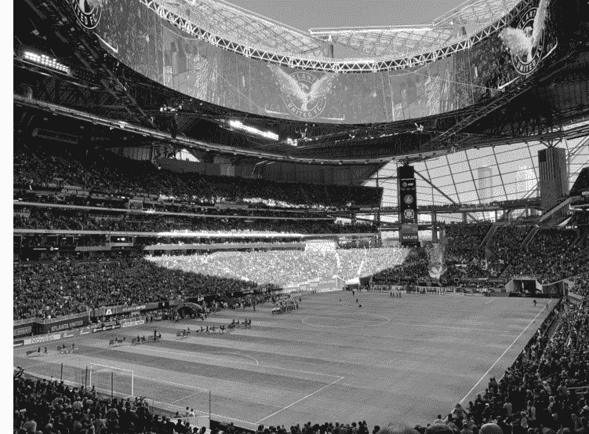
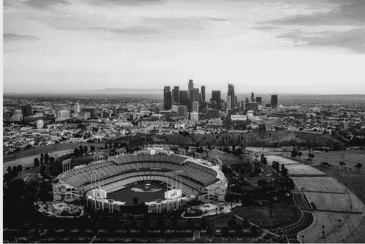

### 可持续发展目标 11：
可持续城市和社区

Taylor & Francis
Taylor & Francis Group
http://taylorandfrancis.com

### 可持续发展目标 11 概述

Timothy Kellison

体育不能从其发生的物理和物质空间中抽象出来。它受其周围的自然和人造环境塑造。正如周围环境可以塑造体育的边界、规则和结构一样，反之亦然。体育可以深刻影响其所嵌入的社区、邻里和城市，这种影响可能是建设性的，也可能是破坏性的（或两者兼有）。持久积极关系的可能性在很大程度上取决于远见和规划，这一概念体现在 SDG 11 中。

SDG 11 关注城市和社区的可持续性。具体而言，该目标旨在“使城市和人类聚居地具有包容性、安全、韧性和可持续性”（General Assembly, 2015, p. 21）。今天，城市地区约占世界人口的一半，预计到 2050 年这一比例将增加到三分之二以上（United Nations, 2019）。鉴于人类这种日益集中的趋势，人类聚居地的持续城市化需要谨慎的规划方法，正如联合国所主张的：

> 在长期人口趋势的指导下，良好的城市化管理（以及其他因素）可以帮助在最大化集聚效益的同时最大限度地减少环境退化以及城市居民数量增加带来的其他潜在不利影响，特别是在低收入和中低收入国家，预计在 2050 年之前城市化速度最快。未规划或管理不当的城市扩张，加上不可持续的生产和消费模式以及公共机构管理城市化的能力不足，可能会由于城市蔓延、污染和环境退化而损害可持续性。（United Nations, 2019, p. iii）

换句话说，城市区域的深思熟虑管理对于打击可持续发展目标旨在应对的许多问题至关重要。

对于任何参与过体育的人来说，其对 SDG 11 的潜在贡献是显而易见的。在所有层面上，体育可用于促进该目标的每个预期成果。如本书其他章节所述，包容性或有针对性的体育项目可能会促进老年人、残疾人、妇女和儿童以及移民和难民等特别脆弱人群的健康、福祉和安全（例如，

第 7、13、19 章）。此外，正如我在本章中进一步讨论的那样，可持续设计的场馆不仅可以减少城市对能源和水资源的本地需求，还可以为社区提供基础设施改善，以减轻当地危机和灾难的影响。体育还可以通过球迷和参与者参与策略、公共交通宣传活动以及专门为刺激气候行动而设计的其他举措来促进环境可持续性。与此同时，体育也可能阻碍这一进展，无论是有意通过恶意设计还是无意通过缺乏规划。这些问题将在下面进一步讨论，在那里我总结了联合国对 SDG 11 的目标，概述了支撑可持续城市和社区概念的几种理论，并讨论了如何将 SDG 11 的各个组成部分应用于体育。

#### 32.1 目标

建设包容、安全、韧性和可持续的城市和人类聚居地的广泛努力被联合国确定的 10 项目标所缩小，如表 32.1 所列并在本节中进一步总结。

目标 11.1 集中于住房和基本服务的可及性。该目标旨在确保所有个人都能居住在充足、安全和负担得起的住房中并获得基本服务。此外，该目标集中于改善非正规住区（通常称为“贫民窟”）的生活条件。总体而言，该目标寻求解决

表 32.1 可持续发展目标 11 的目标

11.1 到 2030 年，确保人人获得价格合理、具有安全保障和充足的住房和基本服务，改善贫民窟
11.2 到 2030 年，为所有人提供安全、价格合理、便捷和可持续的交通系统，提高道路安全，特别是通过扩大公共交通，在特别注意弱势群体、妇女、儿童、残疾人和老年人需求的同时
11.3 到 2030 年，增强包容性和可持续的城市化以及在所有国家参与、综合和可持续的人类住区规划和管理能力
11.4 加强保护和维护世界文化和自然遗产的努力
11.5 到 2030 年，大幅减少死亡人数和受影响人数，并大幅减少相对于全球国内生产总值造成的直接经济损失，由灾害造成，包括水相关灾害，重点保护贫困人口和处于脆弱情况的人
11.6 到 2030 年，减少城市人均环境负面影响，包括特别注意空气质量和市政及其他废物管理
11.7 到 2030 年，为所有人提供普遍获得安全、包容和可达的绿色和公共空间，特别是妇女和儿童、老年人和残疾人
11.a 通过加强国家和区域发展规划，支持城市、城郊和农村地区之间的积极经济、社会和环境联系
11.b 到 2020 年，大幅增加采用和实施包容性、资源效率、减缓和适应气候变化、抗灾以及根据《2015-2030 年仙台减少灾害风险框架》在各层面制定和实施整体灾害风险管理的城市和人类住区数量
11.c 通过提供财政和技术援助，支持最不发达国家利用当地材料建设可持续和有韧性的建筑

来源：General Assembly (2015)。

issues of homelessness and ensure cities provide their inhabitants with safe shelter and reliable basic services. As the UN reported, the COVID-19 pandemic exacerbated existing issues in cities and urban areas. More than 90% of all coronavirus cases were reported in urban areas, and the pandemic hit “the most vulnerable the hardest, including the 1 billion residents of the world’s densely populated informal settlements” (United Nations, 2020, p. 46).

Target 11.2 underscores the contribution of sustainable and accessible transportation systems to economic and social equity. Transportation systems are especially important for linking citizens across a large region and enabling connections to economic and cultural hubs and between urban and rural areas (Acuti et al., 2020). Furthermore, as the target explicitly describes, a public transportation system must be accessible to all citizens, including women, children, persons with disabilities, and older populations. While much focus on rural-urban interdependence tends to emphasize the necessity of city access to those living in rural communities because of the concentration of employment opportunities and cultural activities in urban centers, it is important to stress “rural areas are absolutely necessary for urban areas to function,” as “urban areas rely on rural areas to meet their demands for food, water, wood, [and] raw materials” (Gebre & Gebremedhin, 2019, p. 1). Using a venue like a FIFA World Cup stadium as an example, robust and accessible transport systems are essential not only for transferring spectators to a stadium for a match but also for moving workers and materials necessary to construct the facility in the first place (Kellison & Cintron, 2017).

Two seemingly distinct concepts—land consumption and democratic participation in the urban planning and management processes—are interwoven in Target 11.3. That is, if all individuals who stand to be impacted by urban development policy are actively engaged and participate in the planning process, outcomes that are exclusionary and unjust are less likely to emerge (Kellison et al., 2020). An inclusive planning process that maximizes stakeholder representativeness can also increase the likelihood that other SDG targets are addressed.

In Target 11.4, the need to preserve, protect, and conserve cultural and natural heritage is highlighted. The safeguarding of cultural symbols and the natural environment is a fundamental responsibility of all societies (UNESCO, 1972). Cultural heritage—like monuments, groups of buildings, and human-made sites—strengthens a society’s collective identity, reinforces value systems, and preserves a people’s language, customs, and traditions. Natural heritage—such as natural features, geological and physiographical formations, and natural sites—must be protected to sustain the earth’s flora and fauna and preserve the planet for future generations of humankind. One example of this target’s application to sport is in the work of Pfleegor et al. (2013), who argued “sport and recreation venues have a distinct place in the historical fabric of communities across the world, as they can be the foundation of heritage preservation and contribute to the development of synecdochical images” (p. 386). Indeed, sports and recreation venues—some of which are historically significant themselves—may also be used to promote the preservation of a city or region’s cultural heritage (Salvati & Zitti, 2017). On the other hand, the construction of major sports venues and subsequent events they attract can have adverse effects on the natural environment (Kellison & Casper, 2017).

Climate change and the increasing incidence of severe weather hazards have necessitated global cities to identify proactive solutions for protecting their inhabitants. The goal of Target 11.5 is to reduce the number of people killed and otherwise affected by disasters and to curb economic losses tied to those disasters. A robust climate-action approach that reduces the likelihood of extreme weather is the clearest and most direct way to respond to Target 11.5, but given the lack of serious, global progress in reducing GHG (greenhouse gas) emissions (Watson et al., 2019), climate adaptation will be required. Sports venues offer one way to address a city’s climate vulnerability, as the construction of resilient facilities may afford citizens a place of refuge during a catastrophic storm and shelter in the subsequent days and weeks of recovery (Kellison & Orr, 2021; Orr & Kellison, 2020).

Target 11.6 relates to the environmental impact of cities, particularly when it comes to air quality and waste management. As McCullough et al. (2020) argue, “The relationship between sport and the natural environment is bidirectional; that is, sport impacts the natural environment and is impacted by the natural environment” (p. 509). The environmental impact of sport and on sport are important considerations in the design and operating of sports facilities and the delivery of the events that occur within them. For instance, as fans travel to stadiums and tailgate before matches, they can produce unhealthy spikes in particulate matter emissions (Casper & Bunds, 2018). Meanwhile, the threat of poor air quality may lead sports teams to adopt adaptive measures such as adding roofed structures to their stadium construction (or renovation) plans (Watanabe et al., 2019). Additionally, major sporting events like the Olympic and Paralympic Games may provide an impetus for local governments to activate citywide sustainability strategies, even if only for a short time (McLeod et al., 2018). Public partnerships between facility operators and municipal service providers have also led to the creation of zero-waste programs designed to divert materials away from landfills via recycling and composting in several collegiate and professional sports stadiums (Kellison, 2019).

As reflected by Target 11.7, high-density urban communities benefit from the presence of greenspace and other leisure-based infrastructure like public parks, nature preserves, trails and greenways, and gardens. Not only do parks and greenspace provide positive health benefits and health promotion to members of urban communities, but they also provide infrastructural benefits like reducing air pollution and mitigating extreme weather events (Parsons et al., 2015; Schottland, 2019). These public spaces are also important to promote healthy play and sport, and the erosion of public greenspaces in urban communities has contributed to the generational loss of participants in certain sports. This decline has led some leagues and sport governing bodies to establish youth academies and sponsor revitalizations of urban basketball courts, baseball fields, and soccer pitches (The Aspen Institute, 2015).

In addition to the seven outcome-based targets summarized above, SDG 11 includes three “means of implementation” (or MoI) targets. Target 11.a is intended to enhance linkages between the urban, rural, and transition zones in between in a manner that focuses on economic, social, and environmental benefits. Target 11.b, the only SDG 11 target that matured in 2020, focused on the adoption and implementation of disaster risk strategies at all levels and the alignment of disaster risk reduction strategies with national ones. Lastly, Target 11.c was designed to provide financial and technical assistance to less developed countries to source local materials to build sustainable and resilient buildings. Due to challenges with measurement, Target 11.c was proposed to be deleted in 2020 (Inter-Agency and Expert Group on Sustainable Development Goal Indicators, 2019).

As the targets mentioned above indicate, the grand aspiration of inclusive, safe, resilient, and sustainable cities necessitates a planning approach encompassing housing, transport, cultural preservation, the natural environment, and democratic participation. These aspects of SDG 11 are connected by their collective contribution to the city. In the next section, I turn to several theoretical bases that underpin these markers of sustainable cities and communities.

### 32.2 Theoretical foundations

In his influential essay, “What is a City?,” Mumford (1937) posited that cities were not only centers of economic agglomeration, but also—and perhaps more importantly—profoundly social spaces:

城市在其完整的意义上……是一个地理交汇点，一个经济组织，一个制度过程，一个社会行动的剧场，以及集体统一的美学象征。城市孕育艺术并且是艺术；城市创造剧场并且是剧场。正是在城市中，城市作为剧场，人类更具目的性的活动得以聚焦，并通过冲突与合作的人物、事件、群体，发展出更具意义的 culminations。（第59页）

因此，任何试图描绘城市未来的努力，都应同时关注其物理形态以及塑造它的过程。这一思想体现在规划理论的两个基本类别中：实质性与程序性（Faludi, 1973）。前者关注规划的技术和物质方面，例如城市街道的布局（即计划本身），而后者则关注设计、实施和评估计划的过程（即规划本身）。对规划理论进行分类的最新努力在实质性-程序性类型学的基础上进行了扩展。例如，Allmendinger（2002）提出了五个广义的理论类别，这些理论以后实证主义为导向，包括框架理论、外生理论、社会理论、社会科学哲学和本土规划理论（另见 Pallagst, 2007）。下面，我概述了在思考城市和社区可持续性时可能遵循的三个总体理论方向。鉴于可持续发展目标11具有极其多学科的性质，本讨论将省略的内容多于总结的内容，因此本节的目标不是追求全面性，而是提供与城市可持续性相关的各种理论框架的一个 glimpse。

### 32.2.1 规划理论

与规划相关的一个基本假设是它是刻意的。正如 Fainstein 和 DeFilippis（2016）所解释的那样，“规划是对现有事件进程的干预，其意图是改变其现有进程”（第8页），但何时（如果有的话）进行此类干预是合适的仍然是一个开放性问题。尽管意图再好，规划仍可能导致适得其反的结果，当城市的结构、经济和社会组成部分被孤立研究时。正如 Bettencourt 和 West（2010）指出的那样，将这些组成部分独立对待“会导致政策无效，并经常导致不幸的，有时甚至是灾难性的非预期后果”（第912页）。正如他们进一步解释的那样，城市规模，而不是其历史、地理或设计，是“城市大多数特征的主要决定因素”这一事实，需要以城市和城市化为核心的“可持续性大一统理论”（第912页）。

可持续性大一统理论的想法也反映在 Corbett 和 Mellouli（2017）的论述中，他们认为城市面临的许多挑战，包括“经济约束、人口变化、[以及]衡量进展的数据和指标获取有限”（第428页），需要一种精简、综合的方法。这种方法可以通过信息和通信技术系统来促进，这是所谓的“智慧城市”的标志。智慧城市提供了许多优势，但它们有时可能与促进可持续城市倡议的努力相冲突。Bibri 和 Krogstie（2017）引用了这种冲突的几个原因，包括对智慧城市和可持续城市中平行目标的误解，以及“智慧城市评估框架和概念需要分别重新开发和重新定义，以纳入可持续城市的环境指标和理论构念”（第202页）。

与可持续发展目标11相关，以及更广泛的可持续发展目标相关的目标强调了纳入历史上代表性不足和系统性边缘化群体的 importance，不仅在与可持续发展相关的结果中，而且在创建旨在实现这些结果的策略的过程中。在城市社区中，包容性可持续发展对所有成员的健康和福祉至关重要；毕竟，城市的定义不仅在于其规模和密度，还在于其异质性（Wirth, 1938）。城市丰富多样和多民族的特征也可能考验规划者，因为在交通、住房和环境等议题上，有时会出现相互冲突的偏好（Sandercock, 2000）。包容性对话对于那些将城市本身视为“公地”的人尤其重要，在这种公地中，公民有权获取各种类型的城市商品（例如城市公园、公共广场、道路；Foster & Iaione, 2016）。城市权利不仅意味着获取城市商品的权利，还意味着形成和重塑城市的权利（Harvey, 2008；Lefebvre, 1968），这凸显了在规划桌上拥有各种声音和观点的价值。

### 32.2.2 政治生态学

第二个可用于研究城市可持续性的理论框架是政治生态学，它与规划文献密切相关。城市中不平等的存在可以追溯到规划过程，正如 Bunds 等人（2020）在其对城市体育场馆开发的城市政治生态学应用中所讨论的那样：“在城市环境中，特别是，为改善‘环境’而进行的姿态意味着以更整合的方式看到自然、建成、安全和安全的社会过程以及空间环境形式如何不平等地发生”（第127页）。他们认为，财产利润驱动的私有化转变使一些群体优于其他群体。在美国，这一问题变得尤为突出，因为主要的体育基础设施，如竞技场、球场和体育场建在市中心地段：“地方政治领导人、公民精英和市中心土地持有者（‘增长机器’的组成部分）成功推动了这一再开发议程，并在将许多球队迁至市中心位置方面取得了成功”（Chapin, 1999, 第377页）。

在北美，大多数职业体育场馆至少部分由公众资助（Hutchinson et al., 2018）。为大型职业体育场馆项目争取公共融资的努力可能会使城市的商业精英受益，他们比可能反对公共资金的普通公民更容易在体育场补贴提案背后组织起来（Kellison & Mondello, 2014；Molotch, 1976）。同样，民选官员可能会在选民缺乏批准的情况下推动增长导向的政策，因为他们坚持公民家长主义的政治哲学，即他们知道什么对城市及其居民最好（Kellison, 2016）。在这些情况下，政策制定者甚至可能冒着连任的风险来推动特别有争议的项目（Kellison & Mills, 2021）。除其他原因外，这些项目可能在社区成员中引发争议，因为它们被认为缺乏足够的公众参与或带来高环境成本（Kellison & Mondello, 2012）。

### 32.2.3 可持续城市

第三种理论方法回应了城市可持续意味着什么的问题。当谈到可持续城市时，存在各种紧张关系。然而，正如 Campbell（1996）所争论的那样，财产、资源和发展之间的冲突可能会得到缓解，使社区能够实现“难以捉摸的可持续发展理想”，即“绿色、盈利且公平”的东西（第298页）。有多条路径可以导致这一结果，包括基于程序的路径（即冲突谈判；弥合经济学、环境主义和社会正义的语言差距；政治多元主义；将经济和环境优先事项联系起来）或基于实质的路径（即土地利用和设计、生物区域主义、技术改进）。

为了实现可持续发展目标11的目标，为促进城市可持续性而做出的决策不应局限于地方政府，因为它们应与在

区域或国家层面而言。然而，对于地方规划者和设计师来说，当政府实施似乎违背环境战略的倒退政策时，找到这种一致性可能会很吃力（Kellison & Cianfrone, 2020）。关于城市的决策不一定局限于城市本身，也不局限于政治行为者。正如 Bulkeley 和 Betsill（2005）所发现的，“可持续发展政策目标的解释和实施[可以]由跨越地理尺度并超出城市边界的治理形式所塑造”（第 56 页）。也就是说，可持续城市的创建并非孤立进行，需要众多个人、组织和机构的合作。在下面的部分中，我提供了体育可能在这一努力中发挥作用的示例。

### 32.3 与体育的联系

广泛的利益相关者（积极或适得其反地）为实现更具包容性、安全、韧性和可持续的城市空间的目标做出了贡献。这些利益相关者可能包括体育相关企业中的各种领导者。他们可以从个人运动员到整个体育俱乐部，从青少年协会到国家体育联赛，从地方赛事到全球比赛，从当地健身房到巨型体育场，以及从草根组织到国际管理机构。

体育对 SDG 11 目标的贡献最好可以从两个角度之一来理解（Shamir & Ruskin, 1984）。首先，*参与*体育和身体活动为公民提供健康和心理社会益处，并且可以在城市各地进行，包括在公共公园和绿地或私人设施中。其次，*观赏*体育通常以基础设施为基础，因为它通常需要大规模的场馆来举办赛事和观众。虽然这两种休闲行为模式之间存在明显差异，但也存在一定的重叠。这两个视角都存在于最近呼吁将体育用作城市和社区可持续发展工具的呼声中，如下文进一步概括。

#### 32.3.1 突出体育在城市中的作用

在 2015 年一份审查体育对可持续发展潜在影响的英联邦报告中，它将 SDG 11 识别为“体育方法[可以]做出最有效和最具成本效益贡献”的六项目标之一（Dudfield & Dingwall-Smith, 2015, 第 16 页）。报告的大部分关注点集中在创建和维持可及的绿地和游乐场所，但其他建议还包括“在城市规划中嵌入体育空间”以及利用大型体育赛事“促进经济发展、提高身体活动水平、文化活动、城市更新和增强公民自豪感”（第 65–66 页）。英联邦报告还承认将体育应用于 SDG 11 所有目标的一些挑战。例如，将体育、休闲和身体活动优先纳入绿地和公共空间规划的努力可能会遭到那些质疑其在面对日益城市化和人类定居模式变化时“对社会和经济发展贡献”的人的抵制（第 66 页）。

当然，对于那些将职业生涯奉献给体育的人来说，其潜在影响是显而易见的。例如，回顾他担任联合国秘书长体育促进发展与和平特别顾问的经历，Wilfried Lemke 回忆起参加“Table Tennis for NepALL”启动仪式，该项目旨在促进残疾人包容的残奥会乒乓球项目。除了利用体育“通过改变人们对残疾人的看法并为他们提供参与体育的机会来促进社会发展”外，他还观察到“在 2015 年尼泊尔毁灭性地震之后，体育为幸存者创造了一种正常感和自我效能感”（Lemke, 2016, 第 9 页）。这一观点在可持续发展目标基金（2018）开发的工具包中得到了进一步支持，其中他们宣布“体育可以……有效地用于包容所有人口，无论年龄、性别、种族、民族、出身、性取向、性别认同、宗教或经济或其他地位”（第 41 页）。该报告从多个角度[content]
区域或国家层面而言。然而，对于地方规划者和设计师来说，当政府实施似乎违背环境战略的倒退政策时，找到这种一致性可能会很吃力（Kellison & Cianfrone, 2020）。关于城市的决策不一定局限于城市本身，也不局限于政治行为者。正如 Bulkeley 和 Betsill（2005）所发现的，“可持续发展政策目标的解释和实施[可以]由跨越地理尺度并超出城市边界的治理形式所塑造”（第 56 页）。也就是说，可持续城市的创建并非孤立进行，需要众多个人、组织和机构的合作。在下面的部分中，我提供了体育可能在这一努力中发挥作用的示例。

### 32.3 与体育的联系

A wide range of stakeholders contributes (positively or counterproductively) to the goal of more inclusive, safe, resilient, and sustainable urban spaces. These stakeholders may include various leaders in sports-related enterprises. They can range from individual athletes to entire sport clubs, from youth associations to national sporting leagues, from local events to global competitions, from local gymnasiums to mega stadiums, and from grassroots organizations to international governing bodies.

Sport’s contribution to the targets of SDG 11 may be best understood from one of two perspectives (Shamir & Ruskin, 1984). First, *participation* in sport and physical activity provides citizens with health and psychosocial benefits, and it may occur throughout a city, including in public parks and greenspaces or private facilities. Second, *spectatorship* of sport is often infrastructure-based because it typically requires large-scale venues for hosting events and spectators. While there are apparent differences between these two modes of leisure behavior, there is also some overlap. Both perspectives are present in recent calls to use sport as a sustainable development tool in cities and communities, as summarized further below.

#### 32.3.1 Highlighting the role of sport in cities

In a 2015 Commonwealth report examining sport’s potential impact on sustainable development, it identified SDG 11 as one (of six) where “sport-based approaches [could] make the most effective and cost-efficient contributions” (Dudfield & Dingwall-Smith, 2015, p. 16). Much of the report’s attention centered on creating and sustaining accessible greenspace and places of play, but other recommendations included “embedding space for sport in urban planning” and using major sporting events to “promote economic development, improved physical activity levels, cultural activities, urban regeneration and enhanced civic pride” (pp. 65–66). The Commonwealth report also acknowledged some of the challenges of applying sport to all targets of SDG 11. For instance, efforts to prioritize sport, recreation, and physical activity in plans for green and public spaces could face resistance from those who questioned its contribution “to social and economic development in the face of increasing urbanisation and changes in human settlement patterns” (p. 66).

Of course, for those who have dedicated their careers to sport, its potential impact is unmistakable. For example, reflecting on his experience as Special Adviser to the UN Secretary-General on Sport for Development and Peace, Wilfried Lemke recounted attending the launch of “Table Tennis for NepALL,” a Para table tennis project designed to promote disability inclusion. In addition to using sport to “foster social development by changing perceptions about people with disabilities and providing such people with an opportunity to participate in sport,” he observed that “after the devastating 2015 earthquake in Nepal, sport created a sense

of normalcy and self-efficacy for the survivors” (Lemke, 2016, p. 9). This idea is further supported in a toolkit developed by the Sustainable Development Goals Fund (2018), in which they declared “sports can…be effectively used for the inclusion of all demographics irrespective of age, sex, race, ethnicity, origin, sexual orientation, gender identity, religion or economic or other status” (p. 41). The report approached SDG 11 from multiple perspectives, including big-time, spectator sport (e.g., “Sports stadia can become platforms for human rights-based inclusiveness and respect for diversity”; p. 41), and local, participatory sport (e.g., “Creating spaces and facilities that are appropriate for sports requires well-considered planning and management from the national to the community level”; p. 41).

Following the UN’s unambiguous recognition of sport as an “important enabler of sustainable development” in 2015 (General Assembly, 2015, p. 10), the International Olympic Committee explained the potential of sport in achieving several SDGs. Specifically, referring to SDG 11 and recognizing the potential benefits of both sport participation and sport spectatorship, they observed:

> Cities that invest in public sport, play areas, and related sport activities and programmes can reap numerous benefits in the field of health care and in fighting delinquency and violence, and promoting social cohesion and community identity. Sport events can also act as accelerators for the development of sustainable cities, including improved road networks and public transportation, thereby contributing to road safety. (International Olympic Committee, 2017, p. 1)

Indeed, as discussed in Chapter 38, the IOC has been strongly connected to the UN. In 2016, it became one of the founding signatories of the Sports for Climate Action framework (United Nations Framework Convention on Climate Change, 2018).

The value of sport in sustainable development was further emphasized in the Kazan Action Plan, a policy framework adopted by UNESCO in 2017. The report included a declaration that sporting infrastructure and other public spaces of play “in urban and rural planning can help support, develop and maintain activity and healthy lifestyles for their citizens and build inclusive and sustainable communities” (UNESCO, 2017, p. 9). The Kazan Action Plan further recommended the allocation of at least 15% of urban space for “open and green spaces and public facilities” and that these spaces integrate “opportunities for sport, physical education and physical activity” (p. 9). Additionally, these spaces should be “neutral and public and their design, implementation and management take into account the needs and safety of all citizens, including those with disabilities, as well as other vulnerable groups such as children and women” (p. 9). Taken together, these high-profile endorsements of sport as a mechanism for sustainable development underscore its potential to contribute to the wellness of citizens through healthy living and physical activity. A second contribution may come in the design of sports venues, which, much like the cities in which they are located, will need to adapt to climate-related threats.

#### 32.3.2 Climate and sustainable design

As discussed in the introduction, sport exists at the interface of the natural and built environments. Any sports space, from the impromptu stickball alley to the master-planned concrete-and-steel ballpark, is fabricated around the land on which it sits. The congruous relationship between what is natural and what is built, however, is threatened by extreme weather events associated with climate change, and it has forced urban planners and public policymakers to develop robust

systems of climate adaptation (Dhar & Khirfan, 2017; Intergovernmental Panel on Climate Change, 2014). Not only a casualty of climate change, cities must also address their contributions to this crisis: according to the United Nations Human Settlements Programme (2019), cities account for 60–80% of energy consumption and 70% of GHG emissions.

In large cities, major professional sports venues may indicate civic leaders’ commitment to climate action (Kellison & Hong, 2015). For example, after the naming rights to Seattle’s KeyArena were purchased by Amazon in 2020, CEO Jeff Bezos announced the venue would be renamed Climate Pledge Arena and emphasized the public message being communicated through the moniker: “Instead of naming it after Amazon, we’re calling it Climate Pledge Arena as a regular reminder of the importance of fighting climate change. We look forward to working together with…NHL Seattle to inspire global climate action” (Baker, 2020, para. 10). In addition to implementing zero-waste operations and reclaiming water for its ice system, the arena is expected to be the first net zero carbon certified arena in the world. After undergoing a $930-million renovation, the arena began serving as the home to Seattle’s NHL and WNBA teams in 2021.

Climate Pledge Arena is among the latest sports venues that have made sustainable design central to their operations. Since 2008, more than 70 major sports facilities worldwide have earned LEED (Leadership in Energy and Environmental Design) certification from the U.S. Green Building Council, an organization that promotes sustainable building practices (Center for Sport and Urban Policy, 2020). The LEED rating system is the recognized standard for sustainably designed sports facilities in North America; other popular international variants include BREEAM and Neubau Sportstätten (Campelli, 2018). The fair number of LEED-certified sports venues suggests environmentally friendly stadiums are somewhat common among new constructions in professional sports, but in truth, far more major sports facilities have opened in the past decade without documented pro-environmental designs (Kellison & McCullough, 2018). Various reasons explain why sustainable design in sport has not been more widespread, including a lack of technical expertise or awareness of environmental issues among decision makers (e.g., Trendafilova et al., 2014).

Given the high environmental cost of building new venues (Preservation Green Lab, 2011), it is essential that the materials used to construct a facility are selected carefully. As Omer and Noguchi (2020) argued, “Buildings are the foundations of cities and communities, therefore building materials are key to their long-term sustainability” (p. 8). Thus, using locally available and responsibly sourced building materials will help limit the negative environmental impact that comes with extracting, transporting, erecting, maintaining, and ultimately—as the stadium-replacement loop endures—demolishing the materials. As Mercedes-Benz Stadium was being constructed to replace the Georgia Dome in Atlanta in the mid-2010s, officials cataloged all items inside the Dome, most of which were eventually sold, donated, or reused (Kellison, 2019). Additionally, debris from the imploded Dome was used as infill for a 13-acre greenspace that featured biking paths, a playground, and a sports field. Sustainably designed sports venues undoubtedly deserve praise, but it is equally important to recognize the legacy of the land, neighborhoods, and communities on which a stadium is built. As discussed next, in some cases, sports facilities may be constructed in ways that disadvantage the very groups SDG 11 is intended to protect (Figure 32.1).

#### 32.3.3 Environmental justice

In cities throughout the United States, communities of color face environmental harms at a disproportionately higher rate than white (non-Hispanic) populations. Problems like poor air quality, urban flooding, and scarce greenspace contribute to poor health outcomes and

图 32.1 佐治亚州亚特兰大的梅赛德斯-奔驰体育场。 （来源：Timothy Kellison，转载经许可）

经济不平等（Cutter, 1995）。这些差异是环境种族主义的遗产，因为“少数族裔和低收入社区[面临]不成比例的环境危害和有限的环境利益”（Taylor, 2014, p. 2）。作为对这些问题的回应，公共和私营行为者都实施了环境正义改革，旨在扩大对受环境退化影响最严重的社区的承认、分配和参与（Schlosberg, 2007）。

就其本身而言，职业体育队伍和体育场开发商一直宣传其场馆对所在社区具有积极贡献，尤其是在为位于市中心和城市社区附近的公共资助项目进行论证时。这些主张不可避免地超出了经济影响，并侧重于体育场能够增强城市社会资本并改善城市社区宜居性和吸引力的论点（Sze, 2009）。然而，过去的案例表明，体育场会对社区产生有害影响，尤其是在以黑人和西班牙裔为主的社区。例如，为亚特兰大的州际公路系统和亚特兰大-富尔顿县体育场清理的土地导致乔治亚大道沿线的历史悠久的黑人社区出现显著的经济不稳定（Davis, 2019），而道奇体育场的建设则直接导致居住在洛杉矶一个主要是墨西哥裔美国人社区查韦斯峡谷的人被迫搬迁（Nusbaum, 2020）。这两个项目随后都产生了负面的环境影响。正如历史所显示的那样（如本书其他章节的作者也指出的），体育可以同样有效地被用来推动威胁或伤害有色人种社区的发展。就像

图 32.2 加利福尼亚州洛杉矶的道奇体育场。 （来源：Pixabay 的 David Mark）

城市中的许多问题一样，体育中的许多问题都不是新的，它们并非不可预测地出现，也并非无意为之（图 32.2）。

展望未来，学者必须审视体育场场所、可持续设计与环境正义之间的联系。正如 Reece（2018）在其关于规划中公平作用的回顾中所指出的，他预测过去的问题将持续存在：

> 21 世纪城市规划者面临的挑战至少与十九世纪和二十世纪所遇到的挑战一样艰巨。社会和经济不平等正在加剧，城市在性质和构成上正在发生变化，国家正处于又一次重大的人口结构转型之中。（p. 307）

因此，鉴于体育场与城市社区之间有时不和谐的关系，了解体育场如何（积极或消极地）对公民的生活质量做出贡献至关重要，特别是对于那些历史上一直遭受不公正和不平等环境政策影响的社区的居民而言。

### 32.4 结论性 remarks

2020 年疫情期间主要体育联赛几乎完全停摆，让管理者、媒体和学术界有时间反思体育的未来，并思考没有体育的世界会是什么样子。虽然有些人将停摆视为“更好地复苏”（联合国经济和社会事务部，2020 年）或“建设得更好”（可持续体育研究集体，2020 年；联合国妇女署，2020 年）的机会，

其他人则预言 2020 年“是通往灾难的竞赛中的发令枪”（Moore, 2020，转引自 Vogt et al., 2020）。无论观点如何，气候变化的不可避免性和不可逆转性将迫使体育产业适应或崩溃（Wallace-Wells, 2019）。

本章说明了第十一个可持续发展目标的广泛而深远的影响。使城市和社区包容、安全、有韧性、可持续的挑战需要从许多不同方向实施战略和做法，正如之前重点突出的 10 项目标所展示的那样。学术观点同样多面，关于可持续发展目标 11 的学术工作可能以规划理论、政治生态学或环境科学为基础，等等。当然，这一讨论的核心是城市，而虽然城市仅在可持续发展目标 11 中明确提及，但城市可以为可持续发展目标中列出的其他可持续发展方面做出贡献，包括消除贫困（1）；良好健康与福祉（3）；优质教育（4）；性别平等（5）；体面工作（8）；气候行动（13）；陆地生命（15）；和平、正义与强大机构（16）；和促进目标的伙伴关系（17；Macmillan et al., 2020）。将城市置于可持续发展目标的中心，也强调了集体行动、协作和系统整合的重要性。

体育可以在实现可持续发展目标 11 的目标中发挥关键作用，这一点从英联邦、联合国和国际奥委会发表的高层声明中可见，这些声明强调了体育对城市的价值。无论是参与型还是观众型的体育基础设施都可以设计为支持可持续发展。因此，如果体育要对包容、安全、有韧性和可持续的城市和社区的目标做出积极贡献，体育领域的领导者和政策制定者必须有意识地行动。体育经常因其无边界性而受到赞颂——因其有潜力超越社会、政治地理和经济障碍。在这种意义上，它可能是建设可持续城市和人类住区的一种理想工具。

### 参考文献

Acuti, D., Bellucci, M., & Manetti, G. (2020). 公司披露关于城市韧性的信息：可持续发展目标视角。 Cities, 99, 102608. doi: 10.1016/j.cities.2020.102608

Allmendinger, P. (2002). 走向后实证主义的规划理论类型学。 Planning Theory, 1(1), 77–99. doi: 10.1177/147309520200100105

Baker, G. (2020, June 25). Amazon buys naming rights to KeyArena, will call it Climate Pledge Arena. Seattle Times. https://www.seattletimes.com/sports/hockey/amazon-buys-naming-rights-to-keyarena-will-call-it-climate-pledge-arena/

Bettencourt, L., & West, G. (2010). 城市生活的统一理论。 Nature, 467(7318), 912–913. doi: 10.1038/467912a

Bibri, S. E., & Krogstie, J. (2017). 未来智慧可持续城市：广泛的跨学科文献综述。 Sustainable Cities and Society, 31, 183–212. doi: 10.1016/j.scs.2017.02.016

Bulkeley, H., & Betsill, M. (2005). 重新思考可持续城市：多层治理与气候变化的“城市”政治。 Environmental Politics, 14(1), 42–63. doi: 10.1080/096440104200031078

Bunds, K. S., McLeod, C. M., & Newman, J. I. (2020). 体育场开发中的政治生态学和环境考量。 In B. Wilson & B. Millington (Eds.), Sport and the environment: Research in the Sociology of Sport (Vol. 13, pp. 123–136). Emerald Publishing Limited.

Campbell, S. (1996). 绿色城市、增长城市、公正城市？：城市规划与可持续发展的矛盾。 Journal of the American Planning Association, 62(3), 296–312. doi: 10.1080/01 944369608975696

Campelli, M. (2018, September 4). European ‘green stadium’ certification being road-tested, from Vienna to Barcelona. The Sustainability Report. https://www.sustainabilityreport.com/2018/09/04/european-green-stadium-certification-being-road-tested-from-vienna-to-barcelona/

Casper, J. M., & Bunds, K. S. (2018). Tailgating and air quality. In B. P. McCullough & T. B. Kellison (Eds.), Routledge handbook of sport and the environment (pp. 291–300). Routledge.

Center for Sport and Urban Policy. (2020). Greentrack. http://www.stadiatrack.org/green
Chapin, T. S. (1999). 体育设施选址的政治经济学：世纪末的回顾与评估。 Marquette Sports Law Journal, 10, 361–382. https://scholarship.law.marquette.edu/sportslaw/vol10/iss2/11
Corbett, J., & Mellouli, S. (2017). 赢得城市中的可持续发展目标之战：综合信息生态系统如何有助于实现 2030 年可持续发展目标。 Information Systems Journal, 27(4), 427–461. doi: 10.1111/isj.12138
Cutter, S. L. (1995). 种族、阶级与环境正义。 Progress in Human Geography, 19(1), 111–122. doi: 10.1177/030913259501900111
Davis, M. (2019). Streetscape palimpsest: A history of Georgia Avenue. bit.ly/GeorgiaAveATL
Dhar, T. K., & Khirfan, L. (2017). 增强城市形态对气候变化韧性的多尺度多维度框架。 Urban Climate, 19, 72–91. doi: 10.1016/j.uclim.2016.12.004
Dudfield, O., & Dingwall-Smith, M. (2015). Sport for development and peace and the 2030 agenda for sustainable development. Commonwealth Secretariat.
Fainstein, S. S., & DeFilippis, J. (2016). 引言：规划理论的结构与争论。 In S. S. Fainstein & J. DeFilippis (Eds.), Readings in planning theory (4th ed., pp. 1–18). John Wiley & Sons, Ltd.
Faludi, A. (1973). Planning theory. Pergamon Press.
Foster, S. R., & Iaione, C. (2016). 城市作为 commons。 Yale Law & Policy Review, 34(2), 281–349. http://www.jstor.org/stable/43920369
Gebre, T., & Gebremedhin, B. (2019). 通过关联生态系统服务促进城乡相互依存的互利。 Global Ecology and Conservation, 20, e00707. doi: 10.1016/j.gecco.2019.e00707
General Assembly. (2015). Transforming our world: The 2030 Agenda for Sustainable Development (A/RES/70/1). United Nations. undocs.org/en/A/RES/70/1
Harvey, D. (2008). The right to the city. New Left Review, 53, 23–40.
Hutchinson, M., Berg, B. K., & Kellison, T. (2018). 升级承诺中的政治活动：体育设施融资与美国政府决策。 Sport Management Review, 21, 263–278. doi: 10.1016/j.smr.2017.07.005
Inter-Agency and Expert Group on Sustainable Development Goal Indicators. (2019). Report of the Inter-Agency and Expert Group on Sustainable Development Goal indicators (E/CN.3/2020/2). United Nations. https://unstats.un.org/sdgs/iaeg-sdgs/report-iaeg-sdgs/
Intergovernmental Panel on Climate Change. (2014). Climate change 2014: Synthesis report. Contribution of working groups I, II and III to the Fifth Assessment Report of the Intergovernmental Panel on Climate Change (Core Writing Team, R. K. Pachauri, & L. Meyer, Eds.). IPCC.
International Olympic Committee. (2017). [Untitled statement on sport and the Sustainable Development Goals]. https://stillmedab.olympic.org/media/Document%20Library/OlympicOrg/News/2017/06/2017-Sustainable-development-en.pdf
Kellison, T. (2016). No-vote stadium subsidies and the democratic response. International Journal of Sport Management, 17(3), 452–477.
Kellison, T. (2019). 体育中的环境可持续设计。 In J. A. Maguire, M. Falcous, & K. Liston (Eds.), The business and culture of sports: Society, politics, economy, environment (Vol. 4, pp. 329–344). Macmillan Reference USA.
Kellison, T., & Casper, J. M. (2017). 大型体育赛事的环境遗产。 In I. Brittain, J. Bocarro, T. Byers, & K. Swart (Eds.), Legacies and mega events: Fact or fairy tales (pp. 445–455). Routledge.
Kellison, T., & Cianfrone, B. A. (2020). 体育组织环境项目中的超ordinate 社会认同。 International Journal of Sport Management, 21, 54–81.
Kellison, T., & Cintron, A. M. (2017). 建设体育场，搭建桥梁：中国的外交地缘政治战略。 In C. Esherick, R. E. Baker, S. Jackson, & M. Sam (Eds.), Case studies in sport and diplomacy (pp. 121–135). Fitness Information Technology.
Kellison, T., & Hong, S. (2015). 采用和扩散环保型体育场设计。 European Sport Management Quarterly, 15(2), 249–269. doi: 10.1080/16184742.2014.995690
Kellison, T., & McCullough, B. P. (2018). 关于体育可持续性未来的实用主义视角。 In B. P. McCullough & T. B. Kellison (Eds.), Routledge handbook of sport and the environment (pp. 445–455). Routledge.

Kellison, T., & Mills, B. M. (2021). 选民意图与立法体育场补贴的政治影响. Sport Management Review, 24(2), 181–203. doi: 10.1016/j.smr.2020.07.003
Kellison, T., & Mondello, M. J. (2012). 体育中的组织感知管理：利用企业 pro-environmental 行为以获得期望的设施公投结果. Sport Management Review, 15, 500–512. doi: 10.1016/j.smr.2012.01.005
Kellison, T., & Mondello, M. J. (2014). 政治决策中的公民家长主义：无投票体育场补贴的理由. Journal of Sport Management, 28(2), 162–175. doi: 10.1123/jsm.2012-0210
Kellison, T., & Orr, M. (2021). 气候脆弱性作为早期体育场更换的催化剂. International Journal of Sports Marketing and Sponsorship, 22(1), 126–141. doi: 10.1108/IJSMS-04-2020-0076
Kellison, T., Sam, M. P., Hong, S., Swart, K., & Mondello, M. J. (2020). 全球民主与公共体育场融资视角. Journal of Global Sport Management, 5(4), 321–348. doi: 10.1080/24704067.2018.1531680
Lefebvre, H. (1968). Le droit à la ville. Anthopos.
Lemke, W. (2016). 体育在实现可持续发展目标中的作用. UN Chronicle, 53(2), 6–9.
Macmillan, A., Smith, M., Witten, K., Woodward, A., Hosking, J., Wild, K., & Field, A. (2020). 为实现可持续发展目标而进行的通勤主动交通的郊区层面变化：因果理论与新西兰案例研究. Science of the Total Environment, 714, 136678. doi: 10.1016/j.scitotenv.2020.136678
McCullough, B. P., Orr, M., & Kellison, T. (2020). 体育生态学：在体育管理中概念化一个新兴子学科. Journal of Sport Management, 34(6), 509–520. doi: 10.1123/jsm.2019-0294
McLeod, C. M., Pu, H., & Newman, J. I. (2018). 北京上空的蓝天：奥运会、环境与中华人民共和国. Sociology of Sport Journal, 35, 29–38. doi: 10.1123/ssj.2016-0149
Molotch, H. (1976). 城市作为增长机器：对地方的政治经济学的思考. American Journal of Sociology, 82(2), 309–332. doi: 10.1086/226311
Mumford, L. (1937). 什么是城市？ Architectural Record, 82(5), 59–62.
Nusbaum, E. (2020). 偷家：洛杉矶、道奇队以及夹在中间的生活. PublicAffairs.
Omer, M. A. B., & Noguchi, T. (2020). 理解建筑材料对实现可持续发展目标贡献的概念框架. Sustainable Cities and Society, 52, 101869. doi: 10.1016/j.scs.2019.101869
Orr, M., & Kellison, T. (2020). 体育设施作为环境和社会韧性的场所. Managing Sport and Leisure. Advance online publication. doi: 10.1080/23750472.2020.1855081
Pallagst, K. M. (2007). 美国的管理增长：在理论与实践之间. Ashgate Publishing Limited.
Parsons, A. A., Besenyi, G. M., Kaczynski, A. T., Wilhelm Stanis, S. A., Blake, C. E., & Barr-Anderson, D. J. (2015). 调查公园周边社区的环境不公正问题. Journal of Leisure Research, 47(2), 285–303. doi: 10.1080/00222216.2015.11950361
Pfleger, A. G., Seifried, C. S., & Soebbing, B. P. (2013). 通过体育和休闲设施保护遗产的道德义务. Sport Management Review, 16(3), 378–387. doi: 10.1016/j.smr.2012.10.002
Preservation Green Lab. (2011). 最绿的建筑：量化建筑再利用的环境价值. National Trust for Historic Preservation. https://living-future.org/wp-content/uploads/2016/11/The_Greenest_Building.pdf
Reece, J. W. (2018). 追求21世纪公正城市：公平规划理论与实践的演变. Journal of Planning Literature, 33(3), 299–309. doi: 10.1177/0885412218754519
Salvati, L., & Zitti, M. (2017). 蔓延与大型活动：经济增长与失去竞争优势的城市的近期城市扩张（希腊雅典）. Urbani izziv, 28(2), 110–121. doi: 10.5379/urbani-izziv-en-2017-28-02-003
Sandercock, L. (2000). 当陌生人成为邻居：管理差异城市. Planning Theory & Practice, 1(1), 13–30. doi: 10.1080/14649350050135176
Schlosberg, D. (2007). 定义环境正义：理论、运动与自然. Oxford University Press.
Schottland, T. (2019). 公园作为应对气候变化的解决方案. Parks & Recreation, April, 42–44.
Shamir, B., & Ruskin, H. (1984). 体育参与 vs. 体育观赏：休闲行为的两种模式. Journal of Leisure Research, 16(1), 9–21. doi: 10.1080/00222216.1984.11969569

Sustainable Development Goals Fund. (2018). *体育对实现可持续发展目标的贡献：行动工具包.* Sustainable Development Goals Fund.
Sustainable Sport Research Collective. (2020). *可持续体育议程：体育产业重建更美好 #buildbackbetter 的机会.* Sustainable Sport Research Collective.
Sze, J. (2009). 体育与环境正义：新自由主义纽约市中的种族、地方、怀旧与权力“游戏”. *Journal of Sport & Social Issues, 33*(2), 111–129. doi: 10.1177/0193723509332581
Taylor, D. E. (2014). *有毒社区：环境种族主义、工业污染与居住流动性.* New York University Press.
The Aspen Institute. (2015). *人人参与体育 终身受益：让每个孩子参与游戏的行动手册.* The Aspen Institute.
Trendafilova, S., Kellison, T., & Spearman, L. (2014). 东田纳西体育设施的环境可持续性. *Journal of Facility Planning, Design, and Management, 2*(1), 1–10.
UN Women. (2020). *COVID-19、妇女、女孩与体育：重建更美好.* United Nations.
UNESCO. (1972). *保护世界文化和自然遗产公约 (WHC.2004/WS/2).* https://whc.unesco.org/archive/convention-en.pdf
UNESCO. (2017). *喀山行动计划 (SHS/2017/PI/H/14 REV).* https://unesdoc.unesco.org/ark:/48223/pf0000252725
United Nations. (2019). *世界城市化前景：2018年修订版.* United Nations.
United Nations. (2020). *2020年可持续发展目标报告.* United Nations.
United Nations Department of Economic and Social Affairs. (2020). *恢复更好：体育促进发展与和平.* United Nations. https://www.un.org/development/desa/dspd/wp-content/uploads/sites/22/2020/12/Final-SDP-recovering-better.pdf
United Nations Framework Convention on Climate Change. (2018). *体育应对气候行动框架.*
United Nations Human Settlements Programme. (2019). *2020–2023战略计划.* United Nations.
Vogt, P. J., Goldman, A., & Joji, E. (Hosts). (2020, December 17). A song of impotent rage (No. 170) [Audio podcast]. In *Reply All.* Gimlet Media.
Wallace-Wells, D. (2019). *无法居住的地球.* Tim Duggan Books.
Watanabe, N. M., Yan, G., Soebbing, B. P., & Fu, W. (2019). 空气污染与中国超级联赛的出席率：环境经济学与体育需求. *Journal of Sport Management, 33*(4), 289–302. 10.1123/jsm.2018-0214
Watson, R., McCarthy, J. J., Canziani, P., Nakicenovic, N., & Hisas, L. (2019). *气候变化背后的真相.* FEU-US.
Wirth, L. (1938). 城市主义作为一种生活方式. *American Journal of Sociology, 44*(1), 1–24. doi: 10.1086/217913

### 衡量可持续发展目标 11

Kerri Bodin, Jordan T. Bakhsh, and Marijke Taks

可持续发展目标 11 侧重于发展可持续城市和社区。自联合国于 2015 年通过可持续发展目标以来，在改善基础设施、交通和公共空间的可及性等方面取得了进展。在其 2019 年报告中，联合国经济和社会理事会报告了每个目标和可持续发展目标指标的进展情况，突出了剩余的挑战以及为实现 2030 年目标所需的工作 (UN, 2019)。

从 1990 年到 2016 年，联合国 (2019) 报告称，全球居住在“贫民窟” (p. 17) 的人口比例从 46% 下降到 23%。尽管取得了这一进展，但在 2016 年仍有超过十亿人生活在贫民窟或非正规住区（大多数在东南亚、南亚和中亚），并且九成生活在城市地区的人仍在呼吸不符合世界卫生组织空气质量指南的空气。截至 2018 年，53% 的城市居民方便使用公共交通（定义为居住在距公交车站 500 米范围内以及距铁路或渡轮码头 1000 米范围内）。全球范围内，20 亿人无法获得废物收集服务，30 亿人无法获得受控废物处置设施。最后，截至 2019 年初，虽然 150 个国家制定了国家城市政策，但只有一半的国家正在实施这些政策。该报告的发现表明，各国面临的快速城市化导致了实施挑战，因为在 2000 年至 2014 年间，城市增长速度是其人口增长速度的 1.28 倍，这表明需要更好地管理城市增长以实现可持续城市化 (UN, 2019)。

### 33.1 (非)大型体育赛事与可持续发展：进展指标

#### 33.1.1 可持续发展目标 11 与体育赛事

举办体育赛事是一种可以帮助创造和管理与社区城市增长相关的可持续成果的策略。体育赛事有机会催化公共交通的发展、改善公园空间的可及性、引发环境讨论和政策等 (Taks et al., 2014)。然而，“赛事及其提供的机会仅仅是种子资本；东道主[社区]如何利用这笔资本才是关键

to 实现可持续"成果 (O'Brien, 2006, p. 258)。为此，赛事相关发展是否可持续，或是否符合东道主社区的最佳利益，存在争议，因为缺乏可持续经济和社会成果的证据 (Preuss, 2019)。

联合国认为，要使一项赛事具有可持续性，必须解决社会、经济和环境因素 (Holmes et al., 2015)。然而，体育管理研究往往侧重于经济或社会成果 (例如 Chalip & McGuirty, 2004; Leopkey & Parent, 2012)。因此，虽然这三个问题都很重要，但为本章节部分的目的，我们将重点关注体育赛事与经济和社会可持续性的关系 (关于环境可持续性，参见 Geeraert & Gauthier, 2018; Mallen et al., 2010; Samuel & Stubbs, 2013)。在以下各节中，我们将研究不同规模的体育赛事如何以不同方式促进此类目标，并证明非大型体育赛事 (NMSEs)，与大型体育赛事 (MSEs; 例如奥运会和残奥会) 相比，可能更有潜力为东道主社区产生可持续的社会和经济成果 (Taks, 2013)。我们随后强调未来 NMSE 研究的潜力，并建议虽然体育赛事可以促进实现可持续发展目标 11 的目标，但它们只是复杂社会系统的一个方面。

### 33.2 体育中的测量

鉴于 MSEs 的全球影响力，举办此类赛事已成为利益相关者为解决更广泛的发展目标 (例如社会、经济或环境) 而实施的策略。体育管理研究人员已研究利益相关者从举办 MSEs 中预期获得的各种感知收益 (例如经济影响; Crompton, 1995)。这些感知收益导致了国家体育政策的发展，其主要目标是举办 MSEs，以产生积极、可持续的成果 (Gratton et al., 2005)。然而，研究人员发现，举办的成本超过了由公共资金支持的 MSEs 所带来的经济收益 (例如 Agha & Taks, 2015)。因此，利益相关者建议 MSEs 可以为其东道主社区创造无形 (社会) 成果，以证明其公共资金的合理性 (Green, 2009; Grix & Carmichael, 2012)。因此，研究人员开始将 MSEs 的无形社会成果作为研究方向。

例如，研究人员已研究与举办 MSEs 相关的各种成果，包括改善低收入住房 (例如 Watt, 2013)、改善公共交通 (例如 Wood, 2019) 以及增加社会资本 (例如 Oja et al., 2018)。虽然研究人员主要关注 MSE 的积极成果，但必须承认，举办任何赛事时都存在“赢家”和“输家” (Késenne, 2012)。尽管许多个人可以从举办中受益，但不利后果是不可避免的。此类负面后果包括，例如，失业 (例如 Tien et al., 2011)、破坏和流离失所 (例如 Bull & Lovell, 2007)、负面环境影响 (例如 Jin et al., 2011) 以及举办造成的经济损失 (例如 Agha & Taks, 2015; Maharaj, 2015)。

由于政策制定者以举办可以创造可持续的无形成果为由，使用公共资金举办 MSEs，因此有必要对无形成果进行货币化 (例如社区流离失所、社会资本; Attwell et al., 2019)。为此，研究人员已尝试开发衡量无形成果的货币估值方法 (例如条件估值法; Johnson & Whitehead, 2000)。然而，MSE 机制和成果复杂，这些货币化方法因其适用性和有效性而受到批评 (Orlowski & Wicker, 2019)。例如，在研究之前的奥运会时，很难衡量因负担得起的住房、棚户区改造、白象工程、流离失所效应或赛事失败带来的社区尴尬而 (不) 直接发生的复杂性。

尽管 MSEs 已被用于尝试振兴东道主社区 (Watt, 2013)，但历史表明，振兴可以产生积极的 (例如东伦敦发展; Stevenson, 2016) 和消极的 (例如士绅化; Kennelly & Watt, 2012) 无形成果，这些成果难以概念化和衡量。MSEs 的一个特定挑战是赛事规模，这可能导致在为东道主社区实现可持续成果方面出现问题。这通常包括缺乏与东道主社区的协商，以了解社区成员的价值观和经历 (Taks et al., 2018)。虽然举办 MSEs 所需的规模和资源带来了这一挑战，但 NMSEs 诱导社区产生积极成果 (或至少减轻负面成果) 的潜力已成为体育赛事领域向前发展的可持续途径 (Taks, 2016)。

#### 33.2.1 非大型体育赛事：向前发展的途径

鉴于与 MSEs 相关的当前挑战 (例如 Müller, 2015)，几位体育管理学者主张举办 NMSEs 而非 MSEs，因为 NMSEs 可能为东道主社区带来更可持续的成果 (Chalip et al., 2017; Kaplanidou et al., 2013)。为了说明 NMSEs 如何更适合服务于联合国可持续发展目标 11，我们提出了 Smith (2012) 的可持续赛事再生十项原则 (见表 33.1) 并将其与当前 NMSE 研究联系起来。这些原则包含以社区为中心的赛事方法，目标是以可持续的方式利用赛事满足社区需求。虽然这些原则是针对赛事和城市再生而制定的，但我们在此展示了每项原则对可持续赛事举办的普遍适用性。在朝着这十项原则努力的过程中，体育赛事管理者、东道主社区和政府可以更好地使赛事为联合国可持续发展目标 11 目标做出贡献。

首先，人们认为 NMSEs 比 MSEs 更深植于社区 (Derom & Ramshaw, 2016)、产生更长期的利益相关者关系 (Taks et al., 2014)，并且由于其频率，影响更多社区 (Agha & Taks, 2015; Derom et al., 2017)。这些特征表明 NMSEs 可能更适合融入社区中已有的计划和项目 (原则 1)，因此有助于在赛事本身之外交付平行举措 (原则 2)。此外，研究表明，赛事组合，即使用多种小型赛事，可能更适合满足社区需求，进一步解决原则 1 和 2 (见 Ziakas & Costa, 2015)。其次，学者们指出 NMSEs 可能比其 MSE 对应物允许与当地社区和赛事地区居民进行更好的接触 (Taks, 2013, 2016)，使赛事组织者和支持者对地区居民更具问责 (Smith, 2009)。提高问责制可能进一步允许在利益相关者之间实现共享赛事所有权，包括社区成员 (原则 4) 以及从规划初期阶段开始更好地进行社区参与 (原则 3 和 8)。战略性的社区参与和提高的问责制可能进一步允许从赛事中更公平地分配利益 (原则 7)，而不是主要服务于精英 (这在 MSEs 中通常如此; 例如 Andranovich et al., 2001)。

第三，NMSEs 更深植于社区的潜力可能允许更具战略性、因此更可持续的基础设施发展 (原则 9)，这可以使社区受益，而不仅仅是服务于赛事 (Maharaj, 2015)。此外，学者们强调 NMSEs 举办所需的资源更少 (Agha & Taks, 2015)，这可能使它们比其 MSE 对应物更具可持续性。资源需求较低，加上社区参与，与基础设施发展相关，再次允许追求更具战略性的项目 (原则 9)。由于 NMSEs 需要的资源较少，它们对东道主地区的压力较小，从而可以更专注于平行举措 (原则 2)，以及能够同时关注非体育目标和赛事需求 (原则 5 和 10)。虽然研究表明在 MSEs 的背景下，赛事需求通常优先于其他目标 (Chalip, 2014)，但缺乏研究调查在 NMSEs 的背景下是否也是如此。

最后，与东道主地区的承载能力相匹配的赛事资源需求在 NMSEs 中比在 MSEs 中更有可能实现 (Agha & Taks, 2015)。从理论上讲，这可能会为长期项目留下更多资源，因此产生更可持续的成果，而不是将所有资源都投入到赛事本身和潜在的成本超支 (Preuss et al., 2019)，正如在 MSE 背景下所发生的那样 (原则 6)。

我们上面建议 NMSEs 可能更适合通过借鉴 Smith (2012) 的可持续赛事再生原则为可持续发展目标 11 做出贡献。然而，在考虑体育赛事在实现更广泛发展目标和特别是可持续发展目标 11 方面可能发挥的作用时，仍存在实施挑战。

### 33.3 实施挑战

NMSEs 对社区具有潜力，因为它们在规模和成本上更容易举办、建立长期的利益相关者关系，并针对特定的长期目标。尽管具有这种积极潜力，我们提出了三个关键障碍，挑战 NMSEs 解决可持续发展目标 11 的实施：(1) 缺乏实证研究，(2) 缺乏充分的赛后数据分析，以及 (3) 体育赛事的局限性。

首先，缺乏研究调查 NMSEs 为东道主社区产生可持续成果的能力。迄今为止，大多数 NMSE 研究都集中在社会成果上 (例如体育参与; Potwarka et al., 2019; Taks et al., 2018)。体育赛事杠杆的概念侧重于如何将赛事整合到社区的营销和管理战略中，以最大化其长期利益 (O'Brien & Chalip, 2007)——这可能包括与社会和经济目标相关的城市再生目标。虽然关于杠杆的初步研究是有希望的，但关于 NMSEs、其潜力以及如何利用该潜力以确保未来可持续使用体育赛事的进一步研究是必要的。

其次，不特定于 NMSEs，但对体育赛事研究总体而言至关重要，学者很少调查长期成果；MSE 成果评估的平均主要数据收集

#### 表 33.1 可持续赛事生成的十项原则

| No. | Principle |
|---|---|
| 1 | Embed event projects within wider urban regeneration programs |
| 2 | Use a major event as an opportunity to deliver parallel initiatives |
| 3 | Ensure that regeneration considerations are incorporated into the initial stages of planning for an event |
| 4 | Promote shared ownership amongst the stakeholders of event regeneration programs |
| 5 | Balance event regeneration and event management priorities |
| 6 | Allocate resources throughout the lifetime of projects to achieve sustained effects |
| 7 | Allow the disadvantaged places and people to benefit |
| 8 | Ensure community involvement from outset |
| 9 | Where new venues are required, ensure they are integrated with existing populations not only physically, but also socially and economically |
| 10 | Ensure regeneration promises are not compromised when there is pressure to balance event budgets |

Adapted from Smith (2012).

社区，进一步解决原则 1 和 2 (见 Ziakas & Costa, 2015)。第二，学者们指出 NMSEs 可能允许与当地社区和赛事地区居民比其 MSE 对应物进行更好的接触 (Taks, 2013, 2016)，使赛事组织者和支持者对地区居民更具问责 (Smith, 2009)。提高问责制可能进一步允许在利益相关者之间实现共享赛事所有权，包括社区成员 (原则 4) 以及从规划初期阶段开始更好地进行社区参与 (原则 3 和 8)。战略性社区参与和改善的问责制可能进一步允许从赛事中更公平地分配利益 (原则 7)，而不是主要服务于精英 (这在 MSEs 中通常如此; 例如 Andranovich et al., 2001)。

发生四个月后（Koenigstorfer et al., 2019）。短期评估存在问题，因为成果，尤其是可持续成果，需要更长时间才能形成（Scheu et al., 2019）。如果不可持续，体育赛事成果的价值，特别是与可持续发展目标相关的价值，就毫无意义。尽管针对赛事后即时成果的研究有助于方法论和理论进程，但现在需要衡量赛事举办后很久之后的成果（Preuss, 2019）。因此，为了对非大型体育赛事的可持续成果进行适当评估，研究人员必须处理一个允许在赛事举办后很久之后进行成果测量的时间框架（Scheu et al., 2019）。

最后，学者、从业者和公共官员必须承认，体育赛事只是复杂社会系统的一个方面，可能有助于更大的问题和解决方案。在讨论体育在“解决”社会、经济和环境挑战方面的作用时必须保持谨慎。体育赛事及其在社会中的作用对不同的人、文化、社区和全球地区可能具有不同的意义。这些复杂性在讨论体育赛事及其在努力实现和衡量特定可持续发展目标方面的潜在作用时带来了挑战（Hayhurst et al., 2017）。在讨论可持续赛事举办和成果时，如果实施得当，体育赛事可以成为催化剂。然而，赛事是有限的，虽然体育赛事本身不可持续，但它们可能在创造可持续成果方面发挥作用。因此，今后必须格外小心，确保居民参与体育赛事及其在社区更大发展计划中实施的决策和规划过程。

### 33.4 结论

体育赛事可以在社区发展和解决社会问题方面发挥作用。尽管存在挑战，体育赛事仍有可能被战略性实施，以实现社区内期望的可持续经济、社会和环境目标。尽管研究人员已开始倡导非大型体育赛事优于大型体育赛事的好处，但大多数研究仍集中在大型体育赛事上。虽然这些研究是了解体育赛事可持续成果（或缺乏）可能性的第一步，但研究结果显示大型体育赛事造成的成本多于收益，且在东道主社区中“输家”多于“赢家”（Késenne, 2012）。

在考虑可持续发展目标 11 时，与其大型赛事对应物相比，非大型体育赛事可能更有可能以可持续的方式解决社区需求。我们强调了 Smith（2012）的可持续赛事再生 10 项原则，并将这些原则与非大型体育赛事文献联系起来，以证明其对可持续发展目标 11 的适用性（例如，Andranovich et al., 2001；Derom & Ramshaw, 2016）。尽管存在这种潜力，但在理解体育赛事在实现可持续发展目标 11 方面所能发挥的作用时仍存在挑战。这些包括缺乏关于非大型体育赛事的研究，以及需要适度期望体育赛事“解决”更广泛发展问题的能力。今后，学者、从业者和公共官员必须确保每个社区都处于赛事规划和实施的核心。这种方法应旨在培育互利关系，使体育赛事更好地为东道主社区的需求服务并帮助实现可持续性目标。

### 参考文献

Andranovich, G., Burbank, M. J., & Heying, C. H. (2001). Olympic cities: Lessons learned from mega-event politics. Journal of Urban Affairs, 23(2), 113–131. doi: 10.1111/0735-2166.00079

Agha, N., & Taks, M. (2015). A theoretical comparison of the economic impact of large and small events. International Journal of Sport Finance, 10(3), 199–216.
Attwell, S., Morgan, H., & Parker, A. (2019). Major sporting events: Achieving an international sport development legacy. Managing Sport and Leisure, 24(6), 356–371. doi: 10.1080/23750472.2019.1679038
Bull, C., & Lovell, J. (2007). The impact of hosting major sporting events on local residents: An analysis of the views and perceptions of Canterbury residents in relation to the Tour de France 2007. Journal of Sport & Tourism, 12(3–4), 229–248. doi: 10.1080/14775080701736973
Chalip, L. (2014). From legacy to leverage. In J. Grix (Ed.), Leveraging legacies from sports mega-events (pp. 2–12). Palgrave Macmillan UK.
Chalip, L., Green, B. C., Taks, M., & Misener, L. (2017). Creating sport participation from sport events: Making it happen. International Journal of Sport Policy and Politics, 9(2), 257–276. doi: 10.1080/19406940.2016.1257496
Chalip, L., & McGuirty, J. (2004). Bundling sport events with the host destination. Journal of Sport & Tourism, 9(3), 267–282. doi: 10.1080/1477508042000320241
Crompton, J. L. (1995). Economic impact analysis of sports facilities and events: Eleven sources of misapplication. Journal of Sport Management, 9(1), 14–35. doi: 10.1123/jsm.9.1.14
Derom, I., & Ramshaw, G. (2016). Leveraging sport heritage to promote tourism destinations: The case of the Tour of Flanders Cyclo event. Journal of Sport & Tourism, 20(3–4), 263–283. doi: 10.1080/14775085.2016.1212393
Derom, I., Van Wynsberghe, R., & Minnaert, L. (2017). The community's perspective. In M. M. Parent & J. L. Chappelet (Eds.), Routledge handbook of sports event management (pp. 229–247). Routledge.
Geeraert, A., & Gauthier, R. (2018). Out-of-control Olympics: Why the IOC is unable to ensure an environmentally sustainable Olympic Games. Journal of Environmental Policy & Planning, 20(1), 16–30. doi: 10.1080/1523908X.2017.1302322
Gratton, C., Shibli, S., & Coleman, R. (2005). Sport and economic regeneration in cities. Urban Studies, 42(5–6), 985–999. doi: 10.1080/00420980500107045
Green, M. (2009). Podium or participation? Analysing policy priorities under changing modes of sport governance in the United Kingdom. International Journal of Sport Policy and Politics, 1(2), 121–144. doi: 10.1080/19406940902950697
Grix, J., & Carmichael, F. (2012). Why do governments invest in elite sport? A polemic. International Journal of Sport Policy and Politics, 4(1), 73–90. doi: 10.1080/19406940.2011.627358
Hayhurst, L. M. C., Millington, R., & Darnell, S. C. (2017). The non-governmental agency perspective. In M. M. Parent & J.-L. Chappelet (Eds.), Routledge handbook of sports event management (pp. 397–416). Routledge.
Holmes, K., Hughes, M., Mair, J., & Carlsen, J. (2015). Sustainable events and urban regeneration. Events and Sustainability, 48(60), 13.
Jin, L., Zhang, J., Ma, X., & Connaughton, D. (2011). Residents' perceptions of environmental impacts of the 2008 Beijing Green Olympic Games. European Sport Management Quarterly, 11(3), 275–300. doi: 10.1080/16184742.2011.577791
Johnson, B. K., & Whitehead, J. C. (2000). The value of public goods generated by a major league sports team: The CVM approach. Journal of Sports Economics, 2(1), 6–21. doi: 10.1177/1527000250100200102
Kaplanidou, K., Kerwin, S., & Karadakis, K. (2013). Understanding sport event success: Exploring perceptions of sport event consumers and event providers. Journal of Sport & Tourism, 18(3), 137–159. doi: 10.1080/14775085.2013.861358
Kennelly, J., & Watt, P. (2012). Seeing Olympic effects through the eyes of marginally housed youth: Changing places and the gentrification of East London. Visual Studies, 27(2), 151–160. doi: 10.1080/1472586X.2012.677496
Késenne, S. (2012). The economic impact, costs and benefits of the FIFA World Cup and the Olympic Games: Who wins, who loses? In W. Maennig & A. Zimbalist (Eds.), International handbook on the economics of mega sporting events (pp. 270–278). Edward Elgar.
Koenigstorfer, J., Bocarro, J. N., Byers, T., Edwards, M. B., Jones, G. J., & Preuss, H. (2019). Mapping research on legacy of mega sporting events: Structural changes, consequences, and stakeholder evaluations in empirical studies. Leisure Studies, 38(6), 729–745. https://www.tandfonline.com/doi/abs/10.1080/02614367.2019.1662830
Leopkey, B., & Parent, M. M. (2012). Olympic Games legacy: From general benefits to sustainable long-term legacy. The International Journal of the History of Sport, 29(6), 924–943. doi: 10.1080/09523367.2011.623006

Maharaj, B. (2015). 南方的转折？印度、巴西和南非大型赛事的社会和经济影响. Local Economy, 30(8), 983–999. 10.1177/0269094215604318
Mallen, C., Stevens, J., Adams, L., & McRoberts, S. (2010). 国际综合性体育赛事环境绩效评估. European Sport Management Quarterly, 10(1), 97–122.
Müller, M. (2015). 大型赛事综合征：为何大型赛事规划如此容易出错以及应如何应对. Journal of the American Planning Association, 81(1), 6–17. doi: 10.1080/01944363.2015.1038292
O’Brien, D. (2006). 利用悉尼2000年奥运会的赛事商业化. Annals of Tourism Research, 33(1), 240–261. doi: 10.1016/j.annals.2005.10.011
O’Brien, D., & Chalip, L. (2007). 体育赛事杠杆化执行培训练习. International Journal of Culture, Tourism and Hospitality Research, 1(4), 296–304. doi: 10.1108/17506180710824181
Oja, B., Wear, H., & Clopton, A. (2018). 重大体育赛事与心理收入：社会锚定效应. Journal of Sport Management, 32(3), 257–271. doi: 10.1123/jsm.2016-0170
Orlowski, J., & Wicker, P. (2019). 非市场商品和服务的货币估值：体育领域的概念方法与实证应用综述. European Sport Management Quarterly, 19(4), 456–480. doi: 10.1080/16184742.2018.1535609
Potwarka, L. R., Snelgrove, R., Drewery, D., Bakhsh, J., & Wood, L. (2019). 从意愿到参与：探索基于代金券的赛事杠杆化举措的调节作用. Sport Management Review, 23(2), 302–314. doi: 10.1016/j.smr.2019.03.002
Preuss, H. (2019). 赛事遗产框架与衡量. International Journal of Sport Policy and Politics, 11(1), 103–118. doi: 10.1080/19406940.2018.1490336
Preuss, H., Andreff, W., & Weitzmann, M. (2019). 2000–2018年奥运会的成本和收入超支. Springer Gaber.
Scheu, A., Preuss, H., & Könecke, T. (2019). 奥运会遗产：一项综述. Journal of Global Sport Management. doi: 10.1080/24704067.2019.1566757
Samuel, S., & Stubbs, W. (2013). 绿色奥运，绿色遗产？探索奥运会的环境遗产. International Review for the Sociology of Sport, 48(4), 485–504. doi: 10.1177/1012690212444576
Smith, A. (2009). 理论化大型体育赛事与社会可持续性的关系. Journal of Sport & Tourism, 14(2–3), 109–120. 10.1080/14775080902965033
Smith, A. (2012). 赛事与城市更新：利用赛事振兴城市. Routledge.
Stevenson, N. (2016). 地方节庆、社会资本与可持续目的地发展：东伦敦的经验. Journal of Sustainable Tourism, 24(7), 990–1006. doi: 10.1080/09669582.2015.1128943
Taks, M. (2013). 全球化背景下非大型体育赛事的社会可持续性. European Journal for Sport and Society, 10(2), 121–141. doi: 10.1080/16138171.2013.11687915
Taks, M. (2016). 大型体育赛事的兴衰：未来是非大型体育赛事. In Y. Y. Auweele, E. Cook, & J. Parry (Eds.), Ethics and governance in sport (pp. 108–117). Routledge.
Taks, M., Green, B. C., Misener, L., & Chalip, L. (2014). 评估体育发展成果：以中型国际体育赛事为例. European Sport Management Quarterly, 14(3), 213–237. doi: 10.1080/16184742.2014.882370
Taks, M., Green, B. C., Misener, L., & Chalip, L. (2018). 赛事带来的体育参与：为何不会发生？ Marketing Intelligence & Planning, 36(2), 185–198. doi: 10.1108/MIP-05-2017-0091
Tien, C., Lo, H., & Lin, H. (2011). 大型赛事的经济效益：神话还是现实？奥运会的纵向研究. Journal of Sport Management, 25(1), 11–23. doi: 10.1123/jsm.25.1.11
联合国经济及社会理事会，特别版：实现可持续发展目标进展情况：秘书长报告，E/2019/68（2019年5月8日），可查阅 undocs.org/en/E/2019/68
Watt, P. (2013). “这不是为我们准备的”：再生、2012年奥运会与东伦敦的士绅化. City, 17(1), 99–118. doi: 10.1080/13604813.2012.754190
Wood, A. (2019). 通过大型赛事推进发展项目：2010年足球世界杯与南非的快速公交. Urban Geography, 40(4), 428–444. doi: 10.1080/02723638.2017.1395604
Ziakas, V., & Costa, C. A. (2015). VFR 赛事旅游与“远距离”社交网络：通过团聚和庆祝实现乡村社区发展. In Moufakkir O. Pernecky T. (Eds.), Ideological, social and cultural aspects of events. 182–199, CABI.

### 应用可持续发展目标11

Shireen Hamdan 和 Charles Cooke

Populous 的核心是设计人们喜欢聚在一起的地方。在过去的四十年里，我们在全球范围内多元化发展，利用我们的体育建筑专业知识，还设计了娱乐场馆、机场、会议中心和大型体育赛事等场所和空间。

该事务所在英国承接的首个完整体育场方案是1992年哈德斯菲尔德的约翰·史密斯体育场，当时名为阿尔弗雷德·麦克阿尔平体育场。该项目不仅在英国，而且在欧洲都具有重要意义，因为它是1989年希尔斯堡惨案后完工的首个新建体育场。我们凭借为英国体育理事会开发的理论项目“九十年代的体育场”赢得了合同，该项目为确保大型容量场馆的观众安全建立了新的设计最佳实践。

此后，我们的作品集已扩展到六大洲超过3,000个项目——从英国和美国的温布利和洋基体育场；到悉尼、伦敦和索契的奥运会和残奥会主体育场；为2010年国际足联男子世界杯建造的南非足球城体育场；墨西哥的BBVA班科梅尔体育场；以及印度的纳伦德拉·莫迪体育场，其容量为110,000人，是世界上最大的板球场。

多年来有多少球迷参观过我们的场馆已无法确切得知，但保守估计人数达数千万。我们从事的是在世界各地的城市和城市中心的一些最大建筑内聚集大量人群的业务，而这项工作本身就包含着创造能够提升所服务社区的开发项目的责任——这些开发项目具有包容性、安全、韧性和可持续性。

#### 34.1 与SDG 11的关系

该事务所与SDG 11——可持续城市和社区的联系，不仅体现在我们作为个人和设计师所感受到的个人责任感上，也体现在我们的客户对社区的责任和承诺，以及交付商业上成功的项目的需要。

在体育基础设施的背景下，这意味着要创建可以在举办大型体育赛事以外的初级用途之外运营的混合用途开发项目。一个容量为60,000人的英超足球场每个赛季可能只举办20–30场比赛，而此类新建项目的成本可能高达数亿英镑。为了实现财务可持续性，这些开发项目因此应作为目的地本身发挥更广泛的作用——提供新的游客景点和社区设施，如酒吧、餐厅和零售，以推动人流量，并改善公共交通和开放空间的通达性，让游客和当地居民全年都能聚集。在这种意义上，商业化和社区参与密不可分——而这正是体育基础设施项目可作为城市发展的催化剂的潜力所在。此外，商业上成功的项目的标志与SDG 11目标11.2、11.3和11.7直接一致。

#### 34.2 解决方案头脑风暴和评估

对于Populous而言，这些目标从项目最早阶段的战略制定就已根深蒂固。体育场馆成为白象工程的例子比比皆是——在非赛事日保持沉默的体育场开发项目，对区域的城市肌理毫无提升。良好的设计因此始于总体规划阶段，并寻求通过为场馆创造尽可能广泛的使用光谱来造福社区、游客和客户。

这还涉及对现有交通连接的全面评估。如果这些连接被认为不足以支持拟议的新开发项目，那么建筑师的工作就是与顾问和地方规划当局合作制定增强方案。当然，在这些情况下创造的新交通线路不仅服务于场馆的游客，也服务于整个社区，特别是儿童的父母、残疾人士和老年人——为他们设计的新交通基础设施按照最佳实践最有益——构成了在体育基础设施项目中实现SDG 11战略的关键部分。

包容性也最有效地在概念设计阶段得到解决。这需要一种整体方法，工程范围包括场馆内部的可达性改造设计，并延伸到新建景观公共空间、用于举办各种快闪活动的多功能激活区域，以及吸引新且更多元化观众的增强型餐饮服务。

体育场最大的环境影响之一是其隐含碳。那是与建筑交付相关的所有过程相关的二氧化碳排放，包括提取、加工、制造、运输和施工。减少隐含碳最重要的因素是选择低碳建筑材料、设计高效轻质结构，并优化建筑的形式和尺寸使其高效。然而，由于其规模，所有体育场都将具有显著的碳足迹，因此在设计韧性和可持续建筑时，确保它们不会随后受到气候变化影响而需要进一步使用建筑材料至关重要。此外，必须通过确保使用寿命长和使用频率高来证明材料使用和碳成本的合理性。最糟糕的结果是仅用于单次体育赛事后即被更换的材料、碳和能源密集型结构。高效的结构设计最大限度地减少碳密集型材料如水泥的使用，以及优先减少施工废物，是进一步显著降低建筑隐含碳的两种方式。体育场的碳足迹可以

可通过充分利用体育场现场的材料进一步减少。如果需要拆除任何现有结构，拆除材料应再用于新体育场。Populous 采用的一种方法是重复利用从建筑物地基中开挖的骨料来生产混凝土，该混凝土在原位混合后，与替代水泥产品结合，可制成超低碳混凝土。

体育场对环境的另一项影响是其运营用水和能源使用。体育场通常在非活动模式下具有相对较低的背景用水和能源使用量，但在场馆满负荷运营时用水和能源使用量会显著激增。有许多有效的技术可纳入场馆设计，以提高运营效率，降低峰值能源和用水负荷需求，从而增强开发项目的可持续性资质。这些技术范围从减少用水量的无水小便池和自冲式马桶，到用于收集太阳能的光伏系统、用于制造热水的太阳能热能系统以及地源和空气源供暖系统。过去十年中，可再生能源技术的成本大幅下降，因此现在对任何规模的项目都成为一种可行的选择。

### 34.3 执行

伦敦的伊丽莎白女王奥林匹克公园是响应可持续发展目标 11 的体育基础设施项目的最成功范例之一。为举办伦敦 2012 年奥运会和残奥会而创建的该公园的庞大工程始于 2005 年，将东伦敦超过 200 公顷的棕地进行了改造。共建造了九个临时场馆和五个永久场馆，包括由 Populous 设计的主体育场。至关重要的是，作为奥运会遗产，当地社区交通基础设施得到了巨大改善。共建造了 26 座新桥梁，新增了 20 公里新道路和 13 公里隧道，纵横交错于昔日的荒地。还开发了 80 公顷的新公共公园用地，内设新的游乐场、咖啡馆和景观花园供人们休闲，并安装了街道照明和闭路电视系统，以确保这些区域对所有游客都安全。

所有这些工作的结果是，在奥运会之后几年里，该公园成为东伦敦城市发展的催化剂，并被 EIT Climate-KIC 认可为欧洲智能可持续区。公园内的五个永久场馆最初都是为奥运会设计的，随后在奥运会后进行了改造，以确保它们满足当地社区和世界级运动员的需求。水上运动中心的临时看台翼被拆除，将场馆容量从 17,500 减少到 2,800——这是一个适合社区活动的可持续容量——政府补贴确保会员价格保持可负担。自行车馆新建的 BMX、公路和山地自行车赛道迄今已吸引超过 340 万游客，而多功能铜盒竞技场则吸引了另外 200 万游客。奥林匹克公园内的所有场馆均采用了卓越的无障碍设计水平，使用专门编写的设计标准，超越监管要求并达到新的最佳实践基准。

Populous 还受委托重新配置主体育场，为首都的英超足球俱乐部打造新主场。至关重要的是，这项工作将场馆容量从 80,000 减少到 66,000，确保体育场在比赛日售罄，并为驻场俱乐部西汉姆联提供可持续的家。作为新方案的一部分，并响应英超联赛的安全要求，我们创建了一个“光环”结构的观众设施，包含 96 个新的检票口，这些检票口此前位于体育场外，阻止公众进入场馆周围的景观岛。这一改造使岛屿全年向公众开放成为可能，大大改善了伊丽莎白女王奥林匹克公园内的公共空间质量。改造设计还融入了可伸缩座椅系统，使体育场能够保留足球场周围的跑道，并继续举办大型国际田径赛事。

由于该开发项目，该地区住房和就业机会的可用性也得到了极大提升。前运动员村已改造成住宅区，现已完全入住，到 2031 年，公园及其周边计划新建总计 24,000 套住房。新建的商业区和创新中心 Here East 旨在培育初创企业和创意企业，预计到 2025 年将在公园内创造总计 40,000 个就业岗位。

伊丽莎白女王奥林匹克公园成功实施的场所营造原则对 Populous 开展体育基础设施项目的方式产生了重大影响。在设计新的托特纳姆热刺体育场时，我们的重点是打造的不仅是一个世界级的英超足球场馆，也是一个新的体育和休闲目的地。体育场通过包含可伸缩球场实现真正的多功能性，球场可滑动移开，露出用于美式足球和音乐会的人工比赛场地，并为 NFL 球员和工作人员以及足球队伍提供专用设施。这使得体育场与 NFL 签订了为期 10 年的合作伙伴关系，每年至少举办两场联赛比赛，吸引数万名来自欧洲各地乃至更远地区的游客前往北伦敦。

作为俱乐部的一项重大私人投资，体育场已成为该地区以体育为导向的再生的催化剂，吸引了前所未有的投资，包括约 1 亿英镑用于公共交通基础设施，这使得当地铁路连接得到显著改善，同时还新建了公共空间、公园、商店和餐馆。

完整的开发方案包括新建健身房、超市、第六中学和游客中心，并计划在下一阶段开发中增加一个现场酒店建筑。全年向公众开放，这些设施与体育场本身一起，预计每年将为该地区带来约 200 万游客，支持创造 1,700 个新就业岗位，并为当地经济注入约 2.93 亿英镑。

我们现在正在汲取这些项目的经验教训，并将其应用于我们在全球新兴市场，特别是中东地区综合体育总体规划的设计中。看到该地区正在大力推动投资这些项目，以认识到它们对社区健康和社会福祉的巨大益处，这令人非常满意。
