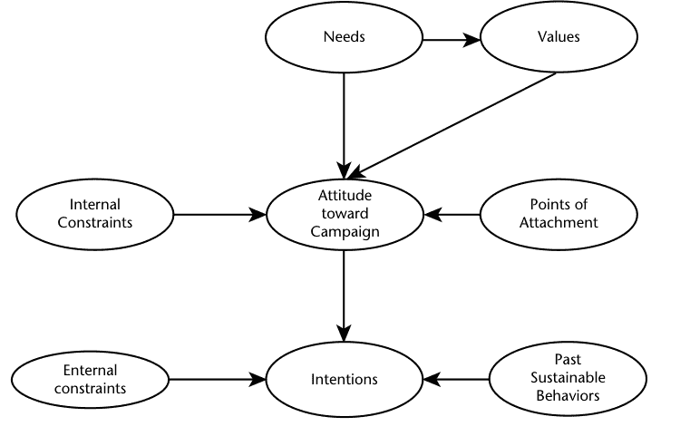

### 可持续发展目标 13：气候行动

Taylor & Francis
Taylor & Francis Group
http://taylorandfrancis.com

### 可持续发展目标 13 概述

Brian P. McCullough 和 Jessica R. Murfree

可持续发展目标 13 要求各国政府、组织和个人“采取紧急行动应对气候变化及其影响”（General Assembly, 2015, p. 13）。该目标设定了雄心勃勃但范围广泛的、到 2030 年实现的指标。最终，目标 13 旨在提高对气候相关灾害的依赖性和适应能力。各国政府、组织和个人可以通过在国家和组织政策中概述应对措施，以应对气候相关灾害的不利后果，从而实现该目标的指标。此外，教育项目可以概述并教授个人他们可以采取的措施以实现气候韧性并推进目标 13。这些教育项目还可以让几代学生了解气候行动的重要性以及不作为的广泛后果。

为此，过去十年（2010–2019）是有记录以来地球历史上最温暖的十年——全球变暖的效应。全球变暖是指“自工业化前时期（1850 年至 1900 年）以来观察到的地球气候系统的长期变暖”（NASA, 2020, para. 3）。大气中温室气体排放（例如甲烷、NO₂、二氧化碳）的增加导致全球变暖，而全球变暖的增加导致气候变化。全球变暖由人类和自然活动引起，是指温室气体被捕获并再辐射，从而加热地球近地表，形成所谓的温室效应。水、臭氧和增加的二氧化碳不断吸收温室气体，导致地球上热量集中。温室气体的主要生产者是人类活动消耗化石燃料，这进而增加了地球地表温度（即陆地和海平面温度）。

气候变化常与全球变暖互换使用，是指“定义地球局部、区域和全球气候的平均天气模式的长期变化”（NASA, 2020, para. 5）。气候模式的变化是由于全球生态系统的破坏，并在一段时间内对特定地区进行观察。这些模式表现为海洋酸化、冰川融化、海平面上升和极端天气事件的增加。平均地表温度的升高加上气候变化的不利影响，加剧了地球大气稳定气候条件的能力。

举例来说，浴缸里有一艘带长桅杆的玩具船。桅杆会随着小波浪或波动来回摇晃，寻求平衡。随着浴缸中的波动加剧，桅杆会剧烈摇晃，寻求稳定。波动过大，船就会倾覆，屈服于湍流。我们的全球气候正面临同样的波动，因为它无法自行调节。如果水，即浴缸中波动的根本来源，以比排水速度更快的速度填满浴缸，船就会经历越来越剧烈的摇晃，几乎没有机会恢复。因此，只要船继续摇晃，我们就会遭受更严重的天气模式（例如降雨、飓风、洪水、干旱、极端高温）。为了实现可管理的平衡，联合国政府间气候变化专门委员会（IPCC）和其他国际管理机构和各国政府都支持将地球平均地表温度限制在工业化前时代之前提到的 1.5°C 以内的努力。

《巴黎气候协定》与之前的国际气候协定（例如《东京议定书》）一样，寻求全球承诺，通过气候行动防止全球平均气温上升 1.5°C。气候行动描述了导致温室气体排放减少并在全球变暖和气候变化即将到来的后果面前提高气候韧性能力的行为。目标 13 概述了应对和采取紧急气候行动的期望目标和行动。为了继续浴缸的比喻，对气候行动的承诺将是对以至少与流入速度一样快的速度排出浴缸中的水，同时寻找减缓水流入速度的解决方案的承诺，以免浴缸溢出。

### 38.1 指标

与其它可持续发展目标一样，目标 13 的指标和指标主要集中在国家层面。然而，这些指标比其他目标更为简洁，因为它们的数量更少，只有三个，而其他可持续发展目标的中位数为 7 个。这些指标明确侧重于提高国家、组织等对气候风险、危险和自然灾害的韧性和适应能力。由可持续发展目标 13 定义的目标（General Assembly, 2015）见表 38.1。

同样，可持续发展目标 13 的指标也侧重于国家层面数据，包括自然灾害影响的死亡人数、失踪人员和流离失所者人数。其他指标侧重于在组织之间整合政策，以提高应对和适应气候变化及其相关或相应风险的能力。例如，欧洲地区的世界卫生组织（WHO）已承诺通过实施具体战略来保护人类健康，从而支持可持续发展目标 13。这些

#### 表 38.1 可持续发展目标 13 的目标

| 目标 | 描述 |
|---|---|
| 13.1 | 加强所有国家应对气候相关危险和自然灾害的韧性和适应能力 |
| 13.2 | 将气候变化措施纳入国家政策、战略和规划 |
| 13.3 | 提高气候变化减缓、适应、影响减少和预警方面的教育、宣传以及人力和机构能力 |
| 13.a | 实施发达国家缔约方根据《联合国气候变化框架公约》作出的承诺，即到 2020 年从所有来源共同筹集每年 1000 亿美元，以满足发展中国家的需求，同时采取有意义的减缓行动并确保透明度，并尽快通过注资使其完全运作 |
| 13.b | 促进提高最不发达国家和小岛屿发展中国家有效应对气候变化规划和管理能力机制，重点关注妇女、青年以及当地和边缘化社区 |

资料来源：General Assembly (2015)。

努力包括评估气候变化对公共健康的风险、监测与气候相关的疾病，以及将气候变化的适应和减缓纳入健康教育（世界卫生组织，2019年）。这些教育组成部分旨在将这些政策及其履行所需的程序整合到课程中，并利用教育赋予个人的力量，使其能够增强应对气候变化风险的能力。目标13则明确侧重于采取“紧急行动应对气候变化及其影响”（联合国大会，2015年，第13页）。因此，首先必须审视体育因不作为而受到的威胁，然后再讨论体育如何采取行动。

### 38.2 与体育的联系

体育与自然环境密不可分。没有自然环境，我们就无法进行身体活动、参与体育、享受休闲或观看他人表演。即使在自然环境失衡且受到威胁的情况下，也会产生影响体育的有害后果。考虑到可持续发展目标13，了解体育将如何受到气候变化的影响至关重要。

政府间气候变化专门委员会（IPCC，2016年）指出气候变化的严重性及其对日常生活的影响。更关键的是，气候变化将影响人们生命的基本要素——清洁水、粮食获取、安全和住所等。气候变化将使这些宝贵的资源变得更加稀缺，导致饥荒和战争，进一步加剧生命最初的后果和影响。尽管存在这些挑战，如果更多的人被这些生存威胁所困扰，他们就没有时间享受体育。更不用说，如果自然环境不利于生存，那么对体育、身体活动和休闲来说就更不适宜了。

#### 38.2.1 气候脆弱性

与此同时，随着气候变化的影响不断累积，我们参与体育、身体活动和休闲的方式也在发生变化。因此，体育部门员工的生计受到了影响。体育部门受气候变化影响的方式可以描述为气候脆弱性，即气候变化对机构或个人潜在影响的功能（Tuner et al., 2003）。气候脆弱性由暴露度和敏感性组成。暴露度是指遭遇气候事件（如飓风、洪水、非季节性极端高温、野火）的可能性。沿海运动容易受到飓风、洪水和其他极端天气事件的影响。气候变化的后果影响了这些团队因海平面上升（如迈阿密热火队）、气温升高（如德克萨斯游骑兵队）或飓风强度增加（如新奥尔良超级穹顶；Kellison & Orr, 2020；Murfree & Moorman, 2021）而存在的可能性。

因此，这些脆弱性也使体育组织在经济上更加脆弱。这种暴露在气候脆弱性的范围内被称为敏感性。敏感性是指“受气候变化影响的观测单元的内部或外部物理、社会和经济特征”（Orr & Inoue, 2018, p. 454）。例如，一些运动可能比其他运动更敏感。如 Orr 和 Inoue（2018）所述，冬季运动容易受到影响，因为冬季运动的冬季季节减少（如滑雪、单板滑雪、冰上滑冰）。参与和参与这些运动的机会本就地理上有限，随着经历长时间冰冻温度和积雪的地区减少，这种限制变得更加严重。因此，这些运动被迫适应以求生存。这些运动最常见的做法是寻求人工环境（如室内）以永久获取运动（Orr et al., 2020）。

相反，户外运动表现出气候敏感性。极端天气事件导致比赛取消。这些事件的范围从印度洪水和板球比赛取消、野火导致空气质量低下和美国职业棒球大联盟比赛取消，以及飓风和美国墨西哥湾沿岸球队赛事取消不等。为此，赛事取消和对极端天气事件的准备不足可能代价高昂。Murfree 和 Moorman（2021）发现，位于气候最脆弱地区（即飓风暴露程度高的地区）的大学体育部门并未在合同中保护其组织免受可能因极端天气事件导致延期或取消而造成的经济损失。

气候脆弱性和后果导致参与或观众角色的体育参与机会减少。缺乏适应、整个体育部门或个别组织的弱依赖威胁到人类继续我们通常的生活方式的能力，具体涉及体育、身体活动和休闲。然而，了解整个体育部门的气候脆弱性、个别运动和体育组织是解决体育中和通过体育采取气候行动的一个方面。相反，考虑体育组织的对环境影响以减少其对气候变化和全球变暖的贡献也至关重要（McCullough et al., 2020）。

#### 38.2.2 体育组织的对环境影响

体育部门并未被正式承认为官方商业行业。因此，很难界定体育部门及其对环境的影响。体育部门依赖于分散的商业部门（如交通、食品和饮料、电视；Cooper & McCullough, 2021）。体育部门的分散化为体育组织逃避其对环境影响的直接批评提供了机会。因此，体育组织在衡量和补救其碳排放方面反应缓慢。然而，学者们对各种体育组织和赛事进行了研究以评估其对环境的影响（Collins et al., 2009）。最值得注意的是，包括 Collins（Collins et al., 2007; 2012）和 Dolf（Dolf & Teehan, 2015）在内的研究团队对体育赛事和组织的对环境影响的理解做出了重大贡献。同样，其他人也研究了交通的生态影响（Cooper, 2020; Cooper & Alderman, 2020; Cooper & McCullough, 2021）。

具体而言，McCullough et al.（2020）补充了该领域研究人员先前开展的工作，但指出这些研究的范围有限。例如，研究人员采用不同的方法来检查体育组织和赛事的对环境影响，无论是通过方法论（如碳足迹与生命周期分析）还是背景（即消费与生产）。McCullough 等人得出结论，虽然有价值，但这些观点限制了研究结果并最小化了体育组织的对环境影响。

McCullough et al.（2020）建议，对环境影响应检查体育赛事的生产和消费，以应对这些有限的范围。此外，先前的研究主要检查了直接的生态效应，而对外部性环境影响则较少。即，通过查看其影响的所有范围，特别是直接和外部性影响，研究人员和从业人员可以更全面地了解体育赛事的对环境影响。这些范围包括体育组织对其具有最直接控制权的赛事的生产和消费。这些影响包括在场馆或特定空间举办赛事的对环境影响。体育赛事生产和消费的直接影响示例包括场馆能源使用、员工和团队出行、观众赛前和赛后活动的碳足迹，以及

往返场馆的本地交通使用。同样，学术界和从业人员经常被忽视的体育赛事对环境影响的外部性是辅助设施（即训练设施、团队办公室）的生态影响、赞助商、客队和球迷的住宿影响，以及消费者访问特定地区相关的其他旅游活动的影响。其他示例见表 38.2。

评估体育组织和赛事的对环境影响可以使体育从业者制定战略计划以减轻这些影响。虽然这种方法可能不是体育部门的制度化做法，但越来越多的体育组织正在响应迫切的气候行动需求。体育部门需要更有雄心的领导来解决其对环境影响，从而解决体育部门造成的危害（Sartore-Baldwin & McCullough, 2018; Sartore-Baldwin et al., 2017）。为

#### 表 38.2 体育中的直接和外部性对环境影响

| 项目 | 范围 | 细节 |
|---|---|---|
| 直接 | 生产 | • 场馆能源使用（搭建期间、赛事期间和拆除期间）   • 场馆用水（搭建期间、赛事期间和拆除期间）   • 场馆废物排放（搭建期间、赛事期间和拆除期间）   • 员工和团队出行   • 员工和团队住宿   • 办公室能源使用   • 办公室用水   • 办公室废物排放 |
| 直接 | 消费 | • 往返场馆的本地交通   • 现场购买（商品和食品/饮料）   • 消费者的场馆能源使用   • 消费者的场馆用水   • 消费者的场馆废物排放   • 尾随活动的碳足迹   • 尾随活动的废物排放 |
| 外部性 | 生产 | • 辅助设施（例如训练设施、媒体中心、节日和尾随区域）能源使用   • 辅助设施（例如训练设施、媒体中心、节日和尾随区域）用水   • 辅助设施（例如训练设施、媒体中心、节日和尾随区域）废物排放   • 赞助商、媒体、供应商的能源使用   • 赞助商、媒体、供应商的用水   • 赞助商、媒体、供应商的废物   • 赞助商、媒体、供应商的交通排放   • 赞助商、媒体、供应商的住宿足迹   • 赞助商、媒体、供应商的餐厅餐食 |
| 外部性 | 消费 | • 消费者的外地出行   • 消费者的住宿足迹   • 消费者与旅游活动相关的排放（例如观光）   • 消费者餐厅餐食/饮料的碳足迹   • 消费者餐厅餐食/饮料的废物 |

### 38.2.3 联合国体育应对气候行动框架

在第二十三届缔约方大会（COP23）期间，联合国气候秘书处推出了体育应对气候行动框架（United Nations, 2021）。该框架旨在确保体育组织将其环境工作与《巴黎气候协定》保持一致，以防止全球平均气温上升1.5 °C。然而，该框架旨在利用体育部门的社会平台，接触新的市场细分群体，并促使他们采取更可持续的行为。因此，其目标是让体育部门参与实现目标13的指标。该框架使用五项原则来实现这些主要目标（见表38.3）。

该框架旨在确保体育组织通过其制定的政策和环境绩效实现环境责任。这种方法的目的是在鼓励企业合作伙伴、供应商和球迷效仿组织的环境责任行为时，确保组织沟通的真实性。一旦组织确定了其环境影响，组织就可以建立内部战略以减少其整体影响（原则1）。该战略结果应导致碳排放或其等效物因环境绩效提升而减少。

这种方法可能需要时间和与利益相关者群体的合作。与企业赞助商、地方政府、环保组织等战略合作伙伴的合作将提高外部利益相关者（例如球迷和社区成员）的感知合法性；Inoue & Kent, 2012；McCullough & Trendafilova, 2018；McCullough et al., 2016）。通过认证、公开承诺、背书和直接合作，体育组织提升了其声誉。然而，这类努力应谨慎进行，以避免被指责为漂绿（Miller, 2017）。这可以通过透明度和报告来抵消。然而，一些体育组织，特别是北美地区的组织，并未参与可持续性报告，而欧洲的其他组织更有可能发布此类报告（McCullough et al., 2020；Pelcher et al., 2021）。一旦体育组织成为合法平台，它就可以更恰当地教育利益相关者，让他们了解如何参与气候行动（原则3）。

在此过程中，体育从业者正在学习并传播创新，以最好地实现其组织目标，同时努力履行其对框架的承诺，使其更具环境责任感。这种创新的传播可以在下一节讨论的波浪中进行表征，以评估和分类体育组织在其环境工作方面的进展（或倒退）阶段（McCullough et al., 2016）。然而，通过这一创新过程，体育组织和从业者可以分享最佳实践，并了解如何最好地解决环境可持续性问题。这使组织能够促进可持续和负责任的行为（见第35章和第36章）。

表38.3 联合国体育应对气候行动框架的原则

| 原则1 | 采取系统性努力促进更大的环境责任 |
| 原则2 | 减少整体气候影响 |
| 原则3 | 教育以应对气候行动 |
| 原则4 | 促进可持续和负责任的消费 |
| 原则5 | 通过沟通倡导气候行动 |

来源：United Nations (2021)。

最后，体育组织可以通过沟通活动让外部利益相关者和社区倡导气候行动。这种策略非常有助于利用体育的平台和影响力，通过体育迷与体育的一般联系、他们的球队、教练、喜爱的球员甚至城市的依附点（McCullough & Kellison, 2016；McCullough & Trail, 2021；Trail & McCullough, 2018, 2020, 2021）。例如，Casper 和同事（Casper et al., 2020；Casper et al., 2014, 2017）发现，当体育组织推广其环境可持续性举措时，球迷对体育组织的承诺度更高，并且在比赛现场和家庭中的可持续行为频率增加。此外，Trail 和 McCullough（2018, 2020）发现，此类活动可以利用不同的沟通媒介，并导致有针对性的细分群体在其所在社区倡导可持续变革。

迄今为止，《体育应对气候行动框架》是促进全球体育部门采取气候行动的最佳规范化努力。截至本章撰写时，已有超过190个体育组织宣布承诺遵守该框架的原则，成为签署方。有关《体育应对气候行动框架》的更多信息，包括当前签署方，可在其网站上找到（United Nations, 2021）

### 38.3 理论基础

体育学院的研究人员以各种方式研究了体育对环境的影响和自然环境（McCullough et al., 2020）。McCullough 和同事将体育生态学研究概念化为研究体育与自然环境之间双向关系的研究。在体育生态学文献中，多个概念和理论框架有助于理解体育部门如何应对目标13。这些视角根据体育与自然环境之间关系的方向性而有所不同。例如，随着体育生态学研究在更广泛的体育管理学科中出现，最初的研究重点是体育组织通过其运营和参与活动变得更环保。其他人则研究了其组织和赛事的环境影响，寻求通过减少其生态影响或温室气体排放从而导致气候变化来改善环境绩效。最近，研究人员重点关注体育组织如何应对（或应该应对）自然环境的变化，以保护其财务可行性。在以下各节中，我们概述了这些理论基础如何帮助体育从业者、研究人员和倡导者推进目标13并通过体育实现目标13。

如前所述，全球体育部门对环境或气候行动的承诺程度参差不齐（McCullough et al., 2016）。研究人员研究了从业者为何不参与环境可持续性（Casper et al., 2012）以及体育从业者参与此类举措的概念和实证证据（Babiak & Trendafilova, 2011；McCullough & Cunningham, 2010）。体育从业者必须克服内部和外部障碍，无论是真实的还是想象的，才能参与这些工作。例如，Casper 等人（2012）指出，体育从业者不参与环境可持续性举措是因为 perceived 成本和投资回报的不确定性。此外，体育组织担心他们可能会因过于关注环境可持续性而受到批评，而忽视了“在场上获胜”。相反，从业者担心做得太少而因不作为而受到其他利益相关者的批评。因此，作为这一问题的结果，体育从业者往往无所作为。

然而，为了鼓励体育部门的参与和积极参与，McCullough 和 Cunningham（2010）建议对这些组织施加制度压力（即政治、功能、社会），以放弃其对自然环境和环境影响漠不关心的商业行为。所有三种压力已被证明有助于吸引体育组织。例如，Babiak 和 Trendafilova（2011）发现，体育从业者参与此类活动是为了降低成本（即间接费用）和增加收入来源。此外，实际例子表明，在要求堆肥、可持续城市设计和可持续交通的更严格环境法规的地区，球队的环境绩效有所提高。

最艰巨的挑战是对体育组织施加社会压力以参与环境举措，如气候行动。尽管如此，Sport Positive 找到了在英格兰足球超级联赛中使用此类压力的方法，以鼓励 EPL 俱乐部进行更强有力和优先的气候行动。该示例在第40章中进一步探讨。Sport Positive 努力最值得注意的是，俱乐部因其环境举措而获得的积极宣传激励了落后的俱乐部参与并更快地推进其可持续性实践，以提高其在其他俱乐部中的排名。该策略已扩展到其他地区，包括德国、意大利和美国。Sport Positive 采取的类似努力以及在其他地方复制的努力需要得到发展，以进一步对体育组织施加适当的压力，使其采取行动、解决其环境影响并成为气候行动的倡导者——符合目标13和联合国的《体育应对气候行动框架》。

#### 38.3.2 体育组织的气候脆弱性

随着体育组织朝着更健全的环境可持续性举措迈进，它们最好审视自己对气候变化的脆弱性。这种评估可以帮助组织了解由于气候变化，他们可能需要如何适应才能向客户提供产品或服务。例如，滑雪场必须通过生产人造雪或寻找替代收入来源（例如淡季的山地自行车道）来适应更短的滑雪季节。同样，暖天气运动应考虑极端高温如何影响参与者或观众对体育的消费。秋季运动在夏季进行季前训练时，可能会考虑空气质量和热指数标准，以保护球员的健康，如果其地区面临野火或极端高温的风险。

然而，在从业者能够解决其风险之前，他们应该对这些风险进行评估。为此，Orr 和 Inoue（2018）提出了体育组织的气候脆弱性（CVSO）框架，这是首次对自然环境对体育的方向性影响进行的有力检验。他们提出的框架与目标13.1保持一致，“加强所有国家应对相关危险和自然灾害的复原力和适应能力”（General Assembly, 2015, p. 13）。Orr 和 Inoue 开发 CVSO 的目的是专门研究体育组织和赛事可能因气候变化而遇到的气候脆弱性。作者利用诸如脆弱性、暴露、敏感性以及体育组织应对气候变化的适应能力（即能力和依赖性）等研究构建。

CVSO 可用于通过气候对组织的影响（CIO）评估气候脆弱性，即“在不考虑适应的情况下，鉴于预计气候变化可能发生的”影响（Collins et al., 2013）。或者，他们通过定义组织气候能力（OCC）来标记与 COI 的区别，即“系统调整以适应气候变化、减轻潜在损害、利用机遇或应对

图 38.1 体育可持续性活动评估模型

with the consequences" (Collins et al., 2013)。CIO 和 OCC 通过四象限图进行对比分析，以确定一个组织对气候变化的脆弱程度及其应对准备水平。研究人员将四种不同状态归类为强化型（高 CIO–高 OCC）、冗余型（低 CIO–高 OCC）、响应型（低 CIO–低 OCC）和问题型（高 CIO–低 OCC）。这些四象限类型学是体育从业者、研究人员和政府官员确定体育部门、联赛和个人球队如何履行目标 13 的一种先进方式。

#### 38.3.3 吸引体育迷

体育观众代表体育赛事环境影响的最大来源（Dolf & Teehan, 2015; McCullough et al., 2020）。体育组织可以实施各种“内部”环境举措，或由体育组织控制。然而，活动组织者仍需通过“外部”举措如可持续交通和废物管理来吸引体育观众（Trail & McCullough, 2020）。研究人员已研究体育从业者为吸引球迷参与可持续行为而创建的活动（Casper et al., 2020; McCullough & Trail, 2020; Trail & McCullough, 2020）。就改善体育赛事和家庭中的环境行为而言，其研究结果为积极。Casper 等人（2014, 2017）发现，如果球迷喜爱的体育队伍要求他们这样做，他们就会参与行为。他们发现，这些行为甚至会从比赛日环境延伸到日常生活。然而，Casper 和同事的工作在所考察的组织方面存在局限，仅限于活动后评估。

Trail 和 McCullough（2020）在 Casper 等人（2014, 2017, 2020）的初步研究结果基础上，探索了如何设计、实施、评估和修订此类活动，以提高组织与（环境和社会）可持续性活动相关的关键绩效指标。Trail 和 McCullough（2020）提出了可持续体育消费者评估模型（SSCEM；如图 38.1 所示）。SSCEM 利用各种社会行为模型和理论，根据组织的消费者细分来设计活动。具体而言，SSCEM 显示需求受价值观介导将预测对可持续性活动的态度。同样，内部约束——即个人认为的障碍——必须被识别并解决，以改善个人对活动的态度（McCullough & Trail, 2020）。具体而言，内部约束可能包括气候变化不真实的认知，或认为参与特定环境行为不会产生影响。了解体育组织球迷群体的需求、价值观和内部约束，将使体育组织能够创建利用这些方面（即需求、价值观）的活动，从而提高态度或对抗负面认知（即内部约束）。

体育从业者可以通过球迷群体与体育组织或品牌可能具有的各种依附点来推广这些活动。例如，细分群体可能对来自球队、个别球员、教练或来自城市或场馆的更通用信息的消息更具响应性。无论依附点如何，活动都可以利用这些各种接触点来提高对活动的态度，从而提高行为意向。

最终，行为意向取决于最小化外部约束（McCullough & Trail, 2020）和过去的可持续行为（Trail & McCullough, 2020）。也就是说，体育组织应尽力消除可能阻止个人参与环境行为的任何障碍，无论是实际的还是感知的。例如，体育组织不应在促进堆肥或公共交通之前解决堆肥或乘坐公共交通的主要障碍。体育组织应确保在场馆内外堆肥尽可能方便。这可能包括传递信息以解决内部约束（例如，推广集体行动的价值），同时利用他们的需求和价值观（例如，为子孙后代保护自然环境）。

SSCEM 模型不仅有助于创建鼓励可持续行为的活动，还可用于跟踪行为变化。SSCEM 与目标 13 相关的本质和重要性在于，该模型可用于提高人们对环境问题的认识（即迫切需要气候行动）、教育球迷群体（即如何参与气候行动），并评估参加体育赛事的球迷群体及其在日常生活中的集体行动。这种方法在社区层面解决了目标 13.2 和 13.3，并与联合国体育促进气候行动框架的原则 3、4 和 5 一致。如下面进一步讨论，除了教育球迷外，当前和未来的体育从业者还可以学习如何应对与体育部门相关的环境可持续性问题。

### 38.4.4 教育体育部门内外的新一代

通过变革性可持续学习（TSL；Sipos et al., 2008）来吸引和教育体育部门采取气候行动的另一种方式。TSL 利用教学方法，通过更易消化和相关的情境，从头脑、手和心三个方面让学生参与环境可持续性。气候变化或理解 IPCC 报告中的科学对于普通人群甚至有科学背景的人来说都可能令人望而生畏。TSL 在像体育这样的情境中教授学生气候变化（McCullough & Pelcher, 2021; Orr 2020）。正如 Orr 等人所建议的，体育是一个令人放松且相关的情境，用于向学生传达和教授气候变化及其对与学生相关的活动的影响。

TSL 通过体验式学习技术解决三个组成部分——参与（头脑）、实施（双手）和赋能（心灵）（Sipos et al., 2008）。这三个组成部分相互关联。这些组成部分旨在挑战先入为主的观念，并在互动的课堂活动和作业中关联复杂问题（例如，气候变化）。参与是通过让学生沉浸于课程的阅读、活动和讨论中来实现的（Orr et al., 2020）。

诸如场馆参观、组建绿色团队和参与生活实验室等练习使学生能够反思他们所学到的内容，以及这如何挑战之前的理解。也就是说，从最初（即场馆参观）到深度参与活动（即绿色团队、生活实验室）的这种批判性思维方面的进展可能会让学生参与到被称为“去学习”的过程中。

同样，实施利用学生新获得的知识和对特定过程的理解，与行业互动以产生积极变化。学生通过与参与环境可持续性举措的体育组织直接相关的真实案例研究或项目，用双手实践。最后，赋能完成了 TSL 的过程，并为学生提供信心，使他们能够在未来的职业生涯中参与类似活动。这最后一步旨在让学生的心灵参与到成为体育部门可持续变革倡导者的程度。他们随后成为变革的推动者，推动体育部门采取更强有力的气候行动以实现目标 13。

### 38.4 结论

全球气候行动对于遏制气候变化的原因是必要的。体育部门是全球应对气候变化集体行动中的重要组成部分。体育组织可以有效地向可能 otherwise 对气候变化后果不了解或未做好准备的新目标受众推广可持续行为（Casper et al., 2020; Inoue & Kent, 2012; Trail & McCullough, 2020）。与其他商业部门一样，体育部门向大气排放温室气体，但也受到全球气候变化的影响（McCullough et al., 2020）。全球范围内已形成集体努力，并由联合国、国际足联和国际奥委会领导，所有这些机构都鼓励体育组织解决其环境影响并让利益相关者选择更可持续的行为。《体育促进气候行动框架》是体育组织积极参与应对目标 13 的集体运动的一种方式。体育部门可以通过气候行动管理自身对气候变化的贡献，同时鼓励他人（例如供应商、赞助商、球迷）可持续行动。

与其他可持续发展目标一样，将目标 13 及其目标应用于体育部门具有挑战性，但并非无关。体育部门有可能在全球促进全球气候行动和教育广大人口提高气候抵御能力的必要性方面发挥作用。这些项目可以侧重于内部运营，在消费体育时鼓励行为改变，并通过社区外展项目进行。我们认为体育部门并不是实施全球气候行动的“包治百病”解决方案。相反，体育部门可以战略性地用于吸引可能否则不会考虑气候变化如何在没有立即行动的情况下影响他们生活的新的商业部门和消费者。

### 参考文献

Babiak, K., & Trendafilova, S. (2011). CSR and environmental responsibility: motives and pressures to adopt green management practices. Corporate Social Responsibility and Environmental Management, 18(1), 11–24. doi: https://doi.org/10.1002/csr.229.

Casper, J., McCullough, B. P., & Pfahl, M. E. (2020). Examining environmental fan engagement initiatives through values and norms with intercollegiate sport fans. Sport Management Review, 23(2), 348–360. doi: 10.1016/j.smr.2019.03.005

Casper, J., Pfahl, M., & McCullough, B. P. (2014). 大学生体育与环境：基于体育部门可持续发展努力的球迷参与研究. Journal of Issues in Intercollegiate Athletics, 7, 65–91.
Casper, J., Pfahl, M., & McCullough, B. P. (2017). 走绿色路线值得吗？评估球迷参与度及对体育部门环境努力的认知. Journal of Applied Sport Management, 9(1), 106–134. doi: 10.18666/JASM-2017-V9-I1-7690
Casper, J., Pfahl, M., & McSherry, M. (2012). 体育部门对环境的意识与行动：NCAA 体育部门可持续发展实践研究. Journal of Sport Management, 26(1), 11–29. 10.1123/jsm.26.1.11
Collins, A., Flynn, A., Munday, M., & Roberts, A. (2007). 评估大型体育赛事的环境后果：2003/04 足总杯决赛. Urban Studies, 44(3), 457–476. 10.1080/004209801098060131878
Collins, A., Jones, C., & Munday, M. (2009). 评估大型体育赛事的环境影响：两种选择？ Tourism Management, 30, 828–837. doi: https://doi.org/10.1016/j.tourman.2008.12.006.
Collins, A., Munday, M., & Roberts, A. (2012). 大型赛事旅游消费的环境后果：以 2007 年环法自行车赛英国赛段为例. Journal of Travel Research, 51(5), 577–590. doi: 10.1177/0047287511434113
Collins, M., Knutti, R., Arblaster, J., Dufresne, J. L., Fichefet, T., Friedlingstein, P., ... & Booth, B. B. (2013). 长期气候变化：预测、承诺、不可逆性. In Climate Change 2013-The physical science basis: Contribution of working group I to the fifth assessment report of the intergovernmental panel on climate change, 1029–1136, Cambridge University Press.
Cooper, J. A. (2020). 让橙色变绿？田纳西橄榄球比赛日旅游的碳足迹批判性分析. Journal of Sport & Tourism, 24(1), 31–51. doi: 10.1080/14775085.2020.1726802
Cooper, J. A., & Alderman, D. H. (2020). 取消疯狂三月赛为更可持续的体育旅游经济提供了机遇. Tourism Geographies, 22(3), 525–535. doi: 10.1080/14616688.2020.1759135
Cooper, J. A., & McCullough, B. P. (2021). 框定可持续性：碳足迹核算疯狂三月赛以重新思考可持续旅游方法与衡量 [待发表手稿]. Department of Health and Kinesiology, Texas A&M University.
Dolf, M., & Teehan, P. (2015). 减少不列颠哥伦比亚大学校队赛事观众及队伍旅行的碳足迹. Sport Management Review, 18(2), 244–255. https://doi.org/10.1007/s00192-012-1798-8
General Assembly. (2015). 改变我们的世界：可持续发展 2030 议程 (A/RES/70/1). United Nations. undocs.org/en/A/RES/70/1
Inoue, Y., & Kent, A. (2012). 体育团队作为促进环境保护行为的推动者：实证研究. Journal of Sport Management, 26(5), 417–432. doi: 10.1123/jsm.26.5.417
IPCC. (2016). 全球变暖 1.5°C. https://www.ipcc.ch/site/assets/uploads/sites/2/2018/07/SR15_SPM_version_stand_alone_LR.pdf
Kellison, T., & Orr, M. (2020). 气候脆弱性作为早期体育场馆更换的催化剂. International Journal of Sports Marketing and Sponsorship. Advance online publication. doi: 10.1108/IJSMS-04-2020-0076
McCullough, B. P., & Cunningham, G. B. (2010). 理解参与绿色倡议的动力及其预期组织成果的概念模型. Quest, 62(4), 348–363. 10.1080/00336297.2010.10483654
McCullough, B. P., & Kellison, T. B. (2016). 为主场球队变绿：体育中的地方感与环境可持续性. Journal of Sustainability Education, 11(February), 1–14.
McCullough, B. P., Orr, M., & Kellison, T. (2020). 体育生态学：体育管理中新兴子学科的概念化. Journal of Sport Management, 34(6), 509–520. doi: 10.1123/jsm.2019-0294
McCullough, B. P., Orr, M., Watanabe, N. M. (2020). 衡量外部性：体育可持续性评估的下一个必要步骤. Journal of Sport Management, 34(5), 393–402. doi: 10.1123/jsm.2019-0254
McCullough, B. P., Pelcher, J. A., & Trendafilova, S. (2020). 北美体育组织环境可持续性绩效信号传播的探索性分析. Sustainability, 12(5), 1950. doi: 10.3390/su12051950
McCullough, B. P., Pfahl, M., & Nguyen, S. (2016). 体育环境可持续性的绿色浪潮. Sport in Society, 19(7), 1040–1065. doi: 10.1080/17430437.2015.1096251
McCullough, B. P., & Pelcher, J. A. (2021). 教师-学生指导：变革性可持续学习优势及其对影响行业和课程完善的直接应用. Sustainability, 13(19), 10768. https://doi.org/10.3390/su131910768
McCullough, B. P., & Trail, G. T. (2021). 变革性营销：特殊奥林匹克运动员的健康与福祉. International Journal for Sports Marketing and Sponsorship, 22(3), 477–492. https://doi.org/10.1108/IJSMS-04-2020-0046
McCullough, B. P. & Trendafilova, S. (2018). 推动可持续发展的产学合作. Sport & Entertainment Review, 4(3), 64–69.
McCullough, B. P., Trendafilova, S., & Picariello, M. (2016). 通过战略合作伙伴关系使可持续发展努力合法化. Sport & Entertainment Review, 2(3), 77–83.
Miller, T. (2017). 体育漂绿. Taylor & Francis.
Murfree, J. R., & Moorman, A. M. (2021). 一级联赛橄榄球比赛合同的审查与分析：飓风导致比赛取消的法律影响. Journal of Legal Aspects of Sport, 31(1), 123–146.
NASA. (2020). 概览：天气、全球变暖与气候变化. https://climate.nasa.gov/resources/global-warming-vs-climate-change/
Orr, M., McCullough, B. P., & Pelcher, J. (2020). 利用体育作为变革性可持续学习的场所和载体. International Journal of Sustainability in Higher Education, 21(6), 1071–1086. doi: 10.1108/IJSHE-02-2020-0074
Orr, M., & Inoue, Y. (2018). 体育与气候：引入体育组织气候脆弱性框架. Sport Management Review, https://doi.org/10.1016/j.smr.2018.09.007
Orr, M., Ross, W. J., & Pelcher, J. (2020). 从自然到人工：探索体育从自然环境向人工环境演变的经营管理启示 [论文发表]. North American Society of Sport Management Conference, San Diego, CA, United States.
Pelcher, J. A., McCullough, B. P., & Trendafilova, S. A. (2021). STARS 报告中的高校体育环境可持续发展努力. International Journal of Sustainability in Higher Education, 22(2), 328–343. doi: 10.1108/IJSHE-07-2020-0246
Sartore-Baldwin, M. L., & McCullough, B. P. (2018). 基于公平的可持续性与生态中心管理：创造更具生态正义的体育组织实践. Sport Management Review, 21(4), 391–402. doi: 10.1016/j.smr.2017.08.009
Sartore-Baldwin, M. L., McCullough, B. P. & Quatman-Yates, C. (2017). 共同责任及体育中的不公正与伤害问题. Quest, 69(3), 366–383. 10.1080/00336297.2016.1238769
Sipos, Y., Battisti, B., & Grimm, K. (2008). 实现变革性可持续学习：调动头脑、手与心. International Journal of Sustainability in Higher Education, 9(1), 68–86. 10.1108/14676370 810842193
Trail, G. T., & McCullough, B. P. (2018). 内部与外部约束对可持续意愿的差异化影响：以跑步赛事参与者市场细分的分层回归分析. Journal of Management for Global Sustainability, 6(2), 1–36. 10.13185/JM2018.06206
Trail, G. T., & McCullough, B. P. (2020). 通过体育营销可持续性：检验体育参与者可持续行为模型. European Sport Management Quarterly, 20(2), 109–129. 10.1080/16184742.2019.1580301
Trail, G. T., & McCullough, B. P. (2021). 可持续性态度、意愿和行为的纵向研究. Sustainability Science, 16(5), 1503–1518. https://doi.org/10.1007/s11625-021-00954-7
Turner, B. L., Kasperson, R. E., Matson, P. A., McCarthy, J. J., Corell, R. W., Christensen, L., Eckley, Noelle, Kasperson, Jeanne X., Luers, A., Martello, M. L., Polsky, C., Pulsipher, A., & Schiller, A. (2003). 可持续科学中脆弱性分析的框架. Proceedings of the National Academy of Sciences, 100(14), 8074–8079. doi: 10.1073/pnas.1231335100.
United Nations. (2021). 体育促进气候行动框架. https://unfccc.int/climate-action/sectoral-engagement/sports-for-climate-action
World Health Organization Regional Office for Europe (2019). 健康与气候行动政策简报. https://www.euro.who.int/__data/assets/pdf_file/0009/397791/SDG-13-policy-brief.pdf

### 衡量可持续发展目标 13

Pamela Wicker 和 Tim F. Thormann

联合国大会在 2015 年提出将气候变化措施纳入国家政策以及立即实施绿色气候基金是可持续发展所提出的两个主要措施（General Assembly, 2015）。尽管关于可持续发展目标进展的报告承认气候变化发生的速度远快于联合国大会在 2015 年的预期，但在财务方面仍可观察到一些积极进展的指标。在 2015–2016 年期间，与 2013–2014 年期间相比，全球气候资金流动增长了 17%。除此之外，28 个国家获得了绿色气候基金为国家适应计划以及进一步适应规划进程提供的融资准入，所获财政支持的价值为 7500 万美元。这一数字未来将持续上升，有 75 个国家正在寻求该基金的支持，合计价值达 1.91 亿美元（UN, 2019）。

另一个进展指标代表了获得财政支持的国家类型。具体而言，7500 万美元中的 67% 被授予最不发达国家、小岛屿发展中国家和非洲国家，这些国家正是最初可持续发展目标特别针对的对象（UN, 2019）。当前与气候相关和地缘物理灾害的数量，例如 2010 年海地地震造成 31.6 万人死亡，表明用于减少气候变化的资金是值得投入的，因为 1998–2017 年期间以往灾害造成的经济损失累计近 3 万亿美元。更重要的是，130 万人死于地理灾害，因此仍需取得进展以加强对气候相关危害和自然灾害的抵御能力和适应能力（UN, 2019）。

尽管存在一些积极的进展指标，但总体报告对实现可持续发展目标 13 提出了质疑（UN, 2019），尤其是在推动气候变化的温室气体排放的背景下。尽管 2015 年《巴黎协定》有共同目标将全球平均气温升幅控制在工业化前水平以上 2°C 以内，但温室气体浓度在 2017 年达到新高（Scott et al., 2016; UN, 2019）。这种负面进展尤其令人担忧，因为政府间气候变化专门委员会（IPCC）解释说，如果未能减少温室气体排放，将导致气候变化的所有组成部分发生变化（IPCC, 2018）。因此，气候变化发生的速度比预期更快，这导致联合国得出结论，需要更有雄心的计划和行动来进行减缓和适应。总体而言，关于可持续发展目标进展的报告传达了实现该目标的微小且主要为财务方面的进展。随着时间的推移以及减少全球温室气体排放的积极成果只是零星的，实现可持续发展目标 13 正面临危险。

### 39.1 体育中的衡量

自 1990 年代以来，体育组织和赛事一直面临关于环境可持续性的问题（Cantelon & Letters, 2000）。尤其是国际奥委会不得不应对有关奥运会环境影响的批评，主要与冬季奥运会有关，冬季奥运会通常需要赛场设施在赛事结束后无法得到妥善利用（Cantelon & Letters, 2000）。然而，体育组织对气候可持续性的讨论在很大程度上与联合国可持续发展目标无关，因为体育组织大多制定自己的可持续发展目标（例如，FIFA, 2020; IOC, 2014）。例如，仔细审视国际奥委会和国际足联的可持续发展目标会发现它们并不十分具体。2022 年卡塔尔国际足联男子世界杯的可持续发展战略涵盖了五个环境可持续性领域：建筑、温室气体、空气污染、废物产生和水生产（FIFA, 2020）。尽管该战略包括环境可持续性的重要领域，但诸如尽量减少当地空气污染或尽量减少送往垃圾填埋场的废物等目标缺乏定量规范，因此难以衡量。2014 年，国际奥委会推出了包含 40 项建议的《2020 议程》，这些建议起初并未转化为政策（Boykoff & Mascarenhas, 2016）。即使这些建议具有约束力，环境可持续性目标也不具体，无法概括为“变绿”（MacAloon, 2016）。

尽管如此，过去奥运会的一些积极可持续性范例仍可提出。例如，2008 年北京奥运会花费超过 170 亿美元来解决环境问题（McCullough et al., 2016）。温哥华组委会（VANOC）在赛事前和赛事阶段监测环境影响，并将碳排放分为不同类别，其中与旅行相关的排放占最大比例（Dolf & Teehan, 2015）。此外，国际足联和国际奥委会强调在未来奥运会和世界杯的申办过程中可持续措施的重要性（McCullough et al., 2016）。一个这样的例子是使用现有场馆，减少新建设施的碳排放。

其他例子还包括北美体育联盟如 NBA 和 NHL 实施的所谓绿色周。在这些周期间，联盟利用与战略合作伙伴或利益相关者的关系，在活动地点提供以环境为主题的活动（Casper et al., 2017; 2020）。此外，绿色体育联盟于 2010 年成立，旨在为体育团队、场馆和赛事提供减少其环境影响的建议。此后，在主要体育团队和大学中开展了诸如场馆获得 LEED 认证、减少废物、促进回收以及安装可再生能源系统等有利于环境的措施（Blankenbuehler & Kunz, 2014）。

体育组织和场馆的这些有利于环境的措施表明，体育部门总体上愿意变得更具环境可持续性。然而，它们也显示出需要由整个体育行业制定的具体目标，以便每个体育组织都能衡量其实现目标的进展，并对其未能实现共同目标承担责任。迈向此类共同目标的第一步是由联合国体育促进气候行动框架取得的，该框架迄今已有超过 185 个签署方。该倡议承诺遵守五项原则并将其纳入战略、程序和政策。第二项原则包括定量衡量温室气体排放，以评估体育组织整体的气候影响（UNFCCC, 2020）。因此，体育研究当前的现状处于衡量阶段，以识别不同的环境影响及其规模，并在此过程中估算代表目标设定和衡量目标实现参考点的现状。

关于衡量，已有三种方法被频繁应用于估算体育的环境影响：环境投入产出分析（ENVIO）、生态足迹分析和侧重于温室气体核算的碳足迹分析（例如 Dolf & Teehan, 2015; Wicker, 2019）。

ENVIO 源于对因额外或损失的经济活动而产生的间接经济或环境后果的评估。它基于列昂惕夫逆矩阵，该矩阵衡量经济与经济之间的相互作用。它研究一个产品的需求或生产如何影响经济体内其他产品的需求（Leontief, 1970）。该矩阵被修改以根据经济结构衡量环境影响并显示经济与环境之间的相互作用，本质上衡量了商品的生产或经济活动的出现与环境外部性之间的联系。

多项研究应用 ENVIO 来估算体育赛事的环境外部性（Collins et al., 2007; Jones, 2008）。在 2004 年威尔士世界拉力锦标赛中（Jones, 2008），超过三分之一的总二氧化碳当量（CO₂-e）排放与组织者和车队支出产生的直接和间接影响有关。由于二氧化碳占所有人为温室气体排放的四分之三以上，其他气体的升温潜势（例如甲烷、氧化亚氮和各种氟化物）被转换为二氧化碳当量排放（CO₂-e）。此外，近三分之二的废物产生可归因于它们。每通过赛事创造 100 万英镑的额外价值，就会产生 930 吨碳排放，表明该赛事在每英镑增值碳排放方面表现较差，与其他部门相比（Jones, 2008）。然而，由于每个部门都有独特特征，跨部门比较是困难的。在 2003–04 年足总杯决赛中，游客支出的经济影响被转换为碳排放：220 万英镑的游客支出转化为 560 吨碳排放（Collins et al., 2007）。在 2007 年法国大环赛的英国赛段中，1.475 亿英镑的经济影响与 17 万吨碳排放相关（Collins et al., 2012）。

第二种方法是生态足迹分析。生态足迹的概念由 Wackernagel 和 Rees（1996）首次提出，定义为“维持特定人类人口所需的生物生产性土地和海洋面积”（Pandey et al., 2011, p. 137）。本质上，它进行需求与供给的比较，或者说人类需求多少土地与地球能提供多少土地相比（Pandey et al., 2011）。生态足迹的衡量单位是一个面积，例如人均全球公顷（gha/capita）。地球在 2016 年的可用生物承载力为 1.63 gha/capita，这是每年每个人类可使用的容量，以便达到生物平衡（Wackernagel & Beyers, 2019）。而 ENVIO 因行业依赖而仅限于国家层面，生态足迹分析允许衡量全球环境影响。

为提供体育中的一些例子，2004 年足总杯决赛的生态足迹估计为 0.0417 gha/访客。与相同持续时间在其居住地平均生态足迹相比，赛事的影响大七倍。几乎所有额外的生态足迹均可归因于游客的交通以及食物和饮料（Collins et al., 2007）。对于 2007 年法国大环赛的英国赛段，生态足迹被分为旅行、食物和饮料以及能源消耗等类别。游客旅行产生了赛事总生态足迹的最高部分，为 0.0153 gha/访客，比其在为期三天的赛事期间在家中的旅行足迹高 2.6 倍。食物和饮料的消费也比

访客在家的消费（Collins et al., 2012）。值得注意的是，英国的人均平均生态足迹在2001年达到5.35 gha/人，已是同期地球生物承载力1.8 gha/人的三倍以上（Collins et al., 2007）。

最近，体育研究者的关注点已转向第三种方法，即碳足迹分析。根据 Wiedmann 和 Minx（2008）的说法，“碳足迹是衡量某项活动直接和间接造成的二氧化碳排放总量，或产品在生命周期各阶段累积的排放量”（第4页）。碳足迹以克/千克/吨 CO₂-e 为单位报告，并反映了这些气体造成的全球变暖（Pandey et al., 2011）。

进行碳足迹分析需要界定组织、时间和运营边界（Franchetti & Apul, 2013）。时间边界是指测量碳足迹的时间段，而组织边界则与进行碳足迹分析的主体相关（例如，活动、组织、个人、产品）。关于运营边界，区分了三种不同的排放范围（Franchetti & Apul, 2013；Pandey et al., 2011）。范围1排放是直接排放，由现场燃料消耗产生。在体育领域，这包括例如用于前往和在体育比赛或活动期间旅行的交通工具。范围2排放是间接排放，由购买电力、蒸汽、供暖和制冷产生。体育相关的例子包括网球场的浇水、场馆的供暖，或最近在卡塔尔2019年世界田径锦标赛期间对整个体育场的降温。范围3排放涵盖产品生命周期中通过生产、工人、材料、分销和废物管理产生的全部排放（Franchetti & Apul, 2013；Pandey et al., 2011）。在体育领域，例如，生产、购买和处置网球拍或自行车等设备会产生范围3排放，因为需要提供自然资源，而产品的生产、运输、分销和处置都会造成排放。

一些研究使用不同的边界调查了体育中的碳足迹。作为时间边界，使用了活动或比赛日包括往返活动的旅行（Collins et al., 2007, 2012；Jones, 2008；Scrucca et al., 2016；Triantafyllidis et al., 2018）、一年期（Wicker, 2018, 2019），以及长达一到两个赛季的时间（Chard & Mallen, 2012；Dolf & Teehan, 2015）。组织边界包括各自的活动（例如，Cooper & McCullough, 2021；Scrucca et al., 2016, Triantafyllidis et al., 2018）、特定队伍或体育部门（Chard & Mallen, 2012；Dolf & Teehan, 2015）、活跃的冬季运动游客（Wicker, 2018），或不同运动的活跃运动参与者（Wicker, 2019）。

运营边界的数据通常通过调查获得，受访者提供其旅行行为信息，具体包括行驶距离和交通方式。这些信息可以通过不同方式转换为 CO₂-e。一些学者利用这些信息借助排放因子来计算碳足迹估算，排放因子表示一个人乘坐特定交通工具行驶一公里或一英里时的排放水平（例如 Scrucca et al., 2016；Triantafyllidis et al., 2018；Wicker, 2019）。这些排放因子具有区域特异性，且通常仅限于直接排放。一个值得注意的例外是 Dolf 和 Teehan（2015），他们能够使用基于生命周期评估（LCA）的整个产品生命周期的排放因子；这种方法对碳足迹提供了更全面的图景，因为所有排放范围都被涵盖。除了一般的排放因子外，还使用了更详细的碳计算器，可根据车辆的品牌、型号和年份提供特定车辆的排放水平（Chard & Mallen, 2012）。这一概述表明，碳足迹估算取决于学者设定的不同边界设置以及将不同出行方式的人均距离转换为 CO₂-e 的排放因子可用性。

由于现有研究通常仅关注环境影响的某些维度，McCullough 等人（2020）提出了体育赛事直接和外部环境影响（DeEI）框架，这是一个用于更全面评估体育赛事环境影响的概念框架。他们建议对整个赛事期间应用生命周期评估，而不是专注于单日测量。这可以通过纳入消费（例如观众和参与者）和生产方面（例如赛事组织）并同时考虑直接影响和外部性来实现。在第一步中，对所有直接影响进行生命周期评估，其中包括所有污染类别或类型，分别排放。直接效应的例子是场馆运营、赛事制作、员工影响（生产方面）、往返赛事的交通以及尾随活动（消费方面）。准确的第一项生命周期评估是必要的，因为直接影响测量是估计外部性影响的基础。外部性的生命周期评估可以包括供应商或赞助商的影响、场外餐厅用餐或酒店住宿的影响。一个这样的生命周期评估的例子是，通过将赛事期间额外肉类消费的额外食物量乘以生产该食物的相应碳足迹来估计其环境影响。他们框架的最后一部分是将直接影响和外部性结合起来，提供一个反映体育赛事整体环境影响的综合指标（McCullough et al., 2020）。

按设计，这种全面的测量需要大量数据，这可能难以收集。获取足够数据的困难是估计体育环境影响所有方法面临的挑战。尽管如此，这样的努力对于实现采取紧急行动应对气候变化及其影响的目标以及评估体育部门为实现该目标所取得的进展是必要的。定量结果对于比较不同赛事的环境影响至关重要，并且可能有助于战略制定和政策优先排序。

### 39.2 实施挑战

在实施应对气候变化的具体措施之前，首先需要对体育的环境影响进行全面测量。提供此类测量的问题不仅在于设定特定边界，还在于足够数据的可用性。另一个挑战与环境影响测量的可能后果有关。值得注意的是，自然情况下，体育组织更倾向于估算体育的积极外部性而非负面外部性，这解释了为什么前者的研究数量远超后者（Wicker & Downward, 2019）。即使提供了环境影响的全面测量，减少环境影响措施的实施也需要了解其主要驱动因素。

现有研究已确定了影响体育中 pro-environmental 行为的若干因素，包括环境价值观、信念和规范；环境意识；以及社会人口特征。具体而言，生物圈价值观被发现对个人的信念有显著影响，而这些信念反过来对个人规范产生积极影响（Casper & Pfahl, 2012）。具有更高 pro-environmental 价值观和个人规范的个人在体育赛事中表现出更高的 pro-environmental 行为意向（Casper et al., 2014）。环境项目赞助商和体育部门倡议在具有 pro-environmental 价值观的目标群体中获得了更高的认知度，这可用于通过体育赛事传达与可持续性相关的信息（Casper et al., 2017）。创造

环境友好价值观和体育规范可以积极影响人们对回收益处的认知，从而促进回收行为（Casper et al., 2020）。这些发现表明，旨在提高个人环境价值观、信念和规范的举措将导致体育中更高水平的亲环境行为。

另一个选择是针对具有环境意识的个人，因为他们比环境意识较弱的个人更可能表现出亲环境行为（Kollmuss & Agyeman, 2002）。然而，环境意识并不自动导致体育中的亲环境行为（例如，Casper et al., 2012；Wicker, 2018, 2019）。这意味着那些表示自己关心环境的人在体育领域并不一定表现得环境友好。这种环境态度与行为之间的差异被称为环境价值-行动差距（Blake, 1999）。这种差距在高成本情境中尤其大（即个人认为亲环境行为在金钱、时间和便利性方面的感知成本过高的情境；Diekmann & Preisendörfer, 2003）。尤其是个人体育参与和体育旅游被发现属于此类高成本情境（Wicker, 2018, 2019）。这意味着体育产业需要实施措施并提供机会来缩小这种价值-行动差距，最终降低感知成本，从而鼓励具有环境意识的个人表现出亲环境行为。

社会人口因素如性别、年龄和收入也被发现会影响亲环境行为，但研究结果在不同研究和研究情境中并不一致。例如，在一项研究中，女性被发现比男性更具环境友好行为（Casper et al., 2017），而其他研究未发现显著的性别效应（Wicker, 2018, 2019）。同样，在活跃的体育参与者中发现了亲环境行为的U形年龄效应（Wicker, 2019），但在其他情境中并未发现（Wicker, 2018）。虽然关于收入的证据更为一致，即收入越高与环境影响越大（负面）相关（Wicker, 2018, 2019），但这一发现与最初假设相矛盾，即收入较高的个人会购买更多环境友好的产品，而这类产品通常更昂贵（Laroche et al., 2001）。这些发现表明，社会人口学因素的作用取决于体育发生的具体情境，并且收入并不有利于亲环境行为，给体育产业的实施带来挑战。

实施挑战还源于上述大多数因素几乎无法由活动组织者或组织改变。因此，降低体育的整体环境影响可能具有挑战性，体育产业的环境举措可能面临风险。尽管如此，一些体育组织和赛事可能有能力积极影响个人对环境的价值观和规范，从而可能导致环境友好行为。此外，虽然活动组织者无法强迫观众以特定方式行动（例如，乘坐公共交通前往活动），但他们可以提供使用替代交通方式的激励措施，以取代通常使用的乘用车。总体而言，体育组织需要在时间、金钱和便利性方面提供成本低廉的环境友好替代方案，鼓励更倾向的消费者群体表现得环境友好。他们可以通过界定特定的时间、组织和运营边界并定期估算其环境影响来评估其在SDG 13方面的进展。这种在相同边界内的定期评估可以监测其进展并确定旨在减少其环境影响的潜在举措的有效性。

### 参考文献

Blake, J. (1999). Overcoming the ‘value-action gap’ in environmental policy: Tensions between national policy and local experience. *Local Environment: The International Journal of Justice and Sustainability*, 4(3), 257–278. doi: 10.1080/13549839908725599

Blankenbuehler, M., & Kunz, M. B. (2014). Professional sports compete to go green. *American Journal of Management*, 14(4), 75–81.

Boykoff, J., & Mascarenhas, G. (2016). The Olympics, sustainability, and greenwashing: The Rio 2016 Summer Games. *Capitalism Nature Socialism*, 27(2), 1–11. doi: 10.1080/10455752.2016.1179473

Cantelon, H., & Letters, M. (2000). The making of the IOC environmental policy as the third dimension of the Olympic movement. *International Review for the Sociology of Sport*, 35(3), 294–308. doi: 10.1177/0126900035003004

Casper, J. M., McCullough, B. P., & Pfahl, M. E. (2020). Examining environmental fan engagement initiatives through values and norms with intercollegiate sport fans. *Sport Management Review*, 23(2), 348–360. doi: 10.1016/j.smr.2019.03.005

Casper, J. M., & Pfahl, M. E. (2012). Environmental behavior frameworks of sport and recreation undergraduate students. *Sport Management Education Journal*, 6(1), 8–20. doi: 10.1123/smej.6.1.8

Casper, J. M., Pfahl, M. E., & McCullough, B. (2014). Intercollegiate sport and the environment: Examining fan engagement based on athletics department sustainability efforts. *Journal of Issues in Intercollegiate Athletics*, 7, 65–91.

Casper, J. M., Pfahl, M. E., & McCullough, B. P. (2017). Is going green worth it? Assessing fan engagement and perceptions of athletic department environmental efforts. *Journal of Applied Sport Management*, 9(1), 106–129. doi: 10.18666/JASM-2017-V9-I1-7690

Casper, J. M., Pfahl, M. E., & McSherry, M. (2012). Athletics department awareness and action regarding the environment: A study of NCAA athletics department sustainability practices. *Journal of Sport Management*, 26(1), 11–29. doi: 10.1123/jsm.26.1.11

Chard, C., & Mallen, C. (2012). Examining the linkages between automobile use and carbon impacts of community-based ice hockey. *Sport Management Review*, 15(4), 476–484. doi: 10.1016/j.smr.2012.02.002

Collins, A., Flynn, A., Munday, M., & Roberts, A. (2007). Assessing the environmental consequences of major sporting events: The 2003/04 FA Cup final. *Urban Studies*, 44(3), 457–476. doi: 10.1080/004209800600113878

Collins, A., Munday, M., & Roberts, A. (2012). Environmental consequences of tourism consumption at major events: An analysis of the UK stages of the 2007 Tour de France. *Journal of Travel Research*, 51(5), 577–590. doi: 10.1177/0047287511434113

Cooper, J.A., & McCullough, B. P. (2021). Bracketing sustainability: Carbon footprinting March Madness to rethink sustainable tourism approaches and measurements. *Journal of Cleaner Production*, 318(10), 128475. doi: 10.1016/j.jclepro.2021.128475

Diekmann, A., & Preisendörfer, P. (2003). Green and greenback: The behavioural effects of environmental attitudes in low-cost and high-cost situations. *Rationality and Society*, 15(4), 441–472. doi: 10.1177/1043463103154002

Dolf, M., & Teehan, P. (2015). Reducing the carbon footprint of spectator and team travel at the University of British Columbia’s varsity sports events. *Sport Management Review*, 18(2), 244–255. doi: 10.1016/j.smr.2014.06.003

FIFA. (2020). FIFA and hosts Qatar present joint FIFA World Cup Sustainability Strategy. https://www.fifa.com/what-we-do/sustainability/strategy/

General Assembly. (2015). *Transforming our world: the 2030 Agenda for Sustainable Development* (A/RES/70/1). United Nations. undocs.org/en/A/RES/70/1

IOC. (2014). *Olympic Agenda 2020*. https://stillmed.olympic.org/Documents/Olympic_Agenda_2020/Olympic_Agenda_2020-20-20_Recommendations-ENG.pdf

IPCC. (2018). *Global warming of 1.5°C*. https://report.ipcc.ch/sr15/pdf/sr15_spm_final.pdf

Jones, C. (2008). Assessing the impact of a major sporting event: The role of environmental accounting. *Tourism Economics*, 14(2), 343–360. doi: 10.5367/0000000008784460382

Kollmuss, A., & Agyeman, J. (2002). Mind the Gap: Why do people act environmentally and what are the barriers to pro-environmental behavior? *Environmental Education Research*, 8(3), 239–260. doi: 10.1080/13504620220145401

Laroche, M., Bergeron, J., & Barbaro-Forleo, G. (2001). Targeting consumers who are willing to pay more for environmentally friendly products. Journal of Consumer Marketing, 18(6), 503–520. doi: 10.1108/EUM00000000006155
Leontief, W. (1970). Environmental repercussions and the economic structure: An Input–Output approach. Review of Economics and Statistics, 52(3), 262–271. doi: 10.2307/1926294
MacAloon, J. J. (2016). Agenda 2020 and the Olympic movement. Sport in Society, 19(6), 767–785. doi: 10.1080/17430437.2015.1119960
McCullough, B. P., Orr, M., & Watanabe, N. M. (2020). Measuring externalities: The imperative next step to sustainability assessment in sport. Journal of Sport Management, 34(5), 393–402. doi: 10.1123/jsm.2019-0254
McCullough, B. P., Pfahl, M. E., & Nguyen, S. N. (2016). The green waves of environmental sustainability in sport. Sport in Society, 19(7), 1040–1065. doi: 10.1080/17430437.2015.1096251
Pandey, D., Agrawal, M., & Pandey, J. S. (2011). Carbon footprint: Current methods of estimation. Environmental Monitoring and Assessment, 178(1), 135–160. doi: 10.1007/s10661-010-1678-y
Scott, D., Hall, C. M., & Gössling, S., (2016). A report on the Paris Climate Change Agreement and its implications for tourism: why we will always have Paris. Journal of Sustainable Tourism, 24(7), 933–948. doi: 10.1080/09669582.2016.1187623
Scrucca, F., Severi, C., Galvan, N., & Brunori, A. (2016). A new method to assess the sustainability performance of events: Application to the 2014 World Orienteering Championship. Environmental Impact Assessment Review, 56, 1–11. doi: 10.1016/j.eiar.2015.08.002
Triantafyllidis, S., Ries, R. J., & Kaplanidou, K. (2018). Carbon dioxide emissions of spectators’ transportation in collegiate sporting events: Comparing on-campus and off-campus stadium locations. Sustainability, 10(1), 241. doi: 10.3390/su10010241
UN. (2019). Special Edition: Progress towards the Sustainable Development Goals Report of the Secretary-General. Advanced unedited version. https://undocs.org/en/E/2019/68
United Nations Framework Convention on Climate Change. (2020). Participants in the Sports for Climate Action Framework. https://unfccc.int/climate-action/sectoral-engagement/sports-for-climate-action/participants-in-the-sports-for-climate-action-framework#eq-1
Wackernagel, M., & Beyers, B. (2019). Ecological footprint: Managing our biocapacity budget. New Society Publishers.
Wackernagel, M., & Rees, W. E. (1996). Our ecological footprint: Reducing human impact on the earth. New Society Publishers.
Wicker, P. (2018). The carbon footprint of active sport tourists: An empirical analysis of skiers and boarders. Journal of Sport & Tourism, 22(2), 151–171. doi: 10.1080/14775085.2017.1313706
Wicker, P. (2019). The carbon footprint of active sport participants. Sport Management Review, 22(4), 513–526. doi: 10.1016/j.smr.2018.07.001
Wicker, P., & Downward, P. (2019). Positive and negative externalities of sport events: From well-being, pride, and social capital to traffic and crime. In P. Downward, B. R. Humphreys, B. Frick, T. Pawlowski, J. E. Ruseski & B. P. Soebbing (Eds.), The SAGE handbook of sports economics (pp. 428–438). Sage.
Wiedmann, T., & Minx, J. (2008). A definition of ‘carbon footprint.’ In C. C. Pertsova (Ed.), Ecological economics research trends (pp. 1–11). Nova Science Publishers.

### 应用可持续发展目标 13

Claire Poole

Sport Positive 于 2019 年成立，旨在建立一个全球社区，帮助体育组织与原本可能不会结识的志同道合的全球同行建立联系，教育组织了解可能实现的事情，深入探讨体育气候行动的挑战性问题，并提高雄心。然而，我与体育部门为应对气候变化所做的工作始于 2015 年初。在可再生能源、可持续发展和气候领域工作了十多年，我对体育的热情成为推动气候行动的自然归宿。

自 2015 年以来，我组织并主办了众多活动和峰会，为体育组织和 UNFCCC 担任顾问，并在 UN 体育气候行动框架成立之初就参与其中，并发表了研究——所有这些都在推动和扩大全球体育部门关注减少其气候影响的范围内，并鼓励球迷在自己的生活中也做到这一点。我的工作和观点曾被 BBC、Guardian、Independent、EuroNews、SportsBusiness Journal、IUCN 商业博客以及联合国环境署的“Ask the Expert”等报道。

首先要说的是，要激发人们采取气候行动，我们必须在他们所在的地方与他们见面，并谈论他们关心的事情。全球有 40 亿人关注协会足球，25 亿人关注板球，10 亿人关注网球——就沟通而言，体育对 SDG 13 有很多贡献。

虽然 Sport Positive 的目标更为全面，涵盖全球所有体育项目，但就本案例研究而言，我将重点关注 Sport Positive 英格兰足球超级联赛可持续发展排行榜，该排行榜由 Sport Positive 于 2019 年制定、研究并推出。 该排名涵盖八个环境类别——从可持续交通到植物性食品和通讯——突出英超俱乐部为减少其气候影响而采取的行动。英格兰足球超级联赛的累计观众约为 32 亿人。 通过这些俱乐部采取大胆的气候行动并与球迷交流，可以产生巨大的影响。

这项工作的初始策略是更深入地了解所有俱乐部的活动：了解他们对环境管理的重视程度以及他们将努力集中在哪些领域。俱乐部不受英国政府或英超联赛的强制要求采取气候行动，因此所有行动都是俱乐部的自愿行为。

| Categories | Clean Energy | Energy Efficiency | Sustainable Transport | Single-use Plastic Reduction or Removal | Waste Management | Water Efficiency | Plant-based/Low-carbon Food | Commitment, Communication, and Engagement |
|---|---|---|---|---|---|---|---|---|
|  | +2 points 100% of energy at stadium and other club sites is from a renewable source (via utility or mix of utility and utility and onsite generation) | +2 points Club has a systemic energy efficiency plan in place across their sites, via building/ energy management systems. BREEAM standards, ESOS compliant, etc. | +2 points Club both actively and visibly advocates for fans/staff to use sustainable transport options and give incentives to do so (i.e., free travel in fan zones, bikes to work scheme, money off public transport) | +2 points Club has a current policy/ systemic effort in place that is already reducing or has entirely removed all single-use plastic from across all sites of their organization | +2 points Club has put in place a systemic waste management program that reduces waste, diverts at least 95% of waste from landfill, and ensures all waste is recycled/ works within the circular economy across all sites—stadium, training facilities, and offices. To include water recycling, and reduction, and reuse where applicable. | +2 points Club has a policy/systemic effort in place that is currently reducing and enabling water reuse from their organization—across stadium, training facilities, and offices. To include water recycling, reduction, and reuse where applicable. | +3 points Club offers sustainably sourced, vegan food options across all sites; to fans on the stadium concourse for every game and hospitality and for staff across all sites | +3 points Club has a publicized sustainability policy/strategy that shows commitment to long-term, holistic sustainability efforts. The policy and associated efforts must be available on the club's main website |
|  | +1 point 40% of energy being provided from renewable source across all clubs sites, but all less than 100%, or for | +1 point Isolated energy efficiency efforts have been made (e.g., LED lighting), but policy or management system in place | +1 point Club actively and visibly advocates for fans and staff to sustainable transport options; public transport, active | +1 point Efforts to remove single-use plastic are ad hoc, or only focused on individual products | +1 point Club has a waste diversion/ recycling system in place but it doesn't lead to 95% diversion from landfill, or doesn't | +1 point Efforts to conserve/reuse water are isolated efforts across 1 or 2 areas, or don't take place across the whole club's operations OR a | +2 points Locally sourced vegan food is available, but not across all sites | +2 points Club publishes regularly/ climate/ sustainability club news and campaigns OR club has a page on the website focused on |

| 类别 | 拥有任何现场发电 | 交通、自行车架、拼车等，但未提供激励 |  | 跨所有场馆运营 | 策略已制定但尚未开始工作 |  | 显示可持续性以及以可持续性/气候变化为重点的活动 |
|---|---|---|---|---|---|---|---|
|  | +0.5 分俱乐部从可再生能源获得部分能源供应，但不足 40% 或更多 | 0 分俱乐部无法证明其已采取任何节能措施 | 0 分俱乐部并未积极或明显倡导球迷和员工可持续出行 | 0 分俱乐部未能成功减少或从其运营中移除一次性塑料 | 0 分俱乐部没有废物管理/不进行回收或尝试将废物从垃圾填埋场转移 | 0 分俱乐部目前不节约或回收用水 | +1 分俱乐部在过去 6 个月内已传达气候变化/环境/可持续性俱乐部新闻 |
|  | 0 分俱乐部从可再生能源获得的能源少于 40% 或无法证明其任何能源均通过可再生能源提供 | +1 额外分俱乐部跟踪并报告球迷前往比赛时使用各种交通方式的比例 |  |  |  |  | 0 分俱乐部未通过其自身传播渠道、俱乐部新闻文章或任何报道积极传达可持续性，且报道时间超过 6 个月 |
|  |  |  |  |  |  | +1 分/素食、本地采购的食品在体育场为球迷提供，或如果所有食品均可持续采购 |  |
|  |  |  |  |  |  | 0 分食品未可持续采购，且在任何场馆均不提供植物性食品选择 |  |

+1 额外分 俱乐部积极推动球迷产生减少其自身生活环境影响的积极行为改变
+1 额外分 俱乐部是联合国体育促进气候行动框架的签署方

#### 表 40.2 体育积极英超可持续性表 2020

| 排名 | 俱乐部 | 清洁能源 | 能源效率 | 可持续交通 | 一次性塑料减少或移除 | 废物管理 | 节水效率 | 植物性/低碳食品 | 承诺、沟通和参与 | 总分 |
|---|---|---|---|---|---|---|---|---|---|---|
| 1 | 托特纳姆热刺足球俱乐部 | 2 | 2 | 2 + 1 额外分 | 2 | 2 | 2 | 3 | 3 + 2 额外分 | 21 |
| 2 | 阿森纳足球俱乐部 | 2 | 2 | 2 | 2 | 2 | 2 | 3 | 3 + 2 额外分 | 20 |
| 2 | 布莱顿 & 霍夫阿尔比恩 | 2 | 2 | 2 + 1 额外分 | 2 | 2 | 2 | 3 | 3 + 1 额外分 | 20 |
| 2 | 曼联足球俱乐部 | 2 | 2 | 2 + 1 额外分 | 2 | 2 | 2 | 3 | 3 + 1 额外分 | 20 |
| 3 | 曼城足球俱乐部 | 2 | 2 | 2 + 1 额外分 | 2 | 2 | 2 | 3 | 3 | 19 |
| 4 | 南安普顿足球俱乐部 | 2 | 2 | 1 + 1 额外分 | 2 | 2 | 0 | 3 | 3 + 2 额外分 | 18 |
| 5 | 利物浦足球俱乐部 | 2 | 1 | 2 | 1 | 2 | 1 | 3 | 3 + 2 额外分 | 17 |
| 6 | 切尔西足球俱乐部 | 0 | 2 | 2 | 1 | 2 | 2 | 2 | 3 | 14 |
| 6 | 西布罗姆维奇阿尔比恩足球俱乐部 | 2 | 2 | 1 + 1 额外分 | 2 | 1 | 1 | 1 | 3 | 14 |
| 7 | 埃弗顿足球俱乐部 | 0.5 | 1 | 2 | 1 | 2 | 1 | 3 | 3 | 13.5 |
| 8 | 西汉姆联足球俱乐部* | 2 | 2 | 1 + 1 额外分 | 1 | 2 | 1 | 3 | 0 | 13 |
| 9 | 水晶宫足球俱乐部 | 0 | 1 | 2 + 1 额外分 | 2 | 1 | 2 | 3 | 0 | 12 |
| 9 | 纽卡斯尔联足球俱乐部 | 1 | 2 | 2 | 1 | 1 | 2 | 3 | 0 | 12 |
| 9 | 沃尔弗汉普顿流浪者足球俱乐部 | 2 | 2 | 2 | 1 | 1 | 1 | 3 | 0 | 12 |
| 9 | 利兹联足球俱乐部 | 2 | 2 | 1 | 1 | 2 | 2 | 2 | 0 | 12 |
| 10 | 富勒姆足球俱乐部 | 1 | 1 | 2 | 1 | 2 | 1 | 3 | 0 | 11 |
| 11 | 莱斯特城足球俱乐部 | 2 | 1 | 2 | 1 | 1 | 1 | 2 | 0 | 10 |
| 11 | 谢菲尔德联足球俱乐部 | 1 | 1 | 1 | 1 | 2 | 1 | 3 | 0 | 10 |
| 12 | 伯恩利足球俱乐部 | 2 | 1 | 1 | 1 | 1 | 1 | 1 | 0 | 8 |
| 13 | 阿斯顿维拉足球俱乐部 | 0 | 1 | 1 | 1 | 1 | 1 | 2 | 0 | 7 |

2019 年的表格评分系统较为简陋。它基于大多数类别的简单是/否系统，是为 1 分，否为 0 分。示例问题包括：

+   - 你是否用可再生能源为体育场供电？
+   - 你是否为球迷提供植物性食品选择？
+   - 你是否帮助或鼓励球迷通过主动或公共交通前往比赛？

该表格的发现令人鼓舞。所有英超俱乐部在所有类别中都有一定活动——没有任何一家俱乐部没有采取一些积极的可持续性措施。所有 20 家俱乐部都采取了某种举措来减少或移除体育场的一次性塑料，17 家俱乐部在体育场看台提供素食，16 家俱乐部拥有节水效率策略。

可持续性表的 2020 年更新（见表 40.1–40.2）深入探讨了俱乐部的气候承诺，对在所有俱乐部运营（而不仅仅是体育场）范围内采取整体可持续性方法、调查球迷出行方式行为、做出更广泛的承诺以应对气候变化、并积极推动球迷产生积极行为变化的俱乐部给予更多分数。

虽然最初让一些俱乐部与我们合作具有挑战性，但所有俱乐部都直接与我们沟通了他们的努力。他们的合作产生了可信的可持续性表，其中所有信息均由俱乐部直接提供或核实——这是前所未有的。

在俱乐部提供信息的初步研究期间，许多俱乐部对如何弥补未获得分数的领域感兴趣，并在某些情况下加快了内部流程或决策，以确保获得分数。这凸显了体育的竞争性质，以及组织可能并非不愿与球迷沟通气候工作，而是可能之前未将其视为重要事项。

在 2019 年和 2020 年表格发布之间，四个英超俱乐部已承诺加入联合国体育促进气候行动框架，两家推出了新的可持续性战略，许多其他俱乐部在全球大流行期间仍在现有努力的基础上建设。可持续性表被直接和间接引用为推动这项工作的动力，并导致许多俱乐部现在在其网站上提供可持续性信息供球迷轻松获取。

虽然将气候变化与体育联系起来对一些人来说仍然具有挑战性，主要是“闭嘴并运球”的人群（Sullivan, 2018），但就体育在应对气候变化斗争中的力量而言，它确实已经开始了。

### 参考文献

Premier League. (2019, July 16). Premier League global audience on the rise. https://www.premierleague.com/news/1280062

Sport Positive. (2021). EPL sustainability table 2020. https://www.sportpositivesummit.com/epl-sustainability-table-2020/

Sullivan, E. (2018, February 19). Laura Ingraham told LeBron James to shut up and dribble; he went to the hoop. National Public Radio. https://www.npr.org/sections/thetwo-way/2018/02/19/587097707/laura-ingraham-told-lebron-james-to-shutup-and-dribble-he-went-to-the-hoop

Taylor & Francis
Taylor & Francis Group
http://taylorandfrancis.com
