# 微型 CSS 项目 - MEAP 版本 8


## welcome

感谢您购买 *Tiny CSS Projects* 的 MEAP。为了从本书中获得最大收益，您需要熟悉 HTML 和 CSS 以及如何在基础网页项目中导航。我们将共同在您现有知识的基础上进行构建，并深入探讨 CSS。

本书最棒的部分之一是每个章节都是一个独立的项目，每个章节都侧重于不同的 CSS 主题。这使您能够通过实践学习，而不是假设性的概念。我们也鼓励您在自己的项目中尝试所学内容，从网络上汲取灵感并利用新获得的知识重新创建。

要充分利用本书，最重要的是要有创造力，第一次做不到也没关系。CSS 是一种有趣的语言，因为它是视觉化的，您可以立即看到更改，并且在大多数情况下，您可以看到何时出现问题。

CSS 从未处于更好的状态，在过去几年中，布局特性如 grid 和 flexbox、动画、过渡、媒体查询等已被引入并不断扩展，我们将对此进行探讨。与此同时，像 Internet Explorer 这样的旧浏览器已经逐渐淘汰，浏览器支持也更加一致。

我们希望您在完成这些项目时能觉得本书有用、有趣且引人入胜，并对 CSS 的现状有良好的理解。

如果您有任何问题、评论或建议，请在 Manning 的 [liveBook Discussion forum](https://livebook.manning.com) 中分享我们的书籍：

—Michael Gearon and Martine Dowden


## 1

## CSS introduction

### This chapter covers

- A brief overview of CSS
- Basic CSS styling
- Selecting HTML elements effectively

Cascading Style Sheets (CSS)，用于控制网页元素的外观。它使用称为样式规则的语法结构来指示浏览器选择某些元素并对其应用视觉品质和效果。

如果您是 CSS 新手或需要复习，章节 1 是一个不错的起点。我们将从 CSS 的简要历史开始。然后迅速进入如何开始使用 CSS，查看将 CSS 与 HTML 关联的方法。

一旦我们的 CSS 运行起来，我们将通过创建一个具有基本媒体组件如标题、内容和图像的单列静态文章页面来了解 CSS 的结构，并看看它们是如何协同工作的。

### 1.1 Overview

Håkon Wium Lie 于 1994 年首次提出 CSS 的想法，比 Tim Berners-Lee 于 1990 年创建 HTML 晚了几年。CSS 被引入是为了通过颜色、布局和排版的选项将样式与网页内容分离。

#### 1.1.1 Separation of Concerns

这种内容与表现的分离基于设计原则 Separation of Concerns (SoC)。其背后的想法是计算机程序或应用程序应被分解为独立的、不同的部分，按目的进行隔离。

保持良好 SoC 的好处包括

- 减少代码重复，因此更易于维护
- 可扩展性，因为它要求元素专注于单一目的
- 稳定性，因为代码更易于维护和测试

考虑到这一原则，HTML 作为网页的结构和内容，CSS 是表现，Javascript 提供额外的功能，三者共同构成网页。图 1.1 显示了这一过程的图表。

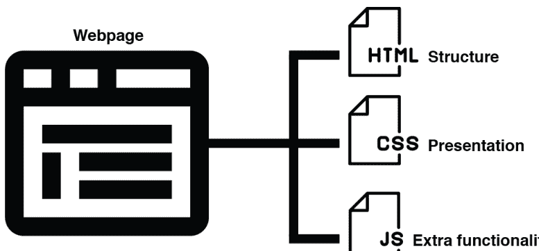

图 1.1 网页的分解

自 2000 年代中期智能手机引入以来，网络随后扩展到响应式和自适应设计，以及移动网站，这些网站通常比桌面体验功能更少。这些移动网站通常位于 m.example.com 等子域上。关于我们是否应该创建响应式和自适应网站还是移动专用网站，各有利弊。

总体而言，响应式和自适应似乎是前进的方向——尤其是随着 CSS 的扩展，使我们能够根据窗口大小和媒体类型应用 CSS。

自 1994 年首次宣布 CSS 以来，CSS 共有三次整体发布：

- 1996 年发布的 CSS1
- 1998 年发布的 CSS2
- 1999 年发布的 CSS3

1999 年之后，发布策略发生了变化，以允许更快、更频繁地发布新功能。现在它被分为模块，编号级别从一级开始一直到五级。CSS 一级模块是 CSS 中全新的东西，例如从未存在过的属性。一些例子是遮罩模块或多列模块，我们将在本书后面探讨。

已经经过几个版本并达到 5 级的模块有：媒体查询、颜色、字体，以及级联和继承模块。

将 CSS 分成模块的好处是每个部分可以独立移动，而不是大规模的 sweeping 更改。然而，有一些讨论认为需要有人宣布我们现在处于 CSS4 阶段，即使只是为了承认自 1999 年以来 CSS 发生了很大变化。

## 1.1.2 What is CSS?

CSS 是一种领域特定语言 (DSL)。DSL 是专门创建用于解决特定问题的语言。它们通常比 Java 或 C# 等通用语言 (GPL) 更简单。CSS 的特定目的是为网页内容设置样式。SQL、HTML 和 XPath 等语言也是 DSL。

CSS 也是一种声明式编程语言。这意味着代码告诉浏览器需要做什么而不是如何做。例如，我们的代码说我们希望此标题为红色，然后浏览器确定如何实现。

这很有用，因为，如果我们想增加段落的行高以改善阅读体验，浏览器将负责确定该行高的新布局、大小和格式，从而减少开发人员的工作量。

自 1994 年以来，CSS 已经走得很远。现在有办法为元素设置动画和过渡、创建运动路径以对 SVG 图形进行动画处理，并根据视口大小有条件地应用样式。此类功能过去只能通过 JavaScript 或 Flash（现已退役）实现。

在过去，设计选择如透明度、圆角边框、遮罩和混合是可行的，但需要非常规的 CSS 技术和“hack”。随着 CSS 的发展，属性被添加以用标准、记录的功能取代这些 hack。可以说 CSS 正处于黄金时代。随着语言的持续发展，创造新颖和创造性体验的机会几乎是无限的。

### 1.2 Getting started with CSS by creating an article layout

在我们的第一个项目中，我们将探索网络上常见的用例，创建单列文章。本章将重点介绍如何将 CSS 链接到 HTML，然后探索我们可以用来设置 HTML 样式的选择器。

我们首先需要了解的是如何将 CSS 与 HTML 关联以及如何选择元素，然后我们就可以担心要应用哪些属性和值。让我们回顾一些基础知识。

#### 1.2.1 Setup

如果您是编码新手，那么有几种通常免费的工具可用于这些项目。您可以选择在线编码，也可以在计算机上使用代码编辑器，例如：


- Sublime: https://www.sublimetext.com
- Brackets: https://brackets.io
- Visual Studio Code: https://code.visualstudio.com
- 基本文本编辑器，例如
  - TextEdit（Mac）
  - Notepad（Windows）
  - Gedit（Linux）

你也可以使用免费的在线开发编辑器，如 CodePen(https://codepen.io)。在线开发编辑器是测试想法和为前端项目提供快速便捷访问的绝佳方式。

一旦你在电脑上安装了代码编辑器或选择了在线编辑器并创建了账户，我们就需要获取本章的入门代码。

在 Github 上创建了一个代码仓库（https://github.com/michaelgearon/Tiny-CSS-Projects），其中包含你跟随每章所需的所有代码。图 1.2 显示了该仓库的截图。

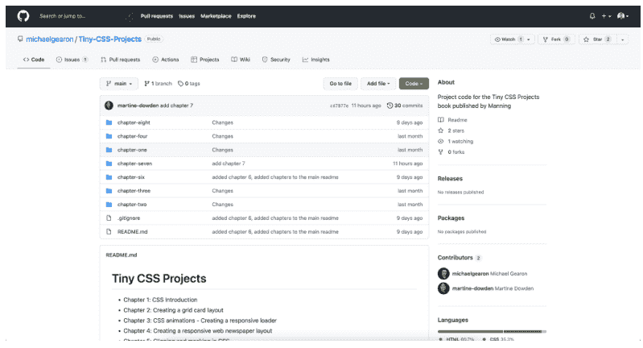

代码按章节组织成文件夹。每个章节文件夹内包含 2 个版本的代码：

- before：包含项目的入门代码。这是如果你跟随章节编码时想要的版本
- after：已完成的项目，如本章末尾应用了所展示 CSS 时的状态

下载，（或如果你熟悉 git，可以克隆），项目选择屏幕顶部的“Code”下拉菜单。

假设你正在跟随章节编码，从 chapter-01 中的“before”文件夹获取文件并复制到你的项目文件夹或你的 pen 中。你应该会看到一个带有一些入门代码的 HTML 文件，以及一个空的 CSS 文件。如果你将 HTML 文件在网页浏览器中打开或将内容复制到 CodePen，你会看到内容目前未加样式，除了浏览器提供的默认样式外，如图 1.3 所示。我们现在准备好使用 CSS 开始设置内容样式。

## Listing 1.1 Starting HTML

```
<!doctype html>
<html lang="en">
<head>
<meta charset="utf-8">
<meta name="viewport" content="width=device-width, initial-scale=1">
<title>Chapter 1 - CSS introduction</title>
<link rel="stylesheet" href="styles.css">
</head>
<body>

<article>
<header>
<h1>Title of our article (heading 1)</h1>
<p>
Posted on
<time datetime="2015-05-16 19:00">May 16</time>
by
Lisa.
</p>
</header>
<p>Lorem ipsum dolor sit amet, consectetur adipiscing elit. Pellentesque tincidunt dapibus eleifend. Nam eu urna ipsum. Etiam consequat ac dolor et dapibus. Duis eros arcu, interdum eu volutpat ac, lacinia a tortor. Vivamus justo tortor, porttitor in arcu nec, pretium viverra ipsum. Nam sit amet nibh magna. Sed ut imperdiet orci, id finibus justo. Maecenas magna mauris, tempor nec tempor id, aliquam et nibh. Nunc elementum ut purus id eleifend. Phasellus pulvinar dui orci, sed eleifend magna ullamcorper sit amet. Proin iaculis lacus congue aliquam sodales.</p>
<ol class="ordered-list">
<li>List item 1</li>
<ul>
<li>Nested item 1</li>
<li>Nested item 2</li>
</ul>
<li>List item 2</li>
<li>List item 3</li>
<li>List item 4</li>
</ol>

<p>Curabitur id augue nulla. Aliquam purus urna, aliquam eu ornare id, maximus et tellus. Aliquam eleifend sem vitae
urna blandit, non bibendum tellus dignissim. Aliquam imperdiet imperdiet sapien sit amet consectetur. Nam
convallis turpis felis,
sed vulputate lacus eleifend a. Mauris pharetra imperdiet lacinia. Sed sit amet
feugiat lectus, in consectetur
magna. Vestibulum accumsan porta enim at ultricies. Vestibulum vitae massa quis massa
dignissim imperdiet.</p>
<blockquote id="quote-by-author">Nunc eleifend nulla lobortis porta rhoncus. Vivamus
feugiat, sem vitae feugiat
aliquam, orci nulla venenatis libero, vitae rhoncus nibh neque ac velit.</blockquote>
<p>Etiam tempor vulputate varius. Duis at metus ut eros ultrices facilisis. Donec ut
est finibus, egestas nisl eu,
placerat neque. Pellentesque cursus, turpis nec sollicitudin sodales, nisi tellus
ultrices lectus, nec facilisis
purus neque vitae
diam. Nunc eleifend nulla lobortis porta rhoncus. Vivamus feugiat, sem vitae feugiat
aliquam, orci nulla venenatis
libero, vitae rhoncus nibh neque ac velit. Donec non fringilla magna. Vivamus
eleifend ligula libero, fermentum
imperdiet arcu viverra
in. Vivamus pellentesque odio interdum mauris aliquam scelerisque.</p>
<h2>Heading 2</h2>
<p>In ac euismod tortor. Vivamus vitae velit efficitur, mattis turpis quis, tincidunt
elit.
<a target="_blank" href="#">In eleifend in dolor id aliquet</a>. Vivamus pellentesque
erat a magna ultricies
rhoncus. Vestibulum at mattis purus, non lobortis risus. Mauris porta ullamcorper
mollis. Sed et placerat nisi,
quis porttitor lacus.
Curabitur sagittis nisl egestas ipsum tristique, eu semper erat gravida. Vestibulum
sagittis quam sit amet
tristique ultricies.
</p>
<p>In id lobortis leo. Nullam commodo tortor eu neque tempus accumsan. Vivamus
molestie, felis consequat consequat
iaculis, justo massa porttitor tellus, ac suscipit urna erat eu erat. Nunc malesuada
eleifend erat nec pharetra.
Sed eu magna iaculis,
elementum dui ac, sagittis augue. Nam sit amet risus dapibus massa rutrum faucibus.
Sed rhoncus finibus magna, vel
tristique sem bibendum nec.</p>

<h3>Heading 3</h3>
<p>Mauris sit amet tempor ex. Morbi eu semper velit. Nullam hendrerit urna
pellentesque, interdum lectus volutpat,
gravida odio.
<a href="#">Sed vulputate eget ante vel vehicula</a>. Curabitur ac velit sed magna
malesuada hendrerit. Vestibulum
ante ipsum primis in faucibus orci luctus et ultrices posuere cubilia curae; Ut
volpat nisi purus. Morbi
venenatis fermentum commodo.
Nam accumsan mollis neque non interdum. Aenean cursus metus ac est gravida, placerat
interdum justo pellentesque.
Duis nec scelerisque lacus, elementum tincidunt est. Maecenas et leo justo. Nam porta
risus porttitor vulputate
laoreet. Nulla sodales
sagittis nulla, non viverra erat consectetur et.
</p>
<p>Quisque vel erat et leo efficitur sollicitudin. Donec id ipsum eget lacus
pellentesque consequat. Praesent id
justo tellus. Maecenas convallis magna ut diam euismod, et porta lacus lacinia. Sed a
placerat justo. Quisque
dictum augue quis dapibus
posuere. Sed rutrum sed leo eget pretium. Donec fermentum varius vestibulum. Nam
ultrices ornare risus, vel
malesuada sapien volutpat ac. Duis sit amet leo ut metus dignissim sollicitudin nec
eget diam. Nullam tortor erat,
tincidunt ut venenatis at,
lacinia in libero. Mauris feugiat commodo lectus eget hendrerit. Curabitur pharetra
cursus eleifend.</p>
<h4 class="small-heading">Heading 4</h4>
<p>Aliquam porttitor, ex sed suscipit scelerisque, arcu urna rhoncus lacus, eget
aliquam enim quam ut lacus.
<a href="#">Cras sed finibus libero</a>. Duis lobortis, ipsum ut consectetur
eleifend, libero magna ullamcorper
ex, eget eleifend mi risus in erat. Ut consequat nunc diam, et convallis orci
efficitur id. Etiam finibus metus a
bibendum lobortis. Sed
est turpis, maximus id magna vitae, lobortis faucibus turpis. Maecenas in ipsum ut
nibh dignissim venenatis.
Aenean laoreet, arcu a ornare feugiat, augue enim bibendum leo, in dapibus tortor
ipsum nec massa. Pellentesque
mollis massa magna, imperdiet
elementum justo sodales vitae.
</p>
<h2>Heading 2</h2>
<h3>Heading 3</h3>
<svg xmlns="http://www.w3.org/">
<circle cx="70" cy="70" r="50"></circle>
<rect y="80" x="200" width="50" height="50" />
</svg>
<h4>Heading 4</h4>
<h5 class="small-heading">Heading 5</h5>
<p>In finibus ultrices nulla ut rhoncus. Suspendisse potenti. Phasellus id tortor nec
elit aliquet ullamcorper ut ut
tortor. Morbi vehicula massa sit amet luctus posuere. Nullam eu lacinia tortor.
Aenean eget pulvinar nulla, sit
amet accumsan tortor.
Praesent augue nunc, luctus ornare consequat id, ultricies vel tellus. Nullam gravida
tellus a nisi elementum
interdum. In scelerisque turpis vitae sem convallis venenatis. Donec aliquam, nibh
sit amet placerat posuere,
neque metus ultricies risus,
at luctus leo arcu a augue. Class aptent taciti sociosqu ad litora torquent per
conubia nostra, per inceptos
himenaeos. Sed congue lectus quis velit fringilla, a ultricies dui vestibulum.
Vestibulum ornare leo augue, vel
pretium ipsum vehicula et.
Nulla vel efficitur risus. Proin malesuada lobortis orci sit amet scelerisque. Sed
tincidunt felis vel aliquet
tristique.</p>
<h6 class="small-heading">Heading 6</h6>
<p lang="it">Questo paragrafo è definito in italiano.</p>
<ul class="list">
<li>List item 1</li>
<ul>
<li>Nested item 1</li>
<li>Nested item 2</li>
</ul>
```


</ul>
    <li>List item 2</li>
    <li>List item 3</li>
    <li>List item 4</li>
</ul>
<footer>
    <p>Footer text</p>
</footer>
</article>
<p>Nam rutrum nunc at lectus egestas porta. Ut molestie posuere faucibus. Pellentesque
    habitant morbi tristique
    senectus et netus et malesuada fames ac turpis egestas. Phasellus fermentum auctor arcu
    ultricies tincidunt.
Quisque urna magna, congue et
    condimentum ut, varius sed arcu. Morbi hendrerit justo eget porta venenatis. Donec id
    ligula accumsan, congue
    mauris at, ornare sem. Aenean lobortis est ac nisl consequat venenatis.</p>
</body>
</html>

## 我们的文章标题（一级标题）

Posted on May 16 by Lisa.

Lorem ipsum dolor sit amet, consectetur adipiscing elit. Pellentesque tincidunt dapibus eleifend. Nam eu urna ipsum. Etiam consequat ac dolor et dapibus. Duis eros arcu, interdum eu volutpat ac, lacinia a tortor. Vivamus justo tortor, porttitor in arcu nec, pretium viverra ipsum. Nam sit amet nibh magna. Sed ut imperdiet orci, id finibus justo. Maecenas magna mauris, tempor nec tempor id, aliquam et nibh. Nunc elementum ut purus id eleifend. Phasellus pulvinar dui orci, sed eleifend magna ullamcorper sit amet. Proin laculis lacus congue aliquam sodales.

- 1. List item 1
  - Nested item 1
  - Nested item 2
- 2. List item 2
- 3. List item 3
- 4. List item 4

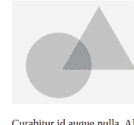

Curabitur id augue nulla. Aliquam purus urna, aliquam eu ornare id, maximus et tellus. Aliquam eleifend sem vitae urna blandit, non bibendum tellus dignissim. Aliquam imperdiet imperdiet sapien sit amet consectetur. Nam convallis turpis felis, sed vulputate lacus eleifend a. Mauris pharetra imperdiet lacinia. Sed sit amet feugiat lectus, in consectetur magna. Vestibulum accumsan porta enim at ultrices. Vestibulum vitae massa quis massa dignissim imperdiet.

Nunc eleifend nulla lobortis porta rhoncus. Vivamus feugiat, sem vitae feugiat aliquam, orci nulla venenatis libero, vitae rhoncus nibh neque ac velit.

Etiam tempor vulputate varius. Duis at metus ut eros ultrices facilisis. Donec ut est finibus, egestas nisl eu, placerat neque. Pellentesque cursus, turpis nec sollicitudin sodales, nis tellus ultrices lectus, nec facilisis purus neque vitae elit. Nunc eleifend nulla lobortis porta rhoncus. Vivamus feugiat, sem vitae feugiat aliquam, orci nulla venenatis libero, vitae rhoncus nibh neque ac velit. Donec non fringilla magna. Vivamus eleifend ligula libero, fermentum imperdiet arcu viverra in. Vivamus pellentesque odio interdum mauris aliquam scelerisque.

## 二级标题

In ac euismod tortor. Vivamus vitae velit efficitur, mattis turpis quis, tincidunt elit. In eleifend in dolor id aliquet. Vivamus pellentesque erat a magna ultricies rhoncus. Vestibulum at mattis purus, non lobortis risus. Mauris porta ullamcorper mollis. Sed et placerat nisi, quis porttitor lacus. Curabitur sagittis nisl egestas ipsum tristique, eu semper erat gravida. Vestibulum sagittis quam quam amet tristique ultricies.

In id lobortis leo. Nullam commodo tortor eu neque tempus accumsan. Vivamus molestie, felis consequat consequat iaculis, justo massa porttitor tellus, ac suscipit urna erat eu erat. Nunc malesuada eleifend erat nec pharetra. Sed ea magna iaculis, elementum dui ac, sagittis augue. Nam sit amet risus dapibus massa rutrum faucibus. Sed rhoncus finibus magna, vel tristique sem bibendum nec.

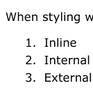

## 三级标题

Mauris sit amet tempor ex. Morbi eu semper velit. Nullam hendrerit urna pellentesque, interdum lectus volutpat, gravida odio. Sed vulputate eget ante vel vehicula. Curabitur ac velit sed magna malesuada hendrerit. Vestibulum ante ipsum primis in faucibus orci luctus et ultrices posuere cubilia curae; Ut volutpat nisi purus. Morbi venenatis fermentum commodo. Nam accumsan mollis neque non interdum. Aenean cursus metus ac est gravida, placerat interdum justo pellentesque. Duis nec scelerisque lacus, elementum tincidunt est. Maecenas et leo justo. Nam porta risus porttitor vulputate laoreet. Nulla sodales sagittis nulla, non viverra erat consectetur et.

Figure 1.3 Starter HTML for our Article

#### 1.3 为我们的 HTML 添加 CSS

When styling with CSS there are 3 ways to apply CSS to our HTML:

- 1. Inline
- 2. Internal
- 3. External

#### 1.3.1 内联 CSS

We can inline the CSS by adding a style attribute to an element. This method has us add the CSS to the element directly in the HTML.

Attribute tags are always specified in the start tag and typically consist of the name of the attribute, in this case: style. The attribute is then followed by an equals sign (=) and its value in quotes. All of the CSS goes inside of the opening and closing quotation marks.

As an example, let’s set the color of our heading to crimson:

```
<h1 style="color: crimson"> Title of our article (heading 1) </h1>
```

If we save our HTML and view it in a browser, we will see it is now crimson. If we are using a code editor rather than a web client (codepen), we will need to refresh the browser page to view our changes. Figure 1.3 shows the output. We notice that the only element affected is the <h1> on which we applied the styles.

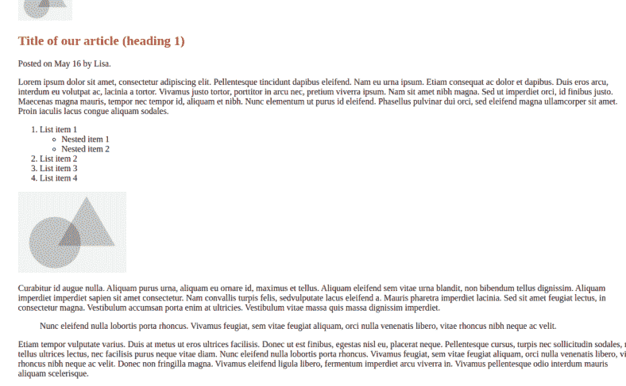

Figure 1.4 Crimson colored header

The benefit (and downside) of inline CSS is that it takes the highest specificity in CSS, which we’ll look at in more detail shortly.

Another major downsides to inline CSS is that it can quickly become unmanageable. For example, imagine we had 20 paragraphs within an HTML document. We would need to apply

the same style attributes with the same CSS properties 20 times to make sure all of our paragraphs look the same.

This scenario exposes 2 issues:

- Our concerns are no longer separated. Our HTML (responsible for the content) and CSS (responsible for styling) are now in the same place and tightly coupled.
- We are repeating the same code in a large number of places, making it extremely difficult to maintain the code and to keep our styles consistent.

The benefit to inline CSS is on page load performance. The browser will first load the HTML file and then any other files it needs to render the page. With the CSS being in the HTML file right away, the browser does not need to wait for it to load from a separate location.

Let’s undo the style we just added to the h1 and look at a different technique with the same benefits as inline but less drawbacks.

#### 1.3.2 内部 CSS

To resolve the issue of repeating code, we can instead add our CSS within an internal style tag. The style tag must be placed between the opening and closing head tags. To color all of our heading elements crimson we can use this snippet of code (Listing 1.1):

```
Listing 1.2
<!DOCTYPE html>
<html lang="en">
<head>
...
<style>
  h1, h2, h3, h4, h5, h6 {
    color: crimson;
  }
</style>
</head>
<body>
...
</body>
</html>
```

The benefit of this approach is that we are now grouping all of our CSS together and it will be applied to the whole HTML document. So in our example all headings (h1, h2, h3, h4, h5, h6) within that web page will be in crimson as we can observe in Figure 1.5.

## Title of our article (heading 1)

Posted on May 16 by Lisa.

Lorem ipsum dolor sit amet, consectetur adipiscing elit. Pellentesque tristique dapibus eleifend. Nam eu urna ipsum. Etiam consequat ac dolor et dapibus. Duis eros arcu, interdum eu volutpat ac, lacinia a tortor. Vivamus justo commodo, porttitor in arcu nec, pretium viverra ipsum. Nam sit amet nibh magna. Sed ut imperdiet orci, id finibus justo. Maecenas magna mauris, tempor nec tempor id, aliquam et nibh. Nunc elementum ut purus id eleifend. Phasellus pulvinar dui orci, sed eleifend magna ullamcorper sit amet. Proin laculis congue aliquam sodales.

- 1. List item 1
  - Nested item 1
  - Nested item 2
- 2. List item 2
- 3. List item 3
- 4. List item 4

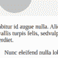

Curabitur id augue nulla. Aliquam purus urna, aliquam eu ornare id, maximus et tellus. Aliquam eleifend sem vitae urna blandit, non bibendum tellus dignissim. Aliquam imperdiet imperdiet sapien sit amet consectetur. Nam convallis turpis felis, sed volutpatne lesta eleifend a. Mauris pharetra imperdiet lacinia. Sed sit amet feugiat lectus, in consectetur magna. Vestibulum accumsan porta enim sit ultricies. Vestibulum vitae massa quis massa dignissim imperdiet.

Nunc eleifend nulla lobortis porta rhoncus. Vivamus feugiat, sem vitae feugiat aliquam, orci nulla venenatis libero, vitae rhoncus nibh neque ac velit.

Etiam tempor vulputate varius. Duis at metus ut eros ultrices facilisis. Donec et est finibus, egestas nisi ei, placerat neque. Pellentesque cursus, turpis nec sollicitudin sodales, nisi tellus ultrices lectus, nec facilisis purus neque vitae diam. Nunc eleifend nulla lobortis porta rhoncus. Vivamus feugiat, sem vitae feugiat aliquam, orci nulla venenatis libero, vitae rhoncus nibh neque ac velit. Donec non fringilla magna. Vivamus eleifend ligula libero, fermentum imperdiet arcu viverra in. Vivamus pellentesque odio interdum mauris aliquam sollicitudin.

## Heading 2

In ea suscipit tortor. Vivamus vitae velit efficitur, mattis turpis quis, tincidunt elit. In eleifend in dolor id aliquet. Vivamus pellentesque erat a magna ultricies rhoncus. Vestibulum at mattis purus, non lobortis risus. Mauris porta ullamcorper mollis. Sed et placerat nisi, quis porttitor lacus. Curabitur sagittis nisi egestas ipsum tristique, eu semper erat gravida. Vestibulum sagittis quam sit amet tristique ultricies.

In id lobortis leo. Nullam commodo tortor eu neque tempus accumsan. Vivamus molestie, felis consequat euismod iaculis, justo massa porttitor tellus, ac suscipit urna eu erat. Nunc malesuada eleifend erat nec pharetra. Sed eu magna iaculis, elementum dui ac, sagittis augue. Nam sit amet risus dapibus massa rutrum faucibus. Sed rhoncus finibus magna, vel tristique sem bibendum nec.

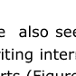

## Heading 3

Mauris sit amet tempor ex. Morbi ac semper velit. Nullam hendrerit a nulla pellentesque. Interdum luctus volutpat, gravida odio. Sed vulputate sem ante vel vehicula. Curabitur ac velit sed magna malesuada hendrerit. Vestibulum ante ipsum primis in faucibus orci luctus et ultrices posuere cubilia curae; Ut volutpat nisi purus. Morbi venenatis fermentum commodo. Nam accumsan mollis neque non interdum. Aenean cursus metus ac est gravida, placerat interdum justo lacinia. Duis nec scelerisque lacus, elementum tincidunt erat. Maecenas et leo luctus. Nam porta risus nontristique vulputate laoreet. Nulla sodales sagittis nulla, non viverra erat consequat et.

Figure 1.5 Styles applied to all headings

We also see a difference in how the internal CSS is written compared to inline CSS. When writing internal CSS, we create what are known as rules. They are composed of the following parts (Figure 1.6):

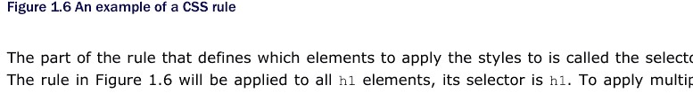

Figure 1.6 An example of a CSS rule

The part of the rule that defines which elements to apply the styles to is called the selector. The rule in Figure 1.6 will be applied to all h1 elements, its selector is h1. To apply multiple


选择器，我们将它们作为以逗号分隔的列表写在开括号之前。例如，要选择所有 h1 和 h2 元素，我们会写 h1,h2 { ... }。

声明由属性组成，在本例中为 color，后跟属性值（red）。声明定义了所选元素将如何设置样式。

属性和值都必须用美国英语书写。诸如 "colour" 或 "capitalise" 之类的拼写变体不受支持，浏览器也不会识别。

当浏览器遇到无效的 CSS 时，它会忽略它。如果一条规则中包含无效的声明，有效的声明仍会被应用，只有无效的部分会被忽略。

内部 CSS 对于样式特定于该页面的单次网页非常有效。它很好地分组了 CSS，使我们能够编写应用于元素的规则，避免在多个地方复制粘贴相同的样式。它还具有与内联样式相同的性能优势，即浏览器可以立即访问 CSS，而无需等待从其他位置获取。

将 CSS 放在 HTML 文档中的缺点是，CSS 仅适用于该文档。因此，如果我们的网站有多个页面，通常就是这种情况，我们就需要将该 CSS 复制到每个 HTML 文档中。对于博客或电子商务网站等大型应用程序来说，这很快就会变得难以维护，因为任何样式更改都必须应用于所有页面。

让我们最后一次撤销我们对项目的更改，并查看第三种技术。

#### 1.3.3 外部 CSS

与内部 CSS 一样，外部 CSS 方法也将我们的 CSS 组合在一起，但它将 CSS 放在单独的 .css 文件中。通过分离 HTML 和 CSS，我们可以有效地分离关注点：内容和样式。

我们通过使用 <link> HTML 标签将样式表链接到 HTML。链接元素对于样式表需要两个属性：rel 属性，它描述了 HTML 文档与所链接内容之间的关系；以及 href 属性，它代表超文本引用并指示要包含的文档的位置。列表 1.2 显示了我们如何将样式表链接到我们项目的 HTML。

```
Listing 1.3
<!DOCTYPE html>
<html>
<head>
<link rel="stylesheet" href="styles.css">
</head>
<body>
<h1>Inline CSS</h1>
</body>
```

大多数情况下，这是在整个网络上看到的方法，也是我们在本书中将使用的方法。外部样式表的优点是我们的 CSS 位于单个文档中，可以一次性修改，其更改将应用于我们所有的 HTML 页面。这种方法的缺点是它意味着浏览器需要额外一次请求来检索该文档，从而失去了将 CSS 直接放在 HTML 中所提供的性能优势。

#### 1.4 级联样式表的级联

关于 CSS 的一个基本要点是级联。CSS 的形成围绕着级联的概念，它允许样式相互覆盖或继承。这为多个样式表竞争网页的呈现铺平了道路。

因此，使用浏览器开发者工具检查元素时，我们有时会看到多个 CSS 值相互竞争，以成为浏览器渲染的值。浏览器如何决定对元素应用哪些 CSS 属性值是通过特异性来决定的。

特异性是指浏览器（或用户代理）决定哪些声明与 HTML 相关并将样式应用于该元素。当多个样式表被应用时，样式表应用的顺序是特异性计算的一个方面。样式在后面的样式表中会覆盖先前样式表提供的样式。换句话说，最后声明的获胜。

在 CSS 中有三种不同的样式表来源。

##### 1.4.1 用户代理样式表

第一个来源是浏览器的默认样式。当我们第一次打开项目，在添加任何样式之前，我们的元素并不都看起来一样。例如，我们的标题比我们的文本更大更粗。这是由用户代理（UA）样式表定义的。这些具有最低优先级，我们发现不同浏览器对 HTML 属性的呈现略有不同。

大多数时候，UA 样式表设置字体大小、边框样式，以及表单元素的一些基本布局，如文本输入或进度条。这在用户样式表找不到或加载文件时出错时很有用。UA 样式表提供一些后备样式，允许用户仍然使用网站。

##### 1.4.2 作者样式表

我们作为开发者编写的样式表被称为作者样式表，它们通常在浏览器显示的样式中具有第二高的优先级。当我们创建网页时，我们编写并应用于网页的 CSS 样式表就是作者样式表。

##### 1.4.3 用户样式表

访问我们网页的用户可以使用自己的样式表来覆盖作者和 UA 样式。这可以改善他们的体验，尤其对残障用户而言。

用户可能使用自己的样式表的实例包括设置最小字体大小、选择自定义字体、提高对比度或增加元素之间的间距。任何用户都可以将用户样式表应用于网页。

这些如何应用于网页将取决于浏览器，通常通过浏览器设置或使用插件。

一旦应用，用户样式表仅对添加它的用户在其应用的浏览器上应用。更改是否会从一个设备携带到另一个设备，又取决于浏览器本身及其跨设备同步插件和设置的能力。

##### 1.4.4 CSS 重置

浏览器提供的默认样式不一致。每个浏览器都有自己的样式表。例如，Chrome 中的默认样式与 Safari 中的不同。如果我们希望我们的应用程序在所有浏览器中看起来相同，这会带来一些挑战。幸运的是，我们有两个可用的选项，CSS 重置或 Normalize。尽管两者都可用于解决跨浏览器样式问题，但它们的工作方式截然不同。

重置表示我们不想要任何浏览器默认样式，并将它们全部重置。在没有应用任何作者样式的情况下，所有元素无论是什么，都看起来像纯文本，如图 1.7 所示。

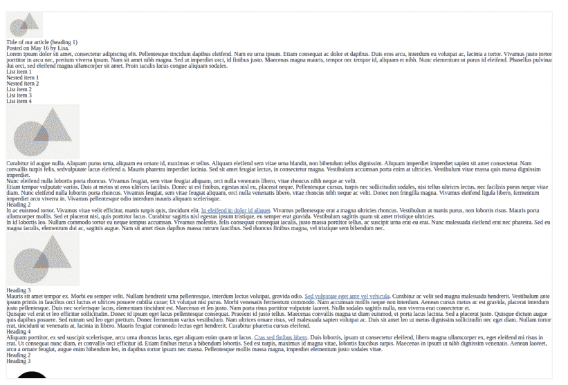

图 1.7 应用了 CSS 重置

要将 CSS 重置应用于我们的项目，首先我们创建一个重置样式表添加到我们的项目中。在我们的项目文件夹中，我们创建一个名为 reset.css 的文件。然后我们将重置 CSS 复制到文件中。

存在许多重置选项，但一个常用的选项可以在 https://meyerweb.com/eric/tools/css/reset/ 找到。

最后我们需要将样式表链接到我们的 HTML。由于顺序很重要，我们希望确保在 `head` 中将重置 CSS **在** 作者样式 **之前** 包含。我们的 HTML 因此将如列表 1.3 所示。

```
Listing 1.4
<head>
...
<link rel="stylesheet" href="reset.css"> #A
<link rel="stylesheet" href="styles.css"> #B
</head>
```

#A 重置样式表
#B 作者样式表

CSS 重置的好处是，我们现在有一个空白的起点开始。如图 1.7 所示，我们所有的元素现在都看起来像纯文本，因此缺点是我们现在需要为所有元素定义基本样式，包括为列表添加项目符号、区分标题级别等。此外，每个版本的 CSS 重置都将根据版本和编写它的开发者而略有不同。

我们的另一个选项是 Normalize。不是重置样式，它专门针对在浏览器之间存在差异的元素并应用规则来标准化它们。

##### 1.4.5 Normalize

与 CSS 重置一样，Normalize 的样式会根据版本和作者略有不同。Normalize 的一个常用选项可以在 https://necolas.github.io/normalize.css/ 找到。我们可以以与 CSS 重置相同的方式将其应用于我们的项目。我们创建一个文件，将代码复制到文件中，并将其链接到我们的 HTML。应用后（图 1.8）我们注意到我们的 HTML 看起来与原来一样，因为它处理的大多数差异都在表单元素和按钮上。根据我们使用的浏览器，我们可能会注意到 h1 大小的差异。


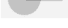

## Title of our article (heading 1)

Posted on May 16 by Lisa.

Lorem ipsum dolor sit amet, consectetur adipiscing elit. Pellentesque tincidunt dapibus eleifend. Nam eu urna ipsum. Etiam consequat ac dolor et dapibus. Duis eros arcu, interdum eu volutpat ac, lacinia a tortor. Vivamus justo tortor, porttitor in arcu nec, pretium viverra ipsum. Nam sit amet nibh magna. Sed ut imperdiet orci, id finibus justo. Maecenas magna mauris, tempor nec tempor id, aliquam et nibh. Nunc elementum ut purus id eleifend. Phasellus pulvinar dui orci, sed eleifend magna ullamcorper sit amet. Proin lacinia lacus congue aliquam sodales.

- 1. List item 1
  - Nested item 1
  - Nested item 2
- 2. List item 2
- 3. List item 3
- 4. List item 4

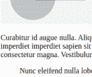

Curabitur id augue nulla. Aliquam purus urna, aliquam eu ornare id, maximus et tellus. Aliquam eleifend sem vitae urna blandit, non bibendum tellus dignissim. Aliquam imperdiet imperdiet sapien sit amet consectetur. Nam convallis turpis felis, sed volutpat lacus eleifend a. Mauris pharetra imperdiet lacinia. Sed sit amet feugiat lectus, in consectetur magna. Vestibulum accumsan porta enim at ultrices. Vestibulum vitae massa quis massa dignissim imperdiet.

Nunc eleifend nulla lobortis porta rhoncus. Vivamus feugiat, sem vitae feugiat aliquam, orci nulla venenatis libero, vitae rhoncus nibh neque ac velit.

Etiam tempor vulputate varius. Duis at metus ut eros ultrices facilisis. Donec ut est finibus, egestas nisl eu, placerat neque. Pellentesque cursus, turpis nec sollicitudin sodales, nisi tellus ultrices lectus, nec facilisis purus neque vitae diam. Nunc eleifend nulla lobortis porta rhoncus. Vivamus feugiat, sem vitae feugiat aliquam, orci nulla venenatis libero, vitae rhoncus nibh neque ac velit. Donec non fringilla magna. Vivamus eleifend ligula libero, fermentum imperdiet arcu viverra in. Vivamus pellentesque odio interdum mauris aliquam scelerisque.

## Heading 2

In ac euismod tortor. Vivamus vitae velit efficitur, mattis turpis quis, tincidunt elit. In eleifend in dolor id aliquet. Vivamus pellentesque erat a magna ultricies rhoncus. Vestibulum at mattis purus, non lobortis risus. Mauris porta ullamcorper mollis. Sed et placerat nisi, quis porttitor lacus. Curabitur sagittis nisl egestas ipsum tristique, eu semper erat gravida. Vestibulum sagittis quam quam amet tristique ultrices.

In id lobortis leo. Nullam commodo tortor eu neque tempus accumsan. Vivamus molestie, felis consequat consequat iaculis, justo massa porttitor tellus, ac suscipit urna erat eu erat. Nunc malesuada eleifend erat nec pharetra. Sed e magna iaculis, elementum dui ac, sagittis augue. Nam sit amet risus dapibus massa rutrum faucibus. Sed rhoncus finibus magna, vel tristique sem bibendum nec.

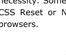

## Heading 3

Mauris sit amet tempor ex. Morbi eu semper velit. Nullam hendrerit urna pellentesque, interdum lectus volutpat, gravida odio. Sed vulputate eget ante vel vehicula. Curabitur ac velit sed magna malesuada hendrerit. Vestibulum ante ipsum primis in faucibus orci luctus et ultrices posuere cubilia curae; Ut volutpat nisi purus. Morbi venenatis fermentum commodo. Nam accumsan mollis neque non interdum. Aenean cursus metus ac est gravida, placerat interdum justo pellentesque. Duis nec scelerisque lacus, elementum tincidunt est. Maecenas et leo justo. Nam porta risus porttitor vulputate laoreet. Nulla sodales sagittis nulla, non viverra erat consectetur et.

## Figure 1.8 Normalized applied to our project

The good news is that UA stylesheet differences are far less of an issue than they were 10 to 15 years ago. Today browsers are more consistent around their choice of styling than they once were, so using CSS Reset or Normalize is more of a personal choice rather than a necessity. Some differences do still exist however, and regardless of whether or not we use CSS Reset or Normalize, we should be testing our code across a variety of devices and browsers.

#### 1.4.6 !important

The !important annotation is one we may have seen in some stylesheets. Often used as a last resort when all else fails, it is a way to override the specificity and declare that a particular value is the most important thing regardless of all else. However, with great power comes great responsibility. The !important annotation was originally created as an accessibility feature.

Remember how we talked about users being able to apply their own styles in order to have a better user experience? It was created to help users define their own styles without having to worry about specificity. Since it overrides any other styles, it was created to ensure that the user’s styles would always have the highest importance and therefore be the ones applied.

Making use of !important is therefore considered bad practice and should not be used in our author stylesheets. Doing so breaks the natural cascade of the CSS and can make it harder to manage the stylesheet going forward.

#### 1.5 Specificity

When there are multiple property values being applied to an element, one will win over the others. How we determine the winner is through a multi step process. We will ignore !important for the time being as it breaks the normal flow, and we will come back around to it later.

We first look at where the value comes from. Anything explicitly defined in a rule will override inherited values. For example (listing 1.4), if we set a font color to red on the body tag, the elements that are inside the tag will have red text. The font color is inherited by those elements. If we specifically set a different color on a paragraph inside of the body, the inherited red value would be overwritten by the more specific blue value set on the paragraph. Therefore, that paragraph’s text color would be blue.

## Listing 1.5 Example of inheritance

```
<body> #A
  <h1>Example</h1> #B
  <p>My paragraph</p> #C
</body> #D

body { color: red } #E
p { color: blue }  #E
```

#A start of HTML
#B our header would inherit the red color
#C the paragraph’s color would be blue as set by the paragraph rule
#D end of HTML
#E CSS Rules

Not all property values will be inherited. Theme related styles such as color and font size, will generally be inherited. Layout considerations are generally not. This is a very loose guideline, and there are definitely exceptions but this is a good place to start. We will cover exceptions as a case by case when they appear throughout the projects.

If inherited versus explicit doesn’t act as a tiebreaker to determine the value, we then look at the type of selector which was used and mathematically calculate the specificity value. We will get into more detail about what each selector type is in this chapter, but let’s look at how the math is applied.

We look at the selector, categorize the types of selectors being used by the rule, then apply the type value. We then add all of the values and get a final specificity value. Figure 1.9 diagrams the process. The biggest number wins, therefore rule #1 in the diagram would win over rule #2.

```
button[type="submit"]#save span { ... }
```

Type Selector 1 + Attribute Selector 10 + ID Selector 100 + Type Selector 1 = 112

```
button[type="submit"] span { ... }
```

Type Selector 1 + Attribute Selector 10 + Type Selector 1 = 12

Figure 1.9 Calculating specificity

Specificity values by selector type are as follows:

- 100 - ID selectors
- 10 - Class selectors, attribute selectors, and pseudo classes
- 1 - Type selectors, and pseudo elements
- 0 - Universal selectors

If we still have a tie we look at which stylesheet the style originated from. If both values come from within the same stylesheet, the one later in the document wins, if they come from different stylesheets, the order is as follows

- 1. User stylesheet
- 2. Author stylesheet(s) (in order in which they are being imported, last one wins)
- 3. User Agent stylesheet

We set !important to the side earlier. Now that we understand the normal flow, let’s add it back into the mix. When a value has the !important annotation, the process is short circuited and the value with the annotation automatically wins regardless of anything else. If both values have the !important annotation, the normal flow is followed. The diagram in Figure 1.10 shows the flow through the stylesheets including property values with the !important annotation.


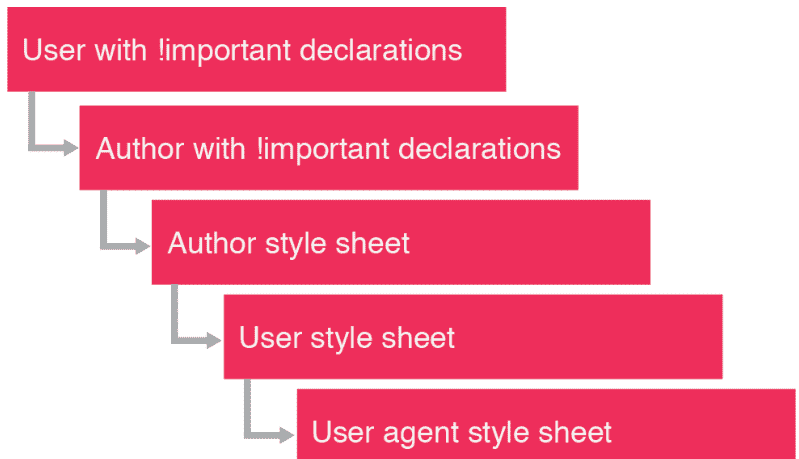

Figure 1.10 CSS order of precedence

我们已经确定选择器的类型会影响类的特异性。让我们更仔细地查看选择器并在项目中使用它们。

#### 1.6 CSS 选择器

选择器设置我们想要定位的 HTML 元素，然后跟随声明。

在 CSS 中，有七种方法可以定位我们想要设置样式的 HTML 元素。让我们先来看基本选择器。

##### 1.6.1 基本选择器

最常见的方法是根据名称、ID 或类名选择元素。

##### TYPE SELECTOR

类型选择器通过名称定位 HTML 元素。使用类型选择器的好处是，在阅读 CSS 时，我们可以快速判断如果修改规则会受到影响的 HTML 元素。它也不要求我们在 HTML 中添加任何特定标记来定位元素。

让我们使用类型选择器来定位我们所有的标题（h1 到 h6），并将它们的颜色更改为深红色。

我们的 CSS 将是：h1, h2, h3, h4, h5, h6 { color: crimson; }。图 1.11 显示我们所有的标题颜色现在都已更改。

## Figure 1.11 Header color change

##### CLASS SELECTORS

类选择器可以应用于我们想要的任意多个不同元素。通过将类名应用于元素，我们将多个 HTML 元素分组在一起，这样当我们应用样式时，它们将应用到任何具有该类名的元素。

类可以通过使用 class 属性添加到 HTML 中。在 class 属性内，我们可以添加任意多个值（或类），每个值之间用空格分隔。与必须用美式英语书写的声明不同，类名可以用任何语言使用任何拼写变体书写。

编写类名有很多方法和方式，例如 Block、Element、Modifier（BEM）方法或 CSS 的可扩展模块化架构（SMACSS），它们是编写一致样式表的风格指南。主要目的是编写任何人都能理解的类名。

例如，将类名 "text" 添加到我们的段落元素会非常令人困惑。这是因为其他元素，如我们的标题，也可以被视为文本，因此可能不清楚我们具体指的是哪个元素。基于特定样式（如颜色）应用类名也可能很危险。给元素一个名为 blue 的类名可能立即有效，但如果设计更改且应用的颜色现在是红色，我们的类名将不再有意义。

在我们的 HTML 中，我们发现一些标题具有 small-heading 的类。我们将创建一个规则来选择 small-heading 并将元素的文本更改为大写。

要选择 small-heading 类名，在 CSS 中我们将首先输入点号（.），后跟类名 small-heading，然后我们的样式进入大括号，与类选择器相同：.small-heading { text-transform: uppercase }。图 1.12 现在显示了我们的大写标题。请注意，其他标题未受影响。只有应用了该类的那些。

Quisque dictum augue quis dapibus posuere. Sed rutrum sed leo eget pretium. Donec fermentum varius vestibulum. Nam ultrices ornare dignissim sollicitudin nec eget diam. Nullam tortor erat, tincidunt ut venenatis at, lacinia in libero. Mauris feugiat commodo lectus eget

## HEADING 4

## Has a class of small-heading

Aliquam porttitor, ex sed suscipit scelerisque, arcu urna rhoncus lacus, eget aliquam enim quam ut lacus. Cras sed finibus libero. Duis lo eleifend mi risus in erat. Ut consequat nunc diam, et convallis orci efficitur id. Etiam finibus metus a bibendum lobortis. Sed est turpis, nibh dignissim venenatis. Aenean laoreet, arcu a ornare feugiat, augue enim bibendum leo, in dapibus tortor ipsum nec massa. Pellentes

## Heading 2

## Heading 3


## Heading 4

## Does not have a class of small-heading

## HEADING 5

In finibus ultrices nulla ut rhoncus. Suspendisse potenti. Phasellus id tortor nec elit aliquet ullamcorper ut ut tortor. Morbi vehicula mass nulla, sit amet accumsan tortor. Praesent augue nunc, luctus ornare consequat id, ultricies vel tellus. Nullam gravida tellus a nisi element aliquam, nibh sit amet placerat posuere, neque metus ultricies risus, at luctus leo arcu a augue. Class aptent taciti sociosqu ad litora torqu velit fringilla, a ultricies dui vestibulum. Vestibulum ornare leo augue, vel pretium ipsum vehicula et. Nulla vel efficitur risus. Proin mal tristique.

## HEADING 6

Questo paragrafo è definito in italiano.

- List item 1

Figure 1.12 Class-selector applied to heading 4, 5 and 6

##### Id SELECTOR

在 HTML 中，id 是唯一的。任何给定的 id 在网页上只能使用一次。如果重复使用多次，则我们的代码被视为无效 HTML。通常我们应避免使用 id 选择器，因为由于 id 在 HTML 中需要唯一，针对 id 构建的类不易重用。此外，id 选择器是最具体的选择器之一，使得使用 id 应用的样式难以覆盖。除非元素的唯一性是关键，否则应避免使用 id 属性。像类名一样，id 名称也可以用任何语言书写。

在我们的示例文章中，有一个带有 id 属性值为 quote-by-author 的 blockquote。在我们的 CSS 中，要选择该 blockquote，我们使用井号（#）紧跟其后是要定位的 id。然后我们有大括号，在其中放置声明，如 Listing 1.4 所示。

## Listing 1.5 shows our rule.

```
#quote-by-author {
  background: lightgrey;
  padding: 10px;
  line-height: 1.75;
}
```

Figure 1.13 shows the code applied to our project.

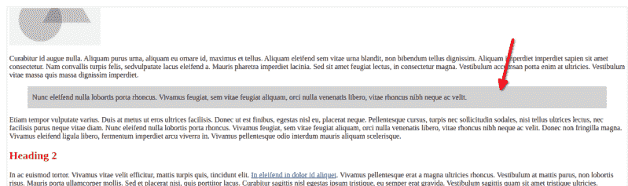

Figure 1.13 shows the output

##### 1.6.2 Combinators

另一种编写 CSS 的方式是通过组合器，它允许在不过度使用 `class` 或 `id` 名称的情况下进行更复杂的 CSS。

共有四种组合器：
- 1. 后代组合器（空格）
- 2. 子组合器（>） 
- 3. 相邻兄弟组合器（+） 
- 4. 通用兄弟组合器（~）

需要理解的一个重要概念是元素之间的关系。在接下来的几个示例中，我们将看看如何利用元素之间的关系来定位不同的 HTML 元素以设置文章的样式。图 1.14 介绍了我们将要查看的关系类型。

## Figure 1.14 The relationship between elements in HTML

###### 1. DESCENDANT COMBINATOR (SPACE)

后代组合器选择父元素内的所有 HTML 元素。后代组合器由三部分组成——第一部分是父元素，在本例中是 article 元素。父元素后跟一个空格，然后是我们想要选择的元素。语法在图 1.15 中说明。

## A space between the parent and child

parent
Child items of the parent

```
article p {
  line-height: 2;
}
```

## Figure 1.15 An example of a descendant combinator

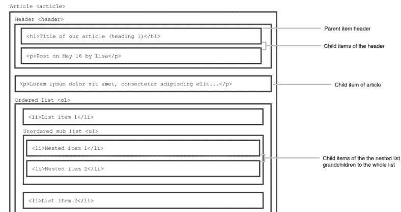

在此示例中，浏览器会找到 article 元素的任何使用情况，然后定位父 article 元素中的所有后代段落（p）并使文本双倍行距。应用后，我们的文章看起来如 Figure 1.16 所示。

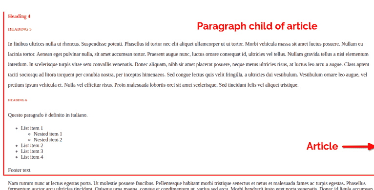

Figure 1.16 Child paragraphs are double spaced.

###### 2. CHILD COMBINATORS (>)

子组合器是父元素的子元素。这与后代组合器不同，因为目标元素必须是直接子元素。后代组合器可以选中任何后代（子元素、孙元素、曾孙元素...）。

在我们的项目中，我们将设置文章中列表项的样式。正如我们在下面的 HTML 中看到的（Listing 1.4），我们有一个无序列表（ul）包含列表项（li）。第一个子元素有自己的嵌套项，它们将是孙元素和曾孙元素。

## Listing 1.7 HTML list items

```
<ul class="list">      #A
  <li>List item 1</li>      #B
  <ul>                    #C
    <li>Nested item 1</li> #D
    <li>Nested item 2</li> #D
  </ul>
  <li>List item 2</li>    #B
  <li>List item 3</li>    #B
  <li>List item 4</li>    #B
</ul>                     #A
```


### A Parent Item (.list)
### B Children of .list
### C Grand child of .list
### D Great grandchildren of .list

我们将只为列表项（子项）设置绯红色样式，而不影响嵌套的列表项（曾孙项）。因此浏览器会找到 `list` 类，并仅针对直接位于 `list` 类下的子列表项（`li`）进行定位，并将 `color` 改为 `crimson`。我们将使用以下 CSS：`.list > li { color: crimson; }`

正如我们在图 1.17 中看到的，列表项现在是绯红色的，而嵌套的列表项仍然是黑色的。这是使用子组合器的好处之一。它允许我们仅设置子元素的样式，而不设置孙元素或层次结构中更深层的元素。

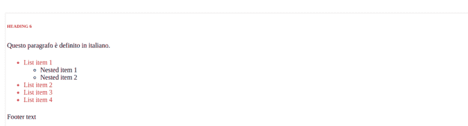

图 1.17 子组合器应用于列表项

*那么我们可以反过来选择子元素的父元素，对吗？* 简短的答案是否定的。目前在 CSS 中没有办法选择父项，因此以下示例将不起作用：`article < p { color: blue; }`。

###### 3. ADJACENT SIBLING COMBINATOR (+)

当我们需要为与另一个元素处于同一级别的元素设置样式时（就像你的兄弟姐妹在家族树中与你处于同一级别一样），我们可以使用相邻兄弟组合器。

如果我们想定位另一个元素之后的元素，可以使用相邻兄弟选择器。

在此示例中（列表 1.7），浏览器将找到 `header` 标签的任何用法，然后定位紧跟在 `header` 标签之后（或相邻）的第一个段落（`p`），并将 `font-size` 改为 `1.5rem`，`font-weight` 改为 `bold`。

```
Listing 1.8 Adjacent sibling combinator

header + p {
  font-size: 1.25rem;
  font-weight: bold;
}
```

图 1.18 显示了该代码应用于我们的文章。

## Title of our article (heading 1)

Posted on May 16 by Lisa.

Lorem ipsum dolor sit amet, consectetur adipiscing elit. Pellentesque tincidunt dapibus eleifend. Nam eu urna ipsum. Etiam consequat ac dolor et dapibus. Duis eros arcu, interdum eu volutpat ac, lacinia a tortor. Vivamus justo tortor, porttitor in arcu nec, pretium viverra ipsum. Nam sit amet nibh magna. Sed ut imperdiet orci, id finibus justo. Maecenas magna mauris, tempor nec tempor id, aliquam et nibh. Nunc elementum ut purus id eleifend. Phasellus pulvinar dui orci, sed eleifend magna ullamcorper sit amet. Proin iaculis lacus congue aliquam sodales.

- 1. List item 1
  - Nested item 1
  - Nested item 2
- 2. List item 2
- 3. List item 3
- 4. List item 4

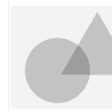

Curabitur id augue nulla. Aliquam purus urna, aliquam eu ornare id, maximus et tellus. Aliquam eleifend sem vitae una blandit, non bibendum tellus dignissim. Aliquam imperdiet imperdiet sapien sit amet consectetur. Nam convallis turpis felis, sed vulputate lacus eleifend a. Mauris pharetra imperdiet lacinia. Sed sit amet feugiat lectus, in consectetur magna. Vestibulum accumsan porta enim ut ultricies. Vestibulum vitae massa quis massa dignissim imperdiet.

> Nunc eleifend nulla lobortis porta rhoncus. Vivamus feugiat, sem vitae feugiat aliquam, orci nulla venenatis libero, vitae rhoncus nibh neque ac velit.

Etiam tempor vulputate varius. Duis at metus ut eros ultrices facilisis. Donec ut est finibus, egestas nisl eu, placerat neque. Pellentesque cursus, turpis nec sollicitudin sodales, nisi

图 1.18 相邻兄弟组合器应用于 header 之后立即出现的段落

如果我们想让第一个元素与其他元素不同以使其脱颖而出，这可能会很有用。我们在看报纸时可能会看到这种情况。第一段可能会被设计得比其余部分更突出，以引起我们的注意。另一个用例是表单中的错误处理。相邻兄弟组合允许我们在表单控件中无效值之后立即向用户显示错误消息。

值得注意的是，与子组合器类似，我们无法找到前一个兄弟元素。`header + p { ... }` 找不到 header 之前的段落将不起作用。

###### 4. GENERAL SIBLING COMBINATOR (~)

通用兄弟组合器比之前的方法更开放，因为它允许我们定位选择器所定位元素之后的所有兄弟元素。

在我们的示例中，我们将设置 `header` 元素之后出现的所有图像的样式。我们会注意到我们有三张占位符图像。第一张较小，可能是一个徽标或作者照片，位于 `header` 之上。我们不想为其设置样式。其他两张图像位于文章的更下方。我们希望在它们周围添加边框，以保持与文章其余部分一致的颜色主题。

我们的规则如下所示：`header ~ img { border: 4px solid crimson; }`。浏览器将找到 `header` 元素并定位该元素之后的所有兄弟图像（`img`）

element 并添加一个边框，其厚度为 4px，线条为实线（与点线、虚线或双线相对），颜色为绯红色。
我们可以在图 1.19 中看到该代码应用于我们的文章。

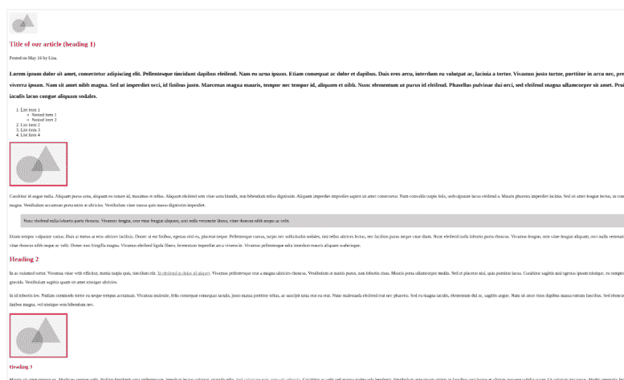

图 1.19 通用兄弟组合器定位 header 的兄弟图像

##### 1.6.3 Pseudo-class and pseudo-element selectors

###### PSEUDO-CLASS

伪类添加到选择器中以定位元素的特定状态。它们对于用户会交互的元素尤其有用，例如链接、按钮和表单字段。伪类使用单个冒号 (:) 后跟元素的状态。在我们的文章中有几个链接。我们没有以任何方式设置它们的样式，因此它们的样式来自用户代理样式表。对于大多数浏览器，它们有下划线，并且颜色会根据链接是否已被访问过（网址是否在浏览器的历史记录中找到）而有所不同。

对于链接，有几个状态需要考虑。最常见的是：

- link: 包含 href 属性且网址未在用户浏览器历史记录中找到的锚标签
- visited: 包含 href 且网址在用户浏览器历史记录中找到的锚标签
- hover: 用户将光标悬停在链接上，但尚未按下
- `active`: 用户正在点击链接并按住
- `focus`: 聚焦元素是默认情况下会接收键盘事件的元素。当用户点击元素时，该元素会自动获得焦点（除非有 JavaScript 更改此行为）。使用键盘在表单字段、链接和按钮之间导航也会更改聚焦的元素。
- `focus-within`: 应用于父元素。如果父元素的子元素获得焦点，则会应用 focus-within 样式。
- `focus-visible`: 仅在通过键盘导航获得焦点或用户通过键盘与元素交互时应用。

还有 `:target` 伪类，我们将在本书后面在讨论 `text-fragments` 时探索它。

在我们当前的文章项目中，我们将首先创建 `a:link` 规则，将包含 href 元素且尚未访问的锚标签的颜色更改为浅蓝色，使用其十六进制颜色代码 (#1D70B8)。

`:visited` 状态应与 `:link` 状态不同，因为它应向用户表明他们之前已访问过该页面。经常我们会看到网站在两者之间没有区别，然而区分两者可以提供更好的体验。

在我们的示例中，我们将 `:visited` 状态更改为紫色，使用十六进制代码值 #4C2C92。

我们将处理 `:hover` 状态。悬停状态不适用于移动用户，因为没有办法识别用户悬停在链接上。在我们的文章中，我们将 `:hover` 状态的文本颜色更改为深蓝色，使用十六进制代码值 #003078。

最后我们将处理 `:focus` 状态。焦点状态可用于链接、按钮和表单输入。焦点状态在用户点击或点按元素时显示。当元素获得焦点时，我们将向元素添加 1 像素的绯红色轮廓。

全部放在一起，我们的链接规则如下（列表 1.8）：

## Listing 1.9 Styling links using pseudo elements

```
a:link {
  color: #1D70B8;
}
a:visited {
  color: #4C2C92
}
a:hover {
  color: #003078;
}
a:focus {
  outline: solid 1px crimson;
}
```

我们可以通过进入浏览器，右键单击并选择“检查”来查看不同的元素状态。然后我们通常会看到 HTML 的视图，右侧为 CSS。通过点击样式部分中的 `:hov` 按钮，我们可以看到一个面板，可能显示“强制元素状态”，然后我们可以打开和关闭不同的伪类。图 1.20 显示了 Chrome 开发工具中打开的 :hov 面板。


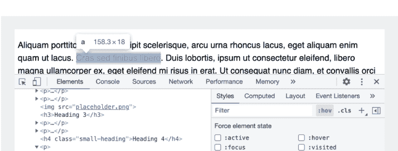

Figure 1.20 Viewing different elements states using the browser developer tools

###### PSEUDO-ELEMENTS

Pseudo elements use a double colon (::). The purpose of pseudo-elements is to allow us to style a specific part of an element. We may also sometimes see pseudo elements being written with a single colon. Either will work. For example we can target the first letter of a paragraph using the pseudo-element ::first-letter rather than wrapping the letter in something like a span element which would break apart the word and clutter our HTML. This allows us to create complex CSS without having to complicate the HTML.

In our article, we used the adjacent sibling combinator to make our first paragraph bold and a larger font size than the rest. Now we’re going to change the color of the first letter of that first paragraph and change the font style to italic.

First we get the header element, then we target the first letter (::first-letter) of the paragraph (p). With our selector created, when then add our declarations. Our CSS will therefore look as follows (Listing 1.7):

##### Listing 1.10 Selecting the first letter

```
header + p::first-letter {
  color: crimson;
  font-style: italic;
}
```

Applied, we can see in Figure 1.21 that our first letter is now red and italicized.

## Title of our article (heading 1)

Posted on May 16 by Lisa.

Lorem ipsum dolor sit amet, consectetur adipiscing elit. Pellentesque tincidunt dapibus eleif ac dolor et dapibus. Duis eros arcu, interdum eu volutpat ac, lacinia a tortor. Vivamus justo viverra ipsum. Nam sit amet nibh magna. Sed ut imperdiet orci, id finibus justo. Maecenas r aliquam et nibh. Nunc elementum ut purus id eleifend. Phasellus pulvinar dui orci, sed eleif iaculis lacus congue aliquam sodales.

Figure 1.21 Pseudo class targeting the first letter of the first paragraph immediately after the header

You might wonder why these selectors are called pseudo-class and pseudo-elements. Let's look at what pseudo means:

> *not genuine; false or pretend*

This makes sense as technically we are targeting a state or parts of an element that might not exist yet, so we are just pretending. Pseudo-classes can change as we have seen with styling our own links. We are creating `if` conditions that are set in motion by the user's actions. For example, `if` the user `hovers` then the browser will show one style, but `if` the user `visited` the link then the browser will show another style. Not all pseudo-elements and classes work on all HTML elements, throughout this book we will look at where we can use pseudo classes and with which HTML elements.

##### 1.6.4 Attribute value selectors

Commonly used for styling links and form elements, the attribute selector styles HTML elements with a specified attribute. The attribute value selector looks for a specific attribute with the same value.

In our article we have some content that is in Italian. The language of the paragraph is specified using the `lang` attribute. (Listing 1.8).

##### Listing 1.11 Italian content

```
<p lang="it">Questo paragrafo è definito in italiano.</p>
```

To hint to users that this content is in Italian we will add the Italian flag emoji using CSS. The browser will find the language (`lang`) attribute with the value of Italian (`it`) and then add an Italian flag emoji `before` it. We will notice in Listing 1.9 that we used a pseudo-element `before` as well. We can use multiple types of selectors together to target the exact part of the HTML we want to style.

##### Listing 1.12 Using multiple types of selectors to add a flag before Italian content

```
[lang="it"]::before {
  content: "🇮🇹"
}
```

Once applied, we can see in Figure 1.22 that our Italian content now has an emoji flag before it.

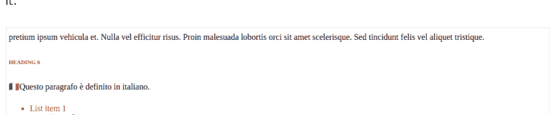

Figure 1.22 Italian flag being applied using attribute and pseudo element selectors

##### 1.6.5 The universal selector

The broadest type of selector is the universal selector which uses the asterisk symbol (*). This means that any declarations made using the universal selector will be applied to all of the HTML elements. Sometimes this can be used to reset CSS, but in terms of specificity the universal selector has a specificity value of 0, which means it can be overridden easily if needed.

In the case of our example project, we will use a universal selector (*) to set the font-family to sans-serif so it will be consistently sans-serif throughout the article: * { font-family: sans-serif; }.

Once applied we can see that all of the text in our document uses a sans-serif font regardless of their element type (Figure 1.23).

## Title of our article (heading 1)

Posted on May 16 by Lisa.

Lorem ipsum dolor sit amet, consectetur adipiscing elit. Pellentesque tincidunt dapibus eleifend. Nam eu urna ipsum. Etiam consequat ac dolor et dapibus. Duis eros arcu, interdum eu volutpat ac, lacinia a tortor. Vivamus justo tortor, porttitor in arcu nec, pretium viverra ipsum. Nam sit amet nibh magna. Sed ut imperdiet orci, id finibus justo. Maecenas magna mauris, tempor nec tempor id, aliquam et nibh. Nunc elementum ut purus id eleifend. Phasellus pulvinar dui orci, sed eleifend magna ullamcorper sit amet. Proin iaculis lacus congue aliquam sodales.

- 1. List item 1
  - Nested item 1
  - Nested item 2
- 2. List item 2
- 3. List item 3
- 4. List item 4

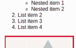

Curabitur id augue nulla. Aliquam purus urna, aliquam eu ornare id, maximus et tellus. Aliquam eleifend sem vitae urna blandit, non bibendum tellus dignissim. Aliquam imperdiet imperdiet sapien sit amet consectetur. Nam convallis turpis felis, sed vulputate lacus eleifend a. Mauris pharetra imperdiet lacinia. Sed sit amet feugiat lectus, in consectetur magna. Vestibulum accumsan porta enim at ultricies. Vestibulum vitae massa quis massa dignissim imperdiet.

> Nunc eleifend nulla lobortis porta rhoncus. Vivamus feugiat, sem vitae feugiat aliquam, orci nulla venenatis libero, vitae rhoncus nibh neque ac velit.

Etiam tempor vulputate varius. Duis at metus ut eros ultrices facilisis. Donec ut est finibus, egestas nisl eu, placerat neque. Pellentesque cursus, turpis nec sollicitudin sodales, nisi tellus ultrices lectus, nec facilisis purus neque vitae diam. Nunc eleifend nulla lobortis porta rhoncus. Vivamus feugiat, sem vitae feugiat

## Figure 1.23 Using the universal selector to change the font type on all elements

###### NAMESPACE AND THE UNIVERSAL SELECTOR

It is possible to mix different languages together in the same document, such as embedding SVG code into HTML.

The issue with doing that is that it’s difficult to distinguish between the various types of code. For example, we could have a link in our SVG graphic and a link in our HTML but we may want to style the SVG links differently than our HTML links.

To solve this we can use namespaces to uniquely identify code and set our definition of what that code does. Then, in the CSS, we can select that namespace and create styles just for that type of code.

In HTML5 when we insert code into a HTML file that is a known foreign element such as an SVG, MathML or XML it is automatically given its correct namespace.

Here a few examples of coding languages and their namespaces:

- HTML elements use the namespace of http://www.w3.org/1999/xhtml
- SVG elements use the namespace of http://www.w3.org/2000/svg
- MathML elements use the namespace of http://www.w3.org/1998/Math/MathML

In our project we have an SVG graphic within our HTML document. To declare a namespace in HTML we use the `xmlns` attribute. As we have learnt, it is optional to declare the namespace for an SVG graphic as it is a known foreign element, but we will declare it in this instance (Listing 1.10):

##### Listing 1.13 SVG Namespace

```
<svg xmlns="http://www.w3.org/2000/svg">
  <!--SVG Code-->
</svg>
```

Now that our SVG is in our HTML and we have optionally added the `namespace` value in the `xmlns` attribute, we need to add this known namespace to our CSS. In the CSS file at the top of the style sheet we add the `namespace` rule.

This is formed by writing `@namespace`. Then we give the namespace a prefix. The prefix given to the namespace can be whatever we choose, but for simplicity we have stuck with `svg` as this is the code we want to target. The name prefix is case sensitive, so `Svg` would be treated differently to `svg`. Then we add the `namespace` URI string in quotes: `@namespace svg "http://www.w3.org/2000/svg";`

Now that we have declared the namespace in our CSS let’s look at how it can work with the universal selector.

We can use the universal selector to style all elements within that namespace. In other words, we style all elements within a certain coding language, like HTML or SVG. We can use the universal selector in the following ways:

- `*` or `*|*` - matches all elements, regardless of their namespace
- `ns|*` - matches all elements in the namespace `ns`
- `|*` - matches all elements without any defined namespace

The next step is to write our CSS rule. We want to apply a background color to our two SVG elements without styling the HTML. The first step is creating the selector, which is the namespace rule we called svg, followed by a pipe (|) and then an asterisk (*) which matches all elements in the svg namespace as seen in Listing 1.11.

Our declaration will be `fill` with a light gray Hex value of `#EDEDED`. We can specify as many namespaces as we want. But that namespace rule only applies to that stylesheet, so we will need to declare it once for each stylesheet we intend to use it in.

##### Listing 1.14 Namespace selector

```
svg|* {
  fill: #EDEDED;
}
```

Once applied, we can see that the elements in our svg image now have a gray background (Figure 1.24).


Figure 1.24: 使用命名空间和通用选择器来设置 SVG 元素的背景

#### 1.7 不同方式编写 CSS

CSS 在我们编写规则和格式方面具有灵活性。我们现在将查看简写属性（我们在整本书中都会反复提到）以及我们可以格式化 CSS 的不同方式。

##### 1.7.1 简写

简写是一种通过将所有值合并到一个属性中来替代编写多个 CSS 属性的方法。我们可以用一些属性来做到这一点，例如 padding、margin、animation……这些我们将在本书的各个部分中介绍。编写简写的优点是我们可以减少样式表的大小，从而提高可读性、性能和内存使用。

每个简写属性接受不同的值。让我们探索我们在项目中使用的那个。我们在文章中有 `blockquote`。当我们对其进行样式设置时，我们使用了 `padding` 属性。我们将 padding 声明如下：`padding: 10px`。这样做时我们使用了简写。我们本可以改写如下（Listing 1.12）：

##### Listing 1.15 Padding expanded

```
padding-top: 10px;
padding-right: 10px;
padding-bottom: 10px;
padding-left: 10px
```

完全可以单独编写每个声明，但就计算性能而言代价昂贵。尤其是当所有属性值都相同时更是如此。

相反，我们可以使用 `padding` 属性并将四个值放在同一行上。顺序为上、右、下、左，如 Figure 1.25 所描述。

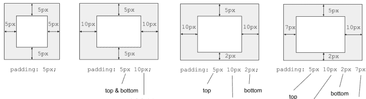

Figure 1.25 Padding shorthand property explained

如图所示，我们可以声明全部 4 个值来定义上、右、下、左的值。但如果我们说左右相同而上下不同，那么我们可以指定 3 个值，顺序为上、左右、下。

如果声明了 2 个值，则表示第一个值是上下应采用的值，然后第二个值设置左右。最后如果只声明了 1 个值，则设置全部 4 个边。

##### 1.7.2 格式化

我们编写 CSS 有几种方式，通常在查看他人的代码时我们会看到不同的格式。以下是一些示例：

多行格式（Listing 1.13）很可能是格式化选择中最受欢迎的一种。每个声明都单独占一行，然后使用制表符或空格缩进。

##### Listing 1.16 The multi-line format

```
h1 {
  color: red;
  font-size: 16px;
  font-family: sans-serif
}
```

这种多行格式的变体（Listing 1.14）将大括号放在单独一行。它是我们可能在 PHP 语言中看到的。将大括号放在单独一行可能被认为是不必要的。

##### Listing 1.17 A variation of the multi-line format

```
h1
{
  color: red;
  font-size: 16px;
  font-family: sans-serif
}
```

单行格式（Listing 1.15）很有意义，它紧凑，我们可以快速浏览文件，知道第一部分是选择器。然而，缺点是如果规则包含许多声明，阅读起来很快就会变得困难。

##### Listing 1.18 The single-line format

```
h1 { color: red; font-size: 16px; font-family: sans-serif }
```

所有选项都有利有弊，但我们会注意到本书中的项目使用了一种组合，即选项一和三。主要需要知道的是没有对错之分，通常取决于什么对你或你的团队最有效。只要代码易于理解，那就足够了。

有鹰眼的人也会注意到上面的示例中，最后规则的声明上没有分号（;）。是否添加它是可选的，但为了更好的网页性能，最好实践是将其移除。

CSS 最好的部分之一是我们可以用最舒适的方式编写它。

#### 1.8 Summary

- CSS 是一种成熟的编码语言，CSS 的每个部分都由模块组成。
- 模块取代了 CSS3 等大型版本，不会有 CSS4 版本发布。
- 内联 CSS 可以获得最高优先级并且性能良好，然而它非常重复且难以维护。
- 外部 CSS 使我们的 CSS 与 HTML 分离，保持关注点分离。
- 除了我们自己的 CSS 之外，浏览器还会应用默认样式。
- 用户也可以应用自己的 CSS，这可能会覆盖作者和用户代理样式表。
- 使用 !important 被认为是不良实践。
- CSS 规则由选择器和一个或多个声明组成。
- 有许多类型的选择器，我们可以针对它们创建规则，每个选择器都有自己的特异性级别

## 2

## 使用 CSS 网格设计布局

### This chapter covers

- 探索网格轨道以及我们如何安排网格
- 在 CSS 网格中使用 minimax 和 repeat 函数
- 使用分数单位以及它在 CSS 网格中独特性
- 创建模板区域并将项目放置在区域上
- 使用网格时的可访问性考虑
- 在网格中创建列和行之间的间距

现在我们对 CSS 的工作原理有了基本了解，我们可以开始探索布局 HTML 内容的选项，包括网格、弹性盒和列。首先，我们将专注于使用网格进行布局。

网格，在这种意义上，是相互交叉形成一系列正方形或矩形的线网络。现在得到所有主要浏览器的支持，网格已成为非常流行的布局技术。

本质上，网格由列和行组成，就像表格一样。我们首先创建我们的网格，然后将项目或元素分配到该网格，就像我们在玩大富翁游戏时将船只放置在网格上一样。

尽管有时与表格概念相比，网格布局和表格有非常不同的用途并满足非常不同的需求。网格用于布局，而表格用于表格数据。如果正在设置样式的内容适合 Excel 表格，那么它就是表格数据，应该放在表格中。

历史上我们曾使用表格进行布局，有时仍然需要这样做（例如电子邮件仅支持 CSS 的子集），但在网络上这被认为是不良实践。我们现在可以使用网格代替。

CSS 网格使我们能够发挥创造力，并为不同条件下的布局制作一系列布局并与媒体查询结合进行适配，正如我们将看到的那样。我们将使用

grid 来设置我们的项目样式，到本章结束时，我们的布局将如下所示（Figure 2.1）：

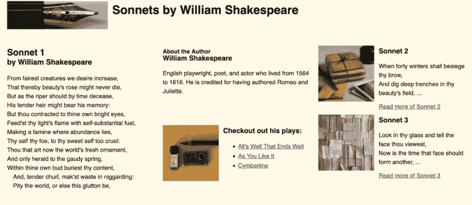

Figure 2.1 Final output

我们从 Github 仓库（https://github.com/michaelgearon/Tiny-CSS-Projects）的 chapter-02 文件夹中找到的起始 HTML 如下所示：

### Listing 2.1 Project HTML

```
<body>
  <main> #A
    <header> #B
      
      <h1>Sonnets by William Shakespeare</h1>
    </header>
    <article> #B
      <h2>
        Sonnet 1
        <br><small>by William Shakespeare</small>
      </h2>
      <p>
        <span>From fairest creatures we desire increase,</span>
        ...
      </p>
    </article>
    <aside> #B
      <section aria-label="sonnet 2">
        
        <h3>Sonnet 2</h3>
        <p>
          When forty winters shall besiege thy brow,
          <br>And dig deep trenches in thy beauty's field, ...
        </p>
      </section>
```

```
<a href="">Read more of Sonnet 2</a>
</section>
<section>

<h3>Sonnet 3</h3>
<p>
Look in thy glass and tell the face thou viewest,
<br>Now is the time that face should form another, ...
</p>
<a href="">Read more of Sonnet 3</a>
</section>
</aside>
<section class="author-details"> #B
<h3>
<small>About the Author</small>
<br>William Shakespeare
</h3>
<p>English playwright, poet, ...</p>
</section>
<section class="plays"> #B

<h3>Checkout out his plays:</h3>
<ul>
<li><a href="">All's Well That Ends Well</a></li>
...
</ul>
<h3></h3>
</section>
<footer> #B
<p>Want to read more ...</p>
</footer>
</main>
</body>
```

#A 项目的容器

#B 容器内的子项

我们还有一些起始 CSS（Listing 2.2）只是为了指导我们在开始将 HTML 元素放置到网格格式时。我们不会担心这些预设样式（例如 margin、padding、颜色、排版和边框），因为这些概念在本书的其他部分有介绍，我们特别希望本项目专注于布局。

我们将字体从衬线改为无衬线，并使用 margin 增加浏览器窗口边界与容器之间的间距。我们还将图像浮动到左侧并调整行高、排版和内边距。

请注意，我们为 main 元素的直接子元素添加了边框和一些内边距。这些是为了帮助我们定义布局。我们将在项目后期将其移除。


## Listing 2.2: Project starting CSS

```
body {
  margin: 0;
  padding: 0;
  background: #fff9e8;
  min-height: 100vh; #G
  font-family: sans-serif;
  color: #151412
}

main { margin: 24px }

img {
  float: left; #F
  margin: 12px 12px 12px 0
}

main > * { #A
  border: solid 1px #bfbfbf; #B
  padding: 12px;
}
main > *, section { display: flow-root } #C

p, ul { line-height: 1.5 }

article p span { display: block; }

article p span:last-of-type, #D
article p span:nth-last-child(2) { #D
  text-indent: 16px #D
} #D

.plays ul { margin-left: 162px } #E
```

#A Asterisk and child combination selects any and all immediate children of main
#B Border to visually point out sections to be positioned using grid
#C Prevents images from bleeding out of their containers
#D Indents the last 2 lines of the sonnet
#E Indents the list; otherwise bullets are right up against the image
#F Allows text to wrap around the image
#G So that the background covers the whole page even when window is longer than the content

Our starting point looks as follows (Figure 2.2).

## Sonnets by William Shakespeare

### Sonnet 1
by William Shakespeare

From fairest creatures we desire increase,
That thereby beauty's rose might never die,
But as the riper should by time decease,
His tender heir might bear his memory:
But thou contracted to thine own bright eyes,
Feed'st thy light's flame with self-substantial fuel,
Making a famine where abundance lies,
Thy self thy foe, to thy sweet self too cruel:
Thou that art now the world's fresh ornament,
And only herald to the gaudy spring,
Within thine own bud buries't thy content,
And, tender churl, mak'st waste in niggarding:
Pity the world, or else this glutton be,

### Sonnet 2

When forty winters shall besiege thy brow,
And dig deep trenches in thy beauty's field, ...
Read more of Sonnet 2

### Sonnet 3

Look in thy glass and tell the face thou viewest,
Now is the time that face should form another, ...
Read more of Sonnet 3

## About the Author
William Shakespeare

English playwright, poet, and actor who lived from 1564 to 1616. He is credited for having authored Romeo and Juliet.

## Check out his plays:

- All's Well That Ends Well
- As You Like It
- Cymbeline

Want to read more of Shakespeare's works, check out his complete works on the Project Gutenberg.

## Figure 2.2 Starting point

CSS grids are a way to place items on a two-dimensional layout, horizontal (x-axis) and vertical (y-axis). In contrast, flexbox (covered in Chapter 6) is single-axis-oriented. It only operates on either X or Y depending on its configuration. In short, a CSS grid is for laying out items whilst a flexbox is for the alignment of items.

First let's set up our grid; we will then look at ways we can alter how our grid behaves based on window size.

## 2.1 Display

The first part of arranging a grid is setting the `display` value to "grid" on the parent container item. When creating a grid layout, we can use one of 2 values:

- `grid`: when we want the browser to display the grid in a block-level box. The grid will take the full width of the container and set itself on a new line.
- `inline-grid`: this is when we want the grid to be an inline-level box. The grid will set itself inline with the previous content much like a span.

### Difference between block-level and inline-level box

In HTML every element has a box surrounding it. A block-level box says that an element's box should use the entire horizontal space of its parent element, therefore preventing any other element being on the same horizontal line. In contrast, inline elements can allow other inline elements to be on the same horizontal line depending on the remaining space.

We will use the value grid for our layout:

## Listing 2.3 Setting the display to grid

```
main {
  display: grid;
}
```

If we preview this in the browser we notice that visually nothing has changed. This is because the browser by default will display the direct child items in one column. The browser will then generate enough rows for all of the children elements.

Using the developer tools in our browser (Figure 2.3), we can see that programmatically the grid has been created even though the layout has not visually changed. To view the underlying grid on most browsers we can right click on the web page and select inspect from the menu.

In the Firefox inspect window, we select the parent container and we will see 2 things to indicate this is now a grid:

- 1. Purple lines around each direct child item
- 2. In the CSS panel to the right of the HTML, we see the `main` has a display of grid and next to it an icon
- 3. Once we click the grid icon beside `<main>`, the layout panel shows us our grid structure

Although we can follow similar steps for Chrome or Safari, Firefox does provide better functionality when viewing and editing the grid in the developer tools.

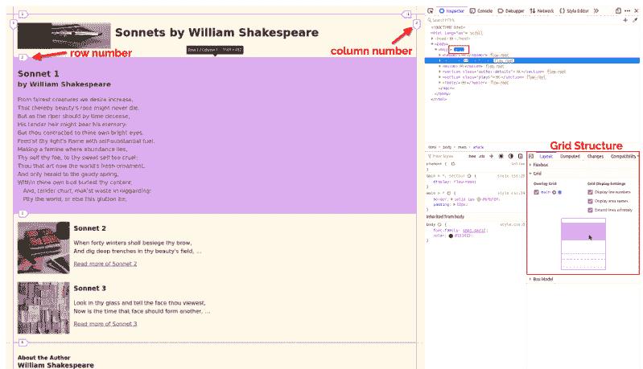

Figure 2.3 Development tools in Firefox

## 2.2 Grid tracks and lines

When grid was introduced it brought in new terminology to describe laying out items. The first concept is grid lines. Lines run horizontally and vertically and are numbered starting from 1 in the top left, on the opposite side to the positive numbers are the negative numbers.

### Writing mode and script direction

The number assigned to each line is dependent on the writing mode (whether lines of text are laid out horizontally or vertically) and script direction of the component. For example, if the writing mode is English then the first line on the left is numbered 1. If the language direction was set to right-to-left, for example because the language was Arabic (written from right to left), then line 1 would be the furthest line to the right.

In-between the grid lines are the grid tracks that are made up of the columns and rows. Columns go from left to right whilst rows go from top to bottom. A track is the space between any two lines on a grid. In our example below (Figure 2.4) the track highlighted is our first row track in our grid. A column track would be the space between two vertical lines.

Then within each track are grid cells. A cell is the intersection of a grid row and a grid column.

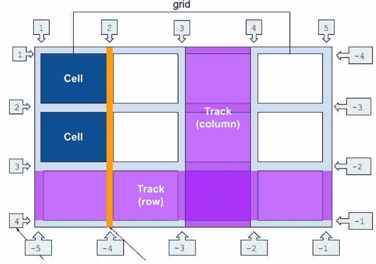

Figure 2.4 Grid structure based on writing mode being English with the direction set to left-to-right

The grid-template-columns and the grid-template-rows properties can be used to lay out your grid.

DEFINITION These properties specify, as a space-separated track list, the line names and track sizing functions of the grid. The grid-template-columns property specifies the track list for the grid's columns, while grid-template-rows specifies the track list for the grid's rows.

Before we set our columns we first need to understand a few concepts that are specific to CSS Grids.

### 2.2.1 Repeating columns

To save repetition in your code you can use the repeat() function to specify how many columns you need.

The repeat() function needs two values that are comma separated:

- 1. the first value indicates how many columns to create
- 2. the second value is the sizing of each column

For our project we will specify that we want 2 columns and then for the sizing of each column we will use the minmax function. Our column definition will therefore looks as follows:

```
grid-template-columns: repeat(2, minmax(auto, 2fr)) 250px;
```

This declaration will produce 3 columns, 2 of equal width using the fraction unit and one of 250 pixels. Let’s dissect this declaration a bit further. Notice that inside the repeat function, we use another function minmax().

### 2.2.2 Minmax

The minmax(min, max) function is made up of two arguments, the minimum and maximum range the grid track should be. The W3C specification states that the minmax function "defines a size range greater than or equal to min and less than or equal to max"¹.

### Valid arguments

To make the function valid the min value (the first argument) needs to be smaller than the max, otherwise max gets ignored by the browser and the function will rely just on the min value.

For our project we set the minimum value to auto and the max to 2 fractions. Let’s look at what auto means.

### 2.2.3 The auto keyword

The auto keyword can be used for either the minimum or maximum value within the function.

When the keyword auto is used for the maximum value then the minimum dimension the container will take is equal to the max-content keyword. To make layouts that include fixed headers and footers, we can assign overflow to the area for whom auto was assigned. The track that has a size value of auto will then shrink and grow with the window size as seen in Figure 2.5.


Header and footer stay fixed to the top and bottom of the window

```
div.grid {
  display: grid;
  grid-template-rows: 250px auto 250px;
}
```

```
div.grid {
  display: grid;
  grid-template-rows: 250px auto 250px;
  Height: 100vh;
}

main {
  overflow: auto
}
```

Figure 2.5 Using the auto keyword

For our use case, in the statement grid-template-columns: repeat(2, minmax(auto, 2fr)) 250px; the auto keyword dictates that for our first 2 columns, the column should be, at a minimum, as wide as the element it contains.

Let’s take a look at the Flexible Length unit (fr) used to set their maximum width.

## 2.2.4 Flexible length

The fractions (fr) unit was introduced in the CSS Grid Module. The fractions unit is unique to grid as it is a way to tell the browser how much room a HTML element should have compared to other elements by distributing the left over space once minimums have been applied.

Let’s first explore what a fraction is through some tasty cake diagrams (Figure 2.6) (sorry if this makes you crave a slice of cake). If you had a whole cake it would equal 100%. If we decided to eat all of the cake that would be 1 fraction. In our CSS that would be the same as grid-template-columns: 1fr which would be 100% of the column.

But we are friendly and decide we will give out some of our cake to our 4 friends, so we need to determine how many slices of our cake each person is going to have.

If we were fair we could say that our cake can be divided into 4 equal slices. In our CSS this would be the same as grid-template-columns: 1fr 1fr 1fr 1fr. We are telling the browser to give each HTML element an equal slice of the whole thing.

But what if we decided to be sneaky and have a larger size? After all, we baked the cake, right?

So we decide to take half of the cake for ourselves, and then divide the remaining half into three slices. To do this we need to have a total of 6 fractions, 3 fractions for our 50% of the cake and then one fraction three times to equally split the other 50% of the cake.

So in our CSS that would be grid-template-columns: 3fr 1fr 1fr 1fr, so we are saying there are 6 fractions in total, the first column gets 3 of them (or 50% of the total) and then the remaining 50% should be equally split between the other 3 columns.

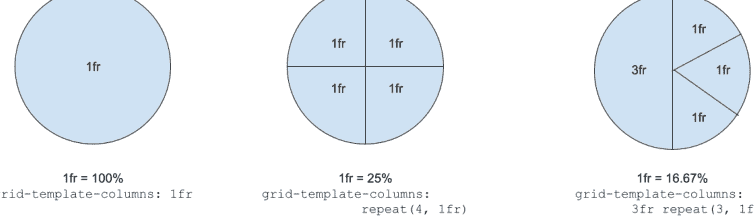

Figure 2.6 Diagram showing fractions value

For our project we will create our grid lines for the columns by adding the following to our main rule:

### Listing 2.4 Setting the amount of columns

```
main {
  display: grid;
  grid-template-columns: repeat(2, minmax(auto, 2fr)) 250px
}
```

When previewed in the browser (Figure 2.7) we can see that now our grid has numbers set across each line. What we can do with this information is explicitly choose where to place our HTML elements within the grid based on the grid line number.

We also notice that the browser has assumed that we want to place our HTML elements within each grid cell so rather than each element being stacked vertically the browser fills up each column cell until it runs out and then creates a new row and fills in those columns. This is also known as the implicit grid.

## Explicit vs implicit grid

When we use either `grid-template-columns` or `grid-template-rows` we create an explicit grid, we are clearly stating to the browser the exact amount of columns and rows this grid should have. The implicit parts (both for the rows and columns) are those that are automatically created by the browser, this can happen when there are more child items than grid cells, the browser will then implicitly extra cells to. We can control implicit behavior through `grid-auto-flow`, `grid-auto-columns`, and `grid-auto-rows`.

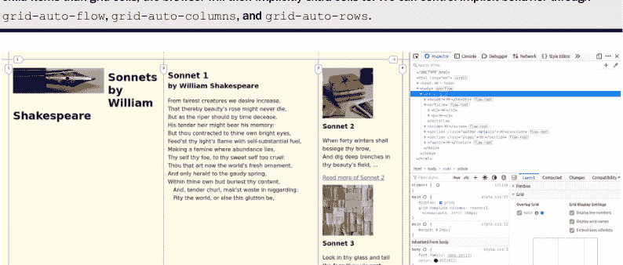

Figure 2.7 Firefox browser preview showing the grid lines and the associated numbers for each line

At this juncture, we have created a grid containing 3 columns. Two of those columns use `minmax()` and then our third column has a fixed value of 250px. This will allow us to have a three column layout. We will want to distribute the main content in the first 2 columns and use the 3rd one as an aside to put other less important content hence it being given less visual real estate (on most screens it will be narrower than the first 2 columns).

## 2.3 Grid template areas

If we want to explicitly set an element on a particular row and column of our grid, we have 2 different options. First, we can use the line numbers and dictate the position of the child as follows: `grid-column: 1 / 4`. This would place the element in the first column spanning through the second and third. Remember than grid is all based on lines, and the first line is the far left edge so the 4th line is the right edge of the grid. In our example, the element would be full width. To define the row we would use the same syntax as for columns with the `grid-row` property. To define that an element should start on the 3rd row and span 2 rows we would write: `grid-row: 3 / 5`.

Rather than dealing with numbers, we can instead use named areas to be referenced when explicitly placing elements on the grid. To do this we use the `grid-template-areas` property. This allows us to define the guide for how we want the web page to be laid out.

The `grid-template-areas` property takes multiple strings, each composed of the names of the areas they describe. Each string represents a row in the layout as seen in Figure 2.8. Each name represents a column within the row. If 2 adjacent cells have the same name (horizontally or vertically) the two cells are treated as one area.

```
grid-template-areas:
"header  header  header"
"content content author"
"content content aside "
"plays   .       aside "
"footer  footer  footer";
```

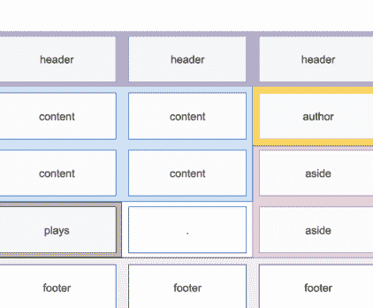

Figure 2.8 Syntax of the `grid-template-areas` property

The benefit of named areas is in the visualization of the final outcome. We will define our `grid-template-areas` as follows (Listing 2.6). Notice the dot (.) in the 4th row. The dot is used to define a cell that we intend to keep empty. Since it does not have a name, content cannot be assigned to it.

### Listing 2.5 Creating our template areas

```
main {
  display: grid;
  grid-template-columns: repeat(2, minmax(auto, 2fr)) 250px;
  grid-template-areas:
  "header header header"
  "content content author"
  "content content aside "
  "plays   .       aside "
  "footer  footer  footer";
}
```

Although we have defined areas, the content is still implicitly positioning itself in each available cell, ignoring the areas we have defined (Figure 2.9). We now need to assign our content to each of these areas.

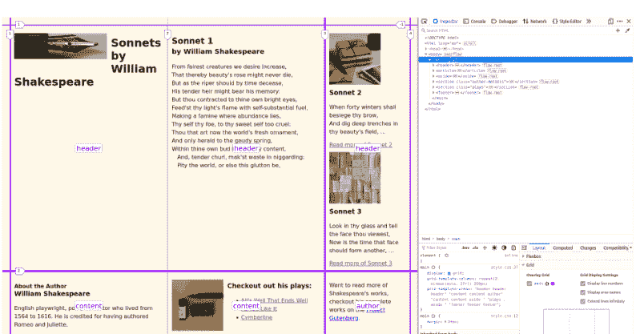

Figure 2.9 Defined grid areas (Firefox)

## 2.3.1 grid-area

To place an element in a defined area we use the grid-area property. The grid-area value is the name we assigned in the grid-template-areas property. For example, if we want the <header> element to be placed inside of the area we defined as header, we would define: header { grid-area: header; }. Applied to our project, we set our areas as follows:

### Listing 2.6 Assigning content to grid areas

```
header { grid-area: header }
article { grid-area: content }
aside { grid-area: aside }
.author-details { grid-area: author }
.plays { grid-area: plays }
footer { grid-area: footer }
```

Now that we explicitly defined where the content should go, we can see that the content falls into place (Figure 2.10).

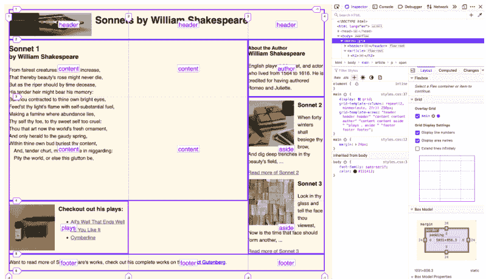

Figure 2.10 Content explicitly placed on the grid

With the layout setup, let’s remove some of the styles we had added for the purpose of understanding what our layout was doing. As seen in Listing 2.7 we remove the padding and borders of our content sections.

### Listing 2.7 Removing debugging styles

```
main > *{
    border: solid 1px #bfbfbf;
    padding: 12px;
}
```

With those styles removed and the screen width narrowed (Figure 2.11) we can see that the content in adjacent columns or rows appears really close together.


## 莎士比亚十四行诗

## 十四行诗 1
作者 William Shakespeare

From fairest creatures we desire increase,
That thereby beauty's rose might never die,
But as the riper should by time decease,
His tender heir might bear his memory:
But thou contracted to thine own bright eyes,
Feed'st thy light's flame with self-substantial fuel,
Making a famine where abundance lies,
Thy self thy foe, to thy sweet self too cruel:
Thou that art now the world's fresh ornament,
And only herald to the gaudy spring,
Within thine own bud buries't thy content,
And, tender churl, mak'st waste in niggarding:
Pity the world, or else this glutton be,

## 关于作者
William Shakespeare

English playwright, poet, and actor who lived from 1564 to 1616. He is credited for having authored Romeo and Juliet.

## 十四行诗 2

When forty winters shall besiege thy brow,
And dig deep trenches in thy beauty's field, ...

Read more of Sonnet 2

## 查看他的剧作：
- All's Well That Ends Well
- As You Like It
- Cymbeline

## 十四行诗 3

Look in thy glass and tell the face thou viewest,
Now is the time that face should form another, ...

Read more of Sonnet 3

Want to read more of Shakespeare's works, check out his complete works on the Project Gutenberg.

Figure 2.1.1 Narrow screens

Let's add space between the areas. To accomplish this, we will use the gap property.

## 2.4 Grid gap

The gap property is shorthand for row-gap and column-gap properties. By setting the row and column gaps we are defining the gutters between each row and column. Gutters is a term from print design, defining the margin between columns. By default the gap between columns and rows is 0.

When using the gap property, the extra space only applies between the tracks of the grid. No gutters are applied before the first track or after the last track. To set space around the grid we use padding and margin properties.

## grid vs grid-gap

As CSS Grid was being defined, the specification for this property was called the grid-gap property but now it is recommended to use just gap. However, we still may see grid-gap in older projects.

The gap property can have up to two positive values:
- the first sets the row gap
- the second is for the column gap

If there is only one value declared it is applied to both the row-gap and the column-gap properties. For our project we will set a 20px gap between our rows and columns by adding gap: 20px to our main rule.

Figure 2.12 shows our gaps added to our layout.

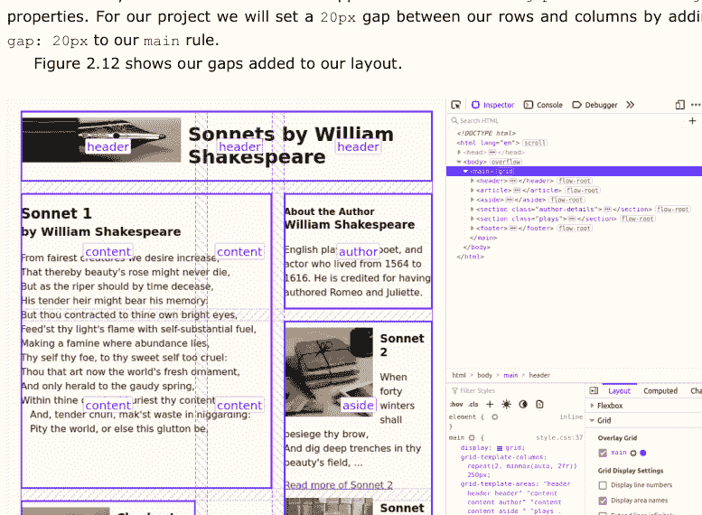

Figure 2.12 Grid layout with added gap

With the gaps added, let’s switch our focus to adjusting our layout based on screen size.

## 2.5 Media Queries

CSS allows us to conditionally apply our styles to our layout based upon the screen size. Media queries are called at-rules because they start with the @ symbol. We then define the condition under which our styles should be applied.

Currently if we look at our layout on a wide screen (Figure 2.13), we notice we have a large amount of space in the center of the page that could be better utilized.

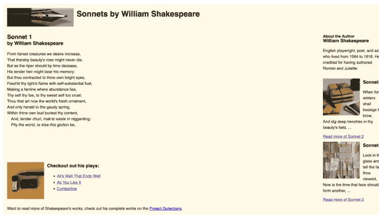

Figure 2.13 Our layout on a wide screen

Let’s create a media query that targets screens wider than 955px. The query looks as follows: @media (min-width: 955px) { }. All of the rules we place inside of the curly brackets ({}) will only be applied if the screen size is greater than or equal to 955px. These styles will override the styles we had already assigned to the grid since by being inside of the media query, they have a higher level of specificity then our original layout.

Listing 2.8 shows our media query. After defining the query, we redefine our grid-template-areas to have a different configuration. We also update the column sizes to all have equal widths.

## Listing 2.8 Creating our template areas with media queries

```
@media (min-width: 955px) { #A
  main {
    grid-template-columns: repeat(3, 1fr); #B
    grid-template-areas: #C
      "header header header" #C
      "content author aside" #C
      "content plays aside " #C
      "footer  footer  footer"; #C
  }
}
```

#A media query
#B redefines the column sizes
#C reconfigures where the content should be placed

Our layout now looks as seen in Figure 2.14 and 2.15.

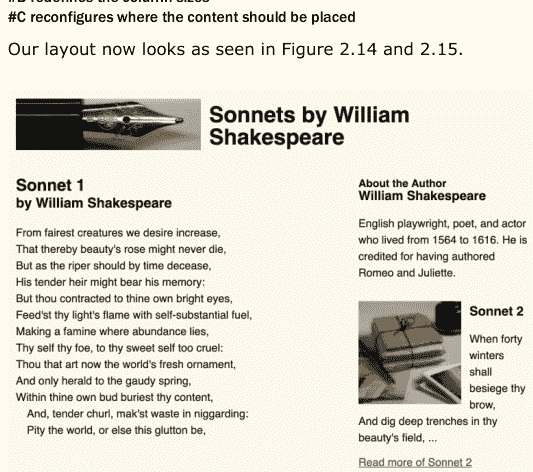

# Figure 2.14 Narrow screen uses original layout

## 莎士比亚十四行诗

## 十四行诗 1
作者 William Shakespeare

From fairest creatures we desire increase,
That thereby beauty's rose might never die,
But as the riper should by time decease,
His tender heir might bear his memory:
But thou contracted to thine own bright eyes,
Feed'st thy light's flame with self-substantial fuel,
Making a famine where abundance lies,
Thy self thy foe, to thy sweet self too cruel:
Thou that art now the world's fresh ornament,
And only herald to the gaudy spring,
Within thine own bud buriest thy content,
And, tender churl, mak'st waste in niggarding:
Pity the world, or else this glutton be,

## 关于作者
William Shakespeare

English playwright, poet, and actor who lived from 1564 to 1616. He is credited for having authored Romeo and Juliette.

## Checkout out his plays:
- All's Well That Ends Well
- As You Like It
- Cymbeline

## 十四行诗 2

When forty winters shall besiege
thy brow,
And dig deep trenches in thy
beauty's field, ...

Read more of Sonnet 2

## 十四行诗 3

Look in thy glass and tell the
face thou viewest,
Now is the time that face should
form another, ...

Read more of Sonnet 3

Want to read more of Shakespeare's works, check out his complete works on the Project Gutenberg.

Figure 2.15 Wide screen using layout from media query

Using grid-template-areas in conjunction with media queries allows us to reconfigure our layout with minimal code. However, there are some accessibility pitfalls we must avoid.

## 2.6 Accessibility

When we placed our items in the grid area we mostly kept the elements in the order they appeared in the code: the header stayed at the top, footer remained at the bottom, and the content was also in a logical visual order. But what if the HTML code arrangement and the visual order were different from each other?

The problem is that if a user is following along with a screen reader or navigates the page via keyboard and the programmatic order does not match what is being displayed, the behavior they will be presented with will seem random. This will make it very difficult for the user to navigate and to comprehend what is going with the page. Visually changing the location of a piece of content using a grid will not affect the order in which assistive technology presents the information to the user.

W3 specification says the following about this case:

> **W3 RECOMMENDATION** Authors must use order and the grid-placement properties only for visual, not logical, reordering of content. Style sheets that use these features to perform logical reordering are non-conforming.

The solution is to keep the source code and the visual experience the same, or at least in a sensible order. This will give you both the most accessible web document and a good structure to work from. For English this means content and HTML should follow the same order, from top left to bottom right.

After assigning our elements to their respective areas on the grid we should always test our page to ensure that regardless of how the user accesses the page, the order will still be logical. A couple of ways we can do this are by visiting our page using a screen reader and by tabbing through the keyboard to make sure the tab order still works.

There are tools and extensions that can help with visualizing tab order. As we are using Firefox for this, in the Firefox dev tools, for example, we can select the accessibility tab and check the "show tabbing order" checkbox, which will outline and number links and buttons as shown in Figure 2.16.

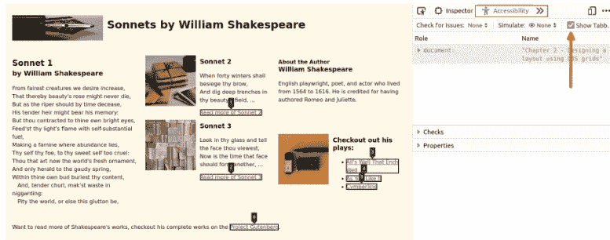

Figure 2.16 Tabbing order of HTML exposed using Firefox dev tools

We have now completed the project (Figure 2.17).

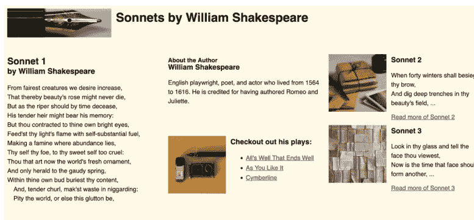

Figure 2.17 Final product on wide screen


我们使用 CSS Grid 模块创建了一个布局，该布局会根据浏览器宽度而响应式。网格的许多方面仍在开发和迭代中，最值得注意的是子网格，它将允许在网格内创建网格。虽然现在可以在网格内设置网格，但子网格的好处是与父网格更密切相关。若要关注未来的增强和开发，请查看位于 https://www.w3.org/TR/css-grid-2/ 的网格规范。

## 2.7 总结

- 在此意义上，网格是一张由相互交叉的线组成的网络，形成一系列正方形或矩形。
- `display` 属性的值为 `grid` 允许我们将项目放置在网格布局上。
- `display` 属性应用于包含要放置在网格中的子元素的父项
- `grid-template-columns` 和 `grid-template-rows` 用于显式定义网格应包含的列和行的数量和大小
- 弹性长度（`fr`）单位是 CSS 网格作为设置项目尺寸的替代方式而形成的一种测量单位
- 我们可以使用 `repeat()` 函数作为一种提高代码效率的方式，其中一行或多行或一列或多列大小相同
- `minmax()` 函数允许我们设置两个参数，即列应有的最小宽度和最大宽度。
- `grid-template-areas` 允许我们定义每个网格区域的名称，然后我们可以在子项上使用 `grid-area` 属性将它们分配到这些命名位置
- `gap` 属性是一种在网格单元之间添加间距（创建间距）的方式
- 请记住确保源代码和视觉体验在相同的逻辑顺序中。当不确定时，请使用浏览器开发者工具检查选项卡顺序

## 3

### 创建响应式动画加载屏幕

### 本章涵盖

- 通过在 SVG 中创建基本形状来创建可缩放矢量图形（SVG）以创建我们的加载器
- 了解 SVG 中 viewbox 和 viewport 之间的区别
- 什么是关键帧以及我们如何从一种尺寸动画到另一种尺寸的 SVG 图像
- 使用 animation 属性设置持续时间、样式、应动画播放的次数以及动画开始的延迟时间
- 如何使用 CSS 样式化 SVG 图像
- 如何使用供应商前缀样式化 HTML 进度条元素

我们今天在大多数网页和移动应用程序中都能看到加载器。这些加载器用作向用户传达正在加载、上传或等待某事的方式。它让用户确信正在发生某些事情，并且应用程序并未冻结。

如果没有某种指示器告诉用户正在发生某事，用户可能会尝试重新加载、返回并再次点击链接，或干脆放弃并离开。当操作耗时超过 1 秒时，我们应该使用某种进度指示器，这时用户往往会失去关注并质疑是否存在问题。除了显示正在发生某事的视觉图形外，加载器还应附带文字，告诉用户正在发生什么。

对于我们的动画，我们将研究 CSS 动画模块，了解 animation 属性、关键帧、过渡以及可访问性，以及我们如何尊重用户对呈现给他们的动画量的偏好。

我们将使用 SVG 图像创建矩形，并查看 SVG 为我们提供的功能，以了解在样式化 HTML 元素和 SVG 元素之间存在的细微 CSS 属性差异。

对于进度条，我们将使用 HTML `progress` 元素，然后查看如何删除浏览器的默认样式并应用我们自己的样式。总的来说，我们希望创建一个一致、响应式的加载器，可在各设备上使用。我们将实现的结果如图所示 3.1。

本项目的 before 和 after 代码可在 GitHub 仓库中找到：https://github.com/michaelgearon/Tiny-CSS-Projects

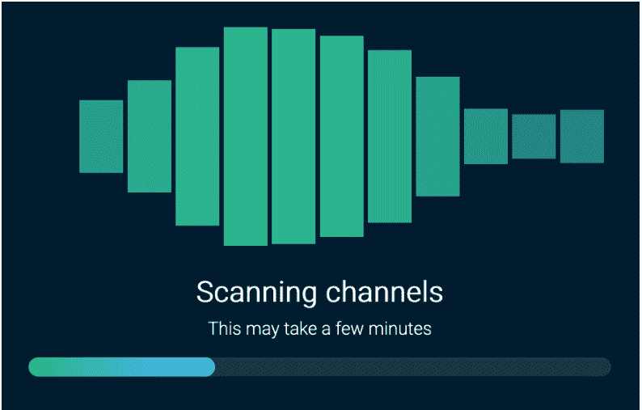

图 3.1 本章的最终目标

### 3.1 SVG 和图形

SVG 代表可缩放矢量图形。SVG 使用基于 XML 的标记语言编写，并由笛卡尔平面上的矢量组成。

矢量是定义几何原语的数学公式。线、多边形、曲线、圆和矩形都是几何原语的示例。

平面上的笛卡尔坐标系是一种基于网格的系统，使用相对于两个垂直轴的距离来定义点的一对数值坐标。这两个轴相交的地方是原点，其坐标值为 (0, 0)。回想一下数学课，当我们被要求在图表上绘制线条时，那就是笛卡尔坐标系。本质上，SVG 是坐标平面上的形状，并以 XML 编写。

相比之下，PNG、JPEG 和 GIF 是光栅图像。光栅图像使用像素网格创建。图 3.2 说明了光栅和矢量图形之间的差异。

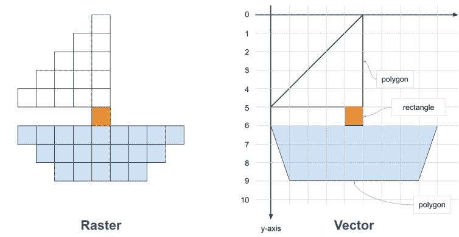

图 3.2 光栅与矢量图形

由于其构造方式，SVG 相对于光栅图像具有许多优势，包括无限可缩放。我们可以随意缩小或放大图像。我们可以缩小光栅图像，但不能在不出现像素化的情况下放大，因为放大像素网格会使网格的单个正方形变得可见。

当我们放大 SVG 时，由于我们在坐标平面上以编程方式设置形状和线条，点之间的路径会被重绘，质量不会下降。

由于 SVG 以 XML 编写，我们可以直接将 SVG 代码放入 HTML 中，并以与处理其他 HTML 元素相同的方式访问、操作、编辑它。SVG 对于图形而言就像 HTML 对于网页一样。

然而，当处理高度复杂或逼真的图像时，光栅是更好的选择。并非不可能使用 SVG 创建逼真图像，但这不切实际。使用矢量图形创建图像的文件大小以及因此加载图像的性能会显著大于作为光栅图像创建。

SVG 最常见的用例是徽标、图标和加载器。我们使用它们作为徽标，因为它们通常是简单图像，需要在任何尺寸或媒介上都清晰。此外，公司或产品通常会有多个版本的徽标，例如用于深色背景与浅色背景的情况。重新着色、但也包括简洁性和可缩放性，也是我们将其用于图标的原因。

我们使用 SVG 作为加载器，因为与光栅对应物不同，我们可以在图像本身内添加动画。我们可以隔离图形内的单个元素并将 CSS 或 JavaScript 应用于该单个元素，这是光栅无法实现的练习。

前面我们提到 SVG 基于笛卡尔平面（二维坐标平面），让我们进一步深入了解这意味着什么以及它是如何工作的。

#### 3.1.1 位置

在处理 SVG 元素时，思考定位的方式是想象我们在网格上放置元素。一切都从 0,0（原点）开始，即 SVG 文档的左上角。

X 或 Y 值越高，它就离左上角越远。位置以像素为单位测量，这是定位 SVG 元素在画布上的默认且唯一方式。图 3.3 扩展了图 3.2 中所示的船的示例，添加了原点和每个形状的坐标值。

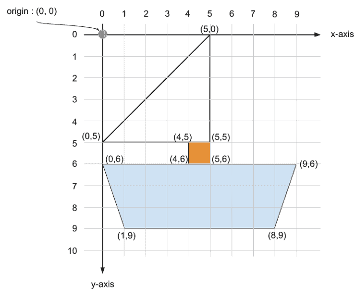

图 3.3 在坐标平面上定位元素

我们的加载器由 11 个矩形组成。为了放置它们，我们需要考虑它们在坐标平面上的位置，同时考虑它们的宽度和它们之间的间隙。

#### 3.1.2 视口

视口是用户可以看到 SVG 的区域。它由两个属性设置：width 和 height。思考视口的方式是把它想象成一个相框，它设置了框架的大小。它不会影响其包含的图形的大小，然而，如果我们将一张大于框架的图像放入相框中，则会出现溢出。我们的 SVG 也会发生同样的情况。与定位一样，视口测量值的原点位于 SVG 的左上角。图 3.4 说明了这一概念。

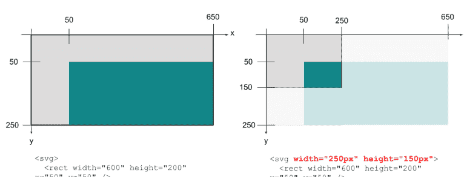

```
<svg>
<rect width="600" height="200"
x="50" y="50" />
</svg>
```

```
<svg width="250px" height="150px">
<rect width="600" height="200"
x="50" y="50" />
</svg>
```

图 3.4 有和没有定义视口的 SVG

我们加载器的视口将为：

```
<svg width="100%" height="300px"> <!--SVG code --> </svg>
```

宽度设置为 100%，但 100% 是什么的？我们规定加载器将占据其父项提供的可用空间的 100%。列表 3.1 显示了我们的起始 HTML。我们看到我们的加载器嵌套在 section 内，因此我们的加载器将与 section 相同宽度。

### 列表 3.1 起始 HTML

```
<body>
<section>
<svg width="100%" height="300px"></svg> #A
<h1>Scanning channels</h1>
<p>This may take a few minutes</p>
<progress id="file" width="100%" value="32" max="100">32%</progress> #B
</section>
</body>
```


#A 高度为 300 像素、宽度为 100% 视口的加载器
#B 稍后在本章中我们将讨论的进度条

我们也有一些起始 CSS（代码清单 3.2），背景、section、header 和段落已被预先设置样式，以便专注于加载器、进度条和动画。

## 代码清单 3.2 起始 CSS

```
body { background: rgb(0 28 47); }

section {
  display: flex;              #A
  flex-direction: column;     #B
  justify-content: space-between; #B
  align-items: center;        #B
  max-width: 800px;           #B
  margin: 40px auto;          #C
  font: 300 100% 'Roboto', sans-serif; #D
  text-align: center;         #D
  color: rgb(255 255 255);    #E
}                             #F

h1 {
  font-size: 4.5vw;
  margin: 40px 0 12px;
}

p {
  font-size: 2.8vw;
  margin-top: 0;
}
```

#A 开始设置加载器容器的规则
#B 布局
#C 使用简写属性书写的边距。上下：40px 边距，左右：auto。
#D 排版
#E 颜色
#F 结束设置加载器容器的规则

我们可以看到我们的 section 的宽度上限为 800 像素。`<section>` 是一个块级元素，因此默认情况下，它将占据其可用的全部宽度。`<body>` 和 `<html>` 也是块级元素。

由于我们没有为 `<body>` 或 `<html>` 指定宽度、内边距或边距，它们将占据窗口的全部宽度。`<section>` 将占据 `<body>` 的全部宽度。然而我们为 `<section>` 分配了最大宽度，因此一旦窗口宽度达到 800 像素或更宽，section 将停止随 `<body>` 一起增长，并保持在 800 像素宽度。因为它上下边距为 auto，它也会相对于 `<body>` 水平居中。

我们的加载器包含在 section 内，section 在达到 800 像素之前会占据 body 的全部宽度，因此我们的加载器也会如此。图 3.5 展示了加载器的宽度如何受屏幕尺寸影响。

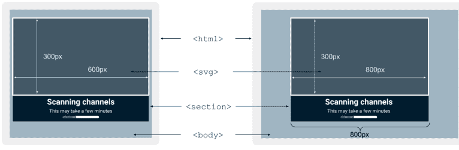

# 图 3.5 窗口宽度对 SVG 宽度的影响

设置好视口后，让我们设置 viewbox，以便 SVG 的内容能够随其容器缩放。因为记住，现在我们只处理了框架，而不是内部内容。

### 3.1.3 ViewBox

viewbox 设置图形在其视口内的位置、高度和宽度。之前我们将视口比作一幅画框，viewbox 允许我们调整图像以适应我们的画框。它可以定位图像，并缩放图形使其能够放入画框内。我们可以将 viewbox 视为我们的平移和缩放工具。要设置 viewbox，我们将 viewBox 属性应用于 SVG，并使用以下 4 个值和语法：viewBox="min-x min-y width height"。代码清单 3.3 显示了 viewBox 应用于我们的加载器。

按顺序拆解这些数字，我们从 min-x 和 min-y 开始，两者都设置为 0。我们希望图形的左上角位于画框的左上角。Min-x 和 min-y 允许我们调整图形在其画框中的位置；它是平移工具。由于我们希望它完全位于左上角，因此将值设置为 0。

接下来我们应用宽度。它设置为 710，因为我们的加载器共有 11 条条形，每条宽度为 60。60 乘以 11 等于 660，我们还有 10 个间隙。每个条形之间的间隙宽度等于，5 × 10 = 50，因此我们的加载器宽度将为 660 + 50 = 710。

我们还将 viewBox 的高度基于加载器中条形的高度。它们将具有 300 的高度值，因此我们也将视口高度设置为 300。我们的加载器因此将完全适合其视口。

## 代码清单 3.3 声明 viewbox

```
<svg viewBox="0 0 710 300" width="100%" height="300px">
<!--SVG code-->
</svg>
```

请注意，我们的 viewbox 和视口高度都等于 300。这就是我们缩放的方式。如果 viewbox 数字小于视口，则相当于向画框中缩小，图形会变小。如果 viewbox 数字大于视口，则相当于放大。由于我们视口和 viewbox 高度相等，因此我们没有缩放。

现在我们已经定义了工作空间，我们可以开始向加载器添加形状了。

### 3.1.4 SVG 中的形状

有一些标准的 SVG 形状/元素：

- `rect`（矩形）
- `circle`
- `ellipse`
- `line`
- `polyline`
- `polygon`

如果我们想要创建不规则形状，我们也可以使用 path。但我们不需要它用于此加载器。最常见的是，当我们查看标志、图标和复杂动画图形背后的 XML 时会看到它们。对于我们的项目，我们将使用基本的矩形形状来创建波浪。

要定义将创建加载器条形的矩形，我们将使用 `<rect>` 元素并添加 4 个属性：`height`、`width`、`x` 和 `y`。x 和 y 属性将确定矩形左上角相对于 SVG 左上角的位置。

我们希望创建 11 个矩形（见代码清单 3.4），宽度为 60，高度为 300，然后我们将使用 x 属性在图形上移动矩形。我们将从 0 开始，并按条形宽度（60）加上额外的间隙 5 增加值。每个矩形的 x 值将比前一个大 65。我们的第 11 个矩形应具有 650 的 x 值。

```
Listing 3.4 11 rectangles
<svg viewBox="0 0 710 300" width="100%" height="300">
  <rect width="60" height="300" x="0" />
  <rect width="60" height="300" x="65" />
  <rect width="60" height="300" x="130" />
  <rect width="60" height="300" x="195" />
  <rect width="60" height="300" x="260" />
  <rect width="60" height="300" x="325" />
  <rect width="60" height="300" x="390" />
  <rect width="60" height="300" x="455" />
  <rect width="60" height="300" x="520" />
  <rect width="60" height="300" x="585" />
  <rect width="60" height="300" x="650" />
</svg>
```

我们现在已将矩形定位在视口内，并且它们会随着我们增加和减少窗口大小而正确缩放，这是由我们的 viewBox 决定的。图 3.6 显示了不同窗口大小下的 SVG。（为使截图中更清晰，已在 SVG 和条形上添加了白色边框）。内容会在其可用空间内缩小和放大，随着窗口大小变化而改变宽高比，同时不会扭曲包含的矩形。

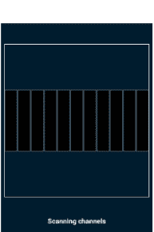

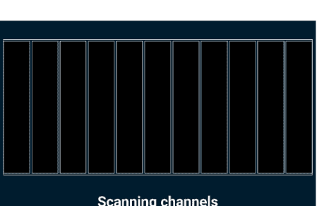

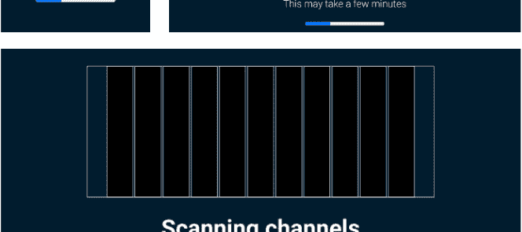

图 3.6 在 SVG 内添加了 11 个矩形

请注意我们的矩形是黑色的，然而，下一步我们将对其进行样式设置。

## 3.2 为 SVG 应用样式

我们可以以与 HTML 几乎相同的方式为 SVG 元素应用样式，内联、在 `<style>` 标签内，或在单独的样式表中。然而有一些细微差别。

首先，最重要的是，SVG 如何导入到我们的 HTML 中会影响样式需要位于何处才能影响元素。

将矢量图形添加到网页的最简单方法是使用图像标签。我们以与任何其他图像相同的方式引用图像文件：``。我们也可以在 CSS 中将其作为 `background-image` 添加：`background-image: url("myImage.svg");`

在这两种情况下，我们的 HTML 和样式可以影响 SVG 本身，但不能影响其内部的元素。例如，我们可以影响图像的大小，但不能更改 SVG 内部特定形状的颜色。图像本质上是一个我们无法穿透的黑盒，无法影响其中的变化。为了操纵其中的元素，样式需要在 SVG 本身内部放置。

我们第三个选项，也是本章使用的选项，是将 SVG 的 XML 内联放置，直接在我们的 HTML 中，而不是在外部文件中，从而避免如果代码在外部文件时会遇到的黑盒问题。缺点是我们的关注点没有那么好分离，因为我们的图像代码现在与 HTML 混合在一起。

将 SVG 放置在 HTML 中内联后，应用 CSS 到任何其他 HTML 元素的方式同样适用。因此，我们可以将想要应用于 SVG 的样式放在我们的 CSS 中，就像对待任何其他 HTML 元素一样。

## SVG 演示属性

与 HTML 不同，在内联应用样式时我们需要包含 style 属性（例如：`<p style="background: blue">`），SVG 有许多可以直接作为属性添加到元素上的样式。这些被称为 **演示属性**。**fill** 例如，（SVG 等同于 `background-color`）可以直接应用于元素而无需 style 标签：`<rect fill="blue">`。

这些属性不必内联直接应用于元素上。它们也可以在 style 标签或样式表中以与应用任何其他 CSS 样式相同的方式添加：`rect { fill: blue; }`。

SVG 演示属性的完整列表可以在 https://developer.mozilla.org/en-US/docs/Web/SVG/Attribute/Presentation 找到

尽管应用样式到 SVG 元素的技术与 HTML 相同（除了前面提到的当内联应用时 SVG 演示属性），我们用于设置元素样式的一些属性会有所不同。让我们更仔细地看看本项目中我们将使用的属性。

### 3.2.1 Fill

要设置加载器条的背景颜色，我们将使用 `fill` 属性，而不是使用 `background-color`，因为 `background-color` 属性对 SVG 元素不起作用。fill 属性仍然支持与 background-color 相同的取值，如颜色名称、RGB(a)、HSL(a) 和十六进制。因此，而不是 `rect { background-color: blue; }` 我们将改写为 `rect { fill: blue; }`。

如果未为特定形状分配 `fill` 值，`fill` 将默认为黑色，这就是为什么我们的矩形目前是黑色的。


让我们继续为矩形添加填充颜色。因为它们并不是全部同一种颜色（它们具有不同深浅的蓝绿色，以给加载器带来一点渐变效果），而不是为每个元素指定一个类，我们将使用伪类 nth-of-child(n)，它根据元素在其父项中的位置来匹配元素。我们将查找第 n 个矩形，并为其应用填充。因此，section rect:nth-of-type(3) 将找到 section 容器中的第三个矩形。

**记住：** 伪类针对的是元素的状态。在本例中是其相对于兄弟元素的相对位置。

清单 3.5 显示了为我们的每个矩形应用的填充颜色。

## 清单 3.5 为我们的每个矩形添加填充颜色

```
rect:nth-child(1) { fill: #1a9f8c }
rect:nth-child(2) { fill: #1eab8d }
rect:nth-child(3) { fill: #20b38e }
rect:nth-child(4) { fill: #22b78d }
rect:nth-child(5) { fill: #22b88e }
rect:nth-child(6) { fill: #21b48d }
rect:nth-child(7) { fill: #1eaf8e }
rect:nth-child(8) { fill: #1c4a8d }
rect:nth-child(9) { fill: #17968b }
rect:nth-child(10) { fill: #128688 }
rect:nth-child(11) { fill: #128688 }
```

图 3.7 显示了我们的输出，我们可以看到加载器中的每个条形不再是黑色，并且已应用了颜色。

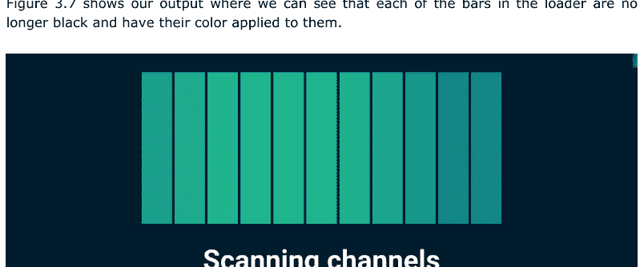

图 3.7 为加载器矩形应用填充

我们声明的唯一缺点是，如果还有另一个 SVG 图形也包含矩形，那么它可能会错误地设置样式。为避免此问题，我们可以为我们的 SVG 图形添加一个类名作为标识符，以指定我们想要设置样式的包含矩形的 SVG。

## 3.3 动画模块

CSS 动画模块允许我们使用关键帧来为属性设置动画，我们稍后会查看。除了关键帧之外，我们还可以控制动画的各个部分，例如动画持续多长时间，以及动画播放多少次。

### 3.3.1 动画属性

animation 属性是以下属性的简写：

- `animation-name`
- `animation-timing-function`
- `animation-iteration-count`
- `animation-fill-mode`
- `animation-duration`
- `animation-delay`
- `animation-direction`
- `animation-play-state`

对于我们的动画，我们将重点关注其中 4 个属性：

1. `animation-name`
2. `animation-duration`
3. `animation-iteration-count`
4. `animation-delay`

我们想要创建的效果是每个矩形在一段时间内缩小和变大，但并非全部同步。在任何给定时间，我们希望元素高度略有不同。当它们在缩小和变大时，我们希望矩形的顶部和底部向中心靠拢，然后再次扩展回全高。基本上，我们将创建一个挤压效果，从大到小再回到大。

尽管我们将对所有矩形应用相同的动画，但为了使它们的尺寸错开，我们将为每个矩形动画的开始应用略有不同的延迟。由于每个矩形开始动画的时间不同，每个矩形都处于扩展和收缩的不同阶段，从而产生涟漪波效果。

让我们先看看如何创建动画本身。然后我们将看看如何将其应用于矩形。最后我们将添加单独的延迟以在任何给定时间错开大小。要创建动画，我们将使用关键帧。然后 animation 属性将引用关键帧并规定持续时间、延迟以及我们希望动画运行的次数。

### 3.3.2 关键帧和动画名称

当我们创建关键帧时，我们需要为关键帧命名。animation-name 声明的值与关键帧名称匹配，将两者连接起来。使用 animation-name 属性，我们可以列出多个用逗号分隔的动画。

关键帧源自动画和电影行业。公司以前手工制作动画时，会制作许多单独的图片，然后在每张图片或帧中进行更改。随着时间的推移，我们不断对每帧进行更改，最终会达到结束帧。这种技术的简单示例是翻页书动画。帧数越多，短时间内调整越细微，动画就越流畅。

关键帧代表动画中最重要的（关键）变化（帧）。然后浏览器会计算出每帧之间的所有帧。这被称为中间帧。允许硬件执行工作，它可以快速填充所有这些中间帧，在一个状态和另一个状态之间创建平滑过渡。此概念在图 3.8 中进行了图解。

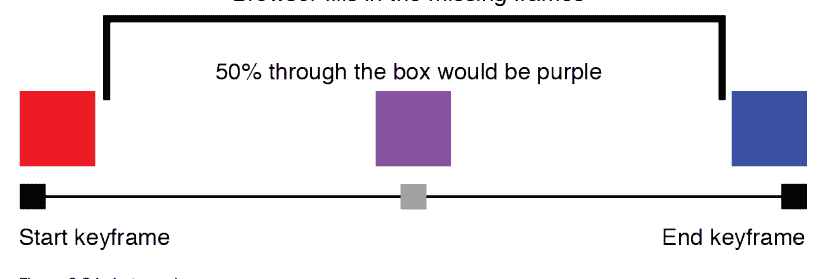

在 CSS 中，关键帧是一个 at-rule，它控制动画序列中发生的步骤。at-rule 是 CSS 语句，用于规定我们的样式应如何表现或何时应用。它们以 @ 符号开头，后跟标识符（在我们的例子中为 keyframes）。语法如下 @keyframes animation-name { ... }。括号内的代码定义了动画的行为。

关键帧内的每个步骤都由一个百分比（动画中经过的时间百分比）和在达到该时间点时应用的样式来定义。让我们看一个示例（清单 3.6，此示例也可以在 codepen 上找到 https://codepen.io/martine-dowden/pen/dydmWZO，在那里我们可以看到动画运行）。

该示例有两个关键帧，一个名为 color，一个名为 border-radius。我们已将两个动画都应用于一个 div。然后我们定义了动画运行所需的时间（3 秒），以及应运行的次数（10 次）。

在每个关键帧内部，是应应用于元素的样式。我们注意到我们有两种不同的表示法，我们有关键字和百分比。让我们分解我们在第一个关键帧中定义的内容。

我们断言当动画开始时（0%），我们希望将 div 的背景颜色设置为蓝色。到动画的 50% 时（3 秒的一半或 1.5 秒），我们的背景将变为黄色。当动画结束时（100%，或 3 秒时），我们的背景将变为红色。在步骤之间，我们会看到从一个状态到下一个状态的平滑变化。

在第二个关键帧 border-radius 中，我们使用关键字 from 和 to 而不是百分比。from 等同于 0%，to 等同于 100%。我们还注意到，我们可以在同一关键帧中混合使用我们想要的表示法。

## 清单 3.6 示例动画

```
@keyframes color {
  0% { background: blue }    #A
  50% { background: yellow }  #A
  100% { background: red }   #A
}

@keyframes border-radius {
  from { border-radius: 0 }   #B
  50% { border-radius: 50% }  #B
  to { border-radius: 0 }     #B
}

div {
  animation-name: color, border-radius;   #C
  animation-duration: 3s;                #D
  animation-iteration-count: 10;         #E
}
```

#A 第一个关键帧，名为 "color"
#B 第二个关键帧，名为 "border-radius"
#C animation-name 属性引用了两个关键帧
#D 设置动画完成所需的时间
#E 设置动画应运行的次数

当我们将动画应用于 div 时，我们还设置了持续时间和迭代次数。请注意，这两个值同时应用于我们的两个动画。在更仔细地查看这两个属性及其工作原理之前，让我们继续为我们的加载器创建关键帧。

对于我们的加载器，我们希望随着时间的推移放大和缩小，或缩放我们的矩形。因此我们将我们的关键帧命名为 scale。我们的 at-rule 将如下所示：@keyframes scale { }。

在 at-rule 内部，我们然后定义动画的步骤（或帧）。我们将从矩形具有其全高开始。动画进行到一半时，我们希望矩形的高度为其原始高度的 20%。当动画终止时，我们希望矩形的高度恢复到全尺寸。因此我们将定义 3 个步骤：from（或 0%）、50% 和 to（或 100%）。


要改变矩形的大小，我们将使用 `transform` 属性。它允许我们改变元素的外观（旋转、缩放、扭曲、移动...），而不影响周围的元素。如果我们使用 `height` 属性来减小一个 `div` 的高度，下方的内容会向上移动以填补新出现的空间。而使用 `transform` 时，元素在页面流中的占用空间和位置不会改变，只有其可见的外观会改变。采用相同的场景，如果我们使用 `transform` 来减小同一个 `div` 的高度，下方的内容就不会向上移动。我们会留下一个空白区域。

要影响元素，`transform` 属性需要一个 `transform-function`。我们将使用 `scaleY()`。 （可用的完整函数列表可以在这里找到：https://developer.mozilla.org/en-US/docs/Web/CSS/transform-function）。

`scaleY()` 函数会垂直调整元素的大小，而不影响其高度，对其进行挤压或拉伸。为了定义元素应该被压缩或拉伸多少，我们向该函数传递一个百分比或一个数字。数值映射到其百分比等价的十进制值，因此 `scaleY(.5)` 和 `scaleY(50%)` 都能达到相同的效果，即将元素的高度减小到原始值的 50%。超过 100% 的值会增大元素的尺寸，而 0 到 100% 之间的值会使其缩小。

对 `scaleY()` 应用负值会使元素垂直翻转，因此 `scaleY(-0.5)` 会使元素上下颠倒并将其高度缩小 50%。`scaleY(-1.5)` 会使元素上下颠倒并使高度变为原始值的 1.5 倍。

对于我们的加载条，我们希望矩形在动画开始和结束时为全高，而在动画进行到一半时为原始高度的 20%。因此应用变换后的完整关键帧将如下所示（清单 3.7）。

## 清单 3.7 完成的 keyframe

```
@keyframes scale {
  #A
  from { transform: scaleY(1) }  #B
  50% { transform: scaleY(0.2) } #C
  to { transform: scaleY(1) }   #D
}                               #E

rect { animation-name: scale; }  #F
```

#A scale at-rule 的开始
#B 以全高开始动画
#C 动画进行到一半时，高度应为原始值的 20%
#D 动画结束时，将矩形恢复为全高
#E scale at-rule 的结束
#F 将 keyframe 应用到矩形

如果我们运行代码，会注意到没有任何变化，我们的矩形还没有开始变大变小，即使我们已经将 keyframe 应用到矩形上。我们仍然需要定义持续时间和迭代次数。让我们进一步深入研究这些属性。

## 3.3.3 持续时间

持续时间设置我们希望动画从开始到结束花费多长时间。持续时间可以用秒（s）或毫秒（ms）设置。持续时间越长，动画完成得越慢。考虑到可访问性，我们需要考虑对运动敏感的用户并选择一个合理的持续时间。

### 动画、癫痫发作和闪烁频率

W3C 建议为了防止因光敏性而诱发用户癫痫发作，我们需要确保我们的动画在任何一秒时间内不会闪烁超过三次¹。

选择合适的动画时序有很多因素。一个动画过快可能会变得无法感知或因其性质而导致癫痫发作。一个动画过慢会使我们的应用程序看起来卡顿。对于诸如重新排序列表时翻转箭头指向方向这样的小型微动画，我们的持续时间应很短。大多数微动画都是过渡性的。它们会动画化元素从一种状态到另一种状态的变化。这种类型动画普遍接受的持续时间约为 250 毫秒。

如果动画更大或更复杂，例如打开和关闭大型面板或菜单，那么我们可以将持续时间增加到约 500 毫秒。加载器则有所不同，它不是对用户操作做出快速响应的短暂变化，而是一个用户会在一段时间内专注于的大型视觉元素。

在确定加载器的“正确”时序时，我们通常会通过反复试验找到最适合我们图形的速度。对于我们的项目，我们希望动画在 2.2 秒内完成。为了应用动画应花费的时间，我们将 `animation-duration` 属性添加到我们的矩形中，如清单 3.8 所示。

## 清单 3.8 添加动画持续时间

```
rect {
  animation-name: scale;
  animation-duration: 2.2s;
}
```

当我们运行代码时，会注意到我们的加载器动画一次然后就不再继续，除非我们重新加载浏览器窗口。我们还注意到所有条形同时增大和减小。让我们先处理让加载器随时间持续动画的问题，然后我们可以错开矩形之间的动画，使它们看起来高度不同。

## 3.3.4 迭代次数

为了使动画在完成后重新开始，我们需要使用 `iteration-count` 属性。它设置动画应重复的次数。默认值是 1。由于我们尚未设置值，浏览器假定我们希望动画运行一次然后结束。对于我们的动画，我们希望它持续重复，为此我们使用 `infinite` 关键字值。

通过应用此值，我们声明动画应永远持续播放。如果我们想运行特定次数，我们将使用整数值。添加迭代次数后，我们的代码如下所示（清单 3.8）。

## 清单 3.9 添加动画迭代次数

```
rect {
  animation-name: scale;
  animation-duration: 2.2s;
  animation-iteration-count: infinite;
}
```

运行代码时，我们可以看到所有矩形从顶部开始同步放大和缩小，并且动画在完成后会重新开始。我们仍有一些工作要做，以便设置动画从矩形中间开始而不是顶部，并错开元素之间的动画，但让我们先暂停一下来查看动画简写属性。

## 3.3.5 动画简写属性

我们目前有 3 条声明定义了我们的动画：animation-name、animation-duration 和 animation-iteration-count。

我们可以通过动画简写属性将这三者合并来简化代码。`animation: scale 2.2s infinite;` 在功能上与我们当前应用于矩形的代码完全相同。使用简写属性使我们的代码更简洁，并且可能更容易阅读，然而如果你发现写出每个属性对你来说更容易，两种方法都是完全有效的。做最适合你的方法。

使用动画简写属性，我们更新后的 rect 规则将为：`rect { animation: scale 2.2s infinite }`。对代码进行更改后，我们会注意到动画没有变化。

接下来让我们解决每个矩形高度错开的问题。

## 3.3.6 延迟

`animation-delay` 属性顾名思义，它允许我们在元素上延迟动画的开始。延迟适用于动画的开始。一旦动画开始，它将正常循环。与持续时间一样，我们可以使用秒（s）或毫秒（ms）来设置延迟的持续时间值。默认值是 0 秒。默认情况下，动画不会有延迟。为了在动画中创建错开的效果，我们将为每个矩形分配不同的延迟值，如清单 3.9 所示。第一个矩形的动画会立即开始。我们给它一个 0 的延迟。我们可以完全省略此声明，因为 0 是 animation-delay 的默认值。这里添加它是为了在解释代码时更清晰。

第二个矩形延迟 200 毫秒，我们之后为每个矩形继续以 200 毫秒递增延迟。请注意在第 6 个矩形上我们


切换为使用秒而不是毫秒。我们这样做是为了使代码更易读，因为秒或毫秒值都是可以接受的。

## Listing 3.10 Added animation iteration count

```
rect:nth-child(1) {
  fill: #1a9f8c;
  animation-delay: 0ms;
}

rect:nth-child(2) {
  fill: #1eab8d;
  animation-delay: 200ms;
}

rect:nth-child(3) {
  fill: #20b38e;
  animation-delay: 400ms;
}

rect:nth-child(4) {
  fill: #22b78d;
  animation-delay: 600ms;
}

rect:nth-child(5) {
  fill: #22b88e;
  animation-delay: 800ms;
}

rect:nth-child(6) {
  fill: #21b48d;
  animation-delay: 1s;
}

rect:nth-child(7) {
  fill: #1eaf8e;
  animation-delay: 1.2s;
}

rect:nth-child(8) {
  fill: #1ca48d;
  animation-delay: 1.4s;
}

rect:nth-child(9) {
  fill: #17968b;
  animation-delay: 1.6s;
}

rect:nth-child(10) {
  fill: #128688;
  animation-delay: 1.8s;
}
rect:nth-child(11) {
  fill: #128688;
  animation-delay: 2s;
}
```

添加延迟后，我们可以看到（图 3.8）我们已经实现了交错效果。然而，元素是从顶部而不是从中心进行生长和收缩的。

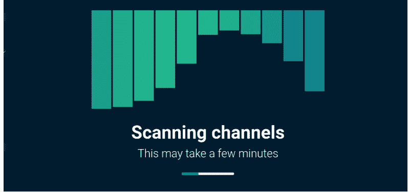

Figure 3.9 Animated rectangles with height change emanating from the top

为了指定我们希望元素从何处生长和收缩，我们需要告诉浏览器动画应从矩形的哪个位置开始。为此，我们现在将研究 transform-origin 属性。

## 3.4 Transform origin

transform-origin 属性设置动画应从哪个位置开始（原点）。如果变换发生在三维（3D）中，则该值可以多达三个值（x、y 和 z）；当它为二维（2D）时，则最多为 2 个值（x 和 y）。

第一个值是水平位置或 X 轴，第二个值是垂直或 Y 轴，然后在 3D 工作时第三个值将是前后或 Z 轴。

transform-origin 的值有 3 种声明方式：

- 1. Length
- 2. Percentage
- 3. Keywords
  - a) Top
  - b) Right
  - c) Bottom
  - d) Left
  - e) Center

在 HTML 中，此属性的初始值为 50% 50% 0，因此这是中心、中心、平面。然而，对于 SVG 元素，初始值为 0, 0，这会将其放置在左上角。

对于我们的动画，我们希望矩形变换原点位于中心。我们希望矩形的顶部和底部收缩，而不是顶部保持固定并从该点展开和收缩。为此，我们可以为矩形应用关键字值 `center` 或将百分比值 `50%` 设置为 `transform-origin` 属性。

无论哪种方式，我们都表示希望原点从矩形的中心发生。对于我们的项目，我们将使用关键字值。Listing 3.9 显示了我们更新后的 `rect` 规则。

我们之前提到过，在处理 2D 动画时，该属性将采用 2 个值，但我们只传递了一个值。当只传递一个值时，它将应用于垂直和水平位置，因此 `transform-origin: center;` 等同于 `transform-origin: center center;`。

## Listing 3.11 Updated rect rule with transform-origin property

```
rect {
  animation: scale 2.2s infinite;
  transform-origin: center;
}
```

我们已经完成了加载动画（图 3.10），但是我们仍然需要考虑我们的设计是否易于访问。

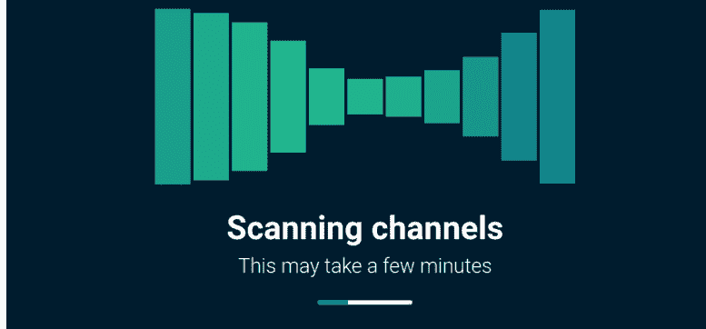

Figure 3.10 Finished Loader Animation

下一节将深入探讨我们如何确保为所有用户提供积极的体验。

## 3.5 Accessibility and the reduced motion query

随着实现变得更容易且浏览器支持得到改善，网络上使用运动、视差（背景移动速度比前景慢）和动画的情况有所增加。通过使用这些技术，我们可以创建更丰富的用户界面，使其具有交互性并在体验中提供更大的深度。

然而，使用这些技术是有代价的。对于某些用户，尤其是患有前庭功能障碍的人来说，屏幕上的运动可能会引起头痛、头晕和恶心。正如我们之前提到的，动画也可能引起癫痫发作，尤其是如果它们包含闪烁的元素。

在许多操作系统中，用户可以选择在设备上禁用动画。在我们的应用程序中，我们需要确保尊重这些偏好。为了检查用户设置，级别 5 媒体查询模块引入了 prefers-reduced-motion 媒体查询。这是一个 at-rule，它检查用户对屏幕上运动的偏好，并允许我们根据用户的偏好应用条件样式。此查询有两个值：

- - `no-preference`
- - `reduce`

我们可以选择在用户偏好减少运动时禁用动画，或在他们未指定偏好时启用它。用户偏好减少运动并不意味着我们完全不能使用任何动画，而是我们应该选择性地保留哪些动画。决定哪些动画保持启用的因素可能包括：

- - 它有多快
- - 它使用视口的多少
- - 闪烁频率
- - 它对网站功能或内容理解是否至关重要

值得一提的是，用户可能更喜欢减少或不使用动画，但可能不知道系统偏好设置以选择退出动画，因此根据网站动画的多少，提供站内退出按钮可能很有用。

> **Accessibility Guidelines for Animations**
> 用户应该能够暂停、停止或隐藏持续超过 3 秒且不被视为必要的动画。加载器在这一点上有点棘手，因为它们向用户传达重要信息（应用程序正在执行某些操作，而不是冻结）。²

我们的加载器可以被视为必要内容，但我们也在其下方提供了一个进度条，它也为用户提供了应用程序正在执行的操作的指示。由于信息也在下方通过不同的媒体传达，并且动画非常大、移动很多，并且可能持续超过三秒，我们将为偏好减少运动的用户禁用它，使用 Listing 3.10 中的代码。

## Listing 3.12 Disabling the animation for users who prefer reduced motion

```
@media (prefers-reduced-motion: reduce) { #A
  rect { animation: none; }    #A #B
}
#A
```

#A 在 at-rule 中，当用户启用 prefer-reduced-motion 时有条件地应用样式
#B 禁用之前应用于矩形的动画

为了验证我们是否成功禁用了动画，而不是必须编辑机器的设置，我们可以进入浏览器开发者工具，在控制台选项卡显示中，选择渲染选项卡（如果尚未显示，使用垂直省略号并从菜单中选择它，单击省略号），并启用减少运动仿真。图 3.11 显示了在 Chrome 版本 102.0.5005.61 中禁用的动画和开发者工具。

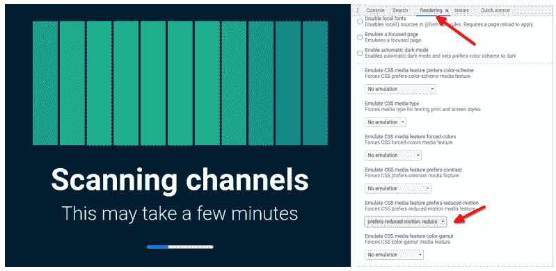

Figure 3.11 Emulating reduced motion preference using Chrome dev tools

加载动画完成后，并且可访问性需求得到处理，让我们把注意力转向屏幕底部的进度条。

## 3.6 Styling an HTML progress bar

`<progress>` HTML 元素可用于显示正在加载、上传或数据传输的情况。它通常用作向用户展示任务完成程度的方式。

`progress` 元素的默认样式在浏览器和操作系统之间会有所不同。进度条的大部分功能在操作系统级别处理，因此我们可用于重新设置控件样式的属性很少，尤其是在条本身内部的有色进度指示器方面。

我们将研究一些可用的变通方法及其陷阱，但在开始之前，让我们先从我们可以轻松完成的事情开始。

图 3.12 显示了由 Listing 3.11 中的 HTML 生成的起点。此时，尚未对控件应用任何样式。显示的是作者机器生成的默认值。


Figure 3.12 Progress bar starting point

## Listing 3.13 Progress bar HTML

```
<body>
  <section>
    ...
    <progress value="32" max="100">32%</progress> #A
  </section>
```

#A 进度条

### 3.6.1 Styling the progress bar

让我们先从更改高度和宽度开始。为了增加进度条的宽度以匹配 section 的宽度，我们将 `width` 属性的值设为 100%。我们还希望将高度增加到 24px。

要更改进度指示器的颜色，即控件的有色部分，我们可以使用一个相当新的属性：`accent-color`。此属性允许我们更改复选标记、单选输入和进度元素等表单控件的颜色。我们将其设置为 #128688，与加载器最后一根条的颜色相匹配。Listing 3.12 显示了我们迄今为止的进度规则。

## Listing 3.14 Progress rule

```
progress {
  height: 24px;
  width: 100%;
  accent-color: #128688;
}
```


Figure 3.13 shows the Lising 3.12 styles applied to our control.

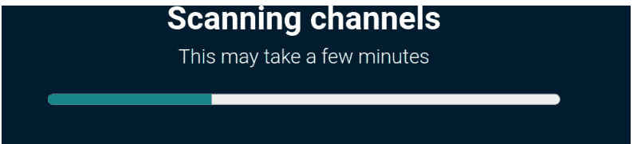

Figure 3.13 Width, height, and accent color applied to the progress element

If we try to add a background color to our element (background: pink), we will notice that it does not work. As a matter of fact, it fails quite spectacularly (Figure 3.14) as it radically changes the appearance of the element and alters the accent-color we had previously set. Furthermore, the background color changes to gray rather than pink.


Figure 3.14 Background color failure

So how do we get around this problem? In order to restyle the control, we need to ignore the default, and recreate the styles from scratch. To do that though we will need to use vendor prefixed properties.

## 3.7 Vendor Prefixes

Historically when browsers were introducing new properties they would be added with a vendor prefix before the property name. Each browser’s prefix is based on the rendering engine they use. Table 3.1 displays major browsers and their prefixes.

## Table 3.1 Vendor prefixes and their browsers

| Prefix | Browsers |
|---|---|
| -webkit- | Chrome, Safari, Opera, most IOS browsers (including Firefox for IOS), Edge |
| -moz- | Firefox |

However, vendor prefixed properties were never meant, and still aren’t fit, for production use. They are often incomplete or non-standard implementations that browsers may choose to either remove or completely refactor at any time. Although this fact has been clearly documented for years, developers, eager to use the latest available properties, regularly used them in production nonetheless.

To prevent this continued behavior most major browsers have moved to shipping experimental features behind a feature flag. To enable the feature and play with it, the user must go into their browser settings and enable that specific flag. By moving to a flag based method, the browsers are able to let developers play with experimental cutting edge features without fear that a non standard implementation might be leveraged in a piece of production code. However many vendor prefixed properties are still available in the wild.

The rest of this chapter covers how we could continue to style the progress bar, however, the code presented is not suitable for production use. We cover it, to show how a developer could test out an experimental feature that has a browser prefix. If we want a safe, stable, production worthy implementation, we should stop where we were before attempting to add the background color. To add a custom background color and continue to customize the control, we will need to use vendor prefixed properties.

The first thing we will do to fix our background color issue is remove the default appearance of the control.

### 3.7.1 Appearance property

To reset the appearance of the progress element we use the `appearance` property. By setting its value to `none`, we cancel out the default styles provided by the user agent. Since we will be creating all of the styles from scratch, we can also remove the accent-color property, as it will no longer have any effect. We will keep our height and width, and also add a border-radius since we are going to have a curved finish. Although the appearance property is supported by all major browsers, we will still need to include the vendor prefixed version in order for the vendor prefixed values we add next to work. Listing 3.13 shows our updated rule.

## Listing 3.15 Progress rule

```
progress {
  height: 24px;
  width: 100%;
  border-radius: 20px;
  -webkit-appearance: none;
  -moz-appearance: none;
  appearance: none;
}
```

At this juncture, our progress bar looks the same as when we broke it adding the background color. This is to be expected. With appearance none added, we can now start altering the control in ways we previously could not. We will first focus on browsers with a -webkit- prefix.

### 3.7.2 Styling the progress bar for -webkit- vendor prefixed browsers

There 3 vendor prefixed pseudo elements we can use to edit the styles of our progress bar:

- ::-webkit-progress-inner-element - is the out most part of the progress element.
- ::-webkit-progress-bar - the entire bar of the progress element, the portion under the progress indicator. Is the child of ::-webkit-progress-inner-element
- ::-webkit-progress-value - is the progress indicator. Is the child of ::-webkit-progress-bar

We will use all three values to style our element.

Let’s start from the inside and work our way outwards. The first part we will want to style is the progress indicator. For that we will need to use ::-webkit-progress-value.

We curve the edges and change the color of the bar to be a light blue as seen in Listening 3.14.

## Listing 3.16 Styling the progress indicator in Chrome

```
::-webkit-progress-value {
  border-radius: 20px;
  background-color: #7be6e8;
}
```

Figure 3.15 shows our output in Chrome.


Figure 3.15 Progress Value styled in Chrome

Next we will edit the background behind the progress indicator using ::-webkit-progress-bar. We will also add rounded corners to the background, and change the color to a linear gradient going from a dark green to a light blue keeping with the theme of the whole piece.

The linear-gradient function takes a direction followed by a series of color and percentage pairs. The direction dictates the angle of the gradient, the color percentage pairs dictate at which points within the gradient we want to shift from one color to another. We will use the keyword value to right as our direction. Then, we set a starting color of #128688 and an ending color value of #4db3ff. Our gradient will therefore go from left to right fading from our start color to our end color.

## CSS Gradient Generators and Vendor Prefixes

> As gradients can be tedious to write by hand, many CSS gradient generators have been created and are freely available on the web. Many still include vendor prefixes in their generated code. These prefixes are no longer necessary as gradients are now supported by all major browsers.

Finally we also add a border radius to the outermost container. The CSS for our progress-bar is shown in Listing 3.15.

## Listing 3.17 Styling the progress indicator container in Chrome

```
::-webkit-progress-bar {
  border-radius: 20px;
  background: #0eb98f;
  background: linear-gradient(to right, #128688 0%,#4db3ff 100%);
}
::-webkit-progress-inner-element {
  border-radius: 20px;
}
```

Our progress indicator looks great in Chrome (Figure 3.16), but let’s take a look at what it looks like in Firefox.


Figure 3.16 Styled progress indicator in Chrome

In Firefox (figure 3.17) we see that our control remains fairly unstyled because instead of -webkit vendor prefix, it uses -moz.


Figure 3.17 Unstyle progress bar in Firefox

Having written the -webkit prefixed code, we now need to do the same for browsers that use a -moz vendor prefix.

### 3.7.3 Browser prefixes Styling the progress bar for -moz- vendor prefixed browsers

We will approach the styles a bit differently for Firefox since we don't have as many properties to play with. The only -moz prefixed property at our disposal is ::-moz-progress-bar. Also a pseudo element, it targets the progress indicator itself.

We will therefore style it the same way we styled ::-webkit-progress-value for Chrome, because we want to achieve the same look in both browsers. Since we are using the same

styles it is logical to add the -moz selector to the already existing rule: ::-moz-progress-bar, ::-webkit-progress-value { ... }. It works great in Firefox (Figure 3.18), however it will break Chrome (Figure 3.19).


Figure 3.18 Firefox Progress Bar Styled


Figure 3.19 Adding both selectors the the same rule breaks Chrome

Having multiple selectors on the same rule should not cause this type of side effect, however, we are dealing with experimental properties which sometimes have non standard behaviors. To prevent this unfortunate side effect, we will write 2 identical rules, one for each selector as seen in Listing 3.16.

## Listing 3.18 Styling the progress indicator container in Chrome

```
::-webkit-progress-value {    #A
  border-radius: 20px;    #A
  background-color: #7be6e8; #A
}

::-moz-progress-bar {    #B
  border-radius: 20px;    #B
  background-color: #7be6e8; #B
}
```

#A Rule for Chrome
#B Rule for Firefox


要为 Firefox 更改背景颜色，我们为 progress 元素本身添加一个 background 属性值。我们将使用在 `::-webkit-progress-bar` 规则中使用的相同渐变。图 3.20 显示了我们在 Firefox 中的进度。


图 3.20 为 progress 元素应用背景后的 Firefox

我们需要做的最后一件事是移除边框，我们将把它应用到 progress 规则上。为此我们将 border 属性值设为 none。我们的最终 progress 规则如清单 3.17 所示。

## 清单 3.19 最终化的 progress 规则

```
progress {
  height: 24px;
  width: 100%;
  -webkit-appearance: none;
  -moz-appearance: none;
  appearance: none;
  border-radius: 20px;
  background: linear-gradient(to right, #128688 0%,#4db3ff 100%);  #A
  border: none;                                           #B
}
```

#A 渐变背景
#B 移除边框

正如我们在图 3.21 中看到的，我们在 Chrome 和 Firefox 中实现了相同的外观。


图 3.21 Firefox 中完成的进度条样式

我们必须强调，这些样式是使用非标准的实验性功能实现的，因此不应在生产环境中使用。这里的价值在于能够在功能变得普遍可用之前尝试新功能。这也可以成为参与社区的机会，因为开发浏览器功能和规范的工作组在新标准被接受并推广供一般使用之前，通常会请求社区提供反馈。

## 3.8 总结

- `animation` 属性是一种使用 CSS 更改位置、颜色或其他视觉元素的方式。
- 关键帧是一种描述元素在其动画过程中的外观的方式。
- 我们随后可以使用 `animation-delay` 属性延迟动画的开始
- `animation-duration` 设置动画完成所需的时间
- SVG 可以使用 CSS 进行样式设置
- `prefers-reduced-motion` 媒体查询允许我们根据用户设置有条件地设置动画样式
- HTML progress bar 是一种显示某物上传或加载程度的方式。
- 默认情况下浏览器会为进度条应用自己的样式，但可以使用 `appearance` 属性将其重置，值为 `none`。
- 我们对 progress 元素的样式能力相当受限
- 有一些实验性属性可用于设置 progress 元素的样式，但它们需要使用厂商前缀
- 厂商前缀属性是实验性的，我们不应在生产代码中使用厂商前缀

## 4

## 创建响应式网页报纸布局

### 本章涵盖

- 使用 CSS 多列布局模块创建报纸布局
- 使用计数器样式 CSS at-rule 创建自定义列表样式
- 使用 filter 属性设置图像样式
- 处理损坏的图像
- 格式化标题
- 使用 quotes 属性为 HTML 元素添加引号
- 使用媒体查询根据屏幕尺寸更改布局

在第 1 章中，我们研究了创建单列文章，这教会了我们 CSS 的基本原理。然而，设计相当简单。让我们重新审视格式化文章的概念，但使其在视觉上更有趣。在本章中，我们将把内容样式化，使其看起来像图 4.1 所示的报纸页面。

## 报纸标题

星期二，2021 年 9 月 5 日

## 文章标题

John Doe

Maecenas faucibus mollis interdum. Cum sociis natoque penatibus et magnis dis parturient montes, nascetur ridiculus mus. Cras justo odio, dapibus ac facilisis in, egestas eget quam. Sed posuere consectetur est at lobortis. Morbi leo risus, porta ac consectetur ac, vestibulum at eros. Lorem ipsum dolor sit amet, consectetur adipiscing elit. Curabitur blandit tempus porttitor.

Integer posuere erat a ante venenatis dapibus posuere velit aliquet. Maecenas faucibus mollis interdum. Cum sociis natoque penatibus et magnis dis parturient montes, nascetur ridiculus mus. Vivamus sagittis lacus vel augue laoreet rutrum faucibus dolor auctor. Aenean eu leo quam. Pellentesque ornare sem lacinia quam venenatis vestibulum.

> "Fusce dapibus, tellus ac cursus commodo, tortor mauris condimentum nibh, ut fermentum massa justo sit amet risus."

Aenean lacinia bibendum nulla sed consectetur. Duis mollis, est non commodo luctus, nisi erat porttitor ligula, eget lacinia odio sem nec elit. Donec id elit non mi porta gravida at eget metus. Cras justo odio, dapibus ac facilisis in, egestas eget quam. Cras mattis consectetur purus sit amet fermentum. Nullam id dolor id nibh ultricies vehicula ut id elit. Cras mattis consectetur purus sit amet fermentum.

### 小标题

- ➢ 列表项 1
- ➢ 列表项 2
- ➢ 列表项 3

Cras justo odio, dapibus ac facilisis in, egestas eget quam. Lorem ipsum dolor sit amet, consectetur

adipiscing elit. Praesent commodo cursus magna, vel scelerisque nisl consectetur et. Cum sociis natoque penatibus et magnis dis parturient montes, nascetur ridiculus mus. Aenean lacinia bibendum nulla sed consectetur.

Donec ullamcorper nulla non metus auctor fringilla. Aenean eu leo quam. Pellentesque ornare sem lacinia quam venenatis vestibulum. Aenean lacinia bibendum nulla sed consectetur. Aenean lacinia bibendum nulla sed consectetur.

### 小标题

Praesent commodo cursus magna, vel scelerisque nisl consectetur et. Aenean eu leo quam. Pellentesque ornare sem lacinia quam venenatis vestibulum. Donec id elit non mi porta gravida at


eget metus. Aenean lacinia bibendum nulla sed consectetur. Integer posuere erat a ante venenatis dapibus posuere velit aliquet. Aenean eu leo quam. Pellentesque ornare sem lacinia quam venenatis vestibulum. Integer posuere erat a ante venenatis dapibus posuere velit aliquet.

Morbi leo risus, porta ac consectetur ac, vestibulum at eros. Curabitur blandit tempus porttitor. Morbi leo risus, porta ac consectetur ac, vestibulum at eros. Duis mollis, est non commodo luctus, nisi erat porttitor ligula, eget lacinia odio sem nec elit.

图 4.1 我们想要实现的结果

要创建内容列，我们将使用 CSS 多列模块。在此过程中，我们还将研究如何管理列之间的空间，如何使元素跨越多列以及如何控制内容换到新列的位置。

报纸的一部分使用了一组项目，该项目具有用户代理样式表提供的一些默认样式。我们将研究如何使用名为 CSS Counters 模块的新模块，该模块允许我们自定义列表项计数器（数字和项目符号）的样式。

本章中我们将涵盖的另一个概念是如何设置图像样式。这将包括使用 filter 属性结合函数来改变图像的外观。我们还将研究损坏图像的解决方案以及如何使它们“优雅地失败”。当我们说“优雅地失败”，有时也称为优雅降级时，我们是在为我们尝试加载的东西出现问题时提供后备方案。

我们的项目代码可以在 GitHub 仓库的第 4 章文件夹中找到：https://github.com/michaelgearon/Tiny-CSS-Projects/tree/main/chapter-04

我们的起始 HTML 由以下元素组成（清单 4.1）。在 body 标签内是报纸的标题和印刷日期，然后是一篇文章。文章有一个标题、作者姓名、引用、2 个小标题、一个列表、一些段落和一张图片。

## 清单 4.1 起始 HTML

```
<html lang="en-US">
<body>
<h1>Newspaper Title</h1> #A
<time datetime="2021-09-07"> #B
Tuesday, 5<sup>th</sup> September 2021 #B
</time> #B
<article> #C
<h2>Article heading</h2> #D
<div class="author">John Doe</div> #E
<p>Maecenas faucibus mollis interdum. Cum sociis natoque penatibus et magnis dis parturient montes, nascetur ridiculus mus. Cras justo odio, dapibus ac facilisis in, egestas eget quam. Sed posuere consectetur est at lobortis. Morbi leo risus, porta ac consectetur ac, vestibulum at eros. Lorem ipsum dolor sit amet, consectetur adipiscing elit. Curabitur blandit tempus porttitor.</p>
<p>Integer posuere erat a ante venenatis dapibus posuere velit aliquet. Maecenas faucibus mollis interdum. Cum sociis natoque penatibus et magnis dis parturient montes, nascetur ridiculus mus. Vivamus sagittis lacus vel augue laoreet rutrum faucibus dolor auctor. Aenean eu leo quam. Pellentesque ornare sem lacinia quam venenatis vestibulum.</p>
<blockquote> #F
Fusce dapibus, tellus ac cursus commodo, tortor mauris condimentum nibh, ut fermentum massa justo sit amet risus. #F
</blockquote> #F
<p>Aenean lacinia bibendum nulla sed consectetur. Duis mollis, est non commodo luctus, nisi erat porttitor ligula, eget lacinia odio sem nec elit. Donec id elit non mi porta gravida at eget metus. Cras justo odio, dapibus ac facilisis in, egestas eget quam. Cras mattis consectetur purus sit amet fermentum. Nullam id dolor id nibh ultricies vehicula ut id elit. Cras mattis consectetur purus sit amet fermentum.</p>
<h3>Subheading</h3> #G
<ul> #H
<li>List item 1</li> #H
... #H
</ul> #H
<p>Cras justo odio, dapibus ac facilisis in, egestas eget quam. Lorem ipsum dolor sit amet, consectetur adipiscing elit. Praesent commodo cursus magna, vel scelerisque nisl consectetur et. Cum sociis natoque penatibus et magnis dis parturient montes, nascetur ridiculus mus. Aenean lacinia bibendum nulla sed consectetur.</p>
<p>Donec ullamcorper nulla non metus auctor fringilla. Aenean eu leo quam. Pellentesque ornare sem lacinia quam venenatis vestibulum. Aenean lacinia bibendum nulla sed consectetur. Aenean lacinia bibendum nulla sed consectetur.</p>
<h3>Subheading</h3> #I
 #J
<p>Praesent commodo cursus magna, vel scelerisque nisl consectetur et. Aenean eu leo quam. Pellentesque ornare sem lacinia quam venenatis vestibulum. Donec id elit non mi porta gravida at eget metus. Aenean lacinia bibendum nulla sed consectetur. Integer posuere erat a ante venenatis dapibus posuere velit aliquet. Aenean eu leo quam. Pellentesque ornare sem lacinia quam venenatis vestibulum. Integer posuere erat a ante venenatis dapibus posuere velit aliquet.</p>
<p>Morbi leo risus, porta ac consectetur ac, vestibulum at eros. Curabitur blandit tempus porttitor. Morbi leo risus, porta ac consectetur ac, vestibulum at eros. Duis mollis, est non commodo luctus, nisi erat porttitor ligula, eget lacinia odio sem nec elit.</p>
</article> #K
</body>
</html>
```

- #A 报纸标题
- #B 印刷日期
- #C 文章开始
- #D 文章标题
- #E 文章作者
- #F 引用
- #G 第一个小标题
- #H 列表
- #I 第二个小标题
- #J 图片
- #K 文章结束

图 4.2 显示了我们的起点。应用到 HTML 的样式是浏览器提供的默认值。页面上尚未应用任何作者样式。


# 报纸标题

Tuesday, 5th September 2021

# 文章标题

John Doe

Maecenas faucibus mollis interdum. Cum sociis natoque penatibus et magnis dis parturient montes, nascetur ridiculus mus. Cras justo odio, dapibus ac facilisis in, egestas eget quam. Sed posuere consectetur est at lobortis. Morbi leo risus, porta ac consectetur ac, vestibulum at eros. Lorem ipsum dolor sit amet, consectetur adipiscing elit. Curabitur blandit tempus porttitor.

Integer posuere erat a ante venenatis dapibus posuere velit aliquet. Maecenas faucibus mollis interdum. Cum sociis natoque penatibus et magnis dis parturient montes, nascetur ridiculus mus. Vivamus sagittis lacus vel augue laoreet rutrum faucibus dolor auctor. Aenean eu leo quam. Pellentesque ornare sem lacinia quam venenatis vestibulum.

Fusce dapibus, tellus ac cursus commodo, tortor mauris condimentum nibh, ut fermentum massa justo sit amet risus.

Aenean lacinia bibendum nulla sed consectetur. Duis mollis, est non commodo luctus, nisi erat porttitor ligula, eget lacinia odio sem nec elit. Donec id elit non mi porta gravida at eget metus. Cras justo odio, dapibus ac facilisis in, egestas eget quam. Cras mattis consectetur purus sit amet fermentum. Nullam id dolor id nibh ultricies vehicula ut id elit. Cras mattis consectetur purus sit amet fermentum.

# 小标题

- List item 1
- List item 2
- List item 3

Cras justo odio, dapibus ac facilisis in, egestas eget quam. Lorem ipsum dolor sit amet, consectetur adipiscing elit. Praesent commodo cursus magna, vel scelerisque nisl consectetur et. Cum sociis natoque penatibus et magnis dis parturient montes, nascetur ridiculus mus. Aenean lacinia bibendum nulla sed consectetur.

Donec ullamcorper nulla non metus auctor fringilla. Aenean eu leo quam. Pellentesque ornare sem lacinia quam venenatis vestibulum. Aenean lacinia bibendum nulla sed consectetur. Aenean lacinia bibendum nulla sed consectetur.

# 小标题


Praesent commodo cursus magna, vel scelerisque nisl consectetur et. Aenean eu leo quam. Pellentesque ornare sem lacinia quam venenatis vestibulum. Donec id elit non mi porta gravida at eget metus. Aenean lacinia bibendum nulla sed consectetur. Integer posuere erat a ante venenatis dapibus posuere velit aliquet. Aenean eu leo quam. Pellentesque ornare sem lacinia quam venenatis vestibulum. Integer posuere erat a ante venenatis dapibus posuere velit aliquet.

Morbi leo risus, porta ac consectetur ac, vestibulum at eros. Curabitur blandit tempus porttitor. Morbi leo risus, porta ac consectetur ac, vestibulum at eros. Duis mollis, est non commodo luctus, nisi erat porttitor ligula, eget lacinia odio sem nec elit.

Figure 4.2 Starting point

在担心布局之前，让我们先定义我们的主题。

# 4.1 设置我们的主题

主题为页面设定基调，通常由颜色、字体、边框，有时还包括内边距组成。我们的主题在屏幕尺寸或布局发生变化时保持不变。通常，网站的主题与它的标志和品牌颜色紧密相关。

我们将在 <body> 标签上设置一些默认值，可由其后代继承。作为一般规则，围绕排版的样式（color、font-family...）可被大多数元素继承（例外是一些表单元素，我们在第10章中介绍）。值得一提的是，font-size 不会被继承。通过在父元素上设置可继承的属性，样式会 trickle down 到后代，从而避免我们需要在每个元素上都应用它们。

# 4.1.1 从 Google Fonts 导入字体

我们应用背景颜色、字体和文字颜色（代码清单 4.2）。请注意，在 body 规则之前，我们从 Google Fonts 导入了所选的 font-family。我们倾向于使用 Google Fonts，因为它可以免费使用，无需创建账户或付费。PT Serif 并不是我们可以安全地期望用户电脑上已加载的字体，因此我们必须为浏览器导入它，以便它知道字形（字母、数字和符号）应该是什么样子。我们还提供 serif 作为后备，以防导入失败。

# Web safe fonts

可用的网络安全字体非常少（我们可以假设大多数设备都可访问的字体）。公认的列表是：Arial、Verdana、Helvetica、Tahoma、Trebuchet MS、Times New Roman、Georgia、Garamond、Courier New、Brush Script MT¹。

无论我们选择什么字体族，最好始终提供后备值（Serif、Sans-serif、Monospace、Cursive 或 Fantasy）

虽然我们将在本章后面进行大部分布局，但我们现在也在 body 上添加了一些左右内边距，以使我们的文字远离边缘。

# Listing 4.2 Defining some theme styles

```
@import url('https://fonts.googleapis.com/css2?family=PT+Serif&display=swap');  #A

body {
  background-color: #f9f7f1;
  font-family: 'PT Serif', serif;  #B
  color: #404040;
  padding: 0 24px;
}
```

#A Importing PT Serif from Google Fonts

#B Applying PT serif to our content and providing a fallback

Figure 4.3 显示了我们更新后的页面。我们注意到 body 中的所有元素都继承了颜色和 font-family。

# 报纸标题

Tuesday, 5th September 2021

# 文章标题

John Doe

Maecenas faucibus mollis interdum. Cum sociis natoque penatibus et magnis dis parturient montes, nascetur ridiculus mus. Cras justo odio, dapibus ac facilisis in, egestas eget quam. Sed posuere consectetur est at lobortis. Morbi leo risus, porta ac consectetur ac, vestibulum at eros. Lorem ipsum dolor sit amet, consectetur adipiscing elit. Curabitur blandit tempus porttitor.

Integer posuere erat a ante venenatis dapibus posuere velit aliquet. Maecenas faucibus mollis interdum. Cum sociis natoque penatibus et magnis dis parturient montes, nascetur ridiculus mus. Vivamus sagittis lacus vel augue laoreet rutrum faucibus dolor auctor. Aenean eu leo quam. Pellentesque ornare sem lacinia quam venenatis vestibulum.

> "Fusce dapibus, tellus ac cursus commodo, tortor mauris condimentum nibh, ut fermentum massa justo sit amet risus."

Aenean lacinia bibendum nulla sed consectetur. Duis mollis, est non commodo luctus, nisi erat porttitor ligula, eget lacinia odio sem nec elit. Donec id elit non mi porta gravida at eget metus. Cras justo odio, dapibus ac facilisis in, egestas eget quam. Cras mattis consectetur purus sit amet fermentum. Nullam id dolor id nibh ultricies vehicula ut id elit. Cras mattis consectetur purus sit amet fermentum.

# 小标题

- List item 1
- List item 2
- List item 3

Cras justo odio, dapibus ac facilisis in, egestas eget quam. Lorem ipsum dolor sit amet, consectetur adipiscing elit. Praesent commodo cursus magna, vel scelerisque nisl consectetur et. Cum sociis natoque penatibus et magnis dis parturient montes, nascetur ridiculus mus. Aenean lacinia bibendum nulla sed consectetur.

Donec ullamcorper nulla non metus auctor fringilla. Aenean eu leo quam. Pellentesque ornare sem lacinia quam venenatis vestibulum. Aenean lacinia bibendum nulla sed consectetur. Aenean lacinia bibendum nulla sed consectetur.

# 小标题


Praesent commodo cursus magna, vel scelerisque nisl consectetur et. Aenean eu leo quam. Pellentesque ornare sem lacinia quam venenatis vestibulum. Donec id elit non mi porta gravida at eget metus. Aenean lacinia bibendum nulla sed consectetur. Integer posuere erat a ante venenatis dapibus posuere velit aliquet. Aenean eu leo quam. Pellentesque ornare sem lacinia quam venenatis vestibulum. Integer posuere erat a ante venenatis dapibus posuere velit aliquet.

Morbi leo risus, porta ac consectetur ac, vestibulum at eros. Curabitur blandit tempus porttitor. Morbi leo risus, porta ac consectetur ac, vestibulum at eros. Duis mollis, est non commodo luctus, nisi erat porttitor ligula, eget lacinia odio sem nec elit.

# Figure 4.3 Theme styles applied to the body being inherited by descendents

接下来我们将为标题、标题和副标题设置样式。让我们从报纸标题开始，它是 HTML 中的 <h1>。我们希望将 font-family 更改为使用名为 "Oswald" 的字体，增加文字大小，使其加粗，将字体转换为全大写，设置行高并居中文本。像 PT Serif 一样，Osward 并不是我们可以期望大多数用户设备都知道的标准字体。我们将像导入 PT Serif 一样导入它。

要从 Google Fonts 导入 "Osward"，我们可以将第二个 @import 添加到文件顶部，或者为了更好的性能，我们可以将两个导入合并为一个 import 语句。将两个导入合并的能力是 Google Fonts 特有的。并非所有内容分发网络（CDN）都提供此功能。

请注意在代码清单 4.3 中，我们在导入中在字体名称之后看到 :wght@400;700。这表示我们想要导入的 Oswald 字体权重。


## Listing 4.3 Styling the newspaper title

```
@import
    url('https://fonts.googleapis.com/css2?family=Oswald:wght@400;700&family=PT+Serif&display=swap'); #A

h1 {
    font-weight: 700; #B
    font-size: 4rem;
    font-family:'Oswald', sans-serif;
    line-height: 1;
    text-transform: uppercase;
    text-align: center;
}
```

#A updated import that includes both Oswald and PT Serif

#B Equivalent to using a value of bold

Our updated title can be seen in Figure 4.4.


Figure 4.4 Styled title

## 4.1.2 Font-weight property

The font-weight property can either take a number value between 100 and 900 or a keyword value (normal, bold, lighter, or bolder). normal is equivalent to 400 and bold to 700. Lighter and bolder change the element’s font weight based on the font-weight of the parent element.

## Table 4.1 Font weight values and their common weight name

| Value | Common weight name |
| --- | --- |
| 100 | Thin (Hairline) |
| 200 | Extra Light (Ultra Light) |
| 300 | Light |
| 400 | Normal (Regular) |
| 500 | Medium |
| 600 | Semi Bold (Demi Bold) |
| 700 | Bold |
| 800 | Extra Bold (Ultra Bold) |
| 900 | Black (Heavy) |
| 950 | Extra Black (Ultra Black) |

If we do not import the weight that matches the one we set in the rule, the browser will apply the closest weight it does have access to. Therefore, had we only imported Oswald with a weight of 400 and applied a font-weight value of bold to our element, the browser would have displayed our text with a weight of 400 because that is the only value it has to work with.

## 4.1.3 Font shorthand property

Using the `font` shorthand property we can combine most of the styles in our rule. The font property requires us to provide a font-family and size, and then optionally the style, variant, weight, stretch, and line-height using the following syntax: `font: font-style font-variant font-weight font-stretch font-size/line-height font-family`. Listing 4.4 shows our updated rule using font.

## Listing 4.4 Title styles using the font shorthand property

```
h1 {
  font: 700 4rem/1 'Oswald', sans-serif;
  text-transform: uppercase;
  text-align: center;
}
```

Let’s apply the concepts we just covered regarding importing fonts, font-weight, and the font shorthand property to style the article title and subheadings.

## 4.1.4 Creating a visual hierarchy

To create visual hierarchy in the page we will set the article heading <h2> to be smaller than our newspaper’s title <h1> but larger than the subheadings within the article <h3>. Generally speaking, the larger an element, the more important it will be perceived to be; we therefore use size to make our headers stand out. By using a different font-family than we do on the main bodies of text and making all of our letters uppercase we further their distinction.

Creating a visual hierarchy is important as it allows the user to glance at the screen and immediately recognize elements of interest. It also helps segment information into groups, making the information easier to process and understand. Listing 4.5 shows our header rules.

We will keep the same font family and uppercase lettering and adjust the sizing. We will also remove the browser provided bottom margin of both article headers to keep them closer to the text they precede.

## Listing 4.5 Article header rules

```
h2 { #A
  font: 3rem/.95 'Oswald', sans-serif;
  text-transform: uppercase;
  margin-bottom: 16px;
}

h3 { #B
  font: 2rem/.95 'Oswald', sans-serif;
  text-transform: uppercase;
  margin-bottom: 12px;
}
```

#A Article heading
#B Article subheadings

Our articles headers now look as seen in Figure 4.5.

## ARTICLE HEADING

John Doe

Maecenas faucibus mollis interdum. Cum sociis natoque penatibus et magnis dis parturient montes, nascetur ridiculus mus. Cras justo odio, dapibus ac facilisis in, egestas eget quam. Sed posuere consectetur est at lobortis. Morbi leo risus, porta ac consectetur ac, vestibulum at eros. Lorem ipsum dolor sit amet, consectetur adipiscing elit. Curabitur blandit tempus porttitor.

Integer posuere erat a ante venenatis dapibus posuere velit aliquet. Maecenas faucibus mollis interdum. Cum sociis natoque penatibus et magnis dis parturient montes, nascetur ridiculus mus. Vivamus sagittis lacus vel augue laoreet rutrum faucibus dolor auctor. Aenean eu leo quam. Pellentesque ornare sem lacinia quam venenatis vestibulum.

Fusce dapibus, tellus ac cursus commodo, tortor mauris condimentum nibh, ut fermentum massa justo sit amet risus.

Aenean lacinia bibendum nulla sed consectetur. Duis mollis, est non commodo luctus, nisi erat porttitor ligula, eget lacinia odio sem nec elit. Donec id elit non mi porta gravida at eget metus. Cras justo odio, dapibus ac facilisis in, egestas eget quam. Cras mattis consectetur purus sit amet fermentum. Nullam id dolor id nibh ultricies vehicula ut id elit. Cras mattis consectetur purus sit amet fermentum.

## SUBHEADING

- List item 1
- List item 2
- List item 3

Cras justo odio, dapibus ac facilisis in, egestas eget quam. Lorem ipsum dolor sit amet, consectetur adipiscing elit. Praesent commodo cursus magna, vel scelerisque nisl consectetur et. Cum sociis natoque penatibus et magnis dis parturient montes, nascetur ridiculus mus. Aenean lacinia bibendum nulla sed consectetur.

Figure 4.5 Styled article headings

## 4.1.5 Inline versus block elements

Let’s continue to make important elements stand out from the rest of the content, starting with the publication date which is found in our HTML in a <time> element. The time element syntactically denotes a specific period in time, and takes an optional datetime attribute which translates the date into a machine readable format for search engines. Our time element looks as follows: <time datetime="2021-09-07">Tuesday, 5<sup>th</sup> September 2021</time>. Figure 4.6 shows the look we want to achieve.


Figure 4.6 Styled publication date

Starting with the typography, we center the text and use the Oswald font-family, set the font-size to 1.5rem, and make the text uppercase and bold. We then change the text size of the "th" found in the superscript element (<sup>) to a slightly smaller font size and normal weight to decrease its prominence.

We then add the top and bottom borders to be 3 pixels thick, solid, very dark gray lines. After adding the borders, we add some top and bottom padding so that we can have some breathing room between the text and the lines.

The (date) time element <time> is an inline-level element, meaning that it will only take up the exact amount of space it needs for its content the same way a span or anchor tag does. In contrast block-level elements (like the div, paragraph, or list) place themselves on a new line and take the full width of their available space. To achieve the design seen in Figure 4.6 we want our <time> element to behave as if it was a block-level element so that the text will place itself in the middle of the screen and to make the borders take the full width of the page. To change the element’s default behavior we will use the display property and give it a value of block. Figures 4.7 and 4.8 show the time element before and after adding the display property. In Figure 4.6 (before adding the display property) the element is exhibiting its default behavior as an inline-level element. In Figure 4.7 (after adding the display property) the element behaves like a block-level element, taking the full width of the screen.


Figure 4.7 The time element exhibiting inline behavior


Figure 4.8 The time element exhibiting block behavior

Styling the publication date in this manner will serve 2 purposes, making it stand out, and creating a visual divide between the newspaper information (the date and newspaper title) and the article itself (everything below the date). The rules we wrote to achieve our design are found below in Listing 4.6.


# Listing 4.6 Styling the publication date

```
time {
  font: 700 1.5rem 'Oswald', sans-serif;    #A
  text-align: center;                       #A
  text-transform: uppercase;                #A

  border-top: 3px solid #333333;            #B
  border-bottom: 3px solid #333333;         #B
  padding: 12px 0;                          #B

  display: block;                           #C
}
time sup {                                  #D
  font-size: .875rem;
  font-weight: normal;
}
```

#A Typography

#B Handles the borders and padding

#C Makes the element behave like a block-level element

#D Styles the "th"

## 4.1.6 Quotes

The last bit of text we want to feature is the blockquote found after the second paragraph in the article. Sticking with our theme and like all of the other elements we want to make standout, we will make the font size bigger and bolder. We will also adjust the line height. Finally we add margin to the element. Isolating an element away from other content around it makes it easier to spot. By adding top and bottom margin, we add space between it and the paragraphs above and below creating white space around the element. By adding left and right margins, we change its alignment, effectively indenting it. The added white space creates the isolation we were just mentioning.

Let’s also add quotation marks to our blockquote. To add the quotation marks at the beginning and end of our quote we could simply go into the HTML and add them, or we can do it programmatically via CSS.

The `quotes` property allows us to define custom quotation marks. We can pass it the symbols we want to use as our double and single quote glyphs. Not all languages use the same symbols. In American English we use "..." and `..`, in French however we use «...» and ‹...›. Using the quote property we can customize which symbols we want to use. If we don’t provide a value for `quotes`, the browser’s default behavior is to use what is customary for the language set on the document. This property however, only defines the symbols, it does not add them.

To add them we use the `content` property values `open-quote` and `close-quote` in conjunction with the `::before` and `::after` pseudo elements as seen in Listing 4.7. The pseudo elements allow us to insert content via the `content` property before and after the element they are applied to respectively. The `open-quote` and `close-quote` keywords represent opening and closing quotation marks as they are defined by the `quotes` property. Since we did not add a `quotes` declaration to our `blockquote` rule, the browser will use what is conventional for the document’s language which we have set to en-US in the language

(lang) attribute on the html tag. The value of en-US specifies that our document is written in American English, therefore the symbols that the browser renders are " and " as we can see in Figure 4.9.

# Listing 4.7 Styling the blockquote

```
blockquote {
  font: 1.8rem/1.25 'Oswald', sans-serif;
  margin: 1.5rem 2rem;
}
blockquote::before { content: open-quote; }
blockquote::after { content: close-quote; }
```

With our quote now styled, let's turn our attention to the bulleted list found in the middle of the article.


Figure 4.9 Styled title, heading, subheadings, and blockquote

## 4.2 CSS counters

Our article contains an unordered (bulleted) list. Currently, each list item has the default bullet before each list item. We can alter what our bullet looks like by using the list-style-type property. By default, we can choose from disc (•), circle (○), square (■), and numbers or letters in a number of different languages, alphabets, and number formats. But let's say we wanted our bullet to be an emoji, specifically the hot beverage emoji (☕). We would have to create a custom list style.

To create our custom list type, we will use the counter-style at-rule. We have used at-rules before in chapter 3 when we created keyframes. In this case, instead of defining how an animation will behave, we will define how our list looks and behaves. The at-rule is called counter style because it specifically addresses the built counting mechanism for list items in CSS. Under the covers regardless of the list being ordered or unordered, the browser keeps track of the position of the item in the list. It counts the items.

Like with keyframes (which we named in order to reference them inside of our animation property) we will name our counter-style so that we can reference it using the list-style property and apply it to our list. Let's name our list-style "emoji". Our at-rule will therefore look as follows: @counter-style emoji { }. Next, we will define the behavior our list-style

needs to have inside of our at-rule. We will use three properties: `symbols`, `system`, and `suffix`.

### 4.2.1 Symbols

The symbols property defines what will be used to create the bullet style. To define our emoji as the symbol we want to use we can either use the emoji directly or use its unicode value. Unicode is a character encoding standard that specifies how a 16 bit binary value is represented as a string. In other words, it's the code representation of our emoji. The actual emoji image is determined by the operating system and browser which is why we see variations in how emojis look between iOS and Android for example. The unicode value tells the machine what to render. We use look-up tables such as the one found at https://unicode.org/emoji/charts/full-emoji-list.html to find this value for our emoji. 🫖 is listed as having the following code: U+2615. To tell our CSS that we are using a unicode value we will replace the U+ with a backslash (\). Using the unicode value our declaration will therefore look as follows: `symbols: "\2615"`. If we just use the emoji, our declaration will be `symbols: 🫖;`

Next we need to define our system.

### 4.2.2 System

We are styling a list. Regardless of type (ordered or unordered), under the covers, the browser keeps track of the list item it is styling based on its position inside the list. The first item's integer value is 1, the second 2 and so on. What the `system` property value does is define the algorithm used to convert that integer value into the visual representation we see on the screen.

We are going to use the `cyclic` value. Earlier we only provided one emoji in our `symbols` declaration, but we could have included multiple different emojis using a space delimited list. A `cyclic` value tells the browser to loop through these values and when it runs out, to start back at the beginning. Since we only have one value, it will apply the 🫖 to the first list item and run out of symbols. Having run out getting to the second list item, it will start back at the beginning of the list applying the 🫖 once again but to the second list item this time. Then it will run again moving on to the third list item and the cycle continues.

Finally we will set a suffix.

### 4.2.3 Suffix

The `suffix` property defines what comes between the bullet (our emoji) and the contents of the list item. By default it's a period. We want to replace the period with plain white space between our emoji and list item content. We will therefore set our suffix property value to " " (a blank space).

### 4.2.4 Putting it all together

With our counter-style defined, we can now apply it to our list. Remember that we named the counter-style rule “emoji”; we will apply the name as the list-style property value for our list as seen in listing 4.8.

# Listing 4.8 Styling the blockquote

```
@counter-style emoji {  #A
  symbols: "\2615";  #B
  system: cyclic;
  suffix: " ";
}

article ul {
  list-style: emoji;    #C
}
```

#A at-rule defining the custom list-style's behavior
#B ☕
#C Applying the custom list-style to the article's lists

Figure 4.10 shows our newly styled list.


Figure 4.10 List styled using ☕ as counters

Let’s continue going down the page and style the image next.

## 4.3 Styling images

Historically, newspapers were printed in black and white, colored ink in newsprint is a fairly new thing when we consider the history of print. To give our design a bit of a retro vibe, we will therefore make our image grayscale. We will first look at how to alter our image using filters. Unlike print, on the web we need to worry about resources not loading or links being


broken, we will therefore also look at how to make the image fail gracefully should it fail to load. Finally we will add a caption to accompany the image.

## 4.3.1 The filter property

Like photo editors or on social media websites like Instagram we can apply filters to images with CSS. We can alter colors, blur, and add drop shadows. Figure 4.11 shows examples of some of the things we can do to our images using filters in CSS. Checkout the code sample in codepen to see it in action: https://codepen.io/michaelgearon/pen/porovxJ.


Figure 4.11 Examples of images altered using the filter property

If we think about photography (before the digital era), when we used film and had to go to a shop and have it developed, we applied filters by adding a translucent disk over our lens, which altered the light coming into the camera box and onto the film. By altering the nature of the light, we altered the image being produced. For example, if we use a red filter while taking a picture, only the red colored wavelength is allowed through, therefore our picture would be tinted red. Polarized sunglasses are another example of a filter which alters the light coming through a lens.

We can still use physical filters with digital cameras. However, in many cases, filters are applied digitally after the picture has already been taken.

In CSS to apply a filter to the image, we use the `filter` property and then a function which defines the behavior we want the filter to have. A list of the available functions can be found at https://developer.mozilla.org/en-US/docs/Web/CSS/filter#functions. We will use the `grayscale()` function to make our picture appear to be a black and white photo.

The grayscale() function takes a percentage which represents how much we want to reduce the amount of color in the image. We want to remove all of the color, so we will pass

in a value of 100%. Our rule therefore looks as follows: `img { filter: grayscale(100%) }`. Figure 4.12 shows the filter applied to our image.


Figure 4.12 Grayscale Image

One consideration to make before using filters is the impact on website performance. Some of the filter functions like grayscale are relatively simple for the browser to process, but functions like drop-shadow and blur can be resource-intensive. If we find that we are applying many filters to a large number of images, it is worth considering the impact of the filters on the overall page performance and whether we should be preprocessing the image ahead of time rather than applying the change via CSS.

## 4.3.2 Handling broken images

Even with the most thorough of diligence and best testing practices, broken image links can happen. Let’s add some fallbacks in order to ensure that should our image fail to load (regardless of the reason) we maintain a positive experience for our users.

First let’s purposely break our link. In the HTML we will replace the path to the image to an image file that does not exist in our project like so:

```

```

The image will not display as broken as seen in figure 4.13.

### SUBHEADING

my broken link

Praesent commodo cursus magna, vel scelerisque nisl consectetur et. Aenean eu leo quam. Pellentesque ornare se non mi porta gravida at eget metus. Aenean lacinia bibendum nulla sed consectetur. Integer posuere erat a ante v quam. Pellentesque ornare sem lacinia quam venenatis vestibulum. Integer posuere erat a ante venenatis danibus

Figure 4.13 Broken link with alt text

When the link is broken, we will hide the image. There won’t be anything there, but it will be less unsightly than the broken image icon. Because there is no way to detect that an image is broken in CSS, we will need to use a little bit of JavaScript to help us know when to hide the image. We will use the onerror JavaScript event handler to trigger a change in styles as follows: . The bit of code that is of interest to us here is the onerror attribute. When an error occurs, the JavaScript inside of the onerror attribute triggers and set’s the image’s display property to none, hiding the image. We can see that in Figure 4.14, our broken image is now missing.

### SUBHEADING

broken image is now gone

sed consectetur. Aenean lacinia bibendum nulla sed consectetur.

Praesent commodo cursus magna, vel scelerisque nisl consectetur et. Aenean eu leo quam. Pellentesque ornare sem lacinia qua non mi porta gravida at eget metus. Aenean lacinia bibendum nulla sed consectetur. Integer posuere erat a ante venenatis dapi quam. Pellentesque ornare sem lacinia quam venenatis vestibulum. Integer posuere erat a ante venenatis dapibus posuere velit

Morbi leo risus, porta ac consectetur ac, vestibulum at eros. Curabitur blandit tempus porttitor. Morbi leo risus, porta ac consec

Figure 4.14 Broken image is missing

The onerror code will only trigger when the image fails to load, so let’s fix our resource path to our image but keep the error handling: . Our image is now restored (Figure 4.15), but has a safeguard in case it should fail.

### SUBHEADING


Praesent commodo cursus magna, vel scelerisque nisl consectetur et. Aenean eu leo quam. Pellentesque ornare non mi porta gravida at eget metus. Aenean lacinia bibendum nulla sed consectetur. Integer posuere erat a an

Figure 4.15 Restored image with fallback

Next let’s add a caption to your image.

## 4.3.3 Formatting captions

The Image does not currently have a caption, so we are going to add one using the figure and figcaption HTML elements. Then we will style it.

<figure> and <figcaption> go hand in hand. The figure contains the image and then the optional figcaption. Often seen in books and other publishing material, diagrams, charts and images will have text underneath the element describing it or relating it to the text. Semantically, the benefit of grouping the image and the caption together is that it programmatically links the image with its caption. From a styling perspective, having the elements together in a parent element allows us to position the element and its caption together as a unit.

### Listing 4.9 Adding a figure and figcaption to the HTML

```
<figure>  #A
  #B
<figcaption>Golden Gate Bridge</figcaption> #C
</figure> #D
```

#A Start of the figure
#B Our image
#C Our image caption
#D End of the figure

Let’s style the figure and the caption, starting by removing the browser provided margins (seen in Figure 4.16) that are currently being applied to the figure.


# Figure 4.16 Figure browser provided styles

We will then reinstate a bottom margin so that our caption is kept separate from the paragraph below it. Finally we will center the image and caption.

We will also style the caption’s text to use the Oswald font-family (the one we used for all the headers) so that it will be visually differentiated from the article text.

### Listing 4.10 Figure and figcaption styles

```
figure {
  margin: 0 0 12px 0; /*A*/
  text-align: center;
}
figcaption {
  font-family: 'Oswald', sans-serif;
}
```

#A Padding shorthand property: top, left, and right padding set to 0 and bottom set to 12px.

At this point we look good on narrow screens but we still need to create our columns on wide screens. Figure 4.17 shows the progress we have made on our project thus far.

### NEWSPAPER TITLE

TUESDAY, 5TH SEPTEMBER 2021

### ARTICLE HEADING

John Doe

Maecenas faucibus mollis interdum. Cum sociis natoque penatibus et magnis dis parturient montes, nascetur ridiculus mus. Cras justo odio, dapibus ac facilisis in, egestas eget quam. Sed posuere consectetur est at lobortis. Morbi leo risus, porta ac consectetur ac, vestibulum at eros. Lorem ipsum dolor sit amet, consectetur adipiscing elit. Curabitur blandit tempus porttitor.

Integer posuere erat a ante venenatis dapibus posuere velit aliquet. Maecenas faucibus mollis interdum. Cum sociis natoque penatibus et magnis dis parturient montes, nascetur ridiculus mus. Vivamus sagittis lacus vel augue laoreet rutrum faucibus dolor auctor. Aenean eu leo quam. Pellentesque ornare sem lacinia quam venenatis vestibulum.

> "Fusce dapibus, tellus ac cursus commodo, tortor mauris condimentum nibh, ut fermentum massa justo sit amet risus."

Aenean lacinia bibendum nulla sed consectetur. Duis mollis, est non commodo luctus, nisi erat porttitor ligula, eget lacinia odio sem nec elit. Donec id elit non mi porta gravida at eget metus. Cras justo odio, dapibus ac facilisis in, egestas eget quam. Cras mattis consectetur purus sit amet fermentum. Nullam id dolor id nibh ultricies vehicula ut id elit. Cras mattis consectetur purus sit amet fermentum.

### SUBHEADING

- List item 1
- List item 2
- List item 5

Cras justo odio, dapibus ac facilisis in, egestas eget quam. Lorem ipsum dolor sit amet, consectetur adipiscing elit. Praesent commodo cursus magna, vel scelerisque nisl consectetur et. Cum sociis natoque penatibus et magnis dis parturient montes, nascetur ridiculus mus. Aenean lacinia bibendum nulla sed consectetur.

Donec ullamcorper nulla non metus auctor fringilla. Aenean eu leo quam. Pellentesque ornare sem lacinia quam venenatis vestibulum. Aenean lacinia bibendum nulla sed consectetur. Aenean lacinia bibendum nulla sed consectetur.

### SUBHEADING


Praesent commodo cursus magna, vel scelerisque nisl consectetur et. Aenean eu leo quam. Pellentesque ornare sem lacinia quam venenatis vestibulum. Donec id elit non mi porta gravida at eget metus. Aenean lacinia bibendum nulla sed consectetur. Integer posuere erat a ante venenatis dapibus posuere velit aliquet. Aenean eu leo quam. Pellentesque ornare sem lacinia quam venenatis vestibulum.

Morbi leo risus, porta ac consectetur ac, vestibulum at eros. Curabitur blandit tempus porttitor. Morbi leo risus, porta ac consectetur ac, vestibulum at eros. Duis mollis, est non commodo luctus, nisi erat porttitor ligula, eget lacinia odio sem nec elit.

Figure 4.17 Progress thus far including styled figure and image caption

Next we will look at how to create a multi-column layout using the multi-column layout module.

## 4.4 Using the CSS multi-column layout module

The CSS multi-column module is fairly new and compared to similar modules like the grid and flexbox modules the multi-column layout module is perhaps a lesser-known option as a way to present content but no less useful.

The purpose of this module is to allow content to naturally flow between multiple columns. It works very similarly to how we create multiple column layouts in a Word or Google doc. We assign columns to a section of content and the content naturally flows from one column to another.


由于我们只希望在更宽的屏幕上将内容放置在列中，因此我们将使用媒体查询，仅在窗口达到特定大小后有条件地应用我们的列。

## 4.4.1 媒体查询

媒体查询是一种 at-rule。与本章前面使用过的 @counter-style 类似，它将以 @ 符号开头，后跟标识符 media。然后我们设置在媒体查询内部找到的规则何时应适用。我们希望在窗口宽度大于或等于 955px 时将内容放置在列中。因此我们的媒体查询将为：@media (min-width: 955px) {}。图 4.18 中找到的图表分解了查询的各个部分。


图 4.18 媒体查询分解

在媒体查询内部，我们现在将定义我们的列。

## 4.4.2 定义和设置列样式

我们定义列创建方式有 2 种：

- 我们可以规定列宽，浏览器将在可用空间中创建尽可能多的该宽度的列。
- 我们可以规定我们想要的列数，浏览器将在可用空间中适配该数量的等大列。

我们将采用第二种选项，因为我们已经知道我们想要创建 3 列。因此我们专门针对 article 并使用 column-count 属性将数量设置为 3，如清单 4.11 所示。

```
Listing 4.11 Conditionally break article into 3 columns based on screen width

@media(min-width: 955px) { #A
  article {
    column-count: 3;    #B
  }
}
```

#A 媒体查询

#B 设置我们想要的列数

图 4.19 显示了使用上述 CSS 将我们的文章布局为三列。


图 4.19 3 列布局

接下来我们将调整列之间的间距并在它们之间添加垂直线。让我们从垂直线开始。

## 4.4.3 使用 column-rule 属性

为了在我们的列之间创建清晰的分隔，我们将使用 `column-rule` 属性在每列之间添加一条垂直线。像边框和轮廓一样，我们需要设置线型、宽度和颜色。为了保持我们的线条工作一致，我们将使用与页面顶部日期上方和下方边框设置的相同颜色和线条样式的线条。我们将使线条稍微窄一些。

屏幕顶部的线条分隔内容类型（标题、日期、文章），这里我们在同一内容类型内。我们添加线条是为了使列的视觉分隔更容易；我们不想破坏内容。因此我们希望线条不那么突出，所以我们将使它们变薄。

为了创建线条，我们在媒体查询中现有的 article 规则中添加 `column-rule: 2px solid #333333;`。我们的文章现在看起来如图所示 4.20。


图 4.20 添加垂直线的列

有了我们的线条，我们可以看到文章本身与日期之间有些拥挤，我们也可以在我们的线条和文本之间使用更多空间。

## 4.4.4 使用 column-gap 属性调整间距

我们现在需要做 2 件事，增加文章日期与文章之间的容器间距，以及增加文章内每列之间的间隙。

为了调整文章与日期之间的间距，我们将在文章顶部添加 36px 的边距。在确定要使用的间距值时，有时需要判断并查看页面上看起来是否合适，我们希望为每个项目创建足够的空间，使其清晰但又不会相距太远以至于看起来分离。

> TIP 在设计中，有格式塔原则，这是一组人类感知原则，描述了人类如何对相似元素进行分组。7 条定律之一是邻近律。该原则谈到，彼此靠近的事物看起来比相距较远的事物更相关。

文章与日期之间的空间处理完毕后，让我们把注意力转向列之间的空间。为了在垂直线和文本之间添加间隙，我们使用 column-gap 属性。column-gap 属性定义我们在列之间想要的空白量；我们将其设置为 42px；

我们继续在媒体查询中添加这些样式，如清单 4.12 所见，因为我们只希望它们在布局为列时应用。我们不希望这些样式更改应用于更窄的屏幕。

### 清单 4.12 更新的媒体查询和 article 规则

```
@media (min-width: 955px) {
  article {
    column-count: 3;
    column-rule: 2px solid #333333;
    column-gap: 42px;
    margin-top: 36px;
  }
}
```

有了这些调整（图 4.21），让我们把注意力转向引语。


图 4.21 调整间距后的布局

本章前面，我们将 blockquote 样式化使其脱颖而出，但现在我们有了多列格式，它在页面上的其他视觉元素中显得有点迷失。让我们让它跨越多列以真正使其突出。

## 4.4.5 使内容跨越多列

我们可以通过使用 `column-span` 属性使元素跨越多列。我们的值选择为 `all` 或 `none`。由于我们希望引语跨越整个页面，我们将选择 `all`。因此在我们的媒体查询中将添加以下规则：`blockquote { column-span: all }` 结果如图 4.22 所示。

请注意，内容的流向已经改变。我们添加了箭头以显示由于使引语跨越屏幕而引入的新流向。不是整篇文章从左上到右下均匀分布在列中，通过在引语上添加 `column-span: all`，引语之前的 content 现在从左上到右在引语上方流动。引语之后的内容将在其下方同样进行。由于跨越内容，我们改变了文本在列中的流动方式。


图 4.22 由于跨列的 blockquote 而导致的内容重排

当我们查看内容流时，我们注意到标题和图像已被拆分到 2 个不同的列中，这并不理想。让我们防止这种情况发生。

## 4.4.6 控制内容断开

为了防止图像及其标题最终位于不同的列中，我们可以使用 `break-inside` 属性并将关键字值设置为 `avoid`，我们将其设置在 `<figure>` 元素上。通过此声明，我们通知浏览器在生成列时元素的 contents 应作为一个单元保持在一起，不应拆分到多个列中。换句话说，图像和 figcaption 应保持在一起。我们添加到媒体查询的规则是：`figure { break-inside: avoid }`。图 4.23 显示了 resulting 输出。


图 4.23 保持图像和标题在一起

## 4.5 最后润色

有了我们想要的内容在列中流动，让我们润色一些最终细节。报纸布局的一个标志是文本通常是两端对齐的。

## 4.5.1 文本对齐和连字符

对齐指的是如图 4.24 所描述的正文内各行的对齐方式。文本被对齐意味着文本行将从同一位置开始和结束形成一个方框，而不是像左对齐时那样有参差不齐的末端。


图 4.24 文本对齐

让我们继续对齐我们的段落文本。为此我们将使用 text-align 属性并赋值为 justify。为了使行长度相等，额外空间会在行中分布。我们可以使用 text-justify 属性来调整空间如何重新分配。如果我们不为 text-justify 设置值，浏览器将选择它认为最适合情况的值。我们有一个流体设计，它会随着窗口大小而增长和缩小。最好的可能因窗口大小而异；因此我们将让浏览器决定什么最有效。

我们将添加一些连字符。默认情况下，浏览器在单词到达行尾时不会连字符，而是简单地继续到下一行。我们可以通过将 hyphens 属性设置为 auto 来改变这种行为。允许浏览器在行尾连字符化单词将有助于减少为对齐文本而需要在单词之间需要的空白量。

### 清单 4.13 对齐段落文本

```
@media (min-width: 955px) {
  ...
  p {
    text-align: justify;
    hyphens: auto;
  }
}
```

我们的段落现在看起来如图所示 4.25。


# 文章标题

John Doe

Maecenas faucibus mollis interdum. Cum sociis natoque penatibus et magnis dis parturient

montes, nascetur ridiculus mus. Cras justo odio, dapibus ac facilisis in, egestas eget quam. Sed posuere consectetur est at lobortis. Morbi leo risus, porta ac consectetur ac, vestibulum at eros. Lorem ipsum dolor sit amet, consectetur adipiscing elit. Curabitur blandit tempus porttitor.

Integer posuere erat a ante venenatis dapibus posuere velit aliquet. Maecenas faucibus mollis interdum. Cum sociis natoque penatibus et magnis dis parturient montes, nascetur ridiculus mus. Vivamus sagittis lacus vel augue laoreet rutrum faucibus dolor auctor. Aenean eu leo quam. Pellentesque ornare sem lacinia quam venenatis vestibulum.

> “Fusce dapibus, tellus ac cursus commodo, tortor mauris condimentum nibh, ut fermentum massa justo sit amet risus.”

Aenean lacinia bibendum nulla sed consectetur. Duis mollis, est non commodo luctus, nisi erat porttitor ligula, eget lacinia odio sem nec elit. Donec id elit non mi porta gravida at eget metus. Cras justo odio, dapibus ac facilisis in, egestas eget quam. Cras mattis consectetur purus sit amet fermentum. Nullam id dolor id nibh ultricies vehicula ut id elit. Cras mattis consectetur purus sit amet fermentum.

Cum sociis natoque penatibus et magnis dis parturient montes, nascetur ridiculus mus. Aenean lacinia bibendum nulla sed consectetur. Donec ullamcorper nulla non metus auctor fringilla. Aenean eu leo quam. Pellentesque ornare sem lacinia quam venenatis vestibulum. Aenean lacinia bibendum nulla sed consectetur. Aenean lacinia bibendum nulla sed consectetur.

Praesent commodo cursus magna, vel scelerisque nisl consectetur et. Aenean eu leo quam. Pellentesque ornare sem lacinia quam venenatis vestibulum. Donec id elit non mi porta gravida at eget metus. Aenean lacinia bibendum nulla sed consectetur. Integer posuere erat a ante venenatis dapibus posuere velit aliquet. Aenean eu leo quam. Pellentesque ornare sem lacinia quam venenatis vestibulum. Integer posuere erat a ante venenatis dapibus posuere velit aliquet.

## 小标题

- 列表项 1
- 列表项 2
- 列表项 3

Cras justo odio, dapibus ac facilisis in, egestas eget quam. Lorem ipsum dolor sit amet, consectetur adipiscing elit. Praesent commodo cursus magna, vel scelerisque nisl consectetur et.

## 小标题


Morbi leo risus, porta ac consectetur ac, vestibulum at eros. Curabitur blandit tempus porttitor. Morbi leo risus, porta ac consectetur ac, vestibulum at eros. Duis mollis, est non commodo luctus, nisi erat porttitor ligula, eget lacinia odio sem nec elit.

Figure 4.25 Justified and hyphenated paragraph text

As we look at our layout, we notice that the image looks a little odd and out of place at the bottom of the second column. Let’s fix that.

### 4.5.2 Wrapping the text around the image

To reconnect the image with the subsequent text, we will push the image and its caption to the left and have the text wrap around the image using the float property. Applying the float property to an element pushes it to either the left or the right, allowing text and inline elements to wrap around it.

This is where having the image and caption as a unit inside of a figure tag comes in really handy for styling. Since they are both contained inside of the figure, we will apply the float to the figure, which will neatly wrap the text around both the image and the caption.

Listing 4.14 shows how we float the figure. Notice that we added a right margin to the figure. Since we are floating the figure to the left, it places itself on the left side of the column, allowing the text to wrap around it in the left over space to the right as seen in Figure 4.26. The right margin creates a space between the image and the text so that the text does not come right up against the edge of the image.

## Listing 4.14 Floating the figure

```
@media (min-width: 955px) {
  ...
  figure {
    float: left;
    margin-right: 24px;
  }
}
```


Figure 4.26 Floated image

There are a lot more really cool things we can do with floating images covered in chapter 7. For now though, let’s focus on our newspaper page. The last thing we will address is handling how the page behaves if we are looking at the content in a really wide window.

### 4.5.3 Max-width and margin auto

Figure 4.26 shows us that our layout starts to degrade as the window gets really wide. The wider the window the worse it will get. More and more users have extra wide screens and we therefore need to consider what would happen if they have the window maximized taking up the entire screen. To handle this use case we will use the same trick we used with the loader in chapter 2. We will set a maximum width for our layout and then set its left and right margins to auto, which will center the container when the size of the window is greater than our maximum width.

For our page our container is the body, so we will give our body a max-width of 1200 pixels and set our left and right margins to auto. We will also need to move the background color from being set on the body to being set on the html element otherwise, when our screen size is greater than 1200 pixels we will end up with a white band to the left and right of our page.

These changes won’t go inside of the media query. We will edit the styles we set on the body at the beginning of this chapter and add an html rule to set the background color. Our changes are as follows (Listing 4.15):

## Listing 4.15 Floating the figure

```
html { background-color: #f9f7f1 }

body {
  background-color: #f9f7f1;  #A
  font-family: 'PT Serif', serif;
  color: #404040;
  padding: 0 24px;
  max-width: 1200px;  #B
  margin: 0 auto;     #C
}
```

#A We move the background color from the body rule to the html rule

#B Sets the maximum width our page can become

#C Centers the page when the window is greater than 1200px

With these final changes we have a page that looks works for both mobile and desktop users. Figure 4.27 shows our finished layout.


Figure 4.28 Finished layout

## 4.6 Summary

- A theme is the general look and feel we will maintain throughout an application
- We may need to import our fonts if we use something that is not considered websafe
- Creating a visual hierarchy will help our users orient themselves to the page and identify important information
- We can control which symbols the browser uses when instructed to display quotation marks
- We can customize the way our lists display their bullets using the counter-style at-rule
- Filters allow us to alter the appearance of an image
- We can create multi column layouts using the multi-column layout module
- We can make content span all of the columns when creating multi-column layouts
- We make the browser use hyphens to break words at the end of lines
- Float allows us to wrap text around an element
