## 5
Summary cards with hover interactions

## This chapter covers

- Clipping static background images using the background-clip property
- Using transitions to reveal content on hover
- Using media queries to choose styles based on the device's capabilities and browser window size

Summary cards are used for a range of purposes, whether that be showing a preview for a film, buying a property, a preview of a news article or in our case showing a list of hotels. Usually a summary card contains a title, description, a call to action and sometimes an image. The cards we will create in this project can be seen in Figure 5.1.

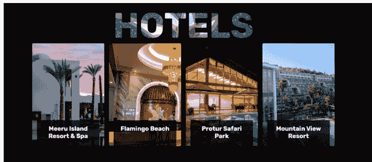

Figure 5.1 Finished Product

The cards will be placed in a single line using the grid module for layout. Each card will have its own background image, with the content placed on top. If the user is viewing the card on a device that supports hover and is at least 700px or more wide then the user will be able to see the title and then hover over the card, which will reveal the short description and an orange call to action button for contrast against the black as seen in Figure 5.2. The reason why we have chosen 700px or more is that it becomes less likely that the person is viewing the web page on a desktop or laptop device when the browser window size is less than 700px.

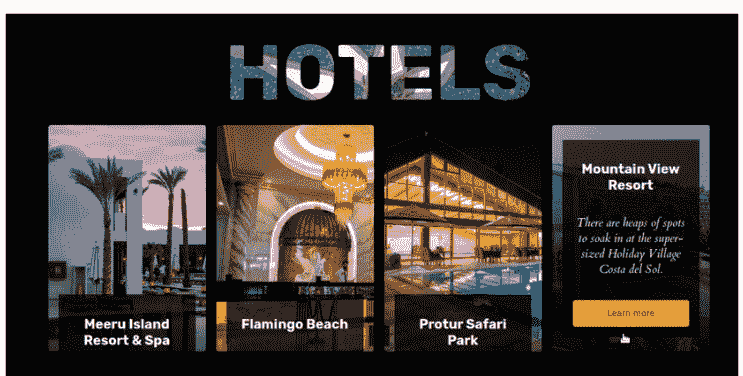

Figure 5.2 Hover Effect on finished product


对于在不支持悬停或宽度小于 700px 的设备上查看的用户，我们将始终显示所有信息而不使用悬停，以确保用户体验不受影响（图 5.3）。

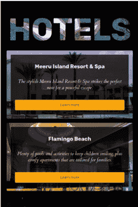

图 5.3 在无法处理悬停状态的小型或触摸设备上的成品

本项目的另一部分是页眉，我们希望使其脱颖而出并具有一定的视觉趣味。为此我们将探索 background-clip 属性以及如何将图像裁剪在文字周围。

## 5.1 开始

列表 5.1 和 5.2 包含了我们在此章节中在此基础上构建的页面的起始 CSS 和 HTML。按照我们对页面进行样式设定的过程，你可以从 Github 仓库下载起始 HTML 和 CSS：https://github.com/michaelgearon/Tiny-CSS-Projects/tree/main/chapter-05。

移动端和桌面端的体验将使用相同的 HTML 和样式表。与我们在第 4 章中所做的类似，我们将利用媒体查询根据浏览器大小和功能来更改样式。列表 5.1 显示了我们的起始 HTML。每个卡片都用 <section> 标签包裹，并包含其标题（<h2>）、描述（<p>）和行动号召（<a>）。

### 列表 5.1 起始 HTML

```
<header>
<h1>Hotels</h1> #A
</header>
<main>
<section> #B
<div>
<h2>Meeru Island Resort & Spa</h2> #C
<p>The stylish Meeru Island Resort & Spa strikes the perfect note for a peaceful escape.</p> #D
<a href="#">Learn more</a> #E
</div>
</section> #F
<section>
<div>
<h2>Flamingo Beach</h2>
<p>Plenty of pools and activities to keep children smiling, plus comfy apartments that are tailored for families.</p>
<a href="#">Learn more</a>
</div>
</section>
<section>
<div>
<h2>Protur Safari Park</h2>
<p>The big, family-friendly complex dishes up plenty of pools and activities.</p>
<a href="#">Learn more</a>
</div>
</section>
<section>
<div>
<h2>Mountain View Resort</h2>
<p>There are heaps of spots to soak in at the super-sized Holiday Village Costa del Sol.</p>
<a href="#">Learn more</a>
</div>
</section>
</main>
```

#A 页面标题

#B 第一个摘要卡片的开始

#C 卡片标题

#D 卡片描述（仅在浏览器允许时悬停时显示）

#E 卡片行动号召

#F 第一个摘要卡片的结束

我们的起始 CSS（列表 5.2）包含了一些基础样式来设置我们的页面。对于 body，我们只是将 margin 增加到 40px，并在四个方向都添加了 20px 的 padding。我们再次使用了 Google Fonts，但这次我们使用的是 Cardo 字体家族，常规字重但使用斜体版本，这将用于每个卡片的描述。

对于标题，我们将使用 Rubik，常规和粗体字重。该字体是一个不错的选择，因为它结合了良好的可读性和圆润的边缘，提供了非正式感，与 Cardo 字体搭配效果很好。

请注意，在加载多个 Google 字体时，导入可以合并为一个请求。

### 列表 5.2 起始 CSS

```
@import
  url("https://fonts.googleapis.com/css?family=Cardo:400i|Rubik:400,700&display=swap")
  ; #A

body {
  margin-top: 40px;
  padding: 20px;
}
```

#A 一次请求加载 Cardo 和 Rubik 字体

当我们开始为项目设置样式时，我们的页面如下所示（图 5.4）。

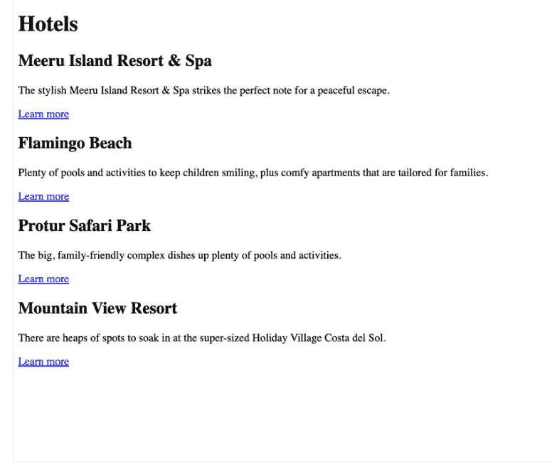

图 5.4 起始点

## 5.2 使用网格布局页面

一个良好的起点是查看我们的卡片布局以及整个网页。我们需要考虑布局的 3 个方面：

- 页眉和主要内容
- 卡片的容器
- 卡片内的内容

我们将为全部 3 种用例使用网格布局模块。

> **Grid**
> Grid 允许我们在由列和行组成的系统上同时在垂直和水平轴上放置和对齐元素。
> 
> 如果你需要了解网格的工作原理，请查看第 2 章。

为了在页面上布局元素，我们将从为窄屏幕创建样式开始，然后通过媒体查询在构建到更大屏幕尺寸时编辑布局。

我们的布局由 2 个地标组成，<header> 和 <main>，它们是 <body> 的直接子元素（列表 5.3）。通过将 body 的 display 属性值设置为 grid，我们将影响页眉和 main 元素的位置。

```
Listing 5.3 Starting HTML
<body>
  <header>  #A
  ...       #A
  </header> #A
  <main>    #B
  ...       #B
  </main>   #B
</body>
```

#A 包含页面页眉
#B 包含卡片

我们然后使用 place-items 属性将元素居中在页面上。该属性是 align-items 和 justify-items 属性声明值的简写。我们将其值设置为 center，将所有项目在其各自的行和列的中间对齐。我们更新后的 body 规则显示在列表 5.4 中。

### 列表 5.4 定位页眉和 main 元素

```
body {
  display: grid;
  place-items: center;
  margin-top: 40px;
  padding: 20px;
}
```

请注意，我们没有定义任何 grid-template-rows、grid-template-columns 或 grid-template-areas。默认情况下，如果未声明，则浏览器仍会创建一个 1 列网格，行数与需要定位的元素数量一样多。在我们的例子中，我们有 2 个，因此我们的网格有 1 列和 2 行（图 5.5）。

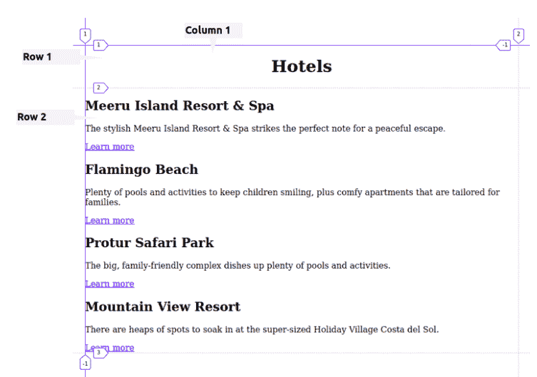

图 5.5 1 x 2 网格

页眉和 main 的宽度因其在网格内而被更改，仅占用其内容所需的水平空间。由于页眉的内容较窄（包含单词 Hotels 的 h1），页面标题会居中于页面。main 元素占用其可用的全部宽度，因为 Flamingo 海滩（第二个卡片）的描述需要全部宽度，甚至会换行。如果我们进一步扩展屏幕宽度，我们会看到 main 元素也会居中自身（图 5.6）。

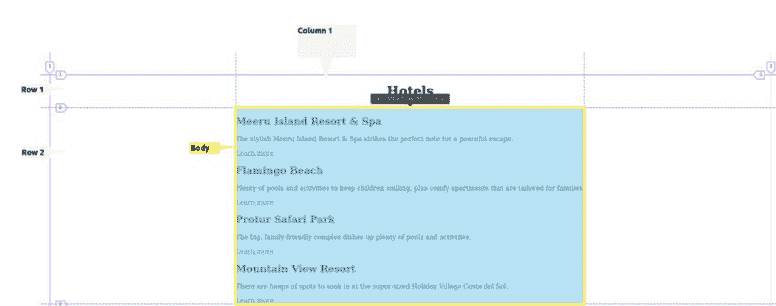

图 5.6 在非常宽的屏幕上居中的 Main

我们还将依赖网格的默认功能并省略定义行和列，因为我们希望在窄屏幕上保持卡片堆叠。为了在卡片之间添加空间，我们包含 1rem 的 gap。我们还将 main 元素的宽度限制为最大 1024 像素，以防止在下一节中我们在宽屏幕上将它们水平对齐时卡片在宽屏幕上过于分散。

我们的更新后的 CSS（列表 5.5）在保持卡片堆叠的同时在每个卡片之间添加了 1rem 的间隔，如图 5.7 所示。

### 列表 5.5 在窄屏幕上定位卡片

```
main {
  display: grid;
  max-width: 1024px;
  grid-gap: 1rem;
}
```

# Hotels

# Meeru Island Resort & Spa

The stylish Meeru Island Resort & Spa strikes the perfect note for a peaceful escape.

Learn more

# Flamingo Beach

Plenty of pools and activities to keep children smiling, plus comfy apartments that are tailored for families.

Learn more

# Protur Safari Park

The big, family-friendly complex dishes up plenty of pools and activities.

Learn more

# Mountain View Resort

There are heaps of spots to soak in at the super-sized Holiday Village Costa del Sol.

Learn more

图 5.7 应用于 <main> 的网格

### 5.2.1 媒体查询

目前我们的卡片是垂直堆叠的。这是 HTML 元素在大多数情况下的默认行为，并且在移动设备上设备宽度相对较窄时是有意义的。然而，对于桌面屏幕，浏览器窗口可以更宽，我们可以利用水平空间使用媒体查询。我们可以定义一些媒体查询来调整布局。

- 1. 如果窗口宽度大于或等于 700px，我们将网格调整为 2 个等大的列，并将每个 section 的高度设置为恰好 350 像素。
- 2. 在 950 像素时，我们再次调整布局，使其具有 4 个等大的列，覆盖前一个媒体查询中设置的 grid-template-columns 值。高度属性值仍然保持 350 像素，因为前一个媒体查询的条件（min-width: 700px）仍然满足。

```
min-width: 700px
```

如果这两个媒体查询的要求均未满足（当浏览器窗口宽度小于 700px 时），则卡片将垂直堆叠在一列中。列表 5.6 显示了正在创建的 2 个媒体查询。


# Listing 5.6 卡片布局

```
@media (min-width: 700px) { #A
  main {
    grid-template-columns: repeat(2, 1fr);
  }
  main > section {
    height: 350px;
  }
}
@media (min-width: 950px) { #B
  main {
    grid-template-columns: repeat(4, 1fr);
  }
}
```

#A 媒体查询用于判断浏览器窗口宽度是否至少为 700px。如果是，则使用查询内的样式。

#B 第二个媒体查询判断浏览器窗口宽度是否至少为 950px。如果是，则覆盖之前的查询并将网格设置为 4 列宽

图 5.8 和 5.9 显示了在 800 和 1000 像素宽浏览器窗口中的输出。

# Hotels

# Meeru Island Resort & Spa

The stylish Meeru Island Resort & Spa strikes the perfect note for a peaceful escape.

Learn more

# Flamingo Beach

Plenty of pools and activities to keep children smiling, plus comfy apartments that are tailored for families.

Learn more

# Protur Safari Park

The big, family-friendly complex dishes up plenty of pools and activities.

Learn more

# Mountain View Resort

There are heaps of spots to soak in at the super-sized Holiday Village Costa del Sol.

Learn more

Figure 5.8 Layout Achieved Viewed On a 800 Pixel wide screen

# Hotels

# Meeru Island Resort & Spa

The stylish Meeru Island Resort & Spa strikes the perfect note for a peaceful escape.

Learn more

# Flamingo Beach

Plenty of pools and activities to keep children smiling, plus comfy apartments that are tailored for families.

Learn more

# Protur Safari Park

The big, family-friendly complex dishes up plenty of pools and activities.

Learn more

# Mountain View Resort

There are heaps of spots to soak in at the super-sized Holiday Village Costa del Sol.

Learn more

Figure 5.9 Layout Achieved Viewed On a 1000 Pixel wide screen

With our layout in hand, let’s start focusing on styling our content starting with the header. We are going to change the font for our h1 element and look at how to use an image to color our text.

## 5.3 Styling the header using background-clip

The title for this page—“hotels”—could be visually more interesting. One way to liven it up could be to set the color to a nice vibrant color and update the font family to something modern. Another way is to apply a background image to the text. This is possible through 2 experimental properties, the background-clip and the text-fill-color.

They are experimental because they still require vendor prefixes to support all main browsers. This can present some risk as experimental properties may have non-standard implementation and are subject to change. We can reduce this risk by setting a fallback color value so that if these 2 properties do not work the user will still see the text, just without the background image.

### Experimental Properties

Experimental properties are not recommended for production use and often have non standard implementations. For more details about experimental properties please refer to Chapter 3, Section 7: Vendor Prefixes.

### 5.3.1 Setting the font

The first step we need to take is to update the font-family, weight, and size as well as transforming the text into uppercase as seen in Listing 5.7.

We used the shorthand font property. The first value sets the weight, and in this case it is set to heavy. The second value is the font size of 120px, then the font-family we want to use. If this font can not be loaded then we fallback to a sans-serif font.

We transformed the text to uppercase through styling rather than writing it all in uppercase within the HTML. Using all uppercase characters can impact accessibility, as some screen readers may interpret the all caps as an acronym and read the letters out individually instead of as a full word. Furthermore, if someone were to copy paste our text, it would come through in uppercase. If we set it to uppercase through CSS, we are only visually styling the text while the characters can be mixed case. Moreover, we are in a very unique position here with only one page to style. In a traditional project, our styles would most likely be applied to multiple pages; by adjusting our casing in our styles, we help ensure consistency throughout our website or application. It is also worth noting that we should use all capitals sparingly as it can impact readability of the content.

# Listing 5.7 Header typography

```
h1 {
  font: 900 120px "Rubik", sans-serif; #A
  text-transform: uppercase;
}
```

#A Shorthand font property

Our header now looks as follows (Figure 5.10):

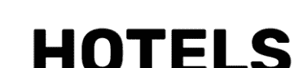

Meeru Island Resort & Spa
The stylish Meeru Island Resort & Spa strikes the perfect note for a peaceful escape.
Learn more

Flamingo Beach
Plenty of pools and activities to keep children smiling, plus comfy apartments that are tailored for families.
Learn more

Protur Safari Park
The big, family-friendly complex dishes up plenty of pools and activities.
Learn more

Mountain View Resort
There are heaps of spots to soak in at the super-sized Holiday Village Costa del Sol.
Learn more

Figure 5.10 Applied header typography styles

### 5.3.2 Background-clip

Next we use an image to color the letters essentially applying a background image to the letters themselves. The first thing we need to do is set a background image on the h1 element. To ensure that the image covers the entirety of the h1 element, we assign the background-size property a value of cover. This will automatically calculate the width and height the image needs in order to make sure the image covers the entire element.

We then manipulate the image to only apply to the letters rather than the entire h1 element. This is where the background-clip property comes into play. This property defines, based on the box-model, which part of the element the background should cover. In our case we will give it a value of text because we only want the image to show behind the letters. This property still requires a browser prefix for webkit based browsers (Chrome, Edge, and Opera) so we also include the prefixed property for compatibility with those browsers.

Our text is currently black, which is preventing the image from showing through. We must therefore make the letters transparent in order not to obscure the image we just set as our text background. The text-fill property allows us to set the color of the text. This property is very similar to using color but if both are set, it will supersede the color property. Since text-fill also requires a vendor prefix (for both webkit and mozilla based browsers), we can use color property as a fall back in case the image does not load or any of the experimental properties should fail.

We set the color to white because we will add a black background to our page a little bit later in this chapter.

# Listing 5.8 Background clip text code

```
h1 {
  text-transform: uppercase;
  font: 900 120px "Rubik", sans-serif;
  background: url(https://images.unsplash.com/photo-1648743430927-5a06fe9f8476?ixlib=rb-1.2.1&ixid=MnwMxMjA3fDB8MHxwaG90by1wYd1fHx8FGVufDB8fHx8&auto=format&fit=crop&w=2074&q=80); #A
  background-size: cover;
  -webkit-background-clip: text; #B
  background-clip: text; #B
  -moz-text-fill-color: transparent; #C
  -webkit-text-fill-color: transparent; #C
  color: white; #D
}
```

#A Adding the background image
#B Clipping the background to only be applied behind the text
#C Making the text transparent to allow the image to show through
#D Fallback color

With any prefixing we add the -moz- and -webkit- prefixes before the unprefixed version. This allows the browser to make sure it is using the non experimental version once it becomes available.

With our header styled (Figure 5.11), the next task for us to tackle is styling the cards. We will first focus on styling the cards without the hover effect and then create our media query for handling cards on wide screens that support hover.

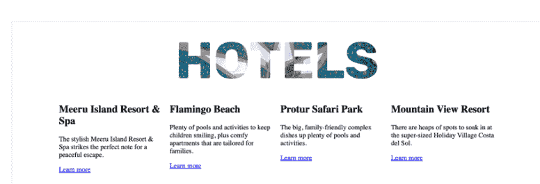

Figure 5.11 Background image clipped to the heading

## 5.4 Styling the cards

Each card is created using an outer section element which will have a background image, and an inner div which we will give a background color to in order to keep our text legible over the image. Within that div is the actual content. Listing 5.9 shows our card structure.

# Listing 5.9 Card HTML

```
<section> #A
  <div> #B
    <h2>Meeru Island Resort & Spa</h2>    #C
    <p>The stylish Meeru Island Resort...</p>    #C
    <a href="#">Learn more</a>    #C
  </div>
</section>
```

#A Outer Card container
#B Content container
#C Content

To style each part of the card, we will work outwards first, styling the container for each card, then the container for the content, and then finally the content itself.

### 5.4.1 Outer card container

The outer container is the element that will get the background image. Each section gets an image for its hotel or resort. We will select each section individually by individually selecting immediate descendent section elements of main in conjunction with the :nth-child() pseudo-class. Our selectors are built as follows: main > section:nth-child(n) where n is the position of the card we are trying to target within the main element. We then assign each of the sections a background image as seen in listing 5.10.


## 上例 5.10 添加背景图片

```
main > section:nth-child(1) {
  background-image: url(https://images.unsplash.com/photo-1551882547-ff40c63fe5fa?ixlib=rb-1.2.1&ixid=MnwXMJA3fDB8MHxwaG90by1wYWdlfHx8FGVufDB8fHx8&auto=format&fit=crop&w=2070&q=80);
}
main > section:nth-child(2) {
  background-image: url(https://images.unsplash.com/photo-1625244724120-1fd1d34d00f6?ixlib=rb-1.2.1&ixid=MnwXMJA3fDB8MHxwaG90by1wYWdlfHx8FGVufDB8fHx8&auto=format&fit=crop&w=2340&q=80);
}
main > section:nth-child(3) {
  background-image: url(https://images.unsplash.com/photo-1616064959886-a500e5c38e1e?ixlib=rb-1.2.1&ixid=MnwXMJA3fDB8MHxwaG90by1wYWdlfHx8FGVufDB8fHx8&auto=format&fit=crop&w=2070&q=80);
}
main > section:nth-child(4) {
  background-image: url(https://images.unsplash.com/photo-1598598795009-f80c5072e665?ixlib=rb-1.2.1&ixid=MnwXMJA3fDB8MHxwaG90by1wYWdlfHx8FGVufDB8fHx8&auto=format&fit=crop&w=1674&q=80);
}
```

添加了背景图片后（图 5.12），让我们也配置一些适用于所有区块的通用样式。


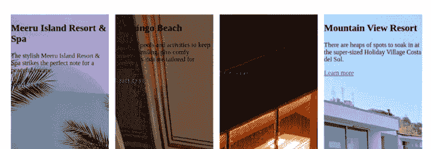

图 5.12 卡片背景图片

我们可以看到图片并没有很好地居中，也没有很好地展示酒店和度假村。我们可以使用 background-size 属性来调整图片大小。我们将其设置为 cover，以便在图片的宽高比与卡片不同时，最大化显示图片的面积而不留下任何空白。我们还添加了 background-color 为 #3a8491（青绿色）作为后备。由于我们是从网络（unsplash.com）加载图片，这些图片可能会被移除或加载失败。因此我们包含一个 background-color 作为后备，以防这种情况发生。

然后我们为卡片添加 border radius 来弯曲角落并柔化边缘。我们的容器样式可以在上例 5.11 中找到。

## 上例 5.11 卡片容器样式

```
main > section {
  background-size: cover;
  background-color: #3a8491;
  border-radius: 4px;
}
```

在处理完外部容器后（图 5.13），让我们现在转向内容容器。


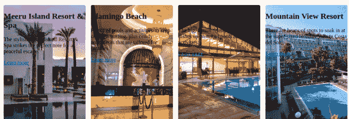

图 5.13 已样式化的外部卡片容器

## 5.4.2 内部容器和内容

目前我们的文本不可读，因为深色文字与图片背景对比，且非常接近外部容器的边缘。

为了提高可读性，我们为内部容器设置 background color 为 rgba(0, 0, 0, .75)，即带透明度的黑色。我们还将文字更改为 whitesmoke 并居中。通过在设计中不使用纯黑或纯白，我们为整体构图实现了更柔和的感觉。

在添加了背景颜色后，我们为内容容器添加 1 rem 的内边距，以使文字远离深色背景的边缘，并添加 1rem 的外边距，以在图片边缘与背景开始处之间留出间隙。

最后我们调整卡片内文字的 font size、weight、line-height 和 font-family。我们的 CSS 如下所示（上例 5.12）。

## 上例 5.12 卡片内容样式

```
main > section > div {
  background-color: rgba(0, 0, 0, .75);    #A
  margin: 1rem;                               #A
  padding: 1rem;                              #A
  color: whitesmoke;                          #A
  text-align: center;                         #A
  font: 14px "Rubik", sans-serif;            #A
}                                               #A

section h2 {                                    #B
  font-size: 1.3rem;                            #B
  font-weight: bold;                            #B
  line-height: 1.2;                             #B
}                                               #B

section p {                                     #C
  font: italic 1.125rem "Cardo", cursive;      #C
  line-height: 1.35;                            #C
}                                               #C
```

#A 卡片内容容器
#B 卡片标题
#C 卡片内容

应用样式后（图 5.14），我们最后需要样式化的内容是我们的链接。

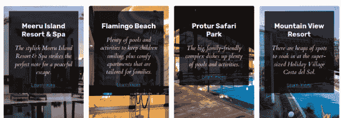

图 5.14 卡片内部容器和排版

由于我们的链接在此情况下作为行动号召，使用户查看有关酒店或度假村的更多信息，我们希望使其加粗且醒目（上例 5.13）。为实现此目的，由于我们卡片内的多数元素都比较暗，我们将为链接赋予明亮的黄橙色（#ffa600）背景，并将其文字颜色更改为近乎黑色。我们还将为其添加内边距，但由于链接默认是内联元素，我们需要将其 display 属性值更改为 inline-block，以便周围元素能够正确重排。

为了与卡片保持一致，我们将为链接赋予 4px 的 border-radius，并最后处理悬停和聚焦。取而代之的是下划线，我们将完全移除下划线，在悬停时稍微加深背景颜色，在聚焦时添加一个距离链接 3 像素的虚线轮廓。

## 上例 5.13 链接样式

```
a {
  background-color: #ffa600;
  color: rgba(0, 0, 0, .75);
  padding: 0.75rem 1.5rem;
  display: inline-block;
  border-radius: 4px;
  text-decoration: none;
}

a:hover {
  background-color: #e69500;
}

a:focus {
  outline: 1px dashed #e69500;
  outline-offset: 3px;
}
```

图 5.15 显示了我们样式化的链接。

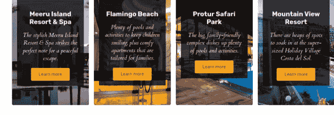

# 图 5.15 已样式化的链接

链接没有垂直对齐看起来有点奇怪，也不显得很整齐。为了使所有链接对齐，我们将再次使用 grid。我们将为内部容器赋予 display 值 grid，并将 grid-template-rows 值设置为 min-content auto min-content，同时将内部容器的高度设置为 100% 减去我们分配给它的内边距和外边距。

本章前面我们已为内部容器设置了 1rem 的外边距和 1rem 的内边距，这意味着为使其占据提供的空间的全部高度，需要分配的高度等于 100% 减去 4rem（顶部 1rem 内边距和 1rem 外边距，底部相同，总计 4 rem）。要在 CSS 中实现这一点，我们使用 calc() 函数来为我们进行计算，将 calc(100% - 4rem) 分配给 height 属性。

定义的行（grid-template-rows: min-content auto min-content）和设定的高度的组合创建了一个布局，其中标题和链接仅占用它们需要的空间，而中间部分（段落元素）获得剩余空间。最后，为了在卡片中间垂直居中段落内容，我们使用 align-items 属性，值为 center，并移除浏览器自动添加到 h2 的底部外边距。

如果我们保留标题底部的外边距，段落顶部会有比底部更多的空间，因为 min-content 会将元素上的外边距计入在内。卡片底部链接没有外边距，段落上方与下方的空白就会不成比例。

上例 5.14 显示了我们的布局调整。

## 上例 5.14 内部容器布局调整

```
main > section > div {
  background-color: rgba(0, 0, 0, .75);
  margin: 1rem;
  padding: 1rem;
  color: whitesmoke;
  text-align: center;
  height: calc(100% - 4rem);
  display: grid;
  grid-template-rows: min-content auto min-content;
  align-items: center;
}

section h2 {
  font-size: 1.3rem;
  font-weight: bold;
  line-height: 1.2;
  margin-bottom: 0;
}
```

这次最后的调整完成了我们的卡片布局（图 5.16）。我们现在将专注于为宽度大于或等于 700px 且具有悬停能力的设备显示和隐藏部分内容。


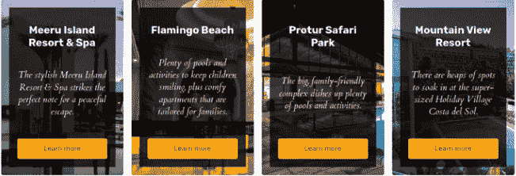

Figure 5.16 Styled cards

## 5.5 Transition on hover and focus-within

首先我们需要创建一个媒体查询，用于检查设备是否支持悬停交互、浏览器窗口宽度至少为 700px，并且用户在设备上未启用 prefers-reduced-motion。

### Prefers reduced motion

用户可能希望退出运动密集的动画。他们可以通过在设备上启用设置来实现，这会通过 prefers-reduced-motion 属性传达给浏览器。我们需要确保尊重用户的设置，因此在确定是否对内容进行动画的查询中，我们将包含该设置未被设置的情况，即值为 no-preference。有关 prefers-reduced-motion 的更多信息，请查看第 3 章中关于可访问性和 reduced motion 查询的部分。

因此我们的媒体查询如下所示： @media (hover: hover) and (min-width: 700px) and (prefers-reduced-motion: no-preference) { }。请注意，我们可以链接多个需要满足的参数，以便查询中的 CSS 被应用。

为了隐藏除标题之外的所有内容，我们将使用 transform 属性将内容向下移动到卡片底部，值为 translateY()。TranslateY() 允许我们在不影响页面流的情况下垂直移动内容，这意味着被移动元素的周围内容完全不受移动影响，不会重新定位或让出位置。

为了计算元素需要移动的距离，我们将再次使用 calc() 函数。我们将标题向下移动卡片的高度 350px 减去 8rem（容器的顶部边距 + 容器的 padding-top + 标题的大小）。

因此卡片的内部部分被向下移动，如图 5.17 所示。

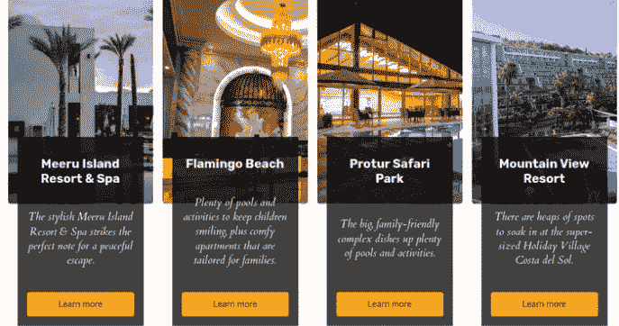

Figure 5.17 Moving the content down

由于我们将在用户将悬停移离该部分时为显示内容设置动画，我们不希望底部剩余的内容保留，因为如果用户将悬停在溢出图片的内容上，内容会向上移动到图片中，失去悬停然后再次向下移动。这种行为会重复造成闪烁。因此我们将内部容器的高度设置为 5rem，并在段落和链接被隐藏时隐藏溢出。

请注意，在第二张卡片中，当内容应被隐藏时，段落内容仍会有一点可见。因此我们还将使用不透明度隐藏非标题内容，当它不应被看到时。此外，我们使用 translateY 将该内容向下移动 1rem，这将允许我们在悬停时将其重新动画化时给予一点运动。

总的来说，用于隐藏内容并缩短内部容器的 CSS 如下所示（Listing 5.15）。为了选择所有不是标题的内容，我们可以使用 :not() 伪类。

### Listing 5.15 Hiding the non header content

```
@media (hover: hover) and (min-width: 700px) and (prefers-reduced-motion: no-preference) {
    #A
    main > section > div {
        transform: translateY(calc(350px - 8rem));
        height: 5rem;
        overflow: hidden;
    }
    main > section > div > *:not(h2) {
        opacity: 0;
        transform: translateY(1rem);
    }
}
```

#A The media query
#B Moving and shortening the inner content container
#C Hiding all of the non H2 content

not() 伪类允许我们过滤选择器。在这种情况下，我们想要定位任何不是 h2 的元素。图 5.18 描述了该过程。

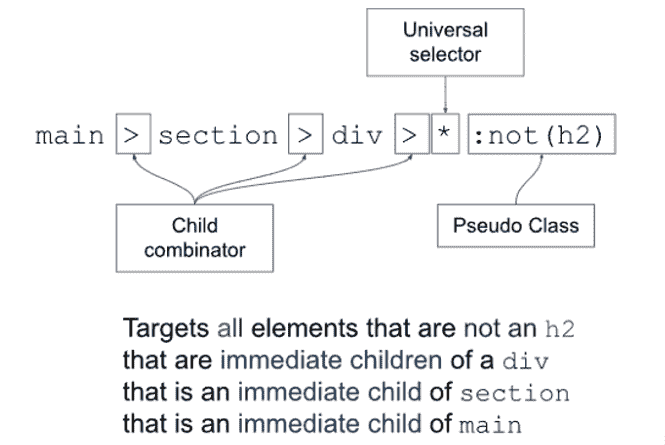

### Figure 5.18 Selecting anything that is not an h2 inside of the inner container

现在内容被隐藏了（图 5.19），我们可以专注于再次显示它。

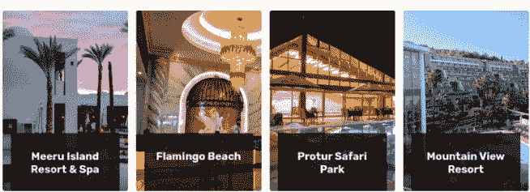

### Figure 5.19 Hiding content

为了再次显示内容，我们需要在悬停和获得焦点时撤销我们为隐藏它所做的一切。由于我们没有从 DOM 中移除链接，它们只是视觉上被隐藏。程序上它们仍然存在，用户可以通过键盘 Tab 到链接。因此我们需要在用户悬停在卡片上时以及链接获得焦点时显示内容。因为我们想要在子元素（链接）获得焦点时对祖先（内容容器）执行操作，我们可以使用 :focus-within 伪类。该伪类允许我们根据元素的后代是否当前处于焦点来有条件地应用样式。

因此，无论链接处于焦点还是部分被悬停，我们都通过将 translateY() 参数设置为 0（无垂直位移），并将内部容器的高度设置为 350px（外部容器的高度）减去 4rem（容器的垂直内边距和边距总和）来将容器移回原位。

我们还需要恢复不透明度被设置为 0 并且被向下移动 1rem 的段落和链接。

最后，我们通过向正在显示和隐藏的元素添加 transition 来完成我们的悬停和 focus-within 效果。由于我们预定义了在它们之间更改的状态，并且我们只希望动画在更改发生时运行一次，我们不需要使用关键帧，我们可以简单地指示 CSS 使用 transition 属性对发生时的所有更改进行动画处理，我们为其分配的值为 all 700ms ease-in-out。这将使所有更改都被动画化，动画完成需要 700 毫秒，并且它会从慢开始，加速，然后在完成前减速。

因此我们的悬停和 focus-within CSS 如下所示（Listing 5.16）。

### Listing 5.16 Showing content on hover and on focus-within

```
@media (hover: hover) and (min-width: 700px) and (prefers-reduced-motion: no-preference) {
  main > section > div {
    transform: translateY(calc(350px - 8rem));
    height: 5rem;
    overflow: hidden;
    transition: all 700ms ease-in-out; #E
  }

  div > *:not(h2) {
    opacity: 0;
    transform: translateY(1rem);
    transition: all 700ms ease-in-out; #E
  }

  section:hover div,      #A
  section:focus-within div {      #B
    transform: translateY(0);
    height: calc(350px - 4rem);
  }

  section:hover div > *:not(h2),      #C
  section:focus-within div > *:not(h2){      #D
    opacity: 1;
    transform: translateY(0);
  }
}
```

#A on section hover move container back into place

#B on section focus-within move container back into place

#C on hover move all non h2 elements inside the container back into place with full opacity

#D on section focus-within move all non h2 elements inside the container back into place with full opacity

#E Animating the changes

应用这些更改后（图 5.20），剩下的就是为我们的页面设置背景，我们的项目就完成了。

### HOTELS

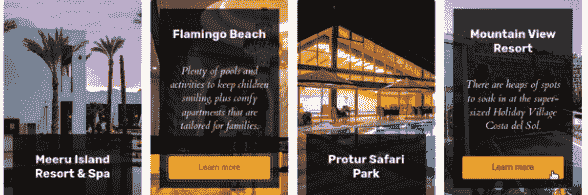

Figure 5.20 Hover and focus-within effect

为了让图片更突出，我们将为整个页面添加一个非常深的灰色几乎是黑色的背景，从而完成项目。

为了应用背景颜色，我们将 background 属性的值设置为 #010101 添加到我们现有的 body 规则中（Listing 5.17）。

### Listing 5.17 Adding the background

```
body {
  display: grid;
  place-items: center;
  margin-top: 40px;
  padding: 20px;
  background: #010101;
}
```

图 5.21、5.22 和 5.23 显示了我们在不同屏幕尺寸下的最终项目。

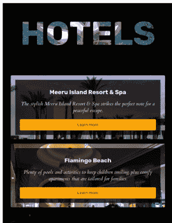

Figure 5.21 Project at window width 600px

Figure 5.22 Project at window width 850px

Figure 5.23 Project at window width 1310px with prefers-reduced-motion enabled

## 5.6 Summary

- 我们使用 grid 属性作为水平布局卡片的方式。通过同时使用媒体查询和 grid-template-columns，我们根据最小浏览器窗口大小调整布局，如果最小宽度为 950px 则为 4 列宽，如果在 700px 到 950px 之间则设置为 2 列，其他情况则默认为堆叠状态
- `text-transform` 属性可以在不影响内容可访问性的情况下视觉上将文本更改为大写；复制内容时不会全部为大写
-  sparingly 使用 `text-transform: uppercase` 并且不要在大面积内容上使用
- `background-clip` 属性的值为 text 可以将背景图像裁剪在文本周围
- `background-clip` 属性仍需要前缀，并且该属性在实现过程中可能会发生变化
- 我们可以使用媒体查询检查设备是否支持悬停，并调整布局以防止用户在设备不支持悬停时看到内容
- 我们可以使用 `and` 在同一个媒体查询上链接多个条件
- 我们可以在媒体查询中使用 `prefers-reduced-motion` 来尊重用户对动画和运动的偏好。
- `:not()` 伪类表示与选择器列表不匹配的元素。
- `translateY()` 会在不影响重排的情况下垂直移动内容
- 我们可以使用 `transition` 属性在状态之间对样式更改进行动画处理
- 为了根据元素的后代是否处于焦点来有条件地应用样式，我们使用 `focus-within` 伪类


