## 6
## 创建个人资料卡片
## 本章涵盖
- CSS 自定义属性
- 使用 radial-gradient 创建背景
- 设置图像大小
- 使用 flexbox 定位元素

在本章中我们将创建一个个人资料卡片。在网页设计中，卡片是一种包含单一主题信息的视觉元素。我们将把这个概念应用于某人的个人资料信息，本质上创建了一张数字名片。这种布局在社交媒体或博客网站上经常可以看到，以便读者快速了解内容的作者。它有时会链接到详细的个人资料页面或与该个人资料所属人互动的机会。

到本章结束时，我们的个人资料卡片将如下所示（图 6.1）：

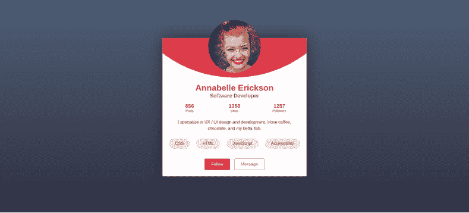

图 6.1 最终输出

要创建此布局，我们将围绕定位做大量工作，特别是利用 flexbox 来帮助我们对齐和居中元素。我们还将了解如何使矩形图像适应圆形而不失真。

让我们直接开始并查看我们的起始 HTML（列表 6.1），它可以在 github 仓库 https://github.com/michaelgearon/Tiny-CSS-Projects/tree/main/chapter-06 中找到。

我们有一个 class 为 card 的 div，其中包含个人资料卡片中展示的所有元素。为了设置我们的博客文章信息，我们使用描述列表。

> **描述列表**
> 描述列表包含术语组，包括描述术语（dt）和任意数量的描述（dd）。描述列表通常用于词汇表或显示元数据。由于我们将术语（帖子、点赞和关注者）与其计数（数字）配对，因此使用描述列表是一个很好的用例。

我们的技术（CSS、HTML...）以列表形式呈现。

### 列表 6.1 项目 HTML

```
<body>
  <div class="card">  #A
     #B
    <h1>Annabelle Erickson</h1> #C
    <div class="title">Software Developer</div> #D
    <dl>          #E
      <div>        #E
        <dt>Posts</dt>      #E
        <dd>856</dd>       #E
      </div>        #E
      <div>        #E
        <dt>Likes</dt>      #E
        <dd>1358</dd>       #E
      </div>        #E
      <div>        #E
        <dt>Followers</dt>  #E
        <dd>1257</dd>       #E
      </div>        #E
    </dl>          #E
    <p class="summary">      #F
      I specialize in UX / UI design and development. I love coffee, chocolate, and my
      betta fish. #F
    </p>      #F
    <ul class="technologies">    #G
      <li>CSS</li>          #G
      <li>HTML</li>         #G
      <li>JavaScript</li>   #G
      <li>Accessibility</li> #G
    </ul>          #G
    <div class="actions">      #H
      <button type="button" class="follow">Follow</button>  #H
      <a href="" class="message">Message</a>          #H
    </div>          #H
  </div> #I
</body>
```

#A 卡片开始
#B 个人资料图片
#C 个人资料持有者姓名
#D 个人资料持有者职位
#E 帖子信息
#F 个人简介 / 关于
#G 技术
#H 操作

当我们开始为卡片设置样式时，我们的页面如下所示（图 6.2）。

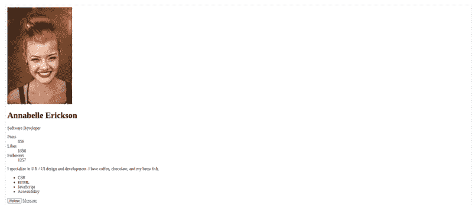

图 6.2 起始点

### 6.1 CSS 自定义属性

在我们的布局中，特别是当我们为个人资料图片和卡片顶部图片下方的彩色部分设置样式时，我们需要多次使用图像大小值进行计算。在像 JavaScript 这样的其他语言中，当我们有一个需要多次引用的值时，我们使用变量。在 CSS 中我们有自定义属性，有时也称为 CSS 变量。

要创建自定义属性，我们将变量名以 2 个破折号（--）为前缀，紧跟变量名。我们以与任何其他属性相同的方式分配值，使用冒号（:）后跟值。因此 CSS 变量声明看起来如下：`--myVariableName: myValue;`

像任何其他声明一样，我们需要在规则内部定义我们的变量。对于我们的项目，我们将定义颜色和图像大小并在 body 规则中声明它们，如列表 6.2 所示。由于我们在 body 上定义了变量，body 元素及其所有后代都将访问这些变量。

请注意，我们可以为变量分配不同类型的值。我们分配颜色，例如在我们的 --primary 变量中（可能是 CSS 自定义属性最常见的用途），但我们也定义了大小（--imageSize）、字体族和渐变（--page-background）。

要引用变量并将其用作声明的一部分，我们使用以下语法：`var(--variableName)`，因此例如要分配我们的文本颜色，将声明：`color: var(--text-color);`

### 列表 6.2 定义 CSS 自定义属性

```
body {
  --primary: #de3c4b; #A
  --primary-contrast: white;
  --secondary: #717777; #B
  --font: Helvetica, Arial, sans-serif;
  --text-color: #2D3142; #C
  --card-background: white;
  --page-background: linear-gradient(#4F5D75, #2D3142);
  --imageSize: 200px;

  background: var(--page-background);
  font-family: var(--font);
  color: var(--text-color);
}
```

#A 深鲑鱼色
#B 灰色
#C 深蓝灰色

注意：线性渐变 我们的线性渐变将从上到下淡化，从深蓝色渐变为非常深的蓝色。有关线性渐变的更深入解释，请查看第 3 章第 3.7.2 节。

在应用了背景和字体颜色及族之后（图 6.3），我们注意到我们的背景在页面底部重复。

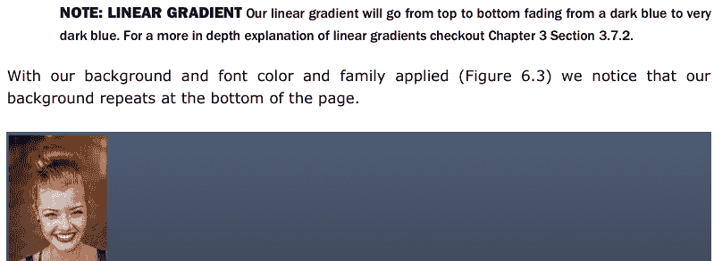

图 6.3 为 body 添加背景

### 6.2 全高背景

线性渐变是一种图像类型。当我们在 CSS 中将图像作为元素的背景应用时，如果图像小于元素，图像将重复或平铺。在这种特定情况下，我们不希望图像重复。

我们有 2 种方法可以修复这个问题：

- 我们可以告诉背景我们不希望它重复，使用 `background-repeat: no-repeat;` 然而由于我们的 body 元素仅与内容一样高，如果窗口比内容更高，我们将在页面底部留下不雅观的白色条，这并不理想。
- 我们的第二个选项（我们将使用的）是使 html 和 body 都占据屏幕的完整高度，而不是让其根据内部内容调整大小。

因此我们将列表 6.3 中的规则添加到我们的样式表中。

我们将 margin 和 padding 重置为 0，因为我们希望确保在窗口内边缘到边缘。

要设置高度，我们实际上使用 `min-height`，因为如果内容长度大于窗口高度，我们仍然希望用户能够访问内容并且背景在其后面。通过使用 `min-height`，我们指示浏览器使 `body` 和 `html` 元素至少与窗口一样高。如果内容会迫使元素更高，则浏览器将使用内容的高度。

我们为 `min-height` 设置的值是 `100vh`。视口高度（vh）是一个基于视口本身高度的单位。它基于百分比，因此将 `100vh` 分配给 `min-height` 意味着我们希望元素至少具有等于视口高度 100% 的高度。

### 列表 6.3 使背景全高

```
html, body {
  margin: 0;
  padding: 0;
  min-height: 100vh;
}
```

现在我们已经设置了背景（图 6.4），让我们为卡片设置样式。

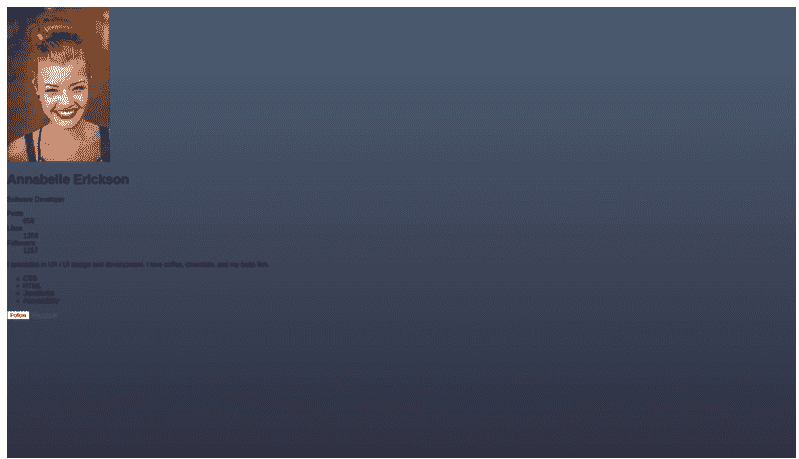

图 6.4 全屏渐变背景

### 6.3 使用 flexbox 设置卡片样式并居中

让我们从为卡片本身设置样式开始。我们将为其提供白色背景和阴影，以为我们的布局增添深度。请注意，我们没有使用颜色值作为背景，而是使用我们的背景变量。

我们还将把卡片的宽度设置为 75vw。视口宽度（vw）是我们在前面使用的视口高度（vh）单位的水平对应物。它也是基于百分比的，因此将我们的宽度设置为 75vw 意味着将卡片的宽度设置为浏览器窗口总宽度的 75%。

然后我们将进一步将卡片的宽度限制为最大 500 像素宽。通过同时使用 width 和 max-width 属性，我们允许卡片在屏幕较窄时缩小，但在较大屏幕上限制卡片变得过于宽大。

最后我们使用 border radius 弯曲卡片的角落以软化设计。列表 6.4 显示了我们的卡片规则。

### 列表 6.4 设置卡片样式

```
.card {
  background-color: var(--card-background);
  box-shadow: 0px 0px 55px rgba(38, 40, 45, .75);
  width: 75vw;
  max-width: 500px;
  border-radius: 4px;
}
```


Figure 6.5 shows the styles applied to our project. With some basic styles added to the card (we will add to these a little bit further into the chapter), let's place the card in the middle (both vertical and horizontal) of the screen.

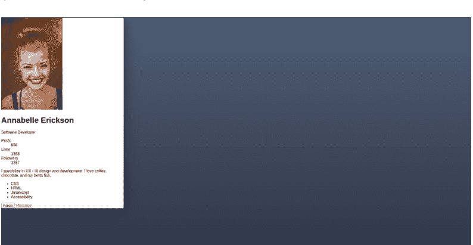

Figure 6.5 Starting to style the card

## 6.3.1 Using flexbox to center elements

To center the card in the exact middle of the screen we are going to use flexbox. Flexbox allows us to place elements across a single axis either vertically or horizontally.

The `display` property with a value of `flex` is used to dictate that elements should be placed on the screen using flexbox. The declaration is set on the parent of the elements that will be flexed.

In our project the element being positioned is the card, its parent is the `body` tag, therefore we will add the `display: flex` declaration to our `body` rule.

We then define how we want the elements within the `body` to behave. In our case we have 1 child (the card) and we want it centered. To center the card horizontally we add a `justify-content: center` declaration to the body rule. This property allows us to dictate how elements are distributed across our axis. Figure 6.6 breaks down the options available to us.

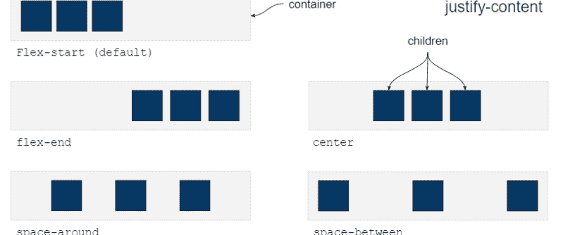

Figure 6.6 justify-content property values

We also want to center the card vertically. For the vertical positioning we will use align-items: center. The align-items property gives us the ability to dictate how elements should be positioned relative to one another and to the container as seen in Figure 6.7.

### align-items
container
children

### Stretch (default)

### flex-start

### flex-end

### baseline

### center

Figure 6.7 align-items property values

Listing 6.5 shows our updated body rule. Remember the parent of the element being positioned is the one on which we apply flexbox related declarations.

### Listing 6.4 Centering the card

```
body {
    ...
    display: flex;
    justify-content: center; #A
    align-items: center; #B
}
```

#A centers the card horizontally

#B centers the card vertically

Now that our card is centered (Figure 6.8), let’s focus on the contents of the card starting with the profile picture.

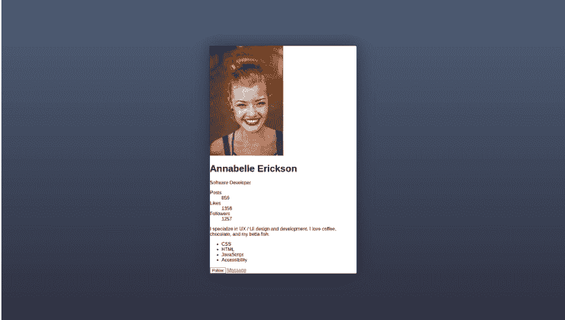

Figure 6.8 Centered card

## 6.4 Styling and positioning the profile picture

We currently have a rectangular image. We want to make the image circular. We also want to center it in the card and have it stick out the top of the card a little bit.

Let’s start by making it into a circle.

### 6.4.1 Object-fit

A circle’s height is equal to its width so as we can see in Figure 6.9, if we set the height and width of the picture to equal our image size variable, the picture will distort.

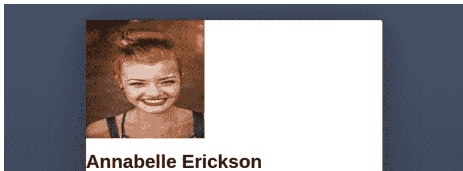

Figure 6.9 Distorted profile picture

To prevent the image from distorting we must also dictate how the image behaves in relation to the size it is given. To do this we will use the object-fit property. By setting the object-fit’s value to cover, we instruct the image to maintain its initial aspect ratio but fit itself to fill the space available. In our case this means that we will lose a little bit of the top and bottom of the image due to the image being taller than it is wide.

By default when using object-fit, the image will be centered and if some of the image is clipped, it will be the edges, which works great for our current use case and picture. However if we wanted to adjust the position of the image within its allotted size and clip only from the bottom, for example, we would also add an object-position declaration.

To make our image a 200px wide circle we use the CSS seen in Listing 6.5. Remember that we set the image size as a CSS custom property in the body, so set the width and height of the image equal to the --imageSize variable. We add the object-fit declaration to prevent the image from distorting and finally we give it a 50% border-radius to make it a circle.

### Listing 6.5 Centering the card

```
body {
  ...
  --imageSize: 200px;
}

img {
  width: var(--imageSize);
  height: var(--imageSize);
  object-fit: cover;  #A
  border-radius: 50%;  #B
}
```

#A Prevents the distortion
#B Makes the image a circle

Our image now looks as seen in Figure 6.10.

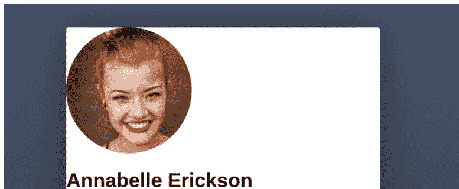

Figure 6.10 Circle profile picture

Now we need to position our picture.

### 6.4.2 Negative margins

To position our image to stick out above the card we are going to use a negative margin. To move an element down and away from content above it, we can add a positive margin-top value to the element. However if we add a negative margin, instead of the element being pushed down, it will be pulled upwards. We are going to leverage this in conjunction with text centering to position the image.

Looking back at the final design Figure 6.11, we notice that all of the text is centered.

Figure 6.11 Final design

Since all of the text is centered, let’s add a text-align: center declaration to the card rule. Images by default are inline elements, so we notice that by centering the text, the image also gets centered (Figure 6.12).

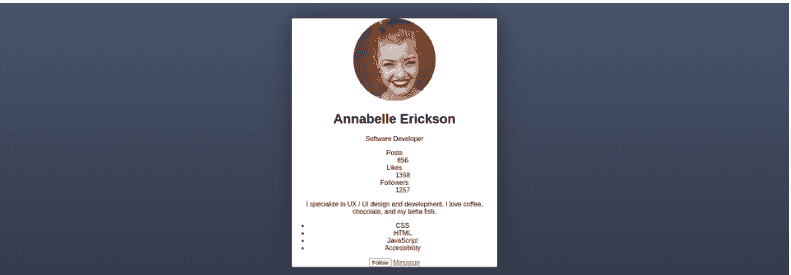

Figure 6.12 Centered text

Now all that is left is to add the negative top margin to move the image upward. We want ⅓ of the image to stick out from the top. We will therefore use the calc() function to do the math for us. Our function looks as follows: calc(-1 * var(--imageSize) / 3); We divide

the image size by 3 to get ⅓ of the height of the image and then multiply by -1 to make it negative. Our margin will therefore make ⅓ of the image stick out from the top of the card as seen in Figure 6.13.

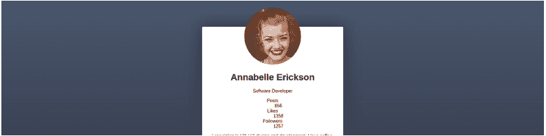

Figure 6.13 Positioned Image

The last thing we need to do is give our card itself some margin. Due to the negative margin we added to the image, if we have a very short screen (Figure 6.14) we see that the top of the image disappears off screen.

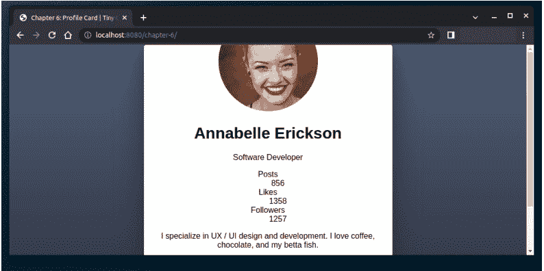

Figure 6.14 Clipping off the top of the image when window height is small

To prevent cutting off part of the picture when the window is not very tall, we want to add some vertical margin to the card itself greater than or equal to the amount of the picture that is sticking out of the card.

To calculate the amount sticking out we used calc(-1 * var(--imageSize) / 3);. For our card margin we are going to use a similar concept. We are going to take ⅓ of the image

```
calc(-1 * var(--imageSize) / 3)
```

height and then add 24 pixels to move the card and image away from the edge. Our final function will be: `calc(var(--imageSize) / 3 + 24px)`.

### Listing 6.6 Positioning the Image

```
.card {
  ...
  text-align: center;
  margin: calc(var(--imageSize) / 3 + 24px) 24px; #A
}

img {
  width: var(--imageSize);
  height: var(--imageSize);
  object-fit: cover;
  border-radius: 50%;
  margin-top: calc(-1 * var(--imageSize) / 3); #B
}
```

#A Vertical margin of ⅓ image size + 24px and horizontal of 24px

#B Negative top margin to make the image stick out of the card

With our image positioned and margins added so that the top of the image does not get cut off on small screens (Figure 6.15), let’s turn our attention to the curved red background under the picture.

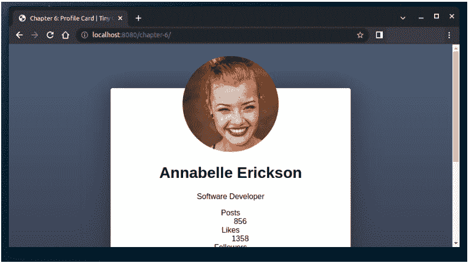

Figure 6.15 Added card margin

## 6.5 Background size and positioning

To create the background behind the image we are going to follow the steps diagrammed in Figure 6.16.

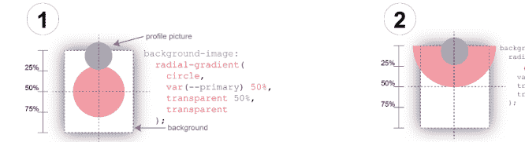

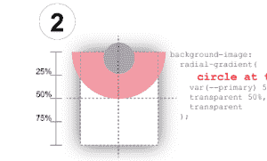

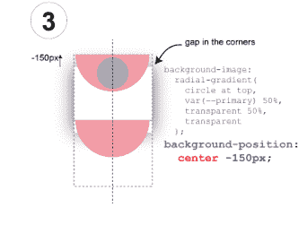

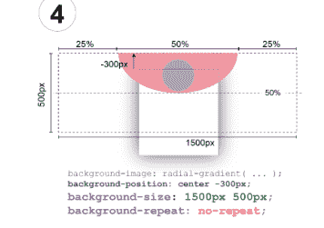

Figure 6.16 Creating the image background

First, we add a background-image consisting of a radial-gradient.

NOTE: COMBINING BACKGROUND COLOR AND IMAGE We can add both a background color and a background image to the same element. We assign the color to the background-color property and the image to the background-image property. Or we can apply both in the background shorthand property as follows: background: white url(path-to-image);

The radial gradient takes an ending shape (circle or ellipse) and then where we want each color to start and stop to form the gradient. We define ours as radial-gradient(circle, var(--primary) 50%, transparent 50%, transparent). Our primary color is a dark salmon so our gradient will create a circle that up until it reaches 50% of its container will be dark salmon. At 50% of the container size it immediately shifts the color to transparent. Since it's an immediate shift in color there is no fade, so we get a nice clean circle.

By default, radial gradients emanate from the center of their container. In step 2 we add circle at top to the beginning of our radial-gradient function to shift the origin of the circle from the center of the background to the top. Our updated radial-gradient function


因此现在看起来如下：radial-gradient(circle at top, var(--primary) 50%, transparent 50%, transparent);

接下来我们想要将圆向上移动，使圆的底部刚好位于图像下方。第 3 步向我们展示，如果我们将背景向上移动 -150 像素，并且我们的卡片相当短（我们的个人资料没有太多内容），我们将在圆与卡片边缘之间在顶部两个角落产生间隙，而我们不希望出现这种情况。为了防止这种情况发生，我们将使背景图像比最大卡片尺寸宽 3 倍（3×500 =1500）。

NOTE: NEGATIVE BACKGROUND POSITION 与图像不同，通过添加负边距，可见部分会超出卡片，而负背景位置不会使溢出的图像部分可见。来自过大背景或更改定位的额外图像内容将简单地被隐藏。

当我们使用渐变创建 background-image 时，产生的背景图像会随着容器一起伸缩，因此我们也将为背景设置一个固定的高度，这样无论卡片中有多少内容，我们的背景形状都是可预测的。

更改背景尺寸后，我们还增加向上移动背景的距离，使其恰好在个人资料图像下方紧密结束

最后，如本章前面提到的，背景图像默认会重复。通过向上移动图像，我们为背景平铺留出了空间。我们只想要一个半圆，因此我们将 background-repeat 设置为 no-repeat。

全部组合起来，我们的卡片背景定义如下（列表 6.7）：

## Listing 6.7 Positioning the Image

```
.card {
  background-color: var(--card-background);
  ...
  background-image: radial-gradient(circle at top, var(--primary) 50%, transparent 50%,
    transparent); #A
  background-size: 1500px 500px; #B
  background-position: center -300px; #C
  background-repeat: no-repeat; #D
}
```

#A 创建一个半圆，其平坦的一侧是卡片顶部
#B 将背景图像的尺寸设置为宽 1500px 高 500px
#C 将背景水平居中并从卡片上方开始 300px
#D 防止背景平铺

图 6.17 显示了添加到卡片的背景。

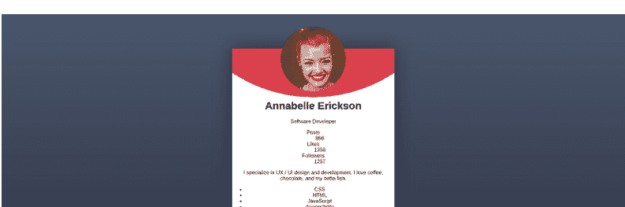

Figure 6.17 Finished background image

随着卡片顶部开始看起来不错，让我们关注其余内容。

## 6.6 Styling the content

我们的卡片目前没有任何内边距，这意味着如果我们的名字更长，它可能会在卡片上边缘到边缘地接触。由于在大多数情况下，卡片是我们将作为组件或模板创建以在多个用户之间重复使用，让我们添加一些左右内边距以确保我们的文本不会进入卡片边缘。我们还将添加一些底部内边距以将链接和底部与卡片底部边缘移开。

列表 6.8 显示了我们更新的卡片规则，图 6.18 显示了新的输出。我们使用简写属性定义了 3 个值。它说明顶部内边距为 0，左右为 24px，底部为 24px。我们特意不为顶部添加内边距，因为它会将图像向下推，并且我们必须重新调整图像定位。

## Listing 6.8 Added padding to the card

```
.card {
  ...
  padding: 0 24px 24px;
}
```

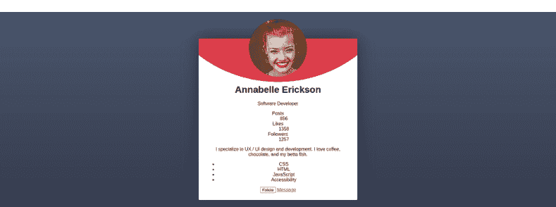

Figure 6.18 Added card padding

### 6.6.1 Styling the name and job title

向下浏览卡片，我们的第一个内容是名字。作为 h1，它有一些浏览器提供的默认样式，其中包括边距。我们将编辑边距以增加标题与图像之间的空间，并在底部移除边距，以便职位标题可以直接位于姓名下方。我们还将颜色更改为鲑鱼色并将字体大小设置为 2rem。

> **Rem Unit**
> Rem 是一个基于根元素字体大小的相对单位，在我们的例子中是 HTML。对于大多数浏览器，默认值是 16px。我们在项目中没有为 HTML 元素设置字体大小，因此当我们将 h1 font-size 设置为 2rem 时，输出大小将为 32px。
> 
> 使用相对字体大小的好处是可访问性。它有助于确保文本可以根据用户设置或设备优雅地缩放。

对于职位标题，我们将增加大小和粗细，并更改字体颜色以使用我们的 secondary 颜色，即灰色。

列表 6.9 显示了我们的新规则，图 6.19 显示了我们的输出。

## Listing 6.9 Styling the name

```
h1 {
  font-size: 2rem;      #A
  margin: 36px 0 0;      #A
  color: var(--primary); #A
}

.title {
  font-size: 1.25rem;    #B
  font-weight: bold;     #B
  color: var(--secondary); #B
}
```

#A 姓名的样式
#B 职位标题的样式

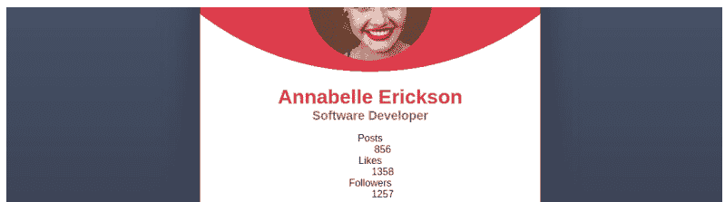

Figure 6.19 Styled Name and Job title

接下来我们将对帖子、点赞和关注者信息进行样式设置。

### 6.6.2 Space-around and gap

在我们的 HTML 中，描述列表（dl）包含帖子、点赞和关注者计数（列表 6.10）。每个分组都包含在 div 中，因此我们将为定义列表应用 display 值 flex 以水平对齐所有三个组。然后我们将 justify-content 属性设置为 space-around 以在卡片上展开它们。

## Listing 6.10 Description list HTML

```
<dl>
  <div>
    <dt>Posts</dt>
    <dd>856</dd>
  </div>
  <div>
    <dt>Likes</dt>
    <dd>1358</dd>
  </div>
  <div>
    <dt>Followers</dt>
    <dd>1257</dd>
  </div>
</dl>
```

space-around 值通过为每个元素之间提供相等量的空间，并在两端各提供一半的空间来在我们的轴上均匀分布元素。图 6.20 显示了间距如何应用的图表。

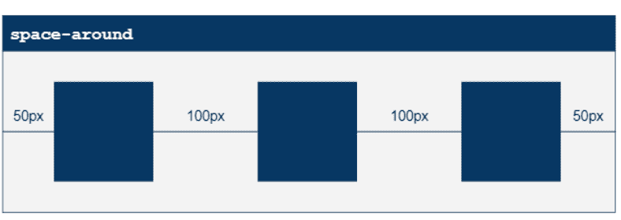

Figure 6.20 space-around property

列表 6.11 显示了我们对描述列表的样式。请注意我们还包含了 gap: 12px 声明。这确保了我们元素之间的最小空间为 12 像素。我们本可以给描述列表内部的 divs 一个 margin；然而，那些也会影响外部边缘。Gap 仅影响元素之间的空间。

## Listing 6.11 Styling the name

```
dl {
  display: flex;
  justify-content: space-around;
  gap: 12px;
}
```

如图 6.21 所见，我们的个人资料统计信息现在在行中并在卡片上均匀分布。

Figure 6.21 Aligned profile stats

然而，数字是偏移的。这来自于描述，其中有一些来自浏览器默认值的边距。让我们去掉这些并使用列表 6.12 中的 CSS 将文本样式设置为粗体、更大、鲑鱼色。

## Listing 6.12 description details rule

```
dd {
  margin: 0;
  font-size: 1.25rem;
  font-weight: bold;
  color: var(--primary);
}
```

移除边距后（图 6.22）我们注意到点赞并没有完全居中到我们卡片的中间。

Figure 6.22 Description list alignment

点赞没有居中在卡片中间的原因是因为三个元素都没有完全相同的宽度。当元素被分布时，浏览器会计算每个元素所需的总空间，然后重新分配剩余空间。因此，由于包含关注者的 div 比包含帖子的 div 更大，点赞不会落在中间。

### 6.6.3 Flex-basis and flex-shrink

为了使点赞居中，我们将为三个 div 分配相同的宽度。然而，与使用 width 属性不同，我们将使用 flex-basis 并将其值设置为 33%。flex-basis 设置浏览器在计算元素所需空间时应使用的初始大小。我们还将 flex-shrink 设置为 1。

flex-shrink 规定元素是否允许缩小到小于 flex-basis 值分配的大小，如果容器中没有足够的空间容纳元素。如果 flex-shrink 值为 0，则大小不调整；任何正值都允许调整大小。

我们将 flex-basis 设置为 33%，但请记住：我们还设置了元素之间的 12 像素间隙。因此，一旦考虑间隙，我们设置的 flex-basis 大小对于容器来说就太宽了。通过允许元素收缩，我们告诉浏览器以每个 div 占用容器宽度的 33% 开始其定位计算，并将它们均匀收缩以适应可用空间。这避免了我们必须计算 divs 应该有多宽才能仍然大小相等。

因此，要编写我们的规则（列表 6.13），我们使用子组合符（>）定位定义列表（dl）的直接子 div 并应用 flex-basis 和 flex-shrink 声明。

## Listing 6.13 Centering the likes

```
dl > div {
  flex-basis: 33%;
  flex-shrink: 1;
}
```

随着我们的点赞居中（图 6.23），让我们把注意力转向定义术语（dt）。

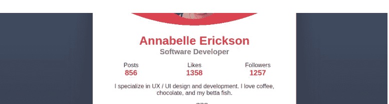


## 6.6.4 Flex-direction

在我们的原始设计中，描述详情（数字）在描述术语之上。为了在视觉上将其翻转，我们将使用 `flex-direction` 属性。我们断言 flexbox 可以在单一轴上放置元素。到目前为止，我们的工作都是在水平或 x 轴上进行。

为了使详情位于术语之上，我们将使用 flexbox 在垂直或 y 轴上操作。要更改 flexbox 操作的轴，我们使用 `flex-direction` 属性。默认情况下其值为 `row`，这使得 flexbox 在 x 轴上操作。通过将值更改为 `column`，我们使其在 y 轴上操作。

此外，`flex-direction` 属性还允许我们规定元素的排序方式。将值设置为 `column-reverse` 会告诉浏览器我们要在 y 轴上操作，并且希望元素按反向 HTML 顺序放置，使描述详情（`dd`）首先出现，描述术语（`dt`）其次。

与之前一样，我们希望在父元素上设置行为，在本例中为 `div`。因此我们将按清单 6.14 所示添加到之前创建的 `div` 规则中以重新排序元素。我们还减小了描述术语（`dt`）的大小以强调数字而非其术语。

```
Listing 6.14 Reversing content order

dl > div {
  flex-basis: 33%;
  flex-shrink: 1;
  display: flex;
  flex-direction: column-reverse;
}
dt { font-size: .75rem; }
```

> NOTE: CONTENT ORDER 出于可访问性原因，我们希望确保我们编写 HTML 的顺序与屏幕上显示的顺序一致。一个让计算机朗读页面内容以便用户在视觉上跟随的用户，如果被朗读的内容与他们看到的内容不匹配，就会很容易感到迷失或困惑。因此在使用 `flex-direction` 等属性重新排序内容时必须谨慎。

图 6.24 显示了我们样式化的描述列表（`dl`）。

Figure 6.24 Styled description List

继续向下浏览卡片，让我们将注意力转向个人资料统计数据下方的摘要段落。

## 6.6.5 Styling the paragraph

段落看起来已经相当不错了。我们要做的唯一一件事就是为其添加一些垂直边距以留出呼吸空间，并增加行高以提高可读性，如清单 6.15 所示。

请注意行高没有单位。通过不设置单位，我们允许行高随字体大小缩放。如果我们将其设置为例如 12 像素的值，行高将始终保持 12 像素，而不管字体大小如何。因此如果字体大小被大幅增加，我们的字母会在垂直方向上重叠。最安全的做法始终是不声明单位。

### Listing 6.15 Paragraph rule

```
p.summary {
  margin: 24px 0;
  line-height: 1.5;
}
```

在处理完段落（图 6.25）后，让我们来样式化技术列表。

Figure 6.25 Styled summary paragraph

## 6.6.6 Flex-wrap

我们要做的第一件事是样式化列表元素本身。我们将使用有时被称为药丸或芯片的设计模式，其中元素具有背景颜色和圆角。我们的 CSS 将如清单 6.16 所示。我们还包含了一些内边距以防止文本紧贴芯片边缘。

### Listing 6.16 Styling the list elements

```
ul.technologies li {
  padding: 12px 24px;
  border-radius: 24px;
  background: #ffdadd;
}
```

在对单个元素进行样式化（图 6.26）后，我们现在可以专注于列表的布局。

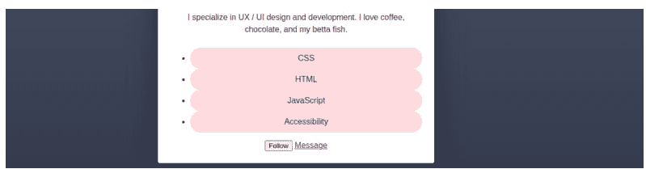

Figure 6.26 Styled List Items

我们要做的第一件事是使用 list-style: none 移除项目符号。然后我们将移除所有内边距并将边距设置为垂直 24px、水平 0。

为了定位项目，我们将使用 flexbox，添加 12px 的间距并将 justify-content 属性值设置为 space-between。space-between 与 space-around 非常相似，只是它不会在容器的开头和结尾添加空间，如图 6.27 所示。

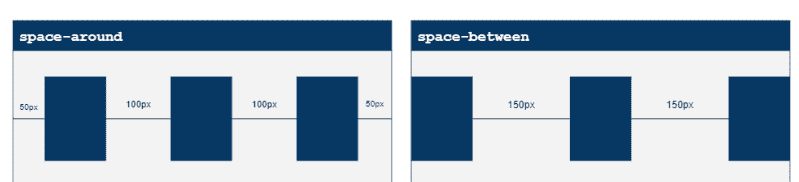

Figure 6.27 space-around versus space-between

我们用于布局芯片的规则如下所示（清单 6.17）：

### Listing 6.17 Styling the list of technologies

```
ul.technologies {
  list-style: none;
  padding: 0;
  margin: 24px 0;
  display: flex;
  justify-content: space-between;
  gap: 12px;
}
```

然而，我们注意到当我们减小屏幕宽度时（图 6.28），我们的最后一个芯片会超出卡片范围。

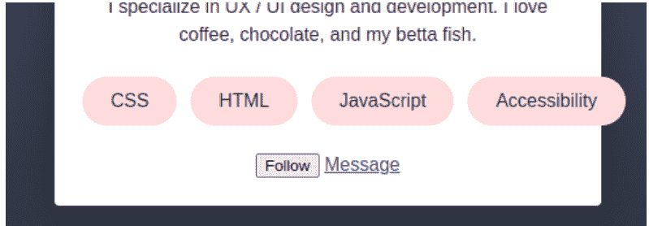

Figure 6.28 Chip extending beyond width of the card

在窄屏幕上，我们的列表比卡片更宽。为了防止内容溢出卡片，我们可以使用 flex-wrap 属性。

默认情况下，弹性项目将显示在一行中，即使容器太小，就像我们技术列表所经历的那样。为了在空间用完时强制最后一个元素换到新行，我们可以将 flex-wrap 属性设置为 wrap。这将告诉浏览器在空间用完时在下方开始新的一行项目。

与 flex-direction 类似，flex-wrap 也可以更改元素的显示顺序，但在这里我们不需要更改它。更新后的规则如清单 6.18 所示。

### Listing 6.18 Adding flex-wrap

```
ul.technologies {
  list-style: none;
  padding: 0;
  margin: 24px 0;
  display: flex;
  justify-content: space-between;
  gap: 12px;
  flex-wrap: wrap;
}
```

请注意图 6.29 中 CSS 和 Accessibility 芯片之间的间隙，即使我们的列表元素没有任何边距。我们的列表 gap 属性值为 12px，这意味着它不仅会确保项目之间水平至少有 12 像素，在换行时它还会在这两者之间垂直添加 12 像素的间隙。

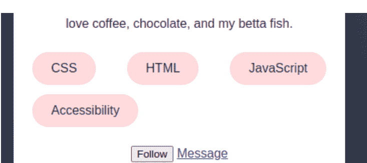

Figure 6.29 Wrapping the chips on narrow screens

## 6.6.7 Styling the actions

我们在个人资料卡中需要样式化的最后一件事是用户在卡片底部可以采取的 2 个操作：向个人资料所有者发送消息或关注。

尽管它们在语义上不同，一个是链接，另一个是按钮，但我们将把它们都样式化为看起来像按钮的样子。让我们从一些将应用于两个元素的基本来开始。我们创建一个包含两个元素选择器的规则，以确保两种元素类型在视觉上保持一致。然后我们为它们不同的地方创建单独的规则。

我们还创建了一个 focus-visible 规则，该规则将应用于使用通用选择器 (*) 和伪类 :focus-visible 的所有元素，以便当用户通过键盘导航到我们的链接和按钮时，他们会看到元素周围的虚线轮廓，并且可以清楚地看到他们即将选择的内容。

### Listing 6.18 Adding flex-wrap

```
.actions a, .actions button {
  padding: 12px 24px;
  border-radius: 4px;
  text-decoration: none; #B
  border: solid 1px var(--primary);
  font-size: 1rem;
  cursor: pointer;
}

.follow {
  background: var(--primary);
  color: var(--primary-contrast);
}

.message {
  background: var(--primary-contrast);
  color: var(--primary);
}

*:focus-visible {
  outline: dotted 1px var(--primary);
  outline-offset: 3px;
}
```

#A applies to both the link and the button
#B removes the underline

图 6.30 显示了我们样式化的链接和按钮。然而，由于它们靠得很近，我们将想要在两个按钮之间添加一些空间。

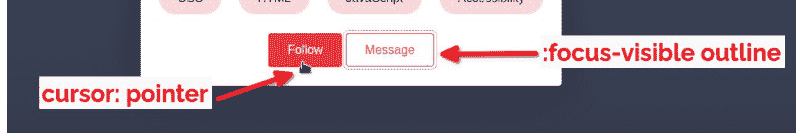

Figure 6.30 Styled actions

我们希望保持链接和按钮居中，但同时在它们之间添加一些空间。让我们最后一次使用 flex 和 gap 来定位我们的操作元素。

我们将为列表赋予 display 属性值为 flex 并添加 16px 的间距。为了保持两个元素居中，我们将使用 justify-content 属性并赋值为 center。最后，我们将通过给列表 margin-top 值 36 像素来在技术列表和操作之间添加一些空间，如清单 6.19 所示。


# Listing 6.19 Positioning the link and button

```
.actions {
  display: flex;
  gap: 16px;
  justify-content: center;
  margin-top: 36px;
}
```

通过这条最后的规则，我们已经完成了个人资料卡的样式设计。最终成品如图 6.31 所示。

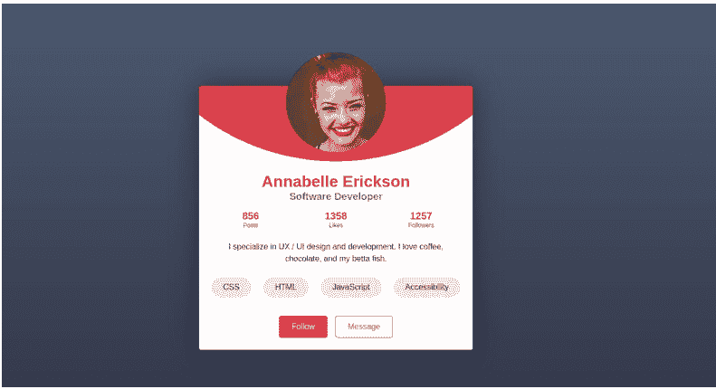

Figure 6.31 Finished Profile Card

## 6.7 Summary

- CSS custom properties allow us to set variables that can be reused throughout our CSS
- Flexbox allows us to position elements on a single axis either horizontally or vertically
- `flex-direction` sets which axis flexbox will operate on
- Both `flex-direction` and `flex-wrap` can alter the order in which the elements are displayed
- The `align-items` property sets how the elements are aligned on the axis relative to one another
- The `justify-content` property dictates how the elements positioned and leftover space will be distributed within the element to which it is applied.
- `flex-basis` sets a starting element size for the browser to use when laying out flexed content
- `flex-shrink` dictates whether and how content can shrink when an element is being flexed
- We can prevent images from distorting when using fixed heights and widths that do not match the image’s aspect ratio by using the `object-fit` property

## 7