## Harnessing the full power of float

### This chapter covers

- Creating a drop cap using float
- Using float to wrap text around the image
- Using CSS shapes to make the text follow the floated image's shape

Grid and flexbox have given us the ability to create layouts that were previously incredibly difficult if not impossible to realize, one of the most common examples would be a three column layout with all three columns the same height regardless of the contents within. Another layout technique, which unlike its grid and flexbox counterparts has been around for quite some time, is float. Part of the CSS Logical Properties and Values Level 1 Module, float is purpose built to allow other content to wrap around the element being floated and as result really shines at manipulating images inside of text and at creating drop caps.

Drop caps are a way to style and add emphasis to text. They consist of creating a larger [sometimes more ornate] capital letter which is usually found at the beginning of a page or paragraph. These were often seen in the illuminated manuscripts of the middle ages. The F at the beginning of the paragraph in Figure 7.1 is an example of a drop cap found in the Carmina Burana manuscript. Later, with the advent of the printing press, the concept was carried over into print with specialized glyphs and plates being created, or by simply using a larger font size. The practice is much more seldom seen on the web but by no means impossible and a great way to make our typography more interesting.

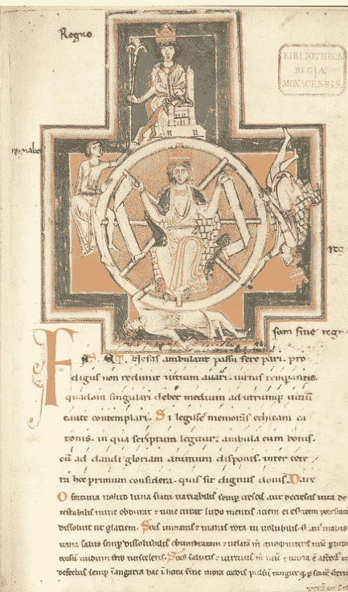

Figure 7.1 The Wheel of Fortune illustration from the Carmina Burana manuscript¹

Another way to make content more visually striking is to style our images to fit nicely in the text. When we add images to content we often add our image tag, maybe some margin, and often don’t think about it much more than that. Using CSS shapes in conjunction with float, we can make our text wrap the actual shape of what is being displayed in the image to create a much more striking effect. We can flow text around virtually any shape we create, even curves.

In this chapter, we will be taking a close look at our typography and images to make our content more visually interesting while making sure we keep our content accessible. We will

1 "File:Wheel-of-fortune-carmina-burana.jpg" Wikimedia Commons, 1220 https://commons.wikimedia.org/wiki/File:Wheel-of-fortune-carmina-burana.jpg. Accessed 25 March 2022.

start with an unstyled excerpt of "The Call of the Wild" by Jack London². We will use float to add a drop cap to our first paragraph. Then, we will wrap our text around our images following the content of said images. We will do this for both a raster and a vector image.

### RASTER VS VECTOR

A raster image is created using a grid of pixels while a vector image is drawn using mathematical formulas. For more in depth information about the difference between raster and vectors checkout Section 1 of Chapter 3: "SVG and graphics"

Figure 7.2 shows the starting point and the finished product.

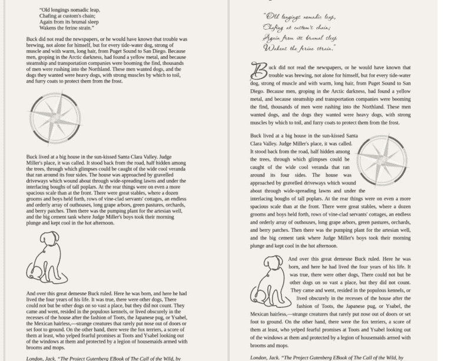

Figure 7.2 The Starting Point and Finished Product

² London, Jack. "The Project Gutenberg EBook of The Call of the Wild, by Jack London." Project Gutenberg https://www.gutenberg.org/files/215/215-h/215-h.htm. Accessed 25 3 2021.

Listings 7.1 and 7.2 include our starting CSS and HTML for our page that we build upon in this chapter. To follow along as we style the page you can download the starting HTML and CSS from the github repo at: https://github.com/michaelgearon/Tiny-CSS-Projects/tree/main/chapter-07.

Our HTML consists of a main tag inside of which we have a header, blockquote, three paragraphs, 2 images, and the citation for where the text came from.

# Listing 7.1 Starting HTML

```
<main>
<h1>Chapter I: Into the Primitive</h1>
<blockquote>"Old longings nomadic..."</blockquote>
<p>Buck did not read the newspapers, or he...</p>
 #A
<p>Buck lived at a big house in the...</p>
 #B
<p>And over this great demesne Buck ruled...</p>
<cite>London, Jack...</cite>
</main>
```

#A The compass image
#B The Dog Image

Our CSS includes some base styles to set up our page including margin, padding, and background color. The body's width is restricted to be no wider than 78ch, and margins center the content when the screen width exceeds our maximum value. Also set up is the default font for the page which is Times New Roman. Lastly, in order to ensure the images do not overflow on small screens, they are given a maximum width, which is set to 100%. In other words, they can't be wider than their container.

# Listing 7.2 Starting CSS

```
html {
  padding: 0;
  margin: 0;
}

body {
  background-color: rgba(206, 194, 174, 0.24);
  padding: 4rem;
  font-size: 16px;
  max-width: 78ch; #A
  margin: 0 auto; #C
  font-family: 'Times New Roman', Times, serif;
  border-left: double 5px rgba(0,0,0,.16);
  min-height: 100vh; #B
  box-sizing: border-box;
}
img {
  max-width: 100%;
}
```

#A Prevents our content from becoming excessively wide
#B So that regardless of window size the background covers the whole window
#C Centers the content when window is larger than 78ch

## 7.1 Adding a drop cap

We already have some base CSS to style the page, we are now going to turn our attention to the text. By virtue of the fact that the width of our body is already capped at a width that works well for our text, we do not need to worry about line length. We do need to address the leading or line height.

### 7.1.1 Leading

Leading is the amount of space found between our lines. The term comes from the days of the printing press, when to adjust the spacing between the lines of text, bars of lead of various widths would be placed. The CSS property we are going to use to accomplish the same outcome is `line-height` (https://developer.mozilla.org/en-US/docs/Web/CSS/line-height).

Line height can take a number value (`line-height: 2`) or a number with a unit (`line-height: 5px`). The unit can either be relative such as ems, or fixed such as pixels. Unless the unit is relative to the font size such as `em`, when providing a unit, if the font is scaled or a child element has a different font size the line height may not look correct and can negatively impact legibility. When using a unitless number, the line height is automatically calculated relative to the font size of the element, eliminating this concern. We will therefore be using a unitless line height. We will set a line height of 1.5 on all paragraphs by creating a rule specifically for the paragraph element and then applying the height as follows: `p { line-height: 1.5; }`.

> **Accessibility and Leading**
> Research shows that for text having a line height between 1.5 and 2 makes line tracking for individuals cognitive disabilities easier³

### 7.1.2 Justification

For optimum effect when we have the text follow the image, we are going to justify our text. Justifying the text means we are going to make all of our lines the same width. A technique often seen in newspapers, where the right edge is a straight line rather than a ragged edge.


# 可访问性与文本对齐

警告：网络内容无障碍指南（WCAG）包含三个相互递进的符合性等级 A、AA 和 AAA。A 是限制最少的，逐步提升到最严格的 AAA。通常网站会以 AA 等级为目标，但如果我们需要符合 AAA，则值得一提的是，文本两端对齐违反了无障碍指南 1.4.5，而该条款是 AAA 的要求⁴。

要对齐我们的文本，我们将使用 `text-align` 属性，该属性可以取 left、right、center 或 justify 的值。我们将 `text-align: justify;` 添加到之前创建的段落规则中。

我们的段落规则现在有 2 个属性，text-align 和 line-height，这可以处理段落的样式。列表 7.3 显示了完成的段落规则。

## 列表 7.3 完成的段落规则

```
p {
  line-height: 1.5;
  text-align: justify;
}
```

段落本身已处理完毕，如图 7.3 所示，我们现在可以专注于第一段的第一字母来创建首字下沉

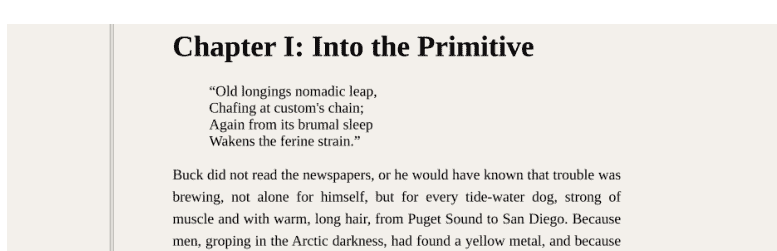

图 7.3 样式化的段落

## 7.1.3 首字母

我们不需要向 HTML 添加任何标签来选择第一段的首字母，我们可以使用伪类 `:first-of-type` (https://developer.mozilla.org/en-US/docs/Web/CSS/:first-of-type) 来选择第一段，然后使用伪元素 `::first-letter` (https://developer.mozilla.org/en-US/docs/Web/CSS/::first-letter) 来获取该字母，在本例中为 B，两者都可以串联。在代码中，这被翻译为 `p:first-of-type::first-letter {}`。

## 伪类 vs 伪元素

伪类添加到选择器中以定位特定状态，而伪元素允许我们选择元素的一部分。

选中字母后，我们现在可以开始对其进行样式设置，使其看起来像首字下沉。为了使其从其余文本中脱颖而出，我们将选择一种更华丽的字形。在本例中，我们将使用 Passions Conflict (https://fonts.google.com/specimen/Passions+Conflict) 如图 7.4 所示，我们将从 Google Fonts 导入该字体。

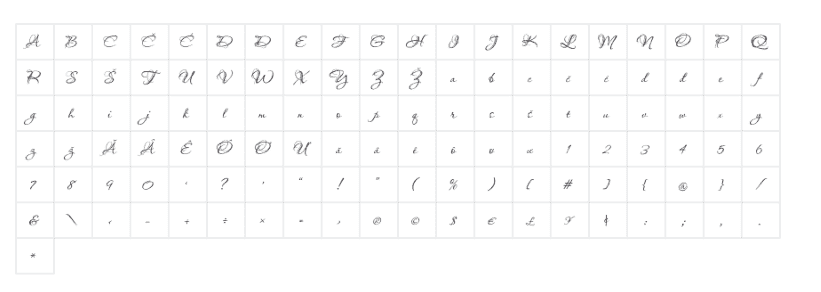

图 7.4 Passions Conflict 字形

由于这种字体的字母大写特别华丽，因此非常适合用于我们的首字下沉。我们稍后在本章中也会使用它来设置本章开头引用的样式。像这样的漂亮字体是装饰页面的绝佳方式，但仅适用于非常短的内容。手写体和装饰字体可能很难阅读，因此不适合用于大量文本。然而，对于首字下沉、大标题或简短引用，它们可以成为区分元素与内容其余部分并为页面增添个性的好方法。

这种特定字体中的字形比 Times New Roman（我们用于其余内容的字体）的字形小得多，而我们正在创建的首字下沉按定义比其余文本更大，因此我们必须调整其大小。我们还将调整字母的行高，使其与文本很好地配合。最后我们将使其向左浮动，以便文本环绕字母，达到我们期望的效果。

float 属性根据传递给它的值将元素放置在其容器的右侧或左侧。周围的内联元素（我们的文本）将使用剩余空间环绕浮动元素。float 属性可以取以下三个属性之一：

- Left
- Right
- None（元素未浮动）

由于我们的文本是英文，从左到右流动，我们希望字母 B 保持在左侧。因此，我们将第一段的首字母（B）向左浮动，通过在规则中添加 `float: left;`。列表 7.4 显示了我们创建的用于设置首字下沉样式的完整 CSS 规则以及 Passions Conflict 字体的导入。图 7.5 显示了生成的输出。

## 列表 7.4 首字下沉

```
@import url(
  'https://fonts.googleapis.com/css2?family=Passions+Conflict&display=swap'
);
p:first-of-type::first-letter {
  font-size: 6em;
  float: left;
  line-height: .5;
  font-family: 'Passions Conflict', cursive;
}
```

A Passions Conflict 字体的导入
B 样式化我们第一段开头字母 B 的规则

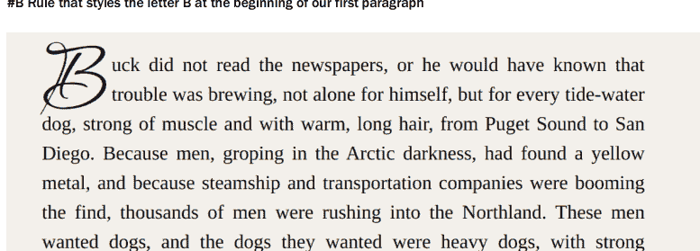

图 7.5 首字下沉

我们使用 em 和无单位的行高，这样如果我们 ever 更改段落的字体大小，首字下沉也会相应缩放，因为 1 em 的值是基于父元素的 font-size 设置的，在本例中是我们的段落标签。

为了重新定位我们的 B 使其与文本很好地配合，我们编辑了字母的行高。另一种我们可以使用的方法是将 B 的位置设置为 relative，然后使用 top、bottom、left 和 right 来相对于其余文本更改其位置。

首字下沉创建后，我们现在将注意力转向本章开头的引用。

## 7.2 样式化引用

页面顶部的引用目前相当单调，而且在文本中有些迷失。为了使其脱颖而出，我们将使用与首字下沉相同的字体。由于前面提到的大小和行高差异，我们将对其进行调整，使段落和引用看起来大小和间距均匀。列表 7.6 显示了我们将添加以完成此任务的 CSS，而列表 7.6 显示了输出。

```
Listing 7.5 Blockquote
```css
blockquote {
  font-family: 'Passions Conflict', cursive;
  font-size: 2em;
  line-height: 1;
}
```
```

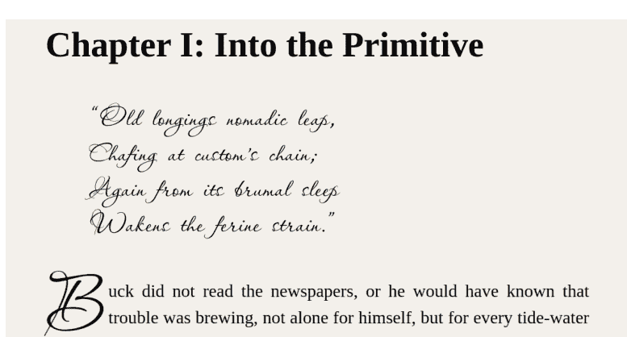

图 7.6 引用块

我们再次使用相对单位，这样如果其余内容的字体大小发生变化，引用也会随之变化。你可能已经注意到，我们使用了行高 1，尽管我们上面说过为了最佳可读性，行高应为 1.5 到 2。我们在这里破例，因为观察输出，我们发现默认情况下该字体本身已有非常大的行高，我们不需要增加大小。在处理草书或装饰字体时，这种情况偶尔会发生。

文本处理完毕后，我们现在可以专注于图像。

## 7.3 使文本围绕指南针弯曲

要使文本环绕我们的指南针图像，我们需要做的第一件事是将指南针向右浮动。我们的指南针是 png，由于是图像，因此本质上是矩形的，因此文本环绕图像遵循矩形路径。图 7.7 显示了浮动的指南针。图像上已应用边框以显示其边界框。

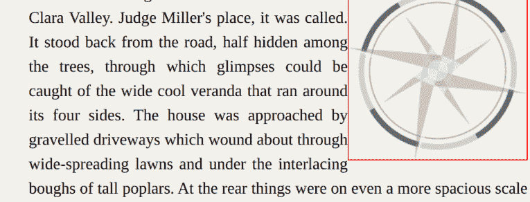

Buck lived at a big house in the sun-kissed Santa Clara Valley. Judge Miller's place, it was called. It stood back from the road, half hidden among the trees, through which glimpses could be caught of the wide cool veranda that ran around its four sides. The house was approached by gravelled driveways which wound about through wide-spreading lawns and under the interlacing boughs of tall poplars. At the rear things were on even a more spacious scale

图 7.7 方形指南针

## 7.3.1 Shape-Outside: Circle

为了使文本跟随指南针的曲线，我们需要为文本环绕添加一个曲线。

我们将使用的属性是 shape-outside (https://developer.mozilla.org/en-US/docs/Web/CSS/shape-outside)。shape-outside 允许我们定义一个形状，相邻文本将围绕该形状流动。该形状也不必是矩形。它可以是

- Circle 或椭圆
- Polygon
- 源自图像 - 使用图像的 alpha 通道（透明度）来确定形状应为
- Path - 在规范中，但在本书撰写时尚未在任何浏览器上实现 (https://developer.mozilla.org/en-US/docs/Web/CSS/basic-shape#path())
- Box model 值

由于我们有一个非常圆形的图形，我们要实现的目标形状是一个圆。这给了我们几个选项：


+   1. 使用 CSS 形状 (https://developer.mozilla.org/en-US/docs/Web/CSS/basic-shape#path())
+   2. 使用边框半径

让我们先来看一下使用形状的情况。

要定义我们的圆形，我们将使用 circle 函数。Circle 接受一个 radius 属性和一个可选的 position 属性，该属性定义圆心的起始位置。如果省略 position 属性，圆的原点将默认为图像的中心。

```
circle( [<shape-radius>]? [at <position>]? )
```

在我们的例子中，我们希望圆的中心是图像的中间，所以我们不会传递位置。然而，我们必须定义一个半径。我们将把它设置为 50%（我们希望半径等于图像宽度的二分之一），在内部它将解析为我们的宽度平方加上我们的高度平方的平方根除以 2 的平方根。

radius = % × √(height² + width²) / √2 = .5 × √(175² + 175²) / √2 = 87.5

由于我们的图像是正方形并且宽度为 175，当传递 50% 的半径时，我们的半径为 87.5 非常合乎逻辑，然而，如果图像是矩形，了解基于百分比的半径是如何计算的对于理解最终输出的外观非常重要。

如果我们有一个高度为 100px、宽度为 300px 的横向图像，我们选择基于百分比的值时，圆的半径就没那么明显了。我们可以使用上面的公式来计算半径会是多少。

radius = % × √(height² + width²) / √2 = .5 × √(100² + 300²) / √2 ≈ 111.8

图 7.8 显示了当使用 circle 函数中的 50% 值时，半径将如何应用于我们的正方形图像，与矩形图像相比。

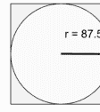

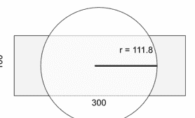

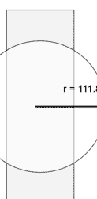

Square
Shape-outside: circle(50%)

landscape

portrait

回到我们的图像，它是正方形，所以我们使用 shape-outside 属性并将其值设置为 circle(50%) 应用于我们的图像。列表 7.6 显示了我们的 CSS 规则。

我们的图像是正方形，所以它的宽高比为 1（宽度 / 高度 = 175 ÷ 175 = 1）。

宽高比：图像的宽高比是图像高度和宽度的比例关系，通过将宽度除以高度计算得出。

添加宽高比并不是创建形状所严格必要的，但有助于在加载时减少布局偏移。

布局偏移：当元素添加到页面或其大小发生变化时，元素之后的所有内容都会移动以腾出空间给元素或填补元素留下的空白。页面上元素的移动被称为布局偏移。

当图像具有设定的高度和宽度或具有定义的宽高比时，浏览器可以在图像加载时为其预留空间，从而减少这种移动。因此，定义图像的宽高比和/或高度和宽度是良好的做法。

## Listing 7.6 shape-outside

```
img.compass {
  aspect-ratio: 1; #A
  float: right;  #B
  shape-outside: circle(50%); #C
}
```

#A 宽高比
#B 将图像浮动到右侧
#C 添加我们的圆形，值为 50%

图 7.8 显示了我们的输出。文本围绕图像环绕并遵循曲线，但我们的图像在任何方面都没有被裁剪。

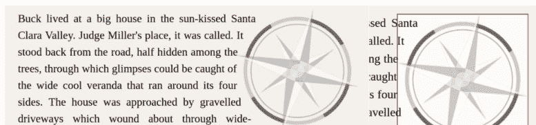

图 7.8 带有曲线文本的浮动指南针

## 7.3.2 Clip-Path

这之所以有效，是因为我们的图像具有透明背景。我们已经使文本变圆，但图像仍然相当方正。如果我们为图像添加背景，这就会变得明显。为了使图像真正看起来是圆形的，我们需要添加一个 clip-path (https://developer.mozilla.org/en-US/docs/Web/CSS/clip-path)。Clip-path 也接受一个形状，所以我们将传递与我们传递给 shape-outside 相同的数值。我们还将为图像添加一些边距，以在它和文本之间留出一些呼吸空间。列表 7.7 显示了我们图像的完整 css。

## Listing 7.7 clip-path

```
img.compass {
  aspect-ratio: 1;
  float: right;
  shape-outside: circle(50%);
  clip-path: circle(50%);
  margin-left: 1rem;
}
```

我们添加了一个与 shape outside 匹配的 clip-path，以及图像左侧的一些边距，以防止文本靠图像太近，尤其是指南针有从圆形轮廓伸出的箭头，我们的圆形并未考虑这些。图 7.9 显示了指南针图像的最终输出。

Buck lived at a big house in the sun-kissed Santa Clara Valley. Judge Miller's place, it was called. It stood back from the road, half hidden among the trees, through which glimpses could be caught of the wide cool veranda that ran around its four sides. The house was approached by gravelled driveways which wound about through wide-spreading lawns and under the interlacing boughs of tall poplars. At the rear things were on even a more

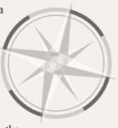

1 Santa lled. ong be ran was wound under the

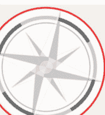

## Figure 7.9 Round Floated compass

通过添加 clip path，我们现在可以观察到图像本身，包括背景现在看起来是圆形的。角落已被裁剪，之前是正方形的背景现在也是圆形的。添加的边距也使文本围绕我们的指南针箭头移动，使其看起来不那么拥挤。

我们已经证明了我们可以使用 CSS Shapes 创建一个圆，现在让我们看看我们将如何使用 border-radius 来制作圆。

## 7.3.3 Shape-box

我们可以通过使用 border radius 修改其矩形形状的元素形状来制作形状。我们仍然使用 shape-outside 但不是传递一个形状，我们指定要在盒模型哪个级别形成形状。我们的选项是

-   - margin-box: 形状跟随边距
-   - border-box: 形状跟随边框
-   - padding-box: 形状跟随内边距
-   - content-box: 形状跟随内容

让我们从一张干净的图像开始，将图像浮动到右侧并添加一些边距以防止文本拥挤图像。列表 7.8 包含了我们的起始 CSS，而图 7.10 显示了当前显示。

## Listing 7.8 Starting point

```
img.compass {
  aspect-ratio: 1;
  float: right;
  margin-left: 1rem;
}
```

Buck lived at a big house in the sun-kissed Santa Clara Valley. Judge Miller's place, it was called. It stood back from the road, half hidden among the trees, through which glimpses could be caught of the wide cool veranda that ran around its four sides. The house was approached by gravelled driveways which wound about through wide-spreading lawns and under the interlacing boughs of tall poplars. At the rear things

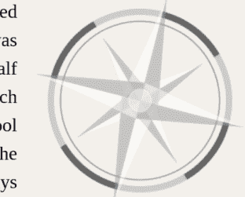

图 7.10 重置为仅浮动和边距

现在让我们添加一个 50% 的边框半径，这将使我们的图像成为圆形。此时，文本不会跟随曲线，我们仍然需要添加 shape-outside 属性。

我们图像周围有边距，我们理想情况下希望形状尊重它，因此我们将使用 margin-box 值。列表 7.9 显示了在代码中应用这一概念。

## Listing 7.9 Starting point

```
img.compass {
  aspect-ratio: 1;
  float: right;
  margin-left: 1rem;
  border-radius: 50%;
  shape-outside: margin-box;
}
```

图 7.11 显示了添加白色背景和边框以强调图像形状的输出。

Buck lived at a big house in the sun-kissed Santa Clara Valley. Judge Miller's place, it was called. It stood back from the road, half hidden among the trees, through which glimpses could be caught of the wide cool veranda that ran around its four sides. The house was approached by gravelled driveways which wound about through wide-spreading lawns and under the interlacing boughs of tall poplars. At the rear things were on even a more

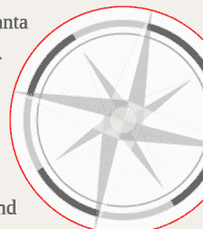

图 7.1.1 指南针形状，边框半径为 50%，shape-outside 值为 margin-box

我们注意到，与我们使用 shape-outside 和 circle 函数时不同，我们的图像已经裁剪成圆形形状，消除了使用 clip-path 的需要。这直接是使用 border-radius 的结果，border-radius 为我们做了裁剪。

我们已经看到了两种实现相同结果的不同方法。像 CSS 中的许多事情一样，有不止一种方法来解决任何单一问题。这就是这种情况之一。两种选项在这种情况下并没有特别优于另一个，这是一个偏好的问题。

现在我们已经处理了指南针图像，我们将继续进行文本围绕狗的环绕。

## 7.4 Wrapping text around the dog

与指南针这种标准形状不同，狗有一个非常不规则的轮廓。然而，这张图像是线条艺术并且由单一路径组成，所以我们可能想从 svg 中获取路径来使用 path 函数创建我们的形状。正如我们即将看到的，虽然在 CSS 规范中定义，在规范中将不会工作。

## 7.4.1 Using path()... or not yet

让我们在编辑器中打开图像文件来检查代码。列表 7.10 显示了为简洁起见并突出重要信息而删减的图像代码。


## Listing 7.10 dog.svg

```
<svg xmlns="http://www.w3.org/2000/svg" viewBox="0 0 152 193">
  <defs>
    <style>
      .cls-1{
        fill:none;
        stroke:#000;
        stroke-miterlimit:10;
        stroke-width:2px;
      }
    </style>
  </defs>
  <path class="cls-1" d="M21.9135,115.62c-17.2115,4.7607-37.3354,..."/>
</svg>
```

我们有 defs，其中包含了图像的样式。这部分定义了 svg 中各个元素的外观。然后我们有一个 path。path 是显示狗狗的元素，不过它长达 1988 个字符，非常复杂，并且当粘贴到 path 函数中如下 shape-outside: path('M21.913...'); 时似乎不起作用。这是因为在本书写作时，尚无浏览器完全实现了 path()⁶。

一旦该功能实现，使用图形编辑器创建我们的路径并复制过来创建形状将是一种非常有价值的技术，但目前我们还无法使用。这种方法也存在一个缺点，即这些路径可能变得很长，这使得可维护性存疑。然而，我们有几个替代方案：

- 1. 创建一个大致匹配我们图像的多边形形状，类似于我们上面使用圆时采用的技术。
- 2. 使用 url() 函数，该函数会引入图像并基于 alpha 通道确定形状。

我们将采用方案 2 并使用 url() 函数。

## 7.4.2 Using the image

与我们处理指南针图像时一样，我们将首先浮动该图像，但这次浮动到左侧，以打破页面上的视觉单调。然后，为了创建形状，我们使用 url() 函数，并向其传递图像的路径。Listing 7.11 显示了应用于狗狗图像的 css。

## Serving the image file

在使用 shape-outside 时使用 URL，我们需要确保通过服务器运行我们的代码，以便浏览器获取图像而不是直接从文件系统读取。这具体与跨源资源共享（CORS）以及浏览器设置的安全策略有关。详细解释可在 CSS 规范中的 https://drafts.csswg.org/css-shapes/#shape-outside-property 找到。为缓解此问题，git 仓库中的示例代码使用 http-server，在 localhost:8080 上提供文件以完成此任务。另一种选择是使用 shape-outside 引用 github 上托管的文件：
url('https://raw.githubusercontent.com/michaelgearon/Tiny-CSS-Projects/main/chapter-07/before/img/dog.svg')。

## Listing 7.11 Dog floated left

```
img.dog {
  aspect-ratio: 126 / 161;
  float: left;
  shape-outside: url('img/dog.svg');
}
```

我们将图像向左浮动，然后添加 shape-outside 并传入对图像本身的引用。浏览器会查看图像的透明度，并根据透明度结束的位置确定形状的创建位置。Figure 7.12 显示了我们的输出。

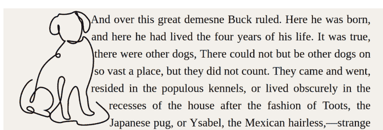

Figure 7.12 Floated dog

由于我们的图像具有不透明的线条和透明的背景，切割点相当直接。如果我们的图像有一个从不透明到透明的渐变，我们可以使用 shape-image-threshold 属性来调整切割位置，该属性接受 0 到 1 之间的值，0 为完全透明，1 为完全不透明。

## 7.4.3 Shape Margin

下一步是添加一些边距以将文本移离图像，因为现在看起来相当拥挤。我们不能像之前向右浮动时那样直接给图像添加边距，如果尝试的话会发现边距被忽略并且实际上不会移动文本。我们需要使用 shape-margin。shape-margin 允许我们调整形状与其余内容之间的空间。我们将添加 1 em 的空间，如 listing 7.12 和 Figure 7.13 所示。

## Listing 7.12 Shape Margin

```
img.dog {
  aspect-ratio: 126 / 161;
  float: left;
  shape-outside: url('img/dog.svg');
  shape-margin: 1em;
}
```

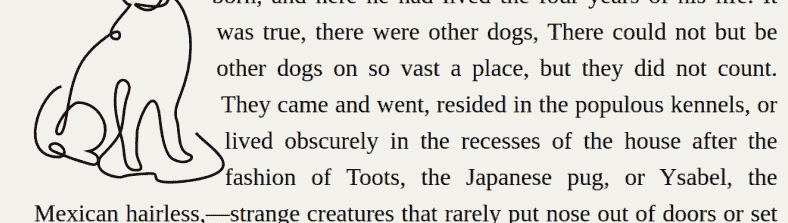

## Figure 7.13 Shape Margin

图像底部的文本仍然相当接近。此时我们可以添加一些边距来增加空间，只要添加的边距小于或等于 shape-margin 的值。如果值大于 shape-margin，它仍然会生效，但仅限于 shape-margin 的量。牢记这一注意事项，我们将在图像右侧添加 1em 的边距。Listing 7.13 显示了狗狗图像的完整 CSS。

## Listing 7.13 Complete dog image

```
img.dog {
  aspect-ratio: 126 / 161;
  float: left;
  shape-outside: url('img/dog.svg');
  shape-margin: 1em;
  margin-right: 1em;
}
```

shape-margin 与 margin-right 的结合，将文本推离我们的图像，得到我们在 Figure 7.14 中看到的精致最终效果。

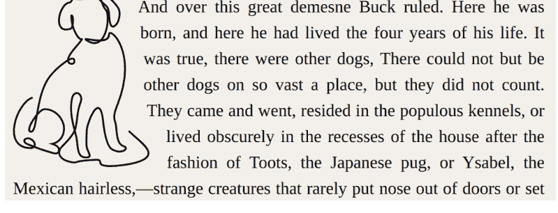

## Figure 7.14 Finished floated dog

完成这最后一步后，我们已完成页面的样式，如 Figure 7.15 所示。我们现在拥有一个视觉上吸引人且比我们最初开始时更有趣的布局。

## Chapter I: Into the Primitive

> "Old longings, nomadic long,
> Chafing at custom's chain;
> Again from its brumal clasp
> Wakens the ferine chain."

Buck 并没有读报纸，否则他就会知道麻烦正在酝酿，不仅对他个人而言，而且对从普吉特湾到圣地亚哥的每一只潮水犬而言，这些狗肌肉强壮，毛发温暖而长。因为人们在北极黑暗中摸索，发现了黄色金属，并且轮船和运输公司在宣传这一发现，成千上万的人正涌入北地。这些人想要狗，他们想要的狗是重型的狗，具有强壮的肌肉以便劳作，以及毛茸茸的皮毛以保护它们免受霜冻。

Buck 住在阳光普照的圣克拉拉谷的一栋大房子里。那是米勒法官的住所。它坐落在路边后面，半隐在树丛中，可以瞥见环绕其四面的宽敞凉爽的门廊。房子由碎石车道通向，车道蜿蜒穿过宽阔的草坪和参天白杨交织的枝桠。房子后面比前面更宽敞。有一座大马厩，十几个马夫和男孩在那里活动，还有一排排藤蔓覆盖的仆人小屋，无尽而整齐的杂房，长长的葡萄棚，绿色的牧场，果园和浆果地。然后是自流井的抽水站，以及米勒法官的男孩们在那里晨泳并在炎热的午后保持凉爽的大水泥水箱。

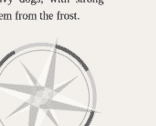

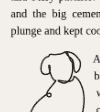

而 Buck 统治着这片广阔的领地。他在这里出生，并在他四年的生命中一直生活在这里。确实，这片如此广阔的地方不可能没有其他狗，但它们不算数。它们来来去去，居住在人口众多的犬舍里，或像 Toots 那只日本斗牛犬，或 Ysabel 那只墨西哥无毛犬一样，隐居在房子的角落里——这些奇怪的生物很少把鼻子探出门外或踏足地面。另一方面，还有狐狸梗，至少有二十只，它们在窗外看着 Toots 和 Ysabel 时发出可怕的承诺的吠叫，并由一群手持扫帚和拖把的女佣保护。

> London, Jack. "The Project Gutenberg EBook of The Call of the Wild, by Jack London." Project Gutenberg, https://www.gutenberg.org/files/215/215-h.htm. Accessed 25 3 2021.

## 7.5 Summary

- 行距，即行与行之间的空间，对可读性很重要
- Float 可以与 first-letter 结合使用以创建首字下沉
- 并非所有字体在给定相同大小值时具有相同的大小和行高
- Shape-outside 使用 CSS 形状来改变元素的形状
- CSS 形状可以由 border-radius 创建
- 与浮动 CSS 形状相邻的内联内容将跟随该形状
- 使用 url() 与 shape-outside 时，图像文件必须由浏览器获取（托管或通过 http-server 或等效方式
- Shape-margin 设置形状的边距
- 有些布局如果不使用 float 就无法实现


