## 8
设计结账购物车

## 本章涵盖

- 条件化表单输入的样式
- 响应式表格
- 使用网格自动定位
- 数字格式化
- 通过媒体查询根据视口大小有条件地设置 CSS
- nth-of-type() 伪类

从食品、书籍到娱乐以及介于两者之间的所有内容，我们中的许多人会定期在线购买商品。这一体验的共同点是结账购物车。我们通过将商品添加到虚拟购物车或篮子中来做出选择，以便在最终购买前查看我们选择的商品。在本章中，我们将研究如何为结账购物车设计样式，使其在窄屏和宽屏上都能正常工作。

在本章中，我们将研究如何在窄屏和宽屏上处理表格。表格对于显示数据非常有用，然而，对于移动设备来说，样式化可能有点困难。因此，我们将研究窄屏的 CSS 解决方案。

我们首先处理一些主题。无论屏幕宽度如何，输入字段、链接或按钮等元素看起来都一样，因此我们将先对这些进行样式化。在组装 UI 的早期定义主题可以显著减少冗余代码并提高我们保持样式一致的能力，因此无论是结账购物车还是任何其他页面或应用程序，此过程都可以翻译到任意数量的设计中。

我们将然后专注于从窄到宽的布局。因为在窄屏（如手机）上，我们倾向于堆叠元素，并且随着变大，我们添加规则来利用我们可用的全部宽度。从移动端开始并随着屏幕变宽而增加样式，通常比从宽屏开始然后在变小时覆盖之前设置的布局元素更容易。我们将创建样式以适应 3 种屏幕尺寸：

- 窄屏（大多数手机）：最大宽度为 549 像素
- 中等（平板电脑和小屏幕）：介于 500px 和 955px 之间
- 宽屏（桌面和高分辨率平板电脑）：宽于 955px

图 8.1 显示了我们的起点以及完成时每个屏幕尺寸的输出效果。

图 8.1 小、中、大屏幕的开始和结束输出

## 8.1 开始

无论屏幕尺寸如何，我们都将使用相同的 HTML。我们将有一个样式表，并使用媒体查询来调整元素在不同屏幕尺寸下的外观。媒体查询用于有条件地将样式应用于元素；我们将在本章后面更详细地探讨这些。

我们的 HTML 包含两个部分，一个用于购物车，一个用于摘要，它们被包装在一个容器中，我们将在宽屏上使用该容器将各部分并排放置。购物车部分包含一个标题和一个包含购物车中每个商品的表格。摘要部分包含一个标题、一个定义列表和 2 个链接。图 8.2 显示了 HTML 元素的图表。

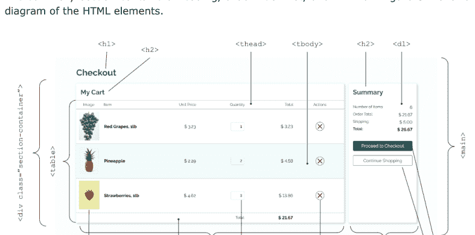

图 8.2 HTML 元素图

清单 8.1 是我们开始使用的 HTML 的缩写版本。代码提到了一个 JavaScript 文件。它存在于根据应用于输入字段的数量计算并插入总值，但不影响样式。一些 HTML 元素还添加了 ARIA（可访问富互联网应用程序），以确保我们的代码是可访问的。ARIA 提供了一个框架来添加属性，这些属性有助于识别代码本身未传达的功能、关系和交互，这些功能由辅助技术（如屏幕阅读器）使用。它对样式也没有任何影响，但我们始终希望确保我们的代码是可访问的，以便我们不阻止残障用户访问和使用我们的应用程序。

## 清单 8.1 起始 HTML

```
<body>
  <main>
    <h1>Checkout</h1>
```
```
<div class="section-container">
  <section>
    <h2>My Cart</h2>
    <table>
      <thead>
        <tr>
          <th>Image</th>
          <th>Item</th>
          <th>Unit Price</th>
          <th>Quantity</th>
          <th>Total</th>
          <th>Actions</th>
        </tr>
      </thead>
      <tbody>
        <tr>
          <td>
            
          </td>
          <td data-name="Item">Red Grapes, 1lb</td>
          <td data-name="Unit Price">$ 3.23</td>
          <td data-name="Quantity">
            <input name="grapes" type="number" aria-label="Pounds of grape baskets" min="0" max="99" id="grapes" value="1" aria-errormessage="grapeError">
            <p class="error" id="grapeError" role="alert" aria-live="polite">Must be a whole number between 0 and 99</p>
          </td>
          <td data-name="Total">
            <!-- value calculated & inserted by JS -->
          </td>
          <td>
            <button type="button" class="destructive">
              
            </button>
          </td>
        </tr>
        ...
      <tfoot>
        <tr>
          <th colspan="4" scope="row">Total:</th>
          <td id="total">
            <!-- value calculated & inserted by JS -->
          </td>
        </tr>
      </tfoot>
    </table>
  </section>

  <section class="summary">
    <h2>Summary</h2>
    <dl>
      <dt>Number of Items</dt>
      <dd id="itemQty">
        <!-- value calculated & inserted by JS -->
      </dd>
    </dl>
```
```
<dt>Order Total</dt>
<dd id="orderTotal">
<!-- value calculated & inserted by JS -->
</dd>

<dt>Shipping</dt>
<dd>$ 5.00</dd>

<dt>Total</dt>
<dd id="grandTotal"></dd>
</dl>
<div class="actions">
<a href="" type="button" class="button primary">
Proceed to Checkout
</a>
<a href="" type="button" class="button secondary">
Continue Shopping
</a>
</div>
</section>
</div>
</main>
</body>
```

与前几章一样，起始和完成项目的代码都可以在 github 仓库中找到：https://github.com/michaelgearon/Tiny-CSS-Projects/tree/main/chapter-08。

## 8.2 主题化

尽管我们的布局有 2 个明确定义的区域（购物车和摘要），并且需要在不同屏幕尺寸下工作，但有一些样式无论它们位于何处或屏幕尺寸如何都不会改变。这些包括

- 使用的字体
- 按钮和链接样式
- 输入和错误消息样式
- 标题大小和颜色

这些类型的样式可以称为我们的主题，为了在页面上保持一致，我们通常希望一次编写它们并在任何地方应用。让我们从我们的字体开始。

### 8.2.1 排版

目前我们的 `font-family` 是浏览器的默认值。在我的例子中它是 Times New Roman，但这可能因您的操作系统、浏览器和系统设置而异。图 8.3 显示了默认字形和开发工具指示正在使用 Times New Roman。在大多数浏览器中，右键单击页面并选择检查将打开开发工具。由于 font-family 未被明确设置，一些浏览器会隐藏它，您可能需要通过计算属性列表顶部的复选框或通过浏览器工具设置来兴奋地告诉浏览器显示所有属性。

## Checkout

## My Cart

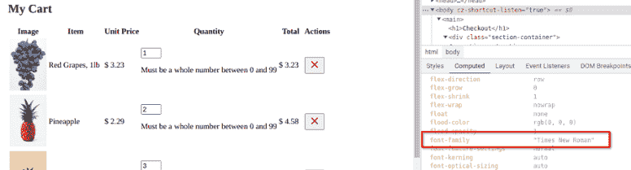

图 8.3 Times New Roman 的默认浏览器

我们将不再使用 Times New Roman，而是从 Google Fonts 导入 Raleway。然后我们将创建一个针对 body 标签的规则，以应用该字体。为此我们将使用 font-family 属性，将其值指定为 "Raleway"。我们还应用了 sans-serif 作为后备。如果 Raleway 无法加载，我们确保将使用一个可比的替代方案（Raleway 是一种无衬线字体）。通过将样式应用于 body 标签，我们充分利用了级联，字体将被应用于任何地方。

应用了 font-family 后，我们现在将设置文本的默认颜色。也在 body 上，使用 color 属性为文本分配颜色。我们将使用值 #171717，它看起来几乎是黑色。我们在这个设计中不使用黑色，因为它是一个非常柔和的设计，而纯黑色可能相当刺眼。

接下来，我们将处理我们的数字。字体系列默认具有旧式或现代数字。两者之间的区别在于数字相对于中线和基线的对齐方式，如图 8.4 所示。

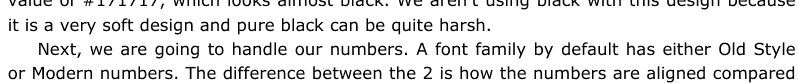

图 8.4 旧式与现代数字

旧式数字的部分数字会超出基线之上和之下，而现代数字则不会。因为我们正在创建一个购物车，我们希望堆叠数字以显示它们相加形成总和，我们希望使用现代样式数字，以便它们更整齐地对齐。然而，Raleway（我们为页面选择的 font-family）默认使用旧式数字。为了使我们的字形使用现代数字，我们可以


使用 `font-variant-numeric` (https://developer.mozilla.org/en-US/docs/Web/CSS/font-variant-numeric) 属性，该属性让我们可以设置数字的显示方式。

这个鲜为人知的属性在处理数字时非常方便，因为它允许我们控制它们显示方式的多个方面，包括：

- 零是否带斜线显示
- 数字如何对齐
- 分数如何显示

我们将使用 `font-variant-numeric: lining-nums`，这会将我们的数字从旧式数字更改为现代数字。图 8.5 显示了在将 `font-variant-numeric` 属性应用到 body 规则之前和之后的摘要部分。在之前版本中，我们可以看到数字的大小不同，而在之后版本中它们已对齐且大小一致。

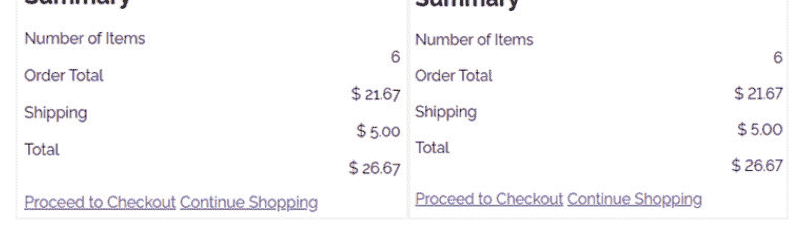

图 8.5 应用 font-variant-numeric 属性前后的对比

最后我们将把标题的颜色更改为青绿色。

我们现在已为页面设置了基础排版。我们直接将其应用于 body 标签，以便页面内的其他子元素将继承这些值。列表 8.2 显示了到目前为止我们构建的规则。

## 列表 8.2 应用于 body 元素的排版相关样式

```
body {
  font-family: 'Raleway', sans-serif;
  color: #171717;
  font-variant-numeric: lining-nums;
}

h1, h2 {
  color: #2c6c69;
}
```

让我们把注意力转向链接和按钮。

## 8.2.2 链接和按钮

此页面上有多个链接和按钮，但从样式上看，它们都像按钮。它们可以根据其用途大致分类。

- 主要行动号召：继续结账链接
- 次要行动号召：继续购物
- 破坏性：带有 X 的按钮，用于从购物车中移除商品

我们将使用这种分类来命名我们的类，以便我们的规则易于重用。在本章中，我们只处理一个页面，但这是一个异常情况。在完整的应用程序中，我们有多个页面或组件会重用相同的样式，因此我们不会将类命名为类似 "proceed-to-checkout"，而是使用 "primary"，这样该类就可以在不同的上下文中轻松重用。

在解决它们之间的差异之前，让我们先考虑它们的相似之处，并为所有看起来像按钮的链接（已赋予 button 类）和按钮编写一个基线。一旦我们编写了基线，我们将为上述每种按钮类型制定规则。

要创建我们的基线，我们首先要做的是使用 background: none 移除浏览器设置的默认灰色背景。接下来添加内边距。

我们对内边距的设置有 2 个选项。

1. 我们可以使用 padding-top、padding-right、padding-bottom 和 padding-right 分别设置每个边。
2. 我们可以使用简写 padding 属性，它允许我们传递 1 到 4 个值。

图 8.6 显示了使用简写属性时值是如何应用的分解。

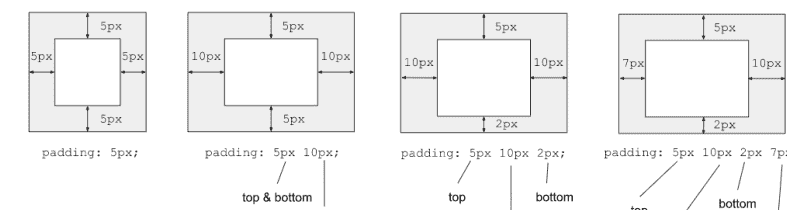

图 8.6 内边距属性简写

我们将使用简写属性。我们将向 padding 属性传递 2 个值（1ex 和 1ch），第一个将处理上下内边距，而第二个将处理左右。

接下来我们将添加一些默认边框。与内边距类似，边框属性相关的样式可以单独设置，也可以使用简写 border 属性，该属性接受样式、宽度和颜色。我们将其设置为 solid 1px #ddd，这将在我们的元素周围产生 1 像素宽的实心灰线。我们还将使用 border-radius 属性使角部圆润。

最后，因为我们将此规则应用于链接，而链接默认是下划线的，所以我们将通过将 text-decoration 属性设置为 none 来移除链接的下划线。

我们为按钮以及具有 button 类的链接制定的基本规则如列表 8.3 所示。

## 列表 8.3 按钮的基础样式

```
button, .button { #A
  background: none;
  border-radius: 4px;
  padding: 1ex 1ch;
  border: solid 1px #ddd;
  text-decoration: none;
}
```

#A 此规则将应用于所有 button 元素以及所有具有 button 类的元素

在处理完按钮的默认状态后，我们现在将添加用户用鼠标悬停在按钮上或通过键盘聚焦时样式的变化。为了实现这一目标，我们将使用 :hover 和 :focus 伪类。

> 注意 伪类 :hover 和 :focus 对可访问性的影响 伪类添加到选择器中以定位特定状态。在悬停和聚焦时添加样式变化对于可访问性很重要，因为它提供了视觉反馈。它让用户知道该项目可以交互。当使用键盘导航时，聚焦时的样式变化让用户知道他们即将交互的元素。没有这些视觉提示，很难知道什么可以点击以及当前焦点在哪里。

在悬停时，我们将在按钮周围添加一个点状青绿色轮廓，并为了留出一些呼吸空间，我们将轮廓偏移 2 像素。我们将使用 2 个属性，outline 和 outline-offset。Outline 与 border 非常相似，接受相同的三个属性：样式、宽度和颜色。Outline-offset 接受一个长度值（可以为负），它决定我们希望轮廓与元素边缘之间的空间量。

聚焦将具有与悬停相同的样式，但轮廓不是点状线，而是实线。列表 8.4 显示了悬停和聚焦状态的最终 CSS。

## 列表 8.4 按钮悬停和聚焦状态

```
button:hover,
.button:hover {
```

```
outline: dotted 1px #2c6c69;
outline-offset: 2px;
}

button:focus,
.button:focus {
  outline: solid 1px #2c6c69;
  outline-offset: 2px;
}
```

图 8.7 显示了包括悬停和聚焦状态在内的样式化链接和按钮。

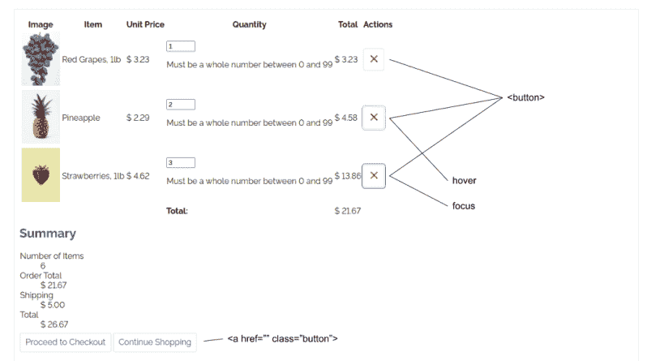

图 8.7 按钮基础样式包括悬停和聚焦

现在我们有了基线，我们可以开始关注每个单独用例。我们将从我们的行动号召开始（“继续结账”和“继续购物”链接）。由于我们已经设置了基线，我们只需要为每种用例编辑颜色，如列表 8.5 所示。我们根据我们更喜欢或期望用户选择的方式在两种操作之间进行区分，以突出主要选择。在整个应用程序中一致地为操作类型设置样式有助于我们引导用户完成他们必须做出的选择。

## 列表 8.5 行动号召样式

```
button.primary,      #A
.button.primary {    #A
  border-color: #2c6c69;  #A
  background: #2c6c69;    #A
  color: white;          #A
```

```
}
#A
button.secondary,
#B
.button.secondary {
#B
  border-color: #2c6c69;
#B
  color: #2c6c69;
#B
}
```

#A 应用于“继续结账”链接
#B 应用于“继续购物”链接

剩下的待样式化的是购物车中每个商品的表格中用于移除商品的按钮，该按钮已被赋予 destructive 类。

与之前两种类型一样，我们需要更改颜色，这次改为红色而不是青绿色，以强调这是一个破坏性操作。我们还需要进行一些调整，使按钮呈圆形并居中图像。为了使按钮看起来像一个圆圈，我们将 border radius 增加到 25%，但正如我们在图 8.8 中看到的那样，这只让我们完成了一半。我们的按钮现在是椭圆形（垂直拉长）。

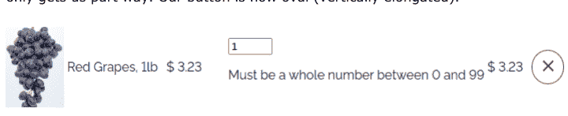

图 8.8 椭圆形移除商品按钮

为了确保我们的按钮是圆形的，我们将为其提供相等的高度和宽度。用于移除图标的图像为 24 像素乘 24 像素。我们将使按钮尺寸与图像尺寸相匹配。因此我们需要添加图像的尺寸加上边框：宽度 = 24 + 2 = 26。我们加 2 是因为我们的边框为 1 像素宽，左右各有一条边框。我们对高度做同样的操作。

由于我们希望按钮与图像大小相同，我们还需要去掉按钮内部的内边距。

我们没有编辑操作按钮的悬停和聚焦样式，因为在基线样式中用于轮廓的颜色（青绿色 - #2c6c69）与我们为这些链接使用的颜色相匹配。这对这个按钮不成立。我们的按钮轮廓和图像是红色的；因此我们将在悬停和聚焦时使轮廓变为红色。

列表 8.6 显示了移除按钮的 CSS，图 8.9 显示了每个状态的输出。

## 列表 8.6 移除按钮

```
button.destructive {
  border-color: #9d1616;
  color: #9d1616;
  border-radius: 50%;
  height: 26px;
  width: 26px;
  padding: 0;
}
```


```
}
button.destructive:hover,
button.destructive:focus {
  outline-color: #9d1616;
}
```

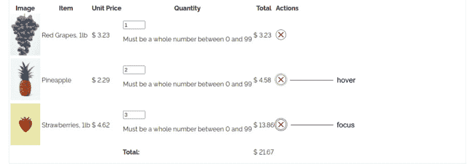

Figure 8.9 Remove button styles

## 8.2.3 Input fields

你可能已经注意到表格中输入字段下方有一句话“Must be a whole number between 0 and 99.” 这与字段验证有关。在 HTML 中我们已为该字段设置了可接受的最小值和最大值：<input name="grapes" type="number" min="0" max="99" ...>。如果在字段中输入的数字超出范围，该字段即为无效。我们可以使用伪类根据其有效性有条件地为字段设置样式。因此我们将根据字段是否有效以不同方式对其进行样式设置。

我们假设默认情况下字段是有效的，然后再覆盖无效字段的样式。所以首先让我们为字段设置一些基本样式。这些样式与我们的基础按钮样式相同。为了避免复制粘贴，我们可以将 input 添加到现有选择器的列表中，如 Listing 8.8 所示。这样可以确保我们希望在整个主题中保持不变的一些基础部分在各处保持一致，并减少如果样式发生变化时需要更新代码的位置。

### Listing 8.7 Adding input to base button styles

```
button,
.button,
input {
  background: none;
  border-radius: 4px;
  ...
}
```

现在让我们处理无效字段。当用户输入无效条目时，我们希望通知他们。我们的 HTML 已设置了什么构成有效值的规则。我们指定了最小值为 0，最大值为 99。由于我们未指定步长，浏览器将默认值设为 1。这意味着我们输入的有效数字仅为 0 到 99 之间的整数，包含两端。所有其他条目在 DOM 树中都会被注册为无效。在 CSS 中，我们可以通过 :invalid 伪类专门选择无效的表单元素。

为了清楚地标记输入为无效，我们将把边框颜色从灰色更改为红色 (#9d1616)。我们还将增加左侧边框的宽度，以提供非颜色的视觉区分。

> **NOTE Use of Color** 尽管颜色在传达诸如状态等信息方面非常有帮助，但它不能是唯一的区分因素，因为色盲或视力受损的用户可能无法区分页面上的颜色。此外，如果使用的设备具有单色或有限颜色显示，颜色差异可能不可见²。

### Listing 8.8 Adding input to base button styles

```
input:invalid {
  border-left: solid 5px #9d1616;
  border-color: #9d1616;
}
```

接下来我们将为错误信息设置样式。我们将文本颜色设为与边框相同的红色，使文本加粗，但比页面上其他元素略小一些。为了确保它能被清楚地识别为错误，我们还将在文本前添加一个错误图标。

要添加错误图标，我们将使用伪元素 :before。

> **REMEMBER** 伪类添加到选择器中以定位特定状态，而伪元素允许我们选择元素的一部分。

要添加图像，我们将使用 content 属性并配合 url() 函数，向其传递文件的 URL。我们随后将图像浮动到左侧，使错误文本能够环绕它。我们将图像宽度设为 1 rem，使其与文本成比例，并为其添加一些边距，以在图标和文本之间留出呼吸空间。

最后需要的一点是默认隐藏错误信息，仅在紧邻的输入无效时才显示它。我们使用 HTML 中的相邻关系将输入字段与错误信息配对。Listing 8.9 显示了我们的输入和错误 HTML。

### Listing 8.9 Input and Error HTML

```
<td data-name="Quantity">
<input name="grapes" type="number" aria-label="Pounds of grape baskets" min="0" max="99" id="grapes" value="-1" aria-errormessage="grapeError">
<p class="error" id="grapeError" role="alert" aria-live="polite">Must be a whole number between 0 and 99</p>
</td>
```

为了默认隐藏它，我们将为错误 div 设置 display 为 none。然后我们将使用相邻兄弟组合符 (+) 找到紧跟在无效输入之后的错误信息，并将其 display 改为 block。Listing 8.10 显示了错误信息的完整 CSS。

### Listing 8.10 Adding input to base button styles

```
.error {
  color: #9d1616;
  font-size: .875em;
  font-weight: bold;
  display: none; #A
}

.error:before {
  content: url('./img/icons/error.svg'); #B
  width: 1em;
  float: left; #C
  margin-right: .25rem; #D
}

input:invalid + .error { #E
  display: block;
}
```

- #A 默认隐藏错误信息
- #B 添加错误图标
- #C 使图标浮动，以便文本环绕它
- #D 在图标和文本之间增加呼吸空间
- #E 使用相邻兄弟组合符 (+) 显示紧跟在无效输入之后的错误信息

Figure 8.10 Shows the styled input fields both valid and invalid with error message only showing for the invalid field.

## Figure 8.10 Formatted fields and error messages

## 8.2.4 Table

接下来我们将为表格设置样式。我们只关注与主题相关的元素，例如颜色和边框。布局和响应式将在本章后面进行。

我们的表格分为三个部分：
- 1. 表头 – `thead`
- 2. 表体 – `tbody`
- 3. 表尾 – `tfoot`

我们将按顺序处理每个部分。

我们将首先为表格标题设置样式。因为它们的重要性不如表格本身的内容，我们给它们一个略小的字体大小和比其他文本更浅的颜色。我们还将把默认的粗体字重降低为正常。通过稍微弱化它们，我们有助于在表格中创建视觉层次，并强调用户最关心的部分（购物车中的商品）。

在表体中，我们将通过使文本加粗来强调商品名称（位于第二列）。为了将粗体属性添加到商品，我们将使用伪类 `:nth-of-type`，以专门定位表体中每一行的第二个单元格：`tbody td:nth-of-type(2)`。

> **PSEUDO CLASS** 请记住，伪类根据元素的状态匹配元素。在这种情况下，它们在父容器（行）内部与其他兄弟（其他表格单元格）之间的位置。

我们还将使用 `:nth-of-type`，这次传入 `even` 值，来选择表体中的偶数行，以创建条纹。我们随后将为所有行添加顶部边框，无论它们在表格中的位置如何。

最后我们将使页脚中的总计加粗。我们的 CSS 将如下所示（Listing 8.11）：

### Listing 8.11 Adding input to base button styles

```
th { #A
  color: #3a3a3a;
  font-weight: normal;
  font-size: .875em;
}

tbody td:nth-of-type(2), #B
tfoot td { #C
  font-weight: bold;
}

tr {
  border-top: solid 1px #aeb7b7;
}

tbody tr:nth-of-type(even) { #D
  background: #f2fcfc;      #D
}                           #D
```

#A 在表头和表尾中设置标题单元格样式
#B 定位第二列中的单元格
#C 选择表尾中非标题单元格
#D 为行添加条纹

Figure 8.11 shows the applied styles with significantly darker background color on the stripped row. We darkened the color for the screenshot to emphasize the vertical lines breaking up the stripe. Previously invisible on the white background, these are the borders of the cells, furthermore, the top border we set on our rows are not showing up.

| Image | Item | Unit Price | Quantity | Total | Actions |
| --- | --- | --- | --- | --- | --- |
|  | Red Grapes, 1lb | $ 3.23 | -1 | $ -3.23 | ✕ |
|  | Must be a whole number between 0 and 99 |  |  |  |  |
|  | Pineapple | $ 2.29 | 2 | $ 4.58 | ✕ |
|  | Strawberries, 1lb | $ 4.62 | 3 | $ 13.86 | ✕ |
|  |  |  | Total: | $ 15.21 |  |

Figure 8.11 formatted table with darkened stripe for emphasis

为了消除间隙并使行上设置的边框显示出来，我们需要将 border-collapse 属性应用于我们的表格，并将值设为 collapse。该属性允许我们控制每个单元格是否拥有自己的边框，或是否共享边框。为了消除间隙，我们希望它们共享边框。

### Listing 8.12 Table borders and width

```
table {
  width: 100%;
  border-collapse: collapse;
}
```

Figure 8.12 shows our updated output. We can see that the white vertical lines have disappeared.


# 图 8.12：添加折叠边框

## 8.2.5 定义列表

摘要部分中仍需主题化的定义列表（<dl>）。通常用于术语表，或显示元数据，它非常适合我们的摘要，其中包含项目及其值。我们将以与表格标题相同的方式设置定义术语（<dt>）的样式。我们希望使其与定义描述（<dd>）脱离强调，后者包含每个元素的美元值。因为我们希望其样式与表格标题相同，所以我们将把 dt 添加为选择器到已存在的规则中，类似于我们在本章前面将 input 添加到按钮规则时的做法。

然后我们将使用伪元素 :after 并使用 content 属性插入字符，在每个定义术语后添加冒号。CSS 和输出分别显示在列表 8.13 和图 8.13 中。

### 列表 8.13 设置定义列表样式

```
th, dt {  #A
  color: #3a3a3a;
  ...
}

dt:after {      #B
  content: ": "; #B
}               #B
```

#A 将定义术语添加到我们现有的标题样式中
#B 在每个定义术语后添加冒号

## 摘要

Number of Items:
4
Order Total:
$ 15.21
Shipping:
$ 5.00
Total:
$ 20.21

Proceed to Checkout

Continue Shopping

图 8.13 定义列表主题

## 8.2.6 卡片

为了给布局一些深度并在各部分之间进行分隔，我们将把各部分的容器样式化为卡片。卡片是 UI 设计中常用的模式，通过将其封装在类似扑克牌的视觉框或容器中来在视觉上分隔内容。这与我们在第 6 章中为个人资料信息创建的卡片概念相同。

为了实现我们的卡片设计，我们将为 body 添加非常浅的青绿色背景，并使用阴影勾勒出各部分，使其看起来像悬浮在 body 上方一样。为了创建阴影，我们将使用 box-shadow 属性，它允许我们控制在 x 轴和 y 轴上添加的阴影量，以及模糊程度、应扩散的距离和阴影的颜色。图 8.14 详细说明了属性值的应用方式。

```
box-shadow: 2px 2px 7px 0 #aeb7b7;
```

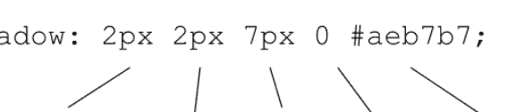

图 8.14 box-shadow 属性值

可选地，我们也可以在偏移量之前设置 inset 的值，以指示阴影应在元素内部而不是外部显示。

为了完成卡片的外观，我们还将使用 4px 的边框半径使角部圆润。使用的值与我们的链接、按钮和输入框相同。

图 8.15 显示了我们样式化的各部分，但请注意，在摘要卡片底部，链接溢出而不是推动卡片变高并被包含在其中。这是因为链接默认的 display 值为 inline。

## Checkout

## My Cart

| Image | Item | Unit Price | Quantity | Total | Actions |
|---|---|---|---|---|---|
|  | Red Grapes, 1lb | $ 3.23 | -1 | $ -3.23 | ✕ |
|  | Pineapple | $ 2.29 | 2 | $ 4.58 | ✕ |
|  | Strawberries, 1lb | $ 4.62 | 3 | $ 13.86 | ✕ |
|  |  |  | Total: | $ 15.21 |  |

Must be a whole number between 0 and 99

## Summary

Number of Items:
4
Order Total:
$ 15.21
Shipping:
$ 5.00
Total:
$ 20.21

Proceed to Checkout
Continue Shopping

图 8.15 主题化各部分

当为内联元素添加垂直内边距时，元素在页面流中的高度实际上并不会增加，它只会占据其内容（文本）的空间，这就是为什么它不会增加卡片高度的原因。为了解决这个问题，我们将把它们的 display 值从 inline 改为 inline-block。列表 8.14 显示了设置卡片样式并修复链接所需的代码。

```
Listing 8.14 Section styles
section {
  background: white;
  border-radius: 4px;
  box-shadow: 2px 2px 7px #aeb7b7;
}

button,
.button,
input {
  ...
  border: solid 1px #ddd;
  text-decoration: none;
  display: inline-block;
}
```

## 8.3 移动布局

我们将从移动优先开始，然后向外扩展。我们要做的第一件事是使表格响应式。

### 8.3.1 表格移动视图

传统的表格布局在移动设备上效果不佳，因为表格需要大量宽度，而手机屏幕没有。为适应窄屏，我们因此将表格行和单元格的行为更像卡片而不是表格。

我们将首先使用媒体查询来专门在视口小于或等于 549px 时应用一组规则。媒体查询以 @ 开头，然后我们指定必须满足的条件才能使其中的代码生效。在我们的例子中，媒体查询将是 `@media (max-width: 549px) { }`。

在此媒体查询内部，我们将定义窄屏上表格的外观。作为快速回顾，图 8.16 显示了我们当前表格的外观以及我们想要实现的目标。

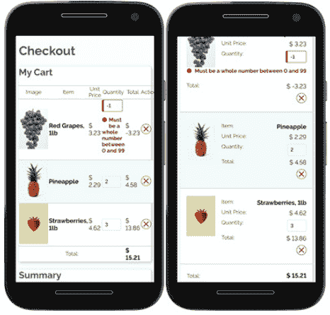

图 8.16 移动设备上表格的修改前后

要在大多数浏览器开发工具中查看窄屏或移动版本，我们可以设置工具以模拟特定设备的屏幕。并非所有工具都会在周围显示手机图像，但它会将浏览器窗口的大小限制为适合设备的尺寸。在 chrome 中，要选择特定设备，我们通过点击开发工具顶部带有手机图标的图标来切换设备工具栏，然后选择我们想要使用的设备，如图 8.17 所示。值得注意的是，这是一种非常有限的模拟，不能替代在实际设备上的测试。

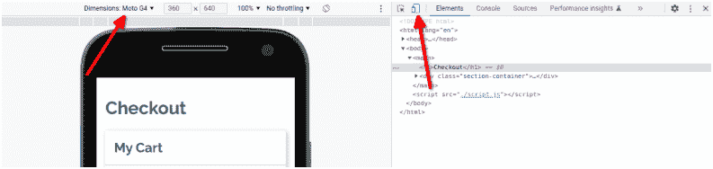

图 8.17 使用 Chrome 开发工具进行设备模拟

我们要做的第一件事是垂直堆叠所有内容，而不是让每行的元素水平表示。因此我们将单元格的 display 值设为 block。然后我们将图像浮动到左侧，以便行的其余内容环绕它，包括一些边距以在图像和行的其余内容之间创建空白。

我们越来越接近最终目标，但我们的标题信息不在需要的位置。正如我们在图 8.18 中看到的，标题信息位于表格顶部，而不是在表格主体行的每个信息之前。

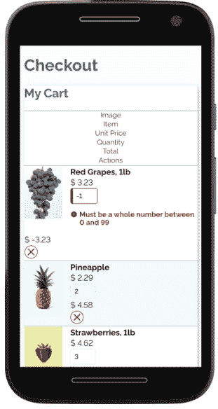

图 8.18 表格标题位于移动表格顶部

为了在每个内容之前放置标题信息，我们不会使用标题。相反，在我们的 HTML 中，我们已向单元格添加了一些 data 属性：<td data-name="Item">Red Grapes, 1lb</td>。我们使用绝对定位将表格标题移出屏幕。我们不想使用 display none，因为标题中的信息仍需要辅助技术。通过使用非常大的负值将其绝对定位到屏幕外，我们在视觉上隐藏它但在程序上不隐藏它。

接下来我们使用 data-name 属性信息，并在每个单元格中显示它。为了显示属性值，我们使用 attr() 函数，它接受属性名称并返回一个值。对于我们的用例，content 属性将如下所示：td[data-name]:before { content: attr(data-name) ":"; }。图 8.19 详细分解了它。

{ content: attr(data-name) ":"; }. Figure 8.19 breaks it down in detail.

```
td[data-name]:before { content: attr(data-name) ":"; }
```

选择具有 data 属性的单元格。规则不适用于没有该属性的单元格。

内容值将在单元格之前放置

定义要显示的内容

返回 data-name 属性的值

在内容后添加冒号

图 8.19 在单元格之前添加标题信息

为了对齐我们的标签和内容，使用 text-align 和 float 的组合。我们在单元格中使用 text-align: right 将所有内容右对齐，然后将标签浮动回左侧以在两者之间创建间隙。我们还将为单元格提供一些内边距以在它们之间添加空白。图 8.20 显示我们已成功对齐内容，然而行未使用表格的全部宽度，表格页脚可以更有效地利用空间，并且我们不希望总计换行。

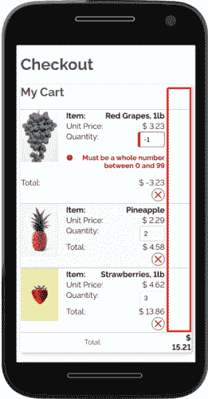

图 8.20 表格内容显示但仍需解决与宽度相关的问题

为了解决宽度问题，我们将为行提供 display 值 block。默认情况下，行的 display 值为 table-row。我们还可以为行提供一些内边距，以便


content is not placed right up against the edges of the card, or against the borders between rows.

Next let's address the table footer. To place the label and values at opposite ends of the available space, we are going to use flexbox. Flexbox allows us to create layouts on 1 axis, either horizontally or vertically. We then use a combination of the `justify-content` and `align-items` properties to define how elements are placed on the axis. `justify-content` determines how elements are distributed on the axis, while `align-items` determine how they are aligned in relationship to one another. Look at Chapter 6 for a detailed explanation of how flexbox works.

Finally we add the labels to our theme and style them the same way we did the table headers and definition terms. Listing 8.15 shows the completed CSS for making the cart section work well on mobile.

## Listing 8.15 Section styles

```
th, dt, td[data-name]:before { #A
  color: #3a3a3a;
  font-weight: normal;
  font-size: .875em;
}

@media(max-width: 549px) { #B
  thead {               #B   #C
    position: absolute; #B   #C
    left: -9999rem;     #B   #C
  }                     #B   #C
  td {                  #B
    display: block;     #B
    text-align: right;  #B
    padding: .25rem 0;  #B
  }                     #B
  table img {           #B
    float: left;        #B
    margin-right: 1rem; #B
  }                     #B
  td[data-name]:before {       #B #D
    content: attr(data-name) ":"; #B #D
    float: left;          #B #D
  }                     #B #D
  tr {                  #B
    display: block;     #B
    padding: 1rem;      #B
  }                     #B
  tfoot tr {            #B
    display: flex;      #B
    justify-content: space-between;  #B
    align-items: baseline; #B
  }                     #B
}                       #B
```

#A Style the cell labels the same as our other labels
#B Only applied if screen width is less than or equal to 549px
#C Move table head offscreen
#D Add HTML data-name attribute information as content before the cell

Figure 8.21 Shows our formatted table.

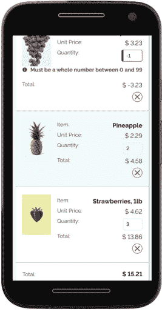

Figure 8.21 Formatted table on mobile

## 8.3.2 Definition List

Unlike the table which has a completely different look on mobile versus on desktop, the definition list will look the same regardless of the width. Its position will change on wider screens but the definition list itself will not. Since it is the same regardless of screen size we will not put the styles we create to address the layout inside of a media query.

To display the definition list we are going to use grid. We will define 2 columns and let items auto-position themselves within the 2 columns. When not given specific placement instructions, child elements of a grid container will place themselves in the first available space, which is exactly what we are going to exploit. We will also define a gap and some padding to the container to space the elements within the grid and card. Lastly we will justify our numbers to the left. Listing 8.16 shows the CSS while Figure 8.22 shows the before and after.

## Listing 8.16 Section styles

```
dl {
  display: grid;
  gap: .5rem;
  grid-template-columns: auto max-content; #A
padding: 0 1rem;
}
dd { text-align: right; }
```

#A We use max-content for our second column because we really don’t want the numbers to wrap which would make them quite difficult to read.

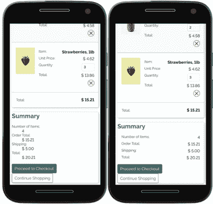

Figure 8.22 Layout for definition list before and after

## 8.3.3 Call to Action Links

Our definition list looks a lot better but the action links still need some help. The first thing we are going to do is give their container some padding. We will then use the text-align property to center them. For instances where there is not enough room for them to be side by side and they end up stacked, we will give them some margin on the bottom to prevent them from being right up against one another. Listing 8.17 displays the code while Figure 8.23 shows the before and after.

## Listing 8.17 Action links

```
.actions {
  padding: 1rem;
  text-align: center;
}
.actions a {
  margin-bottom: .5rem;
}
```

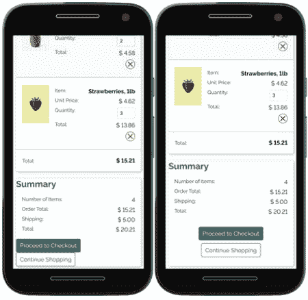

Figure 8.23 Action links layout before and after

## 8.3.4 Padding, Margin, and Margin Collapse

All of the content within our sections is laid out for mobile except our headers. The browser gives them margin by default but it is not accomplishing what we want it to. Instead of creating vertical space between the edge of the card and the header, it is pushing the card down. Margin pushes content but does not affect how much room an element or its content occupy which is why the top margin or the header is "bleeding" out of the card.

If we remove the header's margin and give it padding instead the card will expand but the gap between the two cards will disappear. We therefore need to give the section itself some margin in order to add space between the two cards. If we give the sections a margin with a value of 1rem 0 (1 rem top and bottom, but no left - right) we will see that we still only have a 1 rem gap between the 2 cards. This is a direct result of margin collapse. Unless the positioning of the element has been altered, via float, flex..., 2 margins up against each other will collapse to equal the greater of the 2 margins. Figure 8.24 diagrams what is happening.

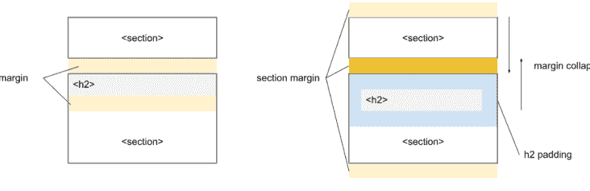

Figure 8.24 Effects of margin and margin collapse

To add space between the edges of the card and the header, we replace the card header’s margin with padding. Then we will add margin to the card in order to regain the lost vertical space between them. Lastly we add padding to the body so that the cards are not stuck right up against the left and right edges of the screen. Listing 8.18 shows how this is done.

## Listing 8.18 Section Margin and Header Padding

```
body { padding: 1rem; }
section { margin: 1rem 0; }
section h2 {
  padding: 1rem;
  margin: 0;
}
```

With the mobile layout now finished, let’s increase the width of the screen and consider tablet and laptop sized screens.

## 8.4 Medium screen size layout

Most of what we did for mobile will look great on medium sized screens. Since we used a media query to restrict table layout changes to screens less than to 459 pixels, the styles we wrote to edit the table will not apply to any screen 500 pixels and up. Figure 8.25 shows the table when the viewport is 449 pixels wide and when it is 550 pixels wide. At 550 pixels of width, we are back to a standard table layout.

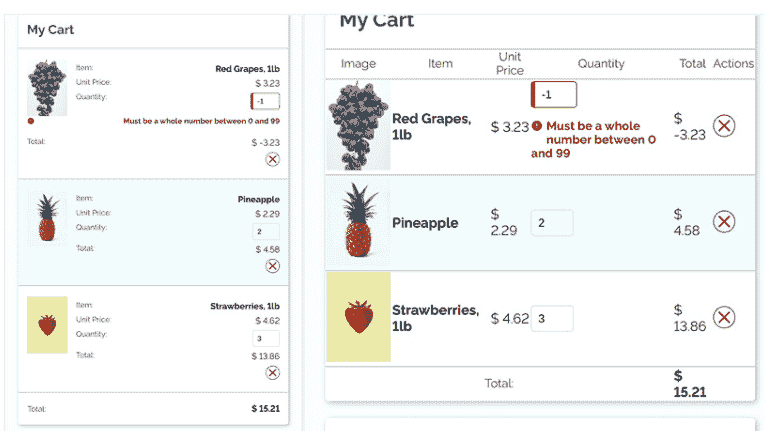

Figure 8.25 Breakover point for table

## 8.4.1 Table layouts

Let’s improve the table layout a little bit. In the browser tables will automatically calculate how wide to make a column based upon the amount of content found in the cells within. We don’t want to allow this default behavior because we do not want the column widths to change when an error message is toggled. Resizing the columns based on the input field states would be disorienting to our users. Instead, we are going to give the table a table-layout value of fixed. The table-layout property allows us to choose the algorithm the browser will use to decide the width of the columns. The default value, auto, calculated column width based on content while fixed determines column width based on the width of the table or by the width of the first row of cells. The table will be evenly divided into a number of columns. Each column will therefore have the same width.

Because we are setting the size of the column based on the width of the table we want to make sure that the images conform to the width of the column. We will therefore set their width to auto and give them a max-width of 100%. This sets the image to take the width of its container, without exceeding it or the size of the original image.

Next we are also going to update the alignments of the values in the table. It is customary, because it makes computation easier at a glance, to justify numbers to the right, especially if they are being totalled in a column. We will update both the header and cells of the unit price, quantity and total to be right justified. To select the headers and cells we could use the :nth-of-type(n) selector. To select header and cells for the Unit Price column (3rd column), we would use th:nth-of-type(3), td:nth-of-type(3) { ... } and then repeat the same process for all the other columns. We could also, however, think about it a


稍微不同。我们希望在前 2 列之后的所有列都右对齐。在 `:nth-of-type()` 内部，我们可以传递数字，也可以传递模式。之前我们在通过传递参数 `even` 来设置行背景色时就使用了这个技巧。在这种情况下，我们将传递一个自定义模式。我们将传递参数 `n + 3`，表示我们想要选择所有匹配的元素，从第 3 个实例开始，其中 n 是迭代器，3 是起始点。列表 8.19 显示了该方法如何应用于表格。

## Listing 8.19 Section Margin and Header Padding

```
@media (min-width: 550px) { #A

  table { table-layout: fixed; } #B

  th, td {
    padding: .5rem;
    text-align: left;
  }

  table img {      #C
    width: auto;      #C
    max-width: 100%;  #C
  }                 #C

  th:nth-of-type(n+3),  #D
  td:nth-of-type(n+3) { #D
    text-align: right;
  }
}
```

#A 媒体查询。如果屏幕宽度大于或等于 550px，则代码内内容才会应用

#B 设置列宽基于表格宽度计算，而不是内容

#C 使图像宽度与列宽匹配

#D 选择从第 3 个开始的所有标题和单元格

Figure 8.26 显示了应用列大小和对齐后的表格。我们的文本已对齐，但我们仍需要对齐输入字段内部的数字。

## My Cart

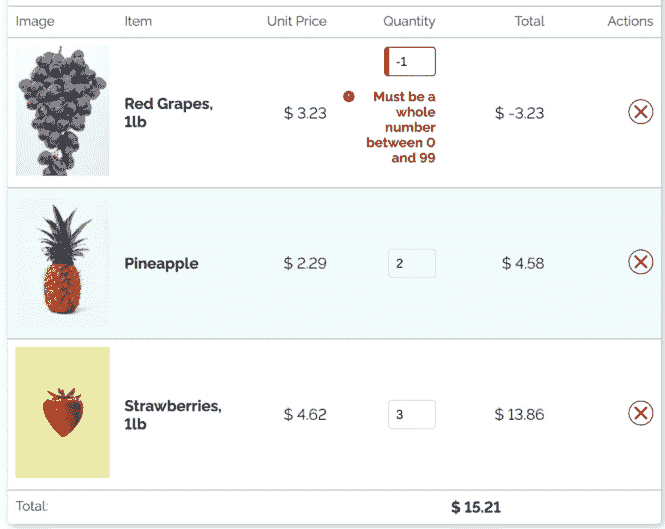

Figure 8.26 Column sizing and text alignment

我们可以选择仅在此表格视图中右对齐输入字段内的文本，或无论屏幕大小如何始终右对齐。由于我们在移动视图中也已将数字和总计右对齐，因此将数字类型的文本输入的文本也右对齐作为主题的一部分似乎是合乎逻辑的。为了专门选择类型为数字的输入，我们可以使用属性选择器：input[type="number"] { ... }。因此，与我们的其他主题样式一起，我们将添加 input[type="number"] { text-align: right; }

在输入字段内的文本对齐后，我们需要为表格考虑的最后一部分是页脚，其中包含一个标题和一个单元格。因为我们之前只选择了行中前 2 个之后的单元格，所以页脚中的单元格未受影响，因为它总共只有 2 个单元格。我们希望标题和数据单元格的内容都右对齐，我们可以通过专门针对 tfoot 本身中的 th 和 td 来选择，如列表 8.20 所示。

## Listing 8.20 Aligning content in the table's footer

```
@media (min-width: 550px) {
...
tfoot th,
tfoot td {
  text-align: right;
}
```

Figure 8.27 显示了中等屏幕的最终产品。

## Checkout

## My Cart

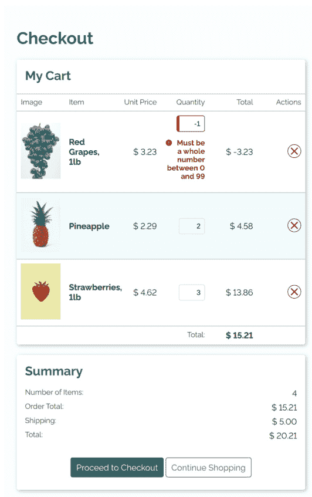

## Summary

Figure 8.27 Final layout for medium sized screens

## 8.5 Wide screens

随着我们继续增加屏幕宽度，摘要部分变得更难阅读，因为定义标题和描述之间的距离越来越大。由于我们越宽，水平可用空间越多，我们将在视口达到 995 像素宽或更大时将摘要部分带到购物车部分旁边。与之前一样，我们将创建一个媒体查询：@media (min-width: 995px) { }。

在我们的 HTML 中，我们在 2 个部分周围有一个容器 div，其类为 section-container。我们将为其赋予 flex 显示，使 2 个项目并排放置并在 x 轴上对齐。我们将然后在 2 个部分之间添加 1 rem 的间距。

NOTE Flexbox Flexbox 允许我们在单个轴上放置和对齐元素。如果您需要复习 flexbox 的工作原理，请查看第 6 章。

Flexbox 将根据其内容自动计算为每个部分分配的空间量，除非我们使用 grow 和 shrink 来另行指示。与使用基于比率的 grow 和 shrink 不同，我们将为摘要部分设置最小宽度，防止文本换行（除非用户正在缩放文本），并将剩余的可用空间留给表格。

如果我们将屏幕变得更宽，例如使用超宽曲面显示，我们最终会达到内容再次变得不可读的程度。为了防止这种情况发生，我们将添加一个最终条件来限制布局的宽度。通过对 body 应用最大宽度，我们确保无论用户拥有什么样的显示器，以及选择将窗口扩展到多宽，内容仍然可用。我们可以通过为其赋予左右边距 auto 来使 body居中。

列表 8.21 显示了我们的媒体查询及其内容，以及对 body 布局规则的编辑以限制 body 的宽度。

## Listing 8.21 Wide screen media query and maximum width

```
body {
  padding: 1rem;
  max-width: 1280px;  #A
  margin: 0 auto;    #A
}

@media (min-width: 995px) {
  .section-container {  #B
    display: flex;      #B
    gap: 1rem;          #B
  }

  .summary {
    min-width: 250px;
  }
}
```

#A 防止内容变得比 1280 像素更宽并使 body居中。

## #B 将卡片和摘要并排放置

Figure 8.28 显示了视口宽度为 1800 像素时的布局。请注意，现在我们已将容器设为 flex，我们在 h1（Checkout）和各部分之间有额外的空间。

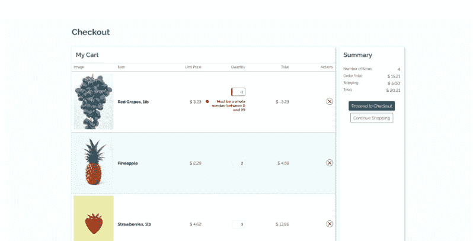

Figure 8.28 Layout on a really wide screen

由于容器现在具有 display flex，各个部分的边距和 h1 的边距（作为浏览器默认样式的一部分存在）不再折叠。我们有 3 种方法可以修复此问题：

- 1. 将 section 边距更改为仅具有底部边距
- 2. 一旦我们设为 flex，就移除各个部分的边距
- 3. 移除浏览器默认样式中 h1 存在的 margin-bottom

我们将选择选项 2 并移除各个部分的上边距和下边距，因为一旦我们设为 flex 且各部分并排放置，它们就不再必要。因此，在我们的媒体查询内部，我们需要添加 section { margin: 0; }。

通过此最终更改，我们拥有一个从移动设备到超宽屏幕都看起来不错的结账购物车。Figure 8.29 显示了每个屏幕尺寸的最终输出。

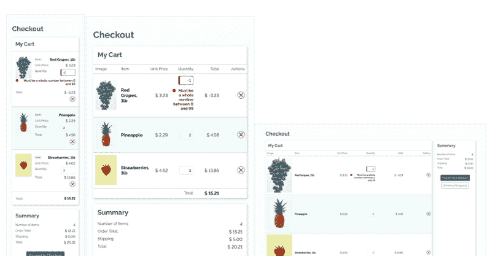

Figure 8.29 Final output across screen sizes

## 8.6 Summary

- 数字样式可以通过 `font-variant-numeric` 属性控制
- `:invalid` 可用于定位并有条件地设置无效元素的样式
- 媒体查询允许我们根据屏幕尺寸有条件地应用样式
- HTML 属性值可用于选择元素
- HTML 属性可以通过 CSS 使用 content 属性和 `attr()` 函数显示
- 边距可以折叠，但一旦元素的 display 属性更改为 `flex` 就不会
- `:nth-of-type` 可以接受数字、关键字或自定义模式，以根据元素在其容器内相对于同类型其他元素的相对位置来定位元素

## 10
Styling forms

## This chapter covers

- Styling input fields
- Styling radio buttons and checkboxes
- Styling drop down selects
- Accessibility considerations
- :focus versus :focus-visible
- :where and :is pseudo classes
- accent-color property

表单无处不在于我们的应用程序中。无论是联系表单、登录屏幕，还是应用程序功能的核心，它们无处不在。然而，表单的设计很容易决定用户体验的成败。在本章中，我们将设置表单的样式并查看一些需要确保解决的可访问性考虑因素。我们将查看对某些单选和复选框输入以及下拉菜单进行样式设置时遇到的一些挑战，以及我们用于设置错误消息样式的一些选项。

在此上下文中，表单是一段代码，包含在 HTML <form> 元素内，包含用户与之交互以向我们的网站或应用程序提交数据的控件（表单字段）。

由于联系表单在应用程序和网站中如此普遍，我们将以联系表单为项目的基础。我们的表单包含 2 个输入字段、下拉菜单、单选按钮、复选框和一个文本区域。我们还在顶部有一个标题，并在表单末尾有 2 个按钮，Send 和 Reset。Figure 10.1 显示了我们的起点，即未应用任何样式的原始 HTML 以及我们希望实现的目标。


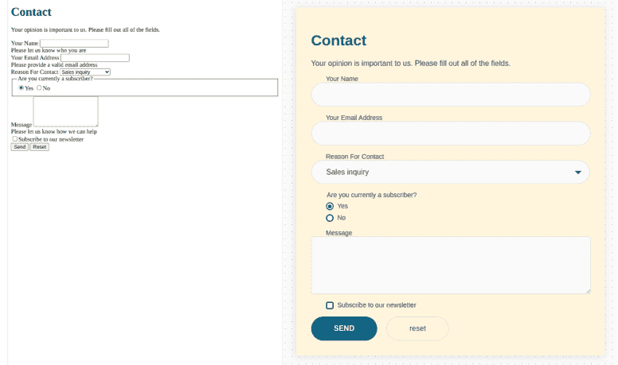

## Figure 10.1 Starting Point and Finished Product

Shown in listing 10.1, our starting HTML is fairly simple and contains our form inside of which our labels, fields, error messages, and buttons are placed.

The starting and finished code can both be found in github at https://github.com/michaelgearon/Tiny-CSS-Projects/tree/main/chapter-10.

## Listing 10.1 Starting HTML

```
<body>
<main>
<h1>Contact</h1>

<form>
<p>Your opinion is important to us. Please fill out all of the fields.</p>

<label for="name">Your Name</label> #A
<input type="text" id="name" name="name" maxlength="250" #A
required aria-describedby="nameError"> #A
<div class="error" id="nameError"> #A
<span role="alert"> #A
Please let us know who you are #A
</span> #A
</div> #A

<label for="email">Your Email Address</label> #B
<input type="email" id="email" name="email" maxlength="250" #B
required aria-describedby="emailError"> #B
<div class="error" id="emailError"> #B
<span role="alert"> #B
```
```
Please provide a valid email address #B
</span> #B
</div> #B

<label for="reasonForContact"> #C
Reason For Contact #C
</label> #C
<select id="reasonForContact" required> #C
<option value="sales" selected> Sales inquiry</option> #C
<option value="support"> Support request</option> #C
<option value="feedback"> Providing feedback</option> #C
<option value="other"> Other</option> #C
</select> #C

<fieldset> #D
<legend>Are you currently a subscriber?</legend> #D
<label> #D
<input type="radio" value="1" name="subscriber" checked required> #D
Yes #D
</label> #D
<label> #D
<input type="radio" value="0" name="subscriber" required>No</label> #D
</fieldset> #D

<label for="message">Message</label> #E
<textarea id="message" name="message" rows="5" required maxlength="500" aria-describedby="messageError"></textarea> #E
<div class="error" id="messageError"> #E
<span role="alert"> #E
Please let us know how we can help #E
</span> #E
</div> #E

<label> #F
<input type="checkbox" name="subscribe">Subscribe to our newsletter #F
</label> #F

<div class="actions">
<button type="submit" onclick="send(event)">Send</button>
<button type="reset" onclick="setAsPristine()">Reset</button>
</div>

</form>

<script src="./script.js"></script>

</main>

</body>
```

#A Name input with associated label and error message
#B Email input with associated label and error message
#C Reason for Contact Dropdown and associated label
#D Fieldset containing subscription radio buttons
#E Message textarea
#F Subscription Checkmark

## 10.1 Creating backgrounds using radial-gradient

Let’s start with some base typography styles, some colors, and the elements around the form such as the header, container holding our form, and most notably the background. As we can see in figure 10.2, our background has a dotted grid pattern. It is not a premade image, but a gradient that has been created and then repeated.

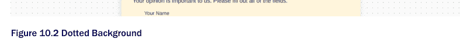

Figure 10.2 Dotted Background

We present this technique now because we will use this technique again later to style the arrow on the drop down. Some elements, <select> being one of them, cannot have ::before or ::after pseudo elements added to them. The select element, like the circles of the radio button, or the checkbox have very limited styling options. This is related to the fact that they rely on the underlying operating system for styles and controls. This is very visible on mobile when a number field automatically opens the number keypad instead of the standard keyboard for example, same for calendar or time controls. Furthermore, when looking at the same website or application on an Iphone versus Android phone, the controls will look drastically different. As a result however, the browser will only allow for a limited number of properties to be applied to the control. Because of our limited ability to style controls, as developers, we have found work arounds, using properties we can affect, the background property is often one that is editable.

Although we could simply use an image that we repeat across the screen to create our gradient, images have their drawbacks in terms of flexibility. For each shape or color we would have to import a new image. We would also need to acquire or create said images. Instead, we can create simple shapes on the fly using a gradient. Although the background is polka dotted and not a gradient, we will be using the radial-gradient function to create the dots.

### 10.1.1 Setting the color scheme using custom properties

Before we look at the gradient, let’s first establish our color palette. We add them as custom properties on the html tag so that we do not have to look up the color codes every time we want to color something and to ensure consistency in our application. An added benefit to using custom properties for our colors is that should we want to add multiple themes to our web page in the future, it could be accomplished with minimal work.

We also include our font family in our custom properties because we will need to apply it to several fields as most fields do not automatically inherit the font-family set on their parent or ancestors. Listing 10.2 shows our color palette and font choice.

## Listing 10.2 Colors and Font Family Custom Properties

```
html {
  --color: #333333;              #A
  --font-family: sans-serif;     #A
  font-size: 12pt;               #A
  color: var(--color);           #A
  font-family: var(--font-family); #A

  --background: #fafafa;         #B
  --background-card: #fff5dc;    #C
  --accent: #086788;             #D
  --accent-contrast: #ffffff;    #E
  --error: #dd1c1aff;            #F
  --border: #ddd;                #G
  --hover: #bee0eb;              #H

  margin: 0;
  padding: 0;
}
```

#A Setting our text default size, font family, and setting the color for the font to a dark gray almost black.
#B Page background color, light gray almost white
#C Background color for the form container, pale yellow
#D Our accent color, used for call to actions and highlighting elements we want to draw the user’s attention to. Blue
#E When the accent color is used as background color, text will be set to the contrast color. White
#F Used for errors. Red
#G Used anytime we have a default border color to set, gray
#H Used for hover effects, very pale blue

Our page, seen in Figure 10.3, looks very similar to how it looked before except for our text which is now a dark gray rather than black and uses my system’s default sans-serif font. Also of note, we notice that the text inside of the message textarea does not look the same as the rest of the page. It is a different font family. An issue we will need to address when we style it later in this chapter.

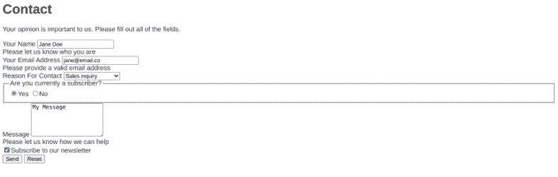

Figure 10.3 Updated Font Style and Color

## 10.1.2 Manipulating a radial gradient

With the colors set, we can start styling our background which we will apply to the <body>.

It is possible to set both a background color and a background image on an element. If instead of using the background property we use individually set values for background-color and background-image, the browser will render both. This is particularly useful when we have images that include transparency or that do not cover the entire element they are applied to. Using our custom property we set in the previous section, we are going to give the body a background-color of var(--background).

Next we will create our gradient. radial-gradient, as its name implies, manipulates colors circularly from the center of the element outwards. The radial-gradient() function allows us to dictate where the center point of the gradient will be located and then set an arbitrary number of colors and values for when the color should be applied relative to the center point as illustrated in the diagram found in Figure 10.4. We can move the center point both vertically and horizontally.

The values for color change can be either relative units (such as percentages) or fixed units (such as pixels). When no change value is passed, the browser will space the colors equally across the image (First example in Figure 10.4). If we do set a position at which the color should change and 2 subsequent values are set to change at the same distance from center, such as in the third example of Figure 10.4, the change will be immediate and abrupt. If the values are not identical the colors will fade from one to the other in the typical way in which we think of gradients such as in the second example of Figure 10.4.


```
background: radial-gradient(black, white, black, white, black)
```

```
background: radial-gradient(circle at 20%, black, white);
```

```
background: radial-gradient(black, 30%, white, 30%, white);
```

```
background-image: radial-gradient(black, 30%, white, 30%, white);
background-size: 25px 25px;
```

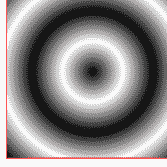

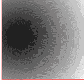

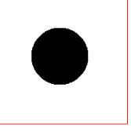

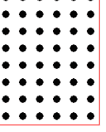

从中心开始以相等间隔从黑色变为白色

中心垂直居中但距离边缘 20% 并从黑色渐变到白色

创建一个从开始为黑色直到圆的 30% 并立即立即切换到白色，从而形成一个圆

与之前相同，但背景被赋予了大小并允许重复，从而创建了波尔卡圆点背景。

## Figure 10.4 Radial Gradient²

我们将创建一个 15px x 15px 的图像，其中心有一个非常小的点，我们将让它在 body 上重复。默认情况下，使用背景图像时（渐变也不例外），如果图像小于容器，浏览器将尽可能多次重复该图像（垂直和水平方向）以填充容器，除非使用 background-repeat 属性另有明确指定。因为我们创建的图像是一个 15px 的正方形，而我们的页面比它宽得多且高得多，所以背景图像将自动平铺或重复以填充整个元素。

我们将保持渐变从中心开始，从那里应用我们的强调色。在 0.75 像素后，我们将立即切换为透明，以便我们的背景色显示出来。如果我们在 7.5 像素处（15 的一半）从强调色切换到透明，我们的圆将恰好为 15 像素直径。由于我们在 0.75 像素处进行切换，我们的圆将为 1.5 像素直径。因此，我们的 background-color 属性值将如下所示：radial-gradient(var(--accent) .75px, transparent .75px);

除了将背景添加到 body 外，我们还将边距设置为 0 并添加 2rem 的内边距，以防止内容一直延伸到屏幕边缘。列表 10.3 显示了迄今为止应用于 body 的样式。

## Listing 10.3 Colors and Font Family Custom Properties

```
body {
  background-color: var(--background);
  background-image: radial-gradient(var(--accent) .75px, transparent .75px);  #A
```

² https://codepen.io/martine-dowden/pen/poajdeQ

```
background-size: 15px 15px;
margin: 0;
padding: 2rem;
}
#A
```

#A 用于在背景中创建点网格的属性

应用页面背景后，如图 10.5 所示，我们现在将设置 <main> 标签的样式，它是 header 和表单周围的容器。

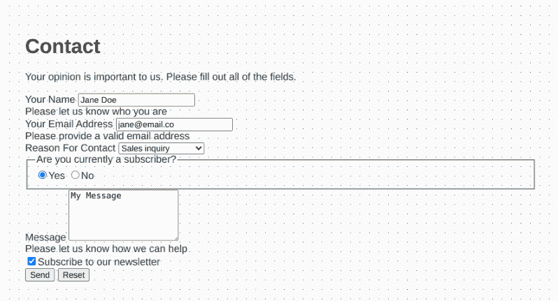

Figure 10.5 Dot Grid Background Created using Radial Gradient

## 10.1.3 Emphasizing the form

通过给 main 一个更亮的纯色背景和一些阴影，我们使其脱颖而出，成为页面的视觉焦点。添加投影阴影将进一步强调其与背景的差异。阴影不必特别强烈，我们将应用的阴影相当微妙，但仍将极大地突出内容，使其成为需要关注的元素。

我们还将限制元素可以达到的最大宽度为 600 像素。查看图 10.4 我们可以看到诸如围绕单选按钮的 fieldset 等块级元素会尽可能扩展到屏幕宽度。就像文本一样，如果控件太宽，眼动追踪会变得困难，用户在尝试填写表单时可能会迷失位置。设置最大宽度可以防止此问题。

然后我们将通过将左右边距设置为 auto 来居中该元素。我们还将垂直边距设置为上下各 1rem，以使其远离屏幕顶部和底部的边缘。

用于设置表单容器样式的属性和值在列表 10.4 中找到。

## Listing 10.4 Form Container Styles

```
main {
  background: var(--background-card);
  padding: 2rem;
  max-width: 600px;
  margin: 1rem auto;
  box-shadow: -2px 2px 15px 0 var(--border);
}
```

我们给容器设置了背景，但现在在图 10.6 中可以看到我们的内容紧贴其边缘。

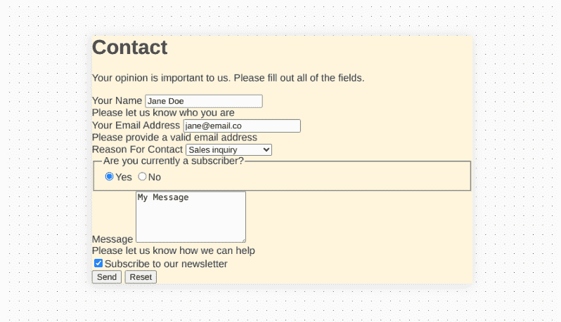

Figure 10.6 Form Container Background

为了防止内容在容器内过于紧凑，我们将在容器上添加 2rem 的内边距。

我们还将使我们的标题（“Contact”）更突出，通过应用我们的强调色，然后我们就可以开始设置表单元素的样式了。容器和标题的最后润色显示在列表 10.5 中。

## Listing 10.5 Finishing Touches to the Container and Header Styles

```
main {
  ...
  padding: 2rem; #A
}
```

```
h1 { color: var(--accent); } #B
```

#A 向之前创建的 main 规则添加内边距
#B 通过引用我们在 body 上设置的变量，使标题文本变为蓝色（我们的强调色）

现在我们的配色方案、背景和页面布局已设置完毕（图 10.7），我们现在准备开始设置表单本身中的元素样式。

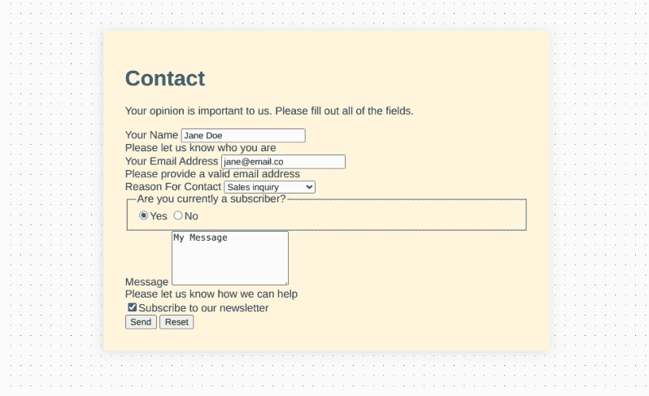

Figure 10.7 Form Container Background with padding and styled header

## 10.2 Resetting fieldset styles

Fieldset 专门用于对控件和标签进行分组。单选组是它们的完美用例，因为它允许我们非常有效地和明确地将它们标识为属于一起。它还为我们提供了一种现成的方式通过 legend 对组进行标记。从风格上讲，我认为我们可以同意它们相当难看。

让我们重置该组的样式，使其在视觉上消失。程序上，我们希望保留它，因为它对辅助技术用户有帮助，但在视觉上，我们将使其融合得更多。

为了使 fieldset 消失，我们需要重置以下属性：

- border
- margin
- padding
- min-width

列表 10.6 显示了我们的规则

## Listing 10.6 Resetting Fieldset Styles

```
fieldset {
  border: 0;
  padding: 0;
  min-width: 0;
  margin: 0;
}
```

我们的 fielset 现在不再可见，如图 10.8 所示，让我们把注意力转向我们的输入字段。

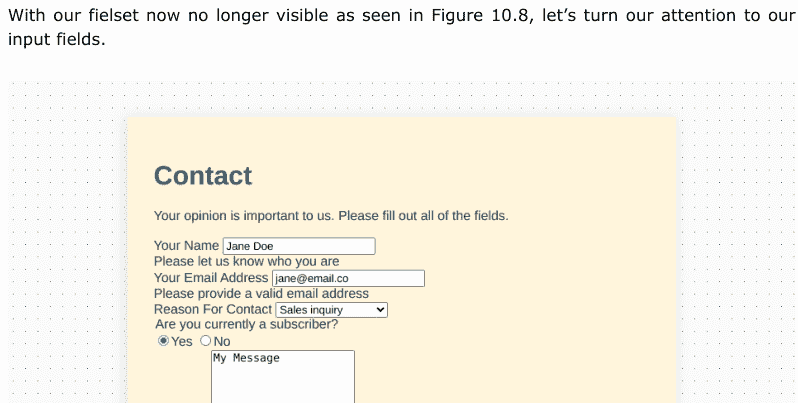

Figure 10.8 Form Container Background

## 10.3 Styling input fields

我们在表单中有 4 种类型的输入字段，分解在表 10.1 中

## Table 10.1 Input field types in the form

| Field Label | Type |
|---|---|
| Your Name | text |
| Your Email Address | email |
| Yes
No | radio |
| Subscribe to our newsletter | checkbox |

HTML 还有更多类型的字段，包括 date、time、number、color 等，每个都有其自己的语义含义和自己的样式考虑。上面选择的采样是因为这些是当今网络上非常常用的类型。

它们的未样式化外观决定了我们将如何设置它们的样式。例如，我们将对单选按钮和复选框与文本输入进行非常不同的处理，但我们可以跨多种类型重用代码。我们将按其未样式化控件的外观对它们进行分组，因此我们将同时处理 type text 和 email，然后再处理 radio 和 checkbox。让我们从文本和电子邮件输入开始。

### 10.3.1 Styling text and email inputs

我们首先要弄清楚如何仅选择文本和电子邮件输入字段，或者更确切地说，选择所有不是单选或复选框的输入字段。一个解决方案是在我们想要处理的每个输入上添加一个类。这在维护上相当困难，尤其是在表单繁重的应用程序或复杂表单中会变得非常嘈杂。因此，我们将使用伪类 :not()³ 结合类型选择器 selector[type="value"]。

:not() 伪类允许我们选择不符合特定条件的元素。在我们的例子中，我们想要选择所有类型不是 radio 或 checkbox 的输入字段。因此我们的选择器将是 input:not([type="radio"], [type="checkbox"])。

我们现在可以开始设置输入字段的样式。我们可以从图 10.8 中看到我们的输入具有白色背景。我们将把它改为与我们在 body 上使用的相同背景颜色。我们还可以注意到字体大小小于我们在 body 上设置的 12pt 大小。输入字段不会继承字体样式。小字体大小在移动设备上难以阅读，对许多用户来说，尤其是幼儿和老年人更是如此。如果我们希望我们的表单在广泛的人群和设备上易于使用，我们将需要增加它。我们因此将其设置为 1rem 以匹配我们应用程序的其余部分。如前所述，输入默认情况下不会继承字体样式，我们因此还将显式设置 color 为 inherit。inherit⁴ 是一个非常方便的属性值。它允许我们在继承默认情况下不发生时强制从父级继承属性值。


接下来，我们将为输入框添加一些内边距、自定义边框和边框圆角。在这种特定情况下，这些样式是为了美观目的。大多数应用程序都有一个整体的风格或外观。我们选择应用于字段的样式应与我们应用程序整体主题保持一致。这样做有助于表单与页面融合，看起来像是属于这里的一部分。从营销角度来看，保持与主题一致也有助于强化品牌认知。对于本项目，我们选择了非常圆润的主题，因此我们将为字段赋予夸张的圆角。

最后，我们还将为字段设置 `display` 值为 `block`（输入框默认的 `display` 属性值为 `inline`），并使其占据容器的全宽。我们将使用 `calc()` 函数来计算容器的全宽（100%）减去我们已添加到输入字段的内边距（每侧 2rem，总宽度为 4rem）。还记得盒模型吗？内边距会增加元素的宽度。因此，我们必须从宽度中减去左右内边距的总量。宽度为 100% 等于可用容器宽度的 100%，然后内边距值将被添加。如果我们不减去内边距，我们的宽度将比分配的空间大 4rem。

我们的代码如下所示（列表 10.7）。

## 列表 10.7 样式化非单选或复选框类型的输入字段

```
input:not([type="radio"], [type="checkbox"]) {
  background: var(--background);
  font-size: 1rem;
  color: inherit;
  border: solid 1px var(--border);
  border-radius: 32px;
  padding: 1rem 2rem;

  display: block;
  width: calc(100% - 4rem); /*A
}
```

### A 计算元素的宽度应为多少

我们为文本和电子邮件输入设置了一些基本样式，如图 10.9 所示。我们现在开始为表单控件开发主题。

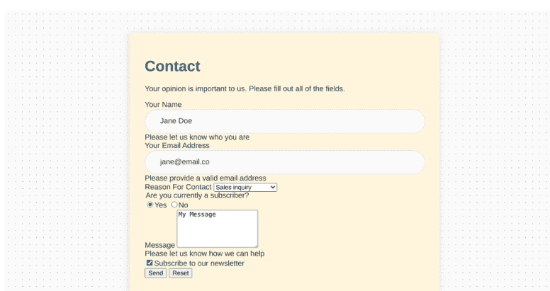

图 10.9 文本和电子邮件输入样式

## 10.3.2 使选择框和文本域与输入样式匹配

为了确保我们在控件上的外观和感觉保持一致，让我们将应用于输入字段的相同样式应用于文本域和选择元素。我们不会创建新规则，也不会复制粘贴代码。为了保持样式的一致性和可维护性，我们将像这样将 `select` 和 `textarea` 作为选择器添加到我们已编写的规则中：

```
input:not([type="radio"], [type="checkbox"]), textarea, select { ... }.
```

应用后，我们注意到两个字段仍然需要一些额外的样式。让我们先关注文本域。在图 10.10 中我们可以看到，文本域的字体类型是错误的。就像我们之前继承颜色一样，我们还需要继承 `font-family` 值。虽然非常圆润的圆角在较细的输入字段上效果很好，但在文本域上由于其高度看起来有点不协调，因此我们将仅对文本域减小 `border-radius`。

图 10.10 显示了我们更新后的文本域。

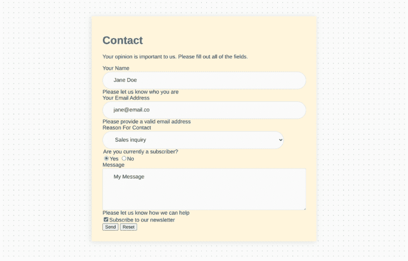

图 10.10 更新后的文本域样式

默认情况下，在网页上，用户可以通过点击并拖动右下角来在宽度和高度上调整文本域大小。在我们的布局中，增加或减少高度不会导致任何布局问题，但宽度则有问题，如图 10.11 所示。

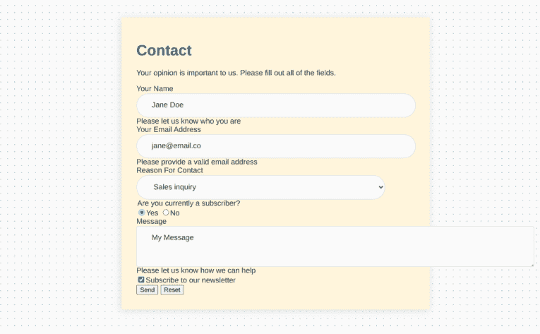

图 10.11 文本域调整大小问题

文本域以不雅观的方式延伸到容器之外。当我们垂直调整大小时，容器会适当调整大小，但水平方向则不是。通过将文本域的 `resize` 属性值从默认的 `both` 改为 `vertical`，我们可以限制用户调整文本域大小的能力。他们仍然可以更改其高度，但不能更改宽度。视觉上文本框看起来仍然相同，并且右下角仍有用于调整大小的控件，如图 10.12 所示。当用户与调整大小控件交互时，他们将被限制为只能垂直调整大小。

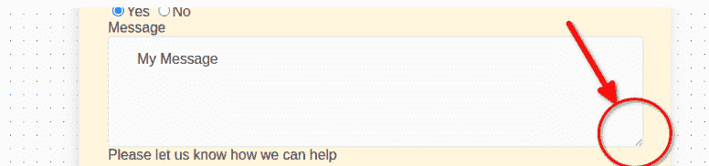

图 10.12 文本域仅垂直调整大小

6 https://developer.mozilla.org/en-US/docs/Web/CSS/resize

对我们基本样式的编辑以及专门为文本域添加的额外内容如下所示，见列表 10.8。

## 列表 10.8 文本域的更新样式

```
input:not([type="radio"], [type="checkbox"]),
textarea,
select {
  background: var(--background);
  font-size: 1rem;
  font-family: inherit;
  color: inherit;
  border: solid 1px var(--border);
  border-radius: 32px;
  padding: 1rem 2rem;

  display: block;
  width: calc(100% - 4rem);
}

textarea {
  border-radius: 4px;
  resize: vertical;
}
```

### A 将 textarea 和 select 添加到我们的样式中
### B 使控件从父容器继承字体大小
### C 为文本域添加了特定于边框半径和调整大小的规则

我们仍然需要解决 `select` 的问题，但这比我们为文本域所做的编辑要复杂一些，所以让我们先完成输入字段的样式，然后再回过头来完成 `select` 控件的样式。

## 10.3.3 样式化单选输入和复选框

本章前面我们谈到过一些表单控件 notoriously 难以样式化，因为我们可以应用于它们的样式选项非常有限。单选按钮和复选框就完全属于这一类。直到最近，还没有任何属性会影响单选圆圈或复选框方块。我们唯一的选项是完全用自己的样式替换原生控件样式。

我们现在有能力更改原生控件的颜色。`accent-color` 属性允许我们用我们指定的颜色替换用户代理选择的颜色。将 `accent-color: var(--accent);` 应用于我们的复选框和单选按钮将产生以下结果（图 10.13）。

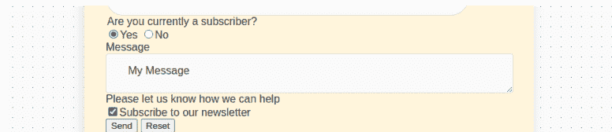

图 10.13 将强调色应用于单选按钮和复选框

元素已采用我们设置的强调色，而不是之前使用的浅蓝色默认颜色。然而，如果我增加应用程序的字体大小，我们在图 10.14 中看到控件不会随之增大。

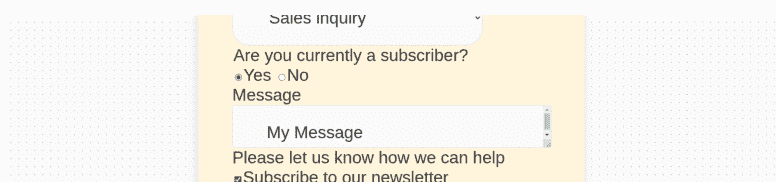

图 10.14 增加单选输入和复选框的字体大小

虽然我们可以更改元素的颜色（这是一种快速高效地将控件样式调整以更好地适应我们样式的方法），如果我们希望控件随字体大小缩放，或进行任何进一步的自定义，我们将需要用自己的样式替换控件样式。

由于我们希望保留控件的功能并仅替换其视觉方面，因此我们的 HTML 保持不变。我们将隐藏浏览器提供的原生控件，并用我们自己的自定义样式替换其视觉部分。为了隐藏原生控件，我们将使用 `appearance` 属性并将其值设为 `none`。此属性允许我们控制控件的原生外观。通过将其属性设置为 `none`，我们表示不希望它显示操作系统提供的样式。我们还将 `background-color` 设置为我们自己的背景颜色，因为某些操作系统会为控件包含背景，最后重置我们的边距。完成的重置如列表 10.9 所示。

## 列表 10.9 单选和复选框重置

```
input[type="radio"],
input[type="checkbox"] {
  appearance: none;

```
```
background-color: var(--background);
margin: 0;
}
```

### A 样式仅应用于类型为单选或复选框的输入

图 10.15 显示我们的单选输入和按钮现在已经消失。因此我们可以开始为控件创建自己的样式。

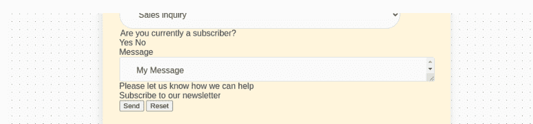

图 10.15 重置单选和复选框样式

我们想要做的是创建一个方框。对于单选输入，我们将为该方框赋予 `border-radius` 以使其变圆，但无论是复选框还是单选，核心都是需要一个方框。因此我们将通过为输入赋予 `1.25em` 的高度和宽度来创建它。我们使用 `em` 单位，因为它们是父级字体大小的百分比。通过将高度和宽度设置为 `1.25rem`，我们将它们设置为等于父级字体大小的 1.25 倍。如果我们的标签，即输入的容器和父级，字体大小为 16 像素，那么我们的方框尺寸将为 20 像素宽 x 20 像素高（16 × 1.25 = 20）。

我们将为方框添加一个边框，该边框继承标签的字体颜色。我知道这听起来有点奇怪，我们如何让边框颜色从字体颜色继承？我们将使用关键字值 `currentColor`，它允许属性在原本不能的情况下专门继承字体颜色。我们将边框颜色设置为 `currentColor`，这将使边框颜色与字体颜色匹配。为了设置边框宽度，我们也将使用 `em`，与高度和宽度相同，这将使边框宽度也能随单选按钮的大小缩放。

由于输入默认是内联元素，为了使高度和宽度生效，我们还需要更改 `display` 属性。我们将将其设置为 `inline-grid`，因为当我们处理输入的选中状态时，我们需要居中内部圆盘或复选标记。Grid 允许我们使用 `place-content` 属性轻松做到这一点。

`inline-grid` 与 `grid` 的关系就像 `inline-block` 与 `block` 的关系一样。`inline-block` 具有 `block` 的所有相同属性，但将其自身内联放置在页面流中。`inline-grid` 以相同的方式工作。我们可以使用网格的所有功能，但元素将在页面流中内联放置，而不是在前一个内容下方。对于我们的目的，这意味着

9 https://developer.mozilla.org/en-US/docs/Web/CSS/color_value#currentcolor_keyword
10 https://developer.mozilla.org/en-US/docs/Web/CSS/CSS_Grid_Layout/Basic_Concepts_of_Grid_Layout


input 将自身放置在文本标签中，而无需我们围绕包含单选输入或复选框的标签创建特殊规则。

接下来我们为元素添加右侧的外边距，这样标签文本就不会紧贴其边缘。

最后我们需要处理 border-radius。这里复选框和输入字段有所不同，因为复选框是正方形而单选是圆形。由于我们的字段边缘非常圆润，我们将为复选框添加一个小的 border-radius（4px）。为了使单选呈圆形，我们将添加 50% 的 border-radius，这将使框看起来呈圆形。

因此，我们的复选框和单选输入的规则如下所示（列表 10.10）：

## Listing 10.10 Radio and Checkbox Styled

```
input[type="radio"],
input[type="checkbox"] {
...
  display: inline-grid;
  place-content: center; #A
  width: 1.25em;
  height: 1.25em;
  border: 0.1875em solid currentColor; #B
  margin: 0 .5rem 0 0;
}

input[type="radio"] { border-radius: 50%; }

input[type="checkbox"] { border-radius: 4px; }
```

#A 将在我们创建它们后自动将内部圆盘和复选框居中放置在元素内部
#B 我们也以 em 为单位设置边框宽度，以便边框的厚度随字体大小缩放

我们的未选中输入已设置样式，现在我们需要处理选中后的样式。我们可以在图 10.16 中看到，当前选中和未选中的元素看起来完全相同。现在我们需要处理选中样式。

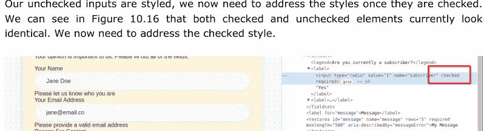

## Figure 10.16 Unchecked Radio and Checkbox Styles

## 10.3.4 :where() and :is() pseudo-classes

在此，我们将介绍两个伪类，它们将帮助我们保持代码简洁和精炼 :is() ¹¹ 和 :where() ¹²。两者工作原理相似，都接受一个选择器列表，如果列表中的任何选择器匹配，则应用规则。在编写长选择器列表时非常有帮助。不要写：

```
input:focus, textarea:focus, select:focus, button:focus { ... }
```

我们可以使用 :where 或 :is 并写出等价的写法，如下所示：

```
:where(input, textarea, select, button):focus { ... }
```

:is() 伪类将以相同方式应用。:is() 和 :where() 之间的区别在于它们的特异性级别。:where() 特异性最低，因此易于覆盖。而 :is() 则采用列表中最具体的选择器的特异性值。

> NOTE Specify 为了解释特异性是如何计算的，请查看第 1 章中的 Specificity 部分。我们将在本章后面更深入地介绍使用 :where() 和 :is() 时如何计算特异性。

因此在使用 :is() 时必须谨慎，因为如果我们的选择器列表中包含 id 选择器（id 选择器特异性最高），我们可能会快速创建出非常难以甚至不可能覆盖的规则。

我们将使用 :where() 和 :is() 结合其他伪类，如 :checked、:hover、:focus 以及 ::before 伪元素，来完成复选框和单选输入的样式设置。

## 10.3.5 Styling checked radio and checkbox inputs

为了添加选中单选的内部圆盘和复选框的复选标记，我们将采用与未选中样式时相同的操作方法，即创建同时适用于两者的基础样式，然后在样式分歧时分别对每个元素进行最终润色。与之前一样，我们将首先创建一个框。然后将该框放置在现有样式的中心，最后将其塑形为圆盘或复选框。

为了创建要放置在当前元素内部的第二个框，我们将使用 ::before 伪元素。这正是上一节中介绍的 :where() 伪类发挥作用的地方。我们将使用它来选择两种输入类型，然后添加 ::before 伪元素。因此我们的选择器将如下所示：:where(input[type="radio"], input[type="checkbox"] )::before { ... }。

现在我们可以创建我们的框。我们的内容为空，因此我们将 content 属性值设为 ""，我们将 display 设为 block，以便可以分配宽度和高度。

当我们之前创建外部框时，我们将其高度和宽度设为 1em。我们使用 em 单位，以便控件大小相对于文本大小缩放。我们在这里也将这样做。我们希望单选内部圆盘和复选标记比其容器小，因此我们将高度和宽度设为 0.625em。假设应用于输入的字体大小为 16px，我们的框大小以像素计将为 10px × 10px（16 × 0.625 = 10）。

我们不需要对内部框进行任何定位，因为还记得我们将输入的 display 设为 inline-grid，然后添加了 place-content 属性并赋值为 center（列表 10.11）吗？网格布局将自动把内部框放置在输入的中心。

## Listing 10.11 Center the Inner Box

```
input[type="radio"], input[type="checkbox"] {
  ...
  display: inline-grid;  #A
  place-content: center;  #A
  ...
}
```

#A 负责定位内部框的两个属性

到目前为止我们为创建内部框所组合的代码显示在列表 10.12 中。

## Listing 10.12 Inner Box

```
:where(input[type="radio"], input[type="checkbox"]):before {
  display: block;
  content: '';
  width: 0.625em;
  height: 0.625em;
}
```

当我们应用此代码时，我们将看不到任何变化，如图 10.17 所示。我们的内部框确实存在，但尚未可见。

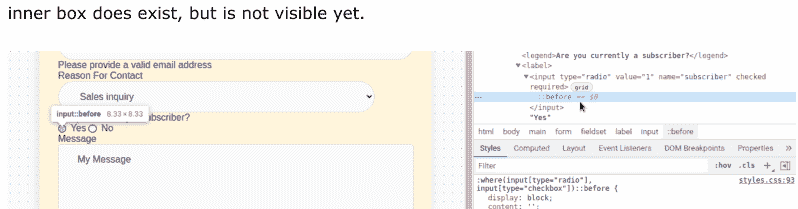

Figure 10.17 Invisible inner box

框尚未可见，因为它没有内容或背景颜色。因此我们将接下来添加背景颜色。

## 10.3.6 Using the :checked pseudo-class

我们不会无差别地一直将相同的背景颜色应用于元素。我们将在元素被选中时使用强调色，在悬停时使用悬停色。

:checked 伪类选择器可用于 type 为 radio 或 checkbox 的 input，或用于下拉列表中的 option 元素（<select>），以在元素被选中时应用样式。然而，将其用于 option 的能力取决于浏览器。

当我们为选中和悬停应用背景颜色时，如果选择器的特异性级别相同（我们的示例中是），我们编写这些规则的顺序很重要。如果我们先写选中规则再写悬停规则，则在悬停选中输入时悬停颜色将被应用，因为悬停规则由于在 CSS 文件中更靠后而覆盖选中规则。因此我们需要确保在 CSS 文件中悬停规则位于选中规则之前。图 10.18 说明了这两种情况。

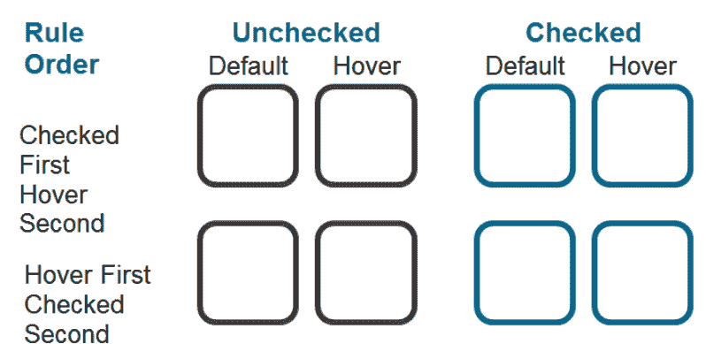

Figure 10.18 Rule order regarding background for checked checkboxes on hover

让我们看看如何在 CSS 文件中应用背景颜色。列表 10.13 显示了我们文件目前的摘录。

## Listing 10.13 Inner Element Background Color

```
:where(input[type="radio"], input[type="checkbox"]):before {
  display: block;
  content: '';
  width: 0.625em;
  height: 0.625em;
}
```

13 https://developer.mozilla.org/en-US/docs/Web/CSS/:checked

```
}

:where(input[type="radio"], input[type="checkbox"]):hover::before { #B
  background: var(--hover);
}

:where(input[type="radio"], input[type="checkbox"]):checked::before { #C
  background: var(--accent);
}
```

#A 内部框的先前编写代码
#B 在悬停时为内部框添加背景颜色
#C 在输入被选中时为内部框添加背景颜色

图 10.19 显示我们现在在元素内部有一个可以塑形的正方形框。当元素被选中时，它使用强调色显示；当我们悬停在未选中的单选或复选框输入上时，我们会看到灰色框。

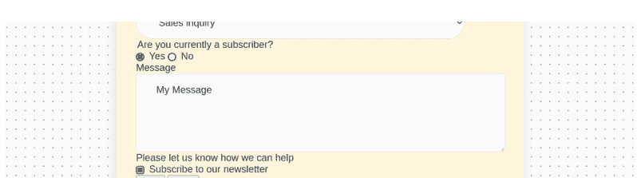

Figure 10.19 Setting up for our checked state

现在我们需要塑形内部框。这里我们的代码将分叉，以分别创建单选的圆盘和复选框的复选标记。

## 10.3.7 Shaping the checked radio input’s inner disk

为了将我们的框变成选中单选输入内部的圆形，我们将使用 border-radius。我们将专门针对 type 为 radio 输入的 before 伪类，然后添加 50% 的 border-radius 使我们的框看起来像圆形，如列表 10.14 所见。我们不区分悬停或选中，因为我们希望形状无论元素状态如何都为圆盘。

## Listing 10.14 Radio Button Inner Disk

```
input[type="radio"]::before {
  border-radius: 50%;
}
```

现在我们有一个非常传统的单选按钮（图 10.20），无论文本大小如何都能很好地缩放。


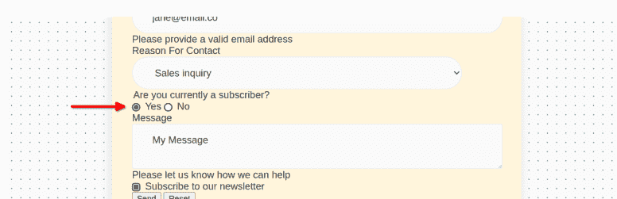

Figure 10.20 Styled Radio Input

有了单选输入样式后，我们现在将注意力转向塑造复选框内部的复选标记。

## 10.3.8 Using CSS shapes to create the checkmark

塑造我们的单选输入非常简单，我们使用了 border-radius 并实现了一个圆盘形状。复选标记的形状就没有那么简单了。要创建它，我们将使用 clip-path。

> NOTE Clip-path Clip path 允许我们通过创建剪切区域来创建形状，该区域定义了元素的哪一部分应显示而哪一部分应隐藏。我们在第 5 章和第 7 章中之前使用过 clip-path，如果你想复习一下

要创建我们的复选标记，我们将应用于 clip-path 的形状是一个 polygon，它将创建我们的复选标记。Polygon 是通过设置一系列基于 X 和 Y 百分比的坐标来创建的，在这些坐标之间会创建一条线。坐标 (0, 0) 是形状的左上角。如果形状未明确关闭，它将自动连接第一个和最后一个点。我们的 polygon 函数将为：polygon(14% 44%, 0% 65%, 50% 100%, 100% 16%, 80% 0%, 43% 62%)。Figure 10.21 解释了形状逐点构建的过程。

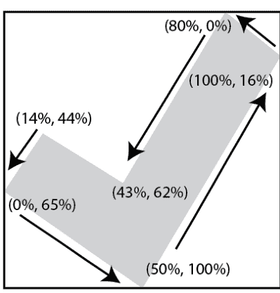

Figure 10.21 Polygon Check Mark Shape Coordinates

有了形状后，我们现在可以创建我们的 clip-path 并将其应用于复选框的内部部分，如 Listing 10.15 所示。

### Listing 10.15 Check mark in our checkbox

```
input[type="checkbox"]::before {
  clip-path: polygon(14% 44%, 0% 65%, 50% 100%, 100% 16%, 80% 0%, 43% 62%);
}
```

添加了 clip-path 后，我们现在拥有了一个完全功能的复选框。让我们添加一些 finishing touches。请注意，在 Figure 10.22 中，已选中单选按钮和复选框的轮廓仍然是我们的字体颜色，而不是强调色。

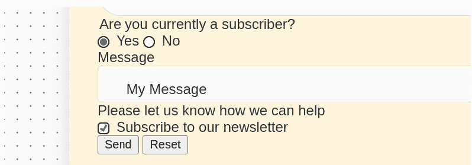

Figure 10.22 Style Checkmark in the checkbox

为了在选中时为单选按钮和复选标记添加轮廓颜色，我们将再次使用 :checked 伪类，以专门选择控件仅在选中时并将边框颜色更改为我们的强调色。在代码中，这转化为 Listing 10.16 所示的内容。我们使用 :is 而不是 :where 是因为特异性。

### Listing 10.16 Accent color outline for checked inputs

```
input[type="radio"],
input[type="checkbox"] {
  ...
  border: 0.1875em solid currentColor;
}

:is(input[type="radio"], input[type="checkbox"]):checked {
  border-color: var(--accent);
}
```

## 10.3.9 Calculating specificity with :is() and :where()

我们之前提到过 :where 的特异性为 0，意味着它是我们可以使用的特异性最低的选择器。我们在以下选择器中设置了默认边框颜色 input[type="radio"], input[type="checkbox"] { ... } 其特异性为 11，使用下表 10.2 计算得出。在每一列中我们计算每种类型选择器的数量，列 A、B 和 C 形成特异性值¹⁶。

### Table 10.2 Calculating Specificity

| Selector | A ID selectors (x100) | B Class selectors, Attribute Selectors, & Pseudo Classes (x10) | C Type Selectors, pseudo elements (x1) | Specificity |
|---|---|---|---|---|
| :where(input[type="radio"], input[type="checkbox"]) | Ignores specificity rules and always equals 0 |  | 000 |
| :where(input[type="radio"], input[type="checkbox"]):checked | Ignores specificity rules and always equals 0 |  | 000 |
| input[type="radio"] | 0 | 1 | 1 | 011 |

| input[type="radio"]:checked | 0 | 2 | 1 | 021 |
|:is(input[type="radio"], input[type="checkbox"]):checked | 0 | 2 | 1 | 021 |

由于 :is 将基于其内部最具体的选择器来确定其特异性值，在我们的特定情况下，其特异性将为 11 再加上 :checked 的 10，给我们一个特异性为 21。由于 21 大于 0，我们覆盖了样式，我们的边框变为我们的强调色。

我们的单选输入和复选框现在在选中和未选中时以及两种状态下的悬停时都已设置样式。Figure 10.23 显示了成品。

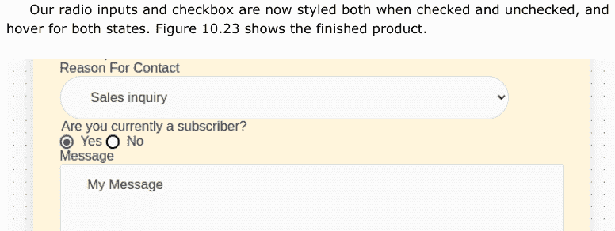

Figure 10.23 Styled Checkmark and Radio Inputs

让我们把注意力转向下拉菜单。

## 10.4 Styling dropdowns

虽然我们为 select 元素设置了与输入和 textarea 相同的默认值（作为复习，它们显示在 Listing 10.17 中），但我们可以在 Figure 10.24 中看到它并没有像其他元素一样占据我们容器的全宽。此外，由于我们添加了边框，表示其为下拉菜单的向下箭头离边缘相当近。

### Listing 10.17 Default styles applied to select
```
input:not([type="radio"], [type="checkbox"]),
textarea,
select {
  background: var(--background);
  font-size: 1rem;
  font-family: inherit;
}
```
```
color: inherit;
border: solid 1px var(--border);
border-radius: 32px;
padding: 1rem 2rem;

display: block;
width: calc(100% - 4rem);
}
```

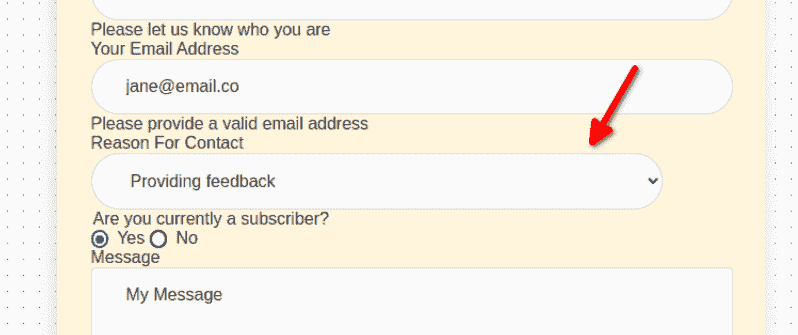

Figure 10.24 Select not taking full width

### 10.4.1 Select styling limitations

在我们着手修复 select 以匹配我们的其他样式之前，让我们先解决我们将遇到的一些限制。select 与单选和复选框输入一样，其大部分样式和功能都来自操作系统本身。因此，我们仅使用 CSS 能样式化的范围将受到限制，尤其是选项列表。我们可以使用 JavaScript 和 ARIA 替换整个控件，但由于这是一本关于 CSS 的书，我们将尽可能使用 CSS 单独进行样式化，然后就此停止。

像我们对单选按钮和复选框所做的那样，我们将首先通过使用 appearance 属性并将其值设为 none 来移除尽可能多的原生样式。然后我们将宽度设置为 100%，使其占据容器的全宽。我们的下拉菜单摆脱了原生外观并正确调整大小后，如 Figure 10.25 所见，我们可以专注于重新添加箭头。请注意，箭头消失了，但添加 appearance: none 并未影响我们的选项。

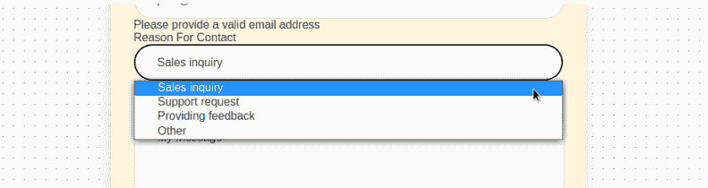

Figure 10.25 Full width select with no arrow

### 10.4.2 Using linear-gradients to create an arrow

我们的下一个任务将是创建一个我们可以控制定位的新箭头。记住在本章开头，我们使用渐变创建了一个圆？我们将再次使用这个技巧来创建我们的箭头，我们将使用 background-image 属性将其添加到下拉菜单中。与 radial-gradient 不同，我们将使用 linear-gradient。

与 radial-gradient 类似，linear-gradient 将接受一系列颜色和它们应开始和停止的百分比，但颜色不是以围绕中心点的圆形方式显示，而是以线性的方式放置朝向某一侧或角落。它还可以接受一个角度来规定颜色线的方向。表 10.3 显示了规定颜色线方向时的角度及其关键字等价物。

Table 10.3 Keyword and Angle Equivalent

| Keyword | Angle in degrees |
|---|---|
| to top | 0 |
| to bottom | 180 |
| to left | 270 |
| to right | 90 |

与 radial-gradient 相同，如果我们在同一百分比停止和停止一种颜色，我们将得到一条尖锐的线而不是从一种颜色到另一种颜色的渐变。

background-image 属性允许我们在背景中添加多个图像。我们将利用此功能。我们需要三个重叠的渐变来创建我们的箭头，它们都将分配给 background-image 属性。

我们首先给背景一个高度和宽度为 1rem，创建一个正方形。然后我们将背景图像设置为我们的三个渐变。第一个值在顶部，最后一个在底部。从底部到顶部工作，我们首先使用从强调色到强调色的渐变。换句话说，我们创建一个蓝色方块。然后我们创建一个放在正方形顶部的第二个渐变。我们的第二个渐变将方块从左下到右上分割，其中顶部是透明的，底部是我们的背景颜色。这创建了一个三角形，遮挡了方块的右下角。我们的第三个将是相反的对角线，从左上到右下，同样顶部透明，底部为背景颜色。这创建了另一个三角形，遮挡了方块的左下角。这留下一个倒置的蓝色三角形，宽 1rem，高半个 rem。Figure 10.26 说明了该过程。


Figure 10.26 Creating an arrow from superimposed gradients

剩下的就是定位我们的背景并防止其重复。我们希望背景距离控件右侧 1rem 并居中。我们可以使用 calc() 函数为我们做数学计算。要计算水平位置，我们取全宽 (100%) 并减去 1rem。对于垂直定位，我们知道我们有 1rem 的上下内边距加上文本，其大小也为 1rem，使我们的控件高度为 3rem。因此我们可以将箭头定位在顶部下方 50%。由于箭头的高度只有半个 rem，我们然后在顶部位置加上 ⅓rem。

全部放在一起，我们得到 select 的以下规则（Listing 10.18）：

### Listing 10.18 Styled Select

```
select {
  appearance: none;
  width: 100%;

  background-image:
    linear-gradient(225deg, transparent 50%, var(--background) 50%),
    linear-gradient(135deg, transparent 50%, var(--background) 50%),
    linear-gradient(var(--accent), var(--accent))
  ;

  background-size: 1rem 1rem;
  background-position: calc(100% - 1rem) calc(50% + .33rem);
  background-repeat: no-repeat;
}
```


Figure 10.27 shows our styled select.


Figure 10.27 Styled and Positioned Select Arrow

To style the select options themselves, only `color` and `background` can be styles, and even then, only some browsers will allow those to be applied. This is because the styles for options are controlled by the underlying operating system. For cross browser compatibility and accessibility, we will therefore leave those as they are.

We have now styled all of the form controls in our form. Let’s revisit our labels and add some breathing room between our labels and our controls so that our elements aren’t so closely compacted against each other.

## 10.5 Styling labels and legends

To style our labels and the legend, we are going to start by giving them `margin`. We will give them vertical margin for breathing room in between items. We will also give them left margin so that the label text aligns with where the text begins in the input field. We gave the inputs left padding of `2rem`. We can therefore give our labels the same amount of left margin to align the text visually on the page. Because labels have a `display` value of `inline` by default, we will need to give them a `display` value of `block` for the margin to apply. Finally we will also decrease their font size. The information that is most important here is the values that are entered by the user, not the labels. By decreasing their size we diminish their importance in the visual hierarchy. We end up with the code displayed in listing 10.19.

### Listing 10.19 Added margin and updated font size

```
label, legend { #A
  display: block;
  margin: 1rem 0 0 2rem; #B
  font-size: .875rem;
}
```

#A we apply the styles to both the labels and the legend
#B Margin top of 1 rem, margin left of 2 rem

Notice in Figure 10.26 that the `legend` is still very close to the "Reason for Contact" field above it. Also, our radio buttons are now very far apart.


Figure 10.28 Added Label and Legend Margin

To add space between our legend and the "Reason for Contact" above we are going to give our fieldset itself some margin. We will then specifically target the labels that are within the fieldset and reduce their vertical margin so that the radio inputs are closer together. We want to keep the radio inputs close together because the closer they are to one another visually, the easier it will be for the user to recognize them as belonging together as a group. Listing 10.20 shows our updated margins.

### Listing 10.20 Added margin and updated font size

```
fieldset {
    #A
    ...
    #A
    margin: 1rem 0;
    #A
}

fieldset label {
    #B
    margin: .5rem 0 0 2rem;
    #B
```

#A Add margin to our already existing fieldset rule
#B Update the margin of the labels that inside of the fieldset

With our labels now formatted (Figure 10.29) let’s continue down the form and style the buttons.


Figure 10.29 Styled Labels and Legend

## 10.6 Styling the buttons

We have two buttons at the bottom of our form. The first performs our primary action, "Send". The second, "Reset" performs a secondary action. We will therefore make the "Send" button much more prominent than our reset as it is the most likely to be used and the behavior we desire the user to perform. The reset is there as a tool or utility to help the user but should not be our primary focus.

### 10.6.1 Resetting the button styles

We will first reset the button styles to match our theme and then differentiate where needed for our two use cases. We create a rule with a button selector, which applies to all buttons removing the border and background, setting our typography preferences, adding padding and margin, adding a border-radius, and changing the cursor to a pointer. Our base styles are shown in Listing 10.21.

### Listing 10.21 Reset button styles

```
button {
  border: none;
  background: none;
  border-radius: 36px;
  padding: 1rem 3rem;
  font-family: var(--font-family);
  font-size: 1rem;
  cursor: pointer;
  margin-right: 1rem;
}
```

Our buttons, shown in Figure 10.30 are now ready to be differentiated based on their purpose.


Figure 10.30 Styled Labels and Legend

### 10.6.2 Styling the submit button

Let’s first handle the “Send” button which has a type submit. Instead of giving it a class, we can use a type selector to specifically target our button: button[type="submit"]. The outcome we want to achieve is shown in Figure 10.31.


Figure 10.31 Styled submit button

We will make it stand out by changing the background color to be our accent color and bolding the text. We also need to change our text color because the dark gray, almost black, we have been using for our text will not show up very well against a dark background. If we do not change the text color, the color contrast between our background color and our text will be too low and impede legibility. We will therefore change the text color to take our accent-contrast custom property value (white) which we set at the beginning of this chapter. Our completed styles for the submit button can be seen below in Listing 10.21.

### Listing 10.21. Added margin and updated font size

```
button[type="submit"] {
  background: var(--accent);
  color: var(--accent-contrast);
  text-transform: uppercase;
  font-weight: bold;
}
```

## 10.6.3 Styling the reset button

Next we need to style the reset button. Same as with our submit button rather than adding a class, we will use a type selector to create our rule. The “Reset” button has a type of reset, so we can use button[type="reset"] as a selector for our rule.

To reinforce that it is a secondary action, we are going to minimize it even further visually compared to its submit counterpart by forcing its text to be all lowercase. We will however change the text color to be our accent color to reinforce that it is clickable, otherwise it just looks like static text.

As mentioned in the previous section, there is not much contrast difference between our text color and our accent color, therefore some users, especially those that are visually impaired, may have trouble differentiating between the two colors. It is therefore imperative that we use more than just color to differentiate between element types and states. We will therefore add a border that is the same color as our input borders to our button.

However, once we apply the border, we can see in Figure 10.30 that the reset button is now taller than our submit button. The submit is 50px tall while the reset is 52px. Not ideal when the goal is to make it appear less important than the submit. Size is often an indicator of importance, the bigger an element is the more important it will appear.


Figure 10.32 Button Sizes

To remedy this situation and have both the buttons be the same size we will add 1px border to the submit button as well. We will however give it a color of accent. It will be invisible as a border since it will blend into the background color but it will make both of our buttons the same size. Listing 10.22 shows the reset button styles and the edit to the submit button.

### Listing 10.22 Reset button styles and border edit to submit

```
button[type="submit"] {
  ...
  border: solid 1px var(--accent);  #A
}

button[type="reset"] {          #B
  color: var(--accent);           #B
  text-transform: lowercase;      #B
  border: solid 1px var(--border); #B
  box-sizing: border-box;         #B
}
```

#A added border to submit button
#B Styles for reset button

We can see in Figure 10.32 that our buttons are now styled and have equal heights.


Figure 10.33 Both buttons are equal in height

Although styled, the buttons are right up against the checkmark above them. We will need to add margin between them and the above control.

In our HTML (shown in Listing 10.23) we notice that there is a container div around our buttons with a class of actions.

### Listing 10.23 Button HTML

```
<div class="actions">
  <button type="submit" onclick="send(event)">Send</button>
  <button type="reset" onclick="setAsPristine()">Reset</button>
</div>
```

We will give the actions div a margin-top of 1rem, which will move the buttons down and away from the checkbox. Listing 10.24 shows this in code.

### Listing 10.24 Margin on actions container

```
.actions {
  margin-top: 1rem;
}
```

As seen in Figure 10.33, we are starting to look pretty good. Our next order of business will be to style our error messages.


Figure 10.34 Styled Buttons and Container

## 10.7 Error handling

在 Name、Email 和 Message 控件下方有一个错误信息。目前它未经过样式处理，因此不易被识别为错误信息。此外，我们也不希望在用户与控件交互之前就显示此错误信息。没人希望在刚开始之前就被错误信息责骂。

我们要做的是将其样式化，使其看起来像错误信息，然后默认隐藏它们，仅在适当时显示。提前说明一下，如果你跟着本章一起编码并且从 Github 下载了起始文件，你可能已经注意到一个 JavaScript 文件。这就是该文件中代码将发挥作用的地方。我们很快就会更详细地介绍这一点。

### 10.7.1 Styling error messages

像网络上大多数错误信息一样，我们将把我们的文本设为红色。我们将使用我们在 --error 自定义属性中设置的颜色。我们还将使文本加粗，并在错误前加上 “Error: ” 字样，以明确表示其为错误，因为如本章前面所述，我们不想仅使用颜色来传达含义或意图。为了保持措辞一致且不必每次都记住添加，我们不会在每个错误开头添加文字，而是通过 CSS 使用 ::before 伪元素以编程方式添加。我们还需要为错误右侧添加 2rem 的外边距，以便其与标签和输入文本对齐。因此，我们的错误样式规则如下所示（Listing 10.25）：

# Listing 10.25 Error Styles

```
.error {
  color: var(--error);  #A
  font-weight: bold;
  margin-left: 2rem;   #B
}

.error span::before { #C
  content: 'Error: '; #C
}                  #C
```

#A 使文本变红
#B 使其与输入内容和标签对齐
#C 在每个错误前添加 “Error: ”

注意，当我们在文本前添加 “Error: ” 文字时，我们将其添加到 span 而不是 error div 本身。这是因为我们将显示和隐藏 error 中的 span 以及整个 error div。让我们更仔细地查看 HTML 以了解原因。Listing 10.26 显示了 Name 字段的完整控件，包括其标签和错误信息。注意 error div 的 id 为 nameError，该 id 被输入字段上的 aria-describedby 属性引用。aria-describedby 属性告诉屏幕阅读器和辅助技术，其引用的 id 元素包含与输入字段相关的额外信息。如果我们使用 display:none 完全隐藏 error div，aria-describedby 指向的元素将不存在。因此我们只隐藏内容（span），以免破坏元素与其错误之间的程序化连接。由于我们只会隐藏 span，因此我们需要将 “Error: ” 文字应用于 span，以便在隐藏错误信息时也能将其隐藏。

# Listing 10.26 Name Field HTML

```
<label for="name">Your Name</label>
<input type="text" id="name" name="name" maxlength="250" required aria-describedby="nameError">
<div class="error" id="nameError">
  <span role="alert">
    Please let us know who you are
  </span>
</div>
```

Figure 10.34 显示了我们样式化的错误信息。


Figure 10.35 Styled error messages

在对输入字段进行样式化后，我们现在可以仅在适当时显示它们。在 Figure 10.33 中我们看到输入框具有有效值，但错误信息仍然显示。为了仅在字段无效时显示它们，我们将首先默认隐藏错误信息。因此我们将 error `div` 中包含的 `span` 应用 `display` 属性值为 `none`。然后我们使用 `:invalid` 有条件地仅在字段无效时显示它。

正如我们在第 8 章中之前提到的，在这种情况下字段的有效性是基于我们在字段本身上设置的属性来确定的。让我们再次查看 name 输入的 HTML：`<input type="text" id="name" name="name" maxlength="250" required aria-describedby="nameError">`。我们包含了 `required` 和 `maxlength` 属性，因此如果字段中没有值，或者值的长度大于 250 个字符，字段值将无效，并且使用 `:invalid` 伪类应用的样式将被应用。

email 元素（`<input type="email" id="email" name="email" maxlength="250" required aria-describedby="emailError">`）也具有 `maxlength` 和 `required` 属性，因此在与 name 字段相同的条件下也会无效。它还有一个类型为 `email`。在 HTML 中，一些字段类型内置了验证。Email 就是其中之一，因此，如果我们输入的 email 地址值为 “myEmail”，它也会显示为无效。

使用 `:invalid` 伪类将有助于防止在字段有效时显示错误，但不会阻止在字段尚未交互时显示错误。我们目前在纯 CSS 中没有办法确定用户是否已与字段交互，有时也称为字段为 “dirty”。这就是我们需要 JavaScript 帮助的地方。附加到文件的脚本会监听 on blur 事件。Blur 事件发生在元素失去焦点时。当我们点击或从字段中切换走时，就会发生 blur 事件。我们的脚本监听这些 blur 事件，并在我们刚刚离开的字段上添加一个 dirty 类。这使我们能够知道哪些字段已被交互，哪些未被交互。具有 dirty 类的字段已被交互，没有 dirty 类的字段未被交互。当点击 “Clear” 按钮时，它会清除表单并从可能具有该类的字段中移除 dirty 类，将表单重置为干净状态。

由于我们有这个 dirty 类，结合 :invalid 属性，我们将仅在控件不仅无效而且已被用户触碰时才显示错误信息，从而防止在用户有机会填写表单之前显示错误信息。我们使用以下选择器：.dirty:invalid + .error span。我们选择位于紧跟在同时无效且具有 dirty 类的元素之后的具有 error 类的元素中包含的 span。

最后我们还将在字段同时无效且为 dirty 时更改其边框颜色为我们的错误颜色。

Listing 10.27 显示了显示和隐藏错误信息的完整规则。

# Listing 10.27 Error Handling CSS

```
.error span { display: none; } #A

.dirty:invalid + .error span { #B
  display: inline;      #B
}                       #B

:is(input, textarea).dirty:invalid { #C
  border-color: var(--error);  #C
}                           #C
```

#A 默认隐藏错误信息
#B 当其在 HTML 中紧邻之前的字段为 dirty 且无效时显示错误信息
#C 当输入框和文本域无效且为 dirty 时将边框颜色改为红色

Figure 10.35 显示了字段的三种可能状态，无效且为 dirty、有效，以及无效但尚未触碰。


Figure 10.36 Error Handling and field States

表面上我们的表单似乎已完成，但我们仍有一些收尾工作要做。

## 10.8 Adding hover and focus styles to form elements

因为我们希望表单具有可访问性，所以我们需要确保在控件和按钮上包含悬停和焦点样式。我们已经处理了单选按钮和复选框的悬停样式，但未处理焦点。对于其他元素我们也尚未考虑。

让我们从焦点开始，因为我们仍需要在表单上的所有元素上应用它。焦点对于通过键盘而非鼠标点击元素浏览网页的用户非常重要。它为用户提供当前具有焦点的元素的视觉指示。

### 10.8.1 :focus versus :focus-visible

因为无论用户如何浏览网页都一直显示焦点样式可能会让人不知所措，这取决于设计，最近 CSS 规范中添加了一个新属性，可根据用户的操作方式，即键盘或鼠标，来应用焦点样式。伪类 :focus-visible 允许我们在用户是

17 https://developer.mozilla.org/en-US/docs/Web/CSS/:focus-visible


与键盘交互时适用但在用户使用鼠标时不会应用，而与 :focus 不同，:focus 无论用户如何与元素交互始终适用。
我们将应用一个实线轮廓，宽度为 2 像素，并使用我们的强调色。这不仅会设置我们的轮廓样式，还会用我们专门为匹配主题而设计的样式替换浏览器的默认悬停状态轮廓。这在具有无效样式悬停的字段上看起来有点不协调。我们可以从图 10.36 看出，不仅边框和轮廓冲突，而且边框还侵入了错误消息。


图 10.37 错误输入上的焦点可见

为防止轮廓与边框冲突，我们使轮廓在字段为脏且无效时使用我们的错误颜色。由于所有字段都有足够的内边距，我们将内缩边框，使其不会离错误消息太近。为了内缩轮廓，我们将 outline-offset 属性设置为负值。我们最终得到了清单 20.28 中显示的 2 条规则。

## Listing 10.28 Focus-visible on form fields and button

```
:focus-visible {
  outline: solid 2px var(--accent);  #A
  outline-offset: -2px;              #A
}

.dirty:invalid:focus-visible {      #B
  outline-color: var(--error);       #B
}
```

#A 所有元素在获得焦点时都会显示轮廓
#B 当元素为脏且无效时，我们将轮廓颜色更改为红色

图 10.36 显示了使用浏览器的开发者工具应用 focus-visible 时的每个字段。在大多数主要浏览器中，开发者工具会有一个 :hov 按钮，可以点击展开一系列复选框，允许我们根据列出的伪类手动应用样式。这就是我们在此处所做的，以便同时将 focus-visible 样式应用于多个元素。 （本图及后续图中使用的浏览器为 Chrome）


图 10.38 字段元素上的焦点可见

我们的轮廓对所有字段都可见且工作良好，除了我们的复选框、单选按钮和按钮，尤其是提交按钮。为此我们将更改轮廓偏移，使轮廓不再位于元素内部，而是放置在元素外部，距离元素 2 像素。为此我们将以下规则添加到样式文件中（清单 10.29）。

## Listing 10.29 Focus-visible on radios and checkboxes

```
:where(input[type="radio"], input[type="checkbox"], button):focus-visible {
  outline-offset: 2px;
}
```

应用编辑后，我们的复选框、输入和按钮在通过键盘导航或交互时现在看起来如图所示 图 10.37。


图 10.39 单选、复选框和按钮上的焦点可见

处理完焦点样式后，让我们处理悬停。

## 10.8.2 Adding hover styles

用户输入文本的字段，例如类型为 text 和 email 的输入或文本区域，在悬停时已将光标类型从默认更改为文本。表 10.4 显示了每种光标类型的外观。

### Table 10.4 Cursors

| Cursor Name | Cursor Image |
|---|---|
| default |  |
| text |  |
| pointer |  |

我们还将按钮上的光标更改为指针。select 在悬停时没有样式或光标的任何更改。为解决 select 问题，并进一步强调其他字段和重置按钮的悬停，我们将更改元素的边框颜色以使用我们的强调色

使用清单 10.30 中找到的颜色。虽然冗余，但由于特异性，我们无法仅在 :is 伪类中添加 input 来覆盖我们之前设置的边框样式。请注意，我们需要同时包含 input，这将更改单选和复选框的边框颜色，以及 input:not(...)，以便更改类型为 text 和 type email 的输入的边框颜色。

## Listing 10.30 Hover rule

```
:is(
  input,
  input:not([type="radio"], [type="checkbox"]),
  textarea, select, button
):hover {
  border-color: var(--accent);
}
```

在图 10.38 中，我们再次使用了 Chrome 开发者工具来专门显示对有箭头指向的元素应用的悬停样式。

Figure 10.40 On Hover Styles

在处理完焦点和悬停后，我们需要关心的最后一件事是确保我们的样式适用于启用了 forced-color: active 的用户。

## 10.9 Handling forced-color mode

强制颜色模式¹⁸ 是一种高对比度设置，允许用户将使用的颜色调色板限制为其设备上设置的系列颜色。Windows 的高对比度模式就是此用例的一个示例。当此模式启用时，它会影响许多 CSS 属性，包括我们使用过的一些属性，最著名的是 background-color。我们利用 background-color 来确定单选和复选框输入的内部部分是否可见


对于已选中与未选中元素。我们还用它来重新设置 select 控件的箭头样式。

在 Chrome 中，我们可以使用开发者工具模拟在机器上启用强制颜色模式，而无需实际编辑计算机设置。在开发者工具的控制台区域中，我们选择渲染选项卡。如果尚未显示，我们可以按省略号按钮显示可能的选项卡列表并从下拉菜单中选择它。在该选项卡中，我们然后查找 forced-color 仿真下拉菜单并将其设置为 forced-colors: active。这将更新页面的样式，使其表现得好像我们在机器上将 forced-colors 设置为 active。图 10.39 显示了在 Chrome 开发者工具中启用仿真的设置。 （注意：不同浏览器可能有或没有此功能，并且启用方式可能不同。）

```
<label for="message">Message</label>
<textarea id="message" name="message" rows="5" required maxlength="500" aria-describedby</textarea>
<div class="error" id="messageError"></div>
<label>
<input type="checkbox" name="subscribe" checked class="dirty"> grid
::before
</input>
"Subscribe to our newsletter "
</label>
```

图 10.41 Chrome 开发者工具中 forced-colors:active 仿真设置

一旦应用仿真，我们可以在图 10.40 中看到我们的页面样式发生了巨大变化。我们还注意到我们无法分辨哪个单选输入被选中，也无法分辨复选框是否被选中，并且我们下拉菜单的箭头消失了。我们还演示了使用颜色以外的东西来区分含义的重要性，因为我们的错误消息也不再是红色了。

# Contact

您的意见对我们很重要。请填写所有字段。

您的姓名
Jane Doe

您的电子邮件地址
jane@email.co

联系原因
Other

您目前是订阅者吗？
○ Yes
○ No

Message

Error: Please let us know how we can help

☐ Subscribe to our newsletter

SEND   reset

图 10.42 仿真 forced-colors: active

我们不会尝试在此模式下恢复我们的颜色，我们希望尊重用户的设置，但我们确实需要确保已选中的输入与未选中的输入有区别，并且我们的 select 有箭头以明显表示其为下拉菜单。

为了创建仅在用户将 forced-color 设置为 active 时才应用的规则，我们将使用媒体查询 @media (forced-colors: active) { ... }。在媒体查询内部创建的规则仅在用户启用 forced-colors 时生效。

我们的复选标记和单选按钮不再可见的原因是系统定义的背景颜色（在本例中为白色）被应用到它们上。因此，我们将更改背景颜色以使用系统颜色而不是我们的强调色。CSS Color Module Level 4 规范¹⁹ 定义了可供我们使用的颜色。我们将使用 CanvasText，这意味着我们将应用的颜色将与用于文本的颜色相同。

我们可以尝试通过更改渐变中的颜色值来将相同的逻辑应用于我们的 select，但我们会注意到它不起作用。这是因为在 forced-colors 模式下，当存在背景图像时，除非它是基于 url 的，否则它将不会显示。我们的

¹⁹ https://www.w3.org/TR/css-color-4/#typedef-system-color


background images use the `linear-gradient()` function, not the `url()` function, therefore, our value is being replaced with a value of `none`.

To remove the system provided arrow, we gave the dropdown an `appearance` property value of `none`. To reinstate the system provided appearance in `forced-colors` mode, inside of the media query, we will give the `select` of an `appearance` property value of `auto`. Our media full media query is displayed in Listing 10.31.

## Listing 10.31 forced-colors: active media query

```
@media (forced-colors: active) {

  :where(input[type="radio"], input[type="checkbox"]):checked::before {
    background-color: CanvasText;
  }

  select {
    appearance: auto;
  }
}
```

Figure 10.41 shows our page in forced-colors mode with our media query applied which fixes the styles that were creating usability problems for our users.

## Contact

Your opinion is important to us. Please fill out all of the fields.

Your Name
Jane Doe

Your Email Address
jane@email.co

Reason For Contact
Sales inquiry

Are you currently a subscriber?
Yes
No

Message
Error: Please let us know how we can help

Subscribe to our newsletter

SEND
reset

Figure 10.43 forced-colors: active styles fixed

When we turn the emulation off, we can see in figure 10.41 that our previously set styles remain as they were and were not affected by those set inside of the media query.


Figure 10.44 Finished Product

With this last task complete, we have now finished styling our form.

## 10.10 Summary

- Form controls whose functionality is tightly coupled with the operating system such as dropdowns are harder to style than those without this coupling
- We can create shapes using gradients
- Using em, elements can be sized to scale with text size
- To inherit font color when otherwise not possible we can use the keyword value currentColor
- :where() and :is() pseudo classes work very similarly but have different levels of specificity
- The :checked allows us to target form elements when they are checked
- The :invalid pseudo class can be used to conditionally format fields when they are invalid
- The validity of a field's value is determined by the attributes set on the field in the HTML
- :focus styles are necessary to make our designs accessible
- We can use :focus-visible to make focus style only show for keyboard users
- In some browsers we can forcibly make the browser apply hover and focus styles
- It is important to always use more than just color to convey meaning
- forced-colors mode changes how some properties behave and the colors we can apply to the UI
- Media queries can be used to conditionally apply styles when forced-colors is set to

active

- In some browsers we can emulate `forced-colors` mode to check our designs

## 11

## Animated social media share links

## This chapter covers

- OOCS, SMACSS, and BEM Architecture Patterns
- Scoping CSS when working with components
- Working with social media icons
- Creating CSS transitions
- Where to use JavaScript to overcome CSS limitations

One of the core foundational reasons for which the internet was created was to share and distribute information. One of the ways we do this today is through social media. In this chapter we will style and animate some links that can be used to share a web page via email or social media.

Like in the previous chapters, we will be using HTML and CSS for this project without using any frameworks. This is to keep focus on the CSS itself without the complexity and individual intricacies that come with using external packages. However, many applications in the wild do use frameworks some of which include the concept of the component. A very common reason to turn a piece of functionality into a component is to reuse the piece of code or element in multiple places in our applications. With reusability comes the possibility for naming collisions. Some systems automatically restrict the scope of the CSS of the component to itself, preventing any possible collision between component styles. However, many do not, leaving it up to the developer to organize their code to prevent accidentally changing the styles in another component when styling a new one. Regardless of the framework and how it does (or does not) handle CSS scoping we have a variety of architecture options to help us organize and standardize our styles.

Before we dive into the project itself let’s take a quick look at some CSS architecture options and choose one for our project.

## 11.1 CSS Architecture

Some of the most popular CSS architecture methodologies include OOCSS, SMACSS, and BEM.

### 11.1.1 OOCSS

https://github.com/stubbornella/oocss/wiki

First presented at Web Directions North in Denver by Nicolle Sullivan, OOCSS stands for Object Oriented Cascading Style Sheets and aims to help developers create CSS that is fast, maintainable, and standards-based. The Object in Object Oriented Cascading Style Sheet is described by Sullivan as

> "a repeating visual pattern, that can be abstracted into an independent snippet of HTML, CSS, and possibly JavaScript. That object can then be reused throughout a site¹"

In other words, what we might think of today as a component or widget. To achieve this reusability, OOCSS follows 2 main principles.

- **Separate structure and skin**: keeping visual features (background, borders... sometimes referred to as theme) as their own classes that can be mixed and matched with objects to create a variety of elements
- **Separate container and content**: By refraining from using location dependent styles, we can ensure the objects look the same no matter where they are placed in the application or site.

### 11.1.2 SMACSS

http://smacss.com

Developed by Jonathan Snook, SMACSS stands for Scalable and Modular Architecture For CSS. It aims to help organize CSS by organizing rules into 5 categories.

- **Base**: the defaults applied by using element, descendent, or child selectors and pseudo classes.
- **Layout**: used to lay elements out on the page such as headers, articles, and footers
- **Module**: More discrete parts of the layout such as carousels, cards, nav bars, etc.
- **State**: something that augments or overrides other styles such as an error state or whether a menu is opened or closed.
- **Theme**: defines the looks and feel. The theme does not always have to be separated in its own classes if there is only one theme for the page or project.

### 11.1.3 BEM

https://en.bem.info/methodology/

Developed by a company named Yandex, BEM stands for Block Element Modifier. It is a component based architecture which aims to break the UI into independent blocks which can be reused.

- Block
  - The purpose, what the block is for or doing
  - Class name for the element such as `header`
- Element
  - Describes the element’s purpose
  - Class name is the block name followed by 2 underscores and the the element such as `header__text`
- Modifier
  - Describes the appearance, state, and behavior
  - The class pattern is as follows: Block-name_modifier-name (ex: `header_mobile`); Block-name__element-name_modifier-name (ex: `header__menu_open`)

### 11.1.4 Picking an approach

Choosing an architectural approach for CSS is very team dependent. The needs of the project, size and experience of the team, as well as the libraries and frameworks being used are all factors in how to choose which architecture to use. There is no one size fits all or universally correct answer, it is a decision that needs to be made by the team.

Because of its component based approach, for this chapter we will use BEM architecture to scope and style our social media share links.

## 11.2 Setup

Now that we have chosen our methodology which dictates the naming convention we will use for the project, let’s take a look at what we will be building. We will style a share button which when clicked opens a set of links which allow the user to share the page via email or to Facebook, LinkedIn, or Twitter. We will then use transitions to animate opening and closing the share options and the hover and focus effect of the individual links. Our end goal is shown in Figure 11.1.


Figure 11.1: End goal

Our starting HTML (Listing 11.1) consists of a container to hold our component, a share button, and a menu to choose what we want to use to share the page to. We also have a linked JavaScript file, which makes our component usable via keyboard navigation and triggers showing and hiding the links inside of the component when the share button is clicked. As we will see later in this project, there are a handful of limitations to animating elements using only


CSS，所以我们将依赖几行 JavaScript 来支持我们的 CSS。我们将在本章后面更详细地介绍 JavaScript；让我们先专注于我们的 HTML 和 CSS。

## Listing 11.1 Starting HTML

```
<main>
  <div class="share" id="share">                          #A
    <button id="shareButton"                          #B
      class="share__button"                           #B
      type="button"                                   #B
      aria-controls="medialist"                       #B
      aria-expanded="false"                           #B
      aria-haspopup="listbox">
      
      Share
    </button>
    <menu aria-labelledby="share" role="menu" id="medialist" class="share__menu"> #C
      <li role="menuitem" class="share__menu-item">           #D
        <a href="mailto:?subject=Tiny%20..."                   #E
          target="_blank"
          rel="nofollow noopener"
          tabindex="-1"
          class="share__link"
        >
           #F
        </a>
      </li>
      <li role="menuitem" class="share__menu-item">            #H
        <a href="https://www.facebook.com/sh..."
          target="_blank"
          rel="nofollow noopener"
          tabindex="-1"
          class="share__link"
        >
          
        </a>
      </li>
      ...
    </menu>
  </div>
</main>
<script src="./scripts.js"></script>                         #G
```

#A 组件容器
#B 打开和关闭社交媒体链接列表的分享按钮
#C 媒体菜单
#D 菜单项
#E 第一个链接是 mailto，用于通过电子邮件分享而不是社交媒体
#F 媒体图标
#G 用于键盘交互和补充 CSS 的脚本
#H 通过社交媒体分享的链接

我们还对 main 应用了一些非常基础的起始 CSS，以将组件移离屏幕边缘，如下所示：`.main { margin: 48px; }`。

所有起始代码（HTML、CSS 和 JavaScript）都可以在 github 上找到：https://github.com/michaelgearon/Tiny-CSS-Projects/tree/main/chapter-11

因此，我们的起点如下所示（图 11.2）


图 11.2：起点

正如我们所见，图标已经提供，但让我们讨论一下这些图标的来源以及获取方式。

## 11.3 Sourcing Icons

每当我们使用他人品牌提供的图标时，我们需要考虑

- 1. 我们是否有权使用该图标？
- 2. 使用该图标有哪些限制？

在社交媒体图标的情况下，其品牌在我们的工作中得到体现，因此我们必须遵循其指南，了解何时、如何以及在何种上下文中使用其品牌。

对于不代表品牌的图标（例如我们为 mailto 链接或分享按钮使用的图标），除非我们自己创建了该图标，否则它受版权法的约束，就像我们在项目中使用的任何其他图像、声音、视频等一样。

> 免责声明 我们不是律师。这不构成法律建议。如有疑问，请咨询法律专业人士。

### 11.3.1 Media Icons

一种有效的方法来了解品牌图标的使用方式是查找该品牌的指南，通过网络搜索“style guide”或“brand guide”等术语。许多社交媒体平台都会对品牌如何被体现提供具体说明，包括图标和标志的下载。表 11.1 列出了我们组件中包含的社交媒体平台以及指向其品牌信息的链接。

## Table 11.1: Social media brand resources

| Brand | Icon | Link to assets |
|---|---|---|
| Facebook |  | https://www.facebook.com/brand/resources/facebookapp/logo/ |
| LinkedIn |  | https://brand.linkedin.com/downloads |
| Twitter |  | https://about.twitter.com/en/who-we-are/brand-toolkit |

对于本项目，我们直接从各自的品牌指南中获取了社交媒体图标。

### 11.3.2 Icon libraries

寻找单个图标可能有点繁琐，尤其是在大型项目中，因此使用图标字体和库来提供图标并不罕见。如上所述，这些也受使用条款的约束。每个库和图标字体都有自己的使用规则。有些可能还要求署名，因此我们在获取图标时必须注意遵守需要遵循的任何规则。

对于本项目，我们从 Material Symbols（https://fonts.google.com/icons）获取了非品牌相关的图标。由于我们只需要 2 个（share - 和 email -@），我们下载了单独的 SVG 并将它们包含在我们的图标文件夹中，而不是将整个库导入项目。

图标已在起始代码中提供，因此我们准备开始样式设计。

## 11.4 Styling the block

由于我们使用 BEM 作为命名约定，我们的块名称将为 "share"。因此，包裹整个组件的容器 `div` 将具有 `share` 类。此块名称还将使用第 11.1.3 节中提到的 BEM 命名约定包含在我们未来的所有类中，这将把我们的 CSS 限定在该组件中，并有助于防止组件与应用程序中它将被使用的任何其他部分之间的样式冲突。

如 listing 11.2 所示，我们为块定义了 `font-family`、`background` 和 `border-radius`。我们还将组件的 `display` 值设为 `inline-flex`。`inline-flex` 的工作方式与 `flex` 相同，但使元素成为行内级元素而不是块级元素。通过使我们的组件表现得像一个行内元素（与链接、span、按钮相同...），我们赋予它在被包含到应用程序中时在放置方面的最大灵活性。此外，按钮默认是行内元素，而在关闭时，所呈现的内容本质上是一个按钮，因此我们将赋予它与按钮相同的流行为。

> 注意：FLEXBOX 如需复习 Flexbox 的工作原理及其相关属性，请查看第 6 章：创建个人资料卡。

## Listing 11.2 Styling the container

```
.share {
  font-family: Verdana, Geneva, Tahoma, sans-serif;
  background: #ffe46a; #A
  border-radius: 36px;
  display: inline-flex;
}
```

#A 黄色

块已样式化（图 11.3）后，让我们处理块内的各个元素。


图 11.3：样式化的容器

## 11.5 Styling the elements

我们的块有 3 个后代元素需要样式化：

- 1. 分享按钮
- 2. 包含链接列表的菜单
- 3. 单个链接

让我们从分享按钮开始，然后依次向下处理。

### 11.5.1 Share button

分配给按钮的类名将包括块名称，后跟两个下划线，然后是元素。在我们的例子中，我们将此元素称为“button”。因此我们的类名将为：share__button。通过在类名前加上 share__，我们确保我们样式化的唯一按钮是我们块内的按钮。

我们希望覆盖浏览器提供的默认值并在其中对齐图标和文本（Listing 11.3）。我们移除背景和边框，调整字体大小和内边距，并使角部圆润。

为了对齐图标和文本，我们将按钮的 display 值设为 flex，然后使用 `align-items` 垂直对齐图标和文本。为了在图标和文本之间添加空白，我们使用 `gap` 属性。

## Listing 11.3 Styling the share button

```
.share_button {
  background: none;
  border: none;
  font-size: 1rem;
  padding: 0 2rem 0 1.5rem;
  border-radius: 36px;
  display: flex;
  align-items: center;
  gap: 1ch;
}
```

图 11.4 显示了我们的输出


图 11.4：样式化的分享按钮

接下来让我们处理悬停和焦点样式。我们使用 `:hover` 和 `:focus-visible` 伪类有条件地更改光标样式并为按钮添加黑色轮廓。然后我们将轮廓偏移 `-5px`，使轮廓放置在按钮内部 5 像素处，而不是在外边缘。

`outline-offset` 属性允许我们控制轮廓的放置位置。正数会将轮廓移得更远或远离元素，而负数会使轮廓内嵌。

Listing 11.4 显示了我们的悬停和焦点 CSS。


## Listing 11.4 Share button hover and focus CSS

```
.share__button:hover,
.share__button:focus-visible {
  cursor: pointer;
  outline: solid 1px black;
  outline-offset: -5px;
}
```

Figure 11.5 shows our button being hovered over with the mouse.


Figure 11.5: Share button hover

## 11.5.2 Share menu

To style the menu and its items, we want to remove the bullets and then place the elements in a row beside the button.

To remove the bullet, we give the list items a list-style value of none.

We then give the menu a display property value of flex, and remove the default margin and padding the browser automatically applies to the menu item.

Listing 11.5 shows our CSS.

## Listing 11.5 Share menu and menu items

```
.share__menu-item { list-style: none }

.share__menu {
  display: flex;
  margin: 0;
  padding: 0;
}
```

When we look at our output (Figure 11.6) we notice that we are in need of some space between the edge of our container and our elements. We will handle this next as part of styling the individual links.


Figure 11.6: Styled menu

## 11.5.3 Share links

To make sure the links have a circle border on hover (rather than an ellipse) we will set their height and width equal to each other. We set them both to 48px. We then curve their corners. This will also resolve our spacing issue because as we see in the HTML (Listing 11.6) we have set the icon height and width to 24. Since we are making the link 48 pixels in height width, once centered, our links will have 12 pixels of whitespace between the icon and the edge of the link.

## Listing 11.6 Styling the links

```
<li role="menuitem" class="share__menu-item">
  <a href="https://www.facebook.com/sha..."
    target="_blank"
    rel="nofollow noopener"
    tabindex="-1"
    class="share__link"
  >
    
  </a>
</li>
```

We also give the links a transparent border. Borders take up space, so in order to prevent the content from shifting on hover or focus when we expose the border, we add a transparent border by default and then color it when we want to show it. This ensures that the space needed for the border is allotted for and prevents the content succeeding the element from shifting when the border is exposed.

To center the icon in the middle of the circle we use flex, justifying the content and aligning the items to the center. Our CSS therefore looks as follows (listing 11.7):

## Listing 11.7 Styling the links

```
.share__link:link,
.share__link:visited {
  height: 48px;
  width: 48px;
  border-radius: 50%;
  display: flex;
  align-items: center;
  justify-content: center;
}
```

With our links styled (Figure 11.7), we can now style the links when hovered or focused.


Figure 11.7: Styled share links

## 11.5.4 Scale()

On hover and focus we are going to want to expose the border by changing its color from transparent to black. When we set the border on the links, we used the border shorthand property which allows us to, in one declaration, define the style, border width and, border color. Since we are only changing the color, we will use border-color rather than the border shorthand. By using border-color we can edit the border’s color without having to worry about the rest of the already defined properties.

We are also going to increase the size of the icon to make it look like it has been magnified using the scale() function. In Chapter 2, while expanding the loader bars, we used scaleY(), which grew and shrunk the bar vertically. However, we want our links to grow proportionally; we will therefore use scale() which, when passed a singular parameter, will grow the element both horizontally and vertically proportionally by the same amount.

The scale() function is actually the shorthand for combining scaleX() and scaleY(). If only one value is passed, the scale amount is applied both vertically and horizontally. If 2 parameters are passed, the first parameter will define the horizontal scale, and the second the vertical.

On hover or focus we want the link to be 25% larger than when not being interacted with. We will therefore give our function a single parameter of 1.25 and apply it to the transform property. Our CSS will therefore look as follows (Listing 11.8):

## Listing 11.8 Styling the links

```
.share__link:hover,
.share__link:focus-visible {
  border-color: black;
  outline: none;
  transform: scale(1.25);
}
```

With the styles applied, on hover (Figure 11.8) our links grow, but because the link is now taller than the container there is a gap on the top and bottom of the link that does not have the yellow background.


Figure 11.8: Link on hover

To create our magnification effect, we want the entire link to remain yellow. We can add a yellow background to the link, which would accomplish our need; however, the reason the background needs to be yellow is because the block’s background color is yellow. If we were to change the background color of the container we would want the link’s background color to also change.

To make sure the colors stay in sync we could use a custom property (CSS variable) or we can make the element inherit the color from its parent.

## 11.5.5 The inherit property value

Background-color is not inherited by default. As we have demonstrated above, it is not because an ancestor has a background color that its descendant automatically has the background color as well. We want to force this to happen. To force background-color to be inherited from its parent we can set the background-color property value for the link to inherit. Inherit, however, only goes up to the parent. In our case, the element that controls the background color is the link’s great grandparent as seen in Figure 11.9.


Figure 11.9: Ancestors of the media links

We need to make the link, menu, and menu-item rules inherit the background color in order to make it trickle down to the link. Once we give all 3 elements a background-color value of inherit (Figure 10), we notice that although we fixed our gap in the link being hovered, we lose our curve on the right side of the component.


Figure 11.10: Inherited background color

We lose our curve because just like `background-color`, `border-radius` is not inherited. To fix the issue, we apply the same logic we did for the `background-color` to `border-radius`. Our edited CSS therefore looks as follows seen in Listing 11.9. Notice that the `border-radius` of the link was not edited. We want to keep the link’s shape as a circle, so we keep the `border-radius: 50%` declaration on the link.

## Listing 11.9 Inheriting property values

```
.share__menu-item {
  list-style: none;
  background: inherit;
  border-radius: inherit;
}

.share__menu {
  display: flex;
  margin: 0;
  padding: 0;
  background: inherit;
  border-radius: inherit;
}

.share__link:link,
.share__link:visited {
  height: 48px;
  width: 48px;
  border: solid 1px transparent;
  border-radius: 50%; #A
  display: flex;
  align-items: center;
  justify-content: center;
  background: inherit;
}
```

#A Makes the link a circle

Although inheriting values in this manner can be a bit cumbersome, it will allow us to make sure that the color is controlled from one place. This benefits maintainability in case we decide we want to change the background’s color and sets us up to easily expand our component to support multiple themes.

With the `border-radius` and `background-color` inherited, our hover and focus styles are now complete (Figure 11.11) but the change when we hover over the link is very abrupt. Let’s animate the size change.


Figure 11.11: Share link hover effect

## 11.6 Animating the component

In Chapter 2 we used keyframes to create animation. This allowed us to define steps for our animation. For our hover we already have our start and end states defined. We are transitioning from one state (not hovered or focused) to another (hovered or focused), whose styles are already defined in rules so instead of using an animation we are going to use a transition.

## 11.6.1 Transition

A transition does not require a keyframe, and allows us to animate the change of styles from one state to another. The transition property allows us to define which property changes should be animated, the duration, and timing function. By adding `transition: transform ease-in-out 250ms;` to our `.share__link` rules we tell the browser to animate the size change of our link (listing 11.10).

To choose the amount of time the transition needs to take, we choose something relatively fast: 250 milliseconds. We want to keep the animation slow enough to be seen but fast enough to keep it snappy. If we make the transition too slow it will make our project look laggy and distract the user from performing the task they are trying to accomplish (share the content).


## Listing 11.10 转换链接大小变化

```
.share__link:link,
.share__link:visited {
  text-decoration: none;
  display: flex;
  flex-direction: column;
  align-items: center;
  justify-content: center;
  height: 48px;
  width: 48px;
  border-radius: 50%;
  border: solid 1px transparent;
  transition: transform ease-in-out 250ms;
}

.share__link:hover,
.share__link:focus-visible {
  border-color: black;
  outline: none;
  transform: scale(1.25);
  background:rgb(255, 228, 106);
}
```

在我们的过渡中，我们明确告诉浏览器对 `transform` 属性发生的变化进行动画处理，但在我们的 `.share__link:link`、`.share__link:visited` 规则中并没有 `transform` 属性。当我们运行代码时，我们注意到大小变化是被动画化的，并且代码确实有效。这是因为在未定义时，默认情况下 scale 等于 `scale(1)`。因此，当我们悬停或聚焦链接时，我们会从 `scale(1)` 动画到 `scale(1.25)`，然后在移开链接时将比例动画回 `scale(1)`。

接下来我们将通过点击按钮来动画隐藏和显示链接。

## 11.6.2 打开和关闭组件

请记住，我们的最终目标是默认情况下组件隐藏我们的链接菜单，只有在点击按钮后才显示它们（图 11.12）。


图 11.12：关闭（左）和展开（右）状态

我们需要做的第一件事是默认隐藏菜单项。为此，我们将为菜单设置 `width` 为 `0` 并隐藏 `overflow`（列表 11.11）。

## Listing 11.11 隐藏菜单

```
.share_menu {
  display: flex;
  margin: 0;
  padding: 0;
  background: inherit;
  border-radius: inherit;
  width: 0;
  overflow: hidden;
}
```

菜单隐藏后（图 11.13），我们现在需要在点击按钮时切换显示和隐藏菜单。


# 图 11.13：隐藏菜单

我们的 JavaScript 为我们处理了部分行为。本章开始时我们提到过这个项目需要一些 JavaScript（列表 11.12）。当我们打开文件时，我们注意到里面有很多代码。

## Listing 11.12 JavaScript 文件

```
(() => {
'use strict';

let expanded = false;
const container = document.getElementById('share');
const shareButton = document.getElementById('shareButton');
const menuItems = Array.from(container.querySelectorAll('li'));
const menu = container.querySelector('menu');

addButtonListeners();
addListListeners();
addTransitionListeners();

function addButtonListeners() {                          #A
  shareButton.addEventListener('click', toggleMenu);     #A
  shareButton.addEventListener('keyup', handleToggleButtonKeypress);  #A
}                                                         #A

function addListListeners() {                            #B
  menuItems.forEach(li => {                              #B
    const link = li.querySelector('a');                  #B
    link.addEventListener('keyup', handleMenuItemKeypress);  #B
    link.addEventListener('keydown', handleTab);         #B
    link.addEventListener('click', toggleMenu);          #B
  })                                                     #B
}                                                         #B

function addTransitionListeners() {                      #C
  menu.addEventListener('transitionstart', handleAnimationStart);  #C
  menu.addEventListener('transitionend', handleAnimationEnd);      #C
}                                                         #C

function handleToggleButtonKeypress(event) {             #D
  switch(event.key) {                                    #D
    case 'ArrowDown':                                    #D
      if (!expanded) { toggleMenu(); }                   #D
      moveToNext();                                      #D
      break;                                             #D
    case 'ArrowUp':                                      #D
      if (expanded) { toggleMenu(); }                    #D
      break;                                             #D
  }                                                      #D
}                                                         #D

function handleMenuItemKeypress(event) {                 #E
  switch(event.key) {                                    #E
    case 'ArrowDown':                                    #E
      moveToNext();                                      #E
      break;                                             #E
    case 'ArrowUp':                                      #E
      if (event.altKey === true) {                       #E
        navigate(event);                                  #E
        toggleMenu();                                     #E
      } else {                                           #E
        moveToPrevious();                                 #E
      }                                                  #E
      break;                                             #E
```

```
case 'Enter':
    toggleMenu();
    break;
case '':
    navigate(event);
    toggleMenu();
    break;
case 'Tab':
    event.preventDefault();
    toggleMenu();
    break;
case 'Escape':
    toggleMenu();
    break;
case 'Home':
    moveToNext(0);
    break;
case 'End':
    moveToNext(menuItems.length - 1);
    break;
}
}

function handleTab(event) {
    if (event.key !== 'Tab') { return; }
    event.preventDefault();
}

function toggleMenu(event) {
    expanded = !expanded;
    shareButton.ariaExpanded = expanded;
    container.classList.toggle('share_expanded');
    if (expanded) {
        menuItems.forEach(li => li.removeAttribute('tabindex'));
    }
    if (!expanded) {
        menuItems.forEach(li => {
            li.removeAttribute('data-current');
            li.tabIndex = -1;
        })
        shareButton.focus();
    }
}

function moveToNext(next = undefined) {
    const selectedIndex = menuItems.findIndex(li => li.dataset.current === 'true');

    let newIndex
    if (next) {
        newIndex = next;
    } else if (selectedIndex === -1 || selectedIndex === menuItems.length - 1) {
        newIndex = 0;
    }
    else {
        newIndex = selectedIndex + 1;
    }

    if (selectedIndex !== -1) {
        menuItems[selectedIndex].removeAttribute('data-current');

```
}
    menuItems[newIndex].setAttribute('data-current', 'true');
    menuItems[newIndex].querySelector('a').focus();
}

function moveToPrevious() {
    const selectedIndex = menuItems.findIndex(li => li.dataset.current);
    const newIndex = selectedIndex < 1 ? menuItems.length - 1 : selectedIndex - 1;
    if (selectedIndex != -1) {
        menuItems[selectedIndex].removeAttribute('data-current');
    }
    menuItems[newIndex].setAttribute('data-current', 'true');
    menuItems[newIndex].querySelector('a').focus();
}

function navigate(event) {
    const url = event.target.href;
    window.open(url);
}

function handleAnimationStart() {
    if (!expanded) { menu.style.overflow = 'hidden' ;}
}

function handleAnimationEnd() {
    if (expanded) { menu.style.overflow = 'visible' }
}
})()
```

#A 为分享按钮添加事件监听器，用于点击和按键以通过键盘和鼠标打开和关闭菜单
#B 为链接添加事件监听，为菜单内的键盘导航处理点击和按键
#C 为菜单添加事件监听，以便知道过渡何时开始和结束
#D 处理分享按钮的键盘上下箭头功能
#E 处理链接上的按键，用于菜单内的键盘导航，包括退出菜单
#F 防止 Tab 在链接之间导航，因为在 Tab 时我们希望将焦点返回到分享按钮而不是转到下一个链接
#G 打开和关闭菜单
#H 当 next 已定义时，按索引将焦点移动到特定项目。否则将循环浏览链接，在用户到达菜单最后一项时返回顶部
#I 将焦点移动到上一个链接，并在用户到达菜单第一项时返回列表底部
#J 当操作由键盘触发而非默认点击或回车时导航用户。当用户在菜单项上按下空格键时使用
#K 在菜单关闭时隐藏溢出
#L 如果打开，我们显示溢出以允许放大图标在容器外部扩展

大部分代码用于处理组件的键盘可访问性，而列表 11.13 显示了与按钮点击相关的部分。当页面加载时，我们默认将组件设置为关闭状态并找到元素的容器，我们将其分配给 `container` 变量。然后我们为按钮添加事件监听器，以便在点击按钮时触发 `toggleMenu()` 函数。

当按钮被点击时，我们将 `expanded` 变量更改为其相反值。如果它是 `true`，它将变为 `false`，反之亦然。然后我们添加或移除


the container. classList.toggle() will add the class if it's not currently present on the element and remove it if it already is.

## Listing 11.13 Opening and closing the menu (JS)

```
(() => {
  ...
  let expanded = false; #A
  const container = document.getElementById('share'); #B
  ...
  function addButtonListeners() {          #C
    shareButton.addEventListener('click', toggleMenu);   #C
    ...                                     #C
  }                                         #C

  function toggleMenu(event) {
    expanded = !expanded; #D
    ...
    container.classList.toggle('share_expanded'); #E
    ...
    ...
  }
}
```

- #A defines a variable to hold our current state
- #B defines a variable for our HTML container element
- #C defines what happens when the button is clicked
- #D toggles the expanded variable value
- #E handles adding and removing the share_expanded

NOTE JS IS ALREADY IN THE STARTER CODE Since this is a CSS book, the JS has already been included in the starter code. If you are following along, you don't need to make any edits to the JS, it should just work.

All put together this code makes it so that when the button is clicked we add the share_expanded class to the container. If it is already open we remove it. We had hidden our menu items, we will now show them when the share_expanded class is present.

NOTE CLASSE NAME SHARE_EXPANDED Remember that we decided we were going to use BEM for our class name convention. Notice that our class name only has one underscore. This is because expanded is our modifier. We use a modifier because we are changing (modifying) the style based on the state (open / close). We have the block (share) and the modifier (expanded); therefore our class name is block_modifier or share_expanded.

To hide our menu we used the width property with a value of 0 and hide the overflow (Listing 11.14).

## Listing 11.14 Hiding the menu

```
.share__menu {
  display: flex;
  margin: 0;
  padding: 0;
  background: inherit;
  border-radius: inherit;
  width: 0;          #A
  overflow: hidden;  #B
}
```

#A makes the width of the menu equal to 0
#B hides the overflow so that the links within are also hidden

To show the links when the component is marked as expanded we must increase our width of the menu as seen in Listing 11.15. We also add a little bit of horizontal padding to add some room round the menu.

To calculate the width of the menu we take the number of links and multiply by their width. The link’s width is 48 pixels (that we hard set) plus the border (1 pixel on each side). Therefore the menu’s width is width = 4×(48 + 2) = 200px.

## Listing 11.15 Showing the menu

```
.share_expanded .share__menu {
  width: 200px;
  padding: 0 2rem 0 1rem;
}
```

Running the code, after clicking the button and hovering over the link we can see that our link no longer expands outside of our menu (Figure 11.14).


Figure 11.14: Expanded component on click

The reason we no longer expand outside of the background like we did initially is because we added overflow: hidden to our menu in order to hide the links when the menu was given a width of 0. We must therefore set the overflow back to visible once we are expanded. Listing 11.16 shows our updated rule.

## Listing 11.16 Showing the menu

```
.share_expanded .share__menu {
  width: 200px;
  padding: 0 2rem 0 1rem;
  overflow: visible;
}
```

With the overflow reinstated, our magnification effect is restored (Figure 11.15). The next piece is to maintain the button outline that is usually present on hover, when the component is open.


# Figure 11.15: Open component with the overflow reinstated

Since we already have a rule written on hover and focus to add the border, we are going to append the rule to also trigger when the component is open. By reusing the same rule we ensure that the styles will be consistent when being hovered, focused, or when the list is visible. To add the condition, we add the .share_expanded .share__button selector to the existing rule (Listing 11.17).

## Listing 11.17 Adding the button border to share button when list is showing

```
.share__button:hover,
.share__button:focus-visible,
.share_expanded .share__button {
  cursor: pointer;
  outline: solid 1px black;
  outline-offset: -5px;
}
```

With the selector added, our button now keeps its border once the component is expanded (Figure 11.16) and when closed and not focused or hovered, we see that the border stays absent.


# Figure 11.16: Maintaining the share button border when list is showing

## 11.6.3 Animating the menu

Now that we have our styles set for both open and closed, let’s animate the showing and hiding of the menu. We want the link list to expand from the left as depicted in Figure 11.17.


Figure 11.17: Breakdown of opening animation

When the menu closes we will want to perform the inverse of the opening animation, retracting the menu hiding the link as we go.

Same as for the magnification effect we added to the links, we are going to use a transition. We don’t need to use keyframes because the animation is only going to be performed once when the button is clicked, and we already have the 2 states defined.

We will add the transition declaration to the menu as follows: `transition: width 250ms ease-in-out`. Again we want to keep the transition snappy so we give it a 250 millisecond duration.

Once we add the transition we realize that icons are becoming visible before they should. Figure 11.18 breaks down the effect.


Figure 11.18: Icons displaying too soon

Even if we change the transition to transition all properties instead of just width, the same issue occurs. The root cause is overflow. When the menu is closed, we want the menu’s overflow to be hidden. When it is open, we want it to be visible. However, overflow is not something that can be gradually changed like width. It is either visible or it’s not—there is no in between.

When opening the menu, we want to wait until the transition is done before we change overflow to visible. When we close, we want the overflow to be hidden immediately. This is where we turn to JavaScript to support our CSS.

We will remove overflow: visible from our .share_expanded .share__menu class and handle adding it via JavaScript.

Listing 11.18 singles out the relevant JavaScript for handling the overflow. The magic lies in the transitionstart and transitionend event listeners. Attached to the menu, they listen for when the transition is triggered and when it is done performing the change. Upon the event happening, they trigger their respective functions which handle the overflow for the menu.

## Listing 11.18 JavaScript for handling overflow

```
(() => {
'use strict';

let expanded = false;
const container = document.getElementById('share');
const menu = container.querySelector('menu');
...
addTransitionListeners();
...
function addTransitionListeners() {
  menu.addEventListener('transitionstart', handleAnimationStart);
  menu.addEventListener('transitionend', handleAnimationEnd);
}
...
function handleAnimationStart() { #A
  if (!expanded) { menu.style.overflow = 'hidden'; } #B
}
...
function handleAnimationEnd() { #C
  if (expanded) { menu.style.overflow = 'visible'; } #D
}
})()
```

#A Is triggered when the transition starts
#B If in the process of closing, we hide the menu's overflow
#C Is triggered when the transition ends
#D If just opened, we show the overflow

NOTE JS IS ALREADY IN THE STARTER CODE Same as earlier in the chapter, since this is a CSS book, the JS has already been included in the starter code. If you are following along, you don't need to make any edits to the JS, it should just work.

All put together the CSS needed to make the animation work is found in Listing 11.19:


## 上例 11.19 用于打开和关闭动画的更新 CSS

```
.share__menu {
  display: flex;
  margin: 0;
  padding: 0;
  background: inherit;
  border-radius: inherit;
  width: 0;
  overflow: hidden;
  transition: width 250ms ease-in-out; #A
}

.share_expanded .share__menu {
  width: 200px;
  padding: 0 2rem 0 1rem;
  overflow: visible; #B
}
```

#A 添加动画
#B 由于我们通过 JS 处理，因此从 CSS 中移除 overflow 处理

完成这些最后的修改以使动画流畅后，我们已完成了动画社交媒体分享组件。最终产品如 图 11.19 所示。


图 11.19：最终产品

## 11.7 总结

- 有多种方式组织 CSS，三个常见模式是 OOCSS、SMACSS 和 BEM
- 图标受版权保护
- 使用社交媒体图标时请遵循品牌指南
- 我们可以通过使用 `inline-flex` 使 flex 元素表现为行内级元素
- `inline-flex` 使用的属性与 `flex` 相同
- outline 的位置可以通过 `outline-offset` 控制
- `scale()` 函数允许我们按比例放大或缩小元素
- `inherit` 属性值允许我们继承父元素中通常不会被继承的值
- 过渡不需要关键帧
- 过渡允许我们从一种状态到另一种状态动画化 CSS 变化
- `overflow` 属性允许我们控制超出其容器的元素是否应被显示或隐藏
- 当使用 JavaScript 扩展过渡功能时，我们可以使用 `ontransitionstart` 和 `ontransitionend` 事件监听器来触发对过渡生命周期的响应 JavaScript 变化

