# 第 1 章 在 Unity 中工作

要在 Unity 中制作内容，了解 Unity 的工作原理以及如何将其作为一款软件来使用非常重要。本章将带您浏览 Unity 的界面与功能，让您准备好在编辑器中开始构建内容。这是一款复杂的软件，对新用户来说可能令人望而生畏，尤其是对没有专业软件背景的人。这偶尔会是一次惊心动魄的旅程，但它是一个令人满足的创作领域，以独特而引人入胜的方式融合了编程与艺术。

> **提示**
>
> 如果您是 Unity 的完全新手，我们建议在尝试本书中其他菜谱之前，先阅读本章以及第 2 章中的所有菜谱。

本章还将向您介绍 Unity 生态系统中使用的许多术语，这将帮助您理解本书的其余部分。

## 1.1 在 Unity 中导航

### 问题

您想了解如何在 Unity 编辑器中导航，并理解每个组件的功能、如何使用以及如何自定义。

### 解决方案

Unity 的用户界面围绕内容窗口进行组织。每个不同的视图都有不同的功能。在本菜谱中，我们将介绍其中一些最重要的视图，并讨论如何布置编辑器以满足您的需求。

当您启动 Unity 并创建新项目时，将进入编辑器的主窗口（图 1-1）。

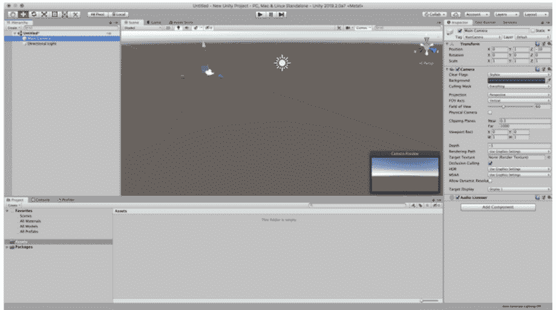

*图 1-1. Unity 编辑器的主窗口*

> **提示**
>
> 初次启动时，Unity 使用的是您在图 1-1 中看到的布局。不过，您可以通过单击并拖动窗口边缘来调整任何窗口的大小。您也可以单击并拖动窗口标签将其重新定位到其他位置。如果将标签拖到另一个窗口的边缘，它将被放置在该窗口的相应一侧。如果将标签拖到窗口中间，它将被添加到窗口顶部的标签列表中。

对于任何在 Unity 中工作的人来说，有几个功能尤其重要。让我们逐一来看看！

> **注释**
>
> 安装 Unity 时默认使用“深色模式”，但为了本书更好的截图效果，我们将其设置为“浅色模式”。如果您的 Unity 颜色与我们不同，请不要惊慌！

### 工具栏

工具栏包含影响整个 Unity 的控件（图 1-2）。它始终位于编辑器窗口顶部，且无法移动。

图 1-2. 工具栏

工具栏从左到右包含以下控件：

### 工具调色板

此调色板控制在选中对象时出现的变换控件的行为。每次只能选择一种模式；它们是：

### 手部工具

在场景视图中单击并拖动将移动您对场景的视图。

### 移动工具

选中的对象可以移动。

### 旋转工具

选中的对象可以围绕其枢轴点或中心旋转。

### 缩放工具

选中的对象可以围绕其枢轴点或中心缩放。

### 矩形工具

选中的对象周围会绘制一个矩形，并可以进行缩放和重新定位。此工具主要用于 2D 对象，如精灵和用户界面元素。

## 变换工具

此工具结合了移动、旋转和缩放工具。选中的对象可以被移动、旋转和缩放。

## 自定义工具

由游戏中的代码定义的任何自定义工具都将出现在此处。

## 轴心/中心切换

此开关设置变换控件是放置在对象的本地轴心点上，还是放置在对象体积的中心。（对于某些3D模型可能不同；例如，人类角色模型通常将轴心点放在角色的脚部。）

## 本地/全局切换

此开关设置变换工具是在全局空间还是本地空间下操作。例如，在本地空间中，拖动移动工具的蓝色“向前”箭头会基于对象自身的朝向将对象向前移动，而在全局模式下，拖动蓝色“向前”箭头会忽略对象的朝向。

## 播放按钮

此按钮启动播放模式，进入你的游戏。你可以再次点击该按钮来结束播放模式并返回编辑。

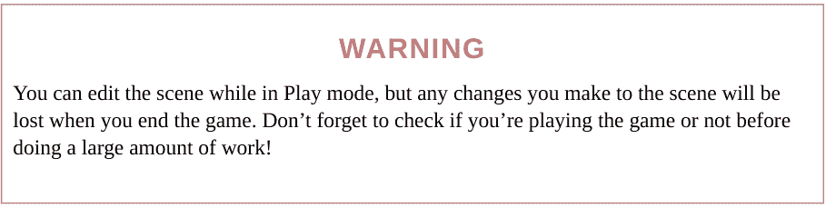

## 暂停按钮

此按钮暂停游戏。如果你处于播放模式，游戏将立即暂停。如果你不在播放模式，你仍然可以点击此按钮；如果随后点击播放按钮，游戏将在第一帧后立即暂停。

## 逐帧按钮

此按钮前进一帧，同时保持游戏暂停。

> **注意**
>
> 更具体地说，前进“一帧”意味着Unity将推进游戏时钟的*固定时间步长*，然后重新渲染游戏。默认情况下，固定时间步长为0.02秒；你可以在项目的Time设置中配置此项（从Edit菜单中，选择Project Settings → Time）。

## 协作菜单

此菜单提供用于使用Unity Collaborate（Unity的版本控制服务）的控件。

> **注意**
>
> Unity Collaborate超出了本书的范围，但Unity手册提供了良好的介绍。

## 服务按钮

此按钮打开服务视图，允许你使用Unity的基于Web的服务，如Cloud Build、Unity Analytics等。有关更多信息，请参见Unity的支持与服务页面。

## 账户按钮

此按钮允许你配置你的Unity账户。

## 图层按钮

使用此按钮，你可以选择当前可见或可选择的图层。

## 布局按钮

此按钮允许你保存和恢复预定义的窗口布局。当你有一个适用于动画或关卡布局等任务的布局，并且想要在不同任务之间切换而无需精确调整窗口位置时，这很有用。

## 场景视图

场景视图允许你查看、选择和修改场景中的对象（图1-3）。在场景视图中，你可以左键单击任何对象来选择它；当对象被选中时，你可以根据工具栏中所选工具（见图1-4）使用变换控件来移动、旋转或缩放它。

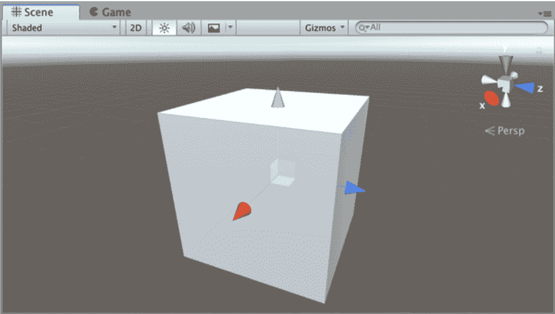

图1-3. 场景视图

要在选定对象上使用变换控件，请单击并拖动附加在其上的箭头（使用移动工具时）、圆圈（旋转工具）或方框（缩放工具）。按住Shift键可将移动、旋转和缩放捕捉到预定义的增量。要在场景视图中移动，请从视图左上角的调色板中选择手部工具，然后单击并拖动。你也可以按住Alt键（Mac上的Option）来使单击和拖动旋转视图；Alt-Control（Mac上为Option-Command）并拖动将平移视图。你可以使用鼠标上的滚轮，或在触控板上使用两指手势来放大和缩小。

> **提示**
>
> 你也可以快速将场景视图移动以聚焦于当前选定的对象。为此，请按F键。

图1-4显示了选定对象的变换工具。这里，已选定一个摄像机，且变换工具处于移动模式。单击并拖动箭头将沿该方向移动选定的对象。

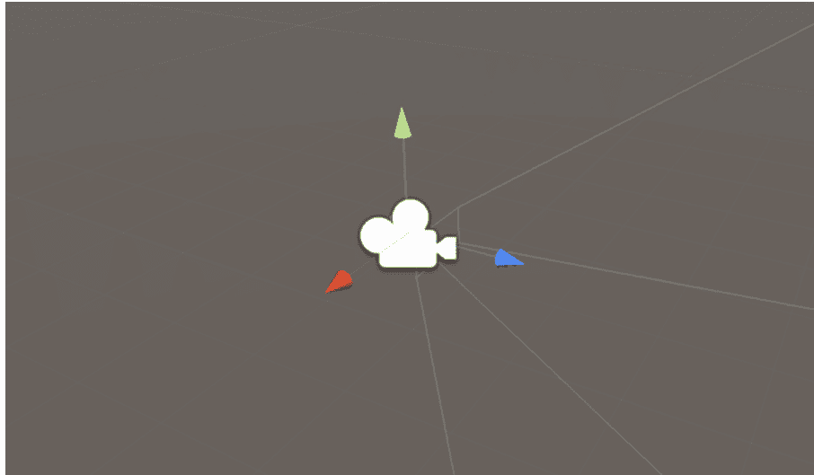

图1-4. 选定对象的变换工具

## 游戏视图

游戏视图显示通过摄像机的视图，并显示如果游戏在Unity外运行时玩家将看到的内容（图1-5）。除非编辑器处于播放模式，否则游戏视图本身不可交互。

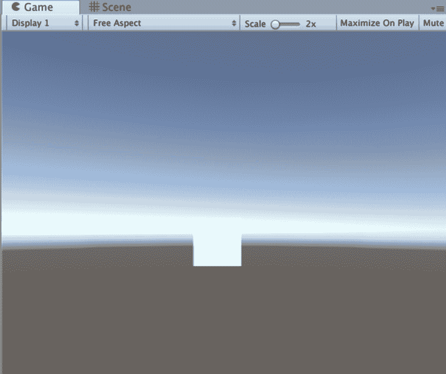

图1-5. 游戏视图

游戏视图顶部有一些控件，让你控制游戏的呈现方式：

## 显示菜单

让你控制在视图中显示哪个显示器的内容。（在Unity中，摄像机可以配置为将其结果发送到主屏幕或外部屏幕。）

## 分辨率菜单

让你为游戏显示指定宽高比或固定分辨率。

## 缩放滑块

让你放大游戏的渲染视图。

## 播放时最大化切换

选中此按钮后，当游戏进入播放模式时，游戏视图将填满整个编辑器窗口。

## 静音音频切换

此按钮禁用游戏的所有音频播放。（例如，当你不希望游戏的音频在你工作时盖过你的音乐时，这很有用。）

## 统计信息切换

此按钮控制是否会在叠加面板中显示性能统计信息。

## 小部件按钮

让你控制小部件（表示场景中某些对象的图标，如摄像机）是否出现在游戏视图中，如同在场景视图中一样。

## 检查器视图

检查器视图显示当前选定对象的信息（图1-6）。从此处，你可以控制附加到游戏对象的每个组件。

## 检查器

| 名称 | 立方体 | 静态 | |
|---|---|---|---|
| 标签 | 未标记 | 图层 | 默认 |

## 变换

| 属性 | X | Y | Z |
|---|---|---|---|
| 位置 | -0.1423078 | 0.7432218 | -2.36 |
| 旋转 | 0 | 0 | 0 |
| 缩放 | 1 | 1 | 1 |

## 立方体 (Mesh Filter)

| 网格 | 立方体 |
|---|---|

## 网格渲染器

| 属性 | 值 |
|---|---|
| 光照探针 | 混合探针 |
| 反射探针 | 混合探针 |
| 锚点覆盖 | 无 (Transform) |
| 投射阴影 | 开启 |
| 接收阴影 | true |
| 运动向量 | 每对象运动 |
| 光照贴图静态 | false |
| 动态遮挡 | true |

> 要为该网格渲染器启用光照贴图生成，请启用“光照贴图静态”属性。

## 盒状碰撞器

| 属性 | X | Y | Z |
|---|---|---|---|
| 是触发器 | false | | |
| 材质 | 无 (物理材质) | | |
| 中心 | 0 | 0 | 0 |
| 大小 | 1 | 1 | 1 |

## 默认材质

| 着色器 | 标准 |
|---|---|

添加组件

图1-6. 检查器视图

**注意**

组件是Unity工作方式的重要组成部分，这意味着我们将在配方1.3中讨论它们，而不是在这里。

在检查器顶部，你可以设置当前选定对象的名称。你还可以通过单击对象名称左侧的图标并选择要使用的符号来为对象设置图标。这对于不可见的游戏对象很有用。

默认情况下，当当前选择更改时，检查器会更改其内容。如果你不希望它这样做，你可以单击检查器右上角的锁定图标，它将停留在当前显示的对象上。

## 层级视图

层级视图显示当前场景中的对象列表（图1-7）。从此处，你可以浏览场景中的对象列表。如果你在层级中选择一个项目，它将在场景视图中被选中，反之亦然。你还可以将一个对象拖放到另一个对象上，使其成为该第二个对象的子对象。

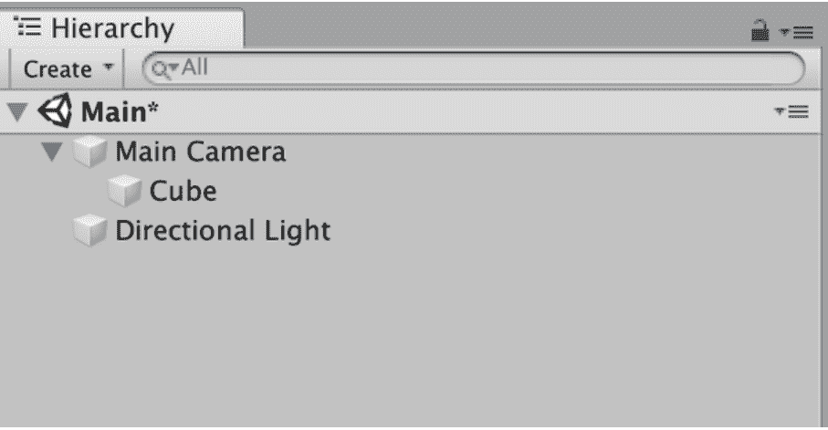

图1-7. 层级视图

## 项目视图

项目视图显示项目Assets文件夹的内容（图1-8）。文件夹中的任何文件都将在此处可见；你也可以移动和重命名文件。

> **警告**
>
> 重命名文件时，请在项目视图中执行，而不是在Unity之外执行。Unity通过在每个资源文件旁边创建扩展名为.meta的新文件来跟踪资源的其他元数据，例如纹理的导入设置。例如，名为Hero.png的资源文件旁边会放置一个名为Hero.png.meta的文件。如果你在Unity内重命名、移动或删除资源文件，Unity也会更新.meta文件，但如果你在Unity之外重命名、移动或删除资源文件，它将不知道该怎么办，并且必须从头开始重新创建.meta文件（这意味着对该文件的任何引用以及任何导入设置都将丢失）。

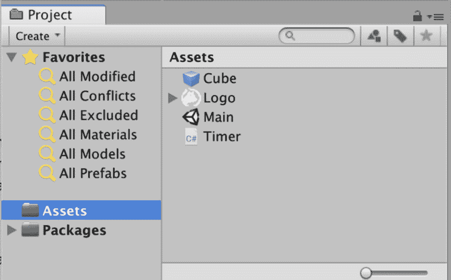

图 1-8. 项目视图

## 讨论

您可以右键单击任何窗口顶部栏上的菜单来关闭它。如果您关闭了一个窗口并想将其找回，通常可以在窗口菜单中找到它。如果您真的卡住了，请打开窗口菜单并选择 布局 → 恢复出厂设置。

## 1.2 使用游戏对象

### 问题

您想要创建和修改游戏对象，它们填充了您游戏中的场景。

### 解决方案

要创建一个新的空游戏对象，请打开 GameObject 菜单，并选择 创建空对象。新的空游戏对象将被添加到场景中。它在场景中不可见，因为它没有任何渲染内容的组件。要了解有关组件的更多信息，请参见 配方 1.3。

> 您也可以按 Command-Shift-N（PC 上为 Control-Shift-N）来创建一个新的空游戏对象。

您可以通过选择游戏对象并在 检查器 中更改其名称来重命名它。

游戏对象可以是其他游戏对象的 *子对象*。当游戏对象移动、旋转或缩放时，其子对象也会受到影响。这意味着您可以创建协同工作的游戏对象层次结构；例如，一辆汽车可以将其四个轮子 각각作为子对象，这意味着当汽车移动时，它们会自动保持在正确的位置。要使一个游戏对象成为另一个游戏对象的子对象，请将其拖放到 层级 中的另一个对象上（参见“层级视图”）。

您也可以通过在 层级 中拖放来重新排序对象。作为快捷方式，您可以按 Command-Equals（PC 上为 Control-Equals）使对象移动到其兄弟对象的末尾，并按 Command-Minus（PC 上为 Control-Minus）移动到其兄弟对象的开头。

### 讨论

您还可以通过将资产拖放到 场景视图 中来创建新游戏对象。例如，如果您将 3D 模型资产拖放到 场景视图 中，Unity 将创建一个包含渲染该模型所需组件的新游戏对象。

作为快捷方式，您可以通过打开 GameObject 菜单并选择 创建空子对象，快速将当前选定对象的空子对象创建出来。您也可以按 Option-Shift-N（PC 上为 Alt-Shift-N）。

## 1.3 使用组件

### 问题

您想要添加和修改组件，它们控制游戏对象的外观和行为。

### 解决方案

单独来看，游戏对象只是一个空容器。正是组件使游戏对象真正能做些有用的事情。

要开始思考组件，我们将创建一个带有一些有用内置组件的新游戏对象：我们将向场景中添加一个立方体！

为此，请执行以下步骤：

1. 打开 GameObject 菜单，并选择 3D 对象 → 立方体。新立方体将被添加到场景中（图 1-9）。
2. 在 层级 或 场景视图 中选择新立方体。检查器将更新以显示附加到其上的组件列表（图 1-10）。

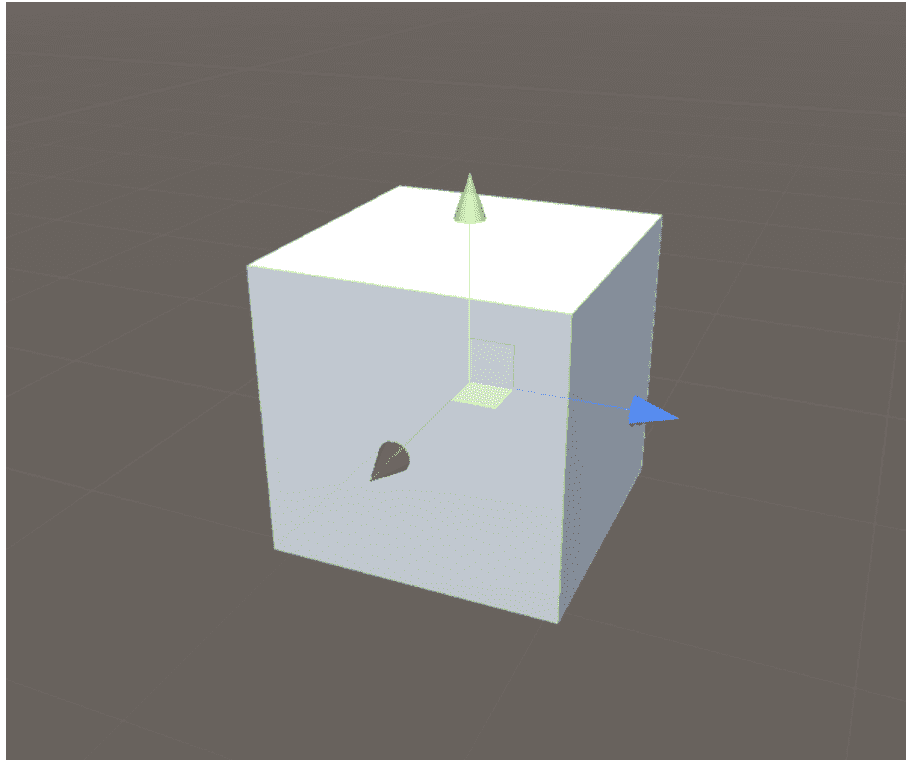

图 1-9. 新添加到场景中的立方体

检查器
立方体 [x] 静态
标记: 未标记, 图层: 默认

### 变换

| 属性 | X | Y | Z |
|---|---|---|---|
| 位置 | -0.1423078 | 0.7432218 | -9.506222 |
| 旋转 | 0 | 0 | 0 |
| 缩放 | 1 | 1 | 1 |

### 立方体 (网格过滤器)

| 网格 | 立方体 |

### 网格渲染器

| 属性 | 值 |
|---|---|
| 光照探针 | 混合探针 |
| 反射探针 | 混合探针 |
| 锚点覆盖 | 无 (变换) |
| 投射阴影 | 开启 |
| 接收阴影 | [x] |
| 运动矢量 | 每个对象运动 |
| 光照贴图静态 | [ ] |
| 动态遮挡 | [x] |

> 要为此网格渲染器启用光照贴图生成，请启用“光照贴图静态”属性。

### 盒体碰撞器

| 属性 | 值 |
|---|---|
| 编辑碰撞器 | [Button] |
| 是触发器 | [ ] |
| 材质 | 无 (物理材质) |
| 中心 | X 0, Y 0, Z 0 |
| 大小 | X 1, Y 1, Z 1 |

### 默认材质

| 着色器 | 标准 |

[添加组件]

每个游戏对象至少有一个组件：变换。变换组件存储对象的位置、旋转和缩放，并且还负责跟踪对象的父对象。您无法移除变换组件。

在立方体上，您会发现几个其他组件。它们各自的功能不同：

### 网格过滤器

从磁盘上的文件加载网格，供网格渲染器使用。（对于本配方中添加的立方体对象，该资产由 Unity 提供；您游戏中的大多数游戏对象将使用您添加到项目中的资产。）

### 网格渲染器

在屏幕上绘制网格，使用材质资产来确定其外观。

### 盒体碰撞器

定义对象在世界中的物理形状。

组件通过在 检查器 中列出的属性暴露其工作方式，让您可以对其进行配置。例如，网格过滤器组件有一个单一属性：它应该使用的网格。这是对象字段的一个示例——它是对您项目中另一个对象的引用。对于网格过滤器，该字段可以接受任何网格对象；这些对象位于您添加到项目中的资产中。对象字段可以使用的对象类型由组件决定；例如，您不能将除网格以外的任何其他类型的对象放入此字段。

### 注意

对象字段不一定要引用资产——它们也可以引用场景中的其他对象。

要自己添加组件，您可以使用 组件 菜单，或单击 检查器 底部的 添加组件 按钮。这两种选项都允许您指定要添加什么类型的组件。

### 讨论

您可以通过单击组件右上角的齿轮图标并选择 移除组件 来移除一个组件。

要将组件复制到另一个游戏对象，请单击齿轮图标并选择 复制组件。接下来，转到您要将组件复制到的对象，单击任何现有组件上的齿轮图标（如果它没有任何组件，请使用 变换 工具）。单击 粘贴组件为新，您复制的组件将被粘贴。

脚本（我们在第 2 章中讨论）也是组件，并且以与您可能附加到游戏对象的任何其他组件完全相同的方式工作。

## 1.4 使用预制体

### 问题

您想要将游戏对象存储在文件中，以便重复使用多个副本。

### 解决方案

通常，您添加到场景中的游戏对象完全存储在场景内。如果您想要预先定义一个对象，然后制作多个副本，您可以将其存储为预制体。预制体是存储游戏对象的资产；您可以实例化预制体，这会在您的场景中创建其副本。

要创建预制体，首先在场景中创建原始对象。例如，通过打开 GameObject 菜单并选择 3D 对象 → 立方体 来创建一个新立方体。该对象将同时出现在场景和 层级 中。接下来，将对象从 层级 拖放到 项目视图 中。将创建一个新文件（图 1-11）：这就是预制体！您还会注意到， 层级 视图中立方体的条目已变为蓝色，这表明它是预制体的实例。您现在可以安全地从场景中删除原始立方体。

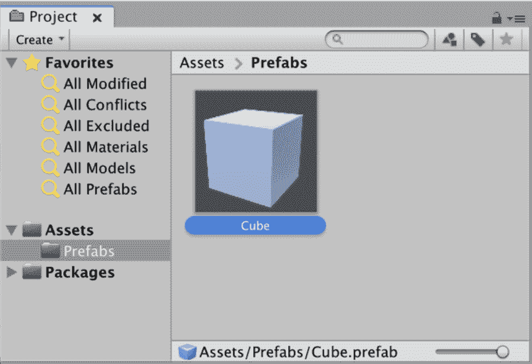

图 1-11. 从立方体创建的新预制体

您可以通过将预制体拖放到场景中来创建预制体的实例。实例是预制体中存储的游戏对象和组件的副本。

通过在 项目视图 中选择文件，单击 检查器 中的 打开预制体，并对其进行更改来编辑预制体（图 1-12）。

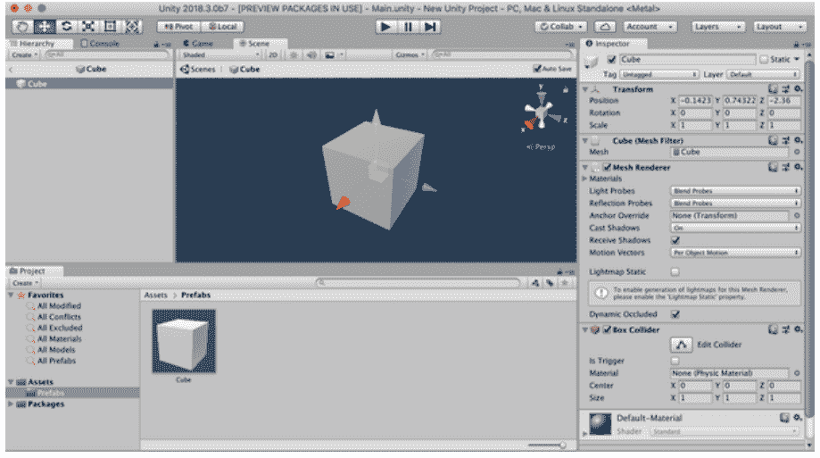

图 1-12. 编辑立方体预制体

完成后，单击 层级 中的返回箭头按钮。整个项目中所有预制体实例都将更新以包含您的更改。

### 讨论

预制体的实例化副本与其原始对象关联；如果您对预制体进行更改，您所做的更改将应用于它的任何实例。默认情况下，反过来不成立：如果您对实例进行更改，它们不会应用到原始对象。例如，如果您将立方体预制体的实例添加到场景并修改其 缩放 属性，更改将仅应用于该实例。此外，您更改的属性将以加粗并带有蓝色线条的形式突出显示，以便更容易看到。

但是，如果您确实想要应用更改，请右键单击您更改的属性，并单击“应用到预制体”。如果您想要应用所有更改，请打开 检查器 顶部的 覆盖项 菜单并单击 全部应用。

从“Overrides”菜单中，你还可以查看对实例所做更改的摘要。

## 1.5 使用场景

### 问题

你想要创建和编辑场景，场景是游戏对象的容器。

### 解决方案

当你创建新项目时，Unity 会为你创建一个新的空场景。当你按下 Command-S（PC 上为 Control-S）时，Unity 会将场景文件保存到磁盘；如果这是该场景首次保存，Unity 会询问你将其保存在哪里。你可以通过打开“文件”菜单并选择“新建场景”来创建更多场景。不要忘记保存新场景以将其存储到磁盘。

### 讨论

你可以将场景用于多种用途。例如，主菜单可以存储为场景，游戏的每个关卡也可以。在游戏过程中，你可以通过代码加载新场景。我们将在 9.1 节中讨论这一点。

## 1.6 管理资源

### 问题

你想要将文件添加到项目中，并配置 Unity 如何将它们导入为资源。

### 解决方案

要将文件添加到项目中，只需从资源管理器（Windows）或 Finder（macOS）将其拖放到“项目”视图中即可。Unity 会将其导入并使其可用于你的项目。

> **提示**
>
> 当文件添加到 Unity 项目时，它被称为*资源*。

Unity 导入文件后，你可以选择该文件，并通过查看“检查器”来配置 Unity 如何*导入*它。不同的文件格式有不同的选项；例如，你可以将图像配置为作为精灵导入，在这种情况下，Unity 会为精灵系统（在第 5 章中讨论）生成一个额外的精灵数据资源，或者将其导入为多种不同类型的纹理之一。

### 讨论

Unity 支持多种文件格式：

### 3D 对象

Autodesk FBX 和 Collada；如果已安装相应软件，Unity 还可以导入 Maya、Cinema 4D、3ds Max、Cheetah3D、Modo、LightWave、Blender 和 SketchUp 文件。

### 音频

WAV、MP3、OGG 和 AIFF；Unity 还支持多种跟踪器模块格式，具体为：Impulse Tracker (.it)、Scream Tracker (.s3m)、Extended Module File Format (.xm) 和 Module File Format (.mod)。

### 2D 纹理

Adobe Photoshop、BMP、PNG、JPG、GIF 和 TGA。

### 文本

TXT 和 JSON。

> 注意
>
> Unity 会捕获外部程序中对文件的大多数更改，但通常依赖于该特定程序已安装。例如，如果你想在 Unity 中将 Blender .blend 文件用作资源，则需要在同一系统上安装 Blender 应用程序。

## 1.7 构建 Unity 项目

### 问题

你想要配置 Unity 以构建你的游戏，从而可以将游戏分发给玩家。

### 解决方案

要构建游戏，请打开“文件”菜单并选择“构建设置”，以打开“构建设置”视图（图 1-13）。

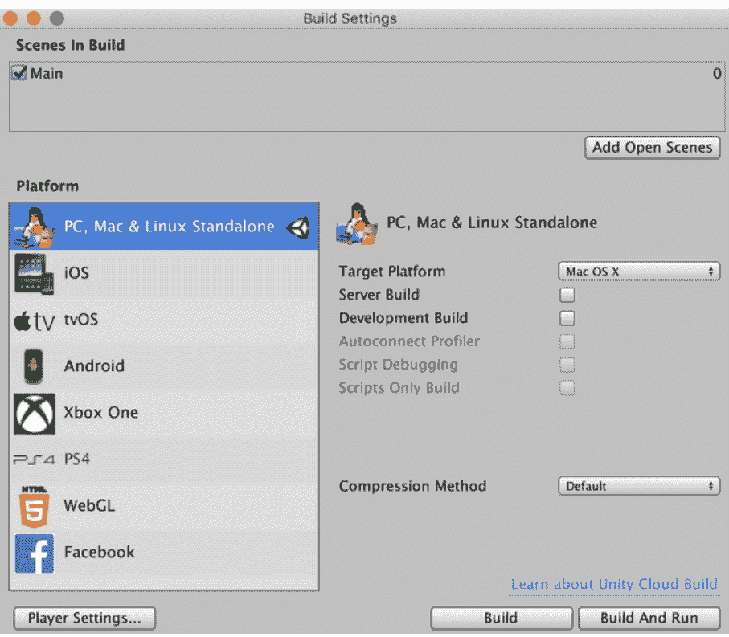

图 1-13. 构建设置视图

构建游戏时，你需要指定要包含哪些场景。如果尚未保存当前场景，请立即通过打开“文件”菜单并选择“保存”，或按下 Command-S（PC 上为 Control-S）来保存。你可以将要包含的场景拖放到“构建中的场景”列表中，也可以单击“添加打开的场景”按钮来添加当前打开的所有场景。

接下来，你需要选择要构建的目标平台。Unity 支持多种平台，从桌面 PC 到移动电话再到游戏主机等。每次只能选择一个平台；当前平台旁边会标记 Unity 标志。要为其他平台构建，请选择它并单击“切换平台”按钮。

准备就绪后，单击“构建”按钮。Unity 会询问你要将构建保存在哪里；完成后，Unity 将开始构建。

### 讨论

要针对某些平台构建，你需要下载相应的平台支持模块。如果没有必要的模块，则无法构建；要获取模块，请单击平台，然后单击“打开下载页面”按钮。你将被引导至用于下载模块的相应网页。

> 注意
>
> 某些平台（如游戏主机）需要特殊许可证；有关更多信息，请参阅 Unity 平台模块安装页面。

## 1.8 访问偏好设置

### 问题

你想要访问控制 Unity 行为的设置，包括整个应用程序和当前项目的设置。

### 解决方案

要打开每个项目的设置，请打开“编辑”菜单并选择“项目设置”。项目设置视图将出现（图 1-14）。

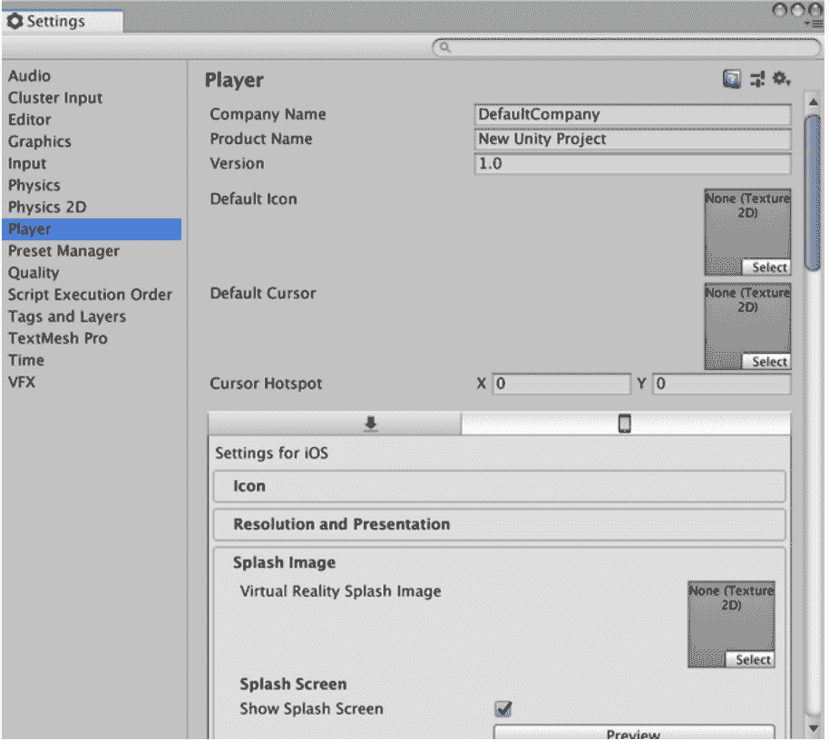

图 1-14. 项目设置视图

在项目设置视图中，你可以为游戏配置多种可能的设置，包括最大分辨率、构建名称、图形质量设置、输入等。

对于影响整个 Unity 应用程序本身的设置，请访问“偏好设置”视图。

### 讨论

“偏好设置”视图（图 1-15）允许你配置颜色、热键以及适用于所有项目的其他设置。在 PC 上，通过打开“编辑”菜单并选择“偏好设置”来访问这些设置；在 Mac 上，打开“Unity”菜单并选择“偏好设置”。

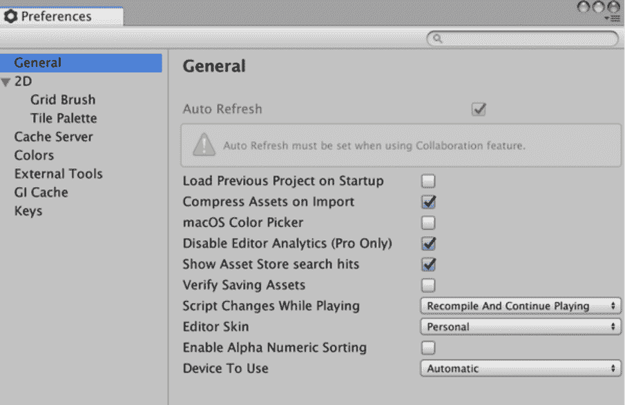

图 1-15. 偏好设置视图

## 1.9 安装 Unity 包

### 问题

你想要安装 Unity 包，以向 Unity 引擎添加额外功能。

### 解决方案

你可以使用 Unity 包管理器安装新包（通常会添加新功能）。

> 注意
>
> 包位于特定项目中。因此，如果你安装了一个包，则只是为当时正在使用的项目安装了它，为其他项目安装时需要再次安装。

要查找包管理器，请打开“窗口”菜单并选择“包管理器”。你将能够搜索并安装新包（这些包从互联网下载）。

### 讨论

Unity 的包管理器允许各种组件单独分发，并与引擎分开更新。

> 提示
>
> 你可能会看到 Unity 包管理器被称为“UPM”。

在本书中，你将使用几个包，如今 Unity 的大多数功能都以包的形式分发。你可以在 Unity 文档中了解更多信息。
