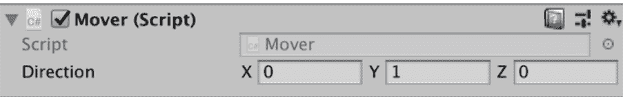
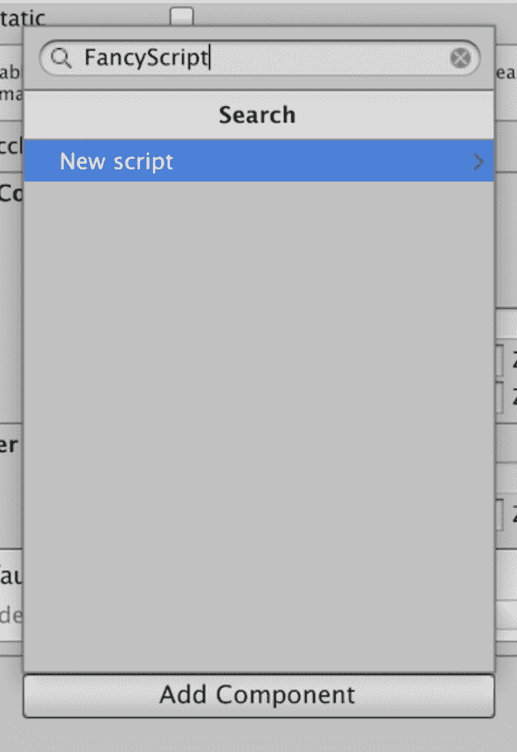
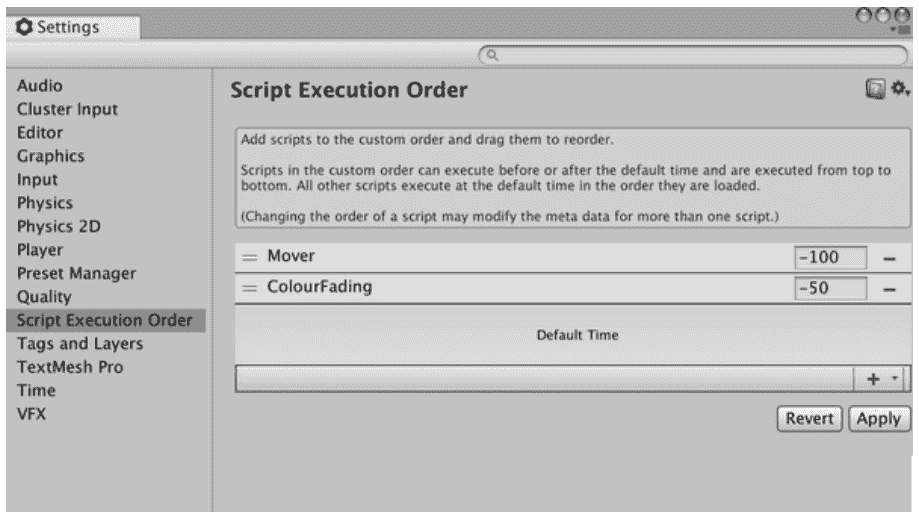
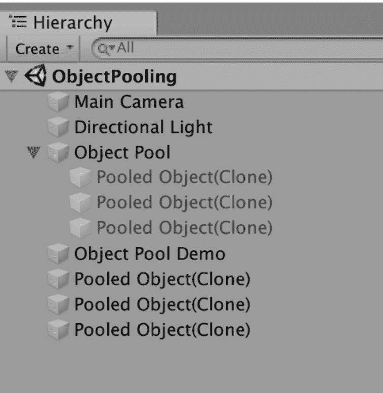
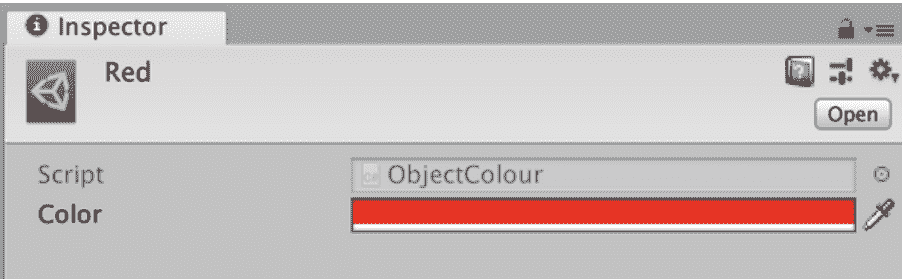
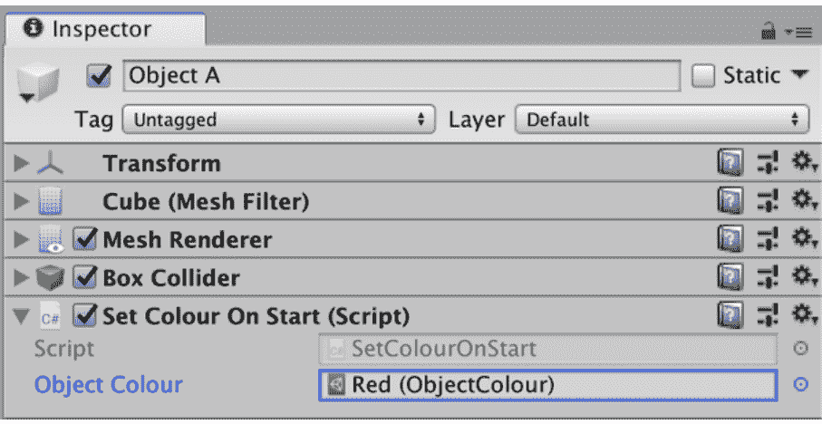

## 第 2 章 脚本

在 Unity 中创建行为意味着编写代码，即编写脚本。Unity 中的脚本使用 C#（读作“C sharp”）编写。C# 最初由 Microsoft 开发，后来演进为包含完整且出色的开源实现，Unity 广泛使用该实现。

**警告**

我们强烈建议你在学习本章中的任何示例之前先复习第 1 章！

本书不会试图为你提供完整的编程指南或完整的 C# 编程指南——那将是另一本书的内容。相反，我们将向你展示如何使用 C# 作为语言编写用于 Unity 的脚本。

**注意**

你可以使用其他语言在 Unity 中编写代码。例如，有许多其他语言的绑定，Unity 还支持一系列可视化脚本工具，我们将在其他章节中简要介绍，但这些内容超出了本书的范围。

如果你有兴趣从更广泛的角度学习 C#，我们强烈推荐 _C# 7.0 in a Nutshell_（Ben 和 Joseph Albahari 著，O’Reilly 出版）以及 _Head First C#_（Andrew Stellman 和 Jennifer Greene 著，O’Reilly 出版）。

## 2.1 向 Unity 场景中的对象添加脚本

### 问题

你想要向游戏对象添加脚本，以便使用 C# 代码为其赋予行为。

### 解决方案

Unity 游戏对象是*组件*的容器。`MonoBehaviour`（名为*Mono*，即 Unity 使用的脚本运行时）是一种脚本组件。当 `MonoBehaviour` 附加到游戏对象时，它会参与游戏的更新循环，并让你有机会每帧运行代码。

> **注意**
>
> 即使你构建的不是游戏（例如模拟程序），Unity 的基本对象目前仍称为游戏对象。因此，我们将继续使用该术语。

要向游戏对象添加代码，你需要创建一个新的 `MonoBehaviour` 脚本，并将其作为组件附加到游戏对象。这意味着你需要一个可用的游戏对象。在 Unity 场景中：

- 1. 通过打开“游戏对象”菜单并选择 3D 对象 → 立方体来创建一个新立方体。
- 2. 使用“移动”工具将立方体定位在摄像机前方的某个位置。

接下来，我们将创建一个新脚本：

- 1. 转到“项目”选项卡，右键单击“资源”文件夹。选择 创建 → C# 脚本。
- 2. 将创建一个新文件，Unity 会提示你为其命名。将文件命名为“Mover”。


> **警告**
> Unity 使用你提供的名称来确定文件的内容。你编写的 C# 类必须与其所在的文件同名，因为 Unity 使用该信息来保存场景的内容。如果你重命名文件，请务必同时重命名其中的类。

- 3. 双击脚本。Unity 会在你的编辑器中打开它：默认情况下，PC 上使用 Visual Studio，Mac 上使用 Visual Studio for Mac，Linux 上使用你的文本编辑器。

> **提示**
> 你可以通过 Unity 的偏好设置并选择 外部工具 → 外部脚本编辑器 来自定义 Unity 用于编辑脚本的程序。我们特别推崇 macOS 上的 Visual Studio Code 和 BBEdit。

你会看到类似这样的代码：

```
using System.Collections;
using System.Collections.Generic;
using UnityEngine;

public class Mover : MonoBehaviour
{
    void Start()
    {
    }

    void Update()
    {
    }
}
```

> **提示**
> Start 方法在第一帧更新之前被调用一次，Update 方法每帧被调用一次。

## 4. 修改 Mover 类，使其如下所示：

```
public class Mover : MonoBehaviour
{
    public Vector3 direction = Vector3.up;

    float speed = 0.1f;

    void Update()
    {
        var movement = direction * speed;

        this.transform.Translate(movement);
    }
}
```

> **注意**
> 这段代码虽然非常适合简单的演示，但并不是移动对象最有效的方法。要了解原因并查看更好的方法，请参阅 配方 2.3。

这段代码做了几件事：

- • 它创建一个名为 direction 的新 public Vector3 变量，并将其初始化为 Vector3.up 的值。这是一个等于 (0, 1, 0) 的 Vector3。

- • 它创建一个名为 speed 的新 private float 变量，并将其初始化为值 0.1f。

> > **提示**
> >
> > `speed` 值末尾的 f 很重要，因为在 C# 中，非整数数字（例如 `0.1`）是 `double` 类型，而不是 `float`。这意味着以下代码行会导致编译器错误：
> >
> > `float speed = 0.1;`
> >
> > 你需要改用 `0.1f`：
> >
> > `float speed = 0.1f;`

- • 它定义一个名为 Update 的新方法；在该方法中，创建一个名为 movement 的变量，其值为 direction 乘以 speed 的结果。然后通过在 transform 属性上调用 Translate 方法来移动对象。

现在我们已创建脚本，需要将其作为组件附加到游戏对象上：

- 1. 选择你之前添加的立方体。

- 2. 将 Mover.cs 脚本拖放到 检查器 上。

检查器 显示 public 变量，允许你对其进行修改。因为 direction 的默认值是 Vector3.up，你可以看到它的值等于 0, 1, 0（图 2-1）。

- 3. 按下播放按钮。对象将开始向上移动。再次按下 播放 以停止。

- 4. 更改 direction 变量中的一个数字，然后再次按下 播放。你会看到对象朝不同方向移动或速度不同。



图 2-1. Mover 组件的 检查器，显示 Direction 变量

## 讨论

MonoBehaviour 是一个 C# 类。你创建它的子类并实现 Unity 在适当时候调用的某些方法；例如，如果你定义了一个 Update 方法，Unity 会每帧调用它，如果你定义了一个 OnDestroy 方法，Unity 会在对象从场景中移除之前立即调用它。我们将在 配方 2.2 中详细讨论重要方法。

除了通过编辑器菜单创建脚本外，你还可以通过 检查器 底部的 添加组件 按钮来创建脚本。为此，单击 添加组件 并键入你想要创建的脚本名称。Unity 将尝试查找该名称的组件；它还会提供创建同名脚本（图 2-2）。以这种方式创建的新脚本会被放置在顶级 Assets 文件夹中，但创建后你可以将其移动到其他位置。

你标记为 public 的变量会出现在 检查器 中。这些变量在你的代码中也可被其他脚本访问；如果你希望变量出现在 检查器 中，但又不希望其他脚本访问它，请移除 public 访问修饰符并在其上方添加 [SerializeField] 特性，如下所示：

```
// This variable is private, but will appear in the Inspector because of the
// SerializeField attribute
[SerializeField]
float speed = 0.1f;
```

> **注意**
> 
> 如果你希望变量是 public 的，但*不*希望它出现在 检查器 中，请改用 [HideInInspector] 特性。



图 2-2. 从 添加组件 菜单创建新脚本

## 2.2 在脚本（或游戏对象）生命周期的特定时间运行代码

### 问题

你希望在脚本生命周期的特定时间运行代码。

### 解决方案

Unity 在不同时间调用你的 MonoBehaviour 上的不同方法：

### Start

Start 方法为每个脚本在每个对象上被调用一次，时间点为脚本首次激活的那一帧。如果脚本在游戏开始时已附加到对象，则 Start 在第一帧被调用。

### Update

Update 方法在每个活动对象上的每个脚本中每帧被调用一次，时间点在相机渲染场景之前。因为它每帧被调用，所以它是处理持续性工作（例如移动）的最佳时机。

### Awake

Awake 方法与 Start 方法类似，在脚本变为活动状态时被调用。Unity 保证所有 Awake 方法都会在任何 Start 方法开始之前完成；这意味着 Awake 方法是设置脚本之间引用的最佳时机（使用 GetComponent 和 FindObjectOfType，在 配方 2.4 和 2.5 中讨论），而 Start 方法是开始从这些引用访问数据的最佳时机。

### LateUpdate

LateUpdate 方法在 Update 之后被调用。与 Awake 和 Start 类似，Unity 只在所有脚本都有机会运行 Update 后才调用 LateUpdate。这让你有机会应用行为，并确保它在其他事情之后发生。例如，如果一个对象上的脚本移动该对象，而另一个对象上的脚本将其旋转以朝向第一个对象，则应将移动代码放在 Update 中，将旋转代码放在 LateUpdate 中，以确保旋转代码会瞄准正确的位置。

### 讨论

除了这些常用方法外，还有一些其他方法会根据情况被调用。例如，如果脚本实现了 OnDestroy 方法且对象被销毁，则会调用 OnDestroy 方法。有些方法只有在同一游戏对象上附加了特定类型的组件时才会被调用。例如，如果脚本实现了 OnBecameVisible 方法并附加了 Renderer 组件（例如 SpriteRenderer 或 MeshRenderer），则当对象进入相机视野时会调用 OnBecameVisible 方法。

这些方法不是从任何父类重写的。Unity 会检查类，注册该类实现了该方法的事实，并直接调用它。

因此，方法是 public 还是 private 并不重要；Unity 无论如何都会调用它们。作为编码惯例，许多开发者将方法设为 private，以防止其他类调用它们，因为只有引擎应该这样做。

### 提示

你可以通过从类中删除任何未使用的 Update 方法来潜在地提高帧性能。有关更多信息，请参阅 Unity 文档。

默认情况下，Unity 不保证不同脚本方法运行的顺序。但是，如果你确实想确保类型 A 的脚本的 Update 方法在类型 B 的脚本之前运行，可以手动配置其执行顺序。为此，打开 编辑 菜单并选择 设置，然后选择 脚本执行顺序。从此处，你可以管理某些脚本的执行顺序，确保它们按照你想要的顺序排列（图 2-3）。



图 2-3. 配置某些脚本的执行顺序

## 2.3 创建与帧率无关的行为

### 问题


你希望进程在固定的时间段内发生，
无论你的项目运行时每秒有多少帧（称为帧率）。

### 解决方案

```csharp
void Update()
{
    var movement = direction * speed;

    // Multiply by delta time; movement now represents 'units per second,'
    // rather than 'units per frame'
    movement *= Time.deltaTime;

    this.transform.Translate(movement);
}
```

### 讨论

Unity会尝试以最快可能的速度运行所有内容，尽可能多地渲染每秒帧数（受到所涉及的各种硬件限制，包括GPU和显示器）。每秒可以渲染的帧数可能会有所不同，具体取决于场景的复杂性，这意味着每帧所花费的时间也可能不同。

这意味着我们可以创建一个简单的Update方法，其中对象每帧移动固定的距离：

```csharp
void Update()
{
    var movement = direction * speed;

    this.transform.Translate(movement);
}
```

这段简单的代码会导致对象在渲染器能更频繁地渲染时，*更频繁地*移动该固定距离，而在渲染器无法产生那么多每秒帧数时，*较少地*移动，因为它每渲染一帧就移动一次。这会导致对象移动速度时快时慢，因为它每秒移动的距离多了或少了。

解决方案是考虑渲染上一帧所花费的时间。这可以通过Time.deltaTime获取。

> 注意
>
> 希腊字母德尔塔（Δ）常用于数学符号中表示值的变化。因此，增量时间是指自上一帧以来经过的额外时间量。

当你将movement乘以Time.deltaTime时，movement不再表示固定距离，而是表示*随时间变化*的距离。当你将其提供给transform的Translate方法时，你会发现对象以固定速度移动，无论渲染器产生新帧的速度有多快。

deltaTime不是你可用的唯一属性。如果你想知道项目已经运行了多久，可以访问time变量。你还可以通过修改Time.timeScale属性来减慢和加快时间，这对于暂停项目非常有用。

## 2.4 使用游戏对象的组件

### 问题

你想使用附加到游戏对象上的组件。

### 解决方案

使用GetComponent方法获取附加到与脚本相同的游戏对象上的组件。

调用GetComponent时，你将要查找的组件类型指定为泛型参数。例如，要获取游戏对象上的Renderer组件，请调用GetComponent<Renderer>方法。

### 警告

如果游戏对象上未附加正确类型的组件，GetComponent将返回null。如果你尝试通过调用其方法或访问其属性和字段来使用此对象，将导致抛出NullPointerException，至少会立即停止当前帧的脚本，最坏的情况可能导致整个项目崩溃。始终先检查结果是否为null。

一旦你拥有另一个组件的引用，就可以使用它。例如，如果你有MeshRenderer，可以通过GetComponent访问该组件，然后访问其属性来随时间更改其材质的颜色：

```csharp
public class ColorFading : MonoBehaviour
{
    void Update()
    {
        var meshRenderer = GetComponent<MeshRenderer>();
        // Check to make sure that it's valid before we use it
        if (meshRenderer == null) {
            return;
        }
        var sineTime = Mathf.Sin(Time.time) + 1 / 2f;
        var color = new Color(sineTime, 0.5f, 0.5f);
        meshRenderer.material.color = color;
    }
}
```

### 讨论

除了GetComponent方法之外，还有许多相关方法，可用于访问*多个*组件、访问父对象上的组件或访问子对象上的组件：

- **GetComponent<T>**
  在当前对象上查找类型T的组件

- **GetComponents<T>**
  查找当前对象上类型T的*所有*组件，并将它们作为数组返回

- **GetComponentInChildren<T>**
  在当前对象或其任何子对象上查找第一个类型T的组件（或其*任何*子对象，执行深度优先搜索）

- **GetComponentsInChildren<T>**
  与GetComponentInChildren<T>相同，但查找*所有*匹配的组件并将它们作为数组返回

- **GetComponentInParent<T>**
  在当前对象或其父对象上查找第一个类型T的组件（直到顶级对象）

- **GetComponentsInParent<T>**
  在当前对象或其父对象上查找第一个类型T的组件（直到顶级对象）

如果你要在每帧都使用某个对象，可以通过在*Awake*或*Start*中调用GetComponent（或其相关函数），并将结果存储在类的变量中来稍微提高性能。

例如，这里是之前相同的代码，但有一个区别——GetComponent仅在Start方法中调用一次：

```csharp
public class ColorFading : MonoBehaviour
{
    // The mesh renderer component will be stored in this after Start
    MeshRenderer meshRenderer;

    void Start()
    {
        // Get the component and cache it
        meshRenderer = GetComponent<MeshRenderer>();
    }

    void Update()
    {
        // Check to make sure that it's valid before we use it
        if (meshRenderer == null) {
            return;
        }

        // meshRenderer has already been stored, so we can just start
        // using it

        var sineTime = Mathf.Sin(Time.time) + 1 / 2f;
        var color = new Color(sineTime, 0.5f, 0.5f);
        meshRenderer.material.color = color;
    }
}
```

## 2.5 查找附加到游戏对象上的对象

### 问题

你想使用附加到游戏对象上的组件，但不知道哪个游戏对象拥有它们。

### 解决方案

使用FindObjectOfType方法查找所需类型的单个组件：

```csharp
// Find a single Mover object in the scene
var mover = FindObjectOfType<Mover>();
```

> 注意
>
> 如果你指定的类型不止一个组件，FindObjectOfType会随机选取一个。随机对象通常按其InstanceID的升序选取。例如，对象-24084会在对象-24082之前被返回。

如果你想查找特定类型的*所有*组件，请使用FindObjectsOfType，它返回一个包含所有组件的数组：

```csharp
// Find all Mover objects in the scene
var allMovers = FindObjectsOfType<Mover>();
```

请注意，与GetComponent（参见配方2.4）一样，如果FindObjectsOfType找不到你要查找的内容，将返回null。在尝试使用结果之前，请始终检查其是否为null。

> 注意
>
> 这些方法只会返回当前处于活动状态的对象。它们不会找到任何处于非活动状态的对象。

### 讨论

FindObjectOfType通过搜索场景中每个对象上的每个组件来工作。不要在Update方法中调用它，因为它会给Unity带来大量工作，你不希望每帧都这样做。相反，请在Start或Awake中调用该方法，并将结果存储在变量中以供日后使用。

## 2.6 单例

### 问题

你想创建一个始终只有一个实例的类，并且其他代码始终可以访问它。

### 解决方案

单例是一种设计为始终只有一个实例的类。例如，在整个游戏中全局可用的事物，如游戏管理器、输入管理器或其他实用工具，通常被实现为单例。

要创建单例，首先创建你的游戏对象，然后创建并附加一个新脚本。

接下来，在类上创建一个公共静态变量，使用该类的类型。然后，在Awake方法中，将该变量的值设置为this，这意味着代码的任何其他部分都能够引用该类的特定实例。例如：

```csharp
public class SimpleSingleton : MonoBehaviour
{
    // 静态变量在类的所有实例之间共享
    public static SimpleSingleton instance;

    void Awake() {
        // 当该对象唤醒时，它将instance变量设置为自身；
        // 因为instance变量是公共和静态的，任何位置的任何
        // 类都可以访问它并调用其方法。
        instance = this;
    }

    // 代码的任何其他部分都可以调用的示例方法，只要
    // 场景中存在附加了SimpleSingleton组件的游戏对象
    public void DoSomething() {
        Debug.Log("I'm the singleton! Hello!");
    }
}
```


您可以通过类上的 `instance` 变量访问单例实例：

```
// Accessing the singleton and calling a method on it
SimpleSingleton.instance.DoSomething();
```

这个单例实例在您的代码中任何地方都可以访问，只要场景中有一个挂载了该脚本的游戏对象，它就会正常工作。

## 讨论

如果您拥有多个单例类，则必须编写 `instance` 变量和 Awake 方法可能会变得乏味，而重复代码可能导致意外错误。

您可以使用泛型来创建更复杂的单例类。以下类设计用于被子类化，并提供 `instance` 方法的自动实现。它还处理了将 `instance` 变量设置为指向单个实例的问题——如果脚本已挂载到场景中的游戏对象，则会找到它；如果不存在，则会创建一个新实例：

```
// This class is generic, which means that you can create multiple versions
// of it that vary depending on what type you specify for 'T'.
// In this case, we're also adding a type constraint, which means that 'T'
// must be a MonoBehaviour subclass.
public class Singleton<T> : MonoBehaviour where T : MonoBehaviour
{
    // The instance. This property only has a getter, which means that
    // other parts of the code won't be able to modify it.
    public static T instance {
        get {
            // If we don't have an instance ready, get one by either
            // finding it in the scene, or creating one
            if (_instance == null) {
                _instance = FindOrCreateInstance();
            }
            return _instance;
        }
    }
    // This variable stores the actual instance. It's private, and can
    // only be accessed through the 'instance' property above.
    private static T _instance;
    // Attempts to find an instance of this singleton. If one can't be
    // found, a new one is created.
    private static T FindOrCreateInstance() {
        // Attempt to locate an instance.
        var instance = GameObject.FindObjectOfType<T>();

        if (instance != null) {
            // We found one. Return it; it will be used as the shared instance.
            return instance;
        }

        // Script components can only exist when they're attached to a game
        // object, so to create this instance, we'll create a new game
        // object, and attach the new component.

        // Figure out what to name the singleton
        var name = typeof(T).Name + " Singleton";

        // Create the container game object with that name
        var containerGameObject = new GameObject(name);

        // Create and attach a new instance of whatever 'T' is; we'll return
        // this new instance
        var singletonComponent =
            containerGameObject.AddComponent<T>();

        return singletonComponent;
    }
}
```

您可以通过子类化 Singleton 来定义自己的新单例。请记住，您需要指定两次类名——一次在命名类时，另一次作为泛型参数（尖括号 < > 中的部分）：

```
public class MoverManager : Singleton<MoverManager>
{
    public void ManageMovers() {
        Debug.Log("Doing some useful work!");
    }
}
```

以这种方式定义的任何类都可以通过实例变量访问。
此属性永远不会为 null；如果您在场景中未设置实例，则在首次使用实例变量时会自动设置它：

```
MoverManager.instance.ManageMovers();
```

> 警告
>
> 单例可能很方便，但它们导致的架构可能难以维护。
> 无论在哪里，一个类调用另一个类的方法时，都会在它们之间创建架构依赖关系：您无法更改或删除某个方法，而不同时修改调用该方法的位置。当一个类可以从任何位置轻松调用时，就很容易创建大量调用，这意味着大量依赖关系。随着代码复杂度的增加，维护难度也会随之增大。如果您发现自己从许多不同的位置调用单例类，请考虑重新组织代码以减少依赖关系的数量。

## 2.7 使用协程管理代码运行时间

### 问题

您希望编写在多个帧中执行的代码。

### 解决方案

在大多数应用程序中，代码旨在尽可能快地运行并立即完成其任务。但是，游戏是随时间进行的；一个球滚下山坡需要一段时间，而游戏玩法通常依赖于定时事件。

在 Unity 中，协程是一种编写随时间执行的代码的方法。协程是一种能够暂时返回或让出控制权给系统其他部分，并在稍后时间恢复执行的方法。

> 注意
> 协程是作为生成器实现的，使用 C# 的 yield return 语法。

协程是任何返回 `IEnumerator` 的方法，并使用 `StartCoroutine` 方法启动。在方法内部，您可以通过 yield return 一个表示要等待多久的对象来暂时挂起方法的执行。

例如，假设您想编写一个执行一些工作、暂停一秒钟，然后再执行更多工作的方法。要实现此功能，您可以创建一个新方法，使其返回 `IEnumerator`，并在想要等待一秒钟的地方，yield return 一个 `WaitForSeconds` 对象：

```
IEnumerator LogAfterDelay() {
    Debug.Log("Back in a second!");

    yield return new WaitForSeconds(1);

    Debug.Log("I'm back!");
}
```

> 注意
> 您只能在返回 `IEnumerator` 的方法内部使用 yield return。

要启动协程，请使用 `StartCoroutine` 方法。调用您的协程方法，并将其返回值作为 `StartCoroutine` 的参数。Unity 将开始运行协程，并确保其在适当的时间恢复：

```
StartCoroutine(LogAfterDelay());
```

`Start` 方法也可以是协程。您只需将其返回类型设置为 `IEnumerator`，即可在其中使用 yield return：

```
IEnumerator Start()
{
    Debug.Log("Hello...");

    yield return new WaitForSeconds(1);

    Debug.Log("...world!");
}
```

与任何其他方法一样，协程可以接收参数。例如，给定以下方法：

```
IEnumerator Countdown(int times) {
    for (int i = times; i > 0; i--) {
        Debug.LogFormat("{0}...", i);
        yield return new WaitForSeconds(1);
    }
    Debug.Log("Done counting!");
}
```

您可以在启动协程时提供参数来调用此协程：

```
// Parameters for coroutines are supplied as part of the function call
StartCoroutine(Countdown(5));
```

因为协程会将控制权交还给引擎，所以它们可以与无限循环配合使用：

```
IEnumerator LogEveryFiveSeconds() {
    // Enter an infinite loop, in which we wait for five seconds and then
    // do something useful
    while (true) {
        yield return new WaitForSeconds(5);
        Debug.Log("Hi!");
    }
}
```

> **警告**
>
> 使用 `while (true)` 或其他永不结束的循环时要小心！如果您在循环中的某个点没有 yield，Unity 将无法跳出循环并会冻结。您将无法退出播放模式，也无法保存场景中任何未保存的更改。请小心！

如果您 yield return `null`，Unity 将在恢复前等待整整一帧。

例如，以下协程充当帧计数器，每渲染 100 帧就记录一次：

```
IEnumerator RunEveryHundredFrames() {
    while (true) {
        // Yielding 'null' will wait one frame.
        yield return null;

        if (Time.frameCount % 100 == 0) {
            Debug.LogFormat("Frame {0}!", Time.frameCount);
        }
    }
}
```

最后，您可以使用 `yield break` 退出协程：

```
while (true) {
    yield return null;

    // Stop on frame 354
    if (Time.frameCount == 354) {
        yield break;
    }
}
```


## 讨论

在这个示例中，我们主要使用了 WaitForSeconds。它很有用，但还有其他可以返回的对象，用于等待不同的时间量。

WaitForEndOfFrame 会等待所有相机渲染完成，但在帧显示在屏幕之前。例如，你可以使用它来捕获屏幕截图，因为此时所有渲染都已完成。

WaitForSecondsRealtime 会等待固定的秒数，类似于 WaitForSeconds。不过，它会忽略 Time.timeScale。

WaitUntil 和 WaitWhile 接受一个委托——内联函数或对方法的引用，该委托每帧都会被重复调用，以判断是否应继续执行。该函数不需要任何参数，并且必须返回一个 bool 值。

WaitWhile 会一直等待，直到你提供的函数返回 false：

```csharp
// Wait while the Y position of this object is below 5
yield return new WaitWhile(() => transform.position.y < 5);
```

WaitUntil 会一直等待，直到你提供的函数不再返回 false：

```csharp
// Wait *until* the Y position of this object is below 5
yield return new WaitUntil(() => transform.position.y < 5);
```

## 2.8 使用对象池管理对象

### 问题

你有一个项目，其中经常创建和销毁对象，并希望该过程更高效。

### 解决方案

创建一个 *对象池*：一个系统，允许对象在不再需要时临时停用，并在被请求时重新激活（与对象在不再需要时自行销毁并从内存中完全移除不同）。

我们将通过创建一个管理 GameObject 队列的脚本来实现这一点，该脚本将公开一个名为 GetObject 的方法。调用 GetObject 时，它会先检查队列中是否有未使用且可回收的现有对象。如果有，则从队列中移除一个并返回；如果没有，则创建一个新对象。

当对象不再需要时，它会联系创建它的对象池，被停用，并添加回队列，以备将来重复使用。对象永远不会被销毁；它只是暂时停放以供日后重用。

### 实现系统

要实现此功能，我们将创建一个执行此行为的新脚本。我们还将创建一个接口，对象可以实现该接口以便在进入或离开队列时收到通知；这将是可选的，但对于需要在每次（重新）进入场景时执行设置的对象很有用：

- 1. 创建一个名为 ObjectPool.cs 的新 C# 脚本。
- 2. 向其中添加以下代码：

```csharp
public interface IObjectPoolNotifier {
    // Called when the object is being returned to the pool.
    void OnEnqueuedToPool();

    // Called when the object is leaving the pool, or has just been
    // created. If 'created' is true, the object has just been created,
    // and is not being recycled.

    // (Doing it this way means you use a single method to do the
    // object's setup, for your first time and all subsequent times.)
    void OnCreatedOrDequeuedFromPool(bool created);
}
```

### 3. 将 ObjectPool 类更新为如下所示：

```csharp
public class ObjectPool : MonoBehaviour
{
    // The prefab that will be instantiated.
    [SerializeField]
    private GameObject prefab;

    // The queue of objects that are not currently in use
    private Queue<GameObject> inactiveObjects = new Queue<GameObject>();

    // Gets an object from the pool. If there isn't one in the queue,
    // a new one is created.
    public GameObject GetObject() {
        // Are there any inactive objects to reuse?
        if (inactiveObjects.Count > 0) {
            // Get an object from the queue
            var dequeuedObject = inactiveObjects.Dequeue();

            // Queued objects are children of the pool, so we move them
            // back to the root
            dequeuedObject.transform.parent = null;
            dequeuedObject.SetActive(true);

            // If there are any MonoBehaviours on this object that
            // implement IObjectPoolNotifier, let them know that this
            // object just left the pool
            var notifiers = dequeuedObject
                .GetComponents<IObjectPoolNotifier>();

            foreach (var notifier in notifiers) {
                // Notify the script that it left the pool
                notifier.OnCreatedOrDequeuedFromPool(false);
            }

            // Return the object for use
            return dequeuedObject;

        } else {
            // There's nothing in the pool to reuse. Create a new object.

            var newObject = Instantiate(prefab);

            // Add the pool tag so that it's able to return to the pool
            // when done.
            var poolTag = newObject.AddComponent<PooledObject>();

            poolTag.owner = this;

            // Mark the pool tag so that it never shows up in the
            // Inspector. There's nothing configurable on it; it only
            // exists to store a reference back to the pool that
            // creates it.
            poolTag.hideFlags = HideFlags.HideInInspector;

            // Notify the object that it was created
            var notifiers = newObject
                .GetComponents<IObjectPoolNotifier>();

            foreach (var notifier in notifiers) {
                // Notify the script that it was just created
                notifier.OnCreatedOrDequeuedFromPool(true);
            }

            // Return the object we just created.
            return newObject;
        }
    }

    // Disables an object and returns it to the queue for later reuse.
    public void ReturnObject(GameObject gameObject)
    {
        // Find any component that we need to notify
        var notifiers = gameObject
            .GetComponents<IObjectPoolNotifier>();

        foreach (var notifier in notifiers)
        {
            // Let it know that it's returning to the pool
            notifier.OnEnqueuedToPool();
        }

        // Disable the object and make it a child of this one, so that
        // it doesn't clutter up the Hierarchy
        gameObject.SetActive(false);
        gameObject.transform.parent = this.transform;

        // Put the object into the inactive queue
        inactiveObjects.Enqueue(gameObject);
    }
}
```

> **注意**
>
> 此代码尚无法编译，因为 PooledObject 类尚不存在。我们即将添加它。

为了让对象能够返回到创建它们的池，它们需要持有对该池的引用。为此，我们将创建一个非常简单的脚本，该脚本没有任何逻辑，仅存储对对象池的引用。

> **提示**
>
> 由于此脚本不会真正影响游戏玩法，因此没有必要将其包含在检查器中。这就是 hideFlags 属性的作用；通过在 GetObject 方法中将其设置为 HideInInspector，我们告诉 Unity 不要显示它。对于此用例来说这很方便，但请小心使用此功能，因为如果看不到组件，就容易忘记它的存在。你可能会不小心编写一个组件，使其执行一些你无法理解的行为，因为你没有意识到该组件存在。

- 1. 创建一个名为 PooledObject.cs 的新脚本，并向其中添加以下代码：

```csharp
// A simple script that just exists to store a reference to an
// ObjectPool. Exists to be used by the ReturnToPool extension method.
public class PooledObject : MonoBehaviour
{
    public ObjectPool owner;
}
```

为了简化将 GameObject 返回到对象池的过程，我们将向 GameObject 添加一个方法，使其非常方便。为此，我们添加一个名为 ReturnToPool 的扩展方法；一旦此代码存在，你就可以在任何 GameObject 上调用 ReturnToPool，它将返回到创建它的池。

### 2. 向 PooledObject.cs 添加以下代码：

```csharp
// A class that adds a new method to the GameObject class: ReturnToPool.
public static class PooledGameObjectExtensions {

    // This method is an extension method (note the "this" parameter).
    // This means that it's a new method that's added to all instances
    // of the GameObject class; you call it like this:
    gameObject.ReturnToPool()

    // Returns an object to the object pool that it was created from
    public static void ReturnToPool(this GameObject gameObject) {

        // Find the PooledObject component.
        var pooledObject = gameObject.GetComponent<PooledObject>();

        // Does it exist?
        if (pooledObject == null) {
            // If it doesn't, it means that this object never came from
            // a pool.
            Debug.LogErrorFormat(gameObject,
                "Cannot return {0} to object pool, because it was not" +
                "created from one.", gameObject);

            return;
        }

        // Tell the pool we came from that this object should be
        // returned.
        pooledObject.owner.ReturnObject(gameObject);
    }
}
```

我们现在已完成系统的实现。


### 测试它

要测试一下，我们将创建两个脚本。一个将使用对象池，另一个将在延迟后将其自身（其实是附加的任何东西）返回到对象池。我们先来创建对象池：

- 1. 创建一个名为 ObjectPoolDemo.cs 的新 C# 脚本，并添加以下代码：

```csharp
// An example of using an object pool.
public class ObjectPoolDemo : MonoBehaviour
{
    // The object pool from which we'll be getting our objects
    [SerializeField]
    private ObjectPool pool;

    IEnumerator Start() {
        // Get and place an object from the pool every 0.1-0.5 seconds
        while (true) {
            // Get (or create, we don't care which) an object from pool
            var o = pool.GetObject();

            // Pick a point somewhere inside a sphere of radius 4
            var position = Random.insideUnitSphere * 4;

            // Place it
            o.transform.position = position;

            // Wait between 0.1 and 0.5 seconds and do it again
            var delay = Random.Range(0.1f, 0.5f);
            yield return new WaitForSeconds(delay);
        }
    }
}
```

此脚本使用对象池来创建对象，并在短延迟后随机将它们放置在场景中。

- 2. 现在我们将创建在短延迟后将自身返回到对象池的脚本。创建一个名为 *ReturnAfterDelay.cs* 的新 C# 脚本，并添加以下代码：

```csharp
// An example of a script that works with an object pool. This object
// waits for one second, and then returns itself to the pool.
public class ReturnAfterDelay : MonoBehaviour, IObjectPoolNotifier
{
    // Our opportunity to do any setup we need to after we're either
    // created or removed from the pool
    public void OnCreatedOrDequeuedFromPool(bool created)
    {
        Debug.Log("Dequeued from object pool!");

        StartCoroutine(DoReturnAfterDelay());
    }

    // Called when we have been returned to the pool
    public void OnEnqueuedToPool()
    {
        Debug.Log("Enqueued to object pool!");
    }

    IEnumerator DoReturnAfterDelay()
    {
        // Wait for one second and then return to the pool
        yield return new WaitForSeconds(1.0f);

        // Return this object to the pool from whence it came
        gameObject.ReturnToPool();
    }
}
```

请注意，此脚本不调用 Destroy，而是调用 ReturnToPool。如果它调用 Destroy，其内存将被释放。

现在我们可以设置场景来使用这些脚本。首先，我们将创建要生成实例的对象：

- 1. 打开 GameObject 菜单并选择 3D Object → Sphere，创建一个新球体。
- 2. 将球体命名为“Pooled Object”。
- 3. 将 ReturnAfterDelay.cs 脚本拖到 Inspector 中。
- 4. 将对象拖到 Project 选项卡中，将其转换为预制体。
- 5. 从场景中删除球体。

接下来，我们将创建对象池本身，并将其配置为创建和管理 Pooled Object 预制体的实例：

- 1. 打开 GameObject 菜单并选择 Create Empty，创建一个新的空游戏对象。
- 2. 将新对象命名为“Object Pool”。
- 3. 选择该对象，并将 ObjectPool.cs 脚本拖到 Inspector 中。
- 4. 将 Pooled Object 预制体拖入其 Prefab 槽位中。

最后，我们将创建一个要求对象池生成对象的对象：

- 1. 打开 GameObject 菜单并选择 Create Empty，创建一个新的空游戏对象。
- 2. 将新对象命名为“Object Pool Demo”。
- 3. 将 ObjectPoolDemo.cs 脚本拖到 Inspector 中。
- 4. 从层级中将 Object Pool 对象拖到 Pool 槽位中。

运行游戏进行测试。球体将出现然后消失。最初，层级将显示新对象出现，但过一段时间后数量将稳定，因为对象池中通常有足够的对象来满足新对象的需求（图 2-4）。当对象返回到对象池时，它们会被禁用并暂时成为对象池的子对象，而不是被销毁并释放其内存。



图 2-4. 对象池中的对象

### 讨论

实例化预制体意味着 Unity 需要分配内存。单独来看，这不是问题，但当你考虑到不再需要该内存时会发生什么的后果时，它就会成为问题。Unity 使用垃圾回收器来管理其内存，这意味着系统中不再被其他部分引用的任何内存都会被定期查找并释放。这个过程（垃圾回收）性能开销相对较大，在构建游戏等高性能要求的软件时应尽量避免。此外，在最初分配内存也不是没有性能成本；这需要消耗 CPU 资源。

为避免垃圾回收，我们应避免分配和释放内存，而应尽可能重复使用内存。因此，对象池是一种用于生成和管理对象生命周期的系统，可最大限度地减少分配新对象的需求。当请求对象时，对象池首先会检查是否存在已经分配但目前未在场景中使用的对象。如果有，则将其激活，从非活动对象池中移除并返回。仅当没有非活动对象时，才会创建新对象。

对象不是通过 Destroy 方法被完全销毁，而是返回到对象池。为简化操作，本示例在 GameObject 类上添加了一个扩展方法，使将对象返回到对象池就像销毁对象一样容易。

## 2.9 使用 ScriptableObject 在资源中存储数据

### 问题

您希望将数据存储在脚本可以访问的资源文件中。

### 解决方案

创建 ScriptableObject 类的子类，并在其中添加所需的属性。

例如，让我们创建一个存储颜色的资源，以及一个在游戏开始时使用该资源来设置其渲染器颜色的脚本。我们将从创建存储颜色的资源开始：

- 1. 创建一个名为 ObjectColour.cs 的新 C# 脚本，并向其中添加以下代码：

```csharp
// Create an entry in the Asset -> Create menu that makes it easy to
// create a new asset of this type
[CreateAssetMenu]

// Don't forget to change the parent class from 'MonoBehaviour' to
// 'ScriptableObject'!
public class ObjectColour : ScriptableObject
{
    public Color color;
}
```

[CreateAssetMenu] 特性告诉 Unity 在 Assets → Create 菜单中添加一个新条目，这使你可以创建一个存储 ScriptableObject 子类实例的新资源文件。

由于该对象作为资源存储在磁盘上，它可以像模型和纹理等其他资源一样，被拖放到跨多个场景的其他对象的 Inspector 中。

> 提示
>
> 在 ScriptableObject 中可以使用与 MonoBehaviour 子类中相同的任何类型的变量。

- 2. 打开 Assets 菜单，选择 Create → Object Color。将创建一个新的 ObjectColour 资源。
- 3. 选择它，然后转到 Inspector（图 2-5）。你将找到它公开的变量，就像使用 MonoBehaviour 时一样。
- 4. 在 Inspector 中设置颜色。



图 2-5. ScriptableObject 资源 ObjectColour 的 Inspector

我们将创建一个简单的脚本来使用 ObjectColour 资源。该脚本将获取 ObjectColour 资源中存储的颜色，并使用它来修改渲染器的材质：

- 1. 创建一个名为 SetColorOnStart.cs 的新 C# 脚本，并向其中添加以下代码：

```csharp
public class SetColorOnStart : MonoBehaviour
{

    // The ScriptableObject that we’ll draw data from
    [SerializeField] ObjectColour objectColour;

    private void Update()
    {
        // Don't try to use the ObjectColour if it hasn't been provided
        if (objectColour == null)
        {
            return;
        }
}
```


```
GetComponent<Renderer>().material.color = objectColour.color;
}
}
```

- 2. 通过打开 GameObject 菜单并选择 3D Object → Cube 来创建一个立方体。
- 3. 将 SetColorOnStart.cs 脚本拖放到立方体上。
- 4. 选择立方体，并将你之前创建的 Object Colour 资产拖放到立方体的 Object Colour 插槽中（图 2-6）。
- 5. 运行游戏。立方体将变为资产中存储的颜色。

尝试创建多个使用同一资产的立方体。它们都将使用相同的颜色。



图 2-6. 使用脚本对象的对象的 Inspector

你可以使用此技术将对象的数据与其逻辑分开，并在游戏中的多个不同对象之间重用数据。这种方法还使得快速替换对象的整组数据变得更加容易——你只需更换它所使用的资产即可。
