# 第 5 章 2D 图形

Unity 通常最为人所知的是其 3D 功能，但它在处理 2D 图形方面同样强大。在本章中，我们将探讨为平面透视设计游戏所需了解的内容。

本章涵盖的概念并不局限于 2D 项目，我们只是从 2D 视角来探讨它们。本章中的示例围绕与 2D 图形相关的概念展开，例如精灵、精灵之间的碰撞、粒子效果以及精灵排序。

## 5.1 将图像导入为精灵

### 问题

您希望将 2D 图像文件作为纹理资产导入项目，并将其用作精灵。

> 提示
> 精灵是 2D 图形对象。术语 *精灵* 实际上被用作任何 2D 图形对象的简称。要了解该术语的词源，请查看维基百科关于精灵的文章。

### 解决方案

要将图像导入为精灵：

- 1. 将图像拖放到项目中。
- 2. 选择图像，并将纹理类型设置为 Sprite（2D 和 UI）（图 5-1）。
- 3. 单击 Apply。
- 4. 现在您可以将此图像用作精灵。

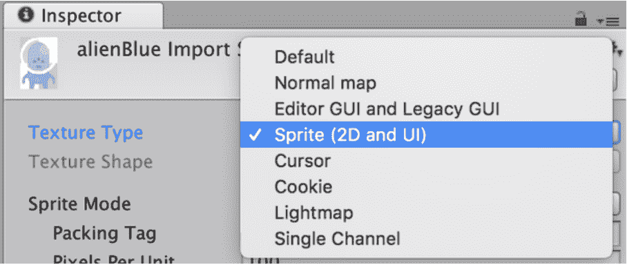

图 5-1. 为精灵设置纹理类型

### 讨论

如果您的项目是使用 Unity 的 2D 模板创建的，导入的精灵将自动以这种方式设置。否则，图像将作为纹理导入，用于 3D 模型的材质中。

您可以通过转到 编辑 → 项目设置 → 编辑器 并将默认行为模式设置为 2D 来更改项目的这种行为（图 5-2）。这将使所有新纹理默认为精灵。它还会使您创建的任何新场景具有一组不同的初始对象——它们将没有灯光或天空盒。

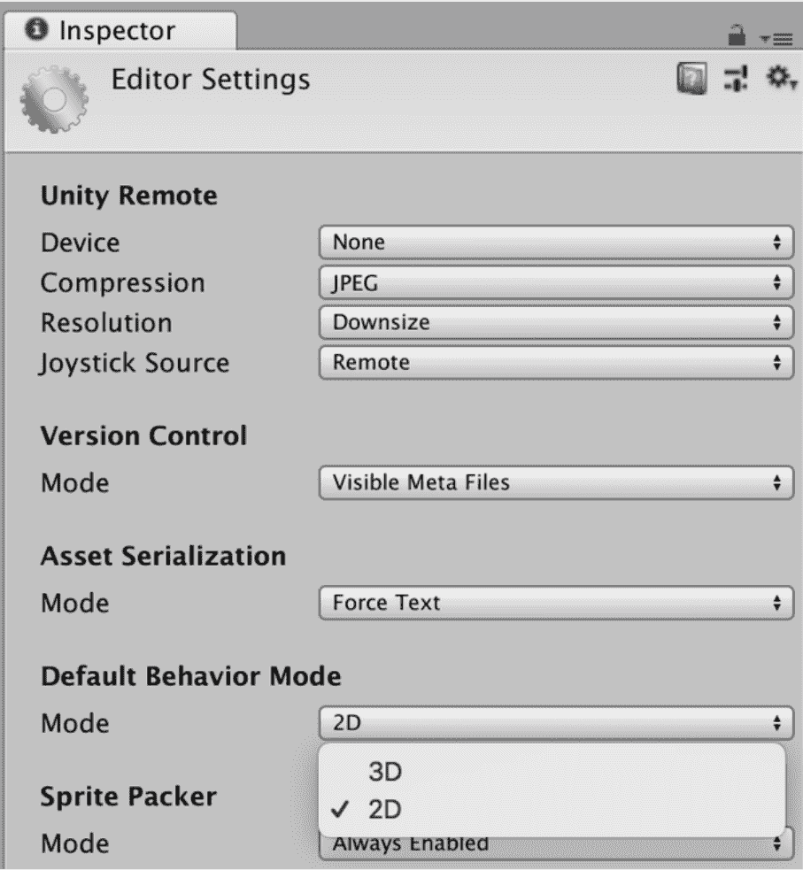

图 5-2. 将项目的默认模式设置为 2D

### 5.2 将精灵添加到场景

#### 问题

您希望将精灵添加到场景中。

#### 解决方案

要将精灵添加到场景中：

- 1. 首先，确保您的图像已配置为精灵（图 5-1）。
- 2. 将其拖放到场景中。

执行此操作后，Unity 将为您创建一个以精灵命名的游戏对象，向其添加 SpriteRenderer 组件，并使 SpriteRenderer 显示该精灵。

#### 讨论

每像素单位（Pixels Per Unit）值控制源图像（以像素为单位）的大小与场景中精灵大小之间的关系。如果精灵为 1 像素/单位，则每个像素的宽度和高度均为 1 单位；如果精灵为 100 像素/单位，则每个像素的宽度和高度均为 1/100 单位。

### 5.3 创建精灵动画

#### 问题

您希望创建一个运行动画的精灵。

#### 解决方案

选择您希望作为动画一部分播放的图像，并将其拖入场景中。

Unity 将为您执行以下操作：

- 1. 创建一个新的动画控制器资产，并将其保存在您拖入的图像资产旁边。
- 2. 创建一个新的动画剪辑，并询问您将其保存在何处。动画剪辑将配置为随时间更新精灵。动画剪辑还会循环播放。
- 3. 将动画剪辑作为状态添加到动画控制器中。
- 4. 创建一个带有 Animator 和 SpriteRenderer 组件的新游戏对象。

您可以通过运行游戏来测试动画。

#### 讨论

如果您已经有一个设置了 Animator 的对象，可以向其附加新的动画状态。我们将在第 8 章中详细讨论如何执行此操作；该章涵盖的 3D 动画与 2D 动画之间的唯一区别在于，动画剪辑修改的是精灵渲染器的 Sprite 字段，而不是 3D 变换的位置。

### 5.4 创建带有 2D 物理效果的精灵

#### 问题

您希望为精灵添加二维物理效果。

#### 解决方案

要创建带有 2D 物理效果的精灵：

- 1. 向场景中添加带有精灵渲染器的游戏对象。
- 2. 选择游戏对象并单击添加组件。
- 3. 选择 物理 2D → Rigidbody 2D，或在搜索字段中输入 Rigidbody 2D 并选择它。

与常规三维 Rigidbody 对象类似，Rigidbody2D 对象定义物理对象的质量和位置，并响应物理力。但是，它们本身不定义形状。要添加形状，需要添加碰撞器。

#### 讨论

与常规碰撞器类似，一个对象上不应有多个 2D 碰撞器。如果需要更复杂的形状，可以使用多边形碰撞器，或者创建带有不同碰撞器的子游戏对象。子对象不需要具有自己的刚体。

添加多边形碰撞器后，您可以对其进行编辑。为此，请选择带有多边形碰撞器组件的对象，然后单击编辑碰撞器按钮。现在，您可以通过拖动点来重新定位多边形的点，通过单击并拖动点之间的线条来添加新点，以及按住 Control 键并单击点来删除点。

### 5.5 自定义精灵碰撞形状

#### 问题

您希望自定义精灵的物理轮廓。

#### 解决方案

要自定义精灵碰撞形状：

- 1. 选择要配置的精灵，并确保已启用 生成物理形状（图 5-3）。
- 2. 单击 精灵编辑器 按钮。精灵编辑器窗口将出现。
- 3. 在左上角的下拉列表中，选择 自定义物理形状。

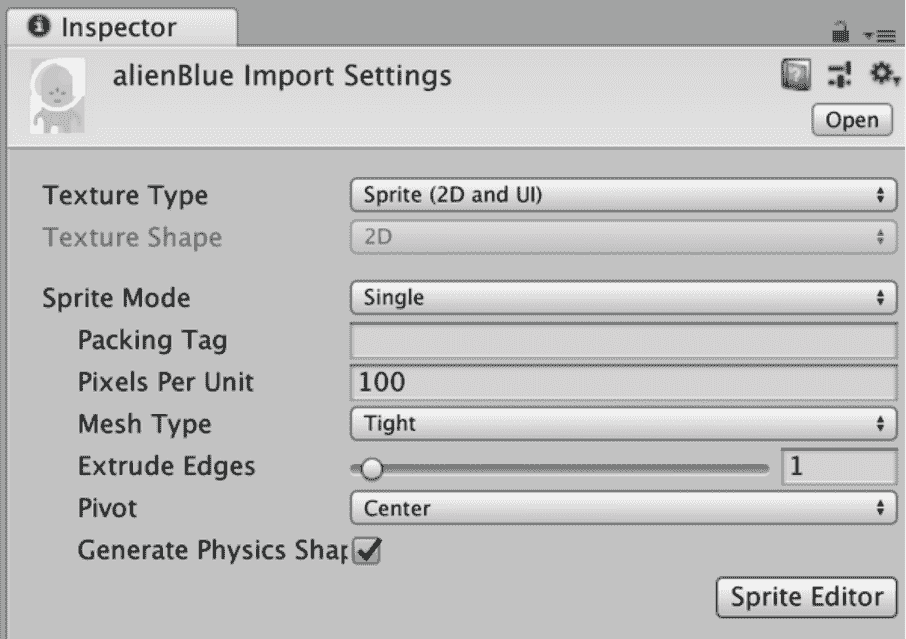

图 5-3. 在精灵纹理的导入设置中启用 生成物理形状 选项

现在，您可以开始定义精灵的形状（图 5-4）：

- 1. 单击并拖动以向形状添加新路径。
- 2. 单击路径上的点以移动它们。
- 3. 在两点之间单击并拖动以在它们之间插入新点。（您还可以将鼠标悬停在线上，然后单击以添加新点！）
- 4. 单击点并按 Command-Delete（PC 上为 Control-Delete）以删除它。
- 5. 完成后，单击 Apply。

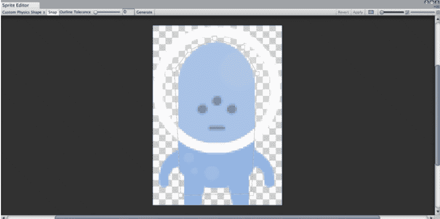

图 5-4. 为精灵创建形状

#### 讨论

当您向带有精灵渲染器的对象添加多边形碰撞器时，物理轮廓将用作默认形状（图 5-5）。如果精灵中未设置物理轮廓，Unity 将使用精灵的透明区域为您生成一个。Unity 通常会尝试创建非常贴合的轮廓，这意味着默认形状通常比需要的更复杂。当您自定义精灵的物理轮廓时，可以为物理系统提供一个更简单的形状。

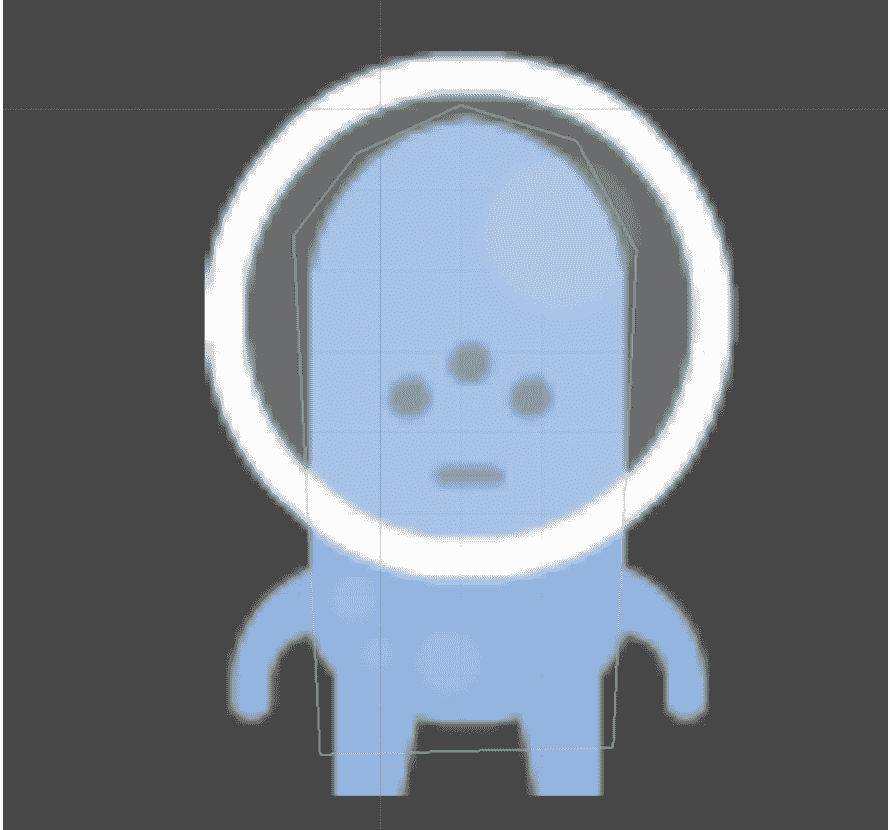

图 5-5. 使用中的物理形状

### 5.6 使用复合碰撞器

#### 问题

您希望将多个 2D 碰撞器合并为一个碰撞器以提高效率。复合碰撞器通过对其子游戏对象的碰撞器进行分组来工作。

#### 解决方案

要创建复合碰撞器：


- 1. 创建带有独立碰撞体的游戏对象。这些可以是任何类型的 2D 碰撞体，例如盒子、多边形或圆形。
- 2. 创建一个空游戏对象，并将其设为带有碰撞体的对象的父对象。
- 3. 接下来，为父对象添加 CompositeCollider2D 组件。
- 4. 最后，选择子游戏对象并勾选“Used By Composite”复选框（图 5-6）。当您选择父对象时，其碰撞体形状将通过组合其子对象的形状来定义。

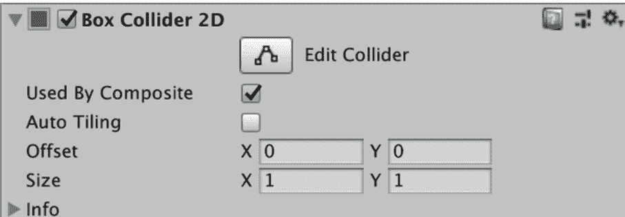

图 5-6. 在碰撞体上启用 Used By Composite 选项

### 讨论

复合碰撞体可以更高效，并防止由两个相互紧邻的碰撞体引起的问题。当两个平面碰撞体相邻时，滑过它们的对象可能会因为大多数物理引擎受到的精度问题而在它们相遇的点处“绊倒”。通过完全移除该角点来解决此问题。

图 5-7 展示了此示例。顶部对象不使用复合碰撞体，且包含一排三个盒形碰撞体，它们之间的线条可见。底部对象同样包含一排三个盒形碰撞体，但配置为复合碰撞体的一部分。它们之间的线条消失了，最终碰撞体是一个没有角点的大矩形形状。

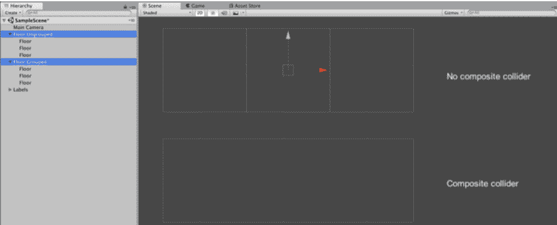

图 5-7. 两组碰撞体：使用复合碰撞体与不使用

## 5.7 使用 Sprite Packer

### 问题

您希望将多个精灵打包到单个纹理中，以节省浪费的空间。

### 解决方案

要使用 Sprite Packer：

- 1. 打开 Assets 菜单并选择 Create → Sprite Atlas，创建一个新的 Sprite Atlas。
- 2. 将要分组的精灵拖入 Objects for Packing 列表。也可以拖入文件夹。

### 讨论

_纹理图集_ 是一张包含多个图像的单个纹理。

构建游戏时，Unity 会收集图集中的所有精灵，并将它们全部打包到一张纹理图像中；在游戏过程中，当精灵渲染器需要显示其精灵时，将使用图集中包含所需数据的子区域。

纹理图集可以带来更好的性能。如果多个精灵渲染器使用存储在同一图集中的精灵，它们可以同时绘制。此外，打包过程会裁剪精灵的边缘，从而减少存储最终图像所需的内存量。

除了创建图集本身之外，您无需做任何其他操作即可使用图集。如果需要绘制的精灵存储在图集中，精灵渲染器将自动使用图集纹理。

## 5.8 对 2D 对象施加力

### 问题

您希望向 2D 对象施加物理力。

### 解决方案

您可以通过脚本使用 Rigidbody2D 类的 AddForce 方法向 2D 对象施加力。

以下脚本演示了如何使用玩家输入向对象施加力：

```
public class AlienForce : MonoBehaviour {

    // The amount of force to apply.
    [SerializeField] float verticalForce = 1000;
    [SerializeField] float sidewaysForce = 1000;

    // A cached reference to the Rigidbody2D on this object.
    Rigidbody2D body;

    // On game start, get the reference to the rigid body and cache it.
    void Start() {
        body = GetComponent<Rigidbody2D>();
    }

    // You will get smoother movement if you apply physical forces in
// FixedUpdate, because it's called a fixed number of times per second,
// with a fixed simulation timestep, which means more stable simulation
void FixedUpdate ()
{
    // Get user input, and scale it by the amount of force we want to
    // apply
    var vertical = Input.GetAxis("Vertical") * verticalForce;
    var horizontal = Input.GetAxis("Horizontal") * sidewaysForce;

    // Generate a force vector from these inputs, scaled by time
    var force =
        new Vector2(horizontal, vertical) * Time.deltaTime;

    // Add the force to the sprite
    body.AddForce(force);
}
}
```

> **注意**
>
> 对于这么小的示例来说尤其不实用，但输入通常会在 Update 中收集，而不是像我们在这里所做的那样在 FixedUpdate 中收集。FixedUpdate 每个渲染帧可以运行多次，这可能意味着最终会得到额外的输入！

### 讨论

与在三维空间中运行的 Rigidbody 组件不同，Rigidbody2D 组件仅在二维空间中运行。这意味着您施加的所有力都是 Vector2，而不是 Vector3。此外，由于只有一个旋转自由度，您只能在一个轴上施加旋转。

除了通过代码施加力之外，您还可以使用 ConstantForce2D 组件（图 5-8）。顾名思义，这些组件会持续向对象施加力。它们适用于知道某物需要移动，但不需要真正控制它的对象和效果。

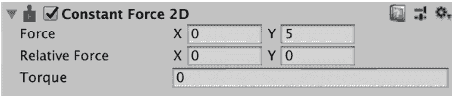

*图 5-8. ConstantForce2D 组件*

## 5.9 创建传送带

### 问题

您希望创建一个可以推动任何接触它的对象的对象。例如，您希望创建一个传送带。

### 解决方案

表面效果器会施加力，将物体沿着效果器边缘推动。要创建传送带：

- 1. 创建一个新游戏对象，并向其添加 `BoxCollider2D` 组件。将其命名为“Conveyor Belt”。
- 2. 打开“Used By Effector”设置（图 5-9）。
- 3. 单击 Add Component 按钮并选择 Physics 2D → Surface Effector 2D，添加 `SurfaceEffector2D` 组件（图 5-10）。
- 4. 将任何带有 `Rigidbody2D` 和 `Collider2D` 的对象放置在其上方。
- 5. 运行游戏。对象会掉落到效果器上并被其推动。

### 注意

如果 Speed 值为正数，对象将被推向右侧；如果为负数，对象将被推向左侧。Speed Variation 值可让您为应用于对象的速度添加随机变化。

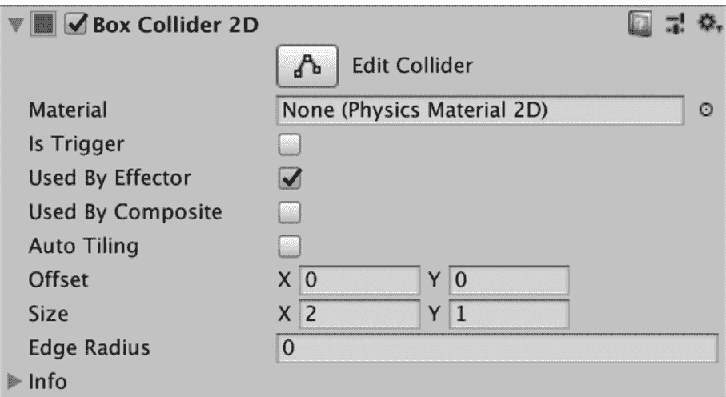

图 5-9. 在碰撞体上启用 Used By Effector 选项

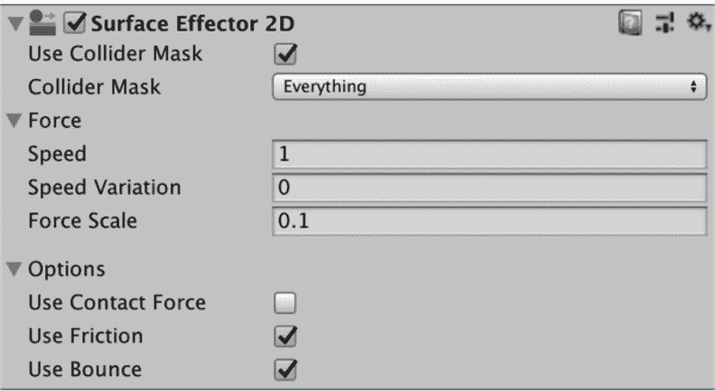

图 5-10. SurfaceEffector2D 组件的设置

### 讨论

效果器与碰撞体协作向对象施加力。当带有 Rigidbody2D 的对象与带有效果器的 Collider2D 碰撞时，效果器会根据其类型和设置向其施加力。（如果效果器的 Collider2D 组件被标记为触发器，则会对边界内的对象施加力。）

Unity 的 2D 物理引擎中有多种效果器。例如，点效果器可以从空间中的某一点吸引和排斥物体，浮力效果器会施加模拟浮力的向上力，平台效果器会创建允许物体单向通过的力。

## 5.10 为精灵使用自定义材质

### 问题

您希望使用自定义材质绘制精灵。

### 解决方案

要为精灵使用自定义材质：

- 1. 打开 Assets 菜单并选择 Create → Material，创建一个新材质资产。将新材质命名为“Sprite Diffuse”。
- 2. 选择新的精灵，并在 Inspector 顶部将着色器更改为 Sprites → Diffuse（图 5-11）。
- 3. 选择场景中任何带有精灵渲染器的游戏对象，并将您的 Sprite Diffuse 材质拖入其 Material 插槽。它现在将响应光照（图 5-12）。

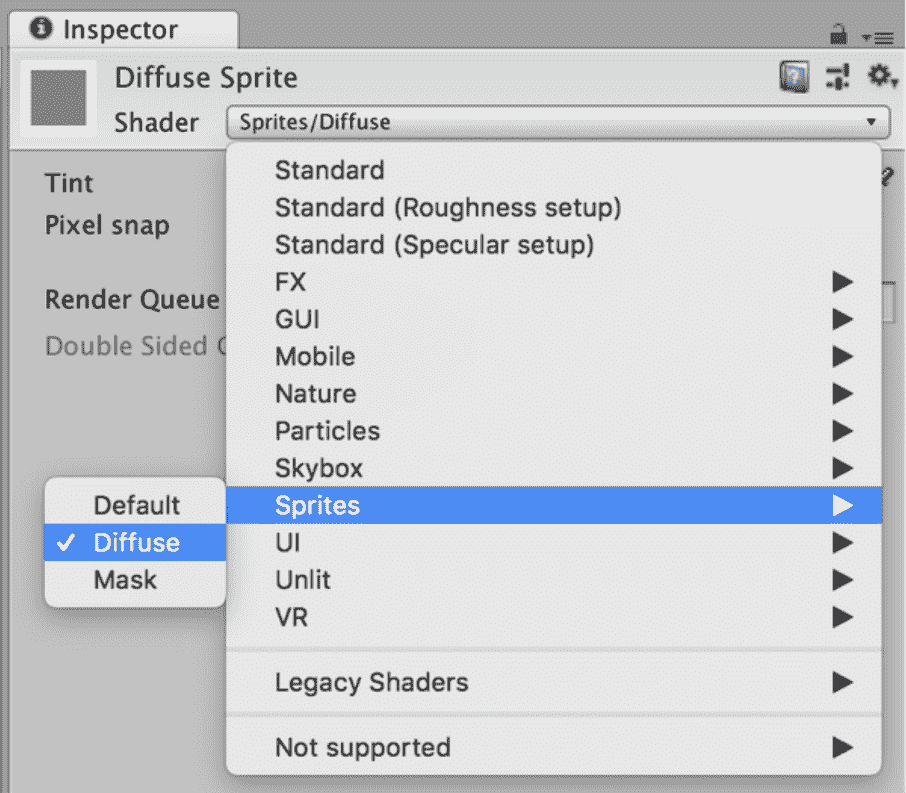

图 5-11. 在材质上选择 Sprites → Diffuse 着色器

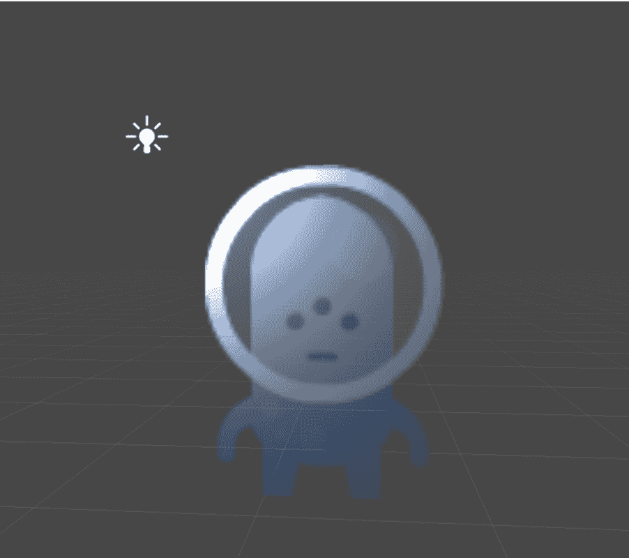

图 5-12. 使用 Diffuse 着色器的精灵

### 讨论

默认着色器忽略光照——纹理的颜色就是屏幕上显示的颜色（而不是受环境遮光）。

> **注意**
>
> 如果您计划对精灵进行光照处理，应该将精灵设计得非常明亮。除非精灵被明亮的光照直接照射，否则它会比在纹理中显示的更暗。


## 5.11 管理精灵排序

### 问题

你希望确保一个对象在另一个对象前面或后面绘制。

### 解决方案

要管理精灵排序：

- 1. 选择要控制其绘制顺序的精灵渲染器。
- 2. 更改 Order in Layer 的值。在排序层中，精灵渲染器按此数字的递减顺序绘制；较大的数字绘制在较小的数字前面。

### 讨论

Order in Layer 设置控制精灵在其排序层内的绘制顺序。并且总是至少有一个排序层，称为 Default，无法移除。

要创建排序层，打开 Edit 菜单，选择 Project Settings → Tags & Layers。创建你的排序层，并重新排列它们的顺序（图 5-13）。

图 5-13. 创建和配置排序层

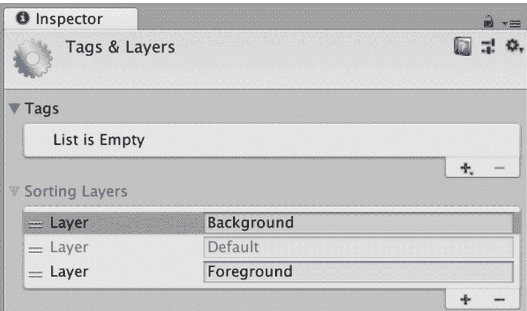

使用排序层来确保大型精灵集合绘制在其他集合的上方或下方。例如，你可以创建一个名为 Background 的排序层和另一个名为 Characters 的排序层；Background 排序层上的对象始终绘制在 Characters 层上的对象后面，无论其 Order in Layer 属性如何。

你可以通过在 Inspector 中更改其 Sorting Layer 属性为精灵渲染器选择排序层（图 5-14）。

排序层的名称与 Layers 相似，但它们是不同的东西。两个对象可以位于不同的排序层上，同时位于同一层。

图 5-14. 为精灵渲染器选择排序层

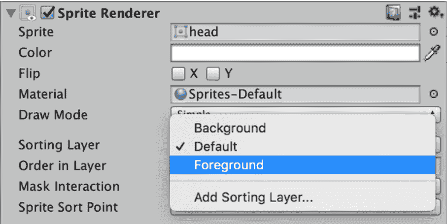

## 5.12 使用排序组

### 问题

你希望使用排序组来确保一组精灵一起绘制。

### 解决方案

使用排序组来管理精灵的排序顺序：

- 1. 创建一个空游戏对象。将其命名为“Sprite Group”。
- 2. 向其添加 SortingGroup 组件。
- 3. 将任何你希望保持排序顺序的精灵渲染器移动为该对象的子对象。

精灵现在将保持该顺序，无论同一屏幕区域中可能有任何其他对象。

### 讨论

排序组确保该组的所有成员一起绘制，
并且没有其他对象可以在它们之间绘制。

例如，图 5-15 和 5-16 均显示两个角色，每个角色都由许多其他精灵组成。这些精灵的排序顺序已配置，例如，头部绘制在身体上方，一只手臂绘制在身体后面。在图 5-15 中，两个角色的父对象上都有一个排序组，而在图 5-16 中，它们没有。这导致各个身体部件错误地与另一个角色重叠。

图 5-15. 两组精灵，每组都在其父对象上附加了排序组

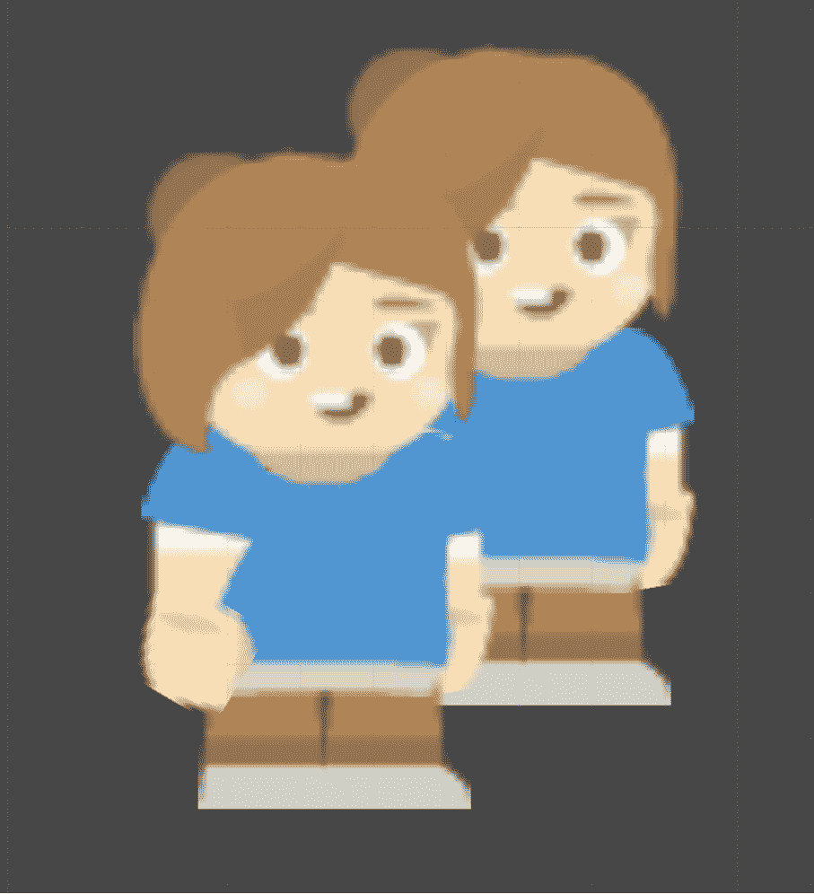

图 5-16. 相同的两组精灵，排序组已禁用

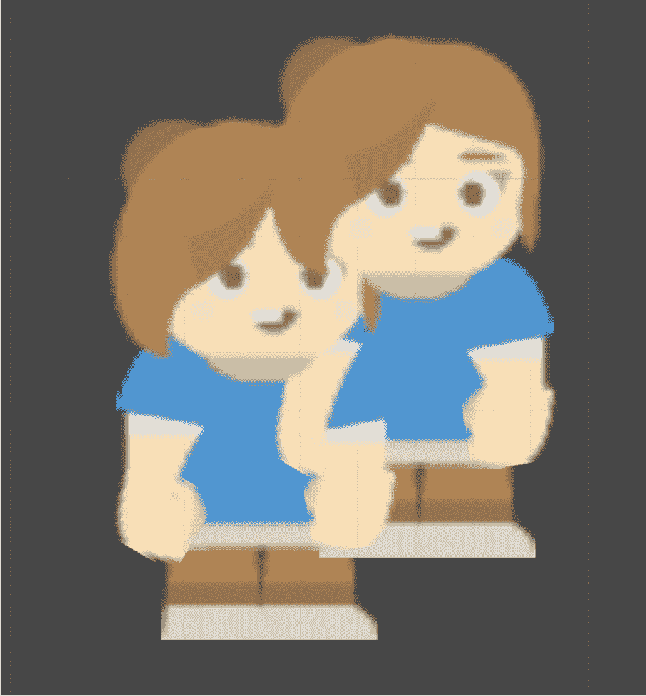

## 5.13 创建 2.5D 场景

### 问题

你希望创建一个包含 2D 和 3D 元素混合的场景。

### 解决方案

要创建 2.5D 场景：

- 1. 选择你的相机，并将其 Projection 模式更改为 Perspective。
- 2. 选择你的背景对象，并将其移离相机。

当相机从一侧移动到另一侧时，距离相机更远的物体将移动得“更慢”，就像 3D 物体（和现实生活中的物体）一样，这会产生深度感。

请注意，当使用透视相机时，更容易遇到排序问题，尤其是当精灵不直接面向相机时。使用排序组以确保 2D 对象排序正确。

### 讨论

“2.5”有多种不同的风格。例如，你可以使用多个平面并获得视差效果，这意味着你的美术资产仍然是平面的绘制精灵，但玩家会感觉到它们存在于一个更深层的环境中。许多游戏使用这种技术；例如，我们参与协助的游戏 Night in the Woods 几乎完全由平面精灵组成，但其中一些距离相机更远。因为相机的 Projection 模式设置为 Perspective，远处的物体移动得更慢，这增强了距离感。

另一种技术是将 2D 精灵与 3D 背景相结合。例如，在 DuckTales: Remastered (Capcom) 中，所有角色都是 2D 精灵，但它们在 3D 环境中移动。这对平台游戏尤其有效，因为它突出了无法穿越的垂直墙壁，并且当相机被允许上下移动时，会创造出一个更加动态的环境，从而暴露出背景的多个视图。
