# 第 6 章 3D 图形

Unity 因其渲染引擎的视觉质量而越来越出名，很大程度上归功于它为艺术家提供的灵活性。在本章中，我们将深入探讨材质、着色器和照明，以及如何构建适合游戏独特外观的自定义效果。

> 提示
> 我们强烈建议也复习第 5 章中的配方，以更全面地了解图形主题。

## 6.1 创建简单材质

### 问题

你希望通过创建材质来自定义 3D 对象表面的外观。

### 解决方案

在本配方中，我们将自定义一个简单的形状，尽管这些步骤适用于你在游戏中最终使用的大多数其他网格：

- 1. 打开 GameObject 菜单并选择 3D Object → Sphere 来创建一个新球体。
- 2. 打开 Assets 菜单，选择 Create → Material。随意命名。
- 3. 选择新材质，并配置其颜色（图 6-1）。
- 4. 将材质拖放到球体上。

检查器

新材质

| 属性 | 值 |
|------|-----|
| 着色器 | Standard |
| 渲染模式 | Opaque |
| 主贴图 | |
| 反照率 | |
| 金属度 | 0.37999 |
| 光滑度 | 0.5 |
| 来源 | Metallic Alpha |
| 法线贴图 | |
| 高度贴图 | |
| 遮挡 | |
| 细节蒙版 | |
| 发射 | |
| 平铺 | X 1 Y 1 |
| 偏移 | X 0 Y 0 |
| 次要贴图 | |
| 细节反照率 x2 | |
| 法线贴图 | 1 |
| 平铺 | X 1 Y 1 |
| 偏移 | X 0 Y 0 |
| UV 集 | UV0 |
| 前向渲染选项 | |
| 镜面高光 | |
| 反射 | |
| 新材质 | |

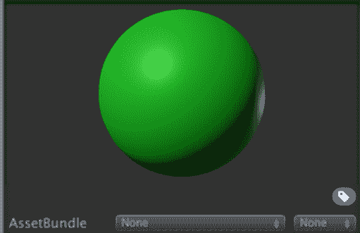

图 6-1. 显示默认 Standard 着色器的可配置属性的材质检查器

### 讨论

材质对于控制场景中对象的外观至关重要。材质通过将*着色器*（计算构成对象的每个像素最终颜色的程序）与*属性*（传递给着色器并与每像素信息结合的输入）相结合来工作。

大多数情况下，你可能最终会使用 Standard 着色器，这是一种极其可配置的基于物理的渲染（PBR）着色器。你可以指定各种属性，包括反照率（基础）颜色、法线贴图、发射率、光滑度和金属度。尝试调整各种属性，看看你对象的材质会发生什么变化。

Standard 着色器不是唯一的着色器；我们将在本章中探讨其中几个，还会制作自己的着色器。

## 6.2 通过脚本控制材质属性

### 问题

你希望在游戏过程中更改材质的属性，例如其颜色。

### 解决方案

当你可以访问 `MeshRenderer` 或 `SpriteRenderer` 或任何其他类型的渲染器时，可以从中访问材质并修改其属性。例如：

```
public class ChangeMaterialColor : MonoBehaviour {

    // The colors we're fading between
    [SerializeField] Color fromColor = Color.white;
    [SerializeField] Color toColor = Color.green;

    // The speed with which we're fading

[SerializeField] float speed = 1f;

// A cached reference to the renderer (The 'new' keyword makes the
// compiler not warn us about the fact that we're overriding an
// existing property that we inherit from MonoBehaviour; this property
// is deprecated, so we aren't using it and it's okay to override it)
new Renderer renderer;

private void Start()
{
    renderer = GetComponent<Renderer>();
}

private void Update()
{
    // Convert time to a number that smoothly moves between -1 and 1
    float t = Mathf.Sin(Time.time * speed);

    // Convert this to one that moves from 0 to 2
    t += 1;

    // Divide it by 2 to make it move from 0 to 1;
    t /= 2;

    // Interpolate between the two colors
    var newColor = Color.Lerp(fromColor, toColor, t);

    // Apply the new color
    renderer.material.color = newColor;
}
}
```

### 讨论

你可以通过两种方式访问渲染器使用的材质：material 属性和 sharedMaterial 属性。

当你第一次访问渲染器的 material 属性时，Unity 会创建渲染器当前使用的材质的副本，告诉渲染器使用这个新副本，并返回它。这是因为如果多个渲染器都使用同一材质文件，你可能不希望在更改其中一个时更改所有渲染器。


如果您确实想更改每个使用某材质的用户，可以使用 sharedMaterial 属性。访问和修改此属性会修改底层材质资产，这意味着使用此资产的所有渲染器都将采用这些更改。

> **警告**
> 
> 修改 sharedMaterial 属性会修改磁盘上的资产。您在游戏过程中对 sharedMaterial 应用的更改会保留，即使退出播放模式后也是如此，并且无法撤销。

材质具有直接访问常见属性的方法，例如颜色或 mainTexture。如果您知道着色器上要修改的属性名称，可以直接通过材质的 SetColor、SetFloat、SetInt 和相关方法对其进行更改。有关可用方法的完整列表，请参阅 Material 类的文档。

## 6.3 创建无光照材质

### 问题

您想要创建一种纯色材质，并且不参与光照计算。

### 解决方案

要创建无光照材质：

- 1. 打开“资产”菜单，然后选择 创建 → 材质。
- 2. 将着色器设置为 无光照 → 颜色。
- 3. 将着色器应用到对象上，注意它忽略任何光照条件，仅显示为平面颜色（图 6-2）。

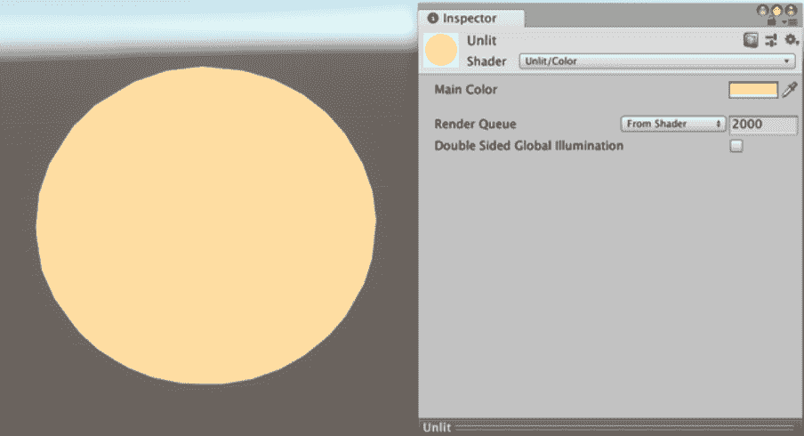

图 6-2. 使用 无光照 → 颜色 着色器的材质的 Inspector

### 讨论

当材质使用无光照着色器时，它不参与光照系统。它不会基于附近的光照源进行着色，而是仅使用平面颜色。当您不追求准确、逼真的外观时，这非常有用。

## 6.4 使用贴图设置材质

### 问题

您想要使用贴图来控制材质的外观。

### 解决方案

材质中的大多数插槽可以接受贴图而不是平面颜色。通常，大多数现代材质使用多个贴图来定义其表面外观；除了反照率之外，它们还使用贴图来定义法线、粗糙度、环境光遮蔽等。

例如，图 6-3 中显示的七张贴图——反照率、金属度、粗糙度、法线贴图、高度贴图、环境光遮蔽和细节遮罩——用于图 6-4 中显示的材质。

## Inspector

### 金属着色器

标准 (粗糙度设置)

渲染模式: 不透明

### 主贴图

- 反照率
- 金属度
- 粗糙度
- 法线贴图
- 高度贴图
- 环境光遮蔽
- 细节遮罩

自发光
平铺: X 1, Y 1
偏移: X 0, Y 0

### 次要贴图

- 细节反照率 x2
- 法线贴图

平铺: X 1, Y 1
偏移: X 0, Y 0
UV 集: UV0

### 前向渲染选项

- 镜面高光 [x]
- 反射 [x]

### 高级选项

- 启用 GPU 实例化 [ ]
- 双面全局光照 [ ]

图 6-3. 带划痕的蓝色金属纹理的材质配置

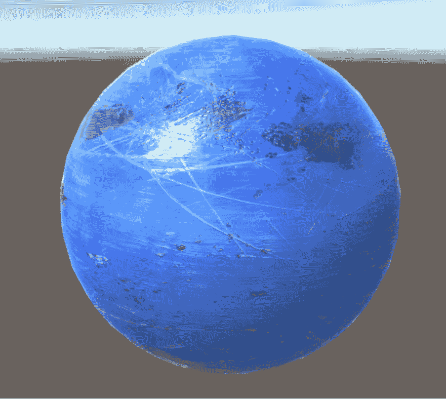

图 6-4. 图 6-3 中的金属材质，在场景中显示

要将贴图附加到材质，只需将贴图从“项目”选项卡拖放到插槽中。材质将立即开始使用该贴图。

### 讨论

如果您没有可用的自有贴图，有许多提供可用许可证贴图的优秀免费网站。例如，ambientCG 提供基于 Creative Commons Zero (CC0) 许可证的高分辨率贴图，允许您将其用于商业和非商业目的。

## 6.5 使材质使用着色器

### 问题

您想要控制材质使用哪个着色器。

### 解决方案

您可以使用两种方法。

第一种方法是通过打开“资产”菜单，然后选择 创建 → 材质 来创建新材质。接下来，从 Inspector 顶部的下拉菜单中选择您的着色器。

或者，如果您有已创建的着色器资产（例如，通过遵循配方 6.10 中的步骤），请在“项目”选项卡中选择着色器并创建材质。材质将使用您选择的着色器。

### 讨论

材质资产将着色器与配置数据相结合，以实现特定的材质效果。当您从下拉菜单中选择着色器时，Unity 会读取着色器并确定其需要什么信息——即它使用哪些贴图、颜色和其他值来计算应用该材质的对象每个像素的颜色。

您可以使用随 Unity 提供的内置着色器，也可以制作自己的着色器。我们在本章的多个配方中讨论使用 Shader Graph 工具创建着色器（例如，配方 6.10、6.11 和 6.12）。

## 6.6 使用内置渲染管线的后期处理设置泛光效果

### 问题

您想要配置相机，以便可以对其应用后期处理效果。

> **注意**
> 本配方适用于内置渲染管线，而不适用于通用渲染管线。

### 解决方案

首先，确保您的项目已安装后期处理栈：

- 1. 打开“窗口”菜单，然后选择“包管理器”。
- 2. 点击“全部”选项卡。
- 3. 找到“后期处理”包，然后点击“安装”按钮（图 6-5）。

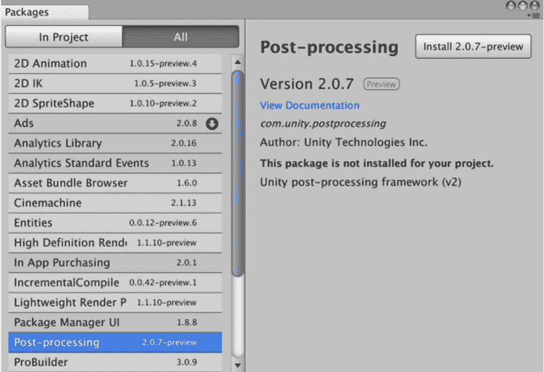

图 6-5. 安装“后期处理”包

接下来，我们将设置后期处理体积。这控制存在哪些后期处理效果及其设置：

- 1. 创建一个新的空游戏对象。将其命名为“后处理体积”。
- 2. 向其添加新的后处理体积组件。
- 3. 开启“是否全局”设置。无论相机位于何处，效果都将应用于相机。
- 4. 在 Inspector 右上角，将图层更改为 PostProcessing（图 6-6）。

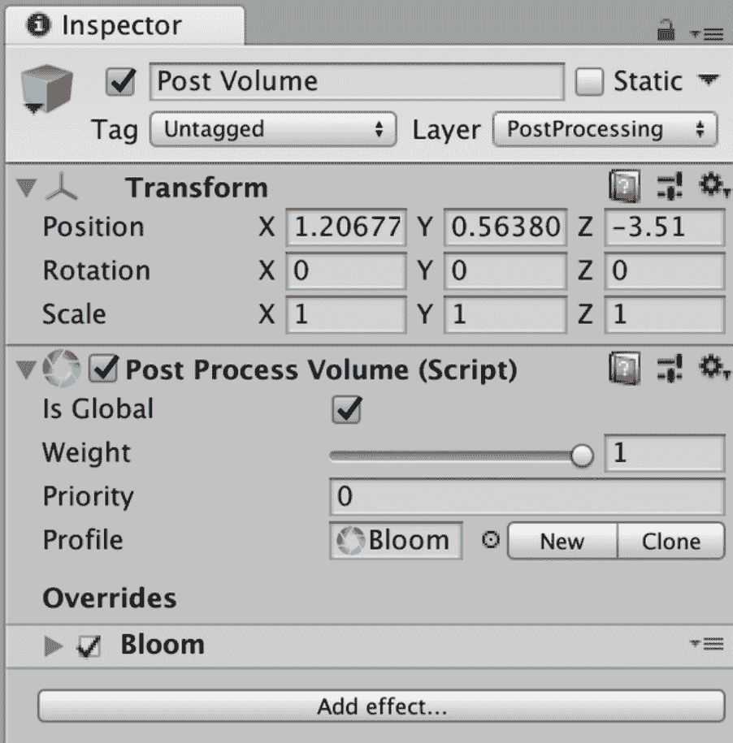

图 6-6. 后处理体积游戏对象的 Inspector

现在我们将设置配置文件，以确定要应用哪些后期处理效果。我们将设置此配置文件以应用泛光效果：

- 1. 点击配置文件字段旁边的“新建”按钮。将创建一个新的后期处理配置文件资产。选择它。
- 2. 在 Inspector 中，点击“添加效果”并选择 Unity → 泛光。将添加一个新的泛光效果。
- 3. 点击“全部”按钮以标记您希望替换所有默认设置。将强度设置为 5，阈值设置为 1.1（图 6-7）。

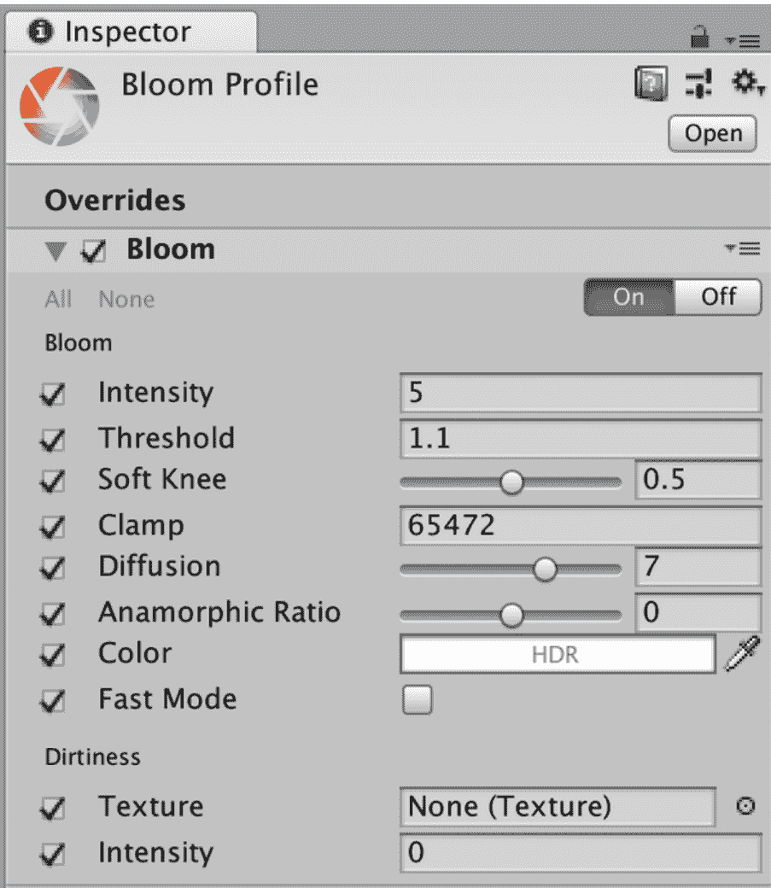

图 6-7. 添加并配置了泛光效果的后期处理配置文件的 Inspector

接下来，我们将设置相机：

- 1. 选择要应用后期处理效果的相机（通常是主相机）。
- 2. 向其添加新的后处理层组件。
- 3. 将图层属性设置为 PostProcessing（图 6-8）。

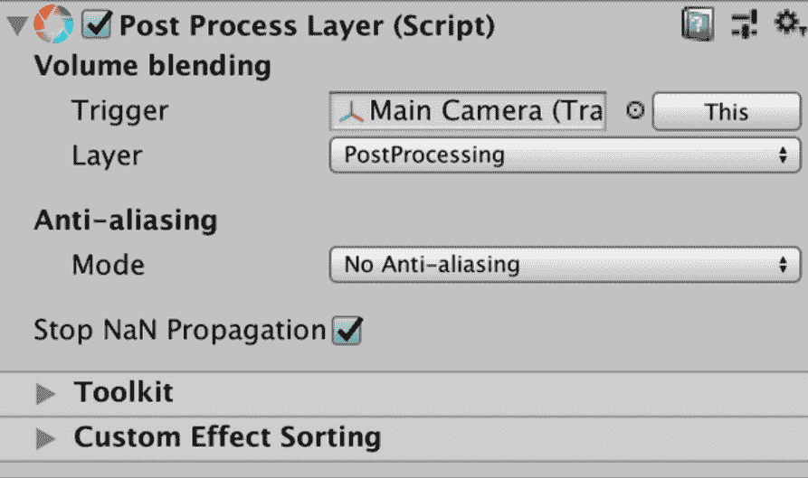

图 6-8. 配置后处理层组件以使用 PostProcessing 对象图层

将出现泛光效果：屏幕的亮部将通过向屏幕附近部分“溢出”而显得更亮。

### 讨论

_后处理效果_是渲染器生成的最终或接近最终图像上执行的视觉效果。它通过获取渲染图像，将其放置在矩形上，然后在其上运行着色器来工作；着色后的结果随后显示在屏幕上或发送到下一个后期处理效果。

有许多不同的后期处理效果；例如，您可以调整最终图像的色调曲线、应用色调、修改场景的曝光、应用景深模糊或添加暗角。尝试各种效果，看看可以实现哪些独特效果！

您的场景中可以有多个后期处理体积。如果它们上带有触发器碰撞体，并且 Post Process Layer 的触发器（通常是相机，但可以是任何变换）位于碰撞体的范围内，则该体积的设置将应用。这样，您可以创建这样的设置：例如，相机可以进入一座鬼屋，并在相机位于建筑物内时仅应用修改场景颜色和色调的后期处理效果。

## 6.7 使用通用渲染管线的后期处理设置泛光效果

### 问题

您想要配置相机，以便可以对其应用后期处理效果。

> **注意**
> 
> 本配方适用于通用渲染管线，而不适用于内置渲染管线。

### 解决方案

要使用通用渲染管线的后期处理设置泛光效果：

- 1. 通过打开“游戏对象”菜单并选择 体积 → 全局体积，创建一个新的全局体积。
- 2. 选择新创建的体积，找到配置文件字段。点击“新建”以创建新的后期处理配置文件。


- 3. 单击 Add Override 按钮，并在出现的菜单中，选择 Post Processing → Bloom。
- 4. 单击 All，并将 Intensity 设置调高到 1。
- 5. 在 Hierarchy 面板中，选择 Camera。
- 6. 在 Camera 的 Inspector 中，找到 Post Processing 设置，并将其打开。

现在可以在 Game 视图中看到 bloom 效果了。

### 讨论

当你使用通用渲染管线时，后处理的设置方式与内置管线相似，但略有不同。你不需要下载和安装任何额外的软件包；后处理已包含在内。你仍然需要创建一个定义应应用哪些后处理效果的体积，但它是另一种类型的对象。你不需要设置任何图层，但确实需要在相机本身上打开后处理。

可用的后处理效果与内置管线中可用的效果相似，但配置方式略有不同。并非内置管线中可用的每个效果在通用管线中都可用，反之亦然。话虽如此，它们的相似之处远多于不同之处。

## 6.8 使用高动态范围颜色

### 问题

你希望在场景中使用高动态范围（HDR）颜色，以实现更逼真的效果。

### 解决方案

首先，为了让 HDR 渲染可见，你需要在相机上启用 HDR 模式。展示 HDR 渲染用途的快速方法是将其与 bloom 后处理效果结合：

- 1. 选择你的相机，并打开 HDR 设置。

- 2. 选择场景的平行光，并将其强度提高到 5（图 6-9）。

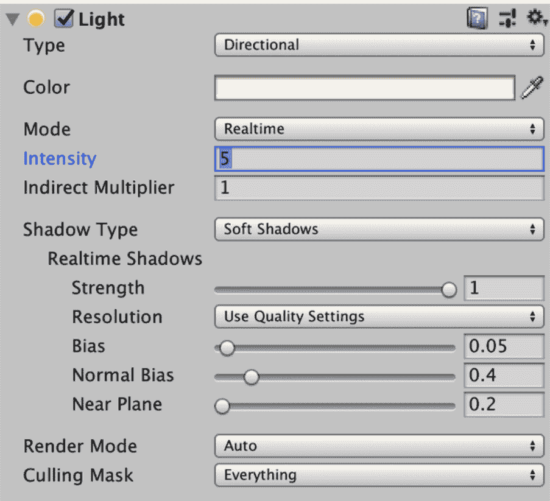

图 6-9. 配置灯光以使用高于 1 的强度

灯光的明亮反射将比物体背光面的部分亮得多（参见图 6-10 和 6-11）。图 6-11 显示与图 6-10 相同的镜头，但启用了 bloom 效果。灯光看起来亮得多，因为它似乎“泄漏”出来了。

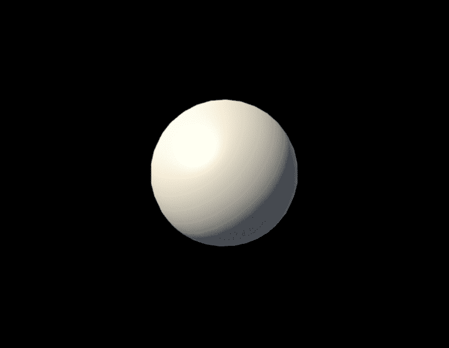

图 6-10. 由平行光照亮的物体，bloom 效果已禁用

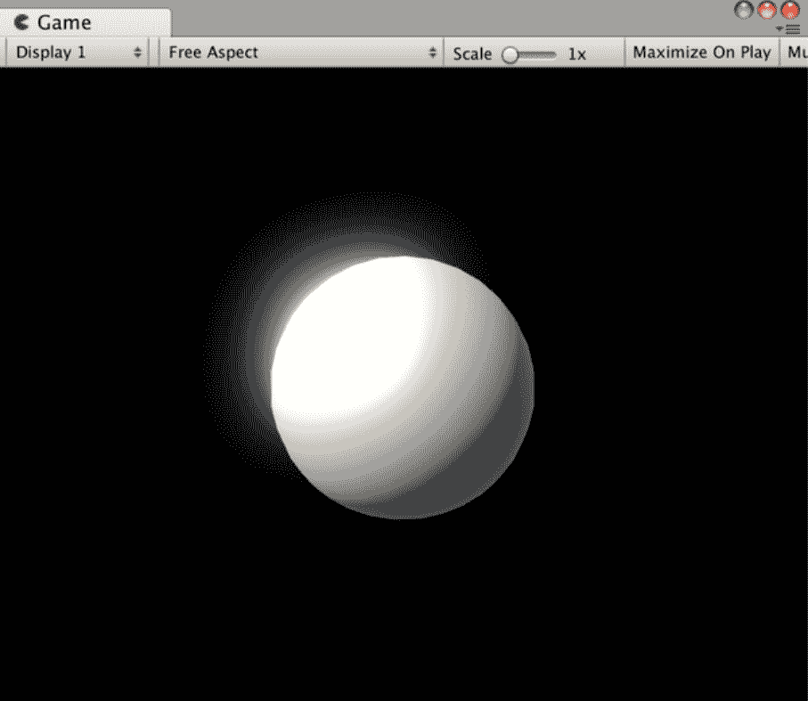

图 6-11. 与图 6-10 相同的镜头，但启用了 bloom 效果

### 讨论

HDR 渲染与低动态范围（LDR）渲染不同。LDR 将每个颜色通道（红、绿、蓝）的值限制在 0 到 1 之间，而 HDR 可以高于或低于此范围。这意味着可以实现更宽范围的曝光级别，并在显示图像之前对其进行处理时具有更大的灵活性。

玩家通过其显示器看到游戏，显示器的颜色范围有限，这意味着 HDR 图像必须通过一种称为色调映射的过程进行压缩。色调映射涉及确定颜色范围的顶部和底部；低于底部的任何颜色级别都会显示为黑色，高于顶部的任何颜色级别都会显示为白色。因为明亮的光线在相机镜头和人眼晶状体中会散射，我们可以通过模糊这些“过亮”颜色来模拟它们——换句话说，即 bloom 效果。这就是为什么我们将 bloom 效果的阈值设置为 1.1，这样只有过亮像素才会应用 bloom 效果。

## 6.9 设置使用可编程渲染管线的项目

### 问题

你希望使用 Unity 的可编程渲染管线（SRP），它们允许使用更先进的渲染技术和编辑器功能。

### 解决方案

在本示例以及后续示例中，我们将使用通用渲染管线（URP）：

- 1. 打开 Unity Hub，然后单击 New Project。找到 3D (URP) 模板（图 6-12）。
- 2. 在使用模板之前，你可能需要先下载该模板。单击“下载模板”，并等待模板下载完成。
- 3. 为项目命名，然后单击 Create Project。

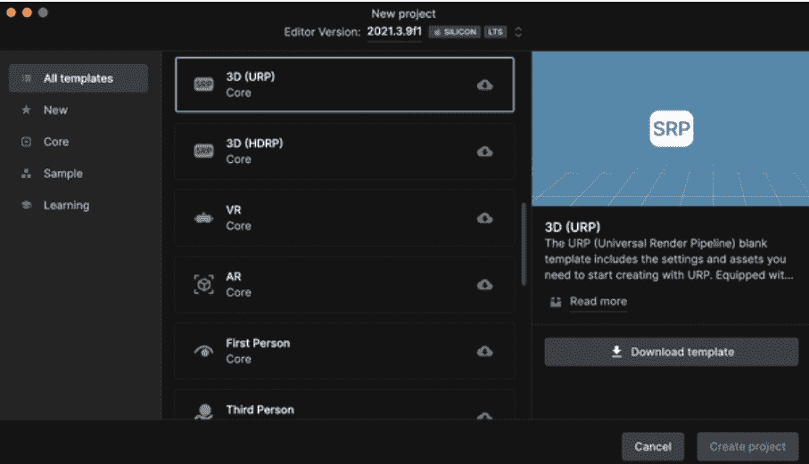

图 6-12. 选择 URP 模板

### 讨论

在 Unity 中，可以自定义图形系统渲染帧的方式。可编程渲染管线系统为图形程序员提供了对引擎应启用和不应启用的哪些渲染功能的精细控制，这使他们能够满足非常特定的性能和视觉质量目标。

然而，我们并非人人都是图形程序员。为此，Unity 还提供了两种预定义的管线设置：高清渲染管线（HDRP）和 URP。HDRP 支持先进的图形技术，但需要相当新的硬件（例如现代 PC 和最新主机）。URP 可以在几乎任何设备上运行并实现良好性能（例如低端 PC、移动设备和旧主机），但限制了支持的图形功能。

> **注意**
> 
> 在本章中，我们将专门关注通用渲染管线。

针对一种渲染管线设计的材质和着色器无法用于其他管线，因为它们依赖于为其设计的渲染管线提供的功能。例如，如果你尝试在使用通用渲染管线的项目中使用专为内置渲染管线设计的材质，它将渲染出明亮的纯紫色，指示错误。

除了创建已经在使用 SRP 的新项目外，你还可以调整现有项目以使用 SRP：

- 1. 打开 Window 菜单，然后选择 Package Manager。
- 2. 在窗口左上角的下拉菜单中，选择 Unity Registry。
- 3. 从软件包列表中选择 Universal RP 软件包，然后单击 Install。Unity 将把软件包下载并安装到你的项目中。
- 4. 打开 Assets 菜单，然后选择 Create → Rendering → URP Asset (with Universal Renderer)。将创建一个新的管线资产；该资产包含项目使用的渲染设置，以及一个 Renderer。
- 5. 通过打开 Edit 菜单并选择 Project Settings 来打开 Project Settings 窗口。
- 6. 选择 Graphics 设置。
- 7. 将你创建的 Universal Pipeline Asset 拖放到 Scriptable Render Pipeline Settings 槽中。

请注意，当你开始使用 SRP 时，需要修改材质以使用专为新管线设计的着色器。为此，在 Project 选项卡中选择你的材质，打开 Edit 菜单，然后选择 Rendering → Materials → Convert Selected Built-In Materials to URP Materials。

## 6.10 使用 Shader Graph 创建着色器

### 问题

你希望使用 Unity 的 Shader Graph 工具创建新着色器，以便你可以创建自己的自定义材质。

### 解决方案

通过打开 Assets 菜单并选择 Create → Shader → URP → Lit Shader Graph 来创建新着色器。为新着色器命名。

你将看到一个带有单个节点的新着色器图（图 6-13）。单击 Save Asset，你的着色器即可用于材质中。

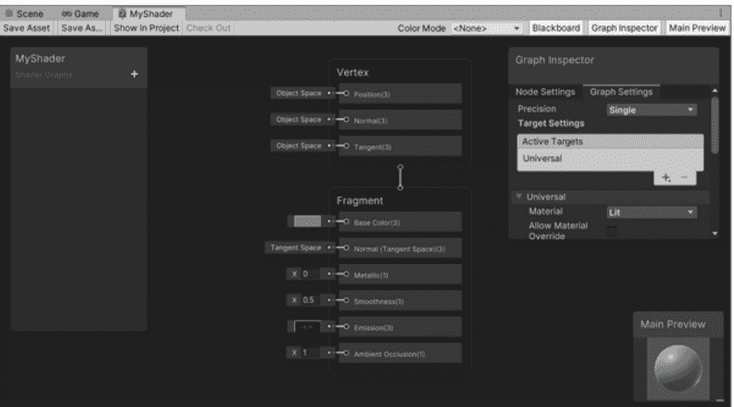

图 6-13. 一个非常简单的着色器图，仅包含 Vertex 和 Fragment 节点

### 讨论

Shader Graph 是构建着色器的可视化工具。着色器通常使用一种称为 ShaderLab 的语言编写，该语言向 Unity 描述着色器的行为，并包含使用第二种语言 Cg 执行着色的具体指令。

ShaderLab 方法非常强大，但由于几个原因，使用起来可能比较困难。首先，它需要至少学习一门新语言；其次，着色器代码可能难以调试；第三，在创建效果时，很难直观地了解效果是如何构建的。

Shader Graph 工具采用不同的方法。你不是编写代码，而是连接生成或修改数据的节点。最终结果被发送到输出节点，该节点在将片段颜色应用到表面之前执行任何必要的最终照明。

> **注意**
> 从本质上讲，所有着色器都是相同的。Shader Graph 功能将你的节点转换为 ShaderLab 和 Cg 源代码，然后像其他着色器一样对其进行编译并发送到 GPU。唯一的区别是你创作它们的过程。

## 6.11 使用 Shader Graph 创建发光效果

### 问题

你希望创建一个使物体边缘发光的着色器。

### 解决方案

要创建发光效果，我们首先需要思考我们希望发生什么。物体的“边缘”应该发光；但是，“边缘”的位置会根据相机的位置而变化。此外，发光效果应在远离边缘时平滑淡出。

实现此目的的一种方法是假设，面向相机的物体任何部分都不是边缘，与相机成直角的物体任何部分都是边缘，而介于两者之间的部分则是平滑


插值于两个极端之间。如果我们将其与颜色结合，就会产生一个外观不错的效果。

幸运的是，有一个内置节点可以为我们处理这个边缘效果，称为 Fresnel Effect 节点。

按照以下步骤创建你的效果：

- 1. 创建一个新的 Lit Shader Graph 资源（参见 配方 6.10）。将新资源命名为“Glowing”，然后打开它。
- 2. 通过在空白处右键单击或按空格键打开创建节点菜单。
- 3. 找到 Fresnel Effect 节点。你可以输入名称，也可以在 Math → Vector → Fresnel Effect 中找到它。

Fresnel Effect 节点会创建白色光晕。我们可以通过将其与颜色相乘来为其着色：

- 1. 创建一个新的 Color 节点（同样，可以通过搜索，或在 Input → Basic → Color 中找到它）。将其设置为所需的颜色。
- 2. 创建一个 Multiply 节点（Math → Basic → Multiply）。
- 3. 从 Color 节点的 Out 插槽单击并拖动到 Multiply 节点的一个输入插槽中。
- 4. 从 Fresnel Effect 的 Out 插槽单击并拖动到 Multiply 节点的另一个输入插槽中。
- 5. 将 Multiply 节点的 Out 插槽连接到 Fragment 节点的 Emission 插槽。完成后，着色器图应如图 6-14 所示。

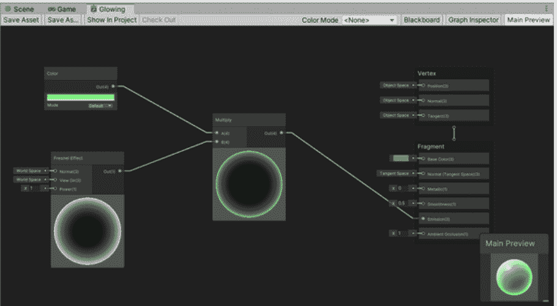

图 6-14. 本配方创建的光晕效果着色器

最后，按照以下步骤创建一个使用此着色器的新材质：

- 1. 单击着色器编辑器顶部的 Save Asset 按钮保存着色器。
- 2. 在 Project 面板中，右键单击着色器，选择 Create → Material。为新材质起一个有用的名称，例如“Glowing”。
- 3. 该材质现已准备好应用到对象上，例如通过将其拖放到对象上。

## 讨论

此着色器利用的菲涅尔（发音为“fray-nell”）效果，是指表面反射的光量会根据表面与观察者之间的角度而变化的观察结果。

当角度很浅时——即表面朝向的方向接近与相机垂直的方向时——可以看到更多反射。

在这个着色器中，我们只需获取表面在任意给定点的“反射率”值，而不实际将其用于反射，而是将该值发送到 Emission 插槽。这并不符合物理现实，但效果可能非常悦目。

如果你通过将 Color 属性的 Mode 设置为 HDR 来设置 HDR 颜色，并将其与设置了 Glow 后处理效果的相机结合（参见 配方 6.6），那么光晕会显得更真实地明亮（图 6-15），因为非常明亮的物体在与透镜（无论是相机还是人眼）交互时往往会产生泛光效果。

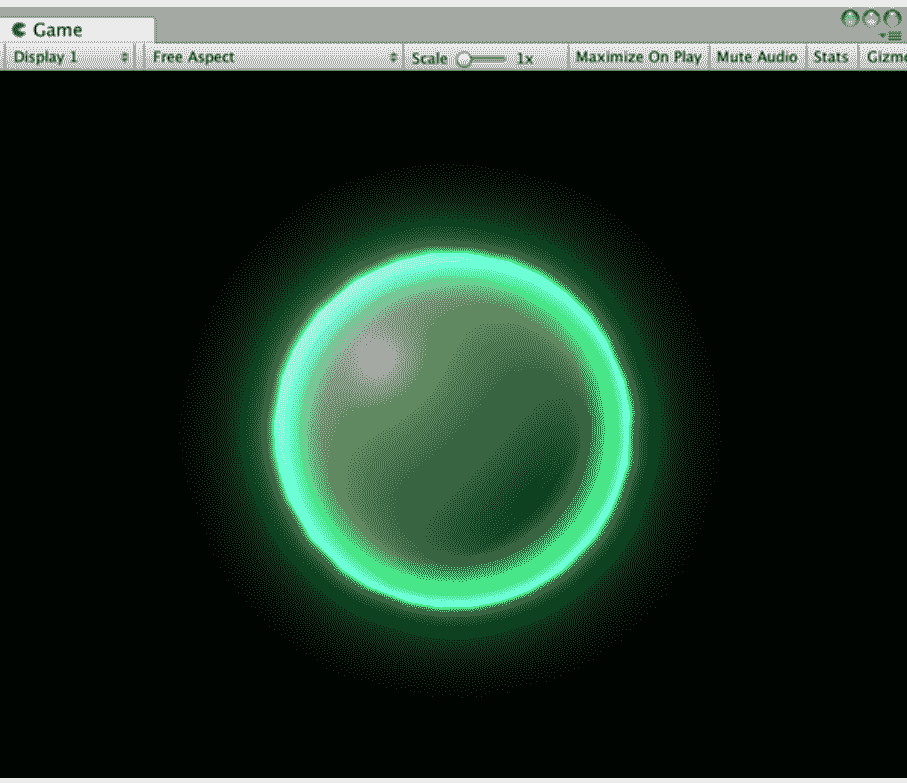

图 6-15. 应用于场景中对象的光晕效果

## 6.12 从着色器图中公开属性

### 问题

你想要从着色器图中公开一个属性，以便可以修改使用该着色器的材质，而无需创建和使用全新的着色器。

### 解决方案

要定义属性，你首先需要使用 Blackboard 面板来创建它。Blackboard 列出了与着色器关联的所有属性：

- 1. 如果尚未打开，请单击着色器编辑器右上角的 Blackboard 按钮打开 Blackboard。
- 2. 单击着色器中 Blackboard 面板右上角的 + 按钮（图 6-16）。
- 3. 选择要创建的属性类型。将创建一个新属性；你可以将其拖到着色器图中，它会显示为一个节点。

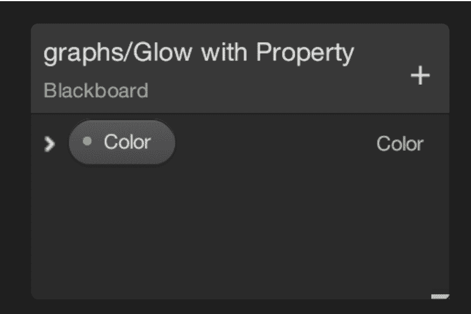

图 6-16. 着色器图中的 Blackboard 面板

一旦属性节点出现在你的着色器图中，你可以将其连接到任何其他节点的输入，并像使用任何其他值一样使用它。唯一的区别是，该属性可以从材质中控制。

### 讨论

任何使用该着色器的材质的检查器中都会显示属性。它们是自定义材质外观的主要方式；如果没有属性，着色器使用的所有值都将固定且不可编辑。

> **提示**
>
> 可以在 Blackboard 面板中双击任何属性将其重命名。

你也可以右键单击着色器图中任何现有的 Input 节点，将其转换为属性节点（图 6-17）。这样更容易构建着色器，因为你可以先从固定值开始，然后稍后决定要将它们公开为属性。

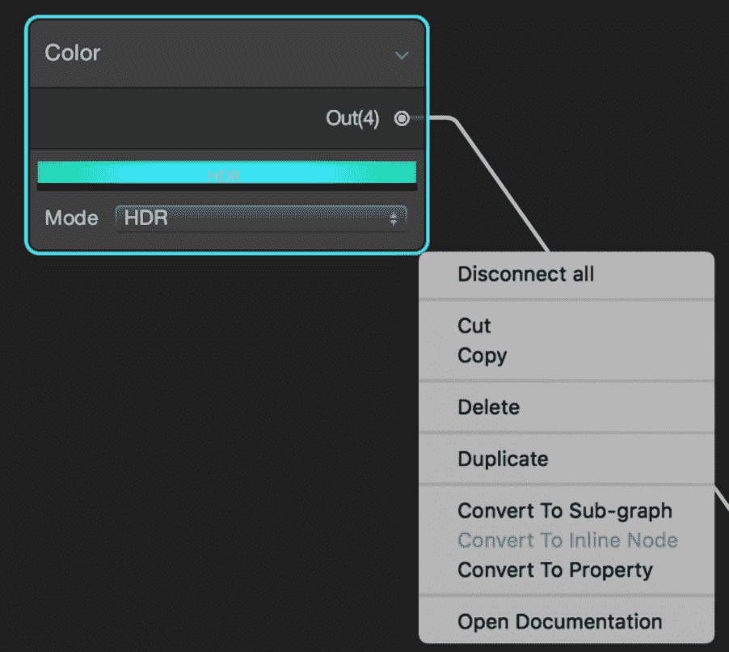

图 6-17. 将 Input 节点转换为属性

## 6.13 随时间对着色器进行动画制作

### 问题

你想要创建一个会随时间自动动画的着色器。例如，你想要创建一个会渐隐渐现的光晕效果。

### 解决方案

使用 Time 节点，它会公开游戏开始以来经过时间的各种表示形式：

- 1. 从你在图 6-10 中创建的 Glow 着色器开始。
- 2. 添加一个 Time 节点（Input → Basic → Time）。

Time 节点公开一个 Sine Time 输出，即当前时间（以秒为单位）经过正弦函数处理后的结果（会产生从 –1 到 1 的正弦波）。

要创建从 0.2 到 1 的渐变效果（即从微弱光晕到完整光晕），我们将使用 Remap 节点：

- 1. 添加一个 Remap 节点（Math → Range → Remap）。
- 2. 将其 In Min Max 值设置为 –1 和 1。（这是它预期接收的值的范围。）
- 3. 将其 Out Min Max 值设置为 0.2 和 1。（这是它将输出的值的范围。）
- 4. 将 Time 节点的 Sine Time 输出连接到其 In 端口。
- 5. 创建一个新的 Multiply 节点。
- 6. 将 Remap 节点和原始 Multiply 节点（即将 Color 和 Fresnel 效果相乘的那个）连接到新的 Multiply 节点。
- 7. 将新的 Multiply 节点连接到 Fragment 节点的 Emission 插槽。

完成后，图应如图 6-18 所示。

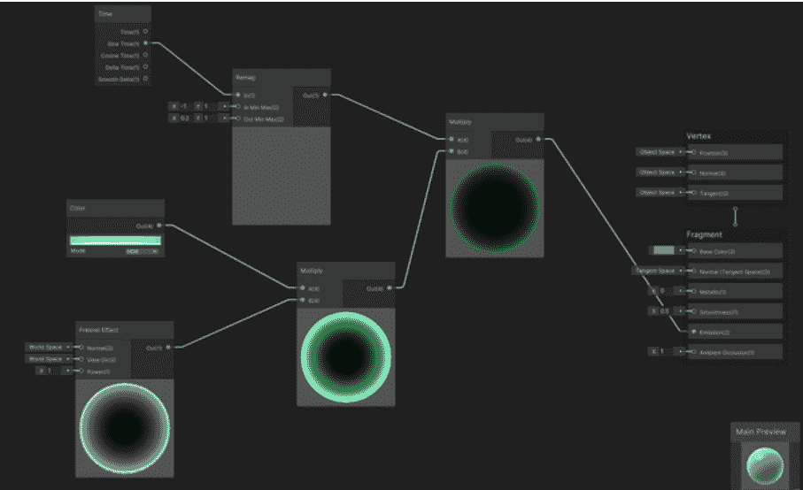

图 6-18. 随时间变化的完成着色器图

运行游戏时，光晕会随时间渐隐渐现。

### 讨论

在这个着色器中，Remap 节点是必需的，因为 Sine Time 节点产生 –1 到 1 之间的数字，而 Emission 值期望的是 0 或更高的值。可以提供负数，但效果极差。要修复此问题，Remap 可以调整值，使其介于 0 和 1 之间。

对于这个着色器，我们还行使了艺术创作自由，将最小值设为 0.2 而非 0，因为我们觉得完全没有光晕看起来很奇怪。Shader Graph 工具最有用的功能之一，就是可以不断调整和微调着色器，直到获得想要的结果，所以不要害怕进行实验。

## 6.14 控制动画着色器的速度

### 问题

你有一个使用 Time 节点随时间更改值的动画着色器，并希望使其变得更快或更慢。

### 解决方案

要控制动画着色器的速度：

- 1. 使用像 **图 6-18** 中那样的 Time 节点。
- 2. 创建一个新的 Multiply 节点。
- 3. 将 Time 节点的 Time 输出（而非 Sine Time 或任何其他输出）以及一个 Float 输入或属性都连接到 Multiply 节点。如果希望速度加快，请将 Float 设置为大于 1；如果希望减速，设置为小于 1；如果希望反向播放，设置为小于 0。
- 4. 将 Multiply 节点的输出连接到一个新的 Sine 节点（Math → Trigonometry → Sine）。
- 5. 像在任何其他动画中一样使用 Sine 节点的输出。

### 讨论

在 Shader Graph 工具中，Vector1 属性与浮点数是同一个东西——它是只有一个分量的向量，这与普通数字相同。

在这个着色器中，我们将时间（即游戏开始以来的秒数）乘以一个常数值，然后对其取正弦。Time 节点提供一个 Sine Time 输出，但我们不能为此目的使用它——如果将其乘以一个常数，它不会振荡得更快，而是会跨越更宽的范围。图 6-19 说明了这一点：虚线表示时间的正弦（y = sin(t)），在正常范围和速率下振荡；实线表示 2 倍时间的正弦（y = sin(2t)），在……的速率下振荡


正常范围，但速率加倍；而虚线，时间正弦的 2 倍（y = 2 * sin(t)），以宽范围和正常速率振荡。

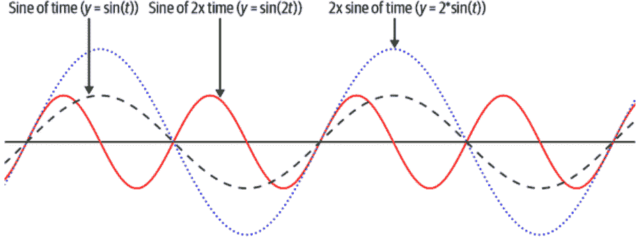

图 6-19. 振荡范围和速率

## 6.15 使用子图复用图组件

### 问题

您希望通过重用常见节点模式来简化着色器图。

### 解决方案

使用子图，它是一组节点，您可以将其存储在文件中并在其他图中重用。子图在您的图中显示为单个“节点”。

要创建子图，请按照以下步骤操作：

- 1. 打开“资源”菜单，然后选择 创建 → 着色器图 → 子图。
- 2. 单击着色器图窗口右上角的“图检查器”按钮，打开“图检查器”。
- 3. 单击 + 按钮并创建新输出，向“输出”节点添加输出。
- 4. 构建您的节点，就像制作着色器一样。不同之处在于，输出不会被发送到“片元”节点来执行光照计算，而是当子图嵌入到另一个着色器时，结果会作为节点的输出公开。当您将节点的输出拖放到一个插槽上时，该插槽将采用传入值的类型。

要使用子图，请保存它，打开要在其中使用的着色器，然后按空格键打开“节点”菜单。输入子图的名称，它将显示为一个新节点。

### 讨论

基于节点的系统很容易变得过于复杂，而子图对于保持条理至关重要。

> **提示**
>
> 子图可以具有属性，就像其他着色器一样。您创建的任何属性都将显示为子图的输入。

例如，图 6-20 显示了一个子图，它生成在黑白之间淡出的纯色，速度可通过“速度”属性配置。图 6-21 显示了在另一个着色器中使用的子图。子图节点位于左下角；由于它具有“速度”属性，该值显示为节点的输入。

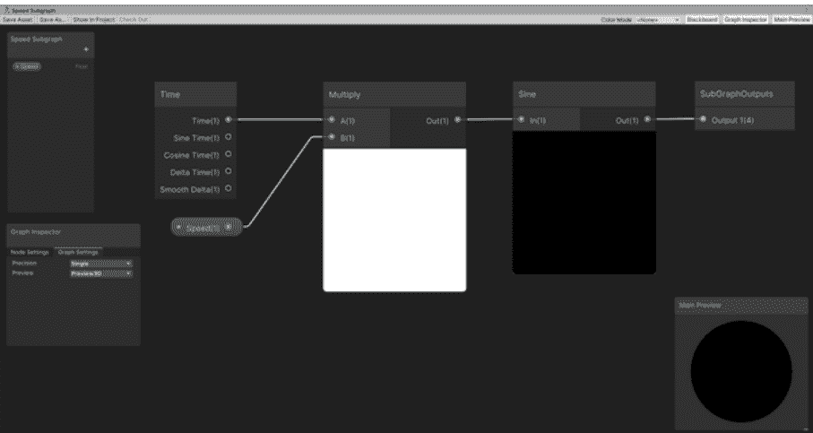

图 6-20. 生成在黑白之间淡出纯色的子图

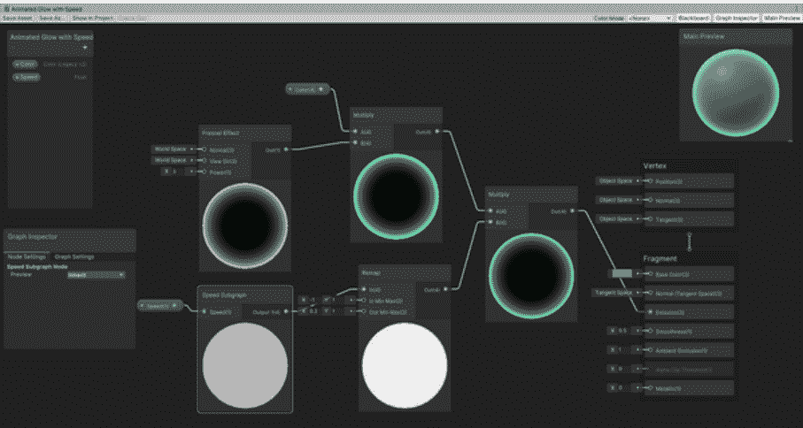

图 6-21. 在另一个着色器中使用的子图

## 6.16 使用着色器图实现溶解效果

### 问题

您希望创建一种效果，其中物体的各个部分逐渐消失。您希望效果的边缘发光。

### 解决方案

按照以下步骤在着色器图工具中构建可实现此效果的着色器：

- 1. 按照配方 6.10 的说明创建一个新的 Lit URP 着色器图。将新着色器图命名为“Dissolve”。
- 2. 打开“图检查器”，转到“图设置”选项卡。向下滚动到“表面类型”，将其从“不透明”更改为“透明”。接下来，打开“Alpha 裁剪”。

这将向“片元”节点添加两个新端口，分别名为“Alpha”和“Alpha 裁剪阈值”。当片元的 Alpha 值低于 Alpha 裁剪阈值时，该片元将不被渲染。

- 3. 创建三个属性（参见配方 6.12）：名为“边缘颜色”的颜色，名为“溶解量”的 Float，以及名为“边缘厚度”的 Float。将所有三个属性拖出到图中，以便每个属性都有自己的节点。
- 4. 选择“溶解量”属性，并在“图检查器”的“节点设置”选项卡中，将其默认值设置为 0.5。
- 5. 选择“边缘厚度”属性，并将其默认值设置为 0.05。
- 6. 选择“边缘颜色”属性，并将其默认值设置为 Alpha 值为 100 的亮蓝色。
- 7. 创建一个简单噪声节点（程序化 → 噪声 → 简单噪声）。将其 Out 插槽连接到“片元”节点的 Alpha 插槽，并将其 Scale 设置为 50。
- 8. 将“溶解量”连接到“片元”节点的 Alpha 裁剪阈值插槽。

当您增加“溶解量”值时，物体的部分将消失。

以下步骤创建发光边缘效果：

- 1. 创建一个加法节点（数学 → 基本 → 加法）。
- 2. 将“边缘厚度”和“溶解量”属性连接到它。
- 3. 创建一个阶跃节点（数学 → 舍入 → 阶跃）。
- 4. 将简单噪声的 Out 插槽连接到阶跃的 Edge 输入。
- 5. 将加法节点的 Out 插槽连接到阶跃的 In 输入。

如果将阶跃的 out 插槽连接到“片元”节点的 Emission 输入，您会看到物体溶解部分周围有一个白色边缘。为了控制颜色，我们将此边缘与颜色相乘：

- 1. 创建一个新的乘法节点。
- 2. 将其输出连接到“片元”节点的 Emission 插槽，并将“阶跃”和“边缘颜色”属性连接到其输入。

您的溶解着色器现已完成；完成的图应该类似于图 6-22。

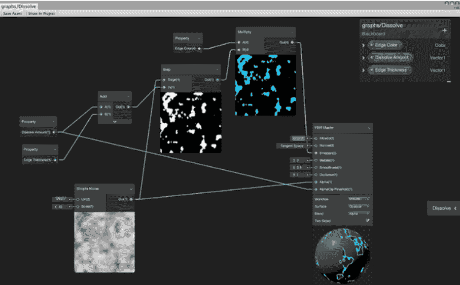

图 6-22. 溶解效果的着色器图

您现在可以创建一个使用此着色器的新材质；当您将“溶解量”值从 0 更改为 1 时，物体将缓慢溶解（图 6-23）。

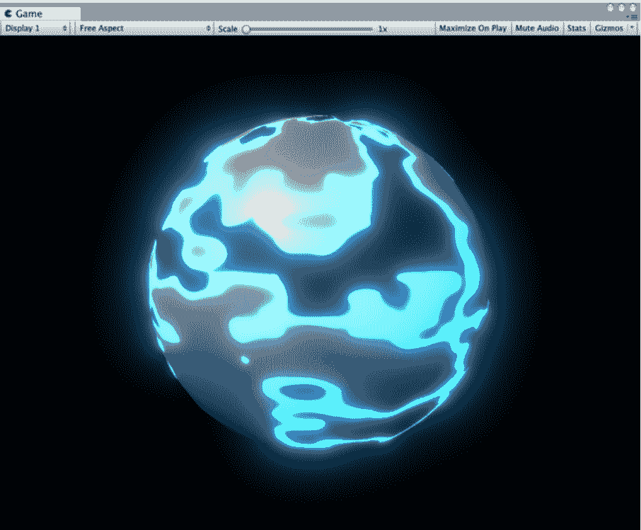

图 6-23. 图像正在溶解；我们还设置了相机以使用泛光效果

### 讨论

着色器的表面模式可以是“不透明”或“透明”。当着色器处于“透明”模式时，它接收到的 Alpha 值用于控制表面的不透明度；当它处于“不透明”模式时，所有绘制的像素都是完全不透明的。

然而，这并不意味着 Alpha 被忽略。在此着色器中，我们将 Alpha 裁剪阈值与 Alpha 值结合使用，以确定表面的哪些部分根本不被渲染。任何 Alpha 值低于 Alpha 裁剪阈值的像素都会被完全丢弃，根本不绘制。由于 Alpha 值取决于简单噪声节点，物体的不同部分具有高于或低于阈值的 Alpha 值。通过更改 Alpha 裁剪阈值，您可以让物体的更多或更少部分出现。

简单噪声节点生成平滑变化的二维噪声模式。如果您修改节点的比例，结果中将包含更多或更少的细节，这意味着更细或更粗的碎片。试试看！

最后，为了创建轮廓效果，我们首先将“边缘厚度”属性添加到溶解量中，这会使溶解效果的边界略微前移。然后，我们使用阶跃节点创建一个图像，在边界边缘周围绘制指定厚度的线，并将其与“边缘颜色”属性相乘。然后将其用作“片元”节点上的 Emission 属性，在溶解区域周围创建发光边缘。

> 注意
>
> 如果您设置相机以使用泛光后处理效果（参见配方 6.6），并通过将模式设置为 HDR 使“边缘颜色”成为 HDR 颜色，则可以在溶解效果上获得不错的发光效果。

您可以通过修改“边缘厚度”和颜色属性来调整效果。

> 提示
>
> 如果您使用橙色，则很容易实现火焰效果。

## 6.17 使用烘焙光照和实时光照

### 问题

您希望使用 Unity 的烘焙光照系统，该系统可让您创建高质量的阴影和反射光。

### 解决方案

如果场景中至少有一个对象标记为对场景全局照明 (GI) 数据有贡献，Unity 将自动为您的场景计算烘焙光照方案。为此，请按照以下步骤操作：

- 1. 选择要进行光照贴图的对象（或对象）。
- 2. 在“检查器”右上角，单击下拉菜单，然后选择“参与 GI”。

Unity 的光照贴图生成器将开始计算场景中的烘焙光照。这可能需要一些时间，具体取决于场景的复杂性。

> 警告
>
> 对全局照明有贡献的对象不允许移动，因为如果移动，光照不会相应调整。如果对象既需要能够移动，又需要表现得像是从静态对象接收光照，则需要使用光照探针；参见配方 6.20。

### 讨论

烘焙光照是预先计算光线在环境中如何反弹的过程。与必须尽可能快速工作的实时光照不同，烘焙光照有足够的时间（通常是几分钟或几小时）来完成计算。由于有了这额外的时间，它可以对离开场景中光源并在关卡中反弹的虚拟光子进行路径追踪。在进行这些计算的过程中，会生成存储物体各个部分接收到的光量的纹理；在运行时，这些纹理用于模拟光照。


烘焙光照通常看起来比实时光照更好（示例见图 6-24），但灵活性较低。因为纹理是在游戏开始前生成的，并且创建需要耗费大量时间，因此无法在游戏过程中修改。如果投射烘焙阴影的对象移动，阴影不会随之移动。

在图 6-24 中，我们看到左侧的立方体使用实时光照，右侧的立方体使用烘焙光照。请注意右侧立方体的阴影更逼近；它在立方体底部附近更清晰，远离处则更模糊，而使用实时光照的立方体的阴影在边缘的所有点都具有相同的模糊度。

除了 Contribute GI 之外，还有多种静态模式。如果你知道某个对象永远不会移动——也许它是关卡中的固定景观——你可以单击 Inspector 右上角的 Static 复选框，一次性启用所有静态模式。这意味着 Unity 可以启用其他优化，包括能够一次批量渲染共享材质的多个对象。

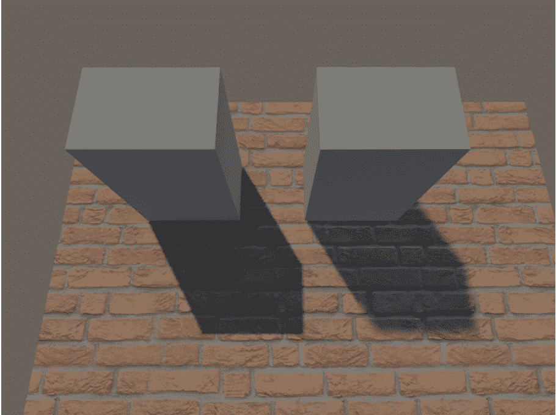

图 6-24. 实时光照与烘焙光照

## 6.18 使用烘焙发光源

### 问题

你希望在使用烘焙光照的场景中创建发光物体。例如，你希望在场景中创建一个灯。

### 解决方案

创建具有发光颜色的材质。将发光 HDR 颜色的强度设置为 1 或更高。将此材质应用于设置为 Contribute GI 的对象。当光照贴图计算光照时，来自发光物体的光将照亮其他静态对象。在图 6-25 中，场景中唯一的光来自中心的发光物体。相机上的泛光效果完成了明亮物体的效果。

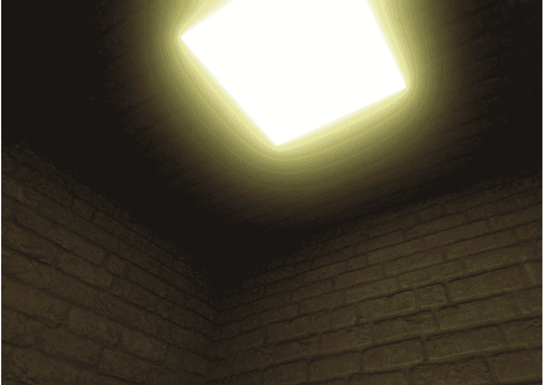

图 6-25. 发光光照

### 讨论

除了投射漂亮的阴影和创造吸引人的光线反弹之外，你还可以使用发光物体向场景中引入光照，前提是它们是静态的。不过，请记住，光照是“假的”——它不会影响不参与全局光照的对象。如果你希望实时对象响应此烘焙光照，你需要使用光照探针（参见配方 6.20），或者添加仅影响使用实时光照的对象的实时光源（参见配方 6.22）。

## 6.19 使静态对象在动态对象上投射阴影

### 问题

你有一个静态对象（即，它参与全局光照），并且希望它在不参与 GI 的对象（即，*动态*对象）上投射阴影。示例见图 6-26，其中三个立方体和球体放置在砖块表面上。左侧，静态立方体投射高质量阴影，该阴影不影响球体。中间，实时立方体投射质量较低但影响球体的阴影。右侧，一个静态立方体和一个设置为仅渲染阴影、形状和大小相同的立方体位于同一位置，因此阴影质量较高，并且部分阴影仍会应用到球体上。

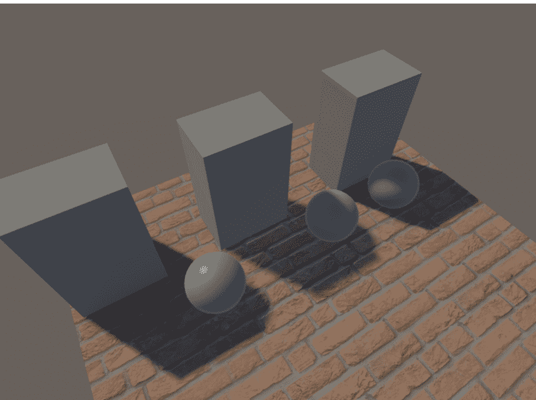

图 6-26. 三个立方体投射阴影

### 解决方案

要使静态对象在动态对象上投射阴影：

- 1. 选择要从中投射实时阴影的网格，并复制它。确保它与原始对象具有相同的大小、形状和位置。（考虑将其设为原始对象的子对象。）
- 2. 关闭 Contribute GI，以便它投射实时阴影。
- 3. 移除了除了 MeshRenderer 以外的所有组件。
- 4. 将 MeshRenderer 的 Cast Shadows 属性设置为 Shadows Only。

这意味着它不会出现在场景中，但会在其他对象上投射阴影。

### 讨论

另一种解决方案是使用光照探针。在阴影区域内部和外部放置光照探针；这会使进入阴影区域的对象变暗，尽管你不会看到阴影的边缘（它会只是均匀变暗）。效果不够好，但渲染成本更低。

> **注意**
> 另一种方法是设计场景布局，使静态对象根本不会在实时对象上投射阴影。

## 6.20 使用光照探针影响光照

### 问题

你希望使用光照探针，使实时对象被来自烘焙光照物体反弹的光照照亮。

### 解决方案

通过打开 GameObject 菜单并选择 Light → Light Probe Group 来创建光照探针组。这将创建一组探针；你可以选择每个单独的探针并重新定位它。光照探针受实时光照和烘焙光照的影响。实时对象将使用附近的光照探针来计算它们应该如何被照亮。在图 6-27 中，场景中没有实时光源；相反，光源附近的光照探针捕获光线如何影响每个点上的物体，圆柱体正在使用该信息来为自身照明。图 6-28 显示了此处设置的光照探针。

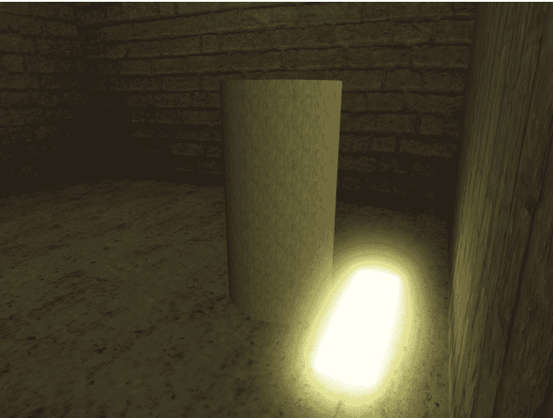

图 6-27. 由烘焙发光物体照亮的实时圆柱体

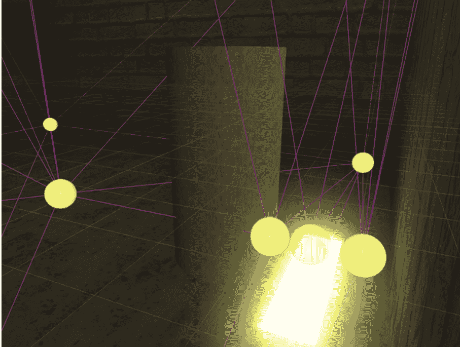

图 6-28. 图 6-27 中使用的光照探针

### 讨论

不参与全局光照的对象无法接收烘焙光照，因为光照在游戏过程中并不“真实存在”——相反，光照被写入纹理，静态对象从纹理读取以模拟光照落在其上的效果。这意味着使用实时光照的对象可能与周围环境显得不协调，因为没有任何光照信息，它只会受到全局环境（例如天空盒或环境光源）的照亮。为解决此问题，你可以为每个烘焙光源创建一个实时光源，或将每个光源设置为 Mixed（即它实际上同时充当烘焙光源和实时光源），但这可能会影响性能——尤其是当你有大量光源，并且在无法使用延迟渲染（一种显著降低多个光源开销的渲染技术）的低功耗设备上进行渲染时。

> 注意
> 本书不介绍延迟渲染，但你可以在 Unity 文档中了解更多信息。

光照探针是解决此问题的方案，它们允许使用实时光照的对象近似模拟如果光照已烘焙时所会经历的光照条件。光照探针通过在烘焙过程中测量经过给定点的烘焙光照量并存储它来实现此功能；在游戏过程中，你的实时光照对象会从一组光照探针中采样，并渲染自身，仿佛附近有光源一样。

> 提示
> 为获得最有效的效果，请在预期会有实时对象出现的区域以及光照强度发生突变区域附近放置光照探针。

## 6.21 使用反射探针

### 问题

你希望使用反射探针，使反射材质看起来更逼真并反射周围的场景。

### 解决方案

创建反射探针不需要多少步骤，并且可以显著改善你的光泽和反射物体，因为它们将能够反射周围的世界：

- 1. 首先，通过打开 GameObject 菜单并选择 Light → Reflection Probe 来创建反射探针。
- 2. 接下来，将探针放置在你希望拥有反射效果的区域中心附近。

> **注意**
> 你可以创建多个反射探针。如果这样做，附近的反射物体将在它们之间混合。

为测试探针，请按以下步骤创建一个光泽金属球体：

- 1. 通过打开 GameObject 菜单并选择 3D Object → Sphere 来创建新球体。
- 2. 将球体放置在反射探针附近（或将反射探针移动到球体附近）。
- 3. 通过打开 Assets 菜单，然后选择 Create → Material 来创建新材质。
- 4. 将新材质命名为“Shiny metal”。
- 5. 将材质拖动到你添加的球体上。
- 6. 选择材质，并将 Smoothness 值提高到约 0.8。这样做时，球体会变得光泽，并通过采样反射探针所见视图来反射附近物体。图 6-29 显示了一个光泽金属球体，反射周围的房间。它的反射来自附近的反射探针（未显示）。我们还添加了一点纹理，以获得更好的外观。


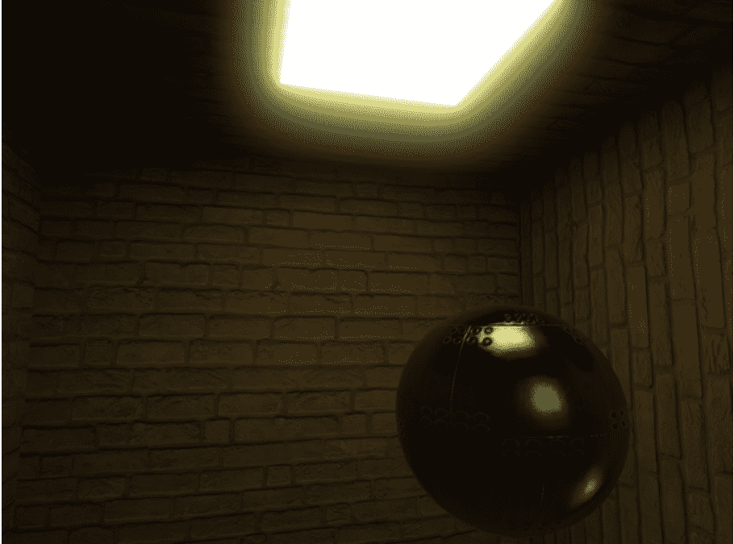

图 6-29. 一个反射周围房间的光泽金属球体

## 讨论

在实时渲染中，精确的反射很难实现。在现实世界中，反射发生在光线均匀地从光滑表面反射时，这意味着可以获得清晰对焦的图像。这意味着在光线追踪渲染器中，反射很容易实现，因为它们追踪光线在场景中反射的路径。然而，大多数实时渲染器不追踪光线，主要原因是需要的计算能力很大。相反，它们执行近似计算：不再将虚拟光子弹射到物体上，而是将其划分为多边形，计算多边形顶点相对于相机位置的位置，并确定该多边形重叠的像素位置。然后，渲染器求解渲染方程，这是根据点的位置、材质和附近光源信息来确定点颜色和亮度的几种简化近似方法之一。

总而言之，反射很难计算，为了在普通硬件上实现实时性能，通常都是假装的。有几种假装反射的方法。一种方法是由20世纪90年代末期的《Deus Ex》等游戏推广的，其创新方法是将浴室镜子和光泽地板设为半透明，在另一侧创建房间的复制翻转副本，并进行一些技巧处理，以确保“反射”副本世界中的所有对象都与“真实”世界中的位置相同。在图 6-30 中，抛光石材地板看起来有反射，但实际上它是半透明的，下方还有一个相同房间的复制的倒置版本。这种方法足够好用，但要逼真地实现可能很困难，而且小错误很容易变得非常明显——著名的是，《Deus Ex》中主览이的手从来都不在他反射的手的同一位置。此外，因为反射的房间实际上存在，这限制了关卡设计师的灵活性——例如，你不能在一个房间上方放置另一个带有光泽石材地板的房间。

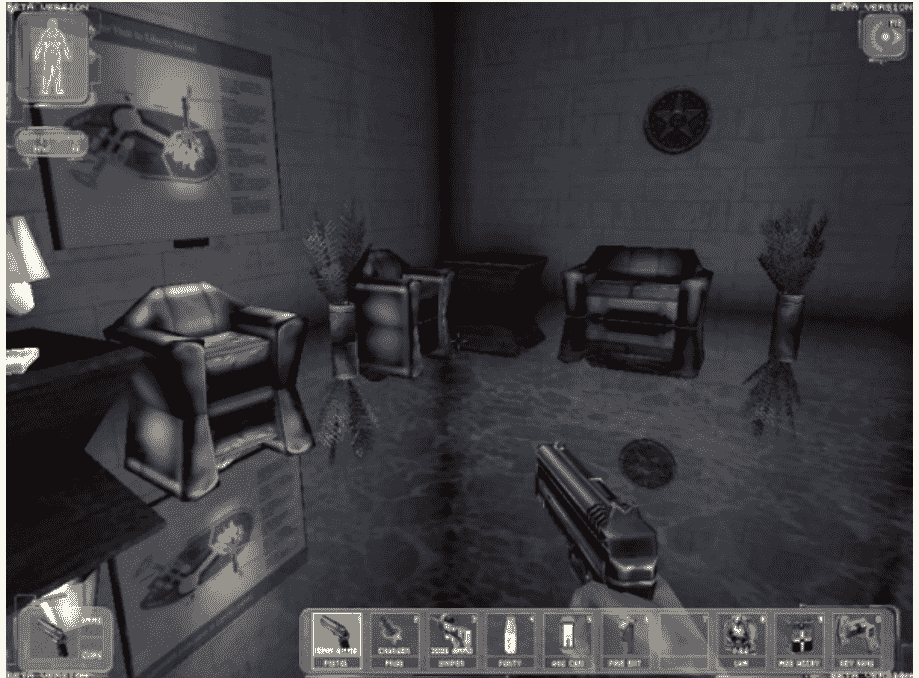

图 6-30. 《Deus Ex》中的反射（Ion Storm Austin/Eidos Interactive）

更准确的方法是渲染两次场景——一次用于主视图，一次从反射表面的另一侧翻转渲染（如《Uncharted 4》所做；参见图 6-31）。这样更好，因为它避免了重复几何体的问题，但也有一个相当糟糕的副作用：只要镜子在视野中，每一帧都会渲染两次相同的场景。这意味着带有镜子的场景需要非常仔细地构建，以最大限度地减少性能损失。

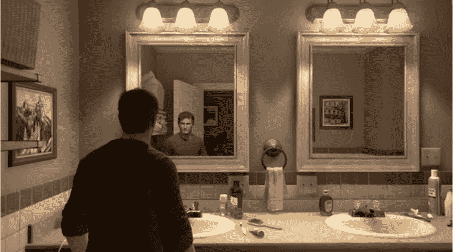

图 6-31. 《Uncharted 4: A Thief's End》中的镜子反射（Naughty Dog/Sony Interactive Entertainment）

但是，游戏中不是所有反射都是镜子。有时，你只需要一个光泽表面、一个湿地板，或者一块本应透视而非凝视的玻璃产生的模糊反射。在这种情况下，反射细节不需要精确，因为表面粗糙度意味着清晰图像也不会清晰。

这意味着反射可以事先生成，并且可能来自不同的位置。只需要从单一点向所有方向渲染一张快照即可。只要快照拍摄点与执行反射的物体相当接近，看起来就没问题。如果反射确实需要更改，可以更改反射探针的更新模式以进行实时更新，但会有性能代价。

注意
多次渲染场景的代价也是为什么为虚拟现实设计的游戏需要更加谨慎地对待性能。在为 VR 头显渲染时，每只眼睛都需要看到场景的不同视图，这意味着整个场景需要为每只眼睛分别渲染。

## 6.22 假装动态自发光物体

### 问题

你有一个具有自发光颜色的实时物体，并且希望它照亮其他物体。

### 解决方案

假装它。创建一个实时光源，并将其作为子对象添加。使其颜色与自发光颜色相同，并且如果放置位置正确，玩家不会意识到照亮其他物体的并不是自发光。图 6-32 展示了一个带有发光效果的物体，其中内部有一个点光源，既照亮了静态墙壁，也照亮了旁边的实时物体。图 6-33 展示了同一物体，但禁用了光源。效果不那么令人信服了。

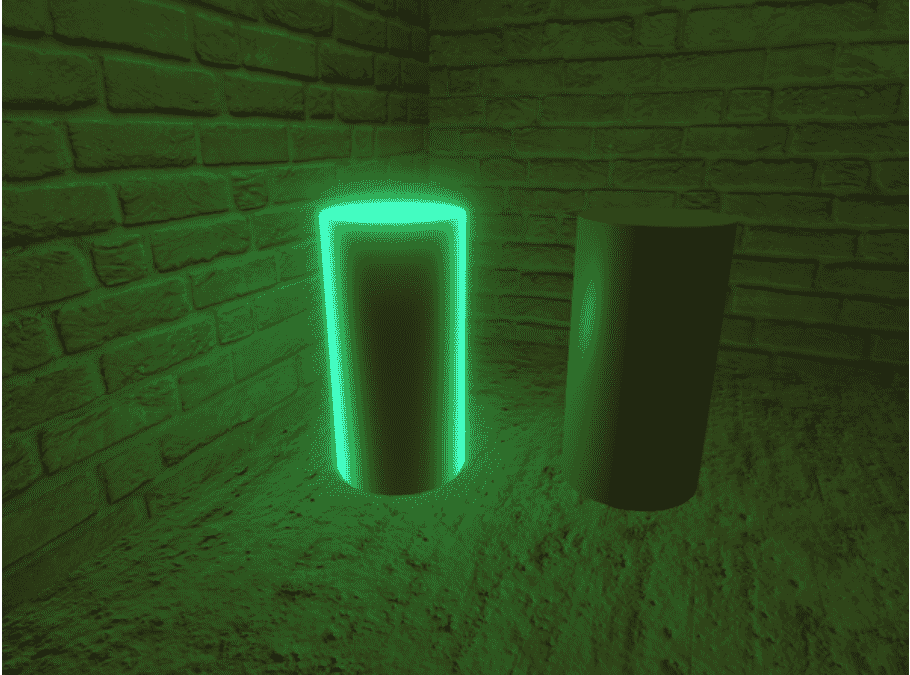

图 6-32. 一个带有发光效果的物体，内部有一个点光源

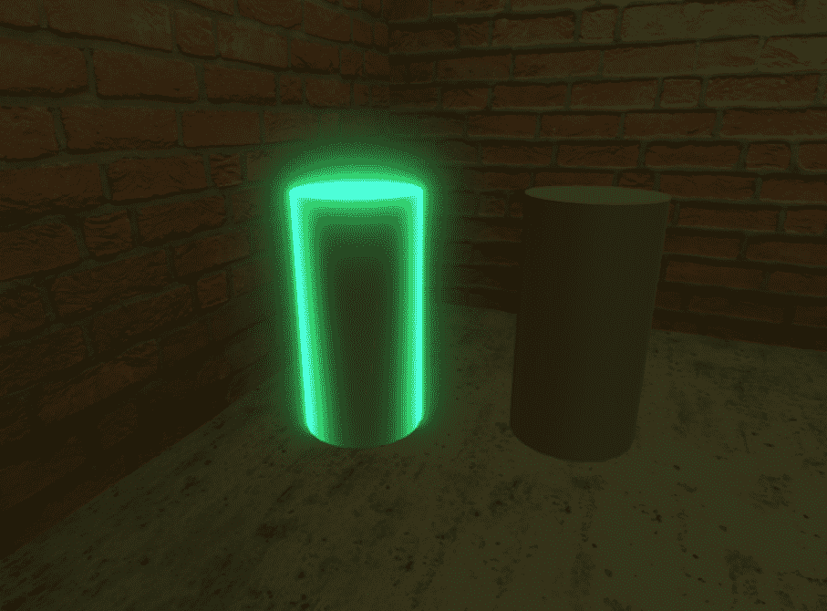

图 6-33. 禁用光源后的同一物体

## 讨论

请记住，所有不试图物理模拟光线反射的计算机图形学都纯粹是伪装。对玩家来说，真正正确的物体和仅仅看起来正确的物体之间没有区别。

## 6.23 渲染到纹理

### 问题

你想将相机的视图渲染到纹理，并在场景中使用该纹理。

### 解决方案

渲染纹理可以作为资产创建。当游戏未运行时，它们不包含任何有用内容，但你可以利用它们是资产这一事实，作为一种便捷方式来确保你的组件使用正确的纹理。

有了渲染纹理后，你可以配置相机将其渲染到该纹理（渲染到渲染纹理的相机不会渲染到屏幕）：

- 1. 打开资源菜单并选择 Create → Render Texture 来创建新的渲染纹理。
- 2. 为新的渲染纹理起任何你喜欢的名字。
- 3. 打开游戏对象菜单并选择 Camera 来创建新的相机。
- 4. 将新相机命名为“Render Texture Camera”，以便与主场景相机区分开来。
- 5. 将渲染纹理资产拖放到 Render Texture Camera 的目标纹理插槽上。

现在，Render Texture Camera 将渲染到纹理，而不是屏幕；该纹理现在可以像任何其他纹理一样使用。例如，你可以将此纹理用作材质的一部分；任何使用此材质的渲染器都会绘制来自 Render Texture Camera 的视图。要实现此效果，请执行以下步骤：

- 1. 打开资源菜单并选择 Create → Material 来创建新的材质。
- 2. 为新材质起任何你喜欢的名字。
- 3. 选择材质。
- 4. 将先前创建的渲染纹理资产拖放到材质的 Albedo 插槽上。

最后，我们将创建一个游戏对象来渲染该材质：

- 1. 打开游戏对象菜单并选择 3D Object → Quad 来创建用于渲染材质的新四边形。
- 2. 将材质拖放到你刚刚创建的四边形上。

四边形将显示相机看到的视图（参见图 6-34 和 6-35）。尝试移动 Render Texture Camera 以查看变化。

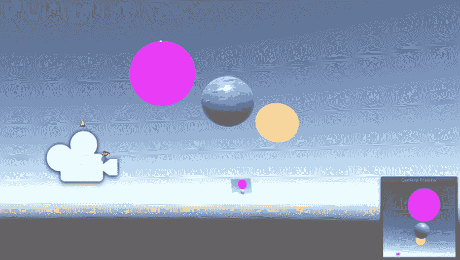

图 6-34. 设置为渲染到纹理的相机

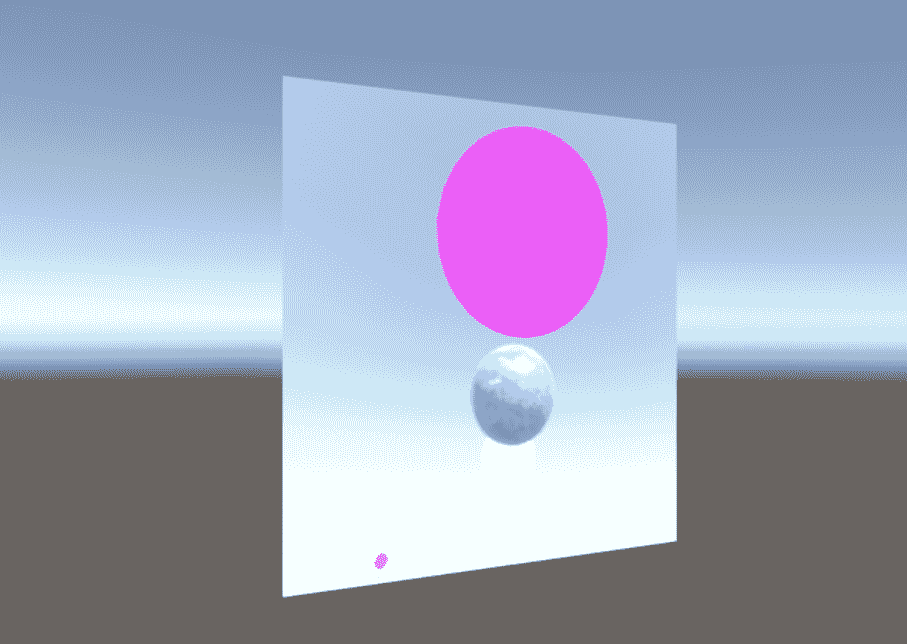

图 6-35. 应用到场景中对象上的渲染纹理；从相机可见的对象被绘制到对象表面上

## 讨论

渲染纹理的默认分辨率为 256×256，但你可以通过选择资产并在检查器中修改其大小来更改它。

不要忘记渲染纹理会占用内存——纹理越大，占用的内存就越多。
