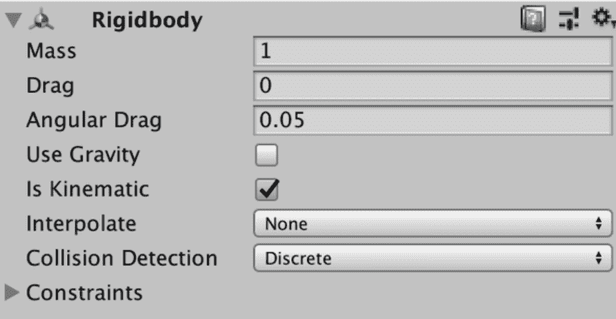

# 第 7 章 3D 物理与角色控制

物理是许多视频游戏的关键组件。无论你的游戏是 2D 还是 3D，或者介于两者之间，你总会在某种时候依赖某种形式的物理力模拟。

物理模拟最有趣的事情之一是，你可以免费获得大量有趣的游戏机会。人类存在于一个物理的三维世界中，当游戏拥有玩家每天都会与之交互的“机制”时，玩家很容易与你的游戏产生共鸣。

为此，本章将探讨构建游戏系统的方法，这些系统允许在物理模拟的 3D 环境中进行角色控制，重点放在第一人称控制上。

**注意**

Unity 有两个物理系统：一个专为 2D 物理设计（我们在第 5 章中讨论），另一个专为 3D 物理设计。本章讨论的是 3D 物理系统。

## 7.1 每秒运行代码特定次数

### 问题

你想编写每秒运行固定次数的代码。

### 解决方案

将代码放入脚本的 FixedUpdate 方法中。


## 讨论

在你的脚本中，Update 方法每帧都会被调用，这使其非常适合几乎所有需要定期更新的内容。

Update 并非以固定频率调用；它取决于渲染每帧所需的时间。如果场景变得更加复杂，每秒的 Update 调用次数会发生变化。

相比之下，FixedUpdate 每秒被调用固定次数。这使其非常适合物理模拟，因为当物理模拟更新之间的时间流逝率保持相同时，物理模拟表现更好。

> 注意
>
> 这并不意味着 FixedUpdate 调用之间会流逝相同的实际时间；Unity 只保证每秒会发生相同次数的 FixedUpdate 调用。

如果你想以与物理相同的频率更新某物，请将代码放在 FixedUpdate 中。如果与物理对象交互的对象没有以与物理对象相同的速率更新，你可能会遇到奇怪的抖动行为，而且手感不好。

## 7.2 使用鼠标让玩家环顾四周

### 问题

在第一人称风格的游戏中，你希望能够使用鼠标控制玩家观看的方向。

### 解决方案

允许玩家使用鼠标控制第一人称视图，传统上称为 mouselook。

> **注意**
> MouseLook 有时也称为 *自由视角*，因为它不必明确绑定到鼠标控制：
> 它可以应用于 D-pad、操纵杆、模拟摇杆或类似设备的控制。

实现 mouselook 涉及旋转两个独立对象：身体和头部。身体围绕 y 轴（也称为 "yaw" 轴——从下到上的线）旋转，而头部围绕 x 轴（从左到右的线）旋转。在第一人称游戏中，相机附加到头部，如下所示：

- 1. 创建一个新的空游戏对象。将其命名为 "Player"。
- 2. 找到主相机对象。如果你没有，打开 GameObject 菜单并选择 Camera。
- 3. 将相机对象拖入 Player 对象，并将其重命名为 "Head"。
- 4. 将 Head 对象定位到你希望头部所在的位置。为了获得最佳效果，不要修改位置的任何分量，除了 y 分量；其他分量应为 0。这意味着相机将直接位于身体中心的上方。
- 5. 创建一个名为 *MouseLook.cs* 的新 C# 脚本，使用以下代码：

```csharp
// Implements mouselook. Horizontal mouse movement rotates the body
// around the y-axis, while vertical mouse movement rotates the head
// around the x-axis.

public class MouseLook : MonoBehaviour
{

// The speed at which we turn. In other words, mouse sensitivity.
[SerializeField] float turnSpeed = 90f;

// How far up the head can tilt, measured in angles from dead-
// level. Must be higher than headLowerAngleLimit.
[SerializeField] float headUpperAngleLimit = 85f;

// How far down the head can tilt, measured in angles from dead-
// level. Must be lower than headLowerAngleLimit.
[SerializeField] float headLowerAngleLimit = -80f;

// Our current rotation from our start, in degrees
float yaw = 0f;
float pitch = 0f;

// Stores the orientations of the head and body when the game
// started. We'll derive new orientations by combining these
// with our yaw and pitch.
Quaternion bodyStartOrientation;
Quaternion headStartOrientation;

// A reference to the head object–the object to rotate up and down.
// (The body is the current object, so we don't need a variable to
// store a reference to it.) Not exposed in the interface; instead,
// we'll figure out what to use by looking for a Camera child object
// at game start.
Transform head;

// When the game starts, perform initial setup.
void Start()
{
    // Find our head object
    head = GetComponentInChildren<Camera>().transform;

    // Cache the orientation of the body and head
    bodyStartOrientation = transform.localRotation;
    headStartOrientation = head.transform.localRotation;

    // Lock and hide the cursor
    Cursor.lockState = CursorLockMode.Locked;
    Cursor.visible = false;
}

// Every time physics updates, update our movement. (We do this in
// FixedUpdate to keep pace with physically simulated objects. If
// you won't be interacting with physics objects, you can do
// this in Update instead.)
void FixedUpdate()
{

    // Read the current horizontal movement, and scale it based on
    // the amount of time that's elapsed and the movement speed.
    var horizontal = Input.GetAxis("Mouse X")
        * Time.deltaTime * turnSpeed;

    // Same for vertical.
    var vertical = Input.GetAxis("Mouse Y")
        * Time.deltaTime * turnSpeed;

    // Update our yaw and pitch values.
    yaw += horizontal;
    pitch += vertical;

    // Clamp pitch so that we can't look directly down or up.
    pitch =
        Mathf.Clamp(pitch, headLowerAngleLimit, headUpperAngleLimit);

    // Compute a rotation for the body by rotating around the y-axis
    // by the number of yaw degrees, and for the head around the
    // x-axis by the number of pitch degrees.
    var bodyRotation = Quaternion.AngleAxis(yaw, Vector3.up);
    var headRotation = Quaternion.AngleAxis(pitch, Vector3.right);

    // Create new rotations for the body and head by combining them
    // with their start rotations.
    transform.localRotation = bodyRotation * bodyStartOrientation;
    head.localRotation = headRotation * headStartOrientation;
}
}
```

- 6. 将 MouseLook 组件附加到身体。
- 7. 运行游戏。移动鼠标将旋转身体和头部。

## 讨论

通过分离头部和身体旋转，这种定向玩家视角的方法避免了“翻滚”视图的问题——如果对象先向下俯仰，然后向侧面“偏航”，就可能发生这种情况，这会产生围绕前向轴旋转的方向。

> 注意
>
> 如果你希望 mouselook 是反向的，只需将 Input.GetAxis("Mouse Y") 的值乘以 -1。

## 7.3 控制 3D 角色

### 问题

你想要在 3D 空间中控制一个角色。

### 解决方案

你通常会先从 mouselook 开始，因为如果没有转身的能力，你只能向前、向后和左右移动。我们假设你已遵循配方 7.2 中的步骤。

实现 mouselook 后，我们将添加一些功能：

- 1. 向 Player 对象添加 CharacterController 组件。
- 2. 将 Head 对象移动到 CharacterController 的顶部。
- 3. 创建一个名为 Movement.cs 的新 C# 脚本，并向其中添加以下代码：

```csharp
// Implements character controller movement.
public class Movement : MonoBehaviour {

    // The speed at which we can move, in units per second.
    [SerializeField] float moveSpeed = 6;

    // The height of a jump, in units.
    [SerializeField] float jumpHeight = 2;

    // The rate at which our vertical speed will be reduced, in units
    // per second.
    [SerializeField] float gravity = 20;

    // The degree to which we can control our movement while in midair.
    [Range(0, 10), SerializeField] float airControl = 5;

    // Our current movement direction. If we're on the ground, we have
    // direct control over it, but if we're in the air, we only have
    // partial control over it.
    Vector3 moveDirection = Vector3.zero;

    // A cached reference to the character controller, which we'll be
    // using often.
    CharacterController controller;

    void Start()
    {
    controller = GetComponent<CharacterController>();
    }
}
```

// We do our movement logic in FixedUpdate so that our movement
// can happen at the same pace as physics updates. If it didn't,
// we'd see jitter when we interact with physics objects that can
// move around.
void FixedUpdate () {

// The input vector describes the user's desired local-space
// movement; if we're on the ground, this will immediately
// become our movement, but if we're in the air, we'll
// interpolate between our current movement and this vector, to
// simulate momentum.
var input = new Vector3(
    Input.GetAxis("Horizontal"),
    0,
    Input.GetAxis("Vertical")
);

// Multiply this movement by our desired movement speed
input *= moveSpeed;

// The controller's Move method uses world-space directions, so
// we need to convert this direction to world space
input = transform.TransformDirection(input);

// Is the controller's bottommost point touching the ground?
if (controller.isGrounded)
{
    // Figure out how much movement we want to apply in local
    // space.
    moveDirection = input;
}
}
```


```
// Is the user pressing the jump button right now?
if (Input.GetButton("Jump"))
{
    // Calculate the amount of upward speed we need,
    // considering that we add moveDirection.y to our height
    // every frame, and we reduce moveDirection.y by gravity
    // every frame.
    moveDirection.y = Mathf.Sqrt(2 * gravity * jumpHeight);
} else {
    // We're on the ground, but not jumping. Set our
    // downward movement to 0 (otherwise, because we're
    // continuously reducing our y-movement, if we walk off
    // a ledge, we'd suddenly have a huge amount of
    // downward momentum).
    moveDirection.y = 0;
}
} else {
    // Slowly bring our movement toward the user's desired
    // input, but preserve our current y-direction (so that the
    // arc of the jump is preserved)
    input.y = moveDirection.y;
    moveDirection = Vector3.Lerp(moveDirection, input,
        airControl * Time.deltaTime);
}

// Bring our movement down by applying gravity over time
moveDirection.y -= gravity * Time.deltaTime;

// Move the controller. The controller will refuse to move into
// other colliders, which means that we won't clip through the
// ground or other colliders. (However, this doesn't stop other
// colliders from moving into us. For that, we'd need to detect
// when we're overlapping another collider, and move away from
// them. We'll cover this in another recipe!)
controller.Move(moveDirection * Time.deltaTime);
}
}

- 4. 将 Movement 组件附加到你的 Player 对象。
- 5. 运行游戏。按方向键或 W、A、S、D 键会移动玩家（除非你自定义了输入系统）。你也可以按空格键跳跃。

## 讨论

为你的游戏实现一个完全物理正确的控制设置当然是可能的，其中玩家被模拟为刚体，并通过对该施加力来移动。但是，为了让你的游戏具有最佳手感，最好使用自己的代码来管理玩家的移动，而不是在物理系统中完成。这是因为要创建一种响应玩家输入并感觉灵敏、舒适的控制方案是非常具有挑战性的。

一些手感最好的游戏具有极其不真实的物理效果，甚至声称写实的游戏也并非物理上真实。马里奥系列平台游戏中的每一款都具有极其不真实的物理效果，但当目标是令人愉快的游戏体验时，这并不重要。像古墓丽像系列这样的现代动作冒险游戏也具有物理上不合理的移动。这并不重要；重要的是玩家与你的游戏控制之间的交互。为此，直接控制玩家的速度和惯性，而不是让物理系统为你处理，能让你对玩家体验拥有所需的控制。

**注意**

关于游戏手感主题的一个绝佳资源是 Steve Swink（CRC Press 出版）的 *Game Feel：游戏设计师的虚拟感觉指南*。

本食谱中展示的设置将在本章的其他几个食谱中使用，因为它是一个很好的基础。

## 7.4 与开关和对象交互

## 问题

你希望玩家能够将第一人称控制器对准世界中的物体，并按下 *使用* 键。某些物体应该对这种交互做出反应。

**注意**

本食谱假设你已按照食谱 7.2 和 7.3 设置好玩家。

## 解决方案

与物体交互需要从相机发射不可见的射线来检测你正在看什么。射线会在遇到射程内的第一个碰撞体时停止；我们需要确保永远不会击中 CharacterCollider：

- 1. 打开编辑菜单，选择 项目设置 → 标签与图层。
- 2. 将一个空白的用户图层设置为 "Player"。
- 3. 选择你的 Player 对象——即包含 CharacterController 的那个对象。
- 4. 打开检查器右上角的 图层 菜单，选择 Player。当系统提示是否也设置子对象的图层时，点击 "Yes, change children"。
- 5. 创建一个名为 Interactable.cs 的新 C# 脚本。将以下代码添加到其中：

```
// Implements being interacted with by an Interacting component.
// Requires a collider, because Interacting objects find their targets
// by casting rays that hit colliders.
[RequireComponent(typeof(Collider))]
public class Interactable : MonoBehaviour {

    public void Interact(GameObject fromObject) {
        Debug.LogFormat("I've been interacted with by {0}!", fromObject);
    }
}
```

- 6. 将此组件附加到你想要交互的对象上。该对象必须具有一种碰撞体。
- 7. 创建一个名为 Interacting.cs 的新 C# 脚本。将以下代码添加到其中：

```
// Implements interacting with Interactable objects
public class Interacting : MonoBehaviour {

    // The key to press to interact with an object.
    [SerializeField] KeyCode interactionKey = KeyCode.E;

    // The range at which we can interact with objects.
    [SerializeField] float interactingRange = 2;

    void Update() {
        // Did the user just press the interaction key?
        if (Input.GetKeyDown(interactionKey)) {
            // Then attempt to interact.
            AttemptInteraction();
        }
    }

    void AttemptInteraction() {
        // Create a ray from the current position and forward direction
        var ray = new Ray(transform.position, transform.forward);

        // Store information about the hit in this variable
        RaycastHit hit;

        // Create a layer mask that represents every layer except the
        // players
        var everythingExceptPlayers =
            ~(1 << LayerMask.NameToLayer("Player"));

        // Combine this layer mask with the one that raycasts usually
        // use; this has the effect of removing the player layer from
        // the list of layers to raycast against
        var layerMask = Physics.DefaultRaycastLayers
            & everythingExceptPlayers;

        // Perform the raycast out, hitting only objects that are on
        // layers described by the layer mask we just assembled
        if (Physics.Raycast(ray, out hit, interactingRange,
            layerMask)) {

        // Try to get the Interactable component on the object
        // we hit
        var interactable = hit.collider
            .GetComponent<Interactable>();

        // Does it exist?
        if (interactable != null) {

            // Signal that it was interacted with.
            interactable.Interact(this.gameObject);
        }
    }
}
}
```

- 8. 将此组件附加到你的 Head 对象上。运行游戏；当你查看带有 Interactable 组件的附近物体并按下交互键时，Interactable 组件会记录它已被交互。

你可以在此基础上构建交互行为，例如在游戏内按钮被使用时使物体出现。

## 讨论

Unity 中的每个游戏对象都可以分配给一个图层，用于将它们分组。图层在 Unity 的多个部分中使用；例如，可以将相机配置为仅渲染某个图层上的对象。

图层也可用于控制物理系统。在此示例中，我们使用图层来确保射线检测永远不会击中玩家，否则会导致问题。

## 7.5 拾取和放下物体

## 问题

你希望能够将物体拉向你，如果足够近，则拾取它们。你希望能够扔掉你正拿着的物体。

**注意**

本食谱假设你已按照食谱 7.2 和 7.3 设置好玩家。你还需要按照食谱 7.4 设置 Player 图层。

## 解决方案

为了拉取、抓取、持有和扔掉物体，我们将首先创建一个名为 Grabbing.cs 的新 C# 脚本，并将以下代码添加到其中：

```
// Implements pulling, grabbing, holding, and throwing.
// A rigidbody is required because we need one to connect our
// grabbing joint to
[RequireComponent(typeof(Rigidbody))]
public class Grabbing : MonoBehaviour {

    // The range from this object at which an object can be picked up.
    [SerializeField] float grabbingRange = 3;

    // The range from this object at which an object can be pulled
    // toward us.
    [SerializeField] float pullingRange = 20;

    // The location at which objects that are picked up will be placed.
    [SerializeField] Transform holdPoint = null;

    // The key to press to pick up or drop an object
    [SerializeField] KeyCode grabKey = KeyCode.E;

    // The key to press to throw an object
    [SerializeField] KeyCode throwKey = KeyCode.Mouse0;

    // The amount of force to apply on a thrown object
    [SerializeField] float throwForce = 100f;

    // The amount of force to apply on objects that we're pulling toward
    // us. Don't forget that objects we're pulling will have friction
    // working against us, so the value might need to be higher than
    // you think.


```csharp
[SerializeField] float pullForce = 50f;

// If the grab joint encounters this much force, break it.
[SerializeField] float grabBreakingForce = 100f;

// If the grab joint encounters this much torque, break it.
[SerializeField] float grabBreakingTorque = 100f;

// The joint that holds our grabber object. Null if we're not
// holding anything.
FixedJoint grabJoint;

// The rigidbody that we're holding. Null if we're not holding
// anything.
Rigidbody grabbedRigidbody;
```

```csharp
private void Awake()
{
    // Do some quick validity checks when we start up

    if (holdPoint == null) {
        Debug.LogError("Grab hold point must not be null!");
    }

    if (holdPoint.IsChildOf(transform) == false) {
        Debug.LogError(
            "Grab hold point must be a child of this object"
        );
    }

    var playerCollider = GetComponentInParent<Collider>();

    playerCollider.gameObject.layer = LayerMask
        .NameToLayer("Player");
}
```

```csharp
private void Update()
{
    // Is the user holding the grab key, and we're not
    // holding something?
    if (Input.GetKey(grabKey) && grabJoint == null) {

        // Attempt to perform a pull or a grab
        AttemptPull();
    }

    // Did the user just press the grab key, and we're holding
    // something?
    else if (Input.GetKeyDown(grabKey) && grabJoint != null) {
        Drop();
    }

    // Does the user want to throw the held object, and we're
    // holding something?
    else if (Input.GetKeyDown(throwKey) && grabJoint != null) {
        // Now apply the throw force
        Throw();
    }
}
```

```csharp
// Throws a held object
void Throw()
{
    // Can't throw if we're not holding anything!
    if (grabbedRigidbody == null) {
        return;
    }

    // Keep a reference to the body we were holding, because Drop
    // will reset it
    var thrownBody = grabbedRigidbody;

    // Calculate the force to apply
    var force = transform.forward * throwForce;

    // And apply it
    thrownBody.AddForce(force);

    // We need to drop what we're holding before we can throw it
    Drop();
}
```

```csharp
// Attempts to pull or pick up the object directly ahead of this
// object. When this script is attached to a camera, it will try to
// get the object directly in the middle of the camera's view. (You
// may want to add a reticle to the GUI to help the player know
// where the precise center of the screen is.)
private void AttemptPull()
{
    // Perform a raycast. If we hit something that has a rigidbody
    // and is not kinematic, pick it up.

    // Create a ray that goes from our current position, and goes
    // out along our current direction.
    var ray = new Ray(transform.position, transform.forward);

    // Create a variable to store the results of what we hit.
    RaycastHit hit;

    // Create a layer mask that represents every layer except the
    // players'
    var everythingExceptPlayers = 
        ~(1 << LayerMask.NameToLayer("Player"));

    // Combine this layer mask with the one that raycasts usually
    // use; this has the effect of removing the Player layer from
    // the list of layers to raycast against
    var layerMask = Physics.DefaultRaycastLayers
        & everythingExceptPlayers;

    // Perform a raycast that uses this layer mask to ignore the
    // players. We use our pulling range because it's the longest;
    // if the object is actually within our (shorter) grabbing
    // range, we'll grab it instead of pulling it.
    var hitSomething =
        Physics.Raycast(ray, out hit, pullingRange, layerMask);

    if (hitSomething == false)
    {
        // Our raycast hit nothing within the pulling range.
        return;
    }

    // We hit something! Is it something we can pick up?
    grabbedRigidbody = hit.rigidbody;

    if (grabbedRigidbody == null || grabbedRigidbody.isKinematic)
    {
        // We can't pick this up; it either has no rigidbody, or
        // it's kinematic.
        return;
    }

    // We now have an object that's within our pulling range.

    // Is the object within the grabbing range, too?
    if (hit.distance < grabbingRange) {

        // We can pick it up.

        // Move the body to our grab position.
        grabbedRigidbody.transform.position = holdPoint.position;

        // Create a joint that will hold this in place, and
        // configure it
        grabJoint = gameObject.AddComponent<FixedJoint>();
        grabJoint.connectedBody = grabbedRigidbody;
        grabJoint.breakForce = grabBreakingForce;
        grabJoint.breakTorque = grabBreakingTorque;

        // Ensure that this grabbed object doesn't collide with
        // this collider, or any collider in our parent, which
        // could cause problems
        foreach (var myCollider in
            GetComponentsInParent<Collider>())
        {
            Physics.IgnoreCollision(myCollider, hit.collider, true);
        }
    } else {
        // It's not in grabbing range, but it is in pulling range.
        // Pull it toward us, until it's in grabbing range.
        var pull = -transform.forward * this.pullForce;
        grabbedRigidbody.AddForce(pull);
    }
}

// Drops the object
private void Drop()
{
    if (grabJoint != null)
    {
        Destroy(grabJoint);
    }
    // Bail out if the object we were holding isn't there anymore
    if (grabbedRigidbody == null)
    {
        return;
    }

    // Re-enable collisions between this object and our collider(s)
    foreach (var myCollider in GetComponentsInParent<Collider>())
    {
        Physics.IgnoreCollision(
            myCollider,
            grabbedRigidbody.GetComponent<Collider>(),
            false);
    }

    grabbedRigidbody = null;
}

// Draw the location of the hold point
private void OnDrawGizmos()
{
    if (holdPoint == null) {
        return;
    }

    Gizmos.color = Color.magenta;
    Gizmos.DrawSphere(holdPoint.position, 0.2f);
}

// Called when a joint that's attached to the game object this
// component is on has broken.
private void OnJointBreak(float breakForce)
{
    // When our joint breaks, call Drop to ensure that we clean up
    // after ourselves.
    Drop();
}
}
```

接下来，我们将设置 Player 对象以使用此 *Grabbing.cs* 脚本：

- 1. 将此组件附加到 Head 对象。
- 2. 创建 Head 对象的新子对象。将其命名为“Grab Point”。这将是相对于玩家头部，对象被持有的位置。
- 3. 将 Grab Point 对象的位置设置为略低于 Head 对象且位于其前方短距离处的位置。位置 (0, –0.25, 1.25) 效果不错。
- 4. 再次选择 Head 对象，并将 Grabbing 组件的 Hold Point 字段设置为您刚创建的 Grab Point 对象。
- 5. 在 Head 对象的 Rigidbody 组件上启用 Is Kinematic 选项。

现在我们将创建一个可以抓取的立方体：

- 1. 打开 GameObject 菜单并选择 3D Object → Cube 来创建新立方体。
- 2. 将其缩放设置为 (0.25, 0.25, 0.25)。
- 3. 向立方体添加 Rigidbody 组件。

运行游戏时，您可以按 E 键将立方体拉向自己。当它进入范围内时，您将抓住它。按鼠标左键可抛掷您正持有的对象。

## 讨论

这是一个与重力枪非常相似的系统，该重力枪在《半条命 2》（Valve Corporation）的后半部分中被突出展示。

一旦在场景中让其运行起来，您可以尝试以下几件事：

- • 尝试直接设置抛掷对象的速度。
- • 尝试不同的拉取和抓取范围。
- • 尝试只能拾取低于特定质量的对象（例如，您无法拾取巨大的岩石）。

> **提示**
> 
> 您可以先获取对象的 Rigidbody 组件，然后访问其 mass 属性来查找对象的质量。

## 7.6 检测对象是否接触另一个对象

## 问题

您想检测两个物理对象何时接触。

## 解决方案

```csharp
private void OnCollisionEnter(Collision collision)
{
    Debug.LogFormat("Object {0} started touching {1}!",
        collision.gameObject.name, this.name);
}

private void OnCollisionExit(Collision collision)
{
    Debug.LogFormat("Object {0} stopped touching {1}!",
        collision.gameObject.name, this.name);
}

private void OnCollisionStay(Collision collision)
{
    Debug.LogFormat("Object {0} remained touching {1}!",
        collision.gameObject.name, this.name);
}
```

## 讨论

这些方法适用于任何带有 Collider 和 Rigidbody 组件的游戏对象：

| 方法 | 说明 |
|------|------|
| OnCollisionEnter | 对象开始接触另一个对象时调用 |
| OnCollisionExit | 对象停止接触另一个对象时调用 |
| OnCollisionStay | 只要两个对象保持接触，每帧都会调用 |


这三个方法都接收一个 Collision 参数，用于存储关于碰撞的信息，包括碰撞发生时的速度，以及对象在世界中接触的点。

> **注意**
> 
> 只有当两个碰撞对象中至少有一个具有非运动刚体时，才会检测到碰撞。运动刚体是指对其他对象施加力，但自身不响应力的刚体。例如，一个不响应重力的漂浮平台可以使用运动刚体来设置。要使刚体成为运动刚体，请在 Inspector 中选中 Is Kinematic 复选框（参见图 7-1）。



图 7-1. 在刚体上启用 Is Kinematic 选项

## 7.7 检测对象是否在触发区域内

### 问题

当对象进入标记为触发器的碰撞体时，您希望检测到这一情况。

### 解决方案

将 OnTriggerEnter、OnTriggerExit 和 OnTriggerStay 方法添加到您的脚本中：

```csharp
private void OnTriggerEnter(Collider other)
{
    Debug.LogFormat("Object {0} entered trigger {1}!",
    other.name, this.name);
}

private void OnTriggerExit(Collider other)
{
    Debug.LogFormat("Object {0} exited trigger {1}!",
    other.name, this.name);
}

private void OnTriggerStay(Collider other)
{
    Debug.LogFormat("Object {0} remained in trigger {1}!",
    other.name, this.name);
}
```

### 讨论

当碰撞体被标记为触发器时，在其 Inspector 中选中 Is Trigger 复选框会使其在场景中的行为不同。触发器碰撞体不会与其他对象碰撞；相反，它们允许任何东西穿过它们。因为它们不发生碰撞，所以不会生成在配方 7.6 中讨论的 OnCollision 消息。相反，它们生成 OnTrigger 消息。

OnTrigger 消息的工作方式与 OnCollision 消息类似，即当对象进入、离开并保持在触发器碰撞体内部时，会分别调用 OnTriggerEnter、OnTriggerExit 和 OnTriggerStay。

这两组方法之间一个显著的区别是，OnTrigger 方法接收一个 Collider 作为其参数，而不是 Collision。这是因为没有碰撞需要报告；唯一有用的信息是另一个碰撞体的标识。

> **注意**
> 
> 只有当涉及的碰撞体中至少有一个附加了刚体时，才会发送触发器事件。

## 7.8 实现移动平台

### 问题

您希望对象从一个点移动到另一个点。

### 解决方案

要使对象从一个点移动到另一个点，您需要三样东西：一组在空间中移动的点列表，对象正在移向的当前点的索引，以及将对象移向当前点的代码，在足够接近时循环到下一个点：

- 1. 创建一个名为 *MovingPlatform.cs* 的新 C# 脚本，并向其中添加以下代码：

```
 // Moves an object at a fixed speed through a series of points.
 public class MovingPlatform : MonoBehaviour {

 // The positions that the platform will move through, stored in local
 // position.
 [SerializeField] Vector3[] points = {};

 // The speed at which it will move between them.
 [SerializeField] float speed = 10f;

 // The index into the 'points' array; this is the point we're trying
 // to move toward
 int nextPoint = 0;

 // Where the platform was when the game started
 Vector3 startPosition;

 // How fast this platform is currently moving, in units per second
 public Vector3 velocity { get; private set; }

 // Use this for initialization
 void Start () {
     if (points == null || points.Length < 2) {
         Debug.LogError("Platform needs 2 or more points to work.");
         return;
     }

     // All of our movement points are defined relative to where we
     // are when the game starts, so record that (since
     // transform.position will change over time)
     startPosition = transform.position;

     // Start our cycle at our first point
     transform.position = currentPoint;
 }

 // Returns the point that we're currently moving toward.
 Vector3 currentPoint {
     get {
         // If we have no points, return our current position
         if (points == null || points.Length == 0) {
             return transform.position;
         }

         // Return the point we're trying to get to
         return points[nextPoint] + startPosition;
     }
 }

 // Update every time physics updates
 void FixedUpdate () {
     // Move toward the target at a fixed speed
     var newPosition = Vector3.MoveTowards(
     transform.position, currentPoint, speed * Time.deltaTime);

     // Have we reached the target?
     if (Vector3.Distance(newPosition, currentPoint) < 0.001) {
     // Snap to the target point
     newPosition = currentPoint;

     // Move to the next target, wrapping around to the start if
     // necessary
     nextPoint += 1;
     nextPoint %= points.Length;
     }

     // Calculate our current velocity in units per second
     velocity =
     (newPosition - transform.position) / Time.deltaTime;

     // Update to our new location
     transform.position = newPosition;
 }

 // Draw the path that the platform will follow
 private void OnDrawGizmosSelected()
 {
     if (points == null || points.Length < 2) {
     return;
     }

     // Our points are stored in local space, so we need to offset
     // them to know where they are in world space.
     Vector3 offsetPosition = transform.position;

     // If we're playing, our transform is moving, so we need to use
     // the cached start position to figure out where our points
     // are in world space.
     if (Application.isPlaying) {
     offsetPosition = startPosition;
     }

     Gizmos.color = Color.blue;

     // Loop over all the points
     for (int p = 0; p < points.Length; p++) {

     // Get this point and the next one, wrapping around to the
     // first
     var p1 = points[p];
     var p2 = points[(p + 1) % points.Length];

     // Draw the point
     Gizmos.DrawSphere(offsetPosition + p1, 0.1f);

     // Draw the line between the points
     Gizmos.DrawLine(offsetPosition + p1, offsetPosition + p2);
     }
 }
 }
```

- 2. 创建一个新立方体，并向其中添加 MovingPlatform。

- 3. 向其中添加所需数量的点。它们将在 Scene 视图中显示。

- 4. 运行游戏。对象将依次移动到每个点，形成一个循环。

### 讨论

如果没有额外的代码，平台将穿过玩家。这是因为平台不知道玩家在哪里，玩家也不知道平台在哪里。如果没有检测这些重叠对象的机制，最终会导致对象互相穿过。这将在配方 7.9 中修复。

另请注意，移动代码在 FixedUpdate 方法中执行。这样做是为了确保平台移动与场景中所有其他移动（包括刚体和玩家角色控制器的移动）以相同的速率发生。

> 注意
> 
> 此配方中的代码存储平台的速度；此配方不直接使用它，但它在配方 7.9 中使用。

## 7.9 实现平台搭乘

### 问题

您希望角色控制器能够站在移动平台上（如配方 7.8 实现的那样）。您还希望如果移动平台从侧面移入角色控制器，则将其推开。

### 解决方案

此配方建立在配方 7.8 的步骤之上，用于创建移动平台。如果您尚未遵循该配方，应先执行该操作。

我们将添加一个新脚本，该脚本将附加到玩家上，并支持让玩家与其接触的任何平台一起移动。因此，如果玩家站在平台上，平台会带着他们移动；如果平台从除上方以外的任何方向推他们，他们会被移开。

- 1. 创建一个名为 *PlatformRiding.cs* 的新 C# 脚本，并向其中添加以下代码：

```
 // Implements platform riding (standing on a moving platform means we'll
 // move with the platform), and pushing (if an object moves into us, it
 // will push us away)
 [RequireComponent(typeof(CharacterController))]
 public class PlatformRiding : MonoBehaviour {

     // The CharacterController on this object.
     CharacterController controller;

     private void Start()
     {
         // We'll be checking our character controller a lot. Cache a
         // reference to it.
         controller = GetComponent<CharacterController>();
     }

     // Every time physics updates, check to see if our collider is
     // overlapping something, and if it is, push ourselves out of it.
     private void FixedUpdate()
     {
         // First, we'll handle pushing the character collider out of the
         // way if another object moves into it.

         // A character collider's physical shape is a capsule. We need
         // to ask the physics system if this capsule is overlapping
         // anything else; to do this, we need to figure out the values
         // that define this capsule.
     }
 }


```
// You can think of a capsule as a cylinder with two spheres
// on either end, where the spheres have the same radius as the
// cylinder. This means that a capsule can be defined by
// three values: the locations of the centers of the two spheres,
// and the radius.
```

```
// Given that a character collider exposes its total height
// (including spheres!) and the radius, we can use this
// to figure out the location of the two capsule points
// in world space.
```

```
// The center of the sphere at the top of the controller's
// capsule
var capsulePoint1 = transform.position + new Vector3(
    0, (controller.height / 2) - controller.radius, 0);
```

```
// The center of the sphere at the bottom of the controller's
// capsule
var capsulePoint2 = transform.position - new Vector3(
    0, (controller.height / 2) + controller.radius, 0);
```

```
// The list of colliders we may be overlapping. We're unlikely
// to overlap more than 10 colliders, so make the list that
// long. (Adjust this if you're encountering lots of overlaps.)
Collider[] overlappingColliders = new Collider[10];
```

```
// Figure out which colliders we're overlapping. We pass in the
// overlappingColliders array, and when this function returns,
// the array will be filled with references to other colliders.
// The function returns the number of colliders that overlap
// the capsule.
var overlapCount = Physics.OverlapCapsuleNonAlloc(
    capsulePoint1, capsulePoint2, // the centers of the spheres
    controller.radius, // the radius of the spheres
    overlappingColliders);

// (Note: we _could_ have used OverlapCapsule, which returns a
// brand-new array, but that requires the function to allocate
// the memory for it on the heap. Because we don't use this
// array after this function ends, the array would turn into
// garbage. More garbage means the garbage collector will run
// more often, which means performance hitches. By creating our
// array locally, we ensure it's stored on the stack; data on
// the stack doesn't get turned into garbage when it goes away,
// but it can't stay around after this function returns,
// which is fine for this case.)

// For each item we were told the capsule overlaps...
for (int i = 0; i < overlapCount; i++) {

    // Get the collider the capsule overlaps
    var overlappingCollider = overlappingColliders[i];

    // If this collider is our controller, ignore it
    if (overlappingCollider == controller) {
        continue;
    }

    // We need to compute how much movement we need to perform
    // to not overlap this collider.

    // First, define some variables to store the direction and
    // distance.
    Vector3 direction;
    float distance;

    // Next, provide information about both our collider and the
    // other one. Our direction and distance variables will be
    // filled with data.
    Physics.ComputePenetration(
        controller, // our collider
        transform.position, // its position
        transform.rotation, // its orientation
        overlappingCollider, // the other collider
        overlappingCollider.transform.position, // its position
        overlappingCollider.transform.rotation, // its
        // orientation
        out direction, // will hold the direction we should
        // move in
        out distance // will contain the distance we should
        // move by
    );

    // Don't get pushed vertically; that's what 1. gravity and
    // 2. moving platforms are for.
    direction.y = 0;

    // Update our position to move out of the way.
    transform.position += direction * distance;
}
```

```
// Next, we'll handle standing on a moving platform.

// Cast a ray down to our feet. If it hit a MovingPlatform,
// inherit its velocity.

// (We don't need to worry about avoiding the character
// controller here, because the raycast starts inside the
// controller, so it won't hit it.)

var ray = new Ray(transform.position, Vector3.down);

RaycastHit hit;

// The maximum distance we want to look for.
float maxDistance = (controller.height / 2f) + 0.1f;

// Cast the ray. Did it hit anything?
if (Physics.Raycast(ray, out hit, maxDistance)) {

  // It did!

  // Did it have a MovingPlatform component?
  var platform = hit.collider.gameObject
    .GetComponent<MovingPlatform>();

  if (platform != null) {
    // If it did, update our position based on the
    // platform's current velocity.
    transform.position +=
      platform.velocity * Time.deltaTime;
  }
}
```

- 为玩家角色添加 PlatformRiding 组件——即拥有你的 CharacterCollider 的对象。
- 运行游戏，并跳到带有 MovingPlatform 组件的对象上。你的角色将随平台一起被携带。此外，如果你离开平台然后站在它的路径上，当平台向你移动时，你会被平台推开。

### 讨论

此配方执行两项不同的测试，以查看 CharacterCollider 是否需要移动：

- 首先，它计算 CharacterCollider 所占据的胶囊体的大小，然后请求 Unity 的物理系统检查还有哪些碰撞体也占据了此空间。如果平台正在推入角色，则两个碰撞体将相交（尽管交叠量很小）。

如果碰撞体相交，则我们请求物理系统计算渗透向量。这是移动玩家所需的位移量，以便两个对象不再重叠。然后只需按该向量移动玩家，这意味着玩家会从平台上移出；最终结果是玩家被推离平台。

- 接下来，它从 CharacterCollider 的中心向下执行射线检测，直到碰撞体底部下方的一小段距离。如果这条射线检测到附带 MovingPlatform 的 Collider，则玩家将以与平台相同的方式移动：将平台的当前速度乘以 delta time。

请注意，由于此代码在 FixedUpdate 方法中运行（这意味着它以与所有其他物理更新相同的速率执行），因此我们不使用 Time.deltaTime，而是使用 Time.fixedDeltaTime——即自上次 FixedUpdate 调用以来经过的时间。

值得注意的是，由于玩家是手动移动的，因此不会传递任何动量。如果你在一个快速上升的平台上，而它突然停止，你不会因为惯性而被抛向空中。

## 7.10 响应被对象推动

### 问题

你希望你的角色碰撞体能够推动刚体。

### 解决方案

如果角色碰撞体正在被手动移动（这是本章配方中的情况），物理引擎不会自动将推力作用于玩家移动到的其他对象，即使该对象是可移动的，无论其质量如何。相反，角色碰撞体会注意到重叠并拒绝移入其中，这会产生对象巨大、沉重且不可移动的感觉。

因此，要实现推动功能，我们需要手动施加力，或直接设置速度。在此配方中，我们将实现一个同时支持这两种选项的脚本：

- 创建一个名为 Pushing.cs 的新 C# 脚本。向其中添加以下代码：

```csharp
// Implements pushing rigidbodies from a character collider.
public class Pushing : MonoBehaviour {

// Defines the possible types of pushing we can apply.
public enum PushMode
{
    // Don't allow any pushing
    NoPushing,

    // Push by directly setting the velocity of things we hit
    DirectlySetVelocity,

    // Push by applying a physical force to the impact point
    ApplyForces
}

// The type of pushing we've selected.
[SerializeField] PushMode pushMode = PushMode.DirectlySetVelocity;

// The amount of force to apply, when push mode is set to
// ApplyForces.
[SerializeField] float pushPower = 5;

// Called when a character collider on the object that this script
// is attached to touches any other collider.
private void OnControllerColliderHit(ControllerColliderHit hit)
{
    // Immediately exit if pushing is disabled
    if (pushMode == PushMode.NoPushing)
    {
        return;
    }

    // Get the rigidbody attached to the collider we hit
    var hitRigidbody = hit.rigidbody;

    // Is this rigidbody something we can push?
    if (hitRigidbody == null || hitRigidbody.isKinematic == true)
    {
        // Either it doesn't have a rigidbody, or the rigidbody
        // is kinematic (that is, it doesn't respond to
        // external forces).

        // Since we're going to apply a force to it, we should
        // respect its settings.
        return;
    }

    // Get a reference to the controller that hit the object, since
    // we'll be making references to it often.
    CharacterController controller = hit.controller;
```


// Calculate the world position of the lowest point on the
// controller.
var footPosition = controller.transform.position.y
    - controller.center.y
    - controller.height / 2;

// If the thing we've hit is underneath us, then we don't want
// to push it; it would make it impossible for us to walk on
// top of it, because it would be "pushed."
if (hit.point.y <= footPosition ) {
    return;
}

// Apply the push, based on our setting.
switch (pushMode)
{
    case PushMode.DirectlySetVelocity:
        // Directly apply the velocity. Less realistic, but can
        // feel better.
        hitRigidbody.velocity = controller.velocity;
        break;
    case PushMode.ApplyForces:
        // Calculate how much push force to apply
        Vector3 force = controller.velocity * pushPower;
        // Apply this force to the object we're pushing
        hitRigidbody.AddForceAtPosition(force, hit.point);
        break;
}
}
}

- 2. 向场景中挂载了 `CharacterController` 组件的对象添加 `Pushing` 组件。
- 3. 向场景添加一个立方体，并为其添加 `Rigidbody` 组件。
- 4. 运行游戏，撞向立方体。它会被撞击推开。分别尝试 `DirectlySetVelocity` 和 `ApplyForces` 模式下的脚本，体验游玩感受的差异。

### 讨论

挂载 `CharacterController` 组件的游戏对象与 `Collider` 接触时，该游戏对象上实现 `OnControllerColliderHit` 方法的脚本会收到通知。此方法接收一个 `ControllerColliderHit` 参数，其中包含关于“碰撞”的信息。这并非真实的碰撞，因为可能未涉及 rigidbody，但仍可访问关于该事件的类似信息。
