# 第 8 章 动画与移动

本章名称可能有多种含义，但主要关注理解什么是动画及其行为，并将该知识应用到 Unity 动画系统中。在 Unity 中，几乎任何事物都可以制作动画。

> 提示
>
> 我们强烈建议，为了更全面地理解移动与动画及其与 Unity 图形的关系，您应将本章与第 5、6、7 章一起阅读。

Unity 拥有极其强大的动画系统，对于许多简单游戏来说略显大材小用，但正因为其强大、灵活且在 Unity 中无处不在，制作各种事物的动画变得非常容易。动画系统可以为从对象到参数再到角色的一切制作动画，以及中间的任何内容。它甚至支持在 Unity 外部创建的动画！

> 提示
>
> 如果您查阅 Unity 动画系统的 Unity 文档，可能会注意到它偶尔被称为“Mecanim”。这是其旧名称，已不再使用。但“Mecanim”与“Unity 动画系统”实际上可以互换。

在 Unity 中制作动画的工作流程围绕动画剪辑展开，动画剪辑描述了对象随时间变化的位置、旋转和其他属性。

> 提示
>
> 每个动画剪辑实际上都是您希望每个被制作动画的属性随时间应呈现的不同参数的录制。

## 8.1 为对象制作动画

### 问题

您希望为某物添加单个动画。

### 解决方案

在视频游戏中，快速的单一动画随处可见，学习如何为单个对象添加简单动画，是开始理解 Unity 动画系统的绝佳方式。我们将创建一个立方体，并为其添加一个简单的弹跳动画：

- 1. 打开 GameObject 菜单，选择 3D Object → Cube，创建一个新立方体。
- 2. 打开 Assets 菜单，选择 Create → Animator Controller，创建新的 Animator 控制器资源。
- 3. 向立方体添加 Animator 组件，可通过 Component 菜单 (Component → Miscellaneous → Animator) 实现，也可将 Animator 控制器资源拖放到层级窗口中的立方体上。
- 4. 打开 Window 菜单并选择 Animator，打开 Animator 选项卡。

> 提示
>
> 您通常会发现，在 Unity 中制作动画不需要编写任何代码！

- 5. 打开 Assets 菜单，选择 Create → Animation，创建新的动画资源。将新资源命名为 "Bounce"。

- 6. 将 Bounce 动画拖入 Animator 组件。这将创建一个使用 Bounce 动画的新动画状态。因为它是第一个状态，所以会被标记为默认状态（即，游戏开始时，Animator 控制器将在 Bounce 状态下启动）。图表现在将如图 8-1 所示。

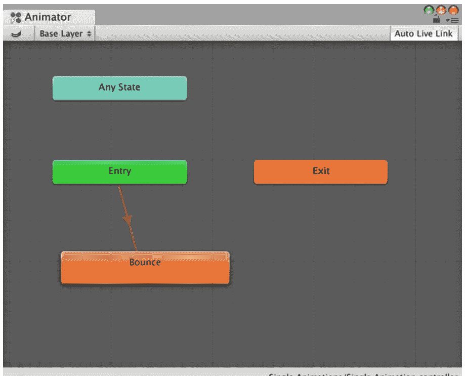

图 8-1. Animator 控制器的状态

接下来，我们将设置动画本身。我们将通过对 y 轴上的局部位置制作动画，让动画上下弹跳：

- 1. 打开 Window 菜单，选择 Animation，打开 Animation 窗格。

**警告**

Animation 窗格与 Animator 窗格不同！

- 2. 选择立方体。在 Animation 窗格中，确保顶部下拉菜单中已选择 Bounce 动画。
- 3. 单击 Add Property 按钮。选择 Transform → Position。
- 4. 单击 Add Keyframe 按钮，即包含菱形图形的小按钮。这将记录立方体在动画的这个时间点处于此位置的事实。
- 5. 通过在 Animation 窗格顶部栏中单击并拖动，或在 Animation 窗格左上角的文本框中输入 **60**，移动到动画的 1 秒位置。再次单击 Add Keyframe。
- 6. 移动到第一个和第二个关键帧之间的中点。
- 7. 单击 Record 按钮，即 Preview 按钮右侧的红色圆点。Unity 将进入 Record 模式，这意味着您对对象所做的任何更改都将创建新关键帧。
- 8. 在场景中将立方体向上移动。将创建一个新关键帧。

Animation 窗格现在应如图 8-2 所示。这种呈现动画的样式称为 *dopesheet*。

- 9. 再次单击 Record 按钮以禁用 Record 模式。

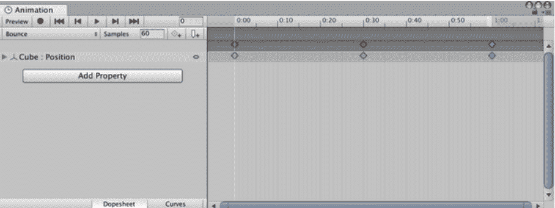

图 8-2. Animation 窗格，显示动画的关键帧

我们现在可以测试动画：

- 1. 在 Animation 窗格中单击 Play 按钮，立方体将上下移动。这为您提供了一种预览动画效果的好方法。

- 2. 运行游戏，动画将在游戏开始时立即播放。

### 讨论

Animator 控制器是动画系统中最重要的组件之一。Animator 控制器让您控制当前正在播放的哪些动画剪辑，并将其结构化为流程图样式的图表，显示每个动画剪辑应何时以及如何播放。

> 提示
>
> Animator 控制器是一个状态机。有关状态机和动画的更多信息，请参阅 Unity 手册。

即使您只有一两个剪辑（如我们刚才为立方体制作动画时一样），也会使用 Animator 控制器，因为它使管理和控制动画行为变得更加容易。Animator 控制器中的每个节点都可以表示特定动画或另一个嵌套 Animator 控制器。使用此系统可以创建的不同行为提供了几乎无限的可能性！

Animator 控制器管理的特定动画剪辑可以是导入的（例如，来自动作捕捉系统，或来自艺术家在其他软件（例如 Maya）中创建的动画），也可以是在 Unity 内创建的，如我们在此所做。

在动画剪辑内部，有许多可制作动画的属性——例如位置、颜色、旋转和缩放——并且可以具有动画曲线。动画曲线决定属性随时间如何变化。Curves 窗格的示例如图 8-3 所示。

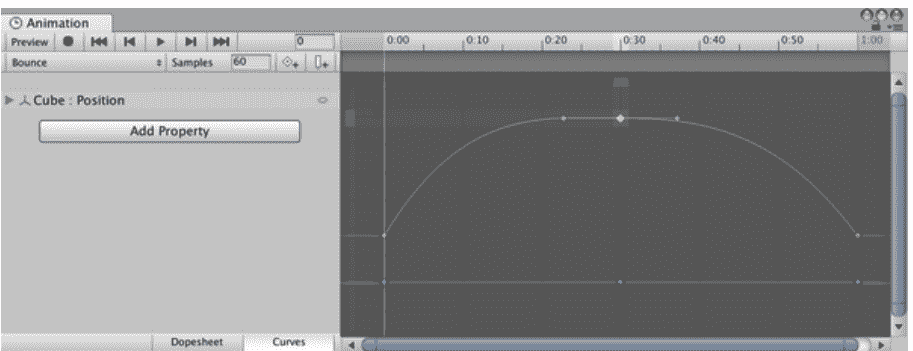

图 8-3. Curves 窗格

本章中的其他配方将更详细地解释动画系统的工作原理，Unity 的文档也相当全面。

## 8.2 基础角色移动

### 问题

您希望角色根据其速度播放不同的动画。您希望该动画控制角色移动。


> 注意
>
> 在本示例以及本章中许多其他示例中，我们将使用 Unity 发布的免费动作捕捉动画，这些动画可在线获取。该软件包还包含一个简单的人类角色，我们将用它来演示动画。

### 解决方案

首先，我们将为角色创建一个可以行走的地面：

- 1. 打开 GameObject 菜单并选择 3D Object → Cube，创建一个新立方体。
- 2. 将立方体的缩放设置为 (20, 1, 20)。这会使其变得又宽又平。

> 提示
>
> 如果需要，可以为立方体添加带纹理的材质（参见第 6.1 节）。这不会影响动画的行为，但可以让你更容易直观地看出角色正在移动。

为了讨论如何为角色制作动画，我们现在需要一个角色！那么，先将角色添加到场景并设置一个简单的动画控制器：

- 1. 下载并导入 Raw Mocap Data 包。

> 提示
>
> 关于导入和管理资产的复习，请参阅第 1 章。

- 2. 找到 DefaultAvatar 模型并将其添加到场景中（参见图 8-4）。
- 3. 创建一个新的动画控制器，并将其添加到 DefaultAvatar。

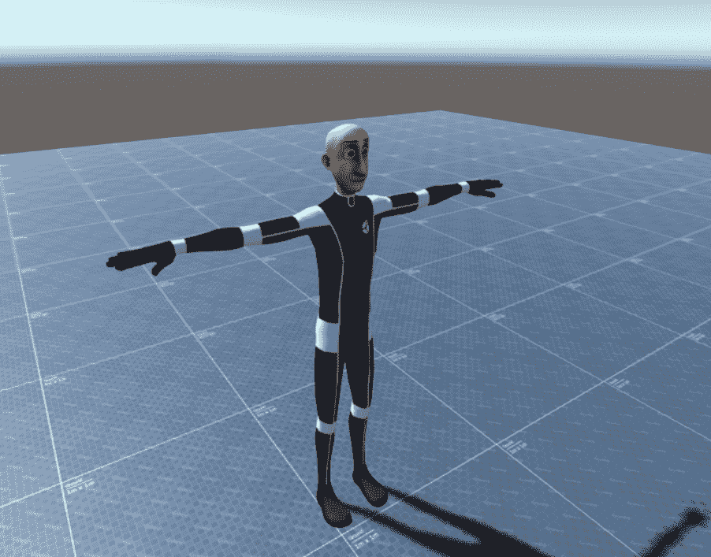

图 8-4. DefaultAvatar 模型

接下来，我们将为角色添加默认状态，这将是一个空闲动画：

- 1. 在 Project 选项卡中搜索 Idle_Neutral_1 动画。你会找到两个同名项目：动画本身和导入动画的文件。将动画拖入动画控制器（它有一个中间带有播放符号的灰色图标，如图 8-5 所示）。
- 2. 运行游戏。角色将播放其空闲动画。

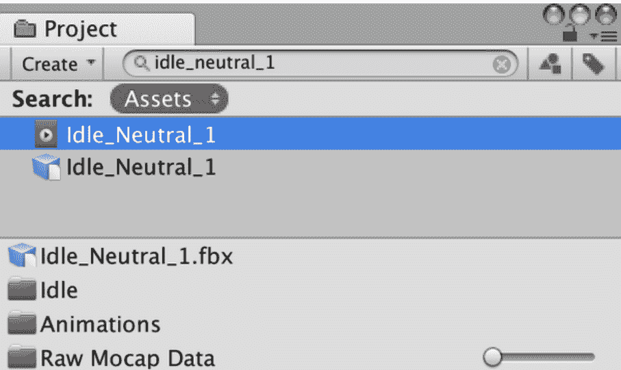

图 8-5. 定位 Idle_Neutral_1 动画

接下来，我们将在控制器上创建一个参数，用于控制角色处于哪个动画状态：

- 1. 打开 Parameters 选项卡，然后单击 + 按钮。选择 Float。将添加一个新参数。
- 2. 将新参数命名为“Speed.”

我们现在将创建一个新脚本，用于控制动画控制器的 Speed 参数：

- 1. 创建一个名为 CharacterMovement.cs 的新 C# 脚本，并向其中添加以下代码：

```
// Allows the control
public class CharacterMovement : MonoBehaviour {

// The animator whose parameters we are controlling
Animator animator;
```

[SerializeField] float speed = 1f;

// Use this for initialization
void Start () {
    animator = GetComponent<Animator>();
}

void Update () {
    animator.SetFloat("Speed",
    Input.GetAxis("Vertical") * speed);
}
}
```

这会创建一个新的 Animator，将 speed 字段公开到 Inspector 中，
并使用 Update 函数根据是否正在使用
“Vertical”输入轴（有关使用 Unity 输入系统的详细信息，请参见第 3 章）来设置速度。简单来说：这会设置好，以便当
角色被要求向前移动时，会播放正确的动画。

- 2. 将 CharacterMovement 组件添加到角色上。

接下来，我们将为角色添加另一个动画状态，并设置它们之间的过渡：

- 1. 选择角色，然后转到 Animator 窗格。
- 2. 找到 Run_Impulse 动画，并将其拖入 Animator。将创建一个新状态。
- 3. 右键单击 Idle_Neutral_1 状态，选择 Make Transition。单击 Run_Impulse 状态。将创建一条连接它们的新线。

现在需要配置此过渡，使其在 Speed 参数高于某个阈值时应用：

- 1. 选择这条线，然后转到 Inspector 底部的 Conditions 列表。
- 2. 单击 + 按钮，将添加一个新条件。控制器中只有一个参数，因此它会被自动选中。确保模式设置为 Greater，并将值设置为 0.1。这意味着当 Speed 参数大于 0.1 时，此过渡将应用。
- 3. 关闭 Has Exit Time 设置。这意味着此过渡可以随时应用，不需要等待当前动画完成。

完成后，Inspector 应如图 8-6 所示。

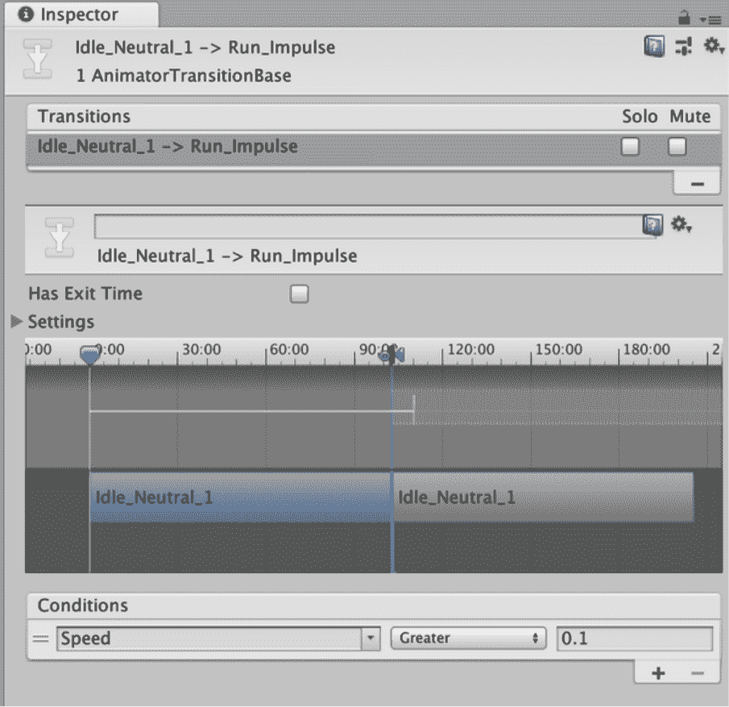

图 8-6. 从空闲动画到跑动画的过渡设置

现在我们将设置速度低于 0.1 时发生的过渡：

- 1. 右键单击 Run_Impulse 状态，选择 Make Transition。单击 Idle_Neutral_1 状态。
- 2. 选择你刚刚创建的新过渡，并以与前一个相同的方式进行设置。不过这次，将条件的模式设置为 Less，而不是 Greater。这将使当速度低于 0.1 时发生过渡。
- 3. 运行游戏。按住上箭头键或 W 键，角色将开始向前行走。

### 讨论

这里使用的 Speed 参数称为*动画参数*。动画参数只有四种类型：整数、浮点数、布尔值或触发器。触发器是一种布尔值，只是在被设置为 *true* 后会在下一帧自动返回 *false* 状态（这使其非常适合像 *跳跃* 或 *死亡* 这样的一次性触发器）。

正如我们在此示例中所示，动画参数可以从脚本中设置。在此示例中，我们使用 `SetFloat` 从脚本访问 Speed 参数。你常常会发现自己需要从脚本修改动画参数，以考虑用户输入（如我们在此处所做）或游戏世界中的碰撞等因素。

你可能注意到，角色在制作动画时会在场景中移动，尽管我们从未明确要求它这样做。这不是魔术：这称为*根运动*，涉及动画本身移动正在制作动画的对象。这保证了对象以正确的速度移动。

在旧的动画系统中，有时会使用一种称为*跑步机运动*的技术，其中动画播放时，正在制作动画的对象始终保持在原点，并且你需要使用脚本以正确的速度和方式移动对象。根运动消除了这样做的麻烦，因为动画本身可以控制对象需要移动多远。

> **注意**
>
> 根运动可能有点难以理解，但它实际上只是多个相互操作的组件的结果。你可以在 Unity 手册中了解更多关于根运动的信息。

## 8.3 反向运动学

### 问题

你想使用反向运动学让角色的手臂或脚朝空间中的某个点延伸。

### 解决方案

为了演示这一点，我们将设置场景以包含播放空闲动画的角色。反向运动学动画将叠加在空闲动画上。

> **注意**
> 本示例使用第 8.2 节中使用的 Raw Mocap Data 包和地板。

要使用反向运动学：

- 1. 向场景添加地板，步骤与第 8.2 节相同。
- 2. 将 DefaultAvatar 对象添加到场景中。将其重命名为“IK Character”（*反向运动学*的缩写，我们稍后会解释）。
- 3. 打开 Assets 菜单，选择 Create → Animator Controller。将新资产命名为“IK Movement.”
- 4. 选择 IK Character，将你刚刚创建的 IK Movement 控制器拖入 Animator 组件的 Controller 插槽中。
- 5. 在 IK Character 仍被选中的情况下，通过打开 Window 菜单并选择 Animation → Animator 转到 Animator 选项卡。
- 6. 找到你导入的 Idle_Neutral_1 动画剪辑，并将其拖放到 Animator 中。
- 7. 通过按下 Play 按钮测试你的角色。角色将站立，执行空闲动画。

现在我们已准备好将反向运动学添加到动画设置中。首先，需要在当前图层上启用 IK：

- 1. 打开你的动画控制器，转到 Layers 选项卡。
- 2. 在基础图层上单击齿轮图标。
- 3. 开启 IK Pass。图层列表现在应该如图 8-7 所示。

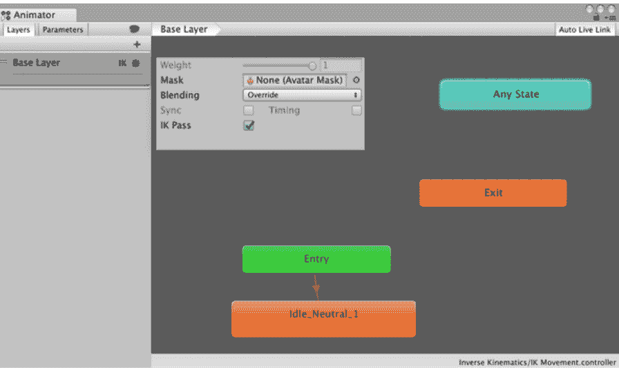

图 8-7. 在动画控制器的基础图层上启用 IK Pass

接下来，我们将创建一个脚本，告诉动画控制器抓取什么，以及用什么抓取：

- 1. 创建一个名为 IKReach.cs 的新 C# 脚本，并向其中添加以下代码：

```
// Updates the positions and weights used for a specified IK goal.
// The Animator attached to the object this script is on must have a
// layer that has an IK pass enabled. Otherwise, OnAnimatorIK won't
```


```csharp
// be called.
[RequireComponent(typeof(Animator))]
public class IKReach : MonoBehaviour {

    // The object we're reaching toward.
    [SerializeField] Transform target = null;

    // An IK goal is a foot or hand that's reaching to a target.
    [SerializeField] AvatarIKGoal goal = AvatarIKGoal.RightHand;

    // The strength with which we're reaching our goal toward the
    // target. 0 = don't reach at all; 1 = the goal must be at the same
    // point as the target, if it's within range.
    [Range(0, 1)]
    [SerializeField] float weight = 0.5f;

    // The animator that's controlling the positions.
    Animator animator;

    // Cache the reference to the animator on start.
    private void Start()
    {
        animator = GetComponent<Animator>();
    }

    // Called every time the animator is about to apply inverse
    // kinematics, which will bend the various joints to try to reach
    // the goals toward their targets. This is our opportunity to
    // provide it with updated information.
    private void OnAnimatorIK(int layerIndex)
    {
        // Set the position that the goal is trying to reach.
        animator.SetIKPosition(goal, target.position);

        // Set the weight for the goal.
        animator.SetIKPositionWeight(goal, weight);
    }
}
```

此脚本让我们定义一个将被伸手触及的目标对象，以及模型中负责伸手动作的部件，并执行所需的动画，使模型始终适当地朝向目标对象移动。

- 2. 向角色添加 IKReach 组件。

- 3. 在场景中创建一个球体，并将其缩小直到大约是网球大小。将其放置在角色附近（图 8-8）。

- 4. 使 IKReach 组件的 Target 字段引用您刚刚添加的球体。

开始游戏。角色将朝向目标伸手。当您在场景视图中移动目标时，角色的姿态将发生变化。

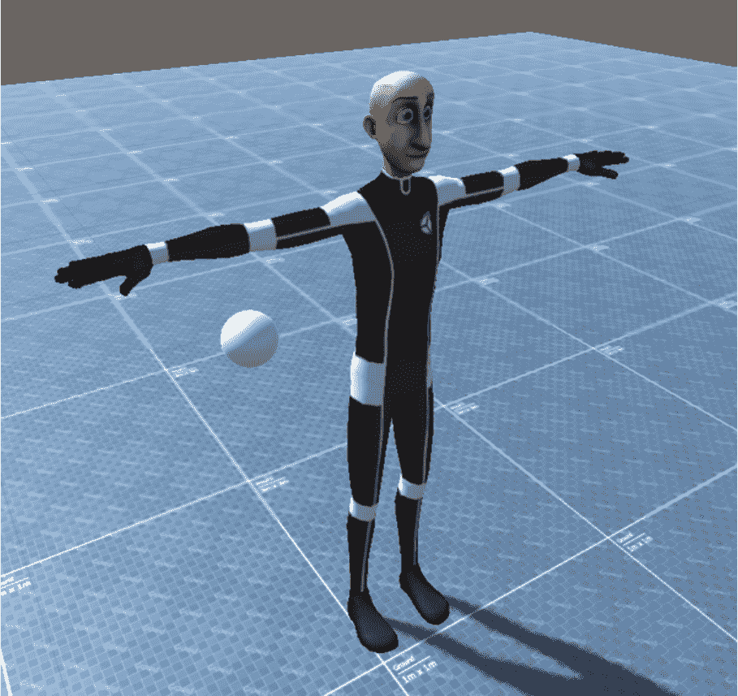

图 8-8. 本示例的场景设置：角色，放置了一个可伸手触及的球体

### 讨论

动力学是指点和物体的运动。视频游戏中的传统动画从父级（关节）开始，然后通过关节向外流动到其余连接元素。这称为正向动力学。

逆向动力学则相反：您希望最外层元素位于特定位置，那么需要做什么来使整个系统对齐到那里？当您希望角色正确站在地板上、上下楼梯和坡道，或者握住或触摸可能在世界中移动的对象时，这在视频游戏中非常有用。

Unity 的动画系统支持任何正确配置的类人角色的逆向动力学。

> **提示**
> 
> 如果您从头开始实现逆向动力学，可能会非常复杂。Unity 的动画系统抽象掉了许多细节。在 Unity 手册中了解其工作原理。

逆向动力学是构建能够与世界进行真实交互的角色的宝贵技术。它不仅适用于类人角色（尽管它是为它们构建的！），因此您也可以为触手、多足机器人或任何需要可靠且真实地与游戏世界其余部分交互的事物创建逆向动力学。

## 8.4 蒙版移动

### 问题

您希望播放仅适用于某些身体部位的动画。例如，您可能希望类人角色在奔跑时挥动双手。

### 解决方案

为演示这一点，我们将基于能够四处奔跑的角色，然后添加另一种仅影响手臂的动画：

- 1. 按照示例 8.2 中的步骤操作。我们还将修改 Raw Mocap Data 资源包中附带的一个动画。在此示例中，我们将创建一个动画剪辑，其中角色用右臂向前伸手抓取某物。为此，我们将修剪现有剪辑，仅包含我们想要的运动。

- 2. 在下载的资源中找到 IdleGrab_Neutral 资源并选中它。

- 3. 在 Inspector 中，转到 Animation 选项卡。

- 4. 分别将动画的 Start 和 End 帧设置为 151 和 253（图 8-9）。这是包含我们想要运动的动画剪辑范围。

> **注意**
> 
> 导入骨架时您可能会看到关于发现警告的提示。在这种情况下可以安全忽略这些警告——它们不影响我们在此处进行的工作。

- 5. 单击 Inspector 底部的 Apply 按钮。

- 6. 选择角色，通过打开 Window 菜单并选择 Animation → Animator 转到 Animator 选项卡。

IdleGrab_Neutral 导入设置

- Model | Rig | Animation | Materials

- - [ ] Import Constraints
- - [x] Import Animation

> 导入此动画文件中的骨架时发现警告。打开 "Rig" 选项卡了解更多详情。

- - [ ] Bake Animations
- - Anim. Compression: Keyframe Reduction
- - Rotation Error: 0.5
- - Position Error: 0.5
- - Scale Error: 0.5

旋转误差定义为允许的最大角度偏差（以度为单位），对于其他项，定义为允许的最大距离/增量偏差（以百分比为单位）。

- - [ ] Animated Custom Pro

| 剪辑 | 开始 | 结束 |
|---|---|---|
| IdleGrab_Neutral | 151.0 | 253.0 |

- - IdleGrab_Neutral
- - Length: 3.400
- - FPS: 30
- - Start: 151
- - End: 253
- - [x] Loop Time
- - [x] Loop Pose (loop match)
- - Cycle Offset: 0
- - Root Transform Rotation
- - [x] Bake Into Pose (loop match)
- - Based Upon: Body Orientation
- - Offset: 0

图 8-9. IdleGrab_Neutral 动画的导入设置

- 7. 转到 Parameters 选项卡并单击 + 按钮以创建新参数。在出现的菜单中单击 Trigger。将新触发器命名为“Grab”。

- 8. 转到 Layers 选项卡并单击 + 按钮以创建新图层。将新图层命名为“Arms”。单击齿轮图标，并将权重设置为 1。

- 9. 在控制器中右键单击并选择 Create State → Empty 以创建新状态。将此新状态命名为“Passive”。

- 10. 将 IdleGrab_Neutral 动画拖放到 Animator 中。

- 11. 右键单击 Passive 状态，并选择 Make Transition。选择 IdleGrab_Neutral 动画，将从 Passive 到 IdleGrab_Neutral 创建新过渡。在另一方向重复此过程：从 IdleGrab_Neutral 到 Passive 创建过渡。

- 12. 选择从 Passive 到 IdleGrab_Neutral 的过渡，并在 Inspector 中关闭 Has Exit Time。这将使过渡立即发生。

- 13. 在这里，通过单击 Conditions 区域中的 + 按钮并选择 Grab 参数，为过渡添加新条件。

我们在这里所做的是设置一个包含两个动画的图层：一个名为 Passive 的空动画，以及一个角色执行抓取动作的动画。当使用 Grab 触发器时，将执行抓取动作。

然而，存在一个问题：IdleGrab_Neutral 动画不仅影响手臂，还影响整个身体。这意味着我们无法将抓取动画与其他内容（如行走）混合。为了使抓取动画仅影响手臂，我们使用头像遮罩来使图层仅应用于某些身体部位：

- 1. 打开 Assets 菜单并选择 Create → Avatar Mask 以创建新头像遮罩。

- 2. 选择新遮罩，然后单击人物图形外的任何位置以取消选择所有身体部位。接下来，选择右臂。（这在图像的左侧；假设人物正面对着您。）有关头像设置应有的外观，请参见图 8-10。

- 3. 转到 Animator 中的 Arm 图层，并将 Mask 属性设置为您刚刚创建的头像遮罩（图 8-11）。这将使在此图层上播放的任何动画仅影响指定的身体部位。

- 4. 通过开始游戏来测试动画。一如既往，您可以移动角色；当您选择 Grab 触发器参数（通过打开 Animator，选择 Parameters 窗格，并单击 Grab 触发器）时，角色将伸出手臂，这将与动画的其他部分结合。


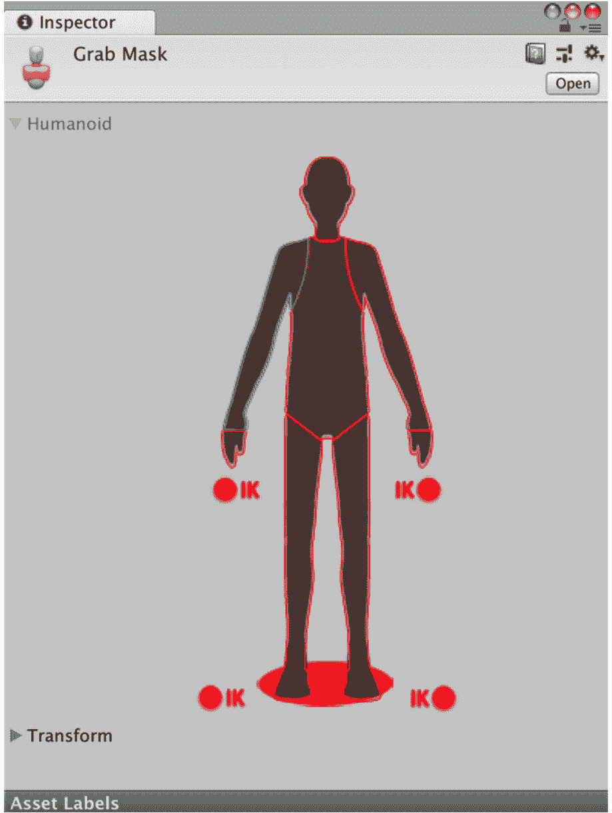

图 8-10. 头像遮罩，除角色的右臂外全部选中

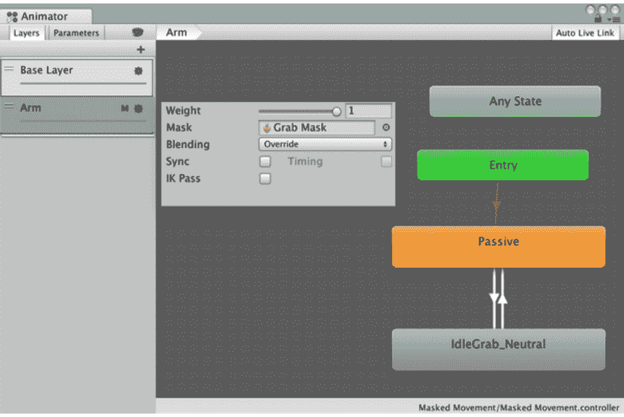

图 8-11. 动画控制器的 Arm 层，已配置为使用头像遮罩

### 讨论

动画层可以用于覆盖或叠加到早期层。每个动画层上可设置的不同权重允许你控制该层对最终姿势的影响程度。

通过创建多个层，可以同时运行多个动画。动画掩码用于控制骨架的哪些部分受哪些层影响，通过调整不同层的权重，可以允许多个动画影响骨架的相同部分。

头像是将常见组件（如手臂或腿部）映射到动画骨架中特定骨骼的过程。这样，即使骨骼不完全相同，也可以在不同网格之间重复使用动画。

## 8.5 混合移动

### 问题

你想在多个动画之间进行混合。例如，你有一个行走动画和一个跑步动画，并希望随着角色速度增加，在两者之间平滑混合。

### 解决方案

使用 *混合树*，它是一种在两个或多个动画片段之间进行混合的动画状态：

- 1. 向场景中添加一个地板，步骤与配方 8.2 相同。
- 2. 将 DefaultAvatar 对象添加到你的场景中。将其重命名为“Blended Movement Character。”
- 3. 打开 Assets 菜单，选择 Create → Animator Controller。将新资产命名为“Blended Movement。”
- 4. 选择 Blended Movement 角色，将你刚刚创建的 Blended Movement 控制器拖动到 Animator 组件的 Controller 插槽中。
- 5. 在 Blended Movement 角色仍然被选中的情况下，通过打开 Window 菜单并选择 Animation → Animator，转到 Animator 选项卡。
- 6. 通过进入 Parameters 选项卡，单击 +，并选择 Float，向控制器添加一个新 Float 参数。将新参数命名为“Speed。”
- 7. 在动画控制器中右键单击，选择 Create State → From New Blend Tree。
- 8. 双击新状态，你将被带到混合树的详细信息页面。
- 9. 选择 Blend Tree 节点，并将其参数设置为“Speed。”这是混合树用来决定使用哪些动画片段的参数。
- 10. 将以下动画片段拖动到混合树的 Inspector 中，并使用指定的阈值和速度。完成后，Inspector 应如图 8-12 所示，控制器应如图 8-13 所示。
  - WalkFWD; 阈值: -1.5, 速度: -1
  - Idle_Neutral_1; 阈值: 0, 速度: 1
  - WalkFWD; 阈值: 1.5, 速度: -1
  - Run_Impulse; 阈值: 5, 速度: -1
- 11. 按 Play 按钮测试游戏。按住上箭头键让角色向前行走。当角色速度为 0 时，角色将保持空闲状态。随着速度增加，角色将通过行走动画过渡到跑步动画。

提示

调整 Character Movement 脚本中的 Speed 变量，看看它如何影响动画。

Inspector

混合树
混合类型 1D

参数 Speed

-1.5 5

运动 阈值

| 运动 | 阈值 | 速度 |
|------|------|------|
| WalkFWD | -1.5 | -1 |
| Idle_Neutral_1 | 0 | 1 |
| WalkFWD | 1.5 | 1 |
| Run_Impulse | 5 | 1 |

自动化阈值
计算阈值 Select
调整时间缩放 Select

资产标签

图 8-12. 四个状态的混合树

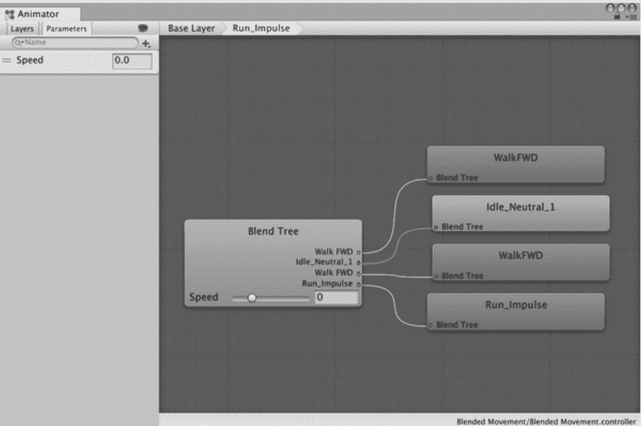

图 8-13. 混合树的控制器

### 讨论

混合树与动画控制器上的参数协同工作。根据参数的值，混合树将混合不同的动画片段。在图 8-12 中，你可以看到一个包含四个片段的混合树，它们允许向后行走、保持静止、向前行走和向前跑步。

有多种类型的混合树，包括 2D 混合树。当你想要向两种方向移动时（例如，前/后和左右）这些非常有用。图 8-14 中可以看到一个 2D 混合树的示例；这个混合树使用两个参数，一个用于前向和反向运动，另一个用于侧向运动。当角色仅施加前向运动时，将播放常规跑步动画；当角色仅施加侧向运动时，将播放转向动画；当两者同时施加时，将播放边跑步边转向的动画。

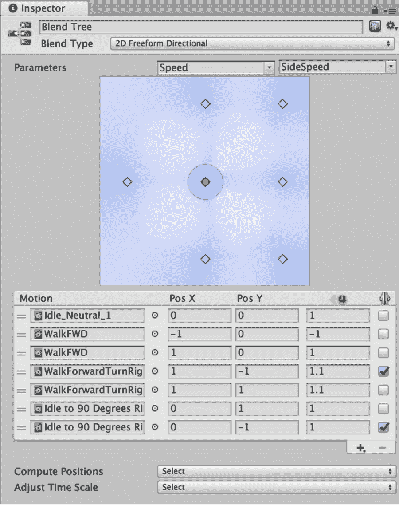

图 8-14. 一个 2D 混合树，带有两个独立控制的参数

## 8.6 导航与动画同步

### 问题

你有一个配置为使用导航网格的角色，并希望角色的动画系统能响应导航代理在世界中移动，使角色看起来更逼真。

### 解决方案

你可以获取有关导航代理如何移动的信息，并使用该信息向动画控制器的参数提供数据：

- 1. 执行配方 8.5 中的步骤，设置一个支持前/后和左右移动的角色。
- 2. 按照配方 10.3 中的步骤，设置你的角色以使用导航网格工作。
- 3. 创建一个名为 NavigationAnimator.cs 的新 C# 脚本，并将以下代码添加到其中：

```csharp
using UnityEngine.AI;

// Uses the NavMeshAgent to drive parameters on the Animator.
[RequireComponent(typeof(NavMeshAgent))]
[RequireComponent(typeof(Animator))]
public class NavigationAnimator : MonoBehaviour
{

// Selects what the final position of the object is controlled by.
enum Mode {
  // The agent directly controls the object's position. More
  // accurate, but causes foot sliding (because the animator isn't
  // moving at the exact speed of the agent).
  AgentControlsPosition,

  // The animator's root motion controls the object's position.
  // Looks better, but less accurate because the motion that
  // results won't precisely match what the agent wants to do.
  AnimatorControlsPosition
}

// The mode that this script is operating in.
[SerializeField] Mode mode = Mode.AnimatorControlsPosition;

// The names of the parameters that this script will control.
[SerializeField] string isMovingParameterName = "Moving";
[SerializeField] string sidewaysSpeedParameterName = "X Speed";
[SerializeField] string forwardSpeedParameterName = "Z Speed";

// Cached references to components we'll be accessing every frame.
Animator animator;
NavMeshAgent agent;

// Stores the movement we did last frame, so that we can smooth out
// our movement over time.
Vector2 smoothDeltaPosition = Vector2.zero;

void Start()
{
    // Cache references to the animator and the nav mesh agent.
    animator = GetComponent<Animator>();
    agent = GetComponent<NavMeshAgent>();

    // The animator will potentially be in charge of our position,
    // not the agent. Disable the agent's ability to directly set
    // this object's position. (The agent will retain the ability
    // to rotate the object.)

    agent.updatePosition = false;
}

void Update()
{
    // The agent stores where it wants to move next in
    // agent.nextPosition.

    // Calculate how far we currently are from where the agent
    // wants to be, in world space.
    Vector3 worldDeltaPosition =
        agent.nextPosition - transform.position;

    // Convert this to local space; we need to know how much of a
    // movement in the x and z planes this would be.
    float xMovement =
        Vector3.Dot(transform.right, worldDeltaPosition);
    float zMovement =
        Vector3.Dot(transform.forward, worldDeltaPosition);

    Vector2 localDeltaPosition = new Vector2(xMovement, zMovement);

    // Smooth out this movement by interpolating from the last
    // frame's movement to this one.
    float smooth = Mathf.Min(1.0f, Time.deltaTime / 0.15f);
    smoothDeltaPosition = Vector2.Lerp(smoothDeltaPosition,
        localDeltaPosition, smooth);

    // Figure out our velocity.
    var velocity = smoothDeltaPosition / Time.deltaTime;

    // We need to tell the animator that we're moving when our
    // velocity exceeds a threshold, and we're not too close
    // to the destination.
    bool shouldMove = velocity.magnitude > 0.5f &&
        agent.remainingDistance > agent.radius;
}
```


```
// We now have all the information we need to tell the animator
// what to do. Update its parameters; the animator controller
// will play the right animation. This updates the animation's
// root position as well, which we can optionally use to control
// or influence the object's position.

// We're providing three parameters here.
// - 'Moving' is a bool that unambiguously indicates whether we
//   want to be idle or moving.
// - X and Z speed are intended to control a 2D blend tree.
// - Z speed is forward and backward, while X speed is left and
//   right.

// This can also work with a 1D blend tree, where Z speed is the
// only parameter, but if you do this, you should use this
// script in AgentControlsPosition mode.
//

// This is because if your animator controller doesn't have any
// animations that move the root position sideways, the animator
// will find it difficult to make the kinds of turns that the
// agent may try, and the result will be the visible object
// jumping around onscreen as a result of repeatedly moving too
// far from the agent. Play with your blend trees and
// animations to get good-feeling movement.

animator.SetBool(isMovingParameterName, shouldMove);
animator.SetFloat(sidewaysSpeedParameterName, velocity.x);
animator.SetFloat(forwardSpeedParameterName, velocity.y);

// Is the animator controlling our position, instead of
// the agent?
if (mode == Mode.AnimatorControlsPosition) {

// If the animator is controlling our position, the agent
// will start drifting away from the object. If this happens,
// you'll start seeing visual glitches caused by the
// navigation logic not matching the visible object onscreen.

// To fix this, we'll detect if the object is significantly
// far from the agent. "Significantly" means it's more
// than one agent-radius away from the agent's position
// (that is, the object is outside the agent's cylinder).

// When this happens, we'll start bringing the object closer
// to the agent's position. This reduces animation realism
// slightly, because it's movement that's not reflected in
// the motion of the character, but it prevents larger
// errors from accumulating over time.

// Is the object's position far from where the agent wants
// to be?
if (worldDeltaPosition.magnitude > agent.radius)
{
    // Bring us closer to where the agent wants to be
    transform.position = Vector3.Lerp(transform.position,
        agent.nextPosition,
        Time.deltaTime / 0.15f);
}
}
}
```

```
void OnAnimatorMove()
{
    // Which mode is this script in?
    switch (mode)
    {
        case Mode.AgentControlsPosition:
            // Move the object directly where the agent wants
            // to be.
            transform.position = agent.nextPosition;
            break;
        case Mode.AnimatorControlsPosition:
            // Update our position to where the animation system has
            // placed us, following the animation's root movement.

            // Override the movement in the y-axis to where the
            // agent wants to be (otherwise, we'll just pass through
            // hills, stairs, and other changes in ground height).

            Vector3 position = animator.rootPosition;
            position.y = agent.nextPosition.y;
            transform.position = position;
            break;
    }
}
```

- 4. 将 NavigationAnimator 组件添加到对象。

当导航代理开始移动到另一个位置时，它将更新动画器控制器的参数。

### 讨论

让导航代理在移动时播放动画涉及多个方面。最重要的是，在每一帧都会执行检查，以查看对象的模式是由代理控制其位置，还是由动画器控制位置。然后根据模式触发正确的动画系统。

## 8.7 电影相机跟踪

### 问题

你想要创建一个电影风格的相机，并将其设置为始终保持某个对象在视野中。

### 解决方案

做到这一点的最佳方法是使用 Cinemachine 包。Cinemachine 是一个过程式相机系统，旨在提供电影风格的相机控制系统。

> ### 警告
> 
> 如果你阅读 Unity 的文档，可能会发现有关从 Unity 资源商店获取 Cinemachine 的引用。最新版本不久前已从 Unity 资源商店移至 Unity 包管理器，但一些关于 Cinemachine 的文档包含从资源商店获取它的说明；请不要这样做！资源商店中的版本虽然仍可用，但不是最新版本，不会更新，也不一定包含你期望或需要的功能。请务必始终从包管理器获取 Cinemachine 的副本。要复习包管理器的相关知识，请参阅第 1 章。

首先，安装 Cinemachine 包：

- 1. 打开“窗口”菜单，并选择“包管理器”。
- 2. 在“全部”标签页中，找到 Cinemachine 包，然后点击“安装”。

接下来，我们将设置一个 Cinemachine 虚拟相机：

- 1. 打开 Cinemachine 菜单，并选择 Create Virtual Camera（图 8-15）。这将创建并选中一个新的虚拟相机。
- 2. 将虚拟相机定位到场景中的某个位置。
- 3. 将你希望相机查看的对象拖放到虚拟相机的 Look At 插槽中（图 8-16）。
- 4. 运行游戏。相机将看向目标！

- Cinemachine 窗口帮助
- 创建虚拟相机
- 创建自由观察相机
- 创建混合列表相机
- 创建状态驱动相机
- 创建 ClearShot 相机
- 创建带轨道的平移相机
- 创建目标组相机
- 创建混合相机
- 创建 2D 相机
- 创建带平台的轨道
- 导入示例资源包
- 导入后处理 V1 适配器资源包
- 导入后处理 V2 适配器资源包
- 关于

图 8-15. 创建虚拟相机

### Cinemachine 虚拟相机 (脚本)

| 属性 | 值 |
| --- | --- |
| 状态 | 启用 |
| 游戏窗口引导线 | [x] |
| 播放期间保存 | [ ] |
| 优先级 | 10 |
| 跟随 | 无 (Transform) |
| 看向 | Cinemachine 角色 (Transform) |
| 位置混合 | 线性 |

### 镜头

| 属性 | 值 |
| --- | --- |
| 视野 | 40 |
| 近裁剪平面 | 0.1 |
| 远裁剪平面 | 5000 |
| 荷兰角 | 0 |

### 身体

| 属性 | 值 |
| --- | --- |
| — | 不执行任何操作 |

### 瞄准

| 属性 | 值 |
| --- | --- |
| 构图器 | |
| 跟踪对象偏移 | X 0 Y 1.19 Z 0 |
| 前瞻时间 | 0 |
| 前瞻平滑 | 10 |
| 前瞻忽略 Y | [ ] |
| 水平阻尼 | 0.5 |
| 垂直阻尼 | 0.5 |
| 屏幕 X | 0.45131 |
| 屏幕 Y | 0.50125 |
| 死区宽度 | 0.17368 |
| 死区高度 | 0.1 |
| 软区宽度 | 0.8 |
| 软区高度 | 0.8 |
| 偏移 X | 0 |
| 偏移 Y | 0 |

### 噪声

| 属性 | 值 |
| --- | --- |
| — | 无 |

### 扩展

| 属性 | 值 |
| --- | --- |
| 添加扩展 | (选择) |

图 8-16. 配置虚拟相机以查看目标

## 讨论

Cinemachine 使用虚拟相机，它们并非真正的相机：它们的行为更像现实世界中的摄影师，控制真实相机的位置、方向、镜头设置等。虚拟相机本身不执行渲染。Cinemachine 虚拟相机由——听起来有些不祥的——Cinemachine 大脑控制。

Cinemachine 大脑将真实 Unity 相机与虚拟 Cinemachine 相机连接起来。由于大多数电影场景中可能存在多个虚拟相机，大脑将根据你分配给它的优先级监控情况，并在必要时在相机之间进行混合，将虚拟相机的状态应用到真实相机上，如图 8-17 所示。

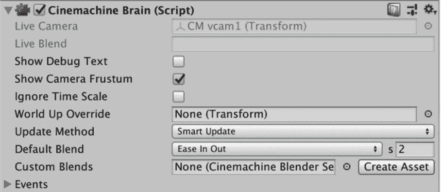

图 8-17. 配置相机大脑

> ### 注释
> 
> 你可以通过阅读 Cinemachine 文档和 Unity 的 Cinemachine 教程系列来了解更多有关 Cinemachine 的信息。

## 8.8 自动切换相机

### 问题

场景中有多个相机，你希望 Cinemachine（请参阅配方 8.7）在它们之间自动切换，以便目标对象始终保持在视野中。

### 解决方案

这里的解决方案是使用 Cinemachine ClearShot 相机：

- 1. 打开 Cinemachine 菜单，并选择 Create ClearShot Camera。
- 2. 选择 ClearShot 对象，并将你希望保持视野的目标拖入 Look At 字段。
- 3. 将所需数量的虚拟相机添加为 ClearShot 组的子项。

### 讨论

ClearShot 是一个具有一个或多个虚拟相机作为子项的对象，并配置为查看某个目标。它将从其不同的子项中选择哪个相机对目标的拍摄效果最佳。

> **提示**
> 
> 在 Unity 脚本 API 参考中了解有关 ClearShot 相机的更多信息。

## 8.9 保持多个对象在视野中

### 问题

你的场景中有多个对象，你希望相机尝试同时将它们全部保持在视野中。

### 解决方案


要同时让大量对象保持在视野中，你需要使用 Cinemachine Look At Group。要创建 Look At Group：

- 1. 创建一个新的空游戏对象，并将其命名为 "Look At Group"。
- 2. 向其添加一个新的 CinemachineTargetGroup 组件。
- 3. 在目标列表中，你可以指定 Look At Group 要引用的 Transforms 列表（图 8-18）。
- 4. 当你希望相机观察整个组时，将相机的 Look At 属性设置为引用 Look At Group，而不是目标本身。

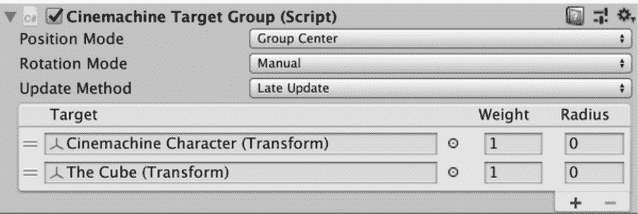

图 8-18. 创建 Look At Group

#### 讨论

这基本上就是顾名思义。你可以在 Unity 脚本 API 参考中了解更多。

### 8.10 移轨相机

#### 问题

你希望相机移动以保持对象在画面内，但又要确保相机仅在固定轨道上移动。这称为移轨相机。

#### 解决方案

创建移轨相机：

- 1. 打开 Cinemachine 菜单，并选择 Dolly Camera with Track。

  这将创建两个对象：一个相机和一个供其跟随的轨道。相机始终位于轨道上的某个位置，尽管可以自由旋转以观察其 Look At 目标。它会沿轨道重新定位，以靠近其 Follow 目标。

- 2. 配置相机的 Look At 和 Follow 属性，使其引用你想要跟踪的对象（图 8-19）。

- 3. 选择 Dolly Track，并配置轨道的起点和终点。你还可以在起点和终点之间创建点，以构建弯曲轨道（图 8-20）。

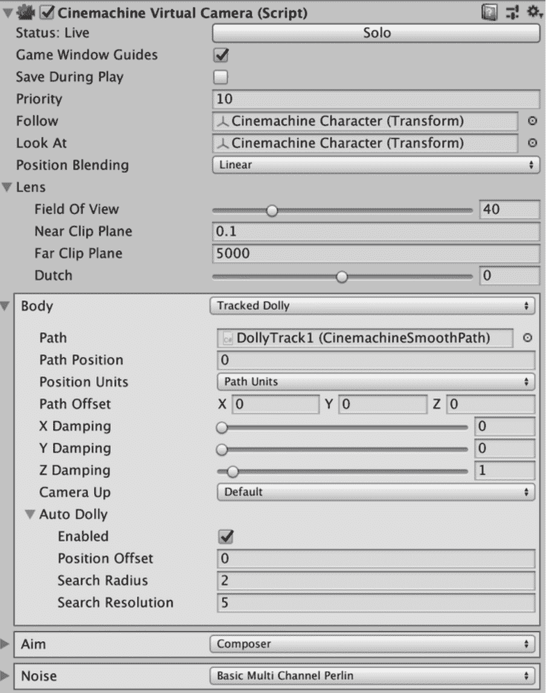

图 8-19. 配置遵循移轨轨道的虚拟相机的 Look At 和 Follow 属性

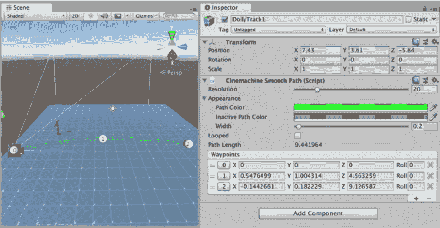

图 8-20. 为相机构建移轨轨道

#### 讨论

“移轨相机”源自电影制作术语：dolly 是一种带轮子的推车，真实的物理相机放置在上面以产生平滑的水平移动。当你希望平滑地移动经过某个物体，或在游戏中创造更具电影感的效果时，移轨相机非常有用。

> **提示**
> 
> 你也可以使用移轨相机来创建 *推移变焦*，即相机向某个物体移动的同时同时进行变焦出。这会使聚焦对象看起来大小不变，而其他一切都会经历透视变形。我们非常喜欢这种效果，因为它在 *Battlestar Galactica* 电视剧中被出色地运用，当飞船跳跃时就能看到！
