# 第 9 章 逻辑与游戏玩法

逻辑与游戏玩法形式多样，含义各异：从让某物表现得像汽车一样，到允许玩家使用鼠标选择对象，再到相机行为。在本章中，我们将提供一些在项目中或游戏中功能的配方和解决方案，作为 Unity 开发者，我们反复需要构建这些功能。这些是许多 Unity 项目的基本构建块，但不一定由 Unity 提供。

**提示**

本章远未涵盖你需要的所有游戏玩法解决方案！Game Developer 上游戏开发者发布的文章是了解此类内容的绝佳资源。在你的游戏开发生涯中，你会发现自己一遍又一遍地、游戏接游戏地实现本章中的许多配方。

## 9.1 加载新场景文件

### 问题

你想加载一个新场景文件。

**提示**

加载新场景文件是加载游戏不同关卡的好方法！但这是一种通用技术，不仅仅适用于关卡。因为场景可以用于任何用途，包括菜单、记分牌等等，切换到新场景并不总是意味着加载新关卡。

### 解决方案

要加载场景，你首先需要告诉 Unity 你希望将该场景包含在项目中。如果不这样做，该场景将不会包含在任何构建版本中，你也无法加载它。

要管理项目中的场景列表，打开 File 菜单并选择 Build Settings。Build Settings 界面将出现（图 9-1）。要将场景标记为可加载，从 Project 选项卡中的 Assets 文件夹将其拖放到屏幕顶部的列表中。

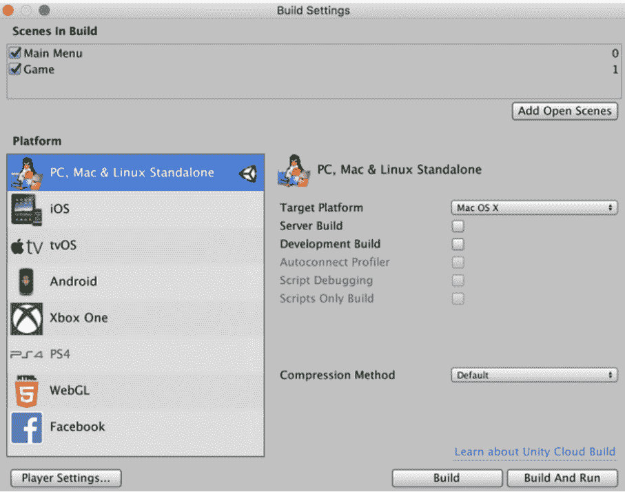

图 9-1. Build Settings 界面中的场景列表，已添加两个场景

你现在已准备好编写加载场景的代码。要使用 SceneManager 类（它为你处理场景加载），需要在脚本顶部包含以下 using 指令：

```
using UnityEngine.SceneManagement;
```

加载新场景就像调用 SceneManager.LoadScene 并提供场景名称一样简单。Unity 将加载新场景并卸载当前场景：

```
// Loads the scene named "Game," replacing the current scene; stops the
// game until loading is done (so don't load big scenes this way!)
SceneManager.LoadScene("Game");
```

重要的是要记住，如果以这种方式加载场景，你的项目在加载新场景期间将暂停。如果加载需要一段时间，可能会让用户感到烦恼，他们可能会认为项目已冻结或崩溃。

为避免这种情况，你可以在后台加载场景。使用 SceneManager 类的 LoadSceneAsync 方法，它会在后台开始加载场景，并返回一个对象，你可以使用该对象来衡量加载需要多长时间以及是否已加载完成：

```
public void LoadLevelAsync() {
    // Start loading the scene; we'll get back an object that represents
    // the scene loading operation
    var operation = SceneManager.LoadSceneAsync("Game");
    Debug.Log("begin load...");
    // Don't proceed to the scene once loading has finished
    operation.allowSceneActivation = false;
    // Start a coroutine that will run while the scene loads, and will run
    // some code after loading finishes
    StartCoroutine(WaitForLoading(operation));
}
IEnumerator WaitForLoading(AsyncOperation operation) {
    // Wait for the scene load to reach at least 90%
    while (operation.progress < 0.9f)
    {
        yield return null;
    }
// We're done!
Debug.Log("Done load.");
// Enabling scene activation will immediately start loading the scene
operation.allowSceneActivation = true;
}
```

你的项目可以同时加载多个场景。例如，你可能有一个包含重要对象（如逻辑或游戏管理器、输入系统和 UI）的场景，然后为游戏中的关卡创建一个单独的场景。

要将一个场景加载到另一个场景之上，调用 LoadScene 时指定 LoadSceneMode 为 Additive。这将加载场景并将其添加到当前已加载的场景之上。你可以加载尽可能多的场景，只要内存允许：

```
public void LoadLevelAdditive() {
// Load the scene in addition to the current one
SceneManager.LoadScene("Game", LoadSceneMode.Additive);
}
```

你也可以卸载以加载方式加载的关卡，将其及其内容从项目中移除。方法是调用 UnloadSceneAsync：

```
public void UnloadLevel() {
// Unloading a scene is an async operation, much like loading can be
var unloadOperation = SceneManager.UnloadSceneAsync("Game");

// If you want to run code after the unloading has completed, start a
// coroutine (again, just like loading)
StartCoroutine(WaitForUnloading(unloadOperation));
}
IEnumerator WaitForUnloading(AsyncOperation operation) {
yield return new WaitUntil(() => operation.isDone);

// Unloading has completed, and all objects that were in the scene
// have been removed. However, Unity will not unload the assets that
// those objects referred to, like the textures. These stay in memory
// for later use by other objects; to free up the memory, do this:
Resources.UnloadUnusedAssets();
}
```

### 讨论

你也可以在编辑器中同时加载多个场景。为此，右键单击要打开的场景并选择 Open Scene Additive。附加场景将出现在 Hierarchy 中（图 9-2）。当两个场景同时打开时，你可以在它们之间拖放对象。

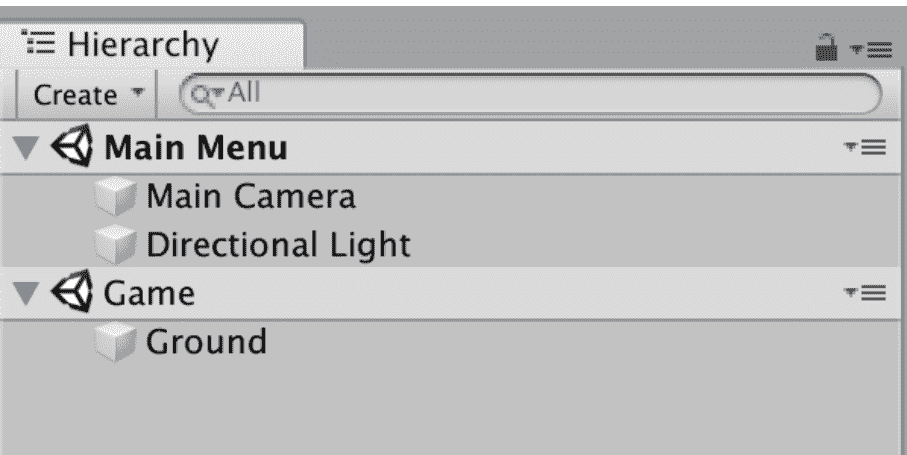

图 9-2. Hierarchy 选项卡，同时加载了两个场景

## 9.2 管理生命值

### 问题

你希望对象在被另一种对象击中时受到伤害。当受到足够伤害时，它们会被销毁。

### 解决方案

解决方案的第一部分是创建三个脚本：


- 1. 创建一个名为 DamageReceiver.cs 的新 C# 脚本，它可以接收对象已受到伤害的信号，并拥有若干可递减的生命值：

```csharp
public class DamageReceiver : MonoBehaviour {
    UnityEngine.Events.UnityEvent onDeath;

    [SerializeField] int hitPoints = 5;
    int currentHitPoints;

    private void Awake() {
        currentHitPoints = hitPoints;
    }

    public void TakeDamage(int damageAmount) {
        currentHitPoints -= damageAmount;

        if (currentHitPoints <= 0) {
            if (onDeath != null) {
                onDeath.Invoke();
            }
            Destroy(gameObject);
        }
    }
}
```

- 2. 接下来，创建一个名为 *DamageGiver.cs* 的新 C# 脚本，它用于检测一个对象是否与另一个对象发生碰撞；如果被碰撞的对象身上带有 *DamageReceiver*，则会被告知其已受到损伤：

```csharp
public class DamageGiver : MonoBehaviour {
    [SerializeField] int damageAmount = 1;

    // Called when the object collides with another
    private void OnCollisionEnter(Collision collision)
    {
        // Does the object we hit have a damage receiver?
        var otherDamageReceiver = collision
            .gameObject.GetComponent<DamageReceiver>();

        if (otherDamageReceiver != null) {
            // Tell it to take damage.
            otherDamageReceiver.TakeDamage(damageAmount);
        }

        // Destroy this projectile
        Destroy(gameObject);
    }
}
```

- 3. 为此，我们将创建一个用于生成并发射弹射体的脚本。创建一个全新的 C# 脚本，名为 *ProjectileShooter.cs*，并向其中添加以下代码：

```csharp
public class ProjectileShooter : MonoBehaviour {
    // The projectile to instantiate copies of
    [SerializeField] GameObject projectilePrefab = null;

    // The amount of time to wait before creating another projectile
    [SerializeField] float timeBetweenShots = 1;

    // The speed that new projectiles should be moving at
    [SerializeField] float projectileSpeed = 10;

    // On start, begin shooting projectiles
    void Start () {
      // Start creating projectiles
      StartCoroutine(ShootProjectiles());
    }

    // Loop forever, creating a projectile every 'timeBetweenShots'
    // seconds
    IEnumerator ShootProjectiles() {
      while (true) {
        ShootNewProjectile();
        yield return new WaitForSeconds(timeBetweenShots);
      }
    }

    // Creates a new projectile and starts it moving
    void ShootNewProjectile() {
      // Spawn the new object with the emitter's position and rotation
      var projectile = Instantiate(
        projectilePrefab,
        transform.position,
        transform.rotation
      );

      // Get the rigidbody on the new projectile
      var rigidbody = projectile.GetComponent<Rigidbody>();

      if (rigidbody == null) {
          Debug.LogError("Projectile prefab has no rigidbody!");
          return;
      }

      // Make it move away from the emitter's forward direction at
      // 'projectileSpeed' units per second
      rigidbody.velocity = transform.forward * projectileSpeed;

      // Get both the projectile's collider and the emitter's
      // collider
      var collider = projectile.GetComponent<Collider>();
      var myCollider = this.GetComponent<Collider>();

      // If both of them are valid, tell the physics system to ignore
      // collisions between them (to prevent projectiles from
      // colliding with their source)
      if (collider != null && myCollider != null) {
          Physics.IgnoreCollision(collider, myCollider);
      }
    }
}
```

Now, we'll set up some objects that demonstrate the system in action:

- 1. 创建一个立方体，将其命名为“伤害接收器”，并将 *DamageReceiver.cs* 脚本附加到它上面。
- 2. 创建一个球体，并将其命名为“弹射体”。
- 3. 将 Rigidbody 组件附加到球体上。在 Rigidbody 上禁用重力。
- 4. 将 DamageGiver 组件附加到球体上。
- 5. 从层级窗口中将球体拖入项目窗口。这将创建一个预制体。
- 6. 从场景中删除原始球体。
- 7. 创建一个圆柱体，并将其命名为“射手”。
- 8. 将 ProjectileShooter.cs 脚本附加到圆柱体上。
- 9. 将弹射体预制体拖入圆柱体的弹射体预制体字段中。
- 10. 定位并调整圆柱体的朝向，使其前进方向（即蓝色箭头所指方向）对准伤害接收器。
- 11. 开始游戏。射手将向目标发射球体。当足够多的球体击中目标后，目标将从场景中移除。

### 讨论

我们的生命值系统只是实现此行为的一种可能方式。例如，您可以在某个全局中心列表中跟踪所有带有生命值的对象，并在此处进行管理。

> 注意
> 
> 反复实例化稍后即将销毁的对象效率较低，因为您会不断地分配和释放内存。我们在此示例中这么做，仅是为了让演示保持简单，但对于真实游戏，请考虑使用对象池，我们将在 配方 2.8 中讨论该方法。

## 9.3 创建俯视摄像机

### 问题

您希望创建一个俯视世界的摄像机系统。您希望能够移动摄像机，并限制其可移动的范围。

### 解决方案

俯视摄像机通常以斜向俯视效果最佳，而非直接沿 y 轴向下瞄准。不过，我们希望摄像机仅沿 x 和 z 方向（与地面平行）移动：

- 1. 创建一个空游戏对象，并将其命名为“摄像机装置”。
- 2. 将主摄像机对象移入摄像机装置中。
- 3. 将主摄像机对象的局部位置设置为 (0, 0, 0)，使其与摄像机装置位于同一位置。
- 4. 围绕 x 轴旋转摄像机（而不是摄像机装置！），使其朝向世界下方。

接下来，我们将添加用于移动摄像机的代码：

- 1. 创建一个名为 _TopDownCameraMovement.cs_ 的新 C# 脚本，并向其中添加以下代码：

```csharp
// Allows for limited top-down movement of a camera.
public class TopDownCameraMovement : MonoBehaviour {
    
    // The speed that the camera will move, in units per second
    [SerializeField] float movementSpeed = 20;
    
    // The lower-left position of the camera, on its current X-Z plane.
    [SerializeField] Vector2 minimumLimit = -Vector2.one;
    
    // The upper-right position of the camera, on its current X-Z plane.
    [SerializeField] Vector2 maximumLimit = Vector2.one;

    // Every frame, update the camera's position
    void Update()
    {
        // Get how much the user wants to move the camera
        var horizontal = Input.GetAxis("Horizontal");
        var vertical = Input.GetAxis("Vertical");
        // Compute how much movement to apply this frame, in world space
        var offset = new Vector3(horizontal, 0, vertical)
        * Time.deltaTime * movementSpeed;
        // Figure out what our new position would be.
        var newPosition = transform.position + offset;
        // Is this new position within our permitted bounds?
        if (bounds.Contains(newPosition)) {
        // Then move to it.
        transform.position = newPosition;
        } else {
        // Otherwise, figure out the closest point to the boundary,
        // and move there instead.
        transform.position = bounds.ClosestPoint(newPosition);
        }
    }
    // Computes the bounding box that the camera is allowed to be in.
    Bounds bounds {
        get {
        // We'll create a bounding box that's zero units high, and
        // positioned at the current height of the camera.
        var cameraHeight = transform.position.y;

        // Figure out the position of the corners of the boxes in
        // world space
        Vector3 minLimit = new Vector3(minimumLimit.x,
            cameraHeight, minimumLimit.y);
        Vector3 maxLimit = new Vector3(maximumLimit.x,
            cameraHeight, maximumLimit.y);
        // Create a new Bounds using these values and return it
        var newBounds = new Bounds();
        newBounds.min = minLimit;
        newBounds.max = maxLimit;
        return newBounds;
        }
    }
    // Draw the bounding box.
    private void OnDrawGizmos()
    {
        Gizmos.color = Color.red;
        Gizmos.DrawWireCube(bounds.center, bounds.size);
    }
}
```

- 2. 将 TopDownCameraMovement.cs 脚本附加到摄像机装置上。一个红色矩形将出现在与摄像机同一水平面上（参见图 9-3）。
- 3. 在检查器中调整最小点和最大点，使其覆盖您希望摄像机移动的区域。
- 4. 运行游戏。当您按下方向键时，摄像机将会移动，且不会离开红色矩形。如果游戏开始前摄像机位于矩形之外，它会移动到矩形内部。


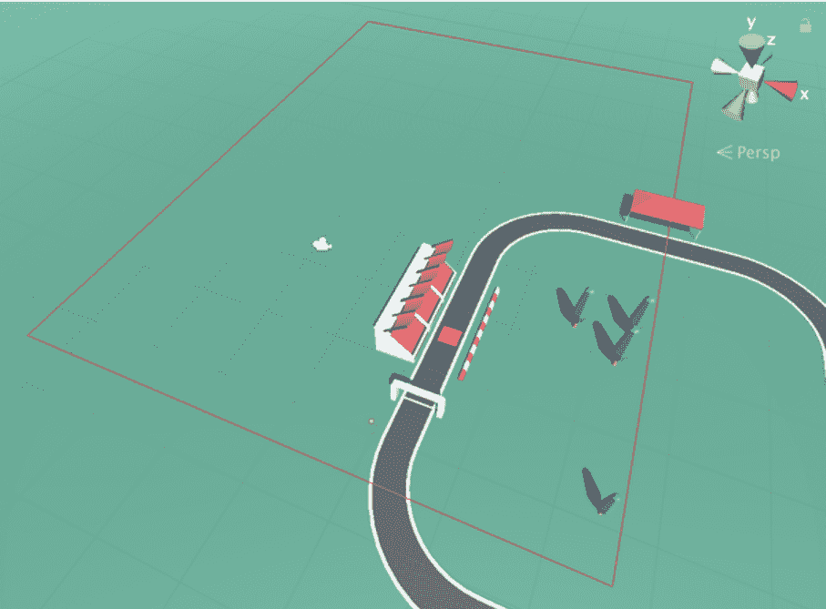

图 9-3. 将顶部俯视 2D 摄像机置于示例游戏关卡上方

## 讨论

这里没什么好多说的。在每一帧中，我们检查玩家希望移动摄像机的幅度，确定一帧内需要移动的距离，计算允许范围内的新位置，并将摄像机移动到那里。再次强调，我们的顶部俯视摄像机系统只是实现这种行为的一种可能方式！你也可以使用更先进的系统，例如 Cinemachine。

> **提示**
>
> 我们使用一个*小部件*作为辅助，以便弄清楚场景视图中发生了什么。*小部件*是场景视图中的元素，可帮助你导航或理解正在发生的事情。

## 9.4 管理任务

### 问题

你希望管理一个任务结构，玩家需要完成特定目标才能结束任务。

作为任务结构的一部分，你希望某些目标是可选的，而某些目标在达成之前不会向玩家展示。如果一个目标失败且不是可选的，那么整个任务就会失败。

### 解决方案

在管理任务结构之前，我们需要一个任务。

首先，让我们定义一个简单的任务：我们将摄像机放置在一些彩色方块前面，并说玩家需要点击它们才能完成任务。但是，其中一个方块是禁忌的，点击它会导致任务失败（图 9-4）。

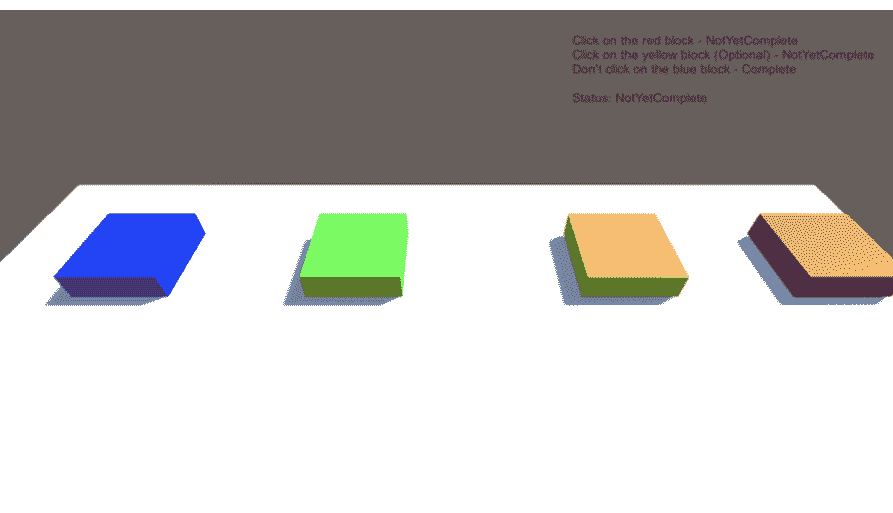

图 9-4. 点击禁忌方块会导致任务失败

我们需要为任务创建场景：

- 1. 创建四个立方体，并将它们放置在摄像机前面。
- 2. 对于每个立方体，创建一个材质，并通过将其拖放到场景视图中的立方体上来添加。
- 3. 更改每个立方体材质的颜色。设置一个红色，一个绿色，一个黄色，一个蓝色。（如果这些颜色中有任何一种难以区分，请更改为最适合你的颜色。）

立方体现已设置完毕（图 9-5）。

### 检查器

### 蓝色方块

### 变换

| 属性 | X | Y | Z |
|---|---|---|---|
| 位置 | 3.5 | 0.15 | 3.39 |
| 旋转 | 0 | 0 | 0 |
| 缩放 | 1 | 0.3 | 1 |

### 立方体（网格过滤器）

网格: 立方体

### 网格渲染器

- 照明
- 材质
- 动态遮挡

### 盒子碰撞器

编辑碰撞器

| 属性 | 值 |
|---|---|
| 是触发器 | 已勾选 |
| 材质 | 无 (物理材质) |
| 中心 | X 0, Y 0, Z 0 |
| 尺寸 | X 1, Y 1, Z 1 |

### 点击时触发目标（脚本）

| 属性 | 值 |
|---|---|
| 脚本 | TriggerObjectiveOnClick |
| 任务 | 点击方块（任务） |
| 状态 | 失败 |
| 目标 | 不要点击蓝色方块 |

### 蓝色方块

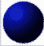

着色器: 标准

渲染模式: 不透明

- 主贴图
  - 反照率: [蓝色颜色]
  - 金属度: 0

图 9-5. 我们立方体的设置

接下来，我们将处理显示任务及其目标的状态：

- 1. 选择主摄像机对象，并向其添加物理射线投射器。
- 2. 创建一个新画布，用于显示任务及其目标的状态。
- 3. 添加一个带有文本组件的游戏对象。
- 4. 调整此对象的大小，以便它可以舒适地容纳一段文本。

现在我们将设置存储任务信息的对象类型。
创建一个名为 Quest.cs 的新 C# 脚本，并将以下代码添加到其中：

```
#if UNITY_EDITOR
using UnityEditor;
#endif

// A Quest stores information about a quest: its name and its
// objectives.

// CreateAssetMenu makes the Create Asset menu contain an entry that
// creates a new Quest asset.
[CreateAssetMenu(fileName = "New Quest", menuName = "Quest",
order = 100)]
public class Quest : ScriptableObject
{

    // Represents the status of objectives and quests
    public enum Status {
    NotYetComplete, // the objective or quest has not yet been
                    // completed
    Complete,       // the objective or quest has been successfully
                    // completed
    Failed          // the objective or quest has failed
    }

    // The name of the quest
    public string questName;

    // The list of objectives that form this quest
    public List<Objective> objectives;

    // Objectives are the specific tasks that make up a quest.
```

```
[System.Serializable]
public class Objective
{
    // The visible name that's shown to the player
    public string name = "New Objective";

    // If true, this objective doesn't need to be complete for the
    // quest to be considered complete.
    public bool optional = false;

    // If false, the objective will not be shown to the user if
    // it's not yet complete. (It will be shown if it's Complete
    // or Failed.)
    public bool visible = true;

    // The status of the objective when the quest begins. Usually
    // this will be "not yet complete," but you might want an
    // objective that starts as Complete, and can be Failed.
    public Status initialStatus = Status.NotYetComplete;
}
}
```

```
}

#if UNITY_EDITOR
// Draw a custom editor that lets you build the list of objectives.
[CustomEditor(typeof(Quest))]
public class QuestEditor : Editor {

    // Called when Unity wants to draw the Inspector for a quest.
    public override void OnInspectorGUI()
    {
        // Ensure that the object we're displaying has had any pending
        // changes done.
        serializedObject.Update();

        // Draw the name of the quest.
        EditorGUILayout.PropertyField(
            serializedObject.FindProperty("questName"),
            new GUIContent("Name")
        );

        // Draw a header for the list of objectives
        EditorGUILayout.LabelField("Objectives");

        // Get the property that contains the list of objectives
        var objectiveList = serializedObject.FindProperty("objectives");
```

```
// Indent the objectives
EditorGUI.indentLevel += 1;

// For each objective in the list, draw an entry
for (int i = 0; i < objectiveList.arraySize; i++)
{
    // Draw a single line of controls
    EditorGUILayout.BeginHorizontal();

    // Draw the objective itself (its name and its flags)
    EditorGUILayout.PropertyField(
        objectiveList.GetArrayElementAtIndex(i),
        includeChildren: true
    );

    // Draw a button that moves the item up in the list
    if (GUILayout.Button("Up", EditorStyles.miniButtonLeft,
        GUILayout.Width(25)))
    {
        objectiveList.MoveArrayElement(i, i - 1);
    }

    // Draw a button that moves the item down in the list
    if (GUILayout.Button("Down", EditorStyles.miniButtonMid,
        GUILayout.Width(40)))
    {
        objectiveList.MoveArrayElement(i, i + 1);
    }

    // Draw a button that removes the item from the list
    if (GUILayout.Button("-", EditorStyles.miniButtonRight,
        GUILayout.Width(25)))
    {
        objectiveList.DeleteArrayElementAtIndex(i);
    }

    EditorGUILayout.EndHorizontal();
}

// Remove the indentation
EditorGUI.indentLevel -= 1;

// Draw a button that adds a new objective to the list
if (GUILayout.Button("Add Objective"))
{
    objectiveList.arraySize += 1;
}
```

```
// Save any changes
serializedObject.ApplyModifiedProperties();
    }
}
#endif
```

> **提示**
>
> 有关我们用来将任务信息存储为资产的 ScriptableObject 类的更多信息，请参见配方 2.9。

现在我们可以创建任务资产：

- 1. 打开资产菜单，并选择 创建 → 任务。将新任务命名为“点击方块”。
- 2. 单击添加目标。将新目标命名为“点击红色方块”。打开可见复选框。
- 3. 再重复此过程两次，分别针对绿色和黄色方块。将其中一个设为可选，另一个设为可选且不可见。
- 4. 为蓝色方块再添加一个目标。对于这个目标，将其名称设置为“不要点击蓝色方块”。将其初始状态设置为“完成”。

完成后，检查器应该类似于图 9-6。


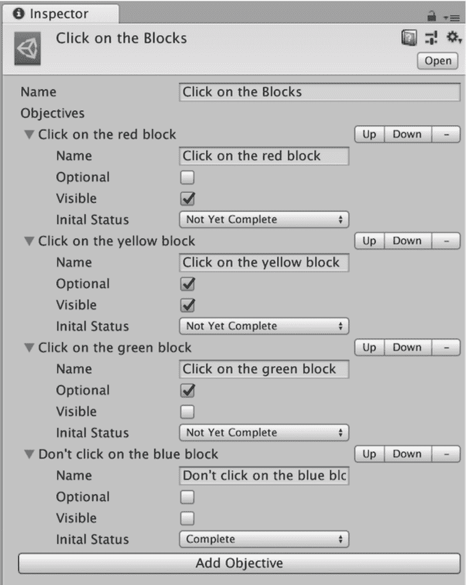

图 9-6. 任务资产的检查器，其中配置了多个目标

我们将设置管理任务的代码：

- 1. 创建一个名为 QuestManager.cs 的新 C# 脚本，并向其中添加以下代码：

```csharp
// Represents the player's current progress through a quest.
public class QuestStatus {
    // The underlying data object that describes the quest.
    public Quest questData;

    // The map of objective identifiers.
    public Dictionary<int, Quest.Status> objectiveStatuses;

    // The constructor. Pass a Quest to this to set it up.
    public QuestStatus(Quest questData)
    {
        // Store the quest info
        this.questData = questData;

        // Create the map of objective numbers to their status
        objectiveStatuses = new Dictionary<int, Quest.Status>();

        for (int i = 0; i < questData.objectives.Count; i += 1)
        {
            var objectiveData = questData.objectives[i];

            objectiveStatuses[i] = objectiveData.initialStatus;
        }
    }

    // Returns the state of the entire quest.
    // If all nonoptional objectives are complete, the quest is complete.
    // If any nonoptional objective is failed, the quest is failed.
    // Otherwise, the quest is not yet complete.
    public Quest.Status questStatus {
        get {
            for (int i = 0; i < questData.objectives.Count; i += 1) {
                var objectiveData = questData.objectives[i];
                // Optional objectives do not matter to the overall
                // quest status
                if (objectiveData.optional)
                    continue;

                var objectiveStatus = objectiveStatuses[i];

                // This is a mandatory objective
                if (objectiveStatus == Quest.Status.Failed)
                {
                    // If a mandatory objective is failed, the whole
                    // quest is failed
                    return Quest.Status.Failed;
                }
                else if (objectiveStatus != Quest.Status.Complete)
                {
                    // If a mandatory objective is not yet complete,
                    // the whole quest is not yet complete
                    return Quest.Status.NotYetComplete;
                }
            }

            // All mandatory objectives are complete, so this quest is
            // complete
            return Quest.Status.Complete;
        }
    }

    // Returns a string containing the list of objectives, their
    // statuses, and the status of the quest.
    public override string ToString()
    {
        var stringBuilder = new System.Text.StringBuilder();

        for (int i = 0; i < questData.objectives.Count; i += 1)
        {
            // Get the objective and its status
            var objectiveData = questData.objectives[i];
            var objectiveStatus = objectiveStatuses[i];

            // Don't show hidden objectives that haven't been finished
            if (objectiveData.visible == false &&
                objectiveStatus == Quest.Status.NotYetComplete)
            {
                continue;
            }

            // If this objective is optional, display "(Optional)" after
            // its name
            if (objectiveData.optional)
            {
                stringBuilder.AppendFormat("{0} (Optional) - {1}\n",
                    objectiveData.name,
                    objectiveStatus.ToString());
            }
            else
            {
                stringBuilder.AppendFormat("{0} - {1}\n",
                    objectiveData.name,
                    objectiveStatus.ToString());
            }
        }

        // Add a blank line followed by the quest status
        stringBuilder.AppendLine();
        stringBuilder.AppendFormat(
            "Status: {0}", this.questStatus.ToString());
        return stringBuilder.ToString();
    }
}

// Manages a quest.
public class QuestManager : MonoBehaviour {
    // The quest that starts when the game starts.
    [SerializeField] Quest startingQuest = null;

    // A label to show the state of the quest.
    [SerializeField] UnityEngine.UI.Text objectiveSummary = null;

    // Tracks the state of the current quest.
    QuestStatus activeQuest;

    // Start a new quest when the game starts
    void Start() {
        if (startingQuest != null)
        {
            StartQuest(startingQuest);
        }
    }

    // Begins tracking a new quest
    public void StartQuest(Quest quest) {
        activeQuest = new QuestStatus(quest);

        UpdateObjectiveSummaryText();

        Debug.LogFormat("Started quest {0}", activeQuest.questData.name);
    }

    // Updates the label that displays the status of the quest and
    // its objectives
    void UpdateObjectiveSummaryText() {

        string label;

        if (activeQuest == null) {
            label = "No active quest.";
        } else {
            label = activeQuest.ToString();
        }

        objectiveSummary.text = label;
    }

    // Called by other objects to indicate that an objective has changed
    // status
    public void UpdateObjectiveStatus(
        Quest quest, int objectiveNumber, Quest.Status status) {

        if (activeQuest == null) {
            Debug.LogError(
                "Tried to set an objective status, but no quest" +
                " is active"
            );

            return;
        }

        if (activeQuest.questData != quest) {

            Debug.LogWarningFormat("Tried to set an objective status " +
                "for quest {0}, but this is not the active quest. " +
                "Ignoring.",
                quest.questName);

            return;
        }

        // Update the objective status
        activeQuest.objectiveStatuses[objectiveNumber] = status;

        // Update the display label
        UpdateObjectiveSummaryText();
    }
}
```

- 2. 创建一个新的空游戏对象，并向其添加 QuestManager 组件。

- 3. 将您创建的任务资产拖入其“起始任务”字段中。

- 4. 将您之前设置的文本对象拖入其“目标摘要”字段中。

- 5. 接下来，我们将设置一个表示目标状态更改并在发生事件时可应用的类。创建一个名为 ObjectiveTrigger.cs 的新 C# 脚本，并向其中添加以下代码：

```csharp
#if UNITY_EDITOR
using UnityEditor;
using System.Linq;
#endif
```

```csharp
// Combines a quest, an objective in that quest, and an objective
// status to use.
[System.Serializable]
public class ObjectiveTrigger
{
    // The quest that we're referring to
    public Quest quest;

    // The status we want to apply to the objective
    public Quest.Status statusToApply;

    // The location of this objective in the quest's objective list
    public int objectiveNumber;

    public void Invoke() {
        // Find the quest manager
        var manager = Object.FindObjectOfType<QuestManager>();

        // And tell it to update our objective
        manager.UpdateObjectiveStatus(quest,
            objectiveNumber,
            statusToApply);
    }
}

#if UNITY_EDITOR
// Custom property drawers override how a type of property appears in
// the Inspector.
[CustomPropertyDrawer(typeof(ObjectiveTrigger))]
public class ObjectiveTriggerDrawer : PropertyDrawer {
    // Called when Unity needs to draw an ObjectiveTrigger property

    // in the Inspector.
    public override void OnGUI(Rect position,
        SerializedProperty property,
        GUIContent label)
    {
        // Wrap this in Begin/EndProperty to ensure that undo works
        // on the entire ObjectiveTrigger property
        EditorGUI.BeginProperty(position, label, property);

        // Get a reference to the three properties in the
        // ObjectiveTrigger.
        var questProperty =
            property.FindPropertyRelative("quest");
        var statusProperty =
            property.FindPropertyRelative("statusToApply");
        var objectiveNumberProperty =
            property.FindPropertyRelative("objectiveNumber");

        // We want to display three controls:
        // - An Object field for dropping a Quest object into
        // - A pop-up field for selecting a Quest.Status from
        // - A pop-up field for selecting the specific objective from;
        //   it should show the name of the objective.
        //
        // If no Quest has been specified, or if the Quest has no
        // objectives, the objective pop-up should be empty and
        // disabled.

        // Calculate the rectangles in which we're displaying.
        var lineSpacing = 2;

        // Calculate the rectangle for the first line
        var firstLinePosition = position;
        firstLinePosition.height =
            base.GetPropertyHeight(questProperty, label);

        // And for the second line (same as the first line, but shifted
        // down one line)
        var secondLinePosition = position;
        secondLinePosition.y = firstLinePosition.y +
            firstLinePosition.height + lineSpacing;
        secondLinePosition.height =
            base.GetPropertyHeight(statusProperty, label);

        // Repeat for the third line (same as the second line, but
        // shifted down)
        var thirdLinePosition = position;
        thirdLinePosition.y = secondLinePosition.y +
            secondLinePosition.height + lineSpacing;
        thirdLinePosition.height =
            base.GetPropertyHeight(objectiveNumberProperty, label);

        // Draw the quest and status properties, using the automatic
        // property fields
        EditorGUI.PropertyField(firstLinePosition, questProperty,
            new GUIContent("Quest"));
        EditorGUI.PropertyField(secondLinePosition, statusProperty,
            new GUIContent("Status"));

        // Now we draw our custom property for the object.
        // Draw a label on the lefthand side, and get a new rectangle
        // to draw the pop-up in
        thirdLinePosition = EditorGUI.PrefixLabel(thirdLinePosition,
            new GUIContent("Objective"));

        // Draw the UI for choosing a property
        var quest = questProperty.objectReferenceValue as Quest;
    }
}
#endif


```csharp
// Only draw this if we have a quest, and it has objectives
if (quest != null && quest.objectives.Count > 0)
{
    // Get the name of every objective, as an array
    var objectiveNames =
        quest.objectives.Select(o => o.name).ToArray();

    // Get the index of the currently selected objective
    var selectedObjective = objectiveNumberProperty.intValue;

    // If we somehow are referring to an object that's not
    // present in the list, reset it to the first objective
    if (selectedObjective >= quest.objectives.Count) {
        selectedObjective = 0;
    }

    // Draw the pop-up, and get back the new selection
    var newSelectedObjective = EditorGUI.Popup(thirdLinePosition,
        selectedObjective,
        objectiveNames);

    // If it was different, store it in the property
    if (newSelectedObjective != selectedObjective)
    {
        objectiveNumberProperty.intValue = newSelectedObjective;
    }
} else {
    // Draw a disabled pop-up as a visual placeholder
    using (new EditorGUI.DisabledGroupScope(true)) {
        // Show a pop-up with a single entry: the string "-".
        // Ignore its return value, since it's not interactive
        // anyway.
    }
}
```

```csharp
EditorGUI.Popup(thirdLinePosition, 0, new[] { "-" });
}
}

EditorGUI.EndProperty();
}

// Called by Unity to figure out the height of this property.
public override float GetPropertyHeight(SerializedProperty property,
    GUIContent label)
{
    // The number of lines in this property
    var lineCount = 3;

    // The number of pixels between each line
    var lineSpacing = 2;

    // The height of each line
    var lineHeight = base.GetPropertyHeight(property, label);

    // The height of this property is the number of lines times the
    // height of each line, plus the spacing between each line
    return (lineHeight * lineCount) +
        (lineSpacing * (lineCount - 1));
}
}
#endif
```

最后，我们将设置方块，使其在被点击时完成或失败目标：

- 1. 创建一个名为 *TriggerObjectiveOnClick.cs* 的新 C# 脚本，并向其中添加以下代码：

```csharp
using UnityEngine.EventSystems;

// Triggers an objective when an object enters it.
public class TriggerObjectiveOnClick :
    MonoBehaviour, IPointerClickHandler {

    // The objective to trigger, and how to trigger it.
    [SerializeField] ObjectiveTrigger objective = new ObjectiveTrigger();

    // Called when the player clicks on this object
    void IPointerClickHandler.OnPointerClick(PointerEventData eventData)
    {
        // We just completed or failed this objective!
        objective.Invoke();

        // Disable this component so that it doesn't get run twice
        this.enabled = false;
    }
}
```

- 2. 将 TriggerObjectiveOnClick 组件添加到每个方块。对每个方块，将任务资产拖入其 Quest 字段，并为目标选择适当的状态（即，将蓝色方块设置为 Failed，其余设置为 Complete）。

图 9-7 显示了配置完成后红色方块的 TriggerObjectiveOnClick 脚本示例。

> **提示**
> 画布本身可能会阻止射线检测，除非你将文本作为射线检测目标禁用。

- 3. 运行游戏。任务状态会在屏幕上显示，并在你点击不同方块时发生变化。

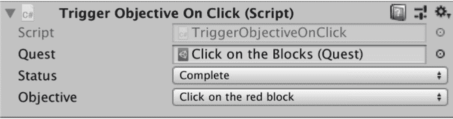

图 9-7. TriggerObjectiveOnClick 的 Inspector

### 讨论

那一段相当长了！别担心，讨论部分不会和解决方案一样长。

> **提示**
> 你可以在第 12 章中了解更多关于 UI 的内容。

在这里创建任务系统涉及创建充当任务的对象（方块）、一个显示任务状态的 UI，然后是一些实际任务。在构建这样的系统时，重要的是要考虑对象可能涉及的不同状态组合。想想调皮、恶意、困惑或运气不佳的玩家可能会做什么：他们可能会做出顺序颠倒的操作、跳过内容，或找到你的代码未预料到的方法来做事情。

## 9.5 拖动方框以选择对象

### 问题

你想要点击并拖动鼠标，在屏幕上创建一个可见的矩形。当你释放鼠标时，你想要知道哪些对象位于该矩形内。

首先，我们将创建绘制方框的画布，以及方框对象本身：

- 1. 打开 GameObject 菜单，选择 UI → Canvas。
- 2. 从 GameObject 菜单中，选择 UI → Image。
- 3. 将新图像命名为“Selection Box.”

接下来，我们将创建一个在被选中时输出消息的脚本：

- 1. 创建一个名为 BoxSelectable.cs 的新 C# 脚本，并向其中添加以下代码：

```csharp
// Handles the input and display of a selection box.
public class BoxSelectable: MonoBehaviour {
    public void Selected() {
        Debug.LogFormat("{0} was selected!", gameObject.name);
    }
}
```

- 2. 创建一些对象（它们是什么不重要；立方体即可），并将它们放置在摄像机可见的位置。
- 3. 将 BoxSelectable.cs 脚本添加到每个对象。

现在，我们将创建一个脚本，用于更新选择框的位置和大小，并报告哪些对象被选中：

- 1. 创建一个名为 BoxSelection.cs 的新 C# 脚本，并向其中添加以下代码：

```csharp
// Handles the input and display of a selection box.
public class BoxSelection : MonoBehaviour
{

    // Draggable inspector reference to the Image GameObject's
    // RectTransform.
    public RectTransform selectionBox;

    // This variable will store the location of wherever we first click
    // before dragging.
    private Vector2 initialClickPosition = Vector2.zero;

    // The rectangle that the box has dragged, in screen space.
    public Rect SelectionRect { get; private set; }

    // If true, the user is actively dragging a box
    public bool IsSelecting { get; private set; }
}

// Configure the visible box
private void Start()
{

    // Setting the anchors to be positioned at zero-zero means that
    // the box's size won't change as its parent changes size
    selectionBox.anchorMin = Vector2.zero;
    selectionBox.anchorMax = Vector2.zero;

    // Setting the pivot point to zero means that the box will pivot
    // around its lower-left corner
    selectionBox.pivot = Vector2.zero;

    // Hide the box at the start
    selectionBox.gameObject.SetActive(false);
}

void Update()
{

    // When we start dragging, record the position of the mouse, and
    // start showing the box
    if (Input.GetMouseButtonDown(0))
    {
        // Get the initial click position of the mouse. No need to
        // convert to GUI space since we are using the lower left as
        // anchor and pivot.
        initialClickPosition =
            new Vector2(Input.mousePosition.x,
                Input.mousePosition.y);

        // Show the box
        selectionBox.gameObject.SetActive(true);
    }

    // While we are dragging, update the position and size of the
    // box based on the mouse position.
    if (Input.GetMouseButton(0))
    {
        // Store the current mouse position in screen space.
        Vector2 currentMousePosition =
            new Vector2(Input.mousePosition.x,
                Input.mousePosition.y);

        // Figure out the lower-left corner, and the upper-right
        // corner
        var xMin =
            Mathf.Min(currentMousePosition.x,
                initialClickPosition.x);
        var xMax =
            Mathf.Max(currentMousePosition.x,
                initialClickPosition.x);

        var yMin =
            Mathf.Min(currentMousePosition.y,
                initialClickPosition.y);
        var yMax =
            Mathf.Max(currentMousePosition.y,
                initialClickPosition.y);

        // Build a rectangle from these corners
        var screenSpaceRect = Rect.MinMaxRect(xMin, yMin,
            xMax, yMax);

        // The anchor of the box has been configured to be its
        // lower-left corner, so by setting its anchoredPosition, we
        // set its lower-left corner.
        selectionBox.anchoredPosition = screenSpaceRect.position;

        // The size delta is how far the box extends from its anchor.
        // Because the anchor's minimum and maximum are the same
        // point, changing its size delta directly changes its
        // final size.
        selectionBox.sizeDelta = screenSpaceRect.size;

        // Update our selection box
        SelectionRect = screenSpaceRect;
    }

    // When we release the mouse button, hide the box, and record
    // that we're no longer selecting
    if (Input.GetMouseButtonUp(0))
    {
        SelectionComplete();
    }
    // Hide the box
}
```


selectionBox.gameObject.SetActive(false);

// We're no longer selecting
IsSelecting = false;
}
}
```

```
// Called when the user finishes dragging a selection box.
void SelectionComplete()
{
```

```
// Get the component attached to this scene
Camera mainCamera = GetComponent<Camera>();
```

```
// Get the bottom-left and top-right corners of the screen-space
// selection view, and convert them to viewport space
var min = mainCamera.ScreenToViewportPoint(
    new Vector3(SelectionRect.xMin, SelectionRect.yMin));
var max = mainCamera.ScreenToViewportPoint(
    new Vector3(SelectionRect.xMax, SelectionRect.yMax));
```

```
// We want to create a bounding box in viewport space. We have
// the x and y coordinates of the bottom-left and top-right
// corners; now we'll include the z coordinates.
min.z = mainCamera.nearClipPlane;
max.z = mainCamera.farClipPlane;
```

```
// Construct our bounding box
var viewportBounds = new Bounds();
viewportBounds.SetMinMax(min, max);
```

```
// Check each object that has a Selectable component
foreach (var selectable in FindObjectsOfType<BoxSelectable>()) {
// Figure out where this object is in viewport space
var selectedPosition = selectable.transform.position;
var viewportPoint =
mainCamera.WorldToViewportPoint(selectedPosition);
// Is that point within our viewport bounding box? If it is,
// they're selected.
var selected = viewportBounds.Contains(viewportPoint);
if (selected) {
    // Let them know.
    selectable.Selected();
}
}
}
```

- 2. 将 BoxSelection 组件附加到主摄像机。
- 3. 将选择框图像拖动到“选择框”字段。
- 4. 运行游戏。您可以单击并拖动来创建方框。释放鼠标时，矩形内所有带有 BoxSelectable 组件的对象都会记录它们已被选中。

### 讨论

**提示**

如果使用分片精灵，您的选择框可以带有边框。

## 9.6 创建菜单结构

### 问题

您希望创建一组菜单页面，每次只有一个菜单可见。

### 解决方案

要创建一组菜单页面：

- 1. 创建一个名为 *Menu.cs* 的新脚本：

```
// Contains UnityEvent, which this script uses
using UnityEngine.Events;

public class Menu : MonoBehaviour {

// Invoked when a menu appears onscreen.
public UnityEvent menuDidAppear = new UnityEvent();

// Invoked when a menu is removed from the screen.
public UnityEvent menuWillDisappear = new UnityEvent();

}
```

- 2. 创建一个名为 *MenuManager.cs* 的新脚本：

```
public class MenuManager : MonoBehaviour {

[SerializeField] List<Menu> menus = new List<Menu>();

private void Start()
{
    // Show the first menu on start
    ShowMenu(menus[0]);
}

public void ShowMenu(Menu menuToShow) {
    // Ensure that this menu is one that we're tracking.
    if (menus.Contains(menuToShow) == false) {
        Debug.LogErrorFormat(
            "{0} is not in the list of menus",
            menuToShow.name
        );
        return;
    }

    // Enable this menu, and disable the others
    foreach (var otherMenu in menus) {
        // Is this the menu we want to display?
        if (otherMenu == menuToShow) {
            // Mark it as active
            otherMenu.gameObject.SetActive(true);

            // Tell the Menu object to invoke its "did appear"
            // action
            otherMenu.menuDidAppear.Invoke();
        } else {
// Is this menu currently active?
if (otherMenu.gameObject.activeInHierarchy)
{
    // If so, tell the Menu object to invoke its "will
    // disappear" action
    otherMenu.menuWillDisappear.Invoke();
}

// And mark it as inactive
otherMenu.gameObject.SetActive(false);
}
}
}
}
```

现在我们将创建一个示例菜单。它将有两个屏幕——主菜单和选项菜单：

- 1. 创建一个新游戏对象，并将其命名为“菜单管理器”。
- 2. 将 MenuManager.cs 脚本添加到此对象。
- 3. 创建一个画布。
- 4. 创建一个名为“主菜单”的新子游戏对象。这将充当菜单控件的容器。
- 5. 将 Menu.cs 脚本添加到此对象。
- 6. 向主菜单对象添加一个按钮游戏对象。将此按钮命名为“显示选项菜单按钮”。
- 7. 将其文本设置为“选项菜单”。
- 8. 复制主菜单对象，并将其重命名为“选项菜单”。

- 9. 将其“显示选项菜单按钮”文本重命名为“显示主菜单按钮”。
- 10. 将其文本更改为“返回”。
- 11. 选择“菜单管理器”对象。
- 12. 将“主菜单”对象拖动到“菜单”插槽。
- 13. 将“选项菜单”对象拖动到“菜单”插槽。

接下来，我们将使按钮显示相应的菜单：

- 1. 选择主菜单对象内的“显示选项菜单按钮”。
- 2. 在按钮的“点击时”事件中添加新条目。
- 3. 将“菜单管理器”拖动到对象字段。
- 4. 在功能下拉菜单中，选择 MenuManager → ShowMenu。
- 5. 将“选项菜单”对象拖动到参数字段。
- 6. 完成后，“点击时”事件应如图 9-8 所示。
- 7. 选择选项菜单对象内的“显示主菜单按钮”。
- 8. 在按钮的“点击时”事件中添加新条目。
- 9. 将“菜单管理器”拖动到对象字段。
- 10. 在功能下拉菜单中，选择 MenuManager → ShowMenu。
- 11. 将“主菜单”对象拖动到参数字段。
- 12. 完成后，“点击时”事件应如图 9-9 所示。
- 13. 运行游戏。主菜单将出现。单击选项按钮将隐藏它并显示选项菜单，单击返回按钮将返回主菜单。

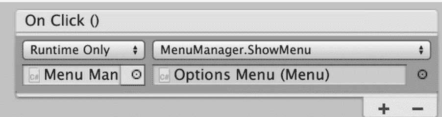

图 9-8. 配置“显示选项菜单”按钮的“点击时”事件

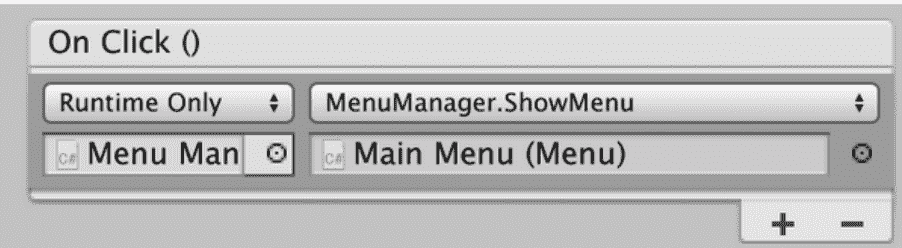

图 9-9. 配置“显示主菜单”按钮的“点击时”事件

### 讨论

您还可以为每个菜单添加其他函数调用；请参见图 9-10。

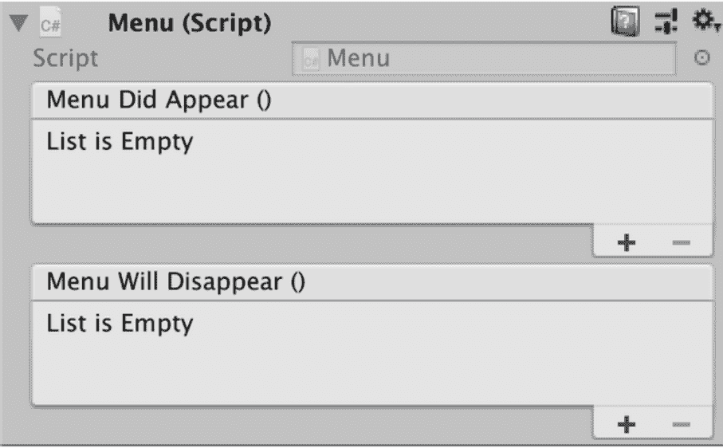

图 9-10. 菜单出现和菜单消失事件，您可以向其中添加函数调用

## 9.7 创建带轮子的车辆

### 问题

您希望实现带轮子的车辆，例如汽车。

### 解决方案

要创建带轮子的车辆：

- 1. 创建一个名为“车辆”的空对象。
- 2. 向其添加刚体。
- 3. 将其质量设置为 750，阻力设置为 0.1。
- 4. 如果有可用的汽车网格，请将其作为子对象添加到“车辆”对象。如果没有网格，请添加一个立方体作为子对象，并将其缩放至适合汽车的形状和大小。如果这样做，请确保删除随立方体附带的盒状碰撞体。无论哪种情况，请确保可见对象的位置为 (0, 0, 0)，以便其位于正确位置。

- 5. 作为子对象创建一个空游戏对象，并将其命名为“碰撞体”。
- 6. 向“碰撞体”添加一个空游戏对象，并将其命名为“车身”。
- 7. 向车身对象添加一个盒状碰撞体。
- 8. 单击“编辑碰撞体”，然后单击并拖动方框，使其紧贴可见汽车对象。
- 9. 作为“碰撞体”的新空子对象，并将其命名为“左前轮”。
- 10. 向这个新对象添加一个车轮碰撞体。
- 11. 将其定位在您希望左前轮胎所在的位置附近。如果使用汽车网格，请将其放置在可见轮胎的中间。
- 12. 调整车轮半径至所需大小。（车轮碰撞体进入车身碰撞体内部没关系。）
- 13. 复制车轮三次——每个其余三个轮胎各一个。将每个移动到另一个轮胎处，并适当重命名。完成后，碰撞体应类似于图 9-11。

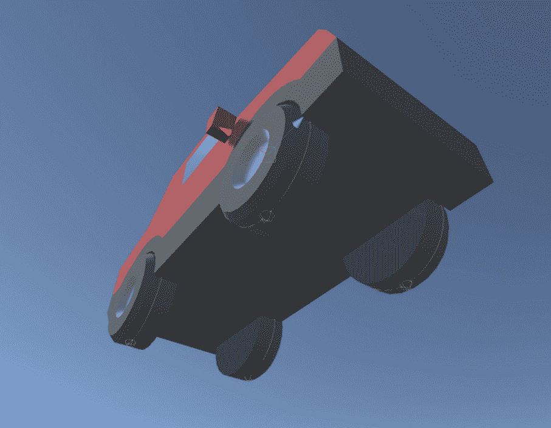

图 9-11. 放置车辆的车轮

- 14. 创建一个新脚本，并将其命名为 Vehicle.cs。向其中添加以下代码：

```
// Configures a single wheel's control parameters.
[System.Serializable]
public class Wheel {
    // The collider this wheel uses
    public WheelCollider collider;

    // Whether this wheel should be powered by the engine
    public bool powered;

    // Whether this wheel is steerable
    public bool steerable;
```


```
// Whether this wheel can apply brakes
public bool hasBrakes;
}
```

```csharp
// Controls the power, braking, and steering applied to wheels.
public class Vehicle : MonoBehaviour {

    // The list of wheels on this vehicle
    [SerializeField] Wheel[] wheels = {};

    // The settings used for controlling the wheels:

    // Maximum motor torque
    [SerializeField] float motorTorque = 1000;

    // Maximum brake torque
    [SerializeField] float brakeTorque = 2000;

    // Maximum steering angle
    [SerializeField] float steeringAngle = 45;

    private void Update() {

        // If the vertical axis is positive, apply motor torque and no
        // brake torque. If it's negative, apply brake torque and no
        // motor torque.
        var vertical = Input.GetAxis("Vertical");

        float motorTorqueToApply;
        float brakeTorqueToApply;

        if (vertical >= 0) {
            motorTorqueToApply = vertical * motorTorque;
            brakeTorqueToApply = 0;
        } else {
            // If the vertical axis is negative, cut the engine and step
            // on the brakes.

            // We use Mathf.Abs here to ensure that we use the positive
            // value of "vertical" (because applying negative braking
            // torque would lead to weirdness).
            motorTorqueToApply = 0;
            brakeTorqueToApply = Mathf.Abs(vertical) * brakeTorque;
        }

        // Scale the maximum steering angle by the horizontal axis.
        var currentSteeringAngle =
            Input.GetAxis("Horizontal") * steeringAngle;

        // Update all wheels

        // Using a for loop, rather than a foreach loop, because foreach
        // loops allocate temporary memory, which is turned into garbage
        // at the end of the frame. We want to minimize garbage, because
        // the more garbage that gets generated, the more often the
        // garbage collector has to run, which causes performance
        // problems.
        for (int wheelNum = 0; wheelNum < wheels.Length; wheelNum++) {

            var wheel = wheels[wheelNum];

            // If a wheel is powered, it updates its motor torque
            if (wheel.powered) {
                wheel.collider.motorTorque = motorTorqueToApply;
            }

            // If a wheel is steerable, it updates its steer angle
            if (wheel.steerable) {
                wheel.collider.steerAngle = currentSteeringAngle;
            }

            // If a wheel has brakes, it updates its brake torque
            if (wheel.hasBrakes) {
                wheel.collider.brakeTorque = brakeTorqueToApply;
            }
        }
    }
}
```

- 15. 将 Vehicle.cs 脚本添加到 Vehicle 对象。

- 16. 选择 Vehicle 对象，并向 Wheels 列表添加四个条目。

- 17. 对于每个条目：
  - a. 添加一个轮胎碰撞器。
  - b. 如果是后轮，则打开 Powered。
  - c. 如果是前轮，则打开 Steerable。
  - d. 打开 Has Brakes。

- 18. 运行游戏。你应该能够驾驶汽车四处行驶。

#### 讨论

你也可以考虑添加一个环绕摄像机来跟随车辆移动，如配方 9.10 所示。

构建车辆时，考虑当所有车轮都可转向或所有车轮都有动力时会发生什么。

提示

尝试修改车辆质量或扭矩值，看看会发生什么！

在 Unity 中，轮胎碰撞器定义了它们自己的悬架参数。尝试调整它们以获得有趣的效果。

## 9.8 防止汽车翻车

### 问题

你希望汽车在急转弯时不会翻车。

### 解决方案

汽车翻车是因为它正在围绕其过高的质心旋转。当质心较低时，围绕它的任何旋转都会使车轮更紧地压向地面，而不是使整辆汽车翻倒。

要防止汽车翻车：

- 1. 创建一个名为 AdjustCenterOfMass.cs 的新 C# 脚本，并添加以下代码：

```csharp
[RequireComponent(typeof(Rigidbody))]
public class AdjustCenterOfMass : MonoBehaviour {

    // How far the center of mass should be moved from its default
    // position
    [SerializeField] Vector3 centerOfMass = Vector3.zero;

    private void Start()
    {
        // Override the center of mass, to enhance stability
        GetComponent<Rigidbody>().centerOfMass += centerOfMass;
    }

    // Called by the editor to show "gizmos" in the Scene view. Used to
    // help visualize the overridden center of mass.
    private void OnDrawGizmosSelected()
    {
        // Draw a green sphere where the updated center of mass will be.
        Gizmos.color = Color.green;

        var currentCenterOfMass =
            this.GetComponent<Rigidbody>().worldCenterOfMass;

        Gizmos.DrawSphere(currentCenterOfMass + centerOfMass, 0.125f);
    }
}
```

- 2. 将此组件添加到包含车辆 Rigidbody 的游戏对象。

- 3. 将质心的 y 坐标向下移动一点，使其刚好位于车辆地板处。质心越低，车辆越稳定。

### 讨论

在 Unity 中，Rigidbody 通常从其碰撞器计算质心，但你可以覆盖它。

在现实生活中，汽车的质心较低，因为变速箱和发动机等重物位于地板下方。我们在此处的实现方式（以及游戏中典型的实现方式）不够现实，但能提供更好的游戏体验。

## 9.9 创建加速带

### 问题

你希望在赛道上创建一些物体，当车辆驶过它们时会获得临时加速。

### 解决方案

首先，创建加速带的可见组件。在本示例中，我们将采用简单的卡通风格：

- 1. 创建一个新材质，并将其命名为“加速带”。

- 2. 将其反照率颜色设置为红色。

- 3. 打开 GameObject 菜单，选择 3D 对象 → 平面。

- 4. 在赛道上适当定位和缩放该对象。

- 5. 将该对象命名为“加速带”。

- 6. 将“加速带”材质拖到该对象上。

- 7. 从该对象中移除网格碰撞器。

- 8. 添加一个盒形碰撞器。

- 9. 打开 Is Trigger。

- 10. 调整大小和位置，创建足够汽车进入的体积（例如，请参见图 9-12）。

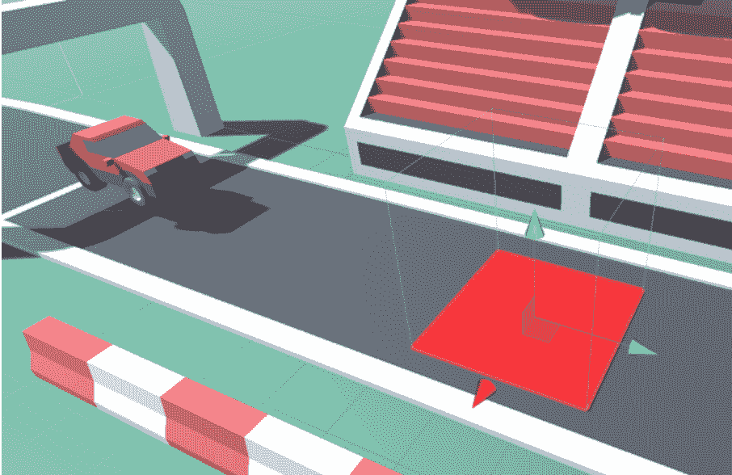

图 9-12. “加速带”对象，带有足够汽车进入的盒形碰撞器

- 11. 创建一个名为 SpeedBoost.cs 的新 C# 脚本，并向其中添加以下代码：

```csharp
public class SpeedBoost : MonoBehaviour {
// The amount of time the boost should apply
[SerializeField] float boostDuration = 1;

// The amount of force to apply in the forward direction
[SerializeField] float boostForce = 50;

// Called when a rigidbody enters the trigger
private void OnTriggerEnter(Collider other)
{
    // Ensure this collider has a rigidbody, either on itself
    // or on a parent object
    var body = other.GetComponentInParent<Rigidbody>();

    if (body == null) {
        return;
    }

    // Attach a ConstantForce component to it
    var boost = body.gameObject.AddComponent<ConstantForce>();

    // Make the ConstantForce boost the object forward by the
    // specified amount
    boost.relativeForce = Vector3.forward * boostForce;

    // Remove this ConstantForce after boostDuration seconds
    Destroy(boost, boostDuration);
}
}
```

- 12. 将 SpeedBoost 组件附加到“加速带”对象。

- 13. 测试游戏。当车辆进入加速区域时，它会向前加速一小段时间。

### 讨论

我们的加速带并不复杂：只是一个带有碰撞器和触发器的对象，并调用物理系统向需要加速的对象施加一些力。加速！

## 9.10 创建围绕目标环绕的摄像机

### 问题

你希望创建一个摄像机，它在固定距离处围绕目标位置旋转。

### 解决方案

要创建环绕摄像机：

- 1. 向场景添加一个摄像机。

- 2. 创建一个名为 OrbitingCamera.cs 的新 C# 脚本，并用以下代码替换其代码：

```csharp
public class OrbitingCamera : MonoBehaviour
{

// The object we're orbiting around
[SerializeField] Transform target;

// The speed at which we change our rotation and elevation
[SerializeField] float rotationSpeed = 120.0f;
[SerializeField] float elevationSpeed = 120.0f;

// The minimum and maximum angle of elevation
[SerializeField] float elevationMinLimit = -20f;
[SerializeField] float elevationMaxLimit = 80f;

// The distance we're at from the target
[SerializeField] float distance = 5.0f;
[SerializeField] float distanceMin = .5f;
[SerializeField] float distanceMax = 15f;

// The angle at which we're rotated around the target
float rotationAroundTarget = 0.0f;

// The angle at which we're looking down or up at the target
float elevationToTarget = 0.0f;

// Use this for initialization
```


```csharp
void Start()
{
    Vector3 angles = transform.eulerAngles;
    rotationAroundTarget = angles.y;
    elevationToTarget = angles.x;

    if (target) {
        // Take the current distance from the camera to the target
        float currentDistance =
            (transform.position - target.position).magnitude;

        // Clamp it to our required minimum/maximum
        distance = Mathf.Clamp(
            currentDistance, distanceMin, distanceMax);
    }
}

// Every frame, after all Update functions are called, update the
// camera position and rotation
//
// We do this in LateUpdate so that if the object we're tracking has
// its position changed in the Update method, the camera will be
// correctly positioned, because LateUpdate is always run afterward.
void LateUpdate()
{
    if (target)
    {
        // Update our rotation and elevation based on mouse movement
        rotationAroundTarget +=
            Input.GetAxis("Mouse X")
            * rotationSpeed * distance * 0.02f;

        elevationToTarget -=
            Input.GetAxis("Mouse Y") * elevationSpeed * 0.02f;

        // Limit the elevation to between the minimum and
        // the maximum
        elevationToTarget = ClampAngle(
            elevationToTarget,
            elevationMinLimit,
            elevationMaxLimit
        );
    }

    // Compute the rotation based on these two angles
    Quaternion rotation = Quaternion.Euler(
        elevationToTarget,
        rotationAroundTarget,
        0
    );

    // Update the distance based on mouse movement
    distance = distance - Input.GetAxis("Mouse ScrollWheel") * 5;

    // And limit it to the minimum and maximum
    distance = Mathf.Clamp(distance, distanceMin, distanceMax);

    // Figure out a position that's "distance" units away
    // from the target in the reverse direction to where
    // we're looking
    Vector3 negDistance = new Vector3(0.0f, 0.0f, -distance);
    Vector3 position = rotation * negDistance + target.position;

    // Update the position
    transform.position = position;

    // Update the rotation so we're looking at the target
    transform.rotation = rotation;
}
}
```

```csharp
// Clamps an angle between "min" and "max," wrapping it if it's less
// than 360 degrees or higher than 360 degrees.
public static float ClampAngle(float angle, float min, float max)
{
    // Wrap the angle at -360 and 360
    if (angle < -360F)
        angle += 360F;
    if (angle > 360F)
        angle -= 360F;

    // Clamp this wrapped angle
    return Mathf.Clamp(angle, min, max);
}
}
```

- 3. 向场景中添加一个立方体。

- 4. 选择摄像机，并将 Hierarchy 中立方体的条目拖入 Target 字段。

- 5. 运行游戏。移动鼠标时，摄像机将围绕目标旋转。

### 讨论

这种摄像机有时被称为“追踪摄像机”。我们在这里的大部分工作都在 LateUpdate 函数中完成，因为我们希望确保当被跟踪对象在 Update 函数中改变位置时，摄像机处于正确位置。LateUpdate 始终在 Update 之后运行。

**提示** 您可以在 Unity 手册中了解事件执行顺序。

## 9.11 创建不会穿墙的环绕摄像机

### 问题

您希望检测摄像机与目标之间是否存在对象，并在有对象时将摄像机移近。

**注意** 此配方基于配方 9.10。

### 解决方案

要创建不会穿墙的摄像机：

- 1. 将以下变量添加到 OrbitingCamera 类中：

```csharp
// When true, the camera will adjust its distance when there's a
// collider between it and the target
[SerializeField] bool clipCamera;
```

- 2. 将以下代码添加到类的 LateUpdate 方法中：

```csharp
if (clipCamera) {

// We'll cast out a ray from the target to the position we just
// computed. If the ray hits something, we'll update our
// position to where the ray hit.

// Store info about any hit in here.
RaycastHit hitInfo;

// Generate a ray from the target to the camera
var ray =
    new Ray(target.position, position - target.position);

// Perform the ray cast; if it hit anything, it returns true,
// and updates the hitInfo variable
var hit = Physics.Raycast(ray, out hitInfo, distance);

if (hit) {
    // We hit something. Update the camera position to where the
    // ray hit an object.
    position = hitInfo.point;
}
}
```

- 3. 在环绕摄像机上启用“Clip Camera”，然后运行游戏。

如果摄像机与目标之间存在碰撞器，摄像机现在会移近目标。

### 讨论

射线检测只会命中碰撞器。如果存在阻挡摄像机但未附加碰撞器的对象，脚本将不知道需要移近。

## 9.12 检测玩家是否已完成一圈

### 问题

您希望检测玩家是否已在赛道上完成一圈。您还希望检测玩家是否逆向行驶，或者通过走太多捷径来作弊。

### 解决方案

您可以通过创建一组玩家必须按顺序通过的检查点来解决这个问题。如果玩家以错误顺序通过检查点，则说明他们逆向行驶：

- 1. 首先布置您的赛道，以便您和玩家都知道要走的路径。参见图 9-13。

**提示** 本章中用于赛车配方的资产来自 Kenney 的赛车工具包，该工具包免费且基于宽松的 Creative Commons Zero 许可证。

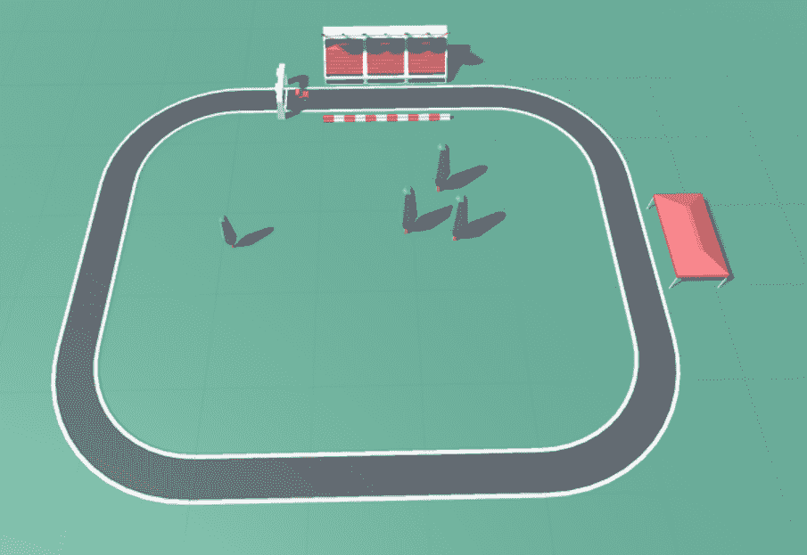

图 9-13. 一个自环简单赛道的示例

- 2. 向场景中添加一辆车辆，并确保您能驾驶（只是为了确保驾驶组件正常工作）。

- 3. 创建一个名为 Checkpoint.cs 的新 C# 脚本，并向其中添加以下代码。请注意，它包含两个类；其中一个类是特殊的编辑器专用代码，用于向 Inspector 添加按钮以帮助构建赛道：

```csharp
#if UNITY_EDITOR
// Include the UnityEditor namespace when this class is being used
// in the Editor.
using UnityEditor;
#endif

public class Checkpoint : MonoBehaviour
{
    // If true, this is the start of the circuit
    [SerializeField] public bool isLapStart;

    // The next checkpoint in the circuit. If we're visiting these in
    // reverse, or skipping too many, then we're going the wrong way.
    [SerializeField] public Checkpoint next;

    // The index number, used by LapTracker to figure out if we're going
    // the wrong way.
    internal int index = 0;

    // Checkpoints are invisible, so we draw a marker in the Scene view
    // to make it easier to visualize.
    private void OnDrawGizmos()
    {
        // Draw the markers as a blue sphere, except for the lap start,
        // which is yellow.
        if (isLapStart)
        {
            Gizmos.color = Color.yellow;
        }
        else
        {
            Gizmos.color = Color.blue;
        }

        Gizmos.DrawSphere(transform.position, 0.5f);

        // If we have a next node set up, draw a blue line to it.
        if (next != null)
        {
            Gizmos.color = Color.blue;
            Gizmos.DrawLine(transform.position, next.transform.position);
        }
    }
}
}
}

```
}
}
```

```csharp
#if UNITY_EDITOR
// Code that adds further controls for building a track to the
// Checkpoint Inspector.
[CustomEditor(typeof(Checkpoint))]
public class CheckpointEditor : Editor {
    // Called when Unity needs to display the Inspector for this
    // Checkpoint component.
    public override void OnInspectorGUI()
    {
        // First, draw the Inspector contents that we'd normally get.
        DrawDefaultInspector();

        // Get a reference to the Checkpoint component we're editing, by
        // casting 'target' (which is just an Object) to Checkpoint.
        var checkpoint = this.target as Checkpoint;

        // Display a button that inserts a new checkpoint between us and
        // the next one. GUILayout.Button both displays the button and
        // returns true if it was clicked.
        if (GUILayout.Button("Insert Checkpoint")) {
            // Make a new object, and add a Checkpoint component to it
            var newCheckpoint = new GameObject("Checkpoint")
                .AddComponent<Checkpoint>();

            // Make it point to our next one, and make us point to
            // it (in other words, insert it between us and our next
            // checkpoint)
            newCheckpoint.next = checkpoint.next;
            checkpoint.next = newCheckpoint;
        }
```


```csharp
// Make it one of our siblings
newCheckpoint.transform
    .SetParent(checkpoint.transform.parent, true);

// Position it as our next sibling in the Hierarchy.
// Not technically needed, and doesn't affect the game at
// all, but it looks nicer.
var nextSiblingIndex =
    checkpoint.transform.GetSiblingIndex() + 1;

newCheckpoint.transform.SetSiblingIndex(nextSiblingIndex);

// Move it slightly so that it's visibly not the same one
newCheckpoint.transform.position =
    checkpoint.transform.position + new Vector3(1, 0, 0);

// Select it, so that we can immediately start moving it
Selection.activeGameObject = newCheckpoint.gameObject;
}
```

```csharp
// Disable this button if we don't have a next checkpoint, or if
// the next checkpoint is the lap start

var disableRemoveButton = checkpoint.next == null ||
    checkpoint.next.isLapStart;
```

```csharp
using (new EditorGUI.DisabledGroupScope(disableRemoveButton)) {
    // Display a button that removes the next checkpoint
    if (GUILayout.Button("Remove Next Checkpoint"))
    {
        // Get the node that this next checkpoint was linking to
        var next = checkpoint.next.next;

// Remove the next one
DestroyImmediate(checkpoint.next.gameObject);

// Aim ourselves at what it was pointing at
checkpoint.next = next;

}
  }
    }
      }
#endif
```

- 4. 创建一个名为“Checkpoints”的新空游戏对象。
- 5. 将一个新的空游戏对象作为 Checkpoints 的子对象添加进去。将其命名为“Checkpoint”，并向其添加 Checkpoint 组件。
- 6. 将此检查点放置在赛道起点处。
- 7. 启用 Is Lap Start。
- 8. 在检查器中单击“插入检查点”。将添加并选中一个新的检查点。沿着赛道将其定位得更靠前。
- 9. 继续插入新的检查点。你也可以选择一个较早的检查点，单击“插入检查点”在两个现有点之间插入一个新检查点，或者选择前一个检查点并单击“删除下一个检查点”来删除一个检查点。
- 10. 完成赛道布置后，选择最后一个检查点，将“圈速起点”检查点（即带有黄色标记的那个）拖入其“Next”字段。

**注意**

如果检查点之间的连接出错，可以通过更改检查点上的“Next”字段来修复。

完成后，赛道应该大致如图 9-14 所示。

- 11. 将最后一个检查点定位好，使赛道的终点线正好位于第一个和最后一个检查点中间，两者应当非常接近。参见图 9-15。

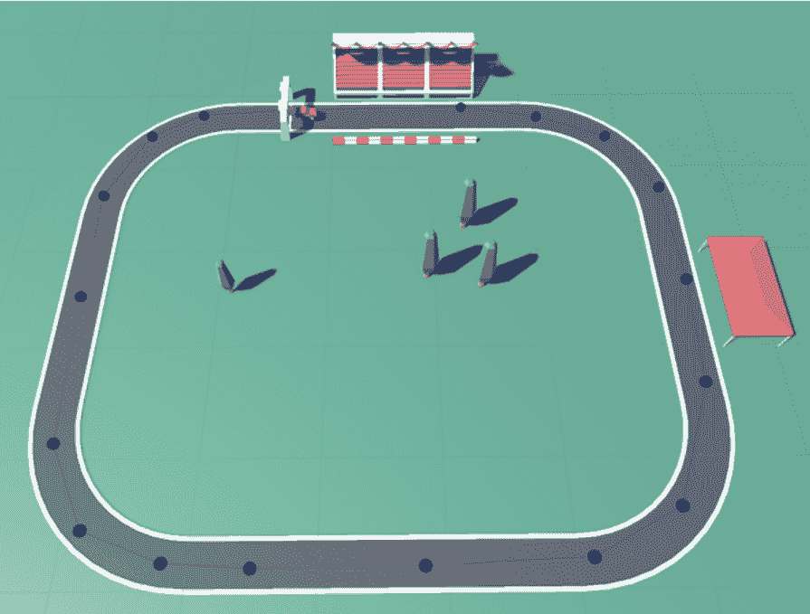

图 9-14. 围绕赛道布置的检查点

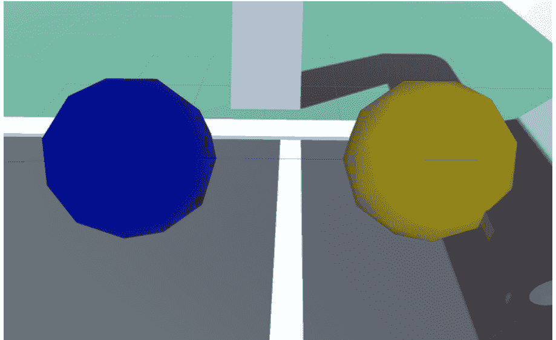

图 9-15. 最后一个检查点，其放置位置使终点线位于第一个和最后一个检查点之间

- 12. 将车辆稍微放在“圈速起点”检查点前方。
- 13. 创建一个画布。
- 14. 创建并添加两个带有文本组件的游戏对象。
- 15. 让其中一个显示文本“Wrong Way!”，另一个显示“Lap 1。”
- 16. 创建一个名为 LapTracker.cs 的新 C# 脚本，并向其中添加以下代码：

```csharp
// We use LINQ to help figure out the start of the circuit with fewer
// lines of code. Using LINQ allocates memory, which is something we
// try to avoid, but because we only do it once (at scene start), it's
// not as bad.
using System.Linq;

public class LapTracker : MonoBehaviour {

    // The object that we're tracking as it makes laps around the
    // circuit.
    [SerializeField] Transform target = null;

    // The number of nodes in the list we're permitted to skip. This
    // prevents the player from just driving a tiny circle from the
    // start of the track to the end ("I crossed the finish line
    // three times! That means I win!"). Increase this number to permit
    // longer shortcuts. Set this to 0 to forbid any shortcuts.
    [SerializeField] int longestPermittedShortcut = 2;

    // The UI element that appears to let the player know they're
    // going the wrong way.
    [SerializeField] GameObject wrongWayIndicator;

    // A text field that displays the number of laps the player has
    // completed.
    [SerializeField] UnityEngine.UI.Text lapCounter;

    // The number of laps the player has completed.
    int lapsComplete = 0;

    // The checkpoint that the player was near most recently.
    Checkpoint lastSeenCheckpoint;

    // The list of all checkpoints on the circuit. We keep a copy of it
    // here, because we need to use this list every frame, and because
    // using FindObjectsOfType to regenerate the list every frame
    // would be slow.
    Checkpoint[] allCheckpoints;

    // The start checkpoint is the first (and hopefully only) checkpoint
    // that has isLapStart turned on.
    Checkpoint StartCheckpoint {
        get {
            // Get the checkpoint marked as the start of the lap
            return FindObjectsOfType<Checkpoint>()
                .Where(c => c.isLapStart)
                .FirstOrDefault();
        }
    }

    void Start() {
        // Ensure that the counter says "lap 1"
        UpdateLapCounter();

        // The player isn't going the wrong way at the start
        wrongWayIndicator.SetActive(false);

        // Create the list of all checkpoints which Update will make
        // use of
        allCheckpoints = FindObjectsOfType<Checkpoint>();

        // Create the circuit of connected checkpoints
        CreateCircuit();

        // Begin the race at the start of the circuit
        lastSeenCheckpoint = StartCheckpoint;
    }

    private void Update() {
        // What's the nearest checkpoint?
        var nearestCheckpoint = NearestCheckpoint();

        if (nearestCheckpoint == null) {
            // No checkpoints! Bail out.
            return;
        }

        if (nearestCheckpoint.index == lastSeenCheckpoint.index) {
            // Nothing to do; the nearest checkpoint has not changed.
        } else if (nearestCheckpoint.index > lastSeenCheckpoint.index) {

            var distance =
                nearestCheckpoint.index - lastSeenCheckpoint.index;

            if (distance > longestPermittedShortcut + 1) {
                // The player has skipped too many checkpoints.
                // Treat this as going the wrong way.
                wrongWayIndicator.SetActive(true);
            } else {
                // We are near the next checkpoint; the player is going
                // the right way.
                lastSeenCheckpoint = nearestCheckpoint;

                wrongWayIndicator.SetActive(false);
            }
        } else if (nearestCheckpoint.isLapStart &&
            lastSeenCheckpoint.next.isLapStart) {
            // If the last checkpoint we saw is the last in the circuit,
            // and our nearest is now the start of the circuit, we just
            // completed a lap!

            lastSeenCheckpoint = nearestCheckpoint;

            lapsComplete += 1;
            UpdateLapCounter();
        } else {
            // This checkpoint is lower than the last one we saw. The
            // player is going the wrong way.
            wrongWayIndicator.SetActive(true);
        }
    }

    // Calculates the nearest checkpoint to the player.
    Checkpoint NearestCheckpoint() {
        // If we don't have a list of checkpoints to use, exit
        // immediately
        if (allCheckpoints == null) {
            return null;
        }

        // Loop through the list of all checkpoints, and find the
        // nearest one to the player's position.
        Checkpoint nearestSoFar = null;
        float nearestDistanceSoFar = float.PositiveInfinity;

        for (int c = 0; c < allCheckpoints.Length; c++) {
            var checkpoint = allCheckpoints[c];
            var distance =
            (target.position - checkpoint.transform.position)
            .sqrMagnitude;

            if (distance < nearestDistanceSoFar) {
                nearestSoFar = checkpoint;
                nearestDistanceSoFar = distance;
            }
        }

        return nearestSoFar;
    }

}

// Walks the list of checkpoints, and makes sure that they all have
// an index that's one higher than the previous one (except for
// the start checkpoint)
void CreateCircuit() {
    var index = 0;

    // Start at the start of the checkpoint
    var currentCheckpoint = StartCheckpoint;

    do
    {
        // Update the index for this checkpoint
        currentCheckpoint.index = index;
        index += 1;

        // Move to the checkpoint it's pointing to
        currentCheckpoint = currentCheckpoint.next;

        // We should not reach the end of the list; that means that
        // the circuit does not form a loop
        if (currentCheckpoint == null)
        {
            Debug.LogError("The circuit is not closed!");
            return;
        }

        // loop until we reach the start again
    } while (currentCheckpoint.isLapStart == false);
}
```


```
// Update the text that's shown to the user
void UpdateLapCounter()
{
    lapCounter.text = string.Format("Lap {0}", lapsComplete + 1);
}
```

```
// Draw a line indicating the nearest checkpoint to the player in
// the Scene view. (Useful for debugging.)
private void OnDrawGizmos()
{
    var nearest = NearestCheckpoint();

    if (target != null && nearest != null) {
        Gizmos.color = Color.red;
        Gizmos.DrawLine(target.position, nearest.transform.position);
    }
}
```

- 17. 创建一个新的空游戏对象，并向其添加 LapTracker 组件。
- 18. 将 Target 字段设置为车辆。
- 19. 将 Wrong Way Indicator 字段设置为显示 "Wrong Way!" 的标签。
- 20. 将 Lap Counter 字段设置为显示 "Lap 1" 的标签。
- 21. 开始游戏。

## 讨论

当您沿正确方向驾驶赛道时，冲过终点线后圈数会增加。如果您驾驶方向错误或走捷径过多，“Wrong Way!”指示器将出现。

我们所做的只是检查是否按反向访问检查点或跳过了太多检查点！就是这么神奇。

## 警告

这并不能神奇地知道游戏中是否存在允许玩家在所有情况下作弊的漏洞。它只是跟踪玩家是否朝正确方向行驶，而不是全面探索游戏状态以防止作弊。您仍然需要手动测试您的游戏！
