# 第 11 章 声音和音乐

音频可能是交互式体验中最重要的部分之一，尤其是在构建游戏时。Unity 为简单和复杂的音频设置提供了广泛的工具。在本章中，我们将讨论如何在场景中让音频正常工作的基础知识，以及控制项目声音的更高级方法。

> **警告**
> 声音和音乐比你想象的要重要得多。如果你正在构建游戏，请不要遗漏声音、音乐和音频。

与其他章节一样，本章远不是一份详尽的食谱集，涵盖您在 Unity 中可能需要使用音频完成的所有事情。相反，我们试图涵盖那些作为 Unity 开发者，我们发现自己一遍又一遍地实现的内容，游戏接游戏，项目接项目。

## 11.1 播放声音

**问题**
您希望在项目中播放声音和音乐。

**解决方案**
要播放音频片段，您首先需要一个要播放的音频文件。如果您已经有想要的文件，请将其拖放到项目中。

**提示**

如果您需要游戏音效，有一些地方可以免费找到音效。Kenney 拥有一个不错的公共领域音效集合；Freesound 等社区网站拥有更广泛的素材和质量范围。您也可以自己创建。Bfxr 是一款适用于 Windows 和 Mac 的免费应用程序，用于生成复古风格的音效。Humble Bundle 也经常为大量游戏资源提供超值交易。

将音频资源添加到项目后，通过选择它并查看检查器来配置 Unity 如何导入它（图 11-1）。Unity 支持 .aif、.wav、.mp3 和 .ogg 音频。它还支持追踪器格式 .xm、.mod、.it 和 .s3m。Unity 会将音频转换为您指定的格式。

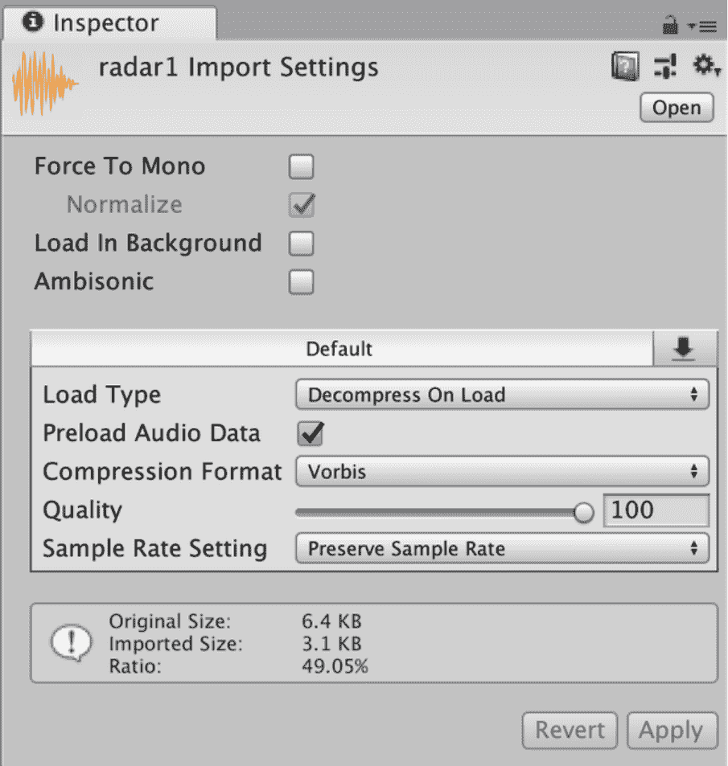

图 11-1. AudioClip 资源的导入设置

导入音频片段后，它就可以播放了。在 Unity 中，音频是从附加到游戏对象的 AudioSource 组件播放的。要创建 AudioSource 组件：

- 1. 打开 GameObject 菜单，选择 Audio → Audio Source。将创建一个新游戏对象，并附加 AudioSource 组件。

**注意**

您还可以通过选择游戏对象，单击检查器底部的 Add Component 按钮，并选择 Audio → Audio Source 来将 AudioSource 组件添加到现有对象。

- 2. 拥有音频源后，通过将资源从 Project 选项卡拖动到 AudioClip 插槽来附加要播放的音频片段（图 11-2）。

- 3. 在 Unity 中运行项目。音频将开始播放。

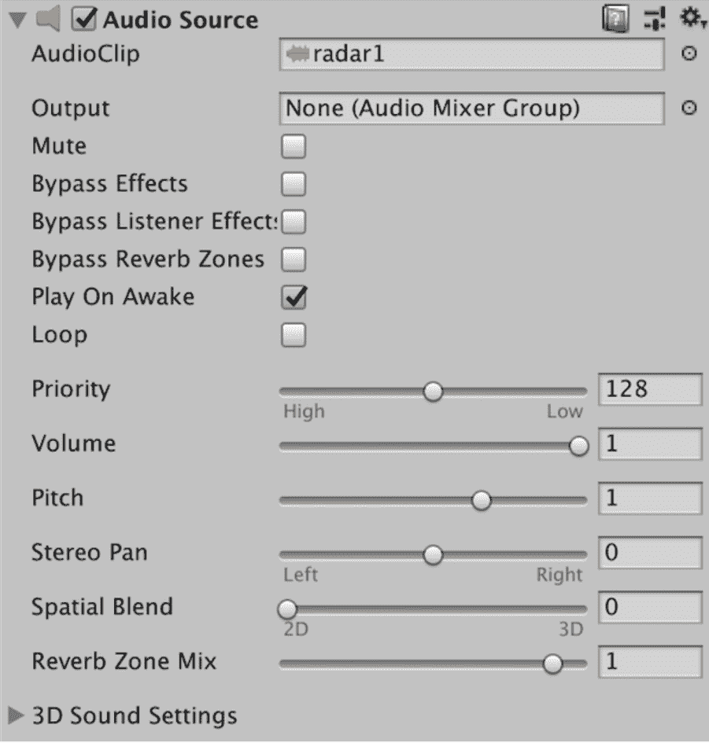

图 11-2. AudioSource 组件的检查器

> > **提示**
> > 您可以通过启用 Play On Awake 选项来配置音频源是否在对象首次激活时开始播放。

**讨论**

当当前正在播放音频的 AudioSource 组件在 AudioListener 组件的范围内时，播放器的扬声器或耳机将播放音频。创建新场景时，所有对象中包含的主 Camera 对象自带一个 AudioListener 组件。

> **注意**
> 
> 场景中一次只能有一个 AudioListener。如果有多个，Unity 会发出警告，并且只有一个会正常工作。

## 11.2 设置混音器

**问题**

您希望在中心位置管理项目播放的音频的电平和设置。

**解决方案**

您可以通过创建音频混音器资源并在混音器中设置组来管理不同音频源组的音量电平。您可以配置音频源将其音频路由到特定组；每个组可以有自己的音量电平和效果。

要创建音频混音器：

- 1. 打开 Assets 菜单，选择 Assets → Create → Audio Mixer。将创建一个新的音频混音器资源；将其重命名为您喜欢的任何名称。（“音频混音器”很常见；您的项目可能不需要多于一个混音器。）

- 2. 双击新资源。Audio Mixer 面板将打开（图 11-3）。

- 3. 音频混音器管理一组集合。组带有音量滑块，并可以附加效果。它们还可以有子级，这意味着更改父级的音量会影响其子级的音量。始终存在一个名为 Master 的组；所有其他组都是 Master 的子级。

- 4. 通过单击组右侧的 + 按钮创建新组。（例如，您可以创建一个名为“音乐”的组，以及一个名为“音效”的组。）

- 5. 要使用您创建的组，可以将音频源路由到一个组。选择音频源，并将 Audio Mixer 面板 Group 列表中的混音器组拖放到音频源的 Output 插槽上。音频源播放的任何音频都将发送到混音器组。

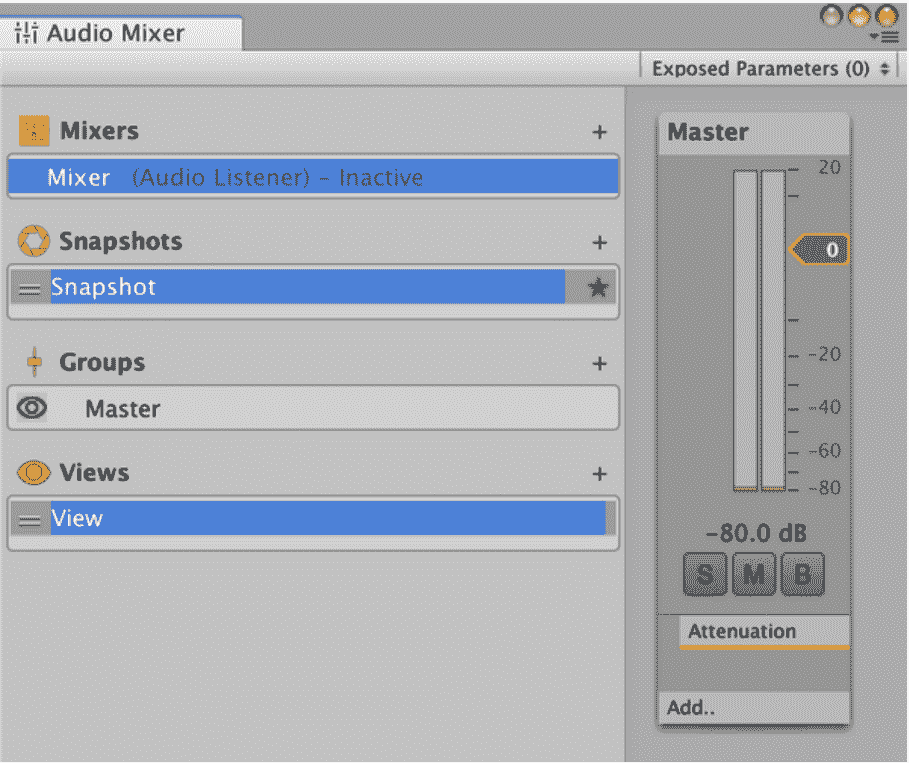

图 11-3. Audio Mixer 面板

遗憾的是，包括 Unity 在内的大多数游戏引擎的音频子系统仍然使用 Master 术语，因为它借用了音频领域中该术语长期以来的用法。这并不是一件好事，我们希望行业能尽快更新该术语。

**讨论**

除了每个组的音量电平外，您还可以有选择地控制哪些组处于活动状态：

- * **M（静音）按钮**：静音组
- * **S（独奏）按钮**：静音所有其他组
- * **B（旁路）按钮**：禁用音频效果（在配方 11.3 中讨论）

## 11.3 使用音频效果

**问题**

您希望应用更改场景中音频声音的效果。例如，您希望应用回声效果。

**解决方案**

您可以通过添加音频效果来修改音频系统处理音频的方式，这些效果可以过滤声音的频率范围、应用混响等。

您可以在三个不同的位置设置效果：音频混音器组、音频源或音频监听器。

音频源或音频监听器上的效果是组件，就像其他非音频组件（例如渲染器或物理碰撞器）一样。要在音频源上添加效果：

- 1. 选择包含要修改的音频源的游戏对象，并单击 Add Component 按钮。
- 2. 单击 Audio，并选择要添加的效果。将添加该组件，音频源播放的任何音频都将由该过滤器修改（图 11-4）。

要在音频监听器上添加效果，过程是相同的，只是效果将修改监听器接收到的任何音频（参见图 11-5）。

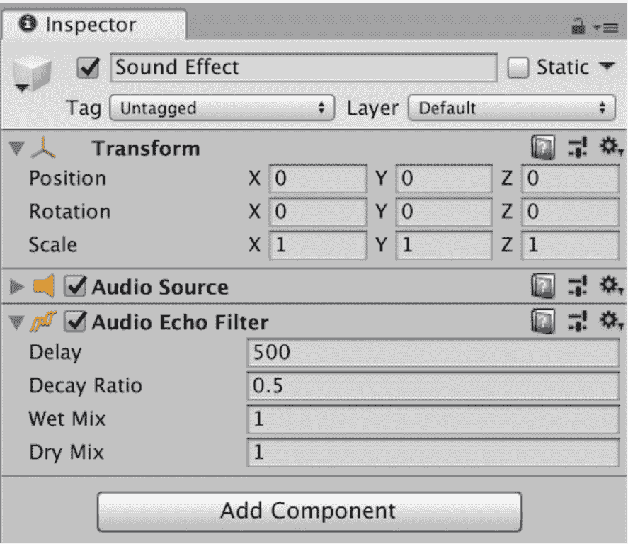

图 11-4. 附加到带有音频源的游戏对象上的音频效果组件

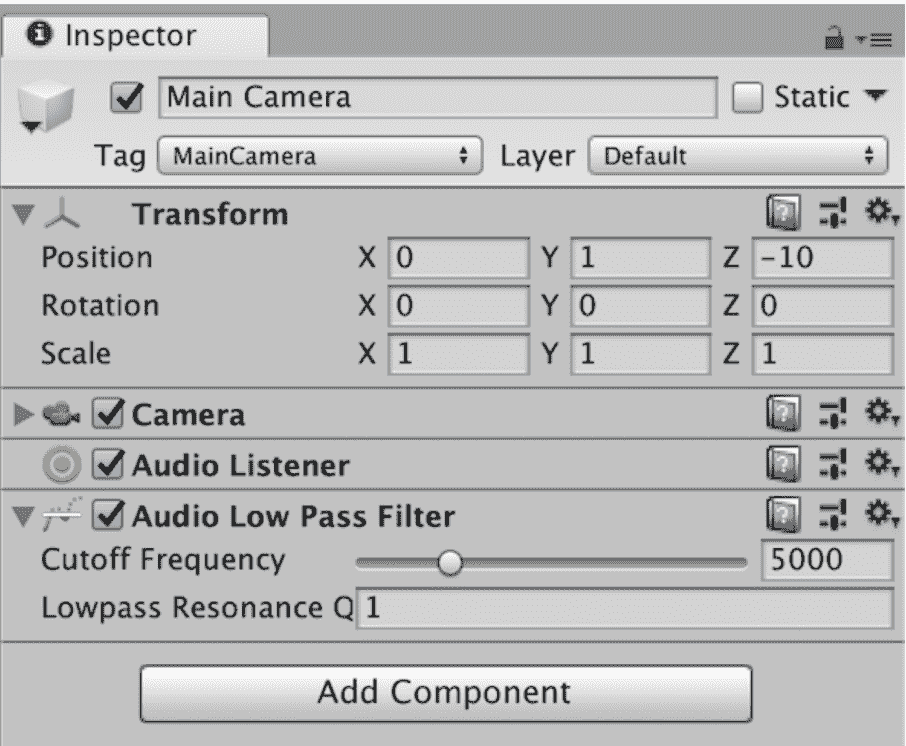

图 11-5. 附加到带有音频监听器的游戏对象上的音频效果组件

> **提示**
> 
> 组件的顺序很重要，因为它控制效果应用于音频的顺序。

除了向音频源和监听器添加效果外，您还可以在混音器的组上添加效果：

- 1. 如果您还没有一个混音器组，请按照配方 11.2 的步骤创建一个。
- 2. 在您组的混音器下，单击 Add 并选择一个效果。
- 3. 在组下选择该效果。


> **提示**
> 混音组中的 B 按钮会绕过效果，暂时禁用它们。

### 讨论

可用的音频效果种类繁多，每种都可以配置以支持你想要的效果。最有用的一些包括：

- *混响效果*
  允许你模拟声音在空间中的回响方式

- *低通滤波器效果*
  去除高频并产生闷音

- *压缩器滤波器*
  降低声音中最安静和最响亮部分之间的动态范围，这意味着音频听起来更趋于保持一致的电平

## 11.4 使用发送和接收效果

### 问题

你希望一个音频混音组上的效果能与来自另一个组的信号协同工作。

### 解决方案

在你的音频组上使用发送和接收效果：

1. 按照配方 11.2 的步骤在音频混音器上设置至少两个混音组。
2. 在应该接收音频的混音组上添加接收效果，方法是单击组底部的添加按钮。
3. 在应该发送音频的混音组上添加发送效果。你的组现在应该看起来类似于图 11-6。添加发送效果后，你需要设置它将音频发送到哪里。
4. 选择发送效果，在其检查器中，将接收器设置为你添加的接收效果（图 11-7）。
5. 运行游戏，并通过带有发送效果的组播放一些音频。音频也将通过带有接收效果的组播放，并将受接收组上任何效果的修改。

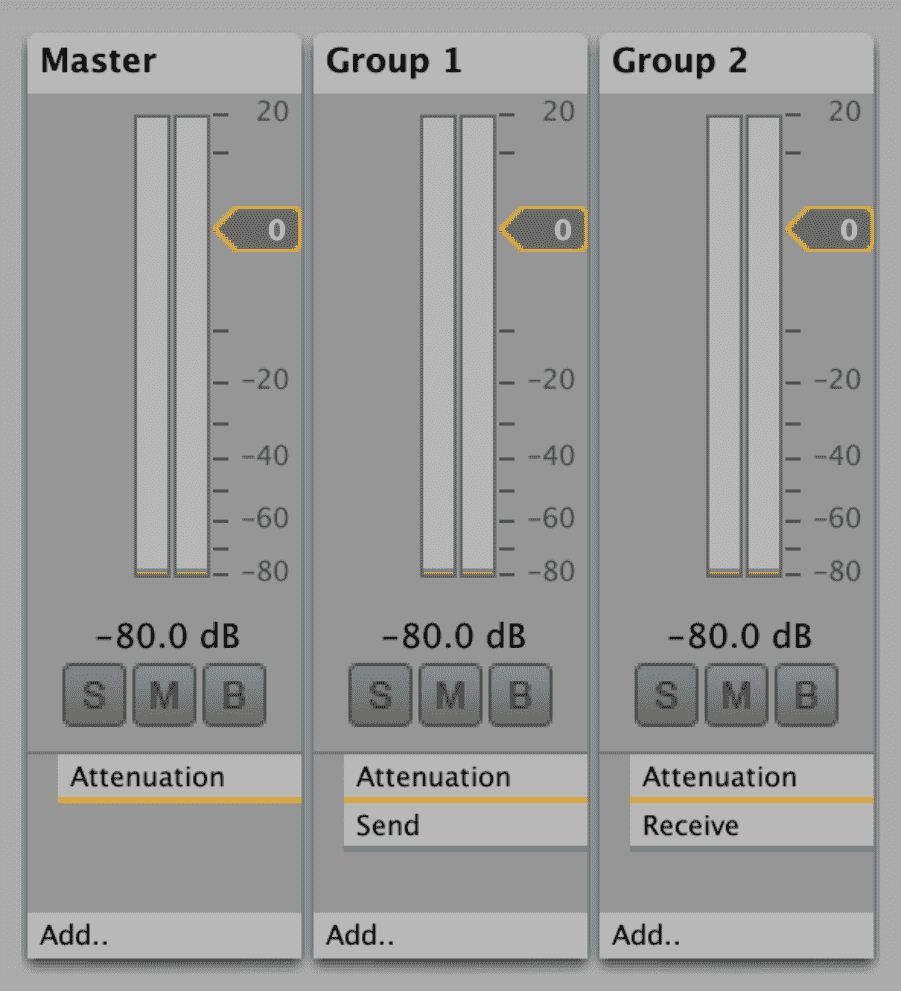

图 11-6. 一个音频混音器，一个组上带有发送效果，另一个组上带有接收效果

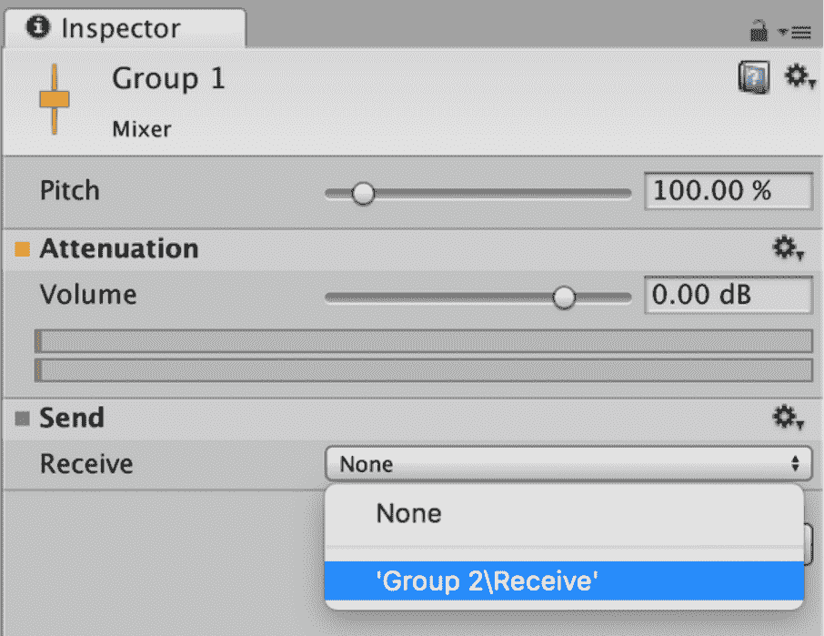

图 11-7. 配置发送效果以将音频发送到另一组上指定的接收效果

> **注释**
>
> 默认情况下，发送效果设置为最低电平。你需要提高发送电平，音频才能发送到接收器。

### 讨论

发送和接收效果本身并不十分有用，因为它们只是复制音频信号。当你想要对音频路由进行更精细的控制，以及想要应用同时利用多个音频信号的音频效果时，它们才会变得有用。

某些效果本身就是接收器——你不需要在它们上额外添加接收效果。例如，音量降低效果（在配方 11.5 中讨论）可以充当接收器。

## 11.5 音量压低

### 问题

你希望当另一组声音处于活动状态时，使一组声音变安静。例如，当语音播放时，你希望降低音效的音量，以使语音更清晰。

### 解决方案

在 _音量压低_ 效果中，一个信号的电平会导致另一个信号的电平降低。要实现这一点，你需要在应该降低音量的组上添加音量降低效果，并向应该触发音量降低的组添加发送效果。

例如，假设你有一个播放音乐的混音组和另一个播放语音的混音组，并且希望在语音播放时自动降低音乐音量：

1. 按照配方 11.2 的步骤在音频混音器上设置至少两个混音组。将一个混音器命名为“语音”，另一个命名为“音乐”。
2. 设置两个音频源：让一个发送到语音组，另一个发送到音乐组。向每个源附加你喜欢的任何音频剪辑，并使发送到音乐的源循环播放。
3. 选择音乐组（应在语音播放时降低其音量），并添加一个新的音量降低效果。
4. 选择语音组（应导致音乐组降低其音量），并添加一个发送效果。
5. 选择发送效果，并将其接收器设置为音量降低效果。
6. 将发送电平提高到最大值（0 dB）。

你现在准备好进行测试了：

1. 运行游戏。你暂时听不到明显的效果；你需要调整设置来确定要设置的值。
2. 让语音源播放其声音；例如，你可以使用脚本来控制音频源（参见配方 11.7）。
3. 选择音量降低效果，并单击检查器顶部的“在播放中编辑”按钮。
4. 在播放过程中，调整阈值滑块以控制音量压低在什么点生效。

### 讨论

你还可以配置比率和膝点参数，以调整音量降低效果如何修改其音量。此外，攻击时间和释放时间设置让你控制效果应用的速度以及效果消失所需的时间。

## 11.6 使用多个音频区域

### 问题

你希望创建音频听起来不同的区域。例如，你希望当玩家走进洞穴时游戏会有深远的回声。

### 解决方案

使用混响区域来创建场景中对音频监听器应用不同混响设置的区域。混响区域会根据监听器在区域内的位置扭曲监听器听到的声音，当你希望玩家进入某个位置时逐渐应用环境效果时，会使用它们。

要创建混响区域：

1. 打开 GameObject 菜单，并选择 Audio → Audio Reverb Zone。
2. 将新区域定位到你希望应用混响的区域。
3. 单击并拖动两个球体上的点以设置效果的最小和最大半径（图 11-8）。
4. 在检查器（图 11-9）中，选择你想要应用的效果类型。有广泛的预设可供选择，包括音乐厅、洞穴、隔音室以及介于两者之间的各种场景。
5. 运行项目，并将相机移入混响区域。当你进入区域时，该效果将开始应用于音频监听器接收到的任何音频。

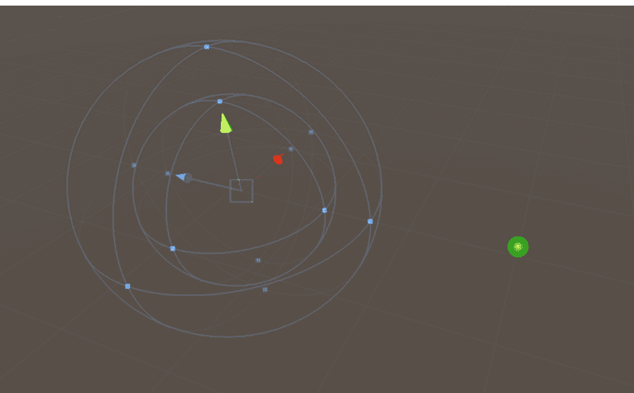

图 11-8. 场景中的音频混响区域

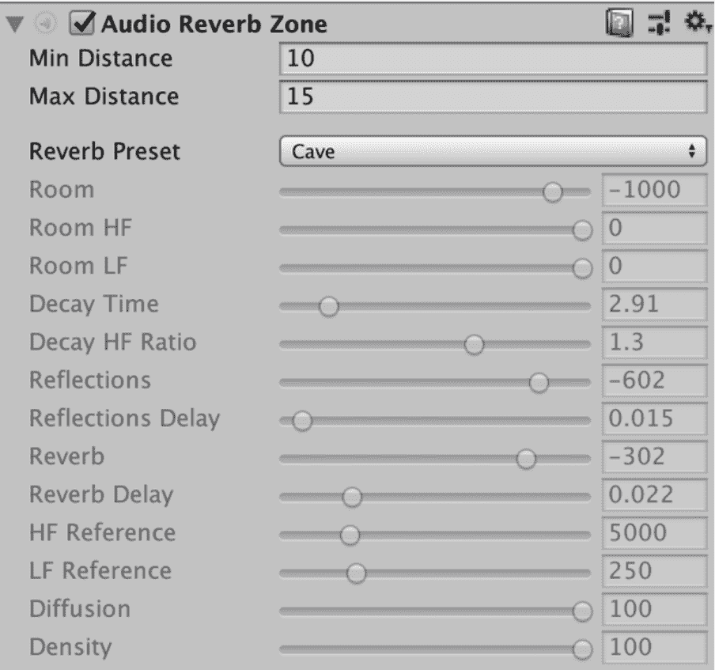

图 11-9. 音频混响区域的检查器

### 讨论

如果将混响预设设置为自定义，你可以修改单独的混响设置，创建一个更精确满足你需求的混响效果。

## 11.7 使用脚本播放音频

### 问题

你希望从脚本触发音频播放。

### 解决方案

使用 AudioSource 组件上的 Play、PlayDelayed、PlayOneShot 和 Stop 方法来控制音频源：

```
// Play the AudioClip that's currently set
source.Play();

// Play the AudioClip with a delay, measured in seconds
source.PlayDelayed(0.5f);

// Play a specified AudioClip; the volume scale is optional
source.PlayOneShot(clip, 0.5f); // play at half volume
source.PlayOneShot(clip, 1f); // play at full volume

// Stop playing the current clip
source.Stop();
```

### 讨论

在游戏过程中才知道音频剪辑身份的情况下能够播放它，这通常很有用，因为这意味着你可以在设计时设置具有适当音量电平和音频混音组的音频源，然后在游戏过程中控制声音本身。

## 11.8 使用声音管理器

### 问题

你希望构建一个系统，允许从代码中的任意位置触发音效。

### 解决方案

创建一个系统，允许代码的其他部分请求播放音效。本类中给出的代码是一个简单示例，但它旨在作为一个基础，你可以在其上添加项目所需的特定功能。

该系统通过将 SoundEffect 定义为 ScriptableObject 类的资产来工作，该类包含对音频剪辑的引用（有关 ScriptableObject 的更多信息，请参见配方 2.9）。AudioManager 是一个单例，包含这些 SoundEffect 资产的列表，可以通过传递效果名称来请求播放其中一个。将附加到 SoundEffect 资产的随机剪辑选中，从而允许一些很好的变化。该效果可以与监听器处于同一位置播放，也可以将世界中的位置作为参数传递，所选音频剪辑将在那里播放。

> **注释**
>
> 此脚本使用单例类，我们将在配方 2.6 中讨论。在继续本示例之前，请先按照该示例中的步骤操作。

要开始构建此系统，我们将从定义 SoundEffect 资产开始：

1. 创建一个名为 SoundEffect.cs 的新 C# 脚本，并将以下代码放入其中：

```
// An asset that contains a collection of audio clips.
[CreateAssetMenu]
public class SoundEffect : ScriptableObject {
    // The list of AudioClips that might be played when
    // this sound effect is played.
    public AudioClip[] clips;

    // Randomly selects an AudioClip from the 'clips' array,
    // if one is available.
    public AudioClip GetRandomClip() {
    if (clips.Length == 0) {
        return null;
    }
```


}
return clips[Random.Range(0, clips.Length)];
}
}

> **提示**
>
> 在实际游戏中，你可能希望从下一次结果中排除最近播放的随机音效，只是为了让游戏感觉比实际更有趣！

- 2. 通过打开 Assets 菜单并选择 Create → Sound Effect 来创建 SoundEffect 资产。为新资产起个你喜欢的名字。
- 3. 选择新资产，并在检查器中，将你想为这个音效使用的音频资产拖放进去（请参见图 11-10）。

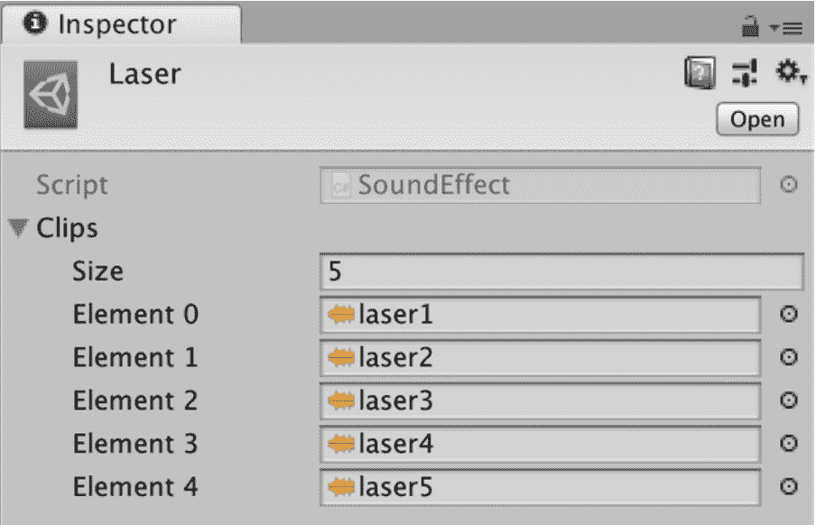

图 11-10. SoundEffect 资产的检查器，其中已将一组音频剪辑添加到其列表中

接下来，我们将创建 AudioManager 类本身。创建一个名为 AudioManager.cs 的新 C# 脚本，并将以下代码添加到其中：

```
public class AudioManager : Singleton<AudioManager> {

    // The list of references to SoundEffect assets.
    public SoundEffect[] effects;

    // A dictionary that maps the names of SoundEffects to the objects
    // themselves, to make it faster to look them up.
    private Dictionary<string, SoundEffect> _effectDictionary;

    // A reference to the current audio listener, which we use to place
    // audio clips.
    private AudioListener _listener;

    private void Awake() {
        // When the manager wakes up, build a dictionary of named sounds, so
        // that we can quickly access them when needed
        _effectDictionary = new Dictionary<string, SoundEffect>();
        foreach (var effect in effects) {
            Debug.LogFormat("registered effect {0}", effect.name);
            _effectDictionary[effect.name] = effect;
        }
    }

    // Plays a sound effect by name, at the same position as the audio
    // listener.
    public void PlayEffect(string effectName) {
        // If we don't currently have a listener (or the reference we had
        // was destroyed, find one to use
        if (_listener == null) {
            _listener = FindObjectOfType<AudioListener>();
        }

        // Play the effect at the listener's position
        PlayEffect(effectName, _listener.transform.position);
    }

    // Plays a sound effect by name, at a specified position in the world
    public void PlayEffect(string effectName, Vector3 worldPosition) {

        // Does the sound effect exist?
        if (_effectDictionary.ContainsKey(effectName) == false) {
            Debug.LogWarningFormat(
                "Effect {0} is not registered.", effectName);
            return;
        }

        // Get a clip from the effect
        var clip = _effectDictionary[effectName].GetRandomClip();

        // Make sure it wasn't null
        if (clip == null) {
            Debug.LogWarningFormat(
                "Effect {0} has no clips to play.", effectName);
            return;
        }

        // Play the selected clip at the specified point
        AudioSource.PlayClipAtPoint(clip, worldPosition);
    }
}
```

最后，我们将创建单例实例，并添加我们希望可用的音频剪辑：

- 1. 通过打开 GameObject 菜单并选择 Create Empty 来创建一个新游戏对象。将新对象命名为“音频管理器”。
- 2. 选择新对象。
- 3. 将 AudioManager.cs 脚本拖放到检查器上。
- 4. 将你创建的 SoundEffect 资产添加到 Effects 列表中（图 11-11）。

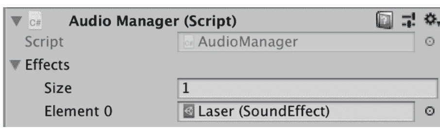

图 11-11. 音频管理器的检查器，其中已将 SoundEffect 资产添加到其列表中

你现在已准备好从代码中触发音效。例如，如果你创建了一个名为“Laser”的 SoundEffect，你可以这样触发它：

```
// Play a sound called "laser" at the same place as the listener
AudioManager.instance.PlayEffect("laser");
```

```
// Play the same sound at the origin
AudioManager.instance.PlayEffect("laser", Vector3.zero);
```

### 讨论

与任何单例一样，你在初始开发的简便性和增加的软件复杂性之间进行权衡。有关更多详细信息，请参见配方 2.6 的讨论。
