# 第 12 章 用户界面

Unity 自带的 UI 系统是构建游戏 UI 的一种强大且灵活的方式。它适用于构建从明确基于菜单和界面的游戏部分（例如实际菜单和配置屏幕）到游戏内 UI 的所有内容，也可以通过添加有帮助的额外 UI 组件来扩展 Unity 编辑器环境，以简化游戏开发流程。

> **注意**
>
> 如果你过去使用过 Unity，很高兴地得知，UI 系统在最近几年已经被完全替换！此处涵盖的所有内容都涉及当前 UI 系统，在 Unity 文档中有时可能被称为“新 UI 系统”。
>
> 旧的 Unity UI 系统侧重于程序员导向的工作流程，而不是涉及的视觉 UI 元素。它的设计方式是程序员可能会思考的方式，而不是 UI 需要表现的方式：视觉上！新系统修复了这个问题，我们都因此受益。

你不需要向总体项目添加任何内容即可开始使用 Unity UI 系统。所有操作都通过属于 UI 系统的游戏对象完成。

> **提示**
>
> Unity UI 系统让你可以创建供玩家交互以启动游戏、修改设置等（例如主菜单）的 UI，以及游戏内 UI，例如你可能在虚拟世界的电脑屏幕上找到的 UI（例如第一人称风格游戏中的电脑控制台）。你可以在 Unity 手册中了解 Unity UI 系统的所有组件。

## 12.1 使用 UI 控件

### 问题

你想在 Unity 中构建用户界面。

### 解决方案

在 Unity 中构建 UI 与在 Unity 中构建任何事物非常相似：它是由游戏对象构建而成的。Unity 提供了一系列作为游戏对象的 UI 元素，如图 12-1 所示。

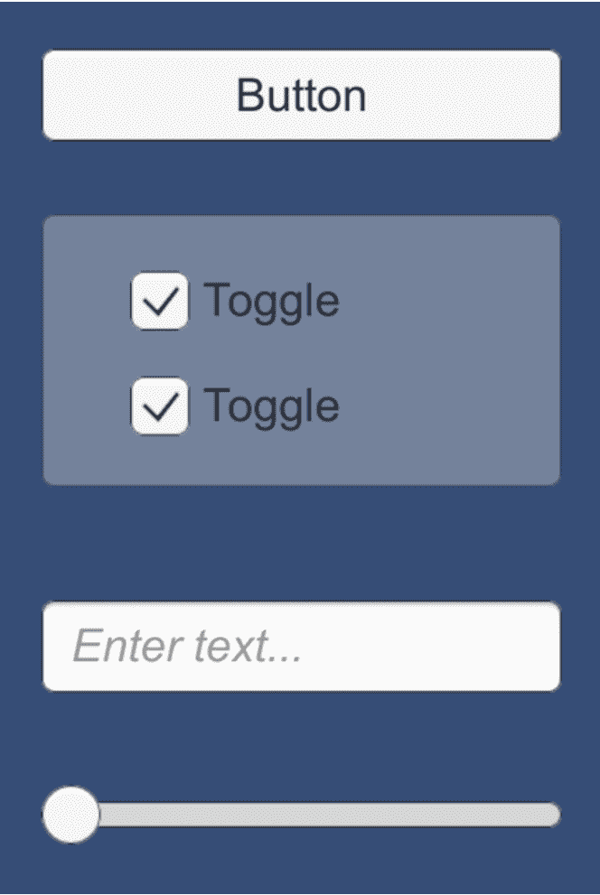

图 12-1. 显示一系列 UI 元素的游戏对象

要在 Unity 中绘制 UI，你需要一个 Canvas 组件。你可以将 Canvas 添加到游戏对象，也可以直接将其添加到场景中，以创建放置 UI 的位置：

- 1. 打开 GameObject 菜单，并选择 UI → Canvas。

所有 UI 元素都作为 Canvas 的子项添加。我们将向 UI 添加一些文本。

- 2. 选择新添加的画布，然后再次打开 GameObject 菜单并选择 UI → Text。将向画布添加一个 Text 对象。
- 3. 选择矩形工具，并拖动 Text 对象以调整大小和重新定位它。
- 4. 选择 Text 对象，并修改其属性以更改其文本。

仅显示一些文本的 UI 并不十分有用，因此现在我们将编写一个脚本，将一些文本记录到控制台，然后将脚本附加到按钮上：

- 1. 创建一个名为 ButtonClicked.cs 的新 C# 脚本，删除默认创建的两个方法，并将以下代码添加到类中：

```
public void ButtonWasClicked() {
    Debug.Log("The button was clicked!");
}
```

这个公共方法 ButtonWasClicked 将连接到我们添加到 UI 的按钮。它向调试日志发送一条消息，表明按钮已被单击。

- 2. 我们还可以添加一个带参数的公共方法，允许我们向记录的输出添加一条消息。将以下方法添加到类中：

```
public void ButtonWasClickedWithParameter(string parameter) {
    string message =
    string.Format("The button was clicked: {0}", parameter);
    Debug.Log(message);
}
```

我们已定义两个公共方法：ButtonWasClickedWithParameter，它只记录按钮已被单击，以及 Format，它做同样的事情，但包含一个我们可以使用的字符串参数。

- 3. 顺便说一下，我们还可以添加不会用于连接 UI 元素的私有方法。将以下方法添加到类中：

```
void PrivateButtonWasClicked() {
    Debug.Log(
        "This won't run as the direct result of a button click!"
    );
}
```

> **提示**
>
> 在 C# 中，所有类方法默认都是私有的，因此如果你想创建私有方法，不需要指定访问级别。不过，如果你愿意，也可以包含 private 关键字，这也不会有什么问题。

现在我们需要实际将新脚本附加到我们一直在构建的 UI 上：

- 1. 将 ButtonClicked 组件（我们的新脚本）附加到 Canvas 对象，或任何其他游戏对象——就本示例而言，选择哪个都无所谓。
- 2. 再次打开 GameObject 菜单，并选择 UI → Button。
- 3. 选择你添加的按钮，并在其 On Click 组件下点击 + 按钮。
- 4. 将步骤 1 中你附加了 ButtonClicked 组件的对象拖入出现的新对象字段中。
- 5. 在现在出现的函数下拉列表中，选择 ButtonClicked → ButtonWasClicked。


- 6. 您的 UI 应该与图 12-2 类似。运行游戏。当您点击按钮时，文本将出现在控制台中。

- 7. 停止游戏，然后再次单击 + 按钮。将同一个对象拖入，并选择 ButtonClicked → ButtonWasClickedWithParameter。请注意，此方法可让您在点击按钮时指定要发送的字符串。

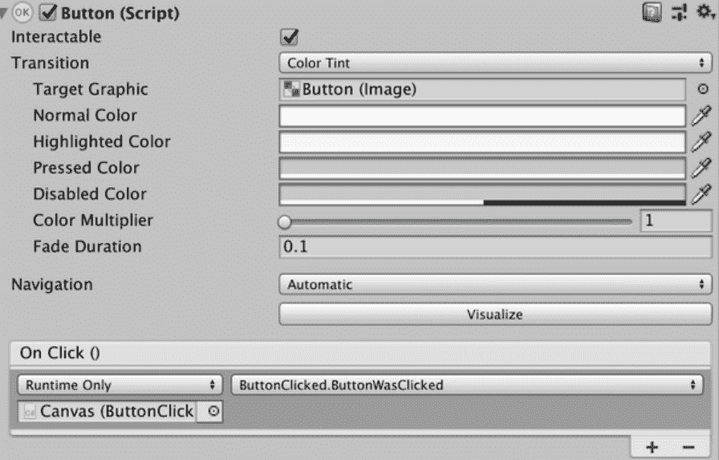

图 12-2. 按钮的 On Click 事件，已配置为调用 ButtonClicked 组件的 ButtonWasClicked 方法

### 注意

由于它不是公共的，PrivateButtonWasClicked 方法永远不会出现在您可以选择的方法列表中。

### 讨论

除了显而易见的输出——我们添加了一个会触发某些操作的按钮之外——这里还有几个值得了解的组成部分。

### 注意

每个画布都附加了 Canvas Scaler 组件，允许您控制其附加画布内 UI 元素的缩放和像素密度。在构建可能在多种屏幕分辨率下运行的游戏时，这对于确保 UI 按预期行为非常有用。有关此组件的更多信息，请参阅 Unity 文档。

每个 UI 元素都存在于画布上，并且每个 UI 元素都附加了 RectTransform 组件。如果您熟悉 Transform 组件（如需复习，请参见第 1 章），那么解释 RectTransform 很简单：它是 UI 元素的 Transform 等效物，为画布内的 UI 元素提供位置、旋转和缩放。

每个 RectTransform 还有四个小三角形句柄，称为锚点。这些锚点定义了组件如何锚定到其父对象。您可以移动锚点（或在检查器中操作它们），例如，允许按钮相对于其父容器更改宽度，同时确保其高度始终保持不变，并且始终与容器底部保持相同的距离。

图 12-3 左上角显示了一个类似靶心的按钮，它允许您从预设的锚点配置中选择。

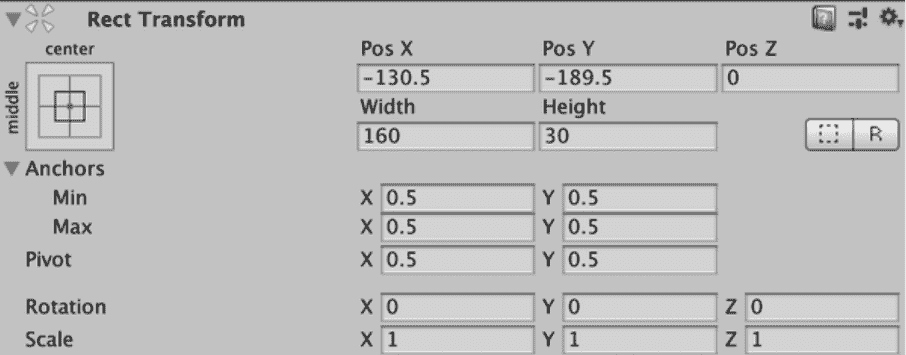

图 12-3. 类似靶心的按钮允许您从预设的锚点配置中选择

## 了解画布

既然使用 Unity UI 系统构建的所有内容都位于画布内，那么了解画布的工作原理也很有价值。首先，画布有一个渲染模式设置，它决定了画布如何渲染。可能的模式有：屏幕空间叠加、屏幕空间摄像机和世界空间。

在屏幕空间方面，叠加意味着画布在场景上方渲染。如果屏幕大小/分辨率发生变化，画布将调整大小以匹配。屏幕空间摄像机的行为与叠加非常相似，但在此情况下，画布位于摄像机（由您指定）前面，所有内容都根据摄像机的设置进行渲染。如需复习摄像机知识，请参阅第 8 章。

以世界空间渲染画布会使画布表现得像场景中的普通对象：您会使用此模式来显示旨在成为游戏世界一部分的 UI，例如飞船控制面板或类似物品。在此情况下，画布的大小取自其 RectTransform 的大小。

## 12.2 控件主题化

### 问题

您使用自己的美术资源作为控件，而不是使用内置的 Unity 美术资源。您希望这些美术资源能够随控件大小的变化进行缩放，而不会出现拉伸。

### 解决方案

在构建游戏美术（尤其是 UI）时，您希望确保界面元素在游戏运行的任何分辨率下都能呈现最佳效果。为了实现 UI 元素的此目标，您需要以特定方式设置用于绘制 UI 的精灵，并告诉 Unity 引擎哪些部分可以在不失真的情况下缩放：

- 1. 首先导入要使用的纹理。

> 注意
>
> 使用 UI 时，必须确保纹理配置为导入为“Sprite / UI”。如需设置资产导入的提醒，请参见第 1 章。

在本示例中，我们将使用 Kenney 开源 UI 资产工具包中的美术资源来自定义面板。我们将使用 PNG 文件夹，并在导入器中将纹理设置为精灵。

> 提示
>
> 互联网上有很多免费的游戏美术资源。Kenney 制作了一些我们最喜欢的素材，我们在这本书中经常引用它们！请查看它的所有资源包。

- 2. 打开 GameObject 菜单，选择 UI → Panel 向场景中添加一个面板。

- 3. 选择 Panel 游戏对象，将其 Source Image 更改为 Kenney UI 包中的 blue_panel 图像。

- 4. 调整面板大小，您会发现图像拉伸（图 12-4）且效果不佳。我们可以修复它！


图 12-4. 角部扭曲的拉伸面板

要修复它，我们需要设置面板的精灵，使得只有特定区域会被拉伸。在此纹理中，除了角部之外的所有部分都可以在不失真的情况下缩放，因此我们将相应地进行设置：

- 1. 选择 blue_panel 纹理。
- 2. 单击 Sprite Editor 按钮。
- 3. 在 Sprite Editor 中，将屏幕顶部出现的绿色点向下拖动，直到绿线位于图像圆角下方。您也可以通过将边框的 T 值设置为 5 来手动输入更改。
- 4. 对另外三个边重复此过程。完成后，Sprite Editor 窗口应如图 12-5 所示。
- 5. 单击 Apply，然后关闭 Sprite Editor。
- 6. 选择 Panel 对象。
- 7. 将 Image 组件的 Image Type 从 Simple 更改为 Sliced。
- 8. 拉伸的外观将消失，因为只有精灵的中间区域被允许拉伸，而角部的形状将被保留（图 12-6）。

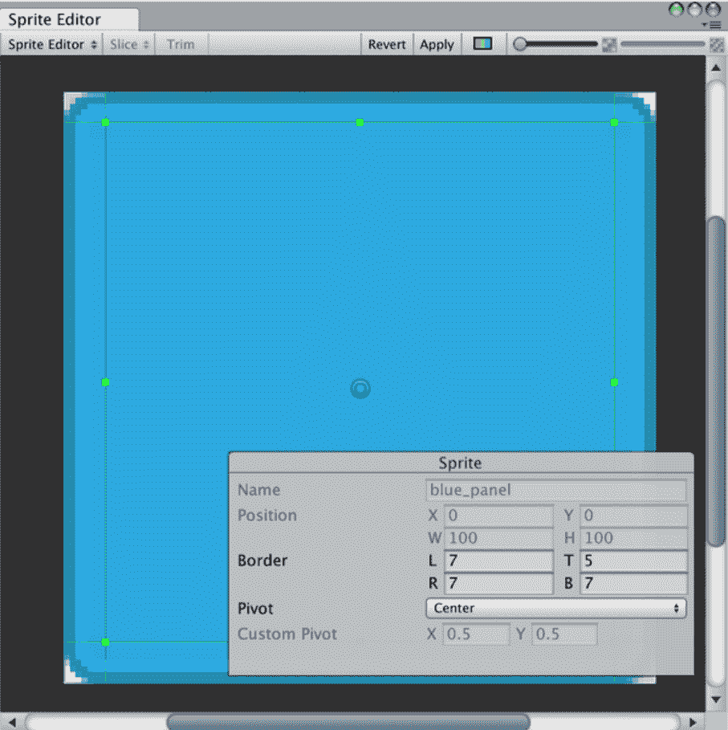

图 12-5. 已为精灵配置边框的 Sprite Editor 窗口


图 12-6. 与图 12-4 中相同的拉伸面板，但精灵已配置为仅在中间拉伸

### 讨论

我们在此使用的技术有时称为 9 切片（9-slicing），因为切片过程定义了图像的九个区域。这并不复杂，只是使用一个带有九个子区域的单一图像资产，每个子区域都有不同的行为：角部不缩放，图像的其余部分根据需要拉伸。

您可能会注意到 Image 组件的 Image Type 还有其他选项：Simple、Tiled 和 Filled。

Simple 会等比例缩放整个精灵。Tiled 的行为与我们在此使用的 Sliced 设置类似，但它是重复中心部分而不是拉伸它。Filled 的行为与 Simple 相同，但从定义的原点沿定义的方向、方法和数量填充精灵。

> **提示**
>
> 您可以在 Unity 手册中了解有关使用图像设计 UI 组件的更多信息。

## 12.3 动画化 UI

### 问题

您想要动画化用户界面的部分内容。

### 解决方案

UI 动画在电子游戏中很常见。界面通常需要吸引自身的注意力，或者用于帮助玩家感觉自己完成了某些特别的事情，或了解他们在游戏中所做事情的影响。Unity 使动画化 UI 元素就像动画化 Unity 内构建的其他任何东西一样简单：非常简单！

> 提示
>
> 这与我们在第 8 章中采用的动画方法不同。如果您愿意，也可以将我们在那里使用的系统挂接到 UI 上。但我们试图向您展示多种解决问题的方法。

为了演示，我们将让按钮在被点击时旋转。首先，我们需要创建一个新按钮：

- 1. 打开 GameObject 菜单，选择 UI → Button 向场景中添加一个按钮。

> 提示
>
> 您可能会注意到，创建按钮还会创建一个作为按钮父级的画布。由于所有 UI 元素都必须是画布的子级，因此如果在添加新 UI 元素时场景中没有画布，系统会为您创建一个。如果场景中已有画布，则新的 UI 组件将作为其子级添加。有关画布的更多信息，请参见配方 12.1 和 Unity 手册。

- 2. 接下来，我们需要创建一个实际执行动画的脚本。创建一个名为 SpinButton.cs 的新 C# 脚本，删除类中的内容，并将以下代码添加到其中：

```
private IEnumerator StartSpinning()
{
    // Don't do any spinning if spin time is zero or less (
    if (spinTime <= 0) {
        yield break;
    }

    // Keep track of how long we've been spinning.
    float elapsed = 0f;
```


```csharp
while (elapsed < spinTime) {
    elapsed += Time.deltaTime;

    // Calculate how far along the animation we are, measured
    // between 0 and 1.
    var t = elapsed / spinTime;

    // Use this value to figure out how many degrees we should be
    // rotated at on this frame.
    var angle = curve.Evaluate(t) * 360f;

    // Calculate the rotation by rotating this many angles around
    // the x-axis.
    transform.localRotation =
        Quaternion.AngleAxis(angle, Vector3.right);

    // Wait a new frame.
    yield return null;
}

// The animation is now complete. Reset the rotation to normal.
transform.localRotation = Quaternion.identity;
}
```

这段代码定义了一个名为 StartSpinning 的方法，我们将将其作为协程来调用，它用于更新所挂载对象的旋转。

- 3. 我们还需要为旋转的参数定义一些变量。将以下内容添加到刚才创建的方法中：

```
// The amount of time needed to perform a full spin
[SerializeField] float spinTime = 0.5f;

// Controls the pacing of the animation.
[SerializeField] AnimationCurve curve = AnimationCurve.EaseInOut(0, 0, 1, 1);
```

> 注意
>
> 当你使用 SerializeField 特性时，相当于让 Unity 知道这些变量的内容应保存到磁盘，并在 Inspector 中显示为可编辑的值。

- 4. 我们需要添加一个公共方法来启动协程，调用刚才创建的 StartSpinning 方法：

```
public void Spin() {
    // Start a spin.
    StartCoroutine(StartSpinning());
}
```

> 提示
>
> 启动协程时，每次遇到 yield return 语句，它就会暂停执行并将控制权返回给 Unity。如果你需要回顾协程相关内容，请查阅第 2 章。

- 5. 将 SpinButton 组件附加到之前创建的按钮上。
- 6. 在 On Click 字段中点击 + 按钮。
- 7. 将按钮本身拖入该字段。
- 8. 在弹出菜单中，选择 SpinButton → Spin。
- 9. 运行游戏。点击按钮时，它会旋转起来！一件杰作。

你也可以使用我们暴露到编辑器中的变量来调整动画的节奏和持续时间，如图 12-7 所示。

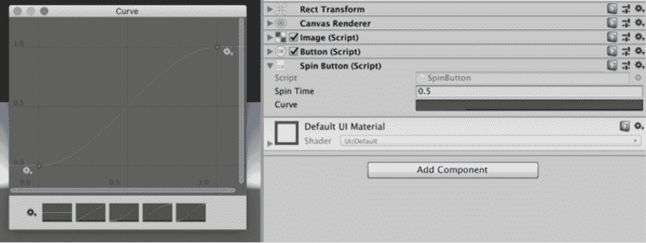

图 12-7. 调整曲线以控制动画节奏和持续时间

### 讨论

此处使用的动画曲线存储了一组关键帧，可随时间进行求值。

> 注意
>
> 在这里，“求值”是指在请求的时间点对曲线进行采样：我们在询问曲线在特定评估时间点发生了什么。

与每帧递增旋转相比，使用动画曲线来实现此效果是一种更强大、更灵活的动画方式。它减少了大量手动工作，让我们能够专注于 UI 的预期移动，而不是编写复杂的动画。

正如我们在本书中多次提到的，几乎任何对象（包括画布上的对象）都可以像 Unity 中的其他对象一样进行动画制作（定位、旋转等）。你也可以为这些对象的属性制作动画！（同样，就像 Unity 中的其他所有内容一样。）

## 12.4 创建项目列表

### 问题

你想创建一个可滚动的 UI 项目列表。

### 解决方案

列表是常见的 UI 元素。你可以将其用于从菜单到背包物品组等各种情况。

首先，我们将创建列表的容器。列表的容器将是 Unity 的 UI 组件之一：滚动视图。我们将创建一个类似图 12-8 所示的简单滚动列表。

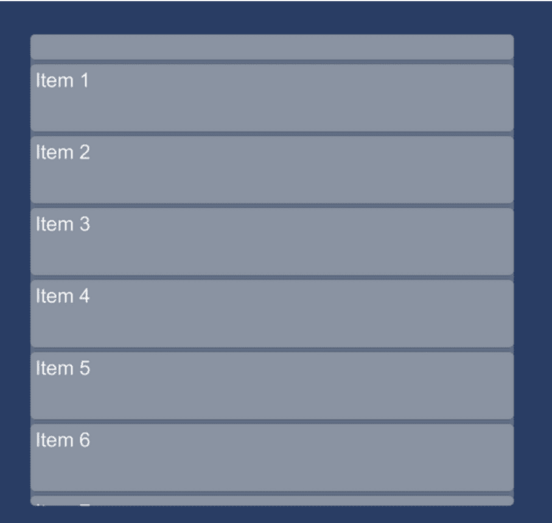

图 12-8. 简单滚动列表

接下来，我们需要进行一些设置：

- 1. 通过打开 GameObject 菜单并选择 UI → Scroll View 来创建滚动视图。
- 2. 选择滚动视图中的 Content 对象。
- 3. 向 Content 对象添加 Vertical Layout Group。
- 4. 在 Child Controls Size 中打开 Width 复选框。这将使 Content 对象内的对象扩展其宽度以填充父对象，同时仍可控制其自身高度。

- 5. 向 Content 对象添加 Content Size Fitter 组件。
- 6. 将 Vertical Fit 设置设为 Preferred Size。这将使 Content 对象调整其高度以匹配其子对象的总高度。它应该如图 12-9 所示。

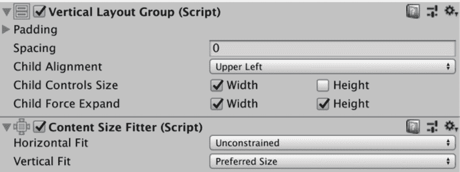

图 12-9. 将 Vertical Fit 设置为 Preferred Size

现在，我们将创建原型列表项对象。我们将使用原型列表项作为列表中每个项目重新创建的基本对象：

- 1. 创建一个面板。将其命名为“List Item”。
- 2. 将 List Item 拖入滚动视图中的 Content 对象。它将调整大小以匹配 Content 对象的宽度。
- 3. 通过打开 GameObject 菜单并选择 UI → Text 创建一个新的 Text 对象。
- 4. 将 Text 对象设为 List Item 的子对象。
- 5. 将 Text 对象的最小锚点设为 (0, 0)，最大锚点设为 (1, 1)。这将使其根据父对象的宽度和高度来定义其大小。
- 6. 将 Text 对象的左、上、下、右边距设为 5。这将在所有边缘向内缩进 5 像素。

接下来，我们将添加一些代码，让每个列表项管理其内容：

- 1. 创建一个名为 ListItem.cs 的新 C# 脚本。删除类的内容，并向其中添加以下代码：

```
[SerializeField] UnityEngine.UI.Text labelText;
```

这将创建一个标签来存储用于列表项条目的文本，并将其暴露到 Unity Inspector 中。

- 2. 添加以下属性：

```
public string Label
{
    get
    {
        return labelText.text;
    }
    set
    {
        labelText.text = value;
    }
}
```

这将暴露一个字符串，允许你获取或设置标签的内容。

> 提示
>
> 有关创建 getter 和 setter 语法的更多信息，请查阅第 2 章。

现在我们需要将刚才创建的脚本添加到原型对象中：

- 1. 向 List Item 添加 ListItem 脚本。
- 2. 将 Text 对象拖入 Label Text 字段。

- 3. 将层级窗口中的 List Item 对象拖入 Project 选项卡。这将创建一个预制体。
- 4. 从场景中删除 List Item。你不再需要它，因为你已经有了预制体！

> **提示**
>
> 有关预制体及其在 Unity 中工作原理的回顾，请参见第 1 章。

最后，我们将添加代码，使用 List Item 的实例来填充列表：

- 1. 创建一个名为 *List.cs* 的新 C# 脚本。向其中添加以下代码：

```
public class List : MonoBehaviour {
    // The number of items to create
    [SerializeField] int itemCount = 5;

    // Each list item will be of this type
    [SerializeField] ListItem itemPrefab;

    // The object that new items should be inserted into
    [SerializeField] RectTransform itemContainer;

    void Start () {
        // Create as many items as we need to
        for (int i = 0; i < itemCount; i++)
        {
            var label = string.Format("Item {0}", i);

            // Create a new item
            CreateNewListItem(label);

        }

        public void CreateNewListItem(string label)
        {
            var newItem = Instantiate(itemPrefab);

            // Place it in the container; tell it to not keep its current
            // position or scale, so it will be laid out correctly by the
            // UI system
            newItem.transform.SetParent(
                itemContainer,
                worldPositionStays: false
            );

            // Give it a label
            newItem.Label = label;
        }
    }
}
```

- 2. 向滚动视图添加 List 组件。
- 3. 将 List Item 预制体拖入其 List Item Prefab 槽位。
- 4. 将 Content 对象拖入其 List Container 槽位。
- 5. 运行游戏。列表现在将包含一个可滚动的项目集合！它应该类似于图 12-10 所示。


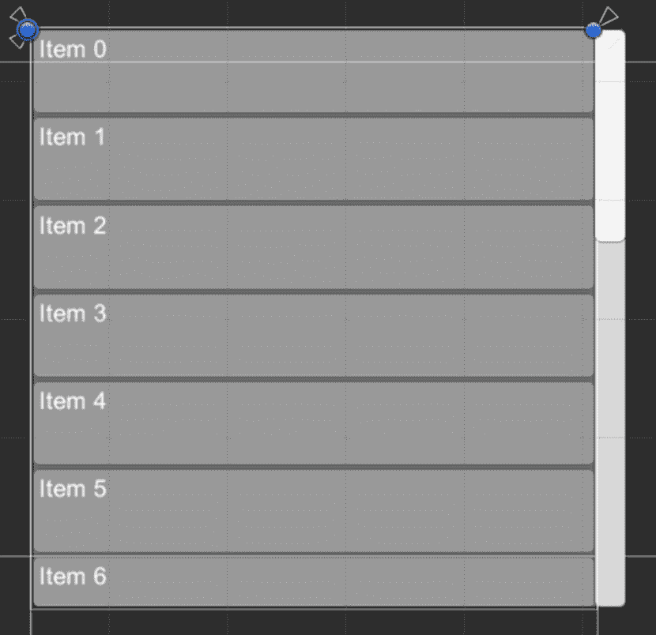

图 12-10. 运行游戏将显示可滚动项目列表

### 讨论

滚动视图在内容无法完全适应屏幕时显然非常有用。滚动视图由几个部分组成——最重要的是，一个剪切区域，它控制另一重要部分（内容区域）显示多少。

## 12.5 列表项淡出

### 问题

你希望管理一个列表，其中的项目在被移除一段时间后淡出。

### 解决方案

基于之前的示例，你已经构建好了精美的列表，现在希望当项目不再需要时，能以悦目的方式让它们从列表中消失。在移除项目时依然看起来很吸引人的列表在视频游戏中非常流行。

要使列表在移除项目时干净利落地淡出它们：

- 1. 从示例 12.4 中的列表示例开始。
- 2. 复制 List Item 预制体，并将新预制体命名为“淡出列表项”。
- 3. 选择“淡出列表项”预制体，并添加 Canvas Group 组件。这样你就可以淡出整个对象。
- 4. 配置 List 对象以使用新的“淡出列表项”。
- 5. 向场景中添加一个新按钮，并将其文本设置为“添加项目”。
- 6. 在其“单击时”列表中添加一个新条目。
- 7. 将 List 对象拖入其对象字段，并选择 List → CreateNewListItem 方法。
- 8. 在文本字段中键入 **新列表项**。
- 9. 创建一个名为 _FadeAfterDelay.cs_ 的新 C# 脚本，删除类的主体，然后添加以下代码：
- 10. 添加必要属性后，添加以下方法：

```
// The number of seconds before a fade starts
[SerializeField] float delayBeforeFading = 2f;

// The amount of time to take while fading out
[SerializeField] float fadeTime = 0.25f;

// Notice the return type-this Start method is a coroutine!
IEnumerator Start () {

    // Wait the required amount of time
    yield return new WaitForSeconds(delayBeforeFading);

    // We need a canvas group in order to fade
    CanvasGroup canvasGroup = GetComponent<CanvasGroup>();

    if (canvasGroup == null) {
        Debug.LogWarning("Cannot fade - no canvas group attached!");
        yield break;
    }

    // Fade time must be more than 0 in order for a fade to be
    // animated
    if (fadeTime <= 0) {
        yield break;
    }

    // Keep track of how much time we've spent fading
    var fadeTimeElapsed = 0f;

    // Perform the fade every frame
    while (fadeTimeElapsed < fadeTime) {
        fadeTimeElapsed += Time.deltaTime;

        // Calculate the fraction of the fade time (between 0 and 1)
        var t = fadeTimeElapsed / fadeTime;

        // Calculate our alpha; it starts at 1, and goes to 0
        var alpha = 1f - t;

        // Apply the fade
        canvasGroup.alpha = alpha;

        // Wait for the next frame
        yield return null;
    }

    // Remove this game object from the scene
    Destroy(gameObject);
}
```

- 11. 将 FadeAfterDelay 组件附加到“淡出列表项”。
- 12. 运行程序。单击按钮时，将出现一个新列表项；过一会儿，它会淡出。我们本想截图给你看，但它已经淡不见了....

### 讨论

你会注意到 Start 方法是一个协程，因此在它运行并处理淡出及从内存中删除对象时，其他事情仍然可以发生。

## 12.6 创建屏幕位置指示器

### 问题

你希望显示突出屏幕上对象位置的图标，为玩家提供他们可能暂时看不到的对象的大致方向。

### 解决方案

要显示指示器，我们将使用 Unity 的 GUI 系统。这意味着我们将设置一个画布和一个用作预制体的原型指示器。

你需要一个用于指示器的精灵。如果你没有，Kenney 的游戏图标包中有一个很好的选择。要创建屏幕位置指示器：

- 1. 通过打开 GameObject 菜单并选择 UI → Canvas 来创建新画布。
- 2. 通过打开 GameObject 菜单并选择 UI → Image 来创建新图像。
- 3. 将图像的精灵设置为你想要用于指示器的精灵。
- 4. 将图像重命名为“指示器”。
- 5. 将“指示器”图像拖入“项目”标签页。这将创建一个预制体。
- 6. 从场景中删除“指示器”图像。

接下来，我们将创建在需要时创建、定位和删除指示器的代码：

- 1. 创建名为 IndicatorManager.cs 的新 C# 脚本，并向其中添加以下代码：

```
public class IndicatorManager : MonoBehaviour {
    // The indicator that appears over each tracked object.
    [SerializeField] RectTransform indicatorPrefab = null;

    // The object that all indicators will go into.
    [SerializeField] RectTransform indicatorContainer = null;

    // The single instance of the indicator manager.
    public static IndicatorManager manager;

    // Maps objects in the world to indicators onscreen.
    Dictionary<TrackedObject, RectTransform> indicators =
        new Dictionary<TrackedObject, RectTransform>();

    private void Awake()
    {
        // Set up the singleton variable to refer to this instance.
        manager = this;
    }

    private void LateUpdate()
    {
        // We do this in LateUpdate so that the calculation of the
        // positions can happen after the objects have moved, which
        // prevents jitter.

        // Every frame, for each object that we're tracking, update the
        // position of its indicator.
        foreach (var pair in indicators) {
            TrackedObject target = pair.Key;
            RectTransform indicator = pair.Value;

            // Has the target been removed from the scene?
            if (target == null) {
                // Skip this indicator
                continue;
            }

            // Update the indicator's position in the canvas.
            indicator.anchoredPosition =
                GetCanvasPositionForTarget(target);
        }
    }

    // Returns the location in canvas space that an indicator should be
    // for a given object
    private Vector2 GetCanvasPositionForTarget(TrackedObject target)
    {
        // Convert the position of the object from world space to
        // viewport space
        var indicatorPoint =
            Camera.main.WorldToViewportPoint(target.transform.position);

        // Viewport coordinates are (0, 0) to (1, 1); (0, 0) is the
        // bottom-left corner of the screen.

        // If a point is outside the screen, we clamp it to the edges.
        indicatorPoint.x = Mathf.Clamp01(indicatorPoint.x);
        indicatorPoint.y = Mathf.Clamp01(indicatorPoint.y);

        // If a point is behind the camera, we force it to the bottom of
        // the screen.
        if (indicatorPoint.z < 0) {
            indicatorPoint.y = 0;

            // We also have to flip it on the x-axis for it to appear
            // correctly.
            indicatorPoint.x = 1f - indicatorPoint.x;
        }

        // Canvas coordinates are (0, 0) -> (width, height); (0, 0) is
        // the bottom-left corner of the canvas.

        // This means that we can scale by the canvas size to get the
        // position in canvas space.

        // Get the canvas
        var canvas = indicatorContainer.GetComponentInParent<Canvas>();

        // Get its size
        Vector2 canvasSize =
            canvas.GetComponent<RectTransform>().sizeDelta;

        // Scale it
        indicatorPoint.Scale(canvasSize);

        // We've now calculated where it belongs in the canvas!
        return indicatorPoint;
    }

    public void AddTrackingIndicator(TrackedObject transform) {
        // Do we already have an indicator for this object?
        if (indicators.ContainsKey(transform)) {
            // Nothing to do; we already have an indicator for this
            // transform
            return;
        }

        // Create our indicator from the prefab
        var indicator = Instantiate(indicatorPrefab);

        // Give it a useful name
        indicator.name = string.Format("Indicator for {0}",
            transform.gameObject.name);

        // Move the indicator into the container
        indicator.SetParent(indicatorContainer, false);

        // Ensure the pivot point is in the center of the object, so
        // that the center of the image is right over the object's


// position
indicator.pivot = new Vector2(0.5f, 0.5f);

// Ensure the object doesn't adjust its size and position based
// on the size of its parent
indicator.anchorMin = Vector2.zero;
indicator.anchorMax = Vector2.zero;

// Keep track of the relationship between the target and its
// indicator
indicators[transform] = indicator;

// Place the indicator in the right location
indicator.anchoredPosition =
    GetCanvasPositionForTarget(transform);
}

// Stops tracking a target.
public void RemoveTrackingIndicator(TrackedObject transform) {

    // If we have an indicator for this target object, remove it
    // from the scene
    if (indicators.ContainsKey(transform)) {
        // Destroy the indicator, if it isn't already gone from the
        // scene.
        if (indicators[transform] != null) {
            Destroy(indicators[transform].gameObject);
        }
    }
}

// And remove it from the list, if it's present. (The Remove
// method won't throw an exception if "transform" isn't in the
// dictionary.)
indicators.Remove(transform);
}
}

- 2. 创建一个空游戏对象，并将其命名为“Indicator Manager”。
- 3. 向 Indicator Manager 添加 IndicatorManager 组件。
- 4. 将画布拖入 Indicator Container 字段。
- 5. 将 Indicator 预制体拖入 Indicator Prefab 字段。

接下来，我们将创建一个脚本，在对象首次出现时请求指示器，并在对象从场景中移除时将其删除。创建一个名为 _TrackedObject.cs_ 的新 C# 脚本，并向其中添加以下代码：

```
public class TrackedObject : MonoBehaviour {
    void Start () {
    // When the object first appears, request an indicator.
    IndicatorManager.manager.AddTrackingIndicator(this);
    }

    // Tell the indicator manager to remove our tracking indicator.
    // OnDestroy is called when either the object is removed from the scene,
    // or the scene is being unloaded (including when we exit Play mode).
    private void OnDestroy() {
    IndicatorManager.manager.RemoveTrackingIndicator(this);
    }
}
```

最后，我们将创建一个对象，其上会绘制指示器：

- 1. 通过打开 GameObject 菜单并选择 3D Object → Sphere，创建一个新球体。
- 2. 将球体移动到摄像机可见的位置。
- 3. 向其添加 TrackedObject 组件。
- 4. 运行游戏。将在其上绘制一个指示器；当你移动球体时，指示器会跟随它。如果将球体移到摄像机后面，其指示器会移动到屏幕底部；当你删除球体时，指示器也会被删除。你也可以向场景中添加任意数量的 TrackedObject 组件。

### 讨论

请记住，当 Unity 编辑器退出播放模式时，对象会被销毁！

## 12.7 自定义编辑器

### 问题

你想要自定义组件的检查器。

### 解决方案

Unity 的编辑器是其最佳特性之一。乍一看可能会产生误导，虽然 Unity 编辑器看起来像许多其他专业软件包，但它实际上是一个灵活、友好的地方，用于完成你的工作。

在 Unity 编辑器中你可以做的最有用的事情之一，就是为游戏中的不同组件创建检查器。你已经了解过如何将属性变量暴露到检查器中；此技术在此基础上更进一步。

我们将创建一个脚本，当与自定义编辑器配对时，它允许你快速建造一堵砖墙。当你添加 Wall 组件时，你将指定墙的宽度和高度，以及要用于砖块纹理的预制体。检查器中会出现一个按钮；当你点击它时，它会将砖块作为子对象创建出来。

首先，我们将创建砖块预制体：

- 1. 创建一个新立方体，并将其命名为“Brick”。
- 2. 将其缩放设置为 (2, 1, 1)。
- 3. 将其从 Hierarchy 选项卡拖入 Project 选项卡。这将创建一个新预制体。
- 4. 从场景中删除原始 Brick 预制体。

接下来，我们将编写墙的代码。此文件将包含两个类——一个用于 Wall 组件，一个用于自定义编辑器：

- 1. 创建一个名为 Wall.cs 的新 C# 脚本。删除其创建的类内容，并向其中添加以下代码：

```
[SerializeField] public int rows = 5;
[SerializeField] public int columns = 5;

[SerializeField] public Renderer brickPrefab;
```

这些变量是墙所需的属性：行数、列数，以及用于存储我们将在砖墙中用于每个砖块的预制体的位置。

- 2. 在同一脚本文件中，在其下方添加另一个类。按如下方式打开你的类，名为 WallEditor：

```
#if UNITY_EDITOR
// The Editor object that will manage the Inspector for Wall components.
[CustomEditor(typeof(Wall))]
public class WallEditor : Editor {
```

这确保它继承自 Editor，而非 MonoBehaviour。这使我们能够访问编辑器功能。你按如下方式关闭它：

```
}
#endif
```

- 3. 使用以下内容更新文件顶部的包含项，将其放在现有包含项下方：

```
#if UNITY_EDITOR
using UnityEditor;
#endif
```

这确保我们可以使用 UnityEditor 命名空间，且 if 语句确保它仅在该脚本在编辑器环境中运行时才被包含。有关此语法的更多信息，请参见第 2 章。

- 4. 在新的 WallEditor 类中，添加以下方法：

```
public override void OnInspectorGUI()
{
    // Make sure that we have the latest data
    serializedObject.Update();

    EditorGUILayout.PropertyField(
        serializedObject.FindProperty("rows"));

    EditorGUILayout.PropertyField(
        serializedObject.FindProperty("columns"));

    EditorGUILayout.PropertyField(
        serializedObject.FindProperty("brickPrefab"));

    serializedObject.ApplyModifiedProperties();

    if (GUILayout.Button("Create Wall")) {
        CreateWall();

    }
}
```

当需要绘制脚本所附对象的检查器内容时，Unity 编辑器会调用此方法。此处的代码会更新对象的副本，为每个属性向检查器面板添加 UI 元素，并创建一个标记为 Create Wall 的按钮，单击该按钮时会调用另一个名为 CreateWall 的方法。

- 5. 创建一个名为 CreateWall、返回 void 的新方法。在其中添加：

```
Undo.RegisterFullObjectHierarchyUndo(target, "Create Wall");
```

这会在我们开始更改对象之前注册其状态，以便用户可以撤销脚本所做的操作。这通常是编辑器增强功能中礼貌的行为。

- 6. 添加一些代码来获取我们要使用的墙的引用：

```
var wall = target as Wall;

if (wall == null) {
    return;
}
```

target 是超类（即编辑器）的一个属性，它为我们提供对检查器中当前表示的对象的引用。

### 注意

我们不能在正在遍历的列表中的对象上调用 DestroyImmediate，因为在遍历过程中列表的大小会发生变化。相反，我们将它们的引用复制到一个固定大小的数组中，以便销毁该数组中的对象。

- 7. 创建一个位置来临时存储所有当前子对象，以便我们可以处理它们：

```
GameObject[] allChildren =
new GameObject[wall.transform.childCount];

int i = 0;
```

- 8. 现在我们可以遍历所有子对象并将它们添加到临时存储中：

```
foreach (Transform child in wall.transform)
{
    allChildren[i] = child.gameObject;
    i += 1;
}
```

- 9. 现在我们可以遍历刚刚创建的数组并销毁每个对象：

```
foreach (GameObject child in allChildren)
{
    // Destroy the object, and also record it as an undoable
    // action
    DestroyImmediate(child.gameObject);
}
```

- 10. 要用新对象（砖块）替换它们，我们需要一个砖块大小的引用，我们将从预制体中获取它：

```
var brickSize =
wall.brickPrefab.GetComponent<Renderer>().bounds.size;
```

- 11. 然后我们可以遍历每一行，并使用嵌套循环遍历每一列，在那里实例化砖块预制体的副本：

```
for (int row = 0; row < wall.rows; row++) {

    // Figure out where the row should be
    var rowPosition = Vector3.zero;
    rowPosition.y += brickSize.y * row;

    for (int column = 0; column < wall.columns; column++)
    {
        // Figure out where the brick should be
        var columnPosition = rowPosition;
        columnPosition.x += brickSize.x * column;

        // Every second row is offset a bit
        if (row % 2 == 0) {
            columnPosition.x += brickSize.x / 2f;
        }

    }

    // PrefabUtility.InstantiatePrefab is like Instantiate, but
    // it remembers that it was a prefab and maintains the
    // connection. (We have to cast it to GameObject because
    // there's no generic version of InstantiatePrefab—the
    // compiler won't figure out the type automatically based
    // on the type that was passed in.)

    var brick = PrefabUtility


.InstantiatePrefab(wall.brickPrefab.gameObject)
as GameObject;

// Give it a name appropriate to its position
brick.name = string.Format("{0} ({1},{2})",
    wall.brickPrefab.name,
    column,
    row);

// Place it in the scene
brick.transform.SetParent(wall.transform, false);

// Update its position, relative to its parent
brick.transform.localPosition = columnPosition;

// Don't rotate it, relative to its parent
brick.transform.localRotation = Quaternion.identity;
}
}

哎呀。这是一段很长的代码。现在我们可以使用它了：

- 1. 创建一个新的空游戏对象，并将其命名为“Wall。”为其添加 Wall 组件。
- 2. 将 Brick 预制体拖入 Brick Prefab 槽位。
- 3. 单击创建墙按钮。一堵砖墙将出现！您可以在自定义检查器中查看输入示例，并在图 12-11 中查看输出。

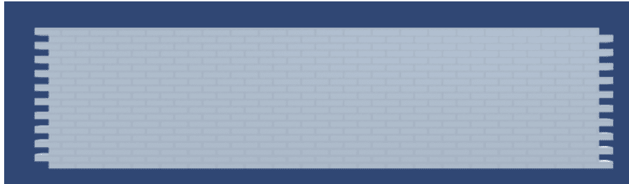

图 12-11. 单击创建墙按钮，砖墙将出现

### 讨论

EditorGUILayout 和 GUILayout 都提供常见编辑器 UI 元素的类似版本。在设计 Unity 编辑器时，考虑要使用哪组控件非常重要。

> **提示**
>
> 当您自定义 Unity 检查器组件时，您将使用您创建的脚本替换默认布局。

## 12.8 属性绘制器

## 问题

您想自定义检查器绘制特定类型变量的方式。例如，您有一个自定义类，并希望自定义其外观。

## 解决方案

我们将通过定义一个名为 MultiValue 的新类型来演示如何做到这一点。它将包含一个字符串列表，其中一个可以在检查器中选择：

- 1. 创建一个名为 *MultiValue.cs* 的新 C# 脚本。删除类的内容，然后在标准包含下方的顶部添加以下代码：

```
#if UNITY_EDITOR
using UnityEditor;
#endif
```

这样可以确保我们可以使用 UnityEditor 命名空间，并且 if 语句确保它仅在该脚本在编辑器环境中运行时被包含。有关此语法的更多信息，请参见第 2 章。

- 2. 接下来，更新类以使其如下所示：

```
[System.Serializable]
public class MultiValue {
    // The index of the currently selected value.
    [SerializeField] int _selectedIndex = 0;

    // The list of available options
    [SerializeField] string[] options;

    // Manages the selected index, and keeps it from going out of bounds.
    public int SelectedIndex {
        get {
            return _selectedIndex;
        }
        set {
            value = Mathf.Clamp(value, 0, options.Length);
        }
    }

    // Creates a new chooser, using the specified values.
    public MultiValue(params string[] values) {
        this.options = values;
    }

    // Returns the text of the currently selected value.
    public string SelectedValue {
        get {
            if (options.Length > 0) {
                return options[_selectedIndex];
            } else {
                return null;
            }
        }
    }
}
```

此脚本可能看起来有点令人困惑，但它相对简单。不过，它需要更多上下文来解释，所以请继续阅读。

- 3. 添加另一个类，如下所示：

```
#if UNITY_EDITOR
// Overrides how Unity will draw a MultiValue property.
[CustomPropertyDrawer(typeof(MultiValue))]
public class MultiValuePropertyDrawer : PropertyDrawer {

    // Called by Unity when it needs to draw a MultiValue property in
    // the Inspector.
    public override void OnGUI(Rect position,
        SerializedProperty property, GUIContent label)
    {
        // Ensure that the controls found in the GUI class behave
        // properly. This also tells Unity that any edit to any field in
        // here should be recorded for the purposes of Undoing them.
        EditorGUI.BeginProperty(position, label, property);

        // Get a reference to the variables that store the info we need
        var indexProperty =
            property.FindPropertyRelative("_selectedIndex");

        var valuesProperty = property.FindPropertyRelative("options");

        // Calculate the rectangle to draw the first line in. This will
        // hold our toolbar (our list of buttons).
        var firstLinePosition = position;
        firstLinePosition.height =
            EditorGUI.GetPropertyHeight(indexProperty);

        // Use this to calculate the rectangle to draw the second
        // property in. (This will vary, depending on whether the user
        // has elected to expand the list in the Inspector or not.)
        var secondLinePosition = firstLinePosition;
        secondLinePosition.y += 2 + firstLinePosition.height;
        secondLinePosition.height =
            EditorGUI.GetPropertyHeight(valuesProperty);

        // Display the label in front of the toolbar, and get back a new
        // rectangle to draw the toolbar in.
        firstLinePosition = EditorGUI.PrefixLabel(
            firstLinePosition, new GUIContent(property.displayName));

        // Get every string inside the "options" property, as an array
        string[] labels = new string[valuesProperty.arraySize];

        for (int i = 0; i < labels.Length; i++) {
            labels[i] =
                valuesProperty.GetArrayElementAtIndex(i).stringValue;
        }

        // Because Toolbar is not in the EditorGUI class, it won't
        // automatically report to the editor that it was updated in a
        // way that the editor can track for the purposes of the Undo
        // system. So, we use BeginChangeCheck before drawing the
        // toolbar, and call EndChangeCheck. If EndChangeCheck returns
        // true, the user made a change.
        EditorGUI.BeginChangeCheck();
        var index = indexProperty.intValue;
        var newValue = GUI.Toolbar(firstLinePosition, index, labels);
        if (EditorGUI.EndChangeCheck()) {
            // The toolbar was changed.
            indexProperty.intValue = newValue;
        }

        // Draw the 'options' list as a regular list. This will also
        // draw things like the expand arrow, the items in the list,
        // and the number of items in the list.
        EditorGUI.indentLevel += 1;
        EditorGUI.PropertyField(secondLinePosition,
            valuesProperty, true);
        EditorGUI.indentLevel -= 1;

        // We're done editing this property.
        EditorGUI.EndProperty();
    }

    // Called by Unity to determine the height of the
    // MultiValue property.
    public override float GetPropertyHeight(SerializedProperty property,
        GUIContent label)
    {
        // The height of a MultiValue property is the height of both of
        // its two child properties, plus the spacing between them.
        float lineSpacing = EditorGUIUtility.standardVerticalSpacing;

        // Get the child properties
        var indexProperty =
            property.FindPropertyRelative("_selectedIndex");

        var valuesProperty = property.FindPropertyRelative("options");

        // Calculate the height of this property by getting the height
        // of both properties (including the strings inside the options,
        // if it's been expanded), plus the line spacing
        float indexHeight = EditorGUI.GetPropertyHeight(indexProperty);
        float optionsHeight =
            EditorGUI.GetPropertyHeight(valuesProperty, true);

        return indexHeight + lineSpacing + optionsHeight;
    }
}

#endif
```

这段冗长的代码创建了一个名为 MultiValuePropertyDrawer 的新属性绘制器，它定义了我们刚才创建的 MultiValue 类型的内容在编辑器中如何绘制。代码获取相关属性的所有必要部分的引用，然后绘制属性检查器的实际 UI。

我们创建的 MultiValue 类首先定义了 MultiValuePropertyDrawer 可实际编辑的属性结构：它包含一个字符串数组作为可能的选项，以及一个 int，指向当前选定的选项。MultiValuePropertyDrawer 中的代码呈现选项，并让用户从检查器中选择一个。

让我们测试一下：

- 1. 创建一个新的空游戏对象，并将其命名为“Demo。”
- 2. 创建一个名为 MultiValueDemo.cs 的新 C# 脚本。向其中添加以下代码：

```
// A simple component to demo the MultiValueChooser property drawer.
public class MultiValueDemo : MonoBehaviour {

    [SerializeField]
    MultiValue multiValue =
        new MultiValue("One", "Two", "Three", "Four", "Five", "Six");
}
```

请注意 MultiValue 属性的外观类似于图 12-12。

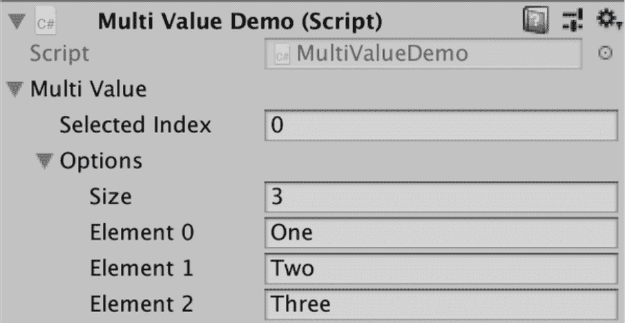

图 12-12. MultiValue 属性的检查器

当您返回 Unity 时，检查器将类似于图 12-13。您可以从属性顶部的栏中选择一个字符串，也可以修改可用字符串。如果向 MultiValueDemo 类添加更多属性，它们将按预期显示。


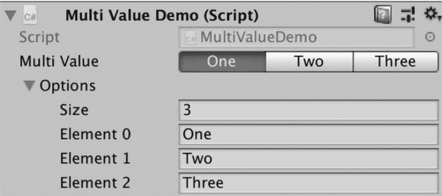

图 12-13. 同一个 MultiValue 属性的检查器，但带有自定义属性绘制器

### 讨论

Unity 通常会在检查器中绘制类的子属性。如果你想要覆盖此行为，则需要亲自完成所有绘制工作。

属性绘制器不能使用更高级的 EditorGUILayout，而必须使用 EditorGUI。这意味着你需要亲自计算和绘制矩形，就像我们在这个示例中所做的那样。

> 提示
>
> 你可以在 Unity 文档中了解有关 Unity Editor API 的更多信息。

## 12.9 属性绘制器

### 问题

当某个特性附加到变量上时，你希望自定义检查器绘制该类型变量的方式。例如，Header 特性会导致 Unity 在检查器中变量上方绘制一个标签。

### 解决方案

我们将添加一个特性，允许你在变量上方绘制一个帮助框，如下所示：

```csharp
public class HelpBoxDemo : MonoBehaviour {
    [HelpBox(text = "Here's a help box above the variable!")]
    [SerializeField] int integer;
}
```

这段代码会生成图 12-14 中所示的检查器。

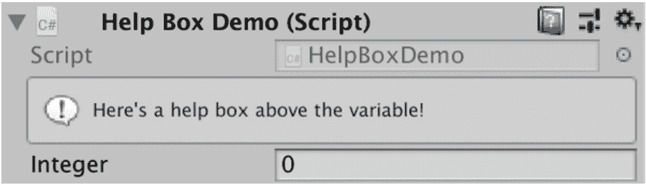

图 12-14. HelpBox 特性（我们将在这个示例中构建它）的实际效果

要创建 HelpBox 特性，请创建一个名为 HelpBox.cs 的新 C# 脚本，并按以下内容替换其代码：

```csharp
#if UNITY_EDITOR
using UnityEditor;
#endif

// A HelpBoxAttribute can be placed above a variable to make it display a
// help box above it in the Inspector.

// Note how we define the HelpBoxAttribute class outside the #if
// UNITY_EDITOR areas. This is because code that refers to the HelpBox will be
// compiled outside of the editor context (that is, with UNITY_EDITOR not
// defined), and it will fail to compile if the class doesn't exist.

public class HelpBoxAttribute : PropertyAttribute
{
    // The text that will appear in the help box.
    public string text;
}

#if UNITY_EDITOR
// The code that draws the help box, as well as the original property.
[CustomPropertyDrawer(typeof(HelpBoxAttribute))]
public class HelpBoxAttributePropertyDrawer : PropertyDrawer {
    public override void OnGUI(
        Rect position, SerializedProperty property, GUIContent label)
    {
        // Let's start by calculating the rectangle in which we'll draw the
        // help box.

        // 'position' is the rectangle that we've been given to draw
        // everything to do with this property. It's calculated by taking
        // the width of the Inspector tab, and the height returned by
        // GetPropertyHeight.

        // The help box will be at the top of the property, so we just take
        // the original position, and reduce the height.
        var helpBoxPosition = position;
        helpBoxPosition.height = HelpBoxHeight;

        // Next, we figure out the rectangle we need to draw the property in.
        // We'll start with the entire available area...
        var propertyPosition = position;

        // Shift it down by the help box's height, plus line spacing
        propertyPosition.y += EditorGUIUtility.standardVerticalSpacing +
            helpBoxPosition.height;

        // And update its height to be however tall the property wants to
        // be, including any child properties.
        propertyPosition.height =
            EditorGUI.GetPropertyHeight(property, includeChildren: true);

        // Get the text from the HelpBoxAttribute.
        HelpBoxAttribute helpBox = (attribute as HelpBoxAttribute);
        string text = helpBox.text;

        // Draw the help box itself.
        EditorGUI.HelpBox(helpBoxPosition, text, MessageType.Info);

        // Draw the original property underneath.
        EditorGUI.PropertyField(
            propertyPosition, property, includeChildren: true);
    }

    public override float GetPropertyHeight(
        SerializedProperty property, GUIContent label)
    {
        // Calculate the height of the help box, given the editor width
        // (the text might wrap over multiple lines)

        float lineSpacing = EditorGUIUtility.standardVerticalSpacing;
        float propertyHeight =
            EditorGUI.GetPropertyHeight(property, includeChildren: true);

        return HelpBoxHeight + lineSpacing + propertyHeight;
    }

    // Calculates the height of the help box.
    private float HelpBoxHeight
    {
        get
        {
            var width = EditorGUIUtility.currentViewWidth;
            var helpBoxAttribute = attribute as HelpBoxAttribute;
            var content = new GUIContent(helpBoxAttribute.text);
            float helpBoxHeight =
                EditorStyles.helpBox.CalcHeight(content, width);

            // Add a single line's height to ensure that text doesn't get
            // clipped
            return helpBoxHeight + EditorGUIUtility.singleLineHeight;
        }
    }
}
#endif
```

### 讨论

在代码中，你也可以将 HelpBoxAttribute 简称为 HelpBox，它依然可以正常工作！

在可能由除你以外的其他人使用的任何编辑器代码中使用帮助框，是一种礼貌的做法。

> **提示**
>
> 你应该假设会有除你以外的其他人使用你的所有代码，即使你是一个人团队。

## 12.10 资产处理

### 问题

你希望自定义 Unity 导入某些文件的方式。

### 解决方案

让我们设置一个资产后处理器，它会自动将文件名以 _n、_nrm 或 _normal 结尾的任何纹理设置为法线贴图：

- 1. 创建一个名为 NormalMapTextureImporter.cs 的新 C# 脚本，并添加以下代码：

```csharp
#if UNITY_EDITOR
using UnityEditor;

public class NormalMapTextureImporter : AssetPostprocessor
{

    // Called before the texture is imported.
    void OnPreprocessTexture() {

        // Get the name of the file.
        var filename =
            System.IO.Path.GetFileNameWithoutExtension(assetPath);

        // We're looking for texture files that end in any of these
        // suffixes.
        var normalMapSuffixes = new[] { "_n", "_normal", "_nrm" };

        // Check each one
        foreach (var suffix in normalMapSuffixes) {
            if (filename.EndsWith(suffix)) {

                // Get the texture importer that's currently importing
                // this texture
                TextureImporter textureImporter =
                    assetImporter as TextureImporter;

                // Update its type so that Unity is aware that it's a
                // normal map
                textureImporter.textureType =
                    TextureImporterType.NormalMap;

                // Exit here, since we know we don't need to do any more
                // work
                return;
            }
        }
    }
}
#endif
```

这段代码创建了一个名为 NormalMapTextureImporter 的 AssetPostprocessor 子类，查找我们想要的后缀，检查每个正在导入的文件是否具有该后缀，并为找到的每个文件将纹理类型更改为法线贴图。

- 2. 要对其进行测试，请获取一个包含法线贴图的纹理并将其重命名，使其名称以 _n 结尾。

**提示**

如果你手头没有法线贴图，可以在 NormalMap-Online 上找到一个有用的法线贴图在线生成器。

- 3. 将此纹理导入项目。该文件将作为法线贴图导入！

### 讨论

在游戏开发领域，纹理文件名中存在一些常见的事实标准：_d 代表漫反射贴图，_e 代表自发光贴图，_n 代表法线贴图，等等。资产后处理系统允许你根据文件名以及其他参数来处理导入。

你可以使用 OnPreprocessTexture 函数在纹理导入之前执行操作，就像我们在这里所做的那样。你可能想要修改纹理的某些方面（例如，修改其 Alpha 值）或更改纹理的压缩格式。

**提示**

你可以在 Unity 文档中了解有关 Unity AssetPostprocessor 类的更多信息。

还有一个等效的 OnPostProcessTexture 函数，它在资产导入完成后被调用。

**注意**

该处理器不仅适用于纹理，也适用于 Unity 可能导入的任何文件。例如，你可以使用它来重新压缩或重新编码声音文件。

## 12.11 向导

### 问题

你希望在 Unity 编辑器中创建并显示一个窗口，让用户提供一些值，并在用户单击按钮时运行代码。

### 解决方案


向导是一种源远流长的用户界面范式，可以追溯到 20 世纪 90 年代初，它会引导你经历一系列步骤。当你在构建游戏时需要频繁执行某个重复性流程时，向导非常有用。

让我们创建一个向导，用于创建一个立方体，并创建一个使用指定颜色的新材质，这一切只需单击一个按钮即可完成：

- 1. 创建一个名为 CreateCubeWizard.cs 的新 C# 脚本，并向其中添加以下代码：

```
#if UNITY_EDITOR
// This entire class only exists in the editor. It doesn't need to be
// included in built games.
using UnityEditor;

// Create a wizard that generates a new cube, as well as a color.
public class CreateCubeWizard : ScriptableWizard {

// Create a new entry in the GameObject menu, called "Cube with
// Color." When it's selected, a CreateCubeWizard will appear. Note
// that this method must be both public and static for
// MenuItem to work.
[MenuItem("GameObject/Cube with Color")]
public static void CreateWizard() {
// Create and display the wizard.
DisplayWizard<CreateCubeWizard>("Create Cube");
}

// Stores temporary information about the cube that the user wants
// to make. These variables are drawn in the window, just like
// variables in a MonoBehaviour component are.
[SerializeField] Vector3 size = Vector3.zero;
[SerializeField] Color color = Color.white;

// Run when the Create button is clicked.
private void OnWizardCreate()
{
// Create a cube
var newCube = GameObject.CreatePrimitive(PrimitiveType.Cube);
// Scale it
newCube.transform.localScale = size;
// Create a new material, using the Standard shader (which
// is the default)
var tintedMaterial = new Material(Shader.Find("Standard"));
// Give it a color
tintedMaterial.color = color;
// Materials need to be saved to disk. To do this, we need to
// figure out where we can save the file.
// GenerateUniqueAssetPath will give us a path that's
// guaranteed to not already have a file present.
var desiredPath =
    AssetDatabase.GenerateUniqueAssetPath("Assets/Tinted.mat");
// Create and save the new asset.
AssetDatabase.CreateAsset(tintedMaterial, desiredPath);
AssetDatabase.SaveAssets();
// Visually "ping" the asset, as though we'd selected it in the
// Editor. This will show the user that a new file has been
// created, and where to find it.
EditorGUIUtility.PingObject(tintedMaterial);
}

// Finally, make the new cube use this new material.
newCube.GetComponent<MeshRenderer>().material = tintedMaterial;
}
}
#endif
```

我们定义了一个名为 CreateCubeWizard 的 ScriptableWizard，它添加了一个名为“Cube with Color”的新菜单项，让我们可以轻松触发向导，然后创建一个新立方体，要求用户提供用于 size 的 Vector3 和用于 color 的 Color。

- 2. 打开 GameObject 菜单，你会看到新的菜单项：Cube with Color。单击它。
- 3. 输入立方体的尺寸和颜色，然后单击 Create。
- 4. 新立方体将添加到场景中，将使用该颜色创建一个新材质，并将立方体设置为使用该新材质。

### 讨论

创建编辑器工具（例如向导）是更复杂的 Unity 工作流程的重要组成部分。向导是创建自定义 UI 的绝佳方式，可以让你作为游戏开发者的生活更轻松。

Unity Editor API 允许你构建许多有用的东西，来简化常见的工作流程。如果你发现自己反复执行某个动作多次，那么使用 Unity Editor API 来简化自己的工作通常是个好主意。自动化的可能性非常广泛！

> **提示**
> 
> 你可以在 Unity 文档中了解有关 Unity Editor API 的更多信息。有很多可能性，也有很多方法可以自动化重复的工作流程。
