## 在 Unity 中工作

要在 Unity 中制作东西，了解 Unity 的工作原理以及如何将其作为软件使用非常重要。在本章中，我们将带你游览 Unity 的界面和功能，以便你准备好在编辑器中开始构建东西。这是一个复杂的软件，对新用户来说可能令人望而生畏，尤其是那些没有 *专业* 软件背景的人。这是一段偶尔疯狂的旅程，但在其中创作是令人满足的领域，以独特而引人入胜的方式融合编程与艺术。

> 如果你完全是 Unity 新手，我们建议在尝试本书其他菜谱之前，先阅读本章以及第 2 章中的所有菜谱。

本章还向你介绍 Unity 生态系统中使用的许多术语，这将帮助你理解本书的其余部分。

### 1.1 在 Unity 中导航

#### 问题

你想学习如何导航 Unity 编辑器，并了解每个组件的作用、如何使用它以及如何自定义它。

#### 解决方案

Unity 的用户界面是围绕 *窗口* 组织的内容。每个不同的视图可以做不同的事情。在本菜谱中，我们将介绍其中一些最重要的视图，并谈谈如何安排编辑器以满足你的需求。

当你启动 Unity 并创建一个新项目时，你将被带到编辑器的主窗口（图 1-1）。

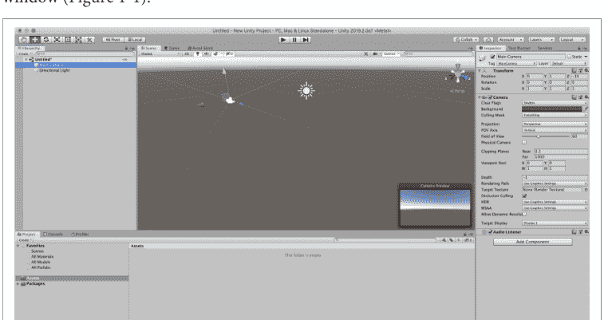

图 1-1. Unity 编辑器的主窗口

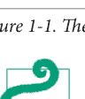

首次启动时，Unity 使用你在图 1-1 中看到的布局。然而，你可以通过点击并拖动其边缘来调整任何窗口的大小。你也可以通过点击并拖动其标签将其重新定位到其他位置。如果你将标签拖到另一个窗口的边缘，它将被放置在该窗口的该侧。如果你将标签拖到窗口中间，它将被添加到该窗口顶部标签列表中。

Unity 在安装时默认使用“深色模式”，但我们已将其设置为“浅色模式”，以便本书中的截图效果更好！如果你的 Unity 颜色与我们不同，请不要惊慌！

## 工具栏

工具栏包含影响整个 Unity 的控件（图 1-2）。它始终位于编辑器窗口顶部且无法移动。

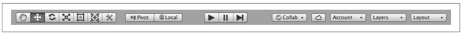

图 1-2. 工具栏

工具栏从左到右包含以下控件：

工具调色板

此调色板控制当对象被选中时出现的变换控件的行为。一次只能选择一种模式；它们是：

- Hand tool
在场景视图中点击并拖动将移动你对场景的视图。

- Move tool
选中的对象可以移动。

- Rotate tool
选中的对象可以在其轴点或中心周围旋转。

- Scale tool
选中的对象可以在其轴点或中心周围缩放。

## 矩形工具

被选中的对象周围会绘制一个矩形，并且可以缩放和重新定位。此工具主要用于 2D 对象，如精灵和用户界面元素。

## 变换工具

此工具结合了移动、旋转和缩放工具。选中的对象可以移动、旋转和缩放。

## 自定义工具

游戏中代码定义的任何自定义工具都会在此处出现。

## 枢轴/中心切换

此切换设置变换控件是放置在对象的局部枢轴点还是放置在对象的体积中心。（这对于某些 3D 模型可能不同；例如，人类角色模型的枢轴点通常放置在角色的脚部。）

## 局部/全局切换

此切换设置变换工具是在全局空间还是局部空间中操作。例如，在局部空间中，拖动移动工具的蓝色“向前”箭头会根据其自身方向向前移动对象，而在全局模式下，拖动蓝色“向前”箭头会忽略对象的方向。

## 播放按钮

此按钮启动播放模式，进入你的游戏。你可以再次点击该按钮以结束播放模式并返回编辑。

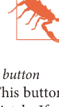

在播放模式下你可以编辑场景，但你在场景中所做的任何更改在结束游戏时都会丢失。不要忘记在进行大量工作之前检查你是否正在玩游戏！

## 暂停按钮

此按钮暂停游戏。如果你在播放模式中，游戏会立即暂停。如果你在播放模式之外，你仍然可以点击此按钮；如果随后点击播放按钮，游戏将在第一帧后立即暂停。

## 步进按钮

此按钮在保持游戏暂停的同时推进一帧。

更具体地说，步进“向前一帧”意味着 Unity 将按 *固定时间步长*推进游戏时钟，然后重新渲染游戏。默认情况下，固定时间步长为 0.02 秒；你可以在项目的 Time 设置中配置此项（从 Edit 菜单中选择 Project Settings → Time）。

## 协作菜单

此菜单提供与 Unity Collaborate 协作的控件，Unity Collaborate 是 Unity 的版本控制服务。

Unity Collaborate 超出了本书的范围，但 Unity 手册提供了良好的介绍。

## 服务按钮

此按钮打开服务视图，允许你使用 Unity 的基于网络的服务，如 Cloud Build、Unity Analytics 等。有关更多信息，请参阅 Unity 的支持和服务页面。

## 账户按钮

此按钮允许你配置你的 Unity 账户。

## 图层按钮

使用此按钮你可以选择当前可见或可选择的图层。

## 布局按钮

此按钮允许你保存和恢复预定义的窗口布局。当你有一个适用于动画或关卡布局等任务的布局，并且想要在不同任务之间切换而无需调整精确的窗口位置时，这非常有用。

## 场景视图

场景视图允许你查看、选择和修改场景中的对象（图 1-3）。在场景视图中，你可以左键单击任何对象来选择它；当对象被选中时，你可以使用变换控件移动、旋转或缩放它，具体取决于你在工具栏中选择的工具（参见图 1-4）。

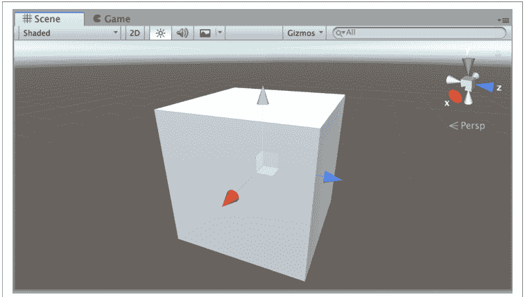

图 1-3. 场景视图

要对选中的对象使用变换控件，请点击并拖动附加在其上的箭头（使用移动工具时）、圆圈（旋转工具）或方块（缩放工具）。按住 Shift 键可将移动、旋转和缩放捕捉到预定义增量。要在场景视图中移动，按视图左上角的调色板中选择手工具，然后点击并拖动。你也可以按住 Alt 键（Mac 上为 Option）使点击并拖动旋转视图；按住 Alt-Control（Option-Command）并拖动将平移视图。你可以使用鼠标滚轮或触控板上的双指手势来缩放。

你也可以快速移动场景视图以聚焦于当前选中的对象。为此，按 F 键。

图 1-4 显示了变换工具与对象被选中时的情况。这里选择了一个摄像机，变换工具处于移动模式。点击并拖动箭头将使选中的对象沿该方向移动。

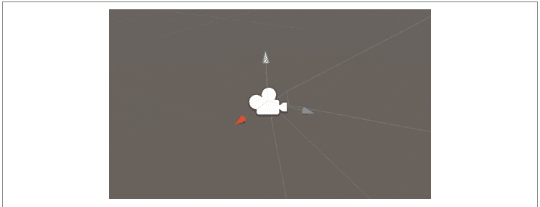

图 1-4. 变换工具与对象被选中

## 游戏视图

游戏视图显示摄像机的视角，并显示如果游戏在 Unity 外部运行时玩家会看到的内容（图 1-5）。除非编辑器处于播放模式，否则游戏视图本身不可交互。

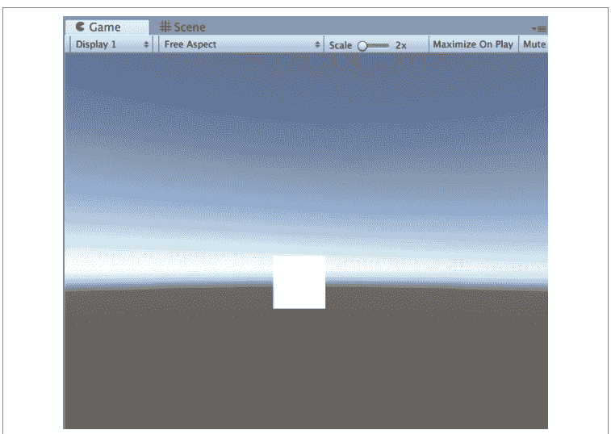

图 1-5. 游戏视图

游戏视图顶部有几个控件，可让你控制游戏的呈现方式：

- *显示菜单*
  让你控制在视图中显示哪个显示器的内容。（在 Unity 中，摄像机可以配置为将结果发送到主屏幕或外部屏幕。）

- *分辨率菜单*
  让你为游戏显示指定纵横比或固定分辨率。

- *缩放滑块*
  让你放大游戏的渲染视图。

- *播放时最大化切换*
  此按钮被选中时，会使游戏进入播放模式时游戏视图填满整个编辑器窗口。

- *静音音频切换*
  此按钮禁用游戏的所有音频播放。（例如，当你不想让游戏音频盖过你在工作时播放的音乐时，这很有用。）

- *统计切换*
  此按钮控制是否在覆盖面板中显示性能统计信息。

- *Gizmos 按钮*
  让你控制 *gizmos*——代表场景中某些对象的图标，如摄像机——是否出现在游戏视图中，就像在场景视图中一样。

## 检查器视图

检查器视图显示当前选中的对象的信息（图 1-6）。从这里，你可以控制附加到游戏对象的每个 *组件*。

图 1-6. 检查器视图

组件是 Unity 工作方式的重要组成部分，这意味着我们将在配方 1.3 中讨论它们，而不是在这里。

在检查器的顶部，你可以设置当前选中对象的名称。你还可以通过点击对象名称左侧的图标并选择一个符号来为对象设置图标。这对于不可见的游戏对象很有用。

默认情况下，检查器会在当前选择更改时更改其内容。如果你不想让它这样做，可以点击检查器右上角的锁定图标，它将保持在当前显示的对象上。

## 层级视图

层级视图显示当前场景中的对象列表（图 1-7）。从这里，你可以浏览场景中的对象列表。如果你选择层级中的一项，它将在场景视图中被选中，反之亦然。你还可以将一个对象拖放到另一个对象上，使其成为该第二个对象的子对象。

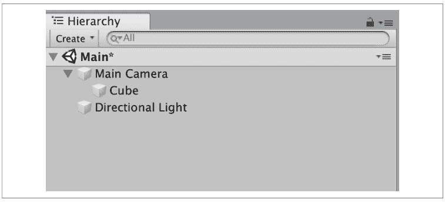

图 1-7. 层级视图

## 项目视图

项目视图显示项目的 Assets 文件夹内容（图 1-8）。文件夹中的任何文件都可见于此处；你也可以移动和重命名文件。

重命名文件时，请在项目视图内进行，而不是在 Unity 外部进行。Unity 通过在每个资源文件旁边创建扩展名为 .meta 的新文件来跟踪资源附加的元数据，例如纹理的导入设置。例如，一个名为 Hero.png 的资源文件旁边会有一个名为 Hero.png.meta 的文件。如果你重命名、移动或删除 Unity 内的资源文件，Unity 也会更新 .meta 文件，但如果你在 Unity 外部重命名、移动或删除资源文件，它就不知道该怎么做，并且必须从头重新创建 .meta 文件（这意味着对该文件的任何引用都会丢失，以及任何导入设置）。

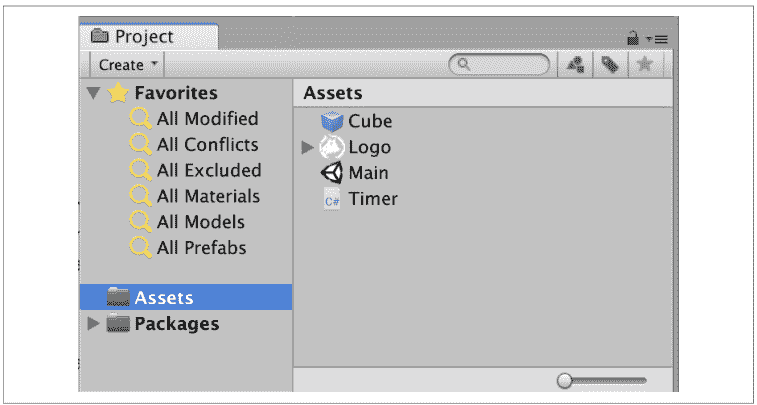

图 1-8. 项目视图

#### 讨论

你可以右键单击任何窗口顶部栏的菜单来关闭它。如果你关闭了一个窗口并想要恢复它，通常可以在 Window 菜单中找到它。如果你真的卡住了，打开 Window 菜单并选择 Layouts → Revert Factory Settings。

### 1.2 使用游戏对象

#### 问题

你想要创建和修改游戏对象，这些对象填充了你的游戏场景。

#### 解决方案

要创建一个新的、空的游戏对象，打开 GameObject 菜单，并选择 Create Empty。一个新的、空的游戏对象将被添加到场景中。它在场景中不可见，因为它没有渲染任何内容的组件。要了解有关组件的更多信息，请参阅 Recipe 1.3。

你也可以按 Command-Shift-N（PC 上为 Control-Shift-N）来创建一个新的、空的游戏对象。

你可以通过选择它并在 Inspector 中更改其名称来重命名游戏对象。

游戏对象可以是其他游戏对象的子对象。当一个游戏对象移动、旋转或缩放时，其子对象也会受到影响。这意味着你可以创建协同工作的游戏对象层次结构；例如，一辆汽车可以将它的四个轮子作为子对象，这意味着当汽车移动时，它们会自动保持在正确的位置。要使一个游戏对象成为另一个游戏对象的子对象，将其拖放到 Hierarchy 中的另一个对象上（参见第 10 页的“Hierarchy view”）。

你也可以通过在 Hierarchy 中拖放来重新排序对象。作为快捷方式，你可以通过按 Command-Equals（PC 上为 Control-Equals）使对象移动到其同级对象的末尾，并通过按 Command-Minus（PC 上为 Control-Minus）使对象移动到其同级对象的开头。

#### 讨论

你也可以通过将资源拖放到 Scene 视图中来创建新的游戏对象。例如，如果你将 3D 模型资源拖放到 Scene 视图中，Unity 将创建一个包含渲染该模型所需组件的新游戏对象。

作为快捷方式，你可以通过打开 GameObject 菜单并选择 Create Empty Child，快速创建一个以当前选定对象为父对象的空游戏对象。你也可以按 Option-Shift-N（PC 上为 Alt-Shift-N）。

### 1.3 使用组件

#### 问题

你想要添加和修改组件，组件控制游戏对象的外观和行为。

#### 解决方案

单独来看，游戏对象只是一个空容器。是组件让游戏对象真正发挥作用。

为了开始思考组件，我们将创建一个带有一些内置有用组件的新游戏对象：我们将向场景中添加一个立方体！

为此，请执行以下步骤：

- 1. 打开 GameObject 菜单，并选择 3D Object → Cube。一个新的立方体将被添加到场景中（图 1-9）。
- 2. 在 Hierarchy 或 Scene 视图中选择新立方体。Inspector 将更新以显示附加到它的组件列表（图 1-10）。

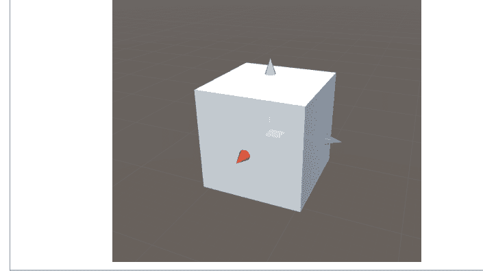

图 1-9. 一个新立方体，刚刚添加到场景中

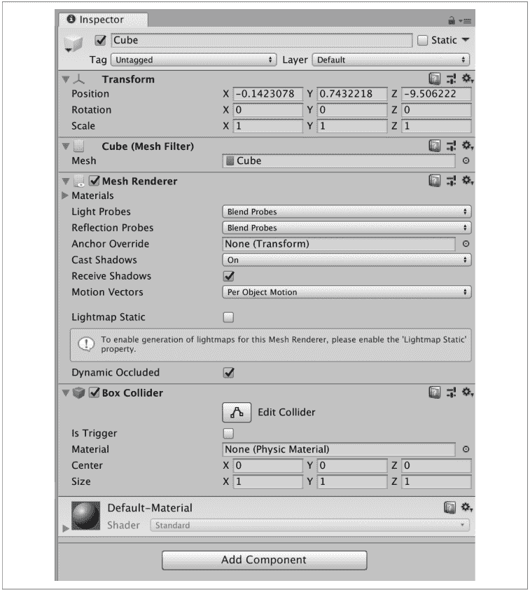

图 1-10. 新立方体的 Inspector

每个游戏对象至少有一个组件：Transform。Transform 组件存储对象的位移、旋转和缩放，并负责跟踪对象的父级。你不能移除 Transform 组件。

在立方体上，你会找到几个额外的组件。它们各自的功能不同：

#### MeshFilter

从磁盘上的文件中加载网格供 MeshRenderer 使用。（对于我们在本教程中添加的立方体对象，资源由 Unity 提供；你游戏中的大多数游戏对象将使用你添加到项目中的资源。）

#### MeshRenderer

使用 Material 资源确定其外观，在屏幕上绘制网格。

#### BoxCollider

定义对象在世界中的物理形状。

组件让你可以通过在 Inspector 中列出的属性来配置它们的工作方式。例如，MeshFilter 组件有一个单一属性：它应使用的 Mesh。这是一个对象字段的示例——它是项目中另一个对象的引用。在 MeshFilter 的情况下，该字段可以接受任何 Mesh 对象；这些对象在你添加到项目的资源中。对象字段可以使用什么类型的对象由组件决定；例如，你不能将除 Mesh 之外的任何其他类型的对象拖放到此字段中。

要自己添加组件，你可以使用 Component 菜单或点击 Inspector 底部的 Add Component 按钮。这两个选项都允许你指定要添加的组件类型。

#### 讨论

你可以通过点击组件右上角的齿轮图标并选择 Remove Component 来移除组件。

要将组件复制到另一个游戏对象，请点击齿轮图标并选择 Copy Component。接下来，前往你要复制组件到的对象，并点击任何现有组件上的齿轮图标（如果没有，请使用 Transform 工具）。点击 Paste Component As New，复制的组件将被粘贴。

脚本（我们在第 2 章中讨论）也是组件，并且与你可能附加到游戏对象的任何其他组件完全相同的方式工作。

### 1.4 使用预制体

#### 问题

你想要将游戏对象存储在文件中，以便可以重用它的多个副本。

#### 解决方案

通常，你添加到场景中的游戏对象完全存储在场景中。如果你想提前定义一个对象，然后制作它的多个副本，你可以将其存储为预制体。预制体是一个存储游戏对象的资源；你可以实例化预制体，这将在你的场景中创建它的副本。

要制作预制体，首先在场景中创建原始对象。例如，通过打开 GameObject 菜单并选择 3D Object → Cube 创建一个新的立方体。该对象将出现在场景和 Hierarchy 中。

接下来，将对象从 Hierarchy 拖放到 Project 视图中。将创建一个新文件（图 1-11）：这就是预制体！你还会注意到 Hierarchy 视图中立方体的条目已变为蓝色，这表明它是预制体的实例。你现在可以安全地从场景中删除原始立方体。

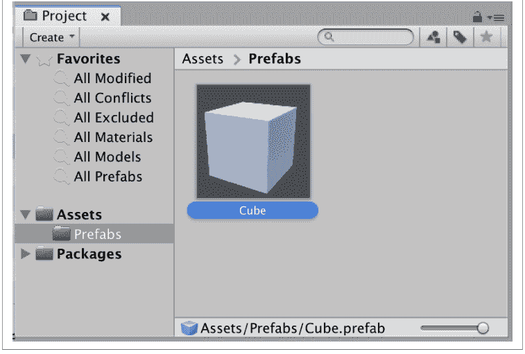

图 1-11. 从立方体创建的新预制体

你可以通过将预制体拖放到场景中来创建预制体的 *实例*。实例是预制体中存储的游戏对象和组件的副本。

通过在 Project 视图中选择文件，点击 Inspector 中的 Open Prefab，然后对其进行更改（图 1-12）来编辑预制体。

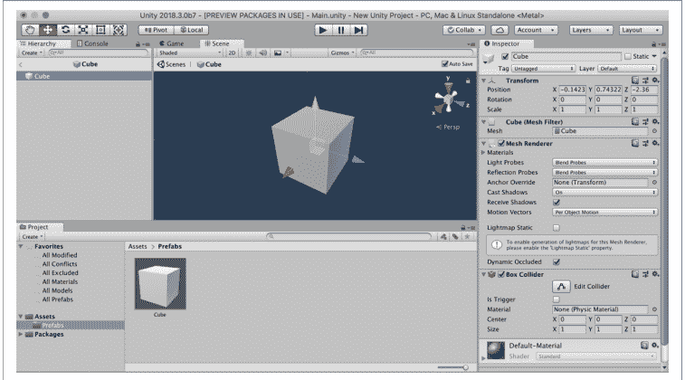

图 1-12. 编辑立方体预制体

完成后，点击 Hierarchy 中的返回箭头按钮。你整个项目中预制体的所有实例都将更新为包含你的更改。

#### 讨论

预制体的实例化副本与其原始版本相关联；如果你对预制体进行更改，更改将应用于其任何实例。默认情况下，反之则不成立：如果你对实例进行更改，更改不会应用于原始版本。例如，如果你将立方体预制体的实例添加到场景并修改其 Scale 属性，更改将仅适用于该实例。此外，你更改的属性将被加粗并带有蓝色线条，以使其更容易看到。

但是，如果你 *确实* 想要应用更改，请右键单击你更改的属性并点击“Apply to Prefab”。如果你想应用所有更改，请打开 Inspector 顶部的 Overrides 菜单并点击 Apply All。

从 Overrides 菜单中，你还可以查看对实例所做的更改的摘要。

### 1.5 使用场景

#### 问题

你想要创建和编辑场景，场景是游戏对象容器的容器。

#### 解决方案

当你创建一个新项目时，Unity 会为你创建一个新的、空的场景。当你按 Command-S（PC 上为 Control-S）时，Unity 会将场景文件保存到磁盘；如果这是场景第一次被保存，Unity 会询问你保存的位置。你可以通过打开 File 菜单并选择 New Scene 来创建更多场景。不要忘记保存新场景以将其存储在磁盘上。

#### 讨论

你可以使用场景用于各种目的。例如，你的主菜单可以存储为一个场景，以及你游戏的每个关卡。在游戏过程中，你可以通过代码加载新场景。我们将在 Recipe 9.1 中讨论这一点。

### 1.6 管理资源

#### 问题

你想要将文件添加到项目中并配置 Unity 如何将其导入为资源。

#### 解决方案

要将文件添加到项目中，只需从 Explorer（Windows）或 Finder（macOS）将其拖放到 Project 视图中。Unity 将导入它并使其可用于你的项目。

当文件被添加到 Unity 项目中时，它被称为 *资源*。

一旦 Unity 导入它，你可以选择该文件并通过查看 Inspector 来配置 Unity *如何* 导入它。不同的文件格式有不同的选项；例如，你可以配置图像被导入为精灵，在这种情况下 Unity 将生成一个额外的精灵数据资源供精灵系统使用（第 5 章讨论），或作为多种不同类型的纹理之一。

#### 讨论

Unity 支持多种文件格式：

*3D 对象*
Autodesk FBX 和 Collada；Unity 还可以导入 Maya、Cinema 4D、3ds Max、Cheetah3D、Modo、LightWave、Blender 和 SketchUp 文件，前提是安装了相应的软件。

*音频*
WAV、MP3、OGG 和 AIFF；Unity 还支持多种 tracker 模块格式——具体来说是 Impulse Tracker（.it）、Scream Tracker（.s3m）、Extended Module File Format（.xm）和 Module File Format（.mod）。

*2D 纹理*
Adobe Photoshop、BMP、PNG、JPG、BMP 和 TGA。

*文本*
TXT 和 JSON。

Unity 会拾取在外部程序中对文件所做的多数更改，但通常依赖于该特定程序已安装。例如，如果你想在 Unity 中将 Blender .blend 文件作为资源使用，则需要在同一系统上安装 Blender 应用程序。

### 1.7 构建 Unity 项目

#### 问题

你希望配置 Unity 构建你的游戏，以便可以将游戏分发给玩家。

#### 解决方案

要构建你的游戏，请通过打开 File 菜单并选择 Build Settings 打开 Build Settings 视图（图 1-13）。

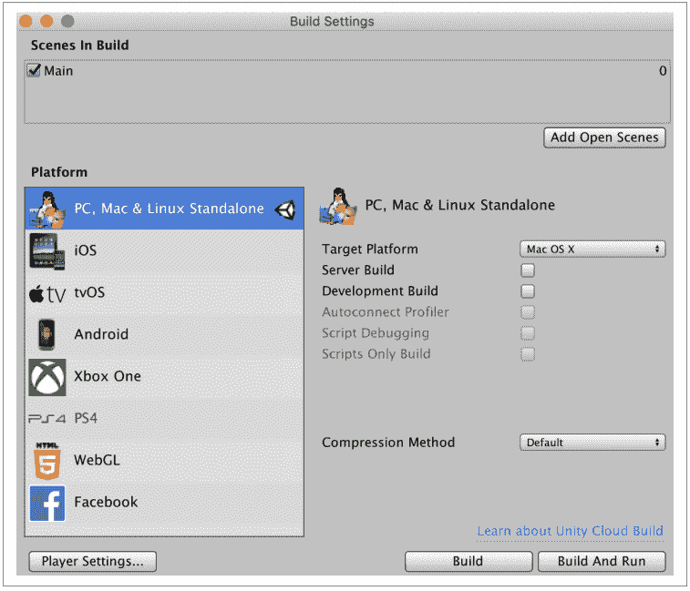

图 1-13. Build Settings 视图

构建游戏时，你需要指定应包含哪些场景。如果尚未保存当前场景，现在应通过打开 File 菜单并选择 Save，或按 Command-S（PC 上为 Control-S）来保存。你可以将要包含的场景拖放到 Scenes In Build 列表中，或点击 Add Open Scenes 按钮以添加当前打开的所有场景。

接下来，你需要选择要构建的目标平台。Unity 支持从桌面 PC 到移动电话再到主机等广泛的平台。一次只能选择一个平台；当前平台会在其旁边标记有 Unity 标志。要为其他平台构建，请选择它并点击 Switch Platform 按钮。

准备就绪后，点击 Build 按钮。Unity 会询问你希望将构建保存到何处；完成后，Unity 将开始构建。

#### 讨论

要为某些平台构建，你需要下载相应的平台支持模块。如果没有必要的模块，你将无法构建；要获取模块，请点击平台并点击 Open Download Page 按钮。你将被带到下载模块的相应网页。

某些平台，如主机，需要特殊许可证；有关更多信息，请参阅 Unity Platform Module Installation 页面。

### 1.8 访问首选项

#### 问题

你希望访问控制 Unity 行为的设置，既针对整个应用程序，也针对当前项目。

#### 解决方案

要打开每个项目的设置，请打开 Edit 菜单并选择 Project Settings。Project Settings 视图将出现（图 1-14）。

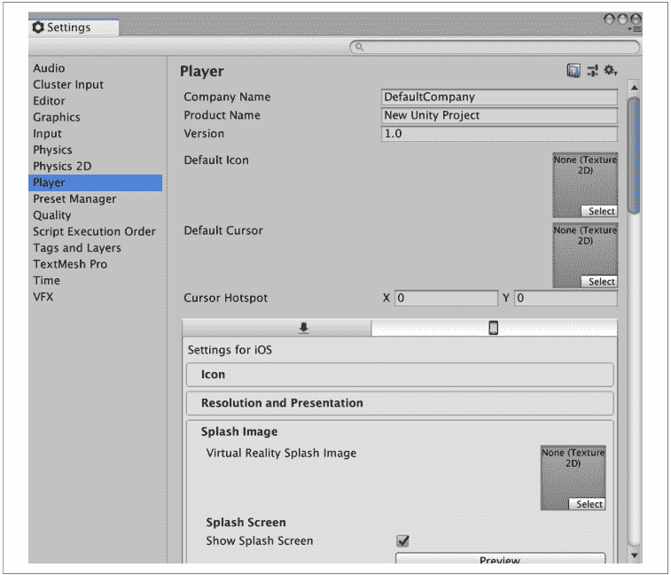

图 1-14. Project Settings 视图

在 Project Settings 视图中，你可以为游戏配置各种可能的设置，包括最大分辨率、构建名称、图形质量设置、输入等。

对于影响整个 Unity 应用程序本身的设置，请访问 Preferences 视图。

#### 讨论

Preferences 视图（图 1-15）允许你配置诸如颜色、热键以及适用于所有项目的其他设置之类的内容。在 PC 上通过打开 Edit 菜单并选择 Preferences 访问这些设置；在 Mac 上打开 Unity 菜单并选择 Preferences。

图 1-15. Preferences 视图

### 1.9 安装 Unity 包

#### 问题

你希望安装一个 Unity 包，以向 Unity 引擎添加额外功能。

#### 解决方案

你可以使用 Unity Package Manager 安装新包（通常会添加新功能）。

包位于特定项目内部。因此，如果你安装了一个包，你就是为当时正在使用的项目安装了它，并且需要为其他项目再次安装。

要找到 Package Manager，请打开 Window 菜单并选择 Package Manager。你可以搜索并安装新包（这些包会从互联网下载）。

#### 讨论

Unity 的 Package Manager 允许各种组件单独分发，并与引擎分开更新。

你可能会看到 Unity Package Manager 被称为“UPM”。

在本书中你将使用一些包，而且如今 Unity 的大多数功能都以包的形式分发。你可以在 Unity 文档中了解更多信息。
