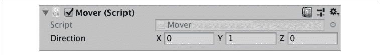
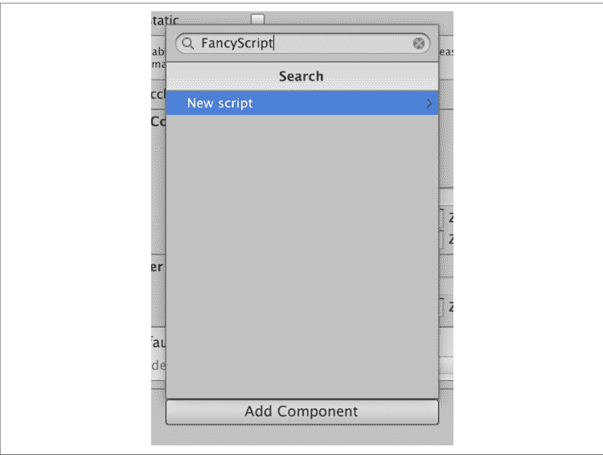
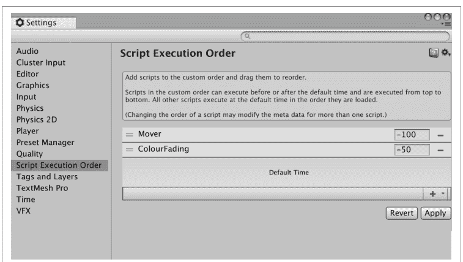
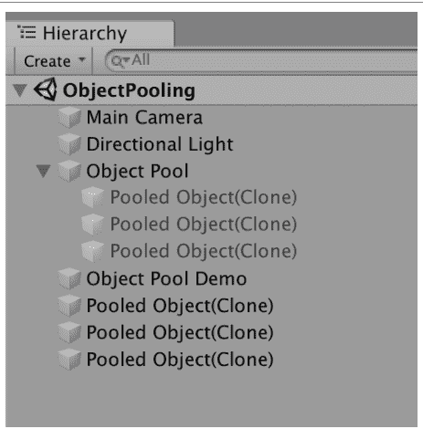
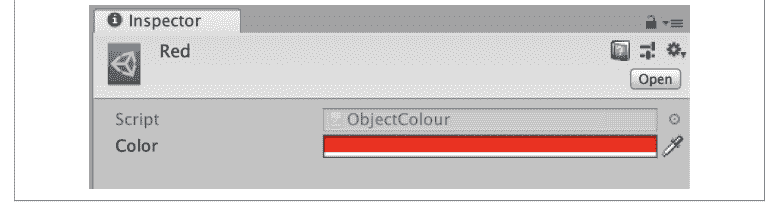
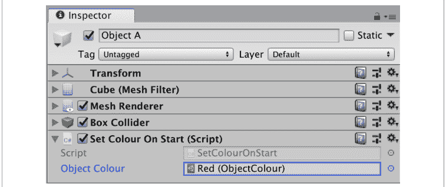

## 第 2 章

## 脚本编写

在 Unity 中创建行为意味着编写代码，或脚本。Unity 中的脚本使用 C# 编写（读作“C sharp”）。C# 最初由 Microsoft 开发，此后已发展为包含一个完整的、极佳的开源实现，Unity 大量使用它。


我们强烈建议你在阅读本章中的任何配方之前先回顾第 1 章！

本书不会试图为你提供编程的完整指南，或 C# 编程的完整指南——那将是另一本书。我们将向你展示如何使用 C# 作为语言为 Unity 编写脚本。


你可以用其他语言在 Unity 中编写代码。例如，有许多其他语言的绑定，并且 Unity 支持一系列视觉脚本工具，我们将在其他章节中涉及，但超出了本书的范围。

如果你有兴趣更广泛地学习 C#，我们强烈推荐 Ben 和 Joseph Albahari 的《C# 7.0 in a Nutshell》（O’Reilly），以及 Andrew Stellman 和 Jennifer Greene 的《Head First C#》（O’Reilly）。

### 2.1 在 Unity 场景中的对象上添加脚本

#### 问题

你希望向游戏对象添加脚本，以便使用 C# 代码赋予它们行为。

#### 解决方案

Unity 游戏对象是 *组件* 的容器。MonoBehaviour——以 Unity 使用的脚本运行时 *Mono* 命名——是一个脚本组件。当 Mono Behaviour 附加到游戏对象时，它会参与游戏的更新循环，并给你在每一帧运行代码的机会。


即使你构建的不是游戏而是模拟，Unity 目前对基本 Unity 对象仍称为游戏对象。因此我们将坚持使用该术语。

要向游戏对象添加代码，你需要创建一个新的 MonoBehaviour 脚本并将其作为组件附加到游戏对象。这意味着你需要一个可用的游戏对象。在 Unity 场景中：

- 1. 通过打开 GameObject 菜单并选择 3D Object → Cube 创建一个新立方体。
- 2. 使用 Move 工具将立方体定位到摄像机前方某处。

接下来，我们将创建一个新脚本：

- 1. 转到 Project 选项卡并右键单击 Assets 文件夹。选择 Create → C# Script。
- 2. 将创建一个新文件，Unity 会提示你为其命名。将文件命名为“Mover”。


Unity 使用你提供的名称来确定文件的内容。编写的 C# 类的名称必须与其所在的文件名相同，因为 Unity 使用该信息来保存场景的内容。如果重命名文件，也请同时重命名其中的类。

3. 双击脚本。Unity 将在你的编辑器中打开它：默认情况下，PC 上为 Visual Studio，Mac 上为 Visual Studio for Mac，或 Linux 上为你的文本编辑器。


你可以通过进入 Unity 的首选项并选择 External Tools → External Script Editor来自定义 Unity 用于编辑脚本的程序。我们特别青睐 macOS 上的 Visual Studio Code 和 BBEdit。

你会看到如下代码：

```
using System.Collections;
using System.Collections.Generic;
using UnityEngine;

public class Mover : MonoBehaviour
{
    void Start()
    {
    }

    void Update()
    {
    }
}
```


Start 在第一帧更新前被调用，Update 在每一帧被调用一次。

4. 修改 Mover 类，使其如下所示：

```
public class Mover : MonoBehaviour
{
    public Vector3 direction = Vector3.up;

    float speed = 0.1f;

    void Update()
    {
        var movement = direction * speed;
```


```
this.transform.Translate(movement);
}
}
```


这段代码对于一个简单的演示来说非常好用，但并不是移动物体的最有效方式。要了解原因并查看更好的方法，请参阅配方 2.3。

这段代码做了几件事：

- 它创建了一个新的公共 Vector3 变量 direction，并将其初始化为 Vector3.up 的值。这是一个等于 (0, 1, 0) 的 Vector3。
- 它创建了一个新的私有 float 变量 speed，并将其初始化为 0.1f 的值。


speed 值末尾的 f 很重要，因为在 C# 中，非整数数字（如 0.1）是 double 类型，而不是 float。这意味着以下代码行会导致编译错误：

```
float speed = 0.1;
```

你需要写成 0.1f 代替：

```
float speed = 0.1f;
```

- 它定义了一个名为 Update 的新方法；在该方法中，创建了一个名为 movement 的变量，其值设置为 direction 与 speed 相乘的结果。然后通过在 transform 属性上调用 Translate 方法来移动物体。

现在我们已经创建了脚本，需要将其作为组件附加到游戏对象上：

- 1. 选择你之前添加的立方体。
- 2. 将 Mover.cs 脚本拖放到 Inspector 上。

Inspector 显示公共变量，允许你对其进行更改。因为 direction 的默认值是 Vector3.up，所以你可以看到其值等于 0, 1, 0（图 2-1）。

- 3. 按下 Play 按钮。物体将开始向上移动。再次按下 Play 按钮即可停止。
- 4. 更改 direction 变量中的某个数字，然后再次按下 Play。你会看到物体以不同的方向或不同的速度移动。



图 2-1. Mover 组件的 Inspector，显示 Direction 变量

#### 讨论

MonoBehaviour 是一个 C# 类。你创建它的子类并实现某些方法，Unity 会在适当的时候调用这些方法；例如，如果你定义了 Update 方法，Unity 将在每一帧调用它，如果你定义了 OnDestroy 方法，Unity 将在对象从场景中移除之前调用它。我们将在配方 2.2 中详细讨论重要的方法。

除了通过编辑器菜单创建脚本外，你还可以通过 Inspector 底部的 Add Component 按钮创建脚本。要这样做，点击 Add Component 并输入你想要创建的脚本的名称。Unity 将尝试按该名称查找组件；它还会提供创建同名脚本的选项（图 2-2）。通过这种方式创建的新脚本会被放置在顶层的 Assets 文件夹中，但创建后你可以将其移至其他位置。

你标记为 public 的变量会出现在 Inspector 中。这些变量也对代码中的其他脚本可访问；如果你希望变量出现在 Inspector 中但不希望其他脚本可以访问它，请移除 public 访问修饰符，并在其上方放置一个 [SerializeField] 属性，如下所示：

```
// 此变量为私有，但由于 SerializeField 属性，它会出现在 Inspector 中
[SerializeField]
float speed = 0.1f;
```

如果你希望变量为 public，但不希望它出现在 Inspector 中，请改用 [HideInInspector] 属性。




图 2-2. 从 Add Component 菜单创建新脚本

### 2.2 在脚本（或游戏对象）的生命周期中特定时间运行代码

#### 问题

你希望在脚本的生命周期中特定时间运行代码。

#### 解决方案

Unity 会在不同时间对你的 MonoBehaviours 调用不同的方法：

#### Start

Start 方法在脚本首次激活的第一帧，为每个对象的每个脚本调用一次。如果脚本在游戏开始时已附加到对象上，则 Start 会在第一帧被调用。

#### Update

Update 方法在每个活动对象的每个脚本上，每帧调用一次，在摄像机渲染场景之前。因为它每帧都被调用，所以它是执行持续发生的任务的最佳时机，例如移动。

#### Awake

Awake 方法与 Start 方法类似，在脚本变为活动时被调用。Unity 保证所有 Awake 方法会在任何 Start 方法开始之前完成；这意味着 Awake 方法是设置脚本之间引用（使用 GetComponent 和 FindObjectOfType，分别在配方 2.4 和 2.5 中讨论）的最佳时机，而 Start 是开始访问这些引用数据的最佳时机。

#### LateUpdate

LateUpdate 方法在 Update 之后被调用。与 Awake 和 Start 一样，Unity 仅在所有脚本都有机会运行 Update 之后才会调用 LateUpdate。这给了你一个机会来应用行为，确保它在其他事情发生之后进行。例如，如果一个对象上的脚本移动它，另一个对象上的脚本使其旋转以看向第一个对象，你应该将移动代码放在 Update 中，将旋转代码放在 LateUpdate 中，以确保旋转代码瞄准正确的位置。

#### 讨论

除了这些常见方法外，还有其他方法可能会根据情况被调用。例如，如果脚本实现了 OnDestroy 方法并且对象被销毁，则会调用 OnDestroy 方法。某些方法只有在同一游戏对象上附加了特定类型的组件时才会被调用。例如，如果脚本实现了 OnBecameVisible 方法并且它附加了 Renderer 组件（如 SpriteRenderer 或 Mesh Renderer），则当对象进入摄像机的视野时，OnBecameVisible 方法将被调用。

这些方法不是从任何父类重写。Unity 检查类，注册类实现了该方法的事实，并直接调用它。

因此，方法是否为 public 或 private 其实并不重要；Unity 仍然会调用它们。作为编码惯例，许多开发者将这些方法设为 private，以防止其他类调用它们，因为只有引擎应该这样做。


你可以通过从类中移除未使用的 Update 方法来潜在地提高帧的性能。有关更多信息，请参阅 Unity 文档。

默认情况下，Unity 不保证不同脚本的方法运行顺序。然而，如果你确实想确保类型 A 的脚本的 Update 方法在类型 B 的脚本之前运行，你可以手动配置它们的执行顺序。要这样做，打开 Edit 菜单并选择 Settings，然后选择 Script Execution Order。从这里，你可以管理某些脚本的执行顺序，确保它们按你想要的顺序排列（图 2-3）。



图 2-3. 配置某些脚本的执行顺序

### 2.3 创建与帧率无关的行为

#### 问题

你希望确保过程在固定时间内进行，而不管项目每秒运行多少帧（称为帧率）。

#### 解决方案

使用 Time 类的 deltaTime 属性来访问渲染上一帧所需的时间，并将其纳入你的计算中：

```
void Update()
{
    var movement = direction * speed;

    // 乘以 delta time；movement 现在表示 '每秒单位'，
    // 而不是 '每帧单位'
    movement *= Time.deltaTime;

    this.transform.Translate(movement);
}
```

#### 讨论

Unity 将尝试以尽可能快的速度运行所有内容，每秒渲染尽可能多的帧（受 GPU 和显示器等各种硬件的限制）。每秒可以渲染的帧数可能会根据场景的复杂性而变化，这意味着每帧所需的时间也可能变化。

这意味着我们可以创建一个简单的 Update 方法，在其中物体每帧移动固定距离：

```
void Update()
{
    var movement = direction * speed;

    this.transform.Translate(movement);
}
```

这种简单代码会导致物体在渲染器能够更频繁渲染时移动得更频繁，在渲染器每秒帧数较少时移动得更少，因为它在每次帧渲染时移动。这导致物体移动速度更快更慢，因为它每秒移动的距离更多或更少。

解决方案是考虑渲染上一帧所需的时间。这可以通过 Time.deltaTime 获得。


希腊字母 delta (Δ) 常用于数学符号中表示值的变化。Delta time 因此是自上一帧以来经过的额外时间。


当你将 movement 乘以 Time.deltaTime 时，movement 不再代表一个固定的距离，而是一个随时间变化的距离。当你将它提供给 transform 的 Translate 方法时，你会发现物体以固定的速度移动，而不管渲染器生成新帧的速度有多快。

deltaTime 并不是你唯一可用的属性。如果你想知道项目运行了多长时间，你可以访问 time 变量。你还可以通过修改 Time.timeScale 属性来减慢和加快时间，这对于暂停项目非常有用。

### 2.4 使用游戏对象的组件

#### 问题

你想要使用附加到游戏对象的组件。

#### 解决方案

使用 GetComponent 方法获取与你的脚本附加在同一游戏对象上的组件。

调用 GetComponent 时，你指定要查找的组件类型作为泛型参数。例如，要获取游戏对象上的 Renderer 组件，你调用方法 GetComponent<Renderer>。


如果游戏对象上没有正确类型的组件，GetComponent 将返回 null。如果你尝试通过调用它的方法或访问其属性和字段来使用此对象，你将导致抛出 NullPointerException，这至少会立即停止脚本的当前帧，最坏的情况会导致整个项目崩溃。始终先检查结果是否为 null。

一旦你获得了对另一个组件的引用，你就可以使用它。例如，如果你有一个 MeshRenderer，你可以通过 GetComponent 访问组件，然后访问其属性，随着时间的推移改变其材质的颜色：

```
public class ColorFading : MonoBehaviour
{
    void Update()
    {
        var meshRenderer = GetComponent<MeshRenderer>();
```

```
// Check to make sure that it's valid before we use it
if (meshRenderer == null) {
    return;
}

var sineTime = Mathf.Sin(Time.time) + 1 / 2f;
var color = new Color(sineTime, 0.5f, 0.5f);
meshRenderer.material.color = color;
}
```

#### 讨论

除了 GetComponent 方法之外，还有许多相关方法可以访问多个组件、访问父对象上的组件或访问子对象上的组件：

- GetComponent<T>
在当前对象上查找类型为 T 的组件

- GetComponents<T>
查找当前对象上所有类型为 T 的组件并以数组形式返回

- GetComponentInChildren<T>
在当前对象或其任何子对象（或其子对象的子对象，进行深度优先搜索）上查找第一个类型为 T 的组件

- GetComponentsInChildren<T>
与 GetComponentInChildren<T> 相同，但查找所有匹配的组件并以数组形式返回

- GetComponentInParent<T>
在当前对象或其父对象（直到顶级对象）上查找第一个类型为 T 的组件

- GetComponentsInParent<T>
在当前对象或其父对象（直到顶级对象）上查找第一个类型为 T 的组件

如果你每帧都会使用一个对象，你可以通过在 Awake 或 Start 中调用 GetComponent（或其相关函数）并将结果存储在类的变量中来稍微提高性能。

例如，这里是之前相同的代码，但有一个不同之处——GetComponent 只在 Start 方法中调用一次：

```
public class ColorFading : MonoBehaviour
{
    // The mesh renderer component will be stored in this after Start
    MeshRenderer meshRenderer;

    void Start()
    {
        // Get the component and cache it
        meshRenderer = GetComponent<MeshRenderer>();
    }

    void Update()
    {
        // Check to make sure that it's valid before we use it
        if (meshRenderer == null) {
            return;
        }

        // meshRenderer has already been stored, so we can just start
        // using it

        var sineTime = Mathf.Sin(Time.time) + 1 / 2f;
        var color = new Color(sineTime, 0.5f, 0.5f);
        meshRenderer.material.color = color;
    }
}
```

### 2.5 查找附加到游戏对象的对象

#### 问题

你想要使用附加到游戏对象的组件，但你不知道哪个游戏对象拥有它们。

#### 解决方案

使用 FindObjectOfType 方法查找单个所需类型的组件：

```
// Find a single Mover object in the scene
var mover = FindObjectOfType<Mover>();
```


如果有多个指定类型的组件，FindObjectOfType 将随机选择一个。随机对象通常按其 InstanceID 的升序选择。例如，对象 -24084 会在对象 -24082 之前返回。

如果你想找到特定类型的所有组件，请使用 FindObjectsOfType，它返回所有组件的数组：

```
// Find all Mover objects in the scene
var allMovers = FindObjectsOfType<Mover>();
```

请注意，与 GetComponent（参见配方 2.4）一样，FindObjectsOfType 如果找不到你要找的内容将返回 null。在尝试使用它们之前，始终检查你的结果是否为 null。


这些方法只会返回当前处于活动状态的对象。它们找不到任何非活动对象。

#### 讨论

FindObjectOfType 通过搜索场景中每个对象上的每个组件来工作。不要在 Update 方法中调用它，因为它会给 Unity 带来大量工作，你不想每帧都这样做。相反，在 Start 或 Awake 时调用该方法，并将结果存储在变量中以供以后使用。

### 2.6 单例

#### 问题

你想要创建一个类，它始终只有一个实例，并且其他代码可以始终访问它。

#### 解决方案

单例是一种设计为永远只有一个实例的类。例如，全局可用的事物，如游戏玩法管理器、输入管理器或其他实用工具，通常实现为单例。

要创建一个，首先创建你的游戏对象，并创建并附加一个新脚本。

接下来，在你的类上创建一个公共静态变量，使用类的类型。然后，在 Awake 方法中，将该变量的值设置为 this，这意味着代码的任何其他部分都将能够引用该类的该特定实例。例如：

```
public class SimpleSingleton : MonoBehaviour
{
    // A 'static' variable is shared between all instances of the class
    public static SimpleSingleton instance;

    void Awake() {
        // When this object wakes up, it sets the instance variable to itself;
        // because the instance variable is public and static, any
        // class from any location can access it and call its methods.
        instance = this;
    }

    // An example method that any other part of the code can call, as long
    // as there's a game object in the scene that has a
    // SimpleSingleton component attached
    public void DoSomething() {
        Debug.Log("I'm the singleton! Hello!");
    }
}
```

你可以通过在类上使用 instance 变量来访问单例实例：

```
// Accessing the singleton and calling a method on it
SimpleSingleton.instance.DoSomething();
```

此单例实例可以从代码中的任何位置访问，只要场景中有一个游戏对象附加了该脚本即可。

#### 讨论

如果你有超过几个单例类，编写 instance 变量和 Awake 方法可能会变得繁琐，重复的代码可能导致意外错误。

你可以通过使用泛型创建更复杂的单例类。以下类设计为被子类化，并提供 instance 方法的自动实现。它还处理设置 instance 变量以指向单个实例的问题——如果脚本已附加到场景中的游戏对象，它将被找到；如果不存在，将创建一个新的：

```
// This class is generic, which means that you can create multiple versions
// of it that vary depending on what type you specify for 'T'.
// In this case, we're also adding a type constraint, which means that 'T'
// must be a MonoBehaviour subclass.
public class Singleton<T> : MonoBehaviour where T : MonoBehaviour
{


// 实例。此属性只有 getter，这意味着代码的其他部分无法修改它。
public static T instance {
    get {
        // 如果我们还没有准备好的实例，通过在场景中查找或创建来获取一个
        if (_instance == null) {
            _instance = FindOrCreateInstance();
        }
        return _instance;
    }
}

// 此变量存储实际的实例。它是私有的，只能通过上面的 'instance' 属性访问。
private static T _instance;

// 尝试查找此单例的实例。如果找不到，则创建一个新的。
private static T FindOrCreateInstance() {

    // 尝试定位一个实例。
    var instance = GameObject.FindObjectOfType<T>();

    if (instance != null) {
        // 我们找到了一个。返回它；它将被用作共享实例。
        return instance;
    }

    // 脚本组件只能存在于附加到游戏对象时，因此要创建此实例，我们将创建一个新的游戏对象，并附加新的组件。

    // 确定单例的名称
    var name = typeof(T).Name + " Singleton";

    // 使用该名称创建容器游戏对象
    var containerGameObject = new GameObject(name);

    // 创建并附加 'T' 的新实例；我们将返回此新实例
    var singletonComponent =
        containerGameObject.AddComponent<T>();

    return singletonComponent;
}
}

你可以通过继承 Singleton 来定义自己的新单例。不要忘记你需要两次指定类的名称——一次是在命名类时，一次是作为泛型参数（尖括号 <> 之间的部分）：

```
public class MoverManager : Singleton<MoverManager>
{
    public void ManageMovers() {
        Debug.Log("Doing some useful work!");
    }
}
```

任何像这样定义的类都可以通过 instance 变量访问。此属性永远不会为 null；如果你没有在场景中设置实例，它将在第一次使用 instance 变量时立即设置：

```
MoverManager.instance.ManageMovers();
```


单例可能很方便，但它们导致的架构可能难以维护。每当一个类调用另一个类的方法时，这就在它们之间创建了架构依赖：你无法在不修改调用该方法的位置的情况下更改或删除该方法。当一个类可以从任何地方轻松调用时，就很容易创建大量调用，这意味着大量依赖。随着代码复杂度的增长，维护变得更加困难。如果你发现自己从许多不同的地方调用单例类，请考虑重新组织代码以减少依赖的数量。

### 2.7 使用协程管理代码运行时间

#### 问题

你想要编写在多帧中执行的代码。

#### 解决方案

在大多数应用程序中，代码旨在尽可能快地运行并立即完成任务。然而，游戏是随时间进行的；球滚下山需要不止一瞬间，游戏玩法通常依赖于定时事件。

在 Unity 中，*协程* 是一种编写随时间进行的代码的方式。协程是一种能够暂时返回，或 *yield* 给系统其余部分，然后在稍后时间恢复的方法。


协程被实现为生成器，使用 C# 的 `yield return` 语法。

协程是任何返回 `IEnumerator` 的方法，并使用 `StartCoroutine` 方法启动。在方法内部，你可以通过 `yield` 返回一个对象来暂时挂起方法的执行，该对象表示你希望 Unity 等待多长时间。

例如，假设你想编写一个执行一些工作、暂停一秒，然后再执行一些工作的 方法。要实现这一点，你将创建一个新方法，使其返回 `IEnumerator`，并在你想要等待一秒的地方，`yield return` 一个 `WaitForSeconds` 对象：

```
IEnumerator LogAfterDelay() {
    Debug.Log("Back in a second!");
    
    yield return new WaitForSeconds(1);
    
    Debug.Log("I'm back!");
}
```


你只能在返回 `IEnumerator` 的方法内部使用 `yield return`。

要启动协程，你使用 `StartCoroutine` 方法。调用你的协程方法并使用其返回值作为 `StartCoroutine` 的参数。Unity 将开始运行协程，并确保在正确的时间恢复它：

```
StartCoroutine(LogAfterDelay());
```

Start 方法也可以是协程。你所要做的就是将其返回类型设置为 IEnumerator，然后你可以在其中使用 yield return：

```
IEnumerator Start()
{
    Debug.Log("Hello...");

    yield return new WaitForSeconds(1);

    Debug.Log("...world!");
}
```

就像任何其他方法一样，协程可以接收参数。例如，给定以下方法：

```
IEnumerator Countdown(int times) {
    for (int i = times; i > 0; i--) {
        Debug.LogFormat("{0}...", i);
        yield return new WaitForSeconds(1);
    }
    Debug.Log("Done counting!");
}
```

你可以通过在启动时提供参数来调用此协程：

// 协程的参数作为函数调用的一部分提供
StartCoroutine(Countdown(5));
```

由于协程将控制权交还给引擎，因此它们可以与无限循环结合使用：

```
IEnumerator LogEveryFiveSeconds() {

    // 进入无限循环，在其中我们等待五秒钟然后做一些有用的事情
    while (true) {
        yield return new WaitForSeconds(5);
        Debug.Log("Hi!");
    }

}
```


在使用 while (true) 或其他永不结束的循环时要小心！如果你在循环中没有某个点进行 yield，Unity 将无法跳出它并会冻结。你将无法退出 Play 模式，也无法保存场景中未保存的更改。要小心！

如果 yield return null，Unity 将在恢复前等待恰好一帧。

例如，以下协程充当帧计数器，并在渲染 100 帧时记录日志：

```
IEnumerator RunEveryHundredFrames() {
    while (true) {
        // Yielding 'null' 将等待一帧。
        yield return null;

        if (Time.frameCount % 100 == 0) {
            Debug.LogFormat("Frame {0}!", Time.frameCount);
        }
    }
}
```

最后，你可以使用 yield break 退出协程：

```
while (true) {
    yield return null;

    // 在第 354 帧停止
    if (Time.frameCount == 354) {
        yield break;
    }
}
```

#### 讨论

在本教程中，我们主要使用 WaitForSeconds。它非常有用，但还有其他对象可以返回以等待不同的时间。

WaitForEndOfFrame 等待所有摄像机渲染完成，但帧显示在屏幕上之前。你可以使用它来，例如，在截图中捕获屏幕内容，确保所有渲染都已完成。

WaitForSecondsRealtime 等待固定数量的秒数，就像 WaitForSeconds 一样。然而，它忽略 Time.timeScale。

WaitUntil 和 WaitWhile 接受一个委托——一个内联函数，或对方法的引用——该委托每帧重复调用以查看是否应继续执行。该函数需要不带参数并返回 bool 值。

WaitWhile 直到你提供的函数返回 false 才会停止：

// 等待此对象的 Y 位置低于 5
yield return new WaitWhile(() => transform.position.y < 5);
```

WaitUntil 直到你提供的函数不再返回 false 才会停止：

// 等待 _直到_ 此对象的 Y 位置低于 5
yield return new WaitUntil(() => transform.position.y < 5);
```


### 2.8 使用对象池管理对象

#### 问题

你有一个项目，其中你会定期创建和销毁对象，并且希望该过程更高效。

#### 解决方案

创建一个*对象池*：一个系统，允许对象在不再需要时暂时停用，并在被请求时重新激活（与对象在不需要时自行销毁、完全从内存中移除的情况相反）。

我们将通过创建一个脚本来实现这一点，该脚本管理一个 GameObject 队列并公开一个名为 GetObject 的方法。当调用 GetObject 时，它会先查看队列中是否有任何未使用且可以回收的现有对象。如果有，一个对象将被从队列中移除并返回；如果没有，则会创建一个新对象。

当对象不再需要时，它会联系创建它的对象池，被停用，并被加回队列，以便将来重复使用。对象在任何时候都不会被销毁；它只是暂时停放以供以后重复使用。

#### 实现系统

为了实现此功能，我们将创建一个执行此行为的新脚本。我们还将创建一个接口，对象可以实现该接口以便在进入或离开队列时收到通知；这是可选的，但对于需要在（重新）进入场景时执行设置的物体很有用：

- 1. 创建一个新的 C# 脚本，命名为 ObjectPool.cs。
- 2. 向其中添加以下代码：

```
public interface IObjectPoolNotifier {
    // Called when the object is being returned to the pool.
    void OnEnqueuedToPool();

    // Called when the object is leaving the pool, or has just been
    // created. If 'created' is true, the object has just been created,
    // and is not being recycled.

    // (Doing it this way means you use a single method to do the
    // object's setup, for your first time and all subsequent times.)
    void OnCreatedOrDequeuedFromPool(bool created);
}
```

3. 更新 ObjectPool 类，使其如下所示：

```
public class ObjectPool : MonoBehaviour
{
    // The prefab that will be instantiated.
    [SerializeField]
    private GameObject prefab;

    // The queue of objects that are not currently in use
    private Queue<GameObject> inactiveObjects = new Queue<GameObject>();

    // Gets an object from the pool. If there isn't one in the queue,
    // a new one is created.
    public GameObject GetObject() {

        // Are there any inactive objects to reuse?
        if (inactiveObjects.Count > 0) {

            // Get an object from the queue
            var dequeuedObject = inactiveObjects.Dequeue();

            // Queued objects are children of the pool, so we move them
            // back to the root
            dequeuedObject.transform.parent = null;
            dequeuedObject.SetActive(true);

            // If there are any MonoBehaviours on this object that
            // implement IObjectPoolNotifier, let them know that this
            // object just left the pool

            var notifiers = dequeuedObject
                .GetComponents<IObjectPoolNotifier>();

            foreach (var notifier in notifiers) {
                // Notify the script that it left the pool
                notifier.OnCreatedOrDequeuedFromPool(false);
            }

            // Return the object for use
            return dequeuedObject;
        } else {

            // There's nothing in the pool to reuse. Create a new object.
            var newObject = Instantiate(prefab);
```

```
// Add the pool tag so that it's able to return to the pool
// when done.
var poolTag = newObject.AddComponent<PooledObject>();

poolTag.owner = this;

// Mark the pool tag so that it never shows up in the
// Inspector. There's nothing configurable on it; it only
// exists to store a reference back to the pool that
// creates it.
poolTag.hideFlags = HideFlags.HideInInspector;

// Notify the object that it was created
var notifiers = newObject
    .GetComponents<IObjectPoolNotifier>();

foreach (var notifier in notifiers)
{
    // Notify the script that it was just created
    notifier.OnCreatedOrDequeuedFromPool(true);
}

// Return the object we just created.
return newObject;
}
}

// Disables an object and returns it to the queue for later reuse.
public void ReturnObject(GameObject gameObject)
{
    // Find any component that we need to notify
    var notifiers = gameObject
        .GetComponents<IObjectPoolNotifier>();

    foreach (var notifier in notifiers)
    {
        // Let it know that it's returning to the pool
        notifier.OnEnqueuedToPool();
    }

    // Disable the object and make it a child of this one, so that
    // it doesn't clutter up the Hierarchy
    gameObject.SetActive(false);
    gameObject.transform.parent = this.transform;

    // Put the object into the inactive queue
    inactiveObjects.Enqueue(gameObject);
}
}
```


这段代码还无法编译，因为 PooledObject 类尚不存在。我们即将添加它。

为了使对象能够返回到创建它们的池中，它们需要对池有一个引用。为了支持这一点，我们将创建一个非常简单的脚本，它没有任何逻辑，并存储对对象池的引用。


由于此脚本实际上不会影响游戏玩法，因此没有理由将其包含在 Inspector 中。这就是 hideFlags 属性控制的内容；通过在 GetObject 方法中将其设置为 HideInInspector，我们告诉 Unity 不要显示它。对于此用例来说很方便，但请注意使用此功能，因为如果看不到组件，很容易忘记组件的存在。你可能会意外编写一个组件，导致一些无法理解的行为，因为你没有意识到该组件的存在。

- 1. 创建一个新的脚本，命名为 PooledObject.cs，并向其中添加以下代码：

```
// A simple script that just exists to store a reference to an
// ObjectPool. Exists to be used by the ReturnToPool extension method.
public class PooledObject : MonoBehaviour
{
    public ObjectPool owner;
}
```

为了简化将 GameObject 返回到对象池的过程，我们将向 GameObject 添加一个方法，使其非常方便。为此，我们添加一个名为 ReturnToPool 的扩展方法；一旦此代码存在，你就可以在任何 GameObject 上调用 ReturnToPool，它将返回到创建它的池。

- 2. 向 PooledObject.cs 添加以下代码：

```
// A class that adds a new method to the GameObject class: ReturnToPool.
public static class PooledGameObjectExtensions {

    // This method is an extension method (note the "this" parameter).
    // This means that it’s a new method that’s added to all instances
    // of the GameObject class; you call it like this:
    // gameObject.ReturnToPool()

    // Returns an object to the object pool that it was created from
    public static void ReturnToPool(this GameObject gameObject) {
```

```
// Find the PooledObject component.
var pooledObject= gameObject.GetComponent<PooledObject>();

// Does it exist?
if (pooledObject == null) {
    // If it doesn't, it means that this object never came from
    // a pool.
    Debug.LogErrorFormat(gameObject,
        "Cannot return {0} to object pool, because it was not" +
        "created from one.", gameObject);

    return;
}

// Tell the pool we came from that this object should be
// returned.
pooledObject.owner.ReturnObject(gameObject);
}
```

我们现在已完成系统的实现。

#### 测试

为了测试，我们将创建两个脚本。一个将使用对象池，另一个将存在以便在延迟后返回自身（这实际上意味着它所附加的对象）到对象池。我们将首先创建对象池：

- 1. 创建一个新的 C# 脚本，命名为 ObjectPoolDemo.cs，并添加以下代码：

```
// An example of using an object pool.
public class ObjectPoolDemo : MonoBehaviour
{
    // The object pool from which we'll be getting our objects
    [SerializeField]
    private ObjectPool pool;

    IEnumerator Start() {

        // Get and place an object from the pool every 0.1-0.5 seconds
        while (true) {

            // Get (or create, we don't care which) an object from pool
            var o = pool.GetObject();

            // Pick a point somewhere inside a sphere of radius 4
            var position = Random.insideUnitSphere * 4;

            // Place it
            o.transform.position = position;
```


// 等待 0.1 到 0.5 秒后再重复执行
var delay = Random.Range(0.1f, 0.5f);

yield return new WaitForSeconds(delay);
}
}
}

此脚本使用对象池创建对象，并在短暂延迟后将其随机放置在场景中。

2. 我们现在将创建在短暂延迟后将自身返回到对象池的脚本。创建一个新的 C# 脚本名为 ReturnAfterDelay.cs，并添加以下代码：

// An example of a script that works with an object pool. This object
// waits for one second, and then returns itself to the pool.
public class ReturnAfterDelay : MonoBehaviour, IObjectPoolNotifier
{
    // Our opportunity to do any setup we need to after we’re either
    // created or removed from the pool
    public void OnCreatedOrDequeuedFromPool(bool created)
    {
        Debug.Log("Dequeued from object pool!");

        StartCoroutine(DoReturnAfterDelay());
    }

    // Called when we have been returned to the pool
    public void OnEnqueuedToPool()
    {
        Debug.Log("Enqueued to object pool!");
    }

    IEnumerator DoReturnAfterDelay() {
        // Wait for one second and then return to the pool
        yield return new WaitForSeconds(1.0f);

        // Return this object to the pool from whence it came
        gameObject.ReturnToPool();
    }
}

请注意，此脚本不会调用 Destroy，而是调用 ReturnToPool。如果它调用 Destroy，其内存将被释放。

我们现在可以设置场景以使用这些脚本。首先，我们将创建要创建实例的物体：

- 1. 通过打开 GameObject 菜单并选择 3D Object → Sphere 创建一个新的球体。
- 2. 将球体命名为“Pooled Object。”
- 3. 将 *ReturnAfterDelay.cs* 脚本拖入 Inspector。
- 4. 将物体拖入 Project 选项卡以将其变成预制体。
- 5. 从场景中删除球体。

接下来，我们将创建对象池本身，并配置它以创建和管理 Pooled Object 预制体的实例：

- 1. 通过打开 GameObject 菜单并选择 Create Empty 创建一个新的空游戏对象。
- 2. 将新对象命名为“Object Pool。”
- 3. 选择该对象，并将 *ObjectPool.cs* 脚本拖入 Inspector。
- 4. 将 Pooled Object 预制体拖入其 Prefab 槽。

最后，我们将创建一个请求对象池生成物体的对象：

- 1. 通过打开 GameObject 菜单并选择 Create Empty 创建一个新的空游戏对象。
- 2. 将新对象命名为“Object Pool Demo。”
- 3. 将 *ObjectPoolDemo.cs* 脚本拖入 Inspector。
- 4. 将层次结构中的 Object Pool 对象从层次结构拖入 Pool 槽。

播放游戏以测试它。球体会出现然后消失。最初，Hierarchy 会显示新对象出现，但过了一会儿数量会稳定下来，因为池中通常有足够的对象来满足对新对象的需求（图 2-4）。当对象返回到池中时，它们会被禁用并暂时成为对象池的子对象，而不是被销毁并释放其内存。



图 2-4. 对象池中的对象

#### Discussion

实例化一个预制体意味着 Unity 需要分配内存。单独来看，这不是问题，但当你考虑内存不再需要时发生的事情的后果时，它就变成了一个问题。Unity 使用垃圾回收器来管理其内存，这意味着任何不再被系统其余部分引用的内存都会定期被追踪并释放。此过程，垃圾回收，相对性能密集，是在构建像游戏这样性能密集的软件时应避免的事情。此外，分配内存本身也不是没有性能成本；它需要 CPU 资源来执行。

为了避免垃圾回收，我们应避免分配和释放内存，而是尽可能重用内存。因此，对象池是一个用于生成和管理对象生命周期的系统，可最大限度地减少分配新对象的需求。当请求一个对象时，池首先检查是否已有已分配但当前未在场景中使用的对象。如果有，它们将被激活，从非活动对象池中移除并返回。如果且仅如果没有非活动对象，才会创建一个新对象。

对象不是通过 Destroy 方法完全销毁，而是返回到池中。为了简化操作，本配方在 Game Object 类上添加了一个扩展方法，这使得将对象返回到池与销毁它一样容易。

### 2.9 Storing Data in Assets Using ScriptableObject

#### Problem

你想将数据存储在资产文件中，以便你的脚本可以访问。

#### Solution

创建 ScriptableObject 类的子类，并在其中添加你想要的属性。

例如，让我们创建一个存储颜色的资产，以及一个使用该资产在游戏开始时设置其渲染器颜色的脚本。我们将首先创建存储颜色的资产：

- 1. 创建一个新的 C# 脚本名为 ObjectColour.cs，并向其中添加以下代码：

// Create an entry in the Asset -> Create menu that makes it easy to
// create a new asset of this type
[CreateAssetMenu]

// Don't forget to change the parent class from 'MonoBehaviour' to
// 'ScriptableObject'!
public class ObjectColour : ScriptableObject
{
    public Color color;
}
[CreateAssetMenu] 属性告诉 Unity 在 Assets → Create 菜单中添加一个新条目，这让你可以创建存储 ScriptableObject 子类实例的新资产文件。

因为对象作为资产存储在磁盘上，所以它可以像模型和纹理等其他资产一样，被拖放到多个场景中其他对象的 Inspector 中。


你可以在 ScriptableObject 中使用任何在 MonoBehaviour 子类中可以使用的变量类型。

- 2. 打开 Assets 菜单，并选择 Create → Object Color。会创建一个新的 ObjectColour 资产。
- 3. 选择它，并转到 Inspector（图 2-5）。你会找到它公开的变量，就像使用 MonoBehaviours 一样。
- 4. 在 Inspector 中设置颜色。



图 2-5. 可脚本化 ObjectColour 资产的 Inspector

我们现在将创建一个简单脚本来使用 ObjectColour 资产。此脚本将获取存储在 ObjectColour 资产中的颜色并用它来修改渲染器的材质：

- 1. 创建一个新的 C# 脚本名为 SetColorOnStart.cs，并向其中添加以下代码：

```
public class SetColorOnStart : MonoBehaviour
{
    // The ScriptableObject that we’ll draw data from
    [SerializeField] ObjectColour objectColour;

    private void Update()
    {
        // Don’t try to use the ObjectColour if it hasn’t been provided
        if (objectColour == null)
        {
            return;
        }

        GetComponent<Renderer>().material.color = objectColour.color;
    }
}
```

- 2. 通过打开 GameObject 菜单并选择 3D Object → Cube 创建一个立方体。
- 3. 将 SetColorOnStart.cs 脚本拖到立方体上。

4. 选择立方体，并将之前创建的 ObjectColour 资产拖到立方体的 Object Colour 槽中（图 2-6）。

5. 运行游戏。立方体会变为资产中存储的颜色。

尝试创建多个使用相同资产的立方体。它们都会使用相同的颜色。



图 2-6. 使用可脚本化对象的对象的 Inspector

#### Discussion

你可以使用此技术将对象的逻辑与其数据分离，并在游戏中的多个不同对象之间重用数据。这种方法还使快速替换对象的整个数据集变得更容易——你只需交换它使用的资产即可。


让玩家对你的游戏拥有控制权，嗯，这很重要！这是互动游戏的核心原则。在本章中，我们将探讨游戏开发者最常见的一些输入需求。幸运的是，Unity 提供了多种输入方法，从键盘和鼠标输入到手柄输入，再到更复杂的鼠标指针控制系统。我们将在此介绍它们。


在本章中，你将同时使用传统的 Input 类，以及 Unity 的新输入系统。它们在现代 Unity 项目中各有其用武之地。

### 3.1 获取简单的键盘输入

#### Problem

你希望以最少的步骤知道用户何时按下键盘上的按键。

#### Solution

使用传统 Input 类的 GetKeyDown、GetKeyUp 和 GetKey 方法来查找正在按下的按键：

```
if (Input.GetKeyDown(KeyCode.A))
{
    Debug.Log("The A key was pressed!");
}
```

```
if (Input.GetKey(KeyCode.A))
{
    Debug.Log("The A key is being held down!");
}

if (Input.GetKeyUp(KeyCode.A))
{
    Debug.Log("The A key was released!");
}

if (Input.anyKeyDown) {
    Debug.Log("A key was pressed!");
}
```

#### Discussion

这些方法在不同时间做出响应：

- GetKeyDown 在本帧按键开始被按下时返回 true。
- GetKeyUp 在本帧按键被释放时返回 true。
- GetKey 如果按键当前被按住则返回 true。

你也可以使用 anyKeyDown 属性来判断是否任意按键被按下，这在你想提示玩家“按任意键继续”时很有用。


Input 类是传统 Input Manager 系统的一部分，该系统可追溯至 Unity 最早的版本。输入操作简单易用，并且在新项目中默认可用，但它存在诸多限制：它不允许自定义按钮到游戏内操作的映射，设置游戏内操作也不算容易，而且你最终需要在其之上构建许多系统。

更好的解决方案是 Unity Input System，它解决了所有这些问题，并且是我们将在本章剩余部分使用的系统。

### 3.2 使用 Unity Input System

#### Problem

你想使用 Unity Input System 来获取用户输入。

#### Solution

从 Package Manager 安装 Unity Input System（Recipe 1.9），按以下步骤操作：

- 1. 通过选择 Window → Package Manager 打开 Package Manager 窗口。
- 2. 将窗口左上角的 Packages 设置从 In Project 改为 Unity Registry。
- 3. 在软件包列表中向下滚动到 Input System，或在右上角的搜索字段中搜索 Input System。
- 4. 从列表中选择 Input System，然后点击 Install 按钮。

Unity 将 Input System 软件包下载并安装到你的项目中。Unity 可能会询问你是否要更新项目设置以使用新的 Input System；选择 Yes，它将重新启动编辑器。

安装 Input System 后，你就可以在代码中使用它了。

例如，我们可以用以下代码重新实现 Recipe 3.1 中的功能，但使用 Input System：

```
using UnityEngine.InputSystem;

if (Keyboard.current.aKey.wasPressedThisFrame) {
    Debug.Log($"The A key was pressed!");
}
if (Keyboard.current.aKey.isPressed) {
    Debug.Log($"The A key is being held down!");
}
if (Keyboard.current.aKey.wasReleasedThisFrame) {
    Debug.Log($"The A key was released!");
}

if (Keyboard.current.anyKey.wasPressedThisFrame) {
    Debug.Log("Some key was pressed!");
}
```

#### Discussion

虽然完全可以直接访问特定的按钮，比如键盘上的按键，但使用用户输入的更好方式是：Input Actions，我们将在下一个配方中介绍。


你可能想要直接访问按钮的地方是为了开发目的。例如，在开发早期阶段，或测试游戏版本时，让特殊开发者键执行游戏中的特殊任务，比如使玩家免疫伤害，会很方便。你通常不会向玩家公开这些功能，因此没有必要将其作为 Input Action 设置，而是直接访问按钮即可。

### 3.3 使用 Input Actions

#### Problem

你想设置 Input Actions，将物理输入映射到游戏内操作。

#### Solution

在 Unity Input System 中，Input Action 是玩家可在游戏中执行的操作（例如移动、跳跃、转向），它由用户可以交互的一个或多个物理控件表示（例如键盘上的 W 键，或手柄上的左摇杆）。

Input Actions 让你能够以游戏中的高层级事物来思考，而不是必须在低层级思考按下特定按钮。更重要的是，因为你可以将多个控件绑定到单个操作上，所以更易于构建针对多种控制方案的游戏。


在按照本配方中的步骤操作之前，请确保已通过 Recipe 3.2 的步骤在项目中安装了 Unity Input System。

为了演示 Input Actions，我们将从创建一个可由用户输入控制的简单场景开始：

- 1. 在一个新空场景中，通过打开 GameObject 菜单并选择 3D Object → Cube 创建一个新立方体。
- 2. 选择新创建的立方体，在 Inspector 中点击 Add Component。输入 CubePlayer，点击“New script”，然后点击 Create and Add。
- 3. 打开新创建的文件 CubePlayer.cs，并用以下内容替换其全部内容：

```
using UnityEngine.InputSystem;

public class CubePlayer : MonoBehaviour
{
    [SerializeField] float moveSpeed = 5;
    private Vector2 moveInput = Vector2.zero;

    public void Update() {
        var movement = new Vector3(moveInput.x, moveInput.y, 0)
            * moveSpeed
            * Time.deltaTime;
```

```
transform.Translate(movement);
}

public void ChangeColour() {
    var color = Color.HSVToRGB(Random.value, 0.8f, 1f);
    GetComponent<Renderer>().material.color = color;
}
}
```

- 4. 保存文件并返回 Unity。


如果你进入 Play 模式，立方体不会做任何事情。我们下一步会解决这个问题！

现在我们有一个准备好响应用户输入的立方体，我们将创建一个接收用户输入并将其发送给立方体的对象：

- 1. 通过打开 GameObject 菜单并选择 Create Empty 创建一个新空游戏对象。将新对象命名为“Player Input”。
- 2. 点击 Add Component 按钮，并选择 Input → Player Input。
- 3. 点击 Actions 字段右侧的选取器（圆形图标），并选择 DefaultInputActions。

DefaultInputActions 是一个预定义的 Input Actions 集合。其中一个预定义操作是“Move”，它绑定到常见的移动相关控件，如键盘上的 WASD 键，以及手柄上的左摇杆。我们将使立方体响应该操作而移动：

- 1. 向 CubePlayer.cs 添加以下方法：

```
public void OnMove(InputAction.CallbackContext context) {
    // Whenever anything happens with this action, get its current value
    // and store it.
    moveInput = context.ReadValue<Vector2>();
}
```

- 2. 保存文件并返回 Unity。
- 3. 接下来，我们将使此方法在 Move 操作状态发生变化时由输入系统调用。首先，选择 Player Input 对象。
- 4. 在 Player Input 组件的 Inspector 中，将 Behaviour 设置为 Invoke Unity Events。
- 5. 底部会出现一个新区域，标记为 Events。打开 Events → Player。
- 6. 点击 Move 事件附带的 + 按钮以添加新条目。
- 7. 将 Cube 对象拖放到对象槽中。
- 8. 将函数下拉菜单从 No Function 改为 CubePlayer → OnMove。
- 9. 按下 Play，并使用 W、A、S 和 D 键移动立方体。

通过此设置，Player Input 组件将调用立方体 CubePlayer 脚本上的 OnMove 方法。此方法接收一个 InputAction.CallbackContext 方法，让代码获取有关接收到的特定输入的信息。Move 操作被定义为包含二维信息的操作（即左右和前后）。在 OnMove 中，我们调用 ReadValue<Vector2> 来获取该数据并存储在 moveInput 变量中。然后在 Update 中使用该变量实际移动立方体。


我们之所以在 Update 中执行实际移动而不是在 OnMove 中，是因为 OnMove 只会在输入发生变化时被调用。如果你按下键盘上的 W 键，OnMove 将被调用一次，当你释放按键时，它会被再次调用。因为我们希望按下 W 意味着开始移动而不是“移动一次”，所以我们需要存储跨越多帧的信息。

如果你有手柄，将其连接到电脑并移动左摇杆。立方体会移动。（你可以使用几乎任何近期游戏商店中可用的控制器。来自热门视频游戏主机如 Xbox、PlayStation 或 Switch 的控制器通常效果更好，因为它们更常见于玩家。）

#### Discussion

默认操作已为 move、look 和 shoot（三个视频游戏动词！）设置了一些通用操作。如果这就是你的游戏所需，太好了！否则，你可以创建自己的。

Input Actions 存储在项目中的资源中，因此如果你想创建新的自定义 Input Actions，你需要创建一个资源来存储它们：

- 1. 选择 Player Input 游戏对象，并转到其上附加的 Player Input 组件的 Inspector。
- 2. 通过点击它并按 Backspace 键清除 Actions 槽。


+   3. 点击 Create Actions 按钮。
+   4. Unity 会询问你想将新资源保存到哪里。将它保存在 Assets 文件夹中的任意位置即可。

Unity 将打开新创建的资源，并且你现在可以看到操作列表。


你也可以通过 Assets → Create → Input Actions 菜单创建新的 Input Actions 资源，但这会创建一个空白集合。通过 Player Input 组件创建可以免去你重新设置所有内容，只要你想向默认集合中添加新操作即可。

默认操作被拆分为两个不同的输入映射：Player 和 UI。


输入映射代表玩家可能处于的不同模式。例如，默认集合有两个：Player 用于常规游戏玩法，UI 用于与用户界面交互。拥有多个输入映射可以让游戏将不同的控制解释为不同的操作；例如，当输入映射设置为 UI 时，左摇杆的含义是“导航 UI”，而不是“移动”。

让我们来看一下 Player 输入映射。它包含三个操作：Move、Look 和 Shoot。每个操作都有若干绑定，它们是与玩家可以交互的物理按钮的连接。例如，Move 绑定到游戏手柄的左摇杆；键盘上的 W、A、S 和 D 键；VR 控制器的主 2D 轴；以及摇杆的摇杆移动。

让我们创建一个新操作——它将是一个 Button（即我们可以获取其按下信息），并且我们将让它改变立方体的颜色：

-   1. 在 Actions 中，点击 + 按钮创建新操作。将新操作命名为“Change Colour”。

注意 Action Type 被设置为 Button。保持该设置即可。还有其他种类操作；例如，Move 操作是 Value 类型，并配置为产生 2D Vector 作为输出。这就是为什么 PlayerCube.cs 中的 OnMove 使用 ReadValue<Vector2>。如果 Change Colour 是 Button，它将在按钮按下和释放时触发事件。

-   2. 新创建的操作开始时带有一个未配置的绑定。让我们设置它。首先，选择 Change Colour 内部的空绑定。

-   3. 打开 Path 下拉菜单，并选择 Keyboard → By Location of Key (US Layout) → C。

Path 下拉菜单让你配置应将哪个特定物理控件绑定到操作。你可以拥有任意多个绑定；例如，如果打开 Move 操作，你会看到大量绑定，每个对应不同种类的输入设备。

By Location of Key 路径允许你指定键盘上的位置。在此示例中，我们将其设置为 US 布局键盘上 C 键所在的位置。

#### Keyboards and the Meaning of Keys

虽然键盘最初设计用于输入文本，但游戏并不以这种方式使用键盘作为控制。设计 PC 游戏控制的游戏设计师通常会选择希望玩家手指位于键盘上的位置，然后反向推导。

毕竟，字母 W 并没有固有特殊之处意味着“向前”，但 W、A、S 和 D 键恰好布局成右手玩家在使用 US QWERTY 布局键盘时，可以舒适地将左手放在键盘上，并方便地访问一组键，这些键恰好适合控制前后和左右移动。然而，如果你将这些操作绑定到特定字母上，使用非该键盘布局的任何人都将处于严重劣势。同时，以“不计功能键的第二行第三个键”这种方式工作也相当繁琐。

By Location of Key 通过指定 US 布局中的键，但表示位置来解决此问题。当你将 Change Colour 操作绑定到 C 键的位置时，该操作将在其他键盘上绑定到该位置对应的键。

值得注意的是，By Location of Key 通常最适合你期望玩家频繁使用并形成肌肉记忆的按钮。如果操作使用频率较低，那么将操作绑定到特定命名键而不是其位置可能更有意义，因为这可以更轻松地按名称找到不常用操作的相应键。

-   4. 将 Use In Control Scheme 设置为 Keyboard & Mouse。这将使绑定在当前控制方案设置为使用这些设备时生效。
-   5. 接下来，我们还将操作绑定到游戏手柄上的一个按钮。在操作列表中，点击 Change Colour 的 + 按钮，并选择 Add Binding。会出现一个新的空绑定。
-   6. 选择新绑定，并将其 Path 设置为 Gamepad → Button South。


几乎所有现代游戏手柄的右侧都有四个呈菱形排列的按钮。这些通常被称为面按钮。South 按钮代表该菱形的底部。不同控制器对这些按钮的命名不同：南按钮在 PlayStation 控制器上是 X 按钮，在 Xbox 控制器上是 A 按钮，在 Nintendo Switch 控制器上是 B 按钮。就像 By Location of Key 用于指定控件的位置而不是名称一样，指定“south button”可以让你引用控制器上按钮的位置。

-   7. 将绑定的 Use In Control Scheme 设置为 Gamepad。


如果你没有可用的游戏手柄，尝试将其绑定到其他东西（例如，鼠标左键）。

-   8. 点击 Save Asset，并关闭窗口。

现在我们创建了新操作并将其绑定到一些控件，我们将让我们的立方体能够响应该操作：

-   1. 向 CubePlayer.cs 添加以下方法：

```
public void OnChangeColour(InputAction.CallbackContext context) {
    // When this action is performed, change color.
    if (context.performed) {
        ChangeColour();
    }
}
```

-   2. 保存文件，并返回 Unity。
-   3. 选择 Player Input 对象，并打开其 Player Input 组件的 Inspector。


当你之前创建新的 actions 资源时，Input Actions 字段被设置为新资源。你可以通过将替换资源拖放到 Input Actions 字段中来更改组件使用的 actions 资源。

-   4. 打开 Events 部分，并选择 Player → Change Colour。
-   5. 点击 + 按钮添加新的接收器。
-   6. 将 Cube 对象拖放到对象字段中，并将函数更改为 CubePlayer → OnChangeColour。
-   7. 在此期间，执行你之前为连接 Move 操作到 CubePlayer 的 OnMove 方法所做的相同步骤；当你更改组件使用的 actions 资源时，该连接会丢失。

进入 Play Mode，并按下键盘上的 C 键或南游戏手柄按钮（或你绑定到 Change Colour 操作的任何其他控件）。立方体将改变颜色。

### 3.4 Locking and Hiding the Mouse Cursor

#### Problem

你希望在游戏中利用鼠标移动，但又不希望屏幕上显示光标。

#### Solution

将 Cursor.lockState 属性设置为 CursorLockMode.Locked 或 CursorLockMode.Confined 以防止鼠标光标离开游戏，并将 Cursor.visible 设置为 false 以使光标不可见：

```
// Lock the cursor to the middle of the screen or window.
Cursor.lockState = CursorLockMode.Locked;

// Prevent the cursor from leaving the window.
Cursor.lockState = CursorLockMode.Confined;

// Don't restrict the mouse cursor at all.
Cursor.lockState = CursorLockMode.None;

// Hide the mouse cursor.
Cursor.visible = false;
```

#### Discussion

在编辑器中，你可以按 Escape 键重新启用鼠标光标并将其从光标监狱中释放。

### 3.5 Responding to Mouseover and Click Events

#### Problem

你希望检测用户将鼠标移过对象时，以及点击它时。

#### Solution

为此，你可以使用 Event System，它能够跟踪屏幕上光标的位置并检测它何时位于场景中的对象上方。要开始使用 Event System，请通过 GameObject 菜单创建一个附加了 EventSystem 组件的对象：

-   1. 打开 GameObject 菜单，并选择 UI → EventSystem。将会创建一个新的 EventSystem 对象。


如果你创建 Canvas，你也会同时创建 EventSystem，因为 UI 系统依赖于我们在本教程中使用的相同技术。


2. 接下来，创建一个射线投射器组件，事件系统将使用它来确定光标下方的对象是什么。射线投射器从摄像机位置沿光标位置向场景中追踪线条，以检测射线击中了什么。如果射线击中了一个碰撞体，则事件系统会向目标对象分派事件。

3. 选择主摄像机对象。

4. 打开组件菜单，并选择事件 → 物理射线投射器。（你也可以通过点击检查器底部的添加组件按钮，然后选择事件 → 物理射线投射器来添加它。）


在本教程中，我们通过利用 3D 物理系统使用 3D 对象。对于 2D 游戏，相同的技术适用，但你需要在摄像机上添加物理 2D 射线投射器而不是物理射线投射器。物理射线投射器仅检测 3D 碰撞体，而物理 2D 射线投射器仅检测 2D 碰撞体。如果你的场景中使用了两种碰撞体类型，两者都可以同时放在你的摄像机上。

5. 接下来，我们将编写一个脚本来检测光标移动到脚本附加到的对象上时，并更改其渲染器的颜色。创建一个名为 ObjectMouseInteraction.cs 的新 C# 脚本。

6. 在类的顶部添加以下 using 指令：

```
using UnityEngine.EventSystems;
```


创建事件系统后，如果你已将项目配置为使用 Unity 输入系统（参见配方 3.2），它会警告你需要将组件更新为与输入系统兼容的组件。要执行此操作，请点击使用 InputSystemUIModule 替换。

为了访问我们处理指针所需的类和接口，我们需要访问 UnityEngine.EventSystems 命名空间。完成此操作后，我们使我们的类符合某些接口，这些接口将 MonoBehaviour 标记为需要了解输入事件的对象。

7. 从代码中删除 ObjectMouseInteraction 类，并将其替换为以下代码：

```
public class ObjectMouseInteraction :
    MonoBehaviour,
    IPointerEnterHandler,  // Handles mouse cursor entering object
    IPointerExitHandler,   // Handles mouse cursor exiting object
    IPointerUpHandler,     // Handles mouse button lifting up on this
                           // object
    IPointerDownHandler,   // Handles mouse button being pressed on this
                           // object
    IPointerClickHandler   // Handles when mouse is pressed and
                           // released on this object
{
}
```

通过实现这些接口，Unity 将在附加对象的输入事件发生时知道联系此脚本。


在本教程中，我们使用的接口比你在实际情况下使用的要多（例如，我们处理指针抬起、按下和点击），但它作为一个很好的演示。这些并不是你唯一可以注册以接收方法调用的事件；请查阅 Unity 文档了解更多信息。

8. 接下来，我们将添加代码以更简单地修改对象的颜色。向 ObjectMouseInteraction 类添加以下变量和方法：

```
Material material;

void Start() {
    material = GetComponent<Renderer>().material;
}
```

9. 最后，我们将添加在光标移动到对象上或点击对象时将被调用的方法。向 ObjectMouseInteraction 类添加以下方法：

```
public void OnPointerClick(PointerEventData eventData)
{
    Debug.LogFormat("{0} clicked!", gameObject.name);
}
```

```
public void OnPointerDown(PointerEventData eventData)
{
    Debug.LogFormat("{0} pointer down!", gameObject.name);
    
    material.color = Color.green;
}

public void OnPointerEnter(PointerEventData eventData)
{
    Debug.LogFormat("{0} pointer enter!", gameObject.name);
    
    material.color = Color.yellow;
}

public void OnPointerExit(PointerEventData eventData)
{
    Debug.LogFormat("{0} pointer exit!", gameObject.name);
    
    material.color = Color.white;
}

public void OnPointerUp(PointerEventData eventData)
{
    Debug.LogFormat("{0} pointer up!", gameObject.name);
    
    material.color = Color.yellow;
}
```

我们现在完成了代码编写，可以将其投入使用。我们将创建一个附加了此组件的立方体；当鼠标与其交互时，它会改变颜色：

- 1. 打开游戏对象菜单，并选择 3D 对象 → 立方体。
- 2. 将新立方体放置在摄像机前方某处。
- 3. 将 ObjectMouseInteraction.cs 脚本拖到立方体上。

播放游戏。随着鼠标在其上移动或点击它，立方体会改变颜色。

#### 讨论

请记住，摄像机的物理射线投射器组件只能“看到”碰撞体。没有碰撞体的对象不会接收这些事件。你还可以通过查看事件系统对象的检查器来调试事件系统。在播放期间，它会显示有关光标所在位置以及当前接收射线投射的对象的的信息（图 3-1）。

图 3-1. 事件系统对象检查器中的调试信息
