## CHAPTER 5

### 2D Graphics

Unity 以其 3D 功能而闻名，但它在处理 2D 图像方面同样出色。在本章中，我们将介绍你需要了解的内容，以便制作面向平面视角的游戏。

本章涵盖的概念并不局限于 2D 项目，我们只是从 2D 角度来探讨它们。本章的配方围绕与 2D 图像相关的概念展开，例如精灵、精灵之间的碰撞、粒子效果和精灵排序。

### 5.1 Importing Images as Sprites

#### Problem

你想将 2D 图像文件作为纹理资源导入项目，并将它们用作精灵。


精灵是 2D 图形对象。术语 *sprite* 基本上被用作任何 2D 图形对象的简写。想要了解该术语的词源，请查看关于精灵的维基百科文章。

#### Solution

要将图像作为精灵导入：

- 1. 将图像拖放到项目中。
- 2. 选择图像并将纹理类型设置为 Sprite (2D and UI)（图 5-1）。
- 3. 单击 Apply。
- 4. 你现在可以用此图像作为精灵。

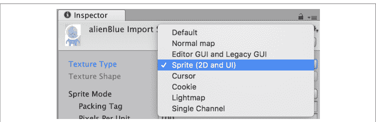

图 5-1. 设置精灵的纹理类型

#### Discussion

如果你的项目是使用 Unity 的 2D 模板创建的，传入的精灵将自动以这种方式设置。否则，图像将作为纹理导入，用于 3D 模型的材质。

你可以通过转到 Edit → Project Settings → Editor 并将 Default Behavior Mode 设置为 2D（图 5-2）使项目以这种方式运行。这会使所有新纹理默认成为精灵。它还会使你创建的任何新场景具有不同的初始对象集——它们不会有光或天空盒。

图 5-2. 将项目的默认模式设置为 2D

### 5.2 Adding a Sprite to the Scene

#### Problem

你想将精灵添加到场景中。

#### Solution

要将精灵添加到场景：

- 1. 首先，确保你的图像已配置为精灵（图 5-1）。
- 2. 将其拖放到场景中。

这样做时，Unity 会为你创建一个名为精灵名称的游戏对象，为其添加一个 SpriteRenderer 组件，并使 SpriteRenderer 显示该精灵。

#### Discussion

Pixels Per Unit 值控制源图像的像素大小与场景中精灵大小之间的关系。如果精灵为 1 像素每单位，则每个像素在宽度和高度上为 1 单位；如果精灵为 100 像素每单位，则每个像素在宽度和高度上为 1/100 单位。

### 5.3 Creating a Sprite Animation

#### Problem

你想创建一个运行动画的精灵。

#### Solution

选择你想要作为动画一部分播放的图像，并将它们拖到场景中。

Unity 将为你执行以下操作：

- 1. 创建一个新的动画控制器资源并将其保存在你拖入的图像资源旁边。
- 2. 创建一个新的动画剪辑并询问你保存位置。动画剪辑将被配置为随时间更新精灵。动画剪辑也将循环。
- 3. 将动画剪辑作为状态添加到动画控制器中。
- 4. 创建一个具有 `Animator` 和 `SpriteRenderer` 组件的新游戏对象。

你可以通过播放游戏来测试动画。

#### Discussion

如果你已经有一个设置了 `Animator` 的对象，你可以为其附加新的动画状态。我们将在第 8 章详细讨论如何执行此操作；3D 动画与 2D 动画之间的唯一区别在于，动画剪辑修改精灵渲染器的 Sprite 字段，而不是 3D 变换的位置。

### 5.4 Creating a Sprite with 2D Physics

#### Problem

你想为精灵添加在二维中工作的物理效果。

#### Solution

要创建具有 2D 物理的精灵：

- 1. 在场景中添加一个具有精灵渲染器的游戏对象。
- 2. 选择游戏对象并单击 Add Component。
- 3. 选择 Physics 2D → RigidBody 2D，或在搜索字段中输入 `RigidBody 2D` 并选择它。

与在三维中工作的常规 `RigidBody` 对象一样，`RigidBody2D` 对象定义物理对象的质量和位置并响应物理力。然而，它们本身并不定义形状。要添加形状，你需要添加一个碰撞体。

#### Discussion

与常规碰撞体一样，对象上不应有多个 2D 碰撞体。如果你想要更复杂的形状，请使用多边形碰撞体或创建具有不同碰撞体的子游戏对象。子对象不需要拥有自己的刚体。

你可以在添加后编辑多边形碰撞体。为此，选择附加了多边形碰撞体组件的对象并单击 Edit Collider 按钮。你现在可以通过拖动它们来重新定位多边形的点，通过单击并拖动点之间的线来添加新点，并通过按住 Control 键并单击一个点来删除该点。

### 5.5 Customizing Sprite Collision Shapes

#### Problem

你想自定义精灵的物理轮廓。

#### Solution

要自定义精灵碰撞形状：

- 1. 选择你想要配置的精灵，并确保 Generate Physics Shape 已打开（图 5-3）。
- 2. 单击 Sprite Editor 按钮。Sprite Editor 窗口将出现。
- 3. 在左上角的下拉列表中，选择 Custom Physics Shape。

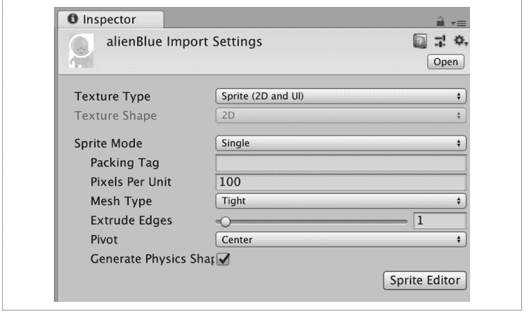

图 5-3. 在精灵纹理的导入设置中启用 Generate Physics Shape 选项

你现在可以开始定义精灵的形状（图 5-4）：

- 1. 单击并拖动以向形状添加新路径。
- 2. 单击路径的点以移动它们。
- 3. 在两个点之间单击并拖动以在它们之间插入新点。（你也可以将鼠标悬停在线上并单击以添加新点！）
- 4. 单击一个点并按 Command-Delete（PC 上为 Control-Delete）以删除它。
- 5. 完成后，单击 Apply。

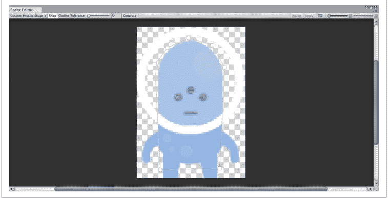

图 5-4. 为精灵创建形状

#### Discussion

物理轮廓用作向具有精灵渲染器的对象添加多边形碰撞体时的默认形状（图 5-5）。如果精灵没有设置物理轮廓，Unity 会使用精灵的透明区域为你生成一个。Unity 通常会尝试创建非常接近的轮廓，这意味着默认形状通常比需要的更复杂。当你自定义精灵的物理轮廓时，你可以为物理系统提供更简单的形状。

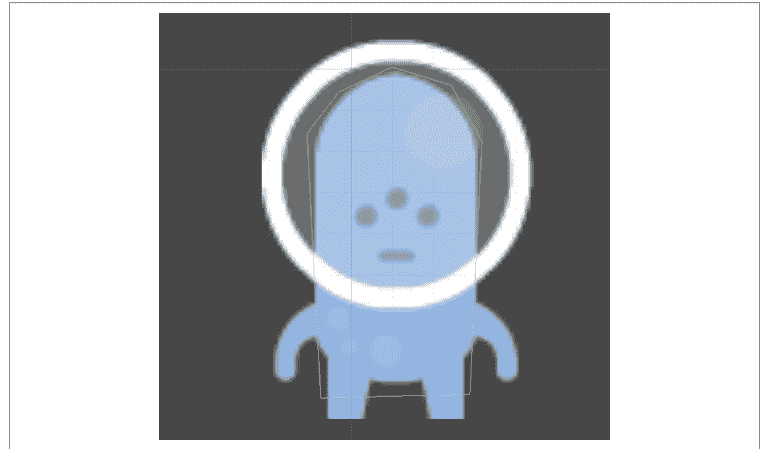

图 5-5. 物理形状的使用情况

### 5.6 Using a Composite Collider

#### Problem

你想将多个 2D 碰撞体合并为一个碰撞体以提高效率。复合碰撞体通过对子游戏对象的碰撞体进行分组来工作。

#### Solution

要创建复合碰撞体：

- 1. 创建具有单独碰撞体的游戏对象。这些可以是任何类型的 2D 碰撞体，例如盒子、多边形或圆形。
- 2. 创建一个空游戏对象，并使其成为具有碰撞体的对象的父级。
- 3. 接下来，向父对象添加一个 CompositeCollider2D 组件。
- 4. 最后，选择子游戏对象并选中 Used By Composite 复选框（图 5-6）。当你选择父对象时，其碰撞体形状将由其子对象的形状组合定义。


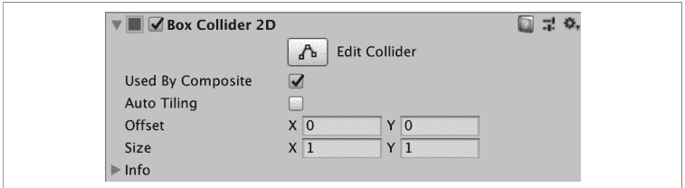

图 5-6. 在碰撞体上启用 Used By Composite 选项

#### Discussion

复合碰撞体可以更高效，并且还能防止两个紧挨着的碰撞体所引起的问题。当两个平面碰撞体彼此相邻时，一个在上面滑动的物体可能会因为大多数物理引擎都存在的精度问题而在它们相接的点处“绊倒”。通过完全移除这个角落即可解决此问题。

图 5-7 显示了此问题的示例。上方的物体未使用复合碰撞体，包含三個按行排列的盒状碰撞体，它们之间的线条可见。下方的物体也有三个按行排列的盒状碰撞体，但配置为复合碰撞体的一部分。它们之间的线条消失了，最终的碰撞体变成了一个没有角落的大矩形形状。

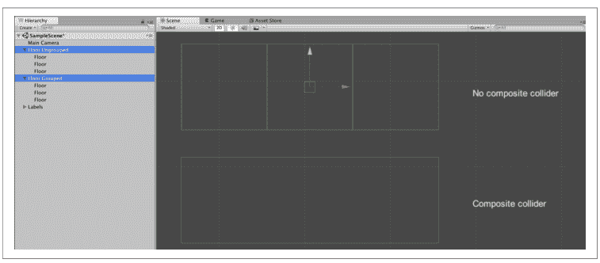

图 5-7. 两组碰撞体：有复合碰撞体和没有复合碰撞体

### 5.7 Using the Sprite Packer

#### Problem

你想将多个精灵打包到单一纹理中以节省浪费的空间。

#### Solution

使用精灵打包器的方法如下：

- 1. 通过打开 Assets 菜单并选择 Create → Sprite Atlas 创建一个新的 Sprite Atlas。
- 2. 将你想要分组的精灵拖到 Objects for Packing 列表中。你也可以拖动文件夹。

#### Discussion

*纹理图集* 是一张包含多个图像的单一纹理。在游戏构建时，Unity 会收集图集中所有的精灵并构建一张将它们全部打包在一起的单一纹理图像；在游戏过程中，当精灵渲染器需要显示其精灵时，就会使用图集中包含所需数据的那部分区域。

纹理图集可以带来更好的性能。如果多个精灵渲染器使用存储在同一图集中的精灵，它们可以同时绘制。此外，打包过程会裁剪精灵的边缘，从而减少存储最终图像所需的内存量。

除了创建图集本身之外，你无需做任何事情来使用图集。精灵渲染器会自动使用图集纹理，如果它们需要绘制的精灵存储在图集中。

### 5.8 Applying Forces to 2D Objects

#### Problem

你想对 2D 物体施加物理力。

#### Solution

你可以通过脚本使用 Rigidbody2D 类的 AddForce 方法对 2D 物体施加力。

下面的脚本演示了如何使用玩家输入对物体施加力：

```
public class AlienForce : MonoBehaviour {

    // The amount of force to apply.
    [SerializeField] float verticalForce = 1000;
    [SerializeField] float sidewaysForce = 1000;

    // A cached reference to the Rigidbody2D on this object.
    Rigidbody2D body;

    // On game start, get the reference to the rigid body and cache it.
    void Start() {
        body = GetComponent<Rigidbody2D>();
    }

    // You will get smoother movement if you apply physical forces in
    // FixedUpdate, because it's called a fixed number of times per second,
    // with a fixed simulation timestep, which means more stable simulation
    void FixedUpdate() {
        // Get user input, and scale it by the amount of force we want to
        // apply
        var vertical = Input.GetAxis("Vertical") * verticalForce;
        var horizontal = Input.GetAxis("Horizontal") * sidewaysForce;

        // Generate a force vector from these inputs, scaled by time
        var force =
            new Vector2(horizontal, vertical) * Time.deltaTime;

        // Add the force to the sprite
        body.AddForce(force);
    }
}
```

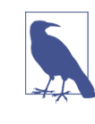

对于如此小的示例来说并不特别实用，但输入通常应该在 Update 中收集，而不是像我们这里这样在 FixedUpdate 中收集。FixedUpdate 可能每帧渲染运行多次，这可能导致你得到额外的输入！

#### Discussion

与在三维中操作的 Rigidbody 组件不同，Rigidbody2D 组件仅在二维中操作。这意味着你施加的所有力都是 Vector2，而不是 Vector3。此外，由于只有一个旋转自由度，你只能在一个轴上施加旋转。

除了用代码施加力之外，你还可以使用 ConstantForce2D 组件（图 5-8）。顾名思义，这些组件会持续对物体施加力。它们适用于你知道某物需要移动但又不需要真正控制它的物体和效果。

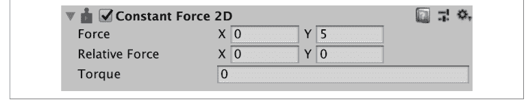

图 5-8. 一个 ConstantForce2D 组件

### 5.9 Creating a Conveyor Belt

#### Problem

你想创建一个推动接触到它的任何物体的物体。例如，你想创建一个传送带。

#### Solution

表面效应器会沿着效应器边缘推动物体施加力。要创建传送带：

- 1. 创建一个新的游戏对象，并为其添加一个 BoxCollider2D 组件。将其命名为“Conveyor Belt”。
- 2. 打开 Used By Effector 设置（图 5-9）。
- 3. 通过点击 Add Component 按钮并选择 Physics 2D → Surface Effector 2D 添加一个 SurfaceEffector2D 组件（图 5-10）。
- 4. 在其上方放置任何带有 RigidBody2D 和 Collider2D 的物体。
- 5. 运行游戏。物体将落到效应器上并被其推动。


如果 Speed 值为正数，物体将被推向右侧；如果 Speed 值为负数，物体将被推向左侧。Speed Variation 值可让你为施加给物体的速度添加随机变化。

图 5-9. 在碰撞体上启用 Used By Effector 选项

图 5-10. SurfaceEffector2D 组件的设置

#### Discussion

效应器与碰撞体协同工作以对物体施加力。当带有 Rigidbody2D 的物体与带有效应器的 Collider2D 碰撞时，效应器会根据效应器的类型和设置对其施加力。 （如果效应器的 Collider2D 组件被标记为触发器，则会对边界内的物体施加力。）

Unity 的 2D 物理引擎中有多个效应器。例如，点效应器可以从空间中的单点吸引和排斥物体，浮力效应器施加向上力以模拟浮力，而平台效应器创建使物体能够单向穿过的力。

### 5.10 Using a Custom Material for Sprites

#### Problem

你想使用自定义材质来绘制精灵。

#### Solution

使用自定义材质为精灵绘制的方法如下：

- 1. 通过打开 Assets 菜单并选择 Create → Material 创建一个新的材质资源。将新材质命名为“Sprite Diffuse”。
- 2. 选择新的精灵，并在 Inspector 顶部将着色器更改为 Sprites → Diffuse（图 5-11）。
- 3. 选择场景中任何带有精灵渲染器的游戏对象，并将你的 Sprite Diffuse 材质拖到其 Material 槽中。它现在将响应光照（图 5-12）。

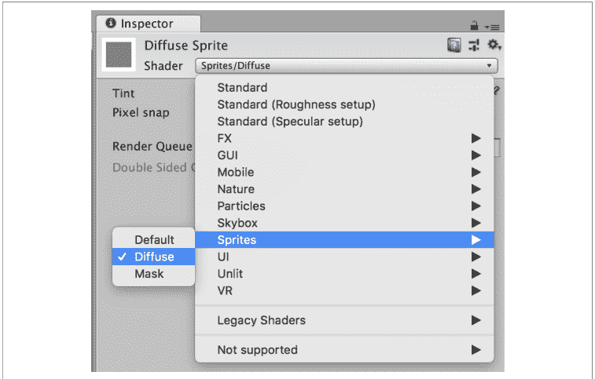

图 5-11. 在材质上选择 Sprites → Diffuse 着色器

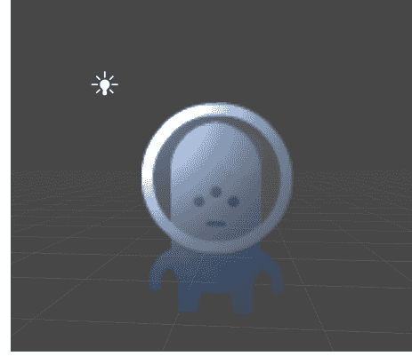

图 5-12. 使用 Diffuse 着色器的精灵

#### Discussion

默认着色器忽略光线——纹理的颜色就是屏幕上使用的颜色（而不是由环境着色）。


如果你计划为精灵添加光照，你应该设计精灵使其非常明亮。除非精灵正好被明亮的光线直射，否则它会比纹理中看起来更暗。

### 5.11 Managing Sprite Sorting

#### Problem

你想确保一个物体在另一个物体前面或后面绘制。

#### Solution

管理精灵排序的方法如下：

- 1. 选择你想要控制绘制顺序的精灵渲染器。
- 2. 更改 Order in Layer 值。精灵渲染器在排序层内按此数字的递减顺序绘制；较大的数字绘制在较小的数字前面。


#### Discussion

Order in Layer 设置控制精灵在其排序图层内的绘制顺序。并且始终至少有一个排序图层，名为 Default，且无法删除。

要创建排序图层，请打开 Edit 菜单，并选择 Project Settings → Tags & Layers。创建你的排序图层，并重新排列它们的顺序（图 5-13）。

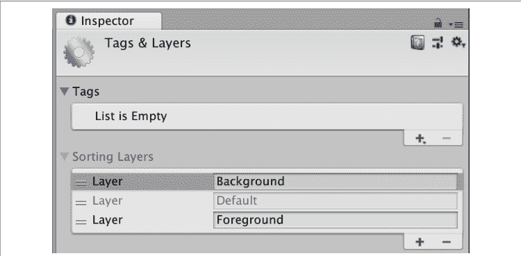

图 5-13. 创建和配置排序图层

使用排序图层可确保大型精灵集合在其他集合之上或之下绘制。例如，你可以创建一个名为 Background 的排序图层，再创建一个名为 Characters 的排序图层；Background 排序图层上的对象始终绘制在 Characters 图层上的对象后面，而不管它们的 Order in Layer 属性如何。

你可以通过在 Inspector 中更改其 Sorting Layer 属性来为精灵渲染器选择一个排序图层（图 5-14）。

排序图层与 Layers 名称相似，但它们是不同的事物。两个对象可以在不同的排序图层上，同时位于同一个图层上。

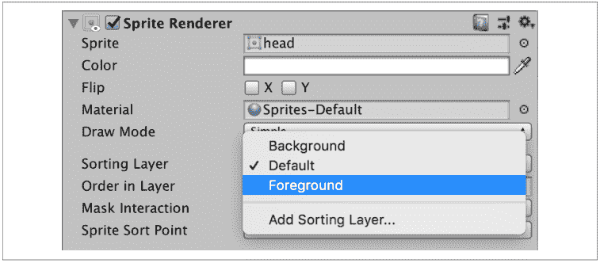

图 5-14. 为精灵渲染器选择排序图层

### 5.12 使用排序组

#### Problem

你想要使用排序组来确保一组精灵一起绘制。

#### Solution

使用排序组来管理精灵的排序顺序：

- 1. 创建一个空的游戏对象。将其命名为“Sprite Group。”
- 2. 为其添加一个 SortingGroup 组件。
- 3. 将你想要保持排序顺序的任何精灵渲染器移动，使其成为此对象的子对象。

精灵现在将保持该顺序，而不管同一屏幕区域中可能存在的其他对象。

#### Discussion

排序组可确保该组的所有成员一起绘制，并且没有任何其他对象可以在它们之间绘制。

例如，图 5-15 和图 5-16 都显示了两个角色，每个角色都由多个其他精灵组成。这些精灵的排序已配置为，例如，头部绘制在身体上方，而其中一只手臂绘制在身体后面。在图 5-15 中，两个角色在其父对象上都有排序组，而在图 5-16 中则没有。这导致各个身体部位错误地重叠到另一个角色上。

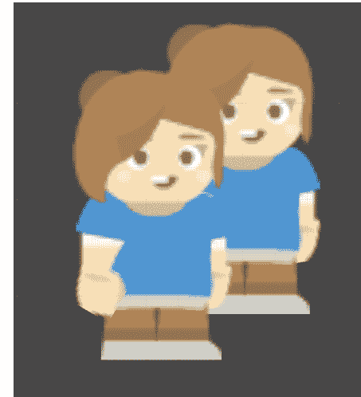

图 5-15. 两个精灵组，每个组在其父对象上都附加了排序组

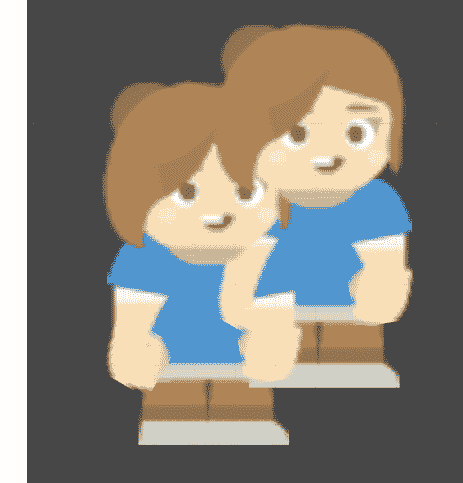

图 5-16. 同样的两个精灵组，排序组已禁用

### 5.13 创建 2.5D 场景

#### Problem

你想要创建一个具有 2D 和 3D 元素混合的场景。

#### Solution

要创建 2.5D 场景：

- 1. 选择你的摄像机并将其 Projection 模式更改为 Perspective。
- 2. 选择你的背景对象并将其移离摄像机更远。

当摄像机从侧面移动时，离摄像机更远的对象会移动得“更慢”，就像 3D 对象（和现实生活中的对象）一样，这会产生深度感。

请注意，当你使用透视摄像机时，你更容易遇到排序问题，尤其是在精灵并非直接面向摄像机时。使用排序组来确保 2D 对象正确排序。

#### Discussion

“2.5” 有很多不同的风格。例如，你可以使用多个平面并获得视差效果，这意味着你的美术资源仍然是平面、绘制的精灵，但玩家会觉得它们存在于更深的环境中。许多游戏都使用这种技术；例如，我们参与制作的一款游戏 *Night in the Woods*，几乎完全由平面精灵组成，但其中一些离摄像机更远。因为摄像机的 Projection 模式设置为 Perspective，远处的物体移动得更慢，这强化了距离感。

另一种技术是将 2D 精灵与 3D 背景结合。例如，在 *Ducktales: Remastered*（Capcom）中，所有角色都是 2D 精灵，但它们在 3D 环境中移动。这对于平台游戏特别有效，因为它突出了你无法穿过的垂直墙壁，并且在摄像机可以上下移动时，暴露了背景的多个视角，从而创造出更加动态的环境。
