## CHAPTER 6
3D Graphics

Unity 因其渲染引擎的视觉质量而变得越来越知名，而其中很大一部分归功于它为艺术家提供的灵活性。在本章中，我们将仔细研究材质、着色器和光照，以及如何构建适合你游戏独特外观的效果。


我们强烈建议你也回顾第 5 章中的配方，以获得更全面的图形主题覆盖。

### 6.1 创建一个简单的材质

#### Problem

你想要通过创建材质来自定义 3D 对象的表面外观。

#### Solution

在本配方中，我们将自定义一个简单的形状，尽管这些步骤适用于你在游戏中最终使用的大多数其他网格：

- 1. 通过打开 GameObject 菜单并选择 3D Object → Sphere 来创建一个新的球体。
- 2. 打开 Assets 菜单，并选择 Create → Material。按你喜欢的名称命名它。
- 3. 选择新材质，并配置其颜色（图 6-1）。
- 4. 将材质拖放到球体上。

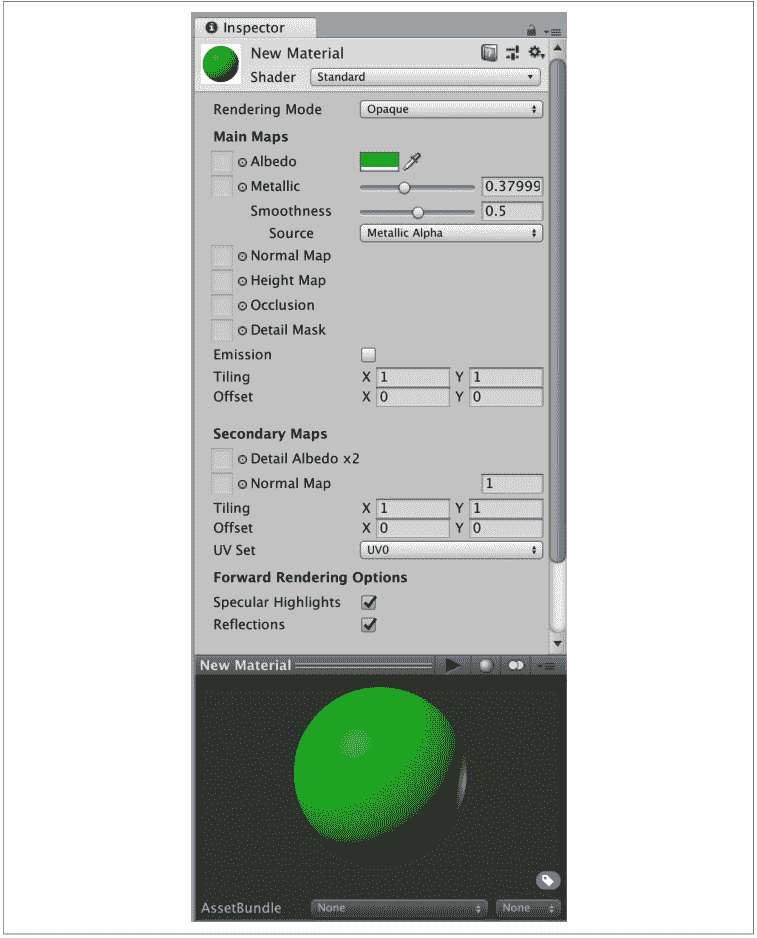

图 6-1. 材质的 Inspector 显示默认 Standard 着色器的可配置属性

#### Discussion

材质对于控制场景中对象的外观至关重要。材质通过组合着色器——即计算构成对象每个像素的最终颜色的程序——与属性——即传递给着色器的输入，与逐像素信息组合——来工作。

大多数时候，你可能会使用 Standard 着色器，它是一个物理基础渲染（PBR）着色器，具有极强的可配置性。你可以指定各种属性，包括 albedo（基础）颜色、法线贴图、自发光度、平滑度和金属度。尝试操作各种属性，看看你的对象材质会发生什么变化。

Standard 着色器并不是唯一的着色器；我们将在本章中探索其中几个，我们也将制作自己的着色器。

### 6.2 通过脚本控制材质的属性

#### Problem

你想要在游戏过程中更改材质的属性，例如其颜色。

#### Solution

当你可以使用 MeshRenderer 或 SpriteRenderer，或任何其他类型的渲染器时，你可以从中访问材质并修改其属性。例如：

```
public class ChangeMaterialColor : MonoBehaviour {

    // The colors we're fading between
    [SerializeField] Color fromColor = Color.white;
    [SerializeField] Color toColor = Color.green;

    // The speed with which we're fading
    [SerializeField] float speed = 1f;

    // A cached reference to the renderer (The 'new' keyword makes the
    // compiler not warn us about the fact that we're overriding an
    // existing property that we inherit from MonoBehaviour; this property
    // is deprecated, so we aren't using it and it's okay to override it)
    new Renderer renderer;
```

```
private void Start()
{
    renderer = GetComponent<Renderer>();
}

private void Update()
{
    // Convert time to a number that smoothly moves between -1 and 1
    float t = Mathf.Sin(Time.time * speed);

    // Convert this to one that moves from 0 to 2
    t += 1;

    // Divide it by 2 to make it move from 0 to 1;
    t /= 2;

    // Interpolate between the two colors
    var newColor = Color.Lerp(fromColor, toColor, t);

    // Apply the new color
    renderer.material.color = newColor;
}
}
```

#### Discussion

你可以访问渲染器使用的材质有两种方式：material 属性和 sharedMaterial 属性。

第一次访问渲染器的 material 属性时，Unity 会创建渲染器当前使用的材质文件的副本，告诉渲染器使用这个新副本并返回它。这是因为如果多个渲染器都使用同一个材质文件，当你更改其中一个时，你可能不希望更改它们全部。

如果你确实想要更改材质的所有使用者，可以使用 sharedMaterial 属性。访问和修改此属性会修改底层材质资源，这意味着使用此资源的所有渲染器都会采用更改。


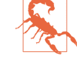

修改 sharedMaterial 属性会修改磁盘上的资源。你在游戏过程中对 sharedMaterial 应用的更改会一直保留，即使离开 Play 模式后也不会消失，而且没有撤销功能。

材质有直接访问常见属性（如颜色或主纹理）的方式。如果你知道要在着色器上修改的属性名称，可以直接通过材质的 SetColor、SetFloat、SetInt 以及相关方法来更改它。有关可用方法的完整列表，请参阅 Material 类的文档。

### 6.3 创建一个非光照材质

#### 问题

你想要创建一个纯色且不参与光照的材质。

#### 解决方案

要创建非光照材质：

- 1. 打开 Assets 菜单，并选择 Create → Material。
- 2. 将着色器设置为 Unlit → Color。
- 3. 将着色器应用到一个对象上，注意它会忽略任何光照条件，只显示为纯色（图 6-2）。

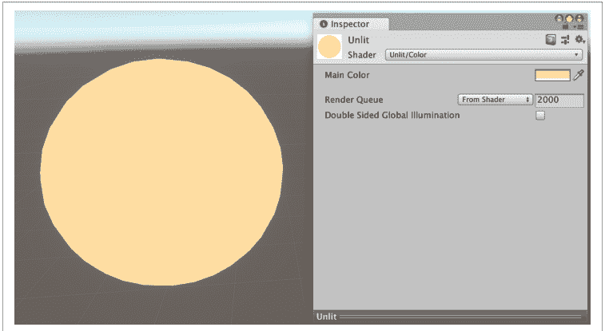

图 6-2. 使用 Unlit → Color 着色器的材质的 Inspector

#### 讨论

当材质使用 Unlit 着色器时，它不会参与光照系统。它不会根据附近的光源进行着色，而是仅使用纯色。这在你不追求准确、逼真外观时非常有用。

### 6.4 使用纹理设置材质

#### 问题

你想要使用纹理来控制材质的外观。

#### 解决方案

材质中的大多数插槽都可以接受纹理而不是纯色。一般来说，大多数现代材质使用多个纹理来定义其表面外观；除了漫反射贴图外，它们还使用纹理来定义法线、粗糙度、环境光遮蔽等。

例如，图 6-3 中显示的七张贴图——漫反射贴图、金属度贴图、粗糙度贴图、法线贴图、高度贴图、遮蔽贴图和细节遮罩——在图 6-4 所示的材质中使用。

图 6-3. 划痕蓝色金属纹理的材质配置

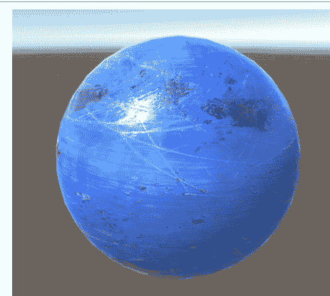

图 6-4. 图 6-3 中的金属材质，在场景中显示

要将纹理附加到材质，只需从 Project 选项卡将纹理拖放到插槽中。材质会立即开始使用该纹理。

#### 讨论

如果你没有自己的纹理可以使用，有许多提供可使用许可的优质免费网站。例如，ambientCG 提供可在知识共享零许可（CC0）下使用的高分辨率纹理，该许可允许你将纹理用于商业和非商业用途。

### 6.5 让材质使用一个着色器

#### 问题

你想要控制材质使用的着色器。

#### 解决方案

你可以通过两种方式做到这一点。

第一个选项是通过打开 Assets 菜单，然后选择 Create → Material 来创建一个新材质。接下来，从 Inspector 顶部下拉菜单中选择你的着色器。

或者，如果你有一个自己创建的着色器资源（例如按照 Recipe 6.10 中的步骤创建），在 Projects 选项卡中选择该着色器并创建材质。材质将使用你选择的着色器。

#### 讨论

材质资源将着色器与配置数据结合起来以实现特定的材质效果。当你从下拉菜单中选择着色器时，Unity 会读取着色器并确定它需要哪些信息——即它用于计算材质应用到对象每个像素颜色的纹理、颜色和其他值。

你可以使用 Unity 自带的着色器，也可以自己制作。我们在本章的多个配方中讨论了使用 Shader Graph 工具创建着色器（例如 Recipes 6.10、6.11 和 6.12）。

### 6.6 使用内置渲染管线的后期处理设置 Bloom 效果

#### 问题

你想要配置一个摄像机以便可以对其应用后期处理效果。


本配方适用于内置渲染管线，不适用于通用渲染管线。

#### 解决方案

首先，确保已为你的项目安装了后期处理栈：

- 1. 打开 Window 菜单，并选择 Package Manager。
- 2. 点击 All 选项卡。
- 3. 找到 Post-processing 包，并点击 Install 按钮（图 6-5）。

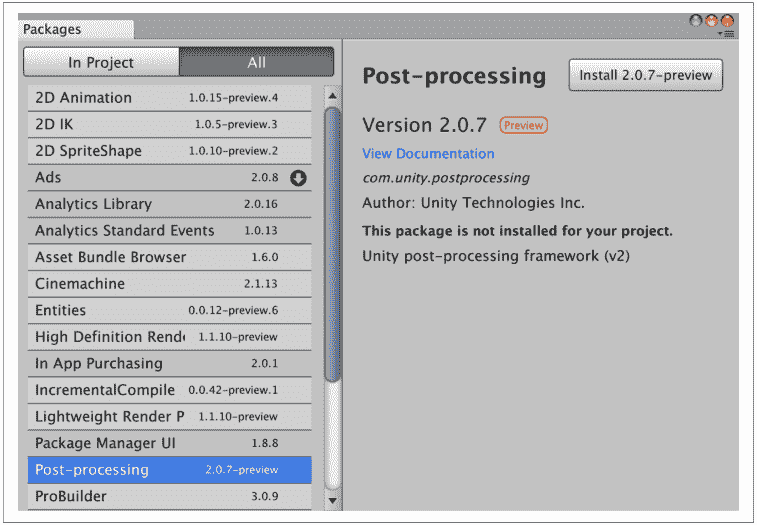

图 6-5. 安装 Post-processing 包

接下来，我们将设置后期处理卷。它控制哪些后期处理效果处于启用状态，以及它们的设置是什么：

- 1. 创建一个新、空的游戏对象。将其命名为“Post Process Volume。”
- 2. 为其添加一个新的 Post-Processing Volume 组件。
- 3. 打开 Is Global 设置。效果将无论摄像机位于何处都应用于摄像机。
- 4. 在 Inspector 的右上角，将 Layer 更改为 PostProcessing（图 6-6）。

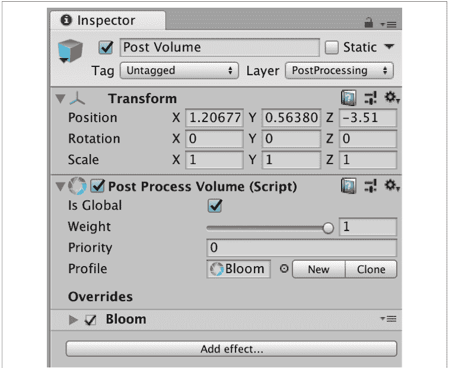

图 6-6. 后期处理卷游戏对象的 Inspector

现在我们将设置配置文件以确定要应用哪些后期处理效果。我们将设置此配置文件以应用 Bloom 效果：

- 1. 点击 Profile 字段旁边的 New 按钮。将创建新的后期处理配置文件资源。选择它。
- 2. 在 Inspector 中，点击 Add Effect 并选择 Unity → Bloom。将添加新的 Bloom 效果。
- 3. 点击 All 按钮以标记你希望覆盖所有默认设置。将 Intensity 设置为 5，将 Threshold 设置为 1.1（图 6-7）。

图 6-7. 后期处理配置文件的 Inspector，已添加并配置了 Bloom 效果

接下来，我们将设置摄像机：

- 1. 选择你想要应用后期处理效果的摄像机（通常是主摄像机）。
- 2. 为其添加一个新的 Post Process Layer 组件。
- 3. 将 Layer 属性设置为 PostProcessing（图 6-8）。

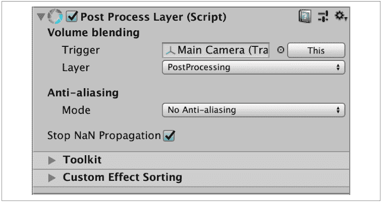

图 6-8. 配置 Post Process Layer 组件以使用 PostProcessing 对象层

Bloom 效果出现：屏幕的亮部会通过“溢出”到附近区域而显得更亮。

#### 讨论

后期处理效果是对渲染器产生的最终或接近最终图像执行的视觉效果。它通过将渲染图像放在一个矩形上，然后在上面运行一个着色器来实现；着色后的结果随后显示在屏幕上或发送到下一个后期处理效果。

有许多不同的后期处理效果；例如，你可以调整最终图像的颜色曲线，应用色调，修改场景曝光，应用景深模糊，或添加暗角。尝试各种效果，看看能实现什么独特效果！

场景中可以有多个后期处理卷。如果它们带有触发器碰撞体，并且 Post Process Layer 的触发器（通常是摄像机，但也可以是任何变换）在碰撞体的边界内，则该卷的设置将生效。这使你可以创建这样的设置：例如，摄像机进入闹鬼房子时，会应用修改场景颜色和色调的后期处理效果，仅在摄像机位于建筑物内时生效。

### 6.7 使用通用渲染管线的后期处理设置 Bloom 效果

#### 问题

你想要配置一个摄像机以便可以对其应用后期处理效果。


本配方适用于通用渲染管线，不适用于内置渲染管线。

#### 解决方案

要使用通用渲染管线通过后期处理设置 Bloom 效果：

- 1. 通过打开 GameObject 菜单并选择 Volume → Global Volume 来创建一个新的 Global Volume。
- 2. 选择新创建的 Volume，并找到 Profile 字段。点击 New 以创建新的后期处理配置文件。
- 3. 点击 Add Override 按钮，并在出现的菜单中选择 Post Processing → Bloom。
- 4. 点击 All，并将 Intensity 设置增加到 1。
- 5. 在 Hierarchy 面板中，选择 Camera。
- 6. 在摄像机的 Inspector 中，找到 Post Processing 设置并将其打开。

你现在可以在 Game 视图中看到 Bloom 效果。

#### 讨论

当你使用通用渲染管线时，后期处理的设置方式与内置管线类似，但略有不同。你不需要下载和安装任何额外的包；后期处理已包含在内。你仍然需要创建一个定义应应用哪些后期处理效果的卷，但它是一种不同类型的对象。你不需要设置任何图层，但需要在摄像机本身上打开后期处理。

可用的后期处理效果与内置管线中的效果相似，但配置方式略有不同。内置管线中并非每个效果在通用管线中都可用，反之亦然。尽管如此，它们之间的相似之处远大于不同之处。


### 6.8 使用高动态范围颜色

#### 问题

你希望在场景中使用高动态范围（HDR）颜色以获得更逼真的效果。

#### 解决方案

首先，要使 HDR 渲染可见，你需要在摄像机上启用 HDR 模式。演示 HDR 渲染用处的一种快速方法是将其与泛光后期处理效果结合使用：

- 1. 选择你的摄像机，并打开 HDR 设置。
- 2. 选择场景的方向光，并将其强度增加到 5（图 6-9）。

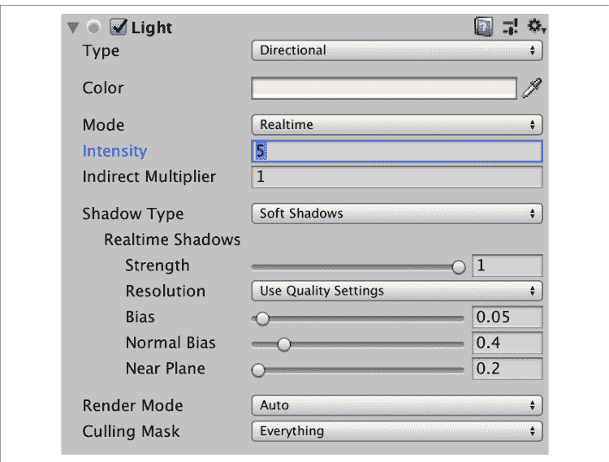

图 6-9. 配置光源使用大于 1 的强度

光的明亮反射会比未面向光源的物体部分显得亮得多（参见图 6-10 和 6-11）。图 6-11 显示的是与图 6-10 相同的镜头，但启用了泛光效果。光看起来会更亮，因为它似乎在“泄漏”。

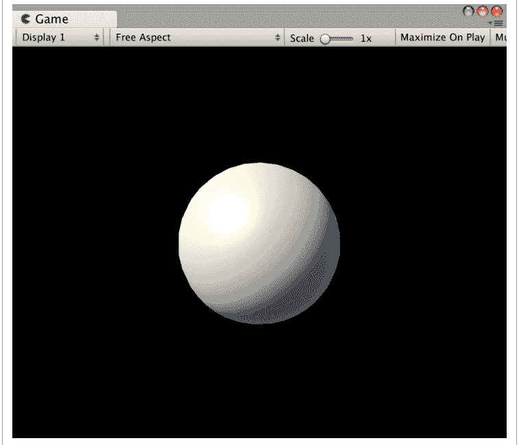

图 6-10. 一个被方向光照亮的物体，泛光效果已禁用

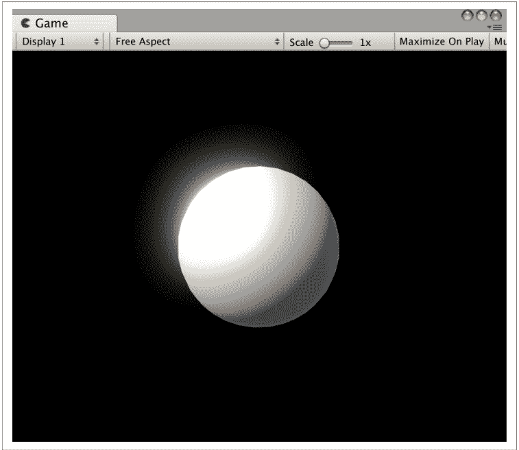

图 6-11. 与图 6-10 相同的镜头，但启用了泛光效果

#### 讨论

HDR 渲染与低动态范围（LDR）渲染不同。LDR 将每个颜色通道（红、绿、蓝）的值限制在 0 到 1 之间，而 HDR 可以高于或低于该范围。这意味着可以实现更宽的曝光范围，并在图像显示前进行处理时提供更大的灵活性。

玩家通过其显示器看到游戏，而显示器的颜色范围有限，这意味着 HDR 图像必须通过一种称为色调映射的过程进行限制。色调映射涉及决定颜色范围的顶部和底部；任何低于底部的颜色级别都会显示为黑色，任何高于顶部的颜色级别都会显示为白色。由于明亮的光线会在相机镜头和人眼的镜头中散射，我们可以通过模糊这些“过亮”颜色来模拟这种效果——换句话说，就是泛光效果。这就是为什么我们将泛光效果的阈值设置为 1.1，这样只有过亮的像素才会应用泛光效果。

### 6.9 设置项目以使用可脚本化渲染管线

#### 问题

你希望使用 Unity 的可脚本化渲染管线（SRPs），它允许更高级的渲染技术和编辑器功能。

#### 解决方案

在本示例中，以及接下来的食谱中，我们将使用通用渲染管线（URP）：

- 1. 打开 Unity Hub，点击 New Project。找到 3D（URP）模板（图 6-12）。
- 2. 你可能需要在使用前下载该模板。点击“Download template”，并等待模板下载完成。
- 3. 为项目命名，然后点击 Create Project。

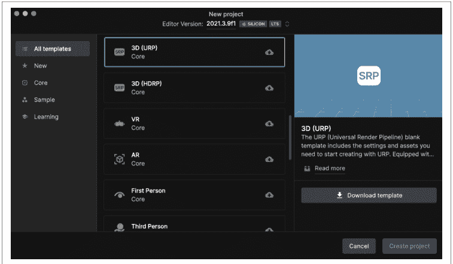

图 6-12. 选择 URP 模板

#### 讨论

在 Unity 中，可以自定义图形系统如何渲染其帧。可脚本化渲染管线系统为图形程序员提供了对引擎应启用或不启用哪些渲染功能的精细控制，这使他们能够满足非常具体的性能和视觉质量目标。

然而，并非我们都是图形程序员。为此，Unity 还提供了两种预定义的管线设置：高清渲染管线（HDRP）和 URP。HDRP 支持先进的图形技术，但需要相当新的硬件（例如现代 PC 和最近的游戏机）。URP 可以在几乎任何设备上运行并实现良好的性能（例如低端 PC、移动设备和旧游戏机），但限制了支持的图形功能。


在本章中，我们将专门关注通用渲染管线。

为一种渲染管线设计的材质和着色器不会适用于其他管线，因为它们依赖于为其设计的渲染管线提供的功能。例如，如果你尝试在通用渲染管线项目中使用为内置渲染管线设计的材质，它将渲染出明亮的纯紫色，表示错误。

除了创建已使用 SRP 的新项目外，你还可以将现有项目适配为使用它：

- 1. 打开 Window 菜单，选择 Package Manager。
- 2. 在窗口左上角的下拉菜单中，选择 Unity Registry。
- 3. 从包列表中选择 Universal RP 包，然后点击 Install。Unity 将下载并安装该包到你的项目中。
- 4. 打开 Assets 菜单，选择 Create → Rendering → URP Asset（with Universal Renderer）。将创建一个新的管线资源；该资源包含项目使用的渲染设置以及一个渲染器。
- 5. 通过打开 Edit 菜单并选择 Project Settings 打开 Project Settings 窗口。
- 6. 选择 Graphics 设置。
- 7. 将你创建的 Universal Pipeline Asset 拖到 Scriptable Render Pipeline Settings 槽中。

请注意，当你开始使用 SRP 时，你需要修改材质以使用为新管线设计的着色器。为此，在 Project 选项卡中选择你的材质，打开 Edit 菜单，然后选择 Rendering → Materials → Convert Selected Built-In Materials to URP Materials。

### 6.10 使用 Shader Graph 创建着色器

#### 问题

你希望使用 Unity 的 Shader Graph 工具创建新的着色器，从而创建自己的自定义材质。

#### 解决方案

通过打开 Assets 菜单并选择 Create → Shader → URP → Lit Shader Graph 创建新的着色器。为新着色器命名。

你将看到一个只有一个节点的全新着色器图（图 6-13）。点击 Save Asset，你的着色器就可以在材质中使用了。

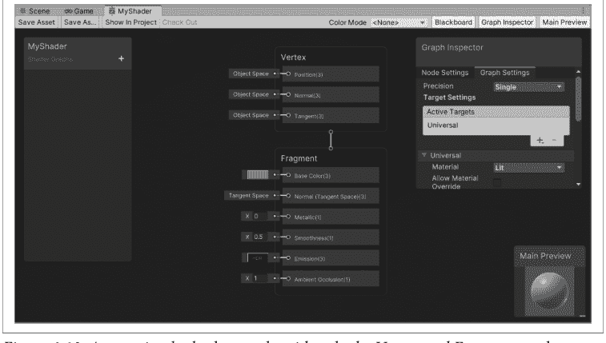

图 6-13. 一个非常简单的着色器图，仅包含顶点和片段节点

#### 讨论

Shader Graph 是构建着色器的可视化工具。着色器通常使用一种名为 ShaderLab 的语言编写，它向 Unity 描述着色器的行为，并包含使用第二种语言 Cg 执行着色所需的具体指令。

ShaderLab 方法功能强大，但使用起来可能有困难，原因有几个。首先，它需要学习至少一种新语言；其次，着色器代码可能难以调试；第三，在创建过程中，很难了解效果是如何在视觉上逐步构建的。

Shader Graph 工具采用了不同的方法。不是编写代码，你连接生成或修改数据的节点。最终结果发送到输出节点，该节点在将片段颜色应用到表面之前执行任何最终光照。


在底层，所有着色器都是一样的。Shader Graph 功能会将你的节点转换为 ShaderLab 和 Cg 源代码，然后编译并像其他着色器一样发送到 GPU。唯一的区别是你编写它们的过程。

### 6.11 使用 Shader Graph 创建发光效果

#### 问题

你希望创建一个使物体边缘发光的着色器。

#### 解决方案

要创建发光效果，我们首先需要考虑我们希望发生什么。物体的“边缘”应该发光；然而，“边缘”的位置取决于摄像机的位置。此外，发光效果应随着远离边缘而平滑淡出。

一种方法是假设物体上任何面向摄像机的部分都不是边缘，任何与摄像机成直角的部分是边缘，介于两者之间的部分则在两个极端之间平滑插值。如果我们将它与一种颜色结合，我们将得到一个漂亮的效果。

幸运的是，有一个内置节点可以为我们处理这种边缘效果，称为 Fresnel Effect 节点。

按照以下步骤创建你的效果：

- 1. 创建一个新的 Lit Shader Graph 资源（参见 Recipe 6.10）。将新资源命名为“Glowing”，并打开它。
- 2. 通过在空白处右键单击或按空格键打开 Create Node 菜单。


3. 定位 Fresnel Effect 节点。你可以通过输入名称或在 Math → Vector → Fresnel Effect 中查找来完成此操作。

Fresnel Effect 节点会产生白色光晕。我们可以通过将其与颜色相乘来为其着色：

- 1. 创建一个新的 Color 节点（同样可以通过搜索找到，或在 Input → Basic → Color 中找到）。将其设置为你想要的颜色。
- 2. 创建一个 Multiply 节点（Math → Basic → Multiply）。
- 3. 从 Color 节点的 Out 插槽点击并拖动到 Multiply 节点的其中一个输入中。
- 4. 从 Fresnel Effect 的 Out 插槽点击并拖动到 Multiply 节点的另一个输入中。
- 5. 将 Multiply 节点的 Out 插槽连接到 Fragment 节点的 Emission 插槽。完成后，着色器图应如下图 6-14 所示。

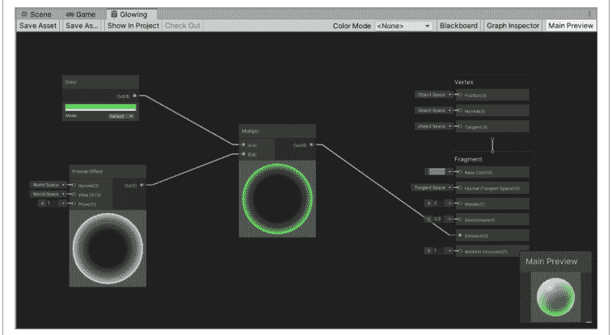

图 6-14。本教程中创建的光晕效果着色器

最后，通过以下步骤创建一个使用此着色器的新材质：

- 1. 通过点击 Shader Editor 顶部 Save Asset 按钮保存着色器。
- 2. 在 Project 面板中，右键单击 Shader，并选择 Create → Material。将新材质命名为有用的名称，例如“Glowing”。
- 3. 材质现在已准备好应用于对象，例如通过将其拖放到对象上。

#### Discussion

Fresnel（发音为“fray-nell”）效果，该着色器利用了这一效果，是观察到从表面反射的光量会根据表面相对于观察者的角度而变化。当角度较浅时——即表面朝向接近与摄像机垂直的方向时——可以看到更多的反射。在此着色器中，我们只是获取表面在任意给定点“反射率”值，而不是实际将其用于反射，而是将该值发送到 Emission 插槽。这在物理上并不真实，但效果可能非常令人愉悦。

如果通过将 Color 属性的 Mode 设置为 HDR 来设置 HDR 颜色，并将其与设置了 Glow 后处理效果的摄像机结合使用（参见 Recipe 6.6），光晕将显得更逼真地明亮（图 6-15），因为非常明亮的物体在与镜头交互时会产生一种泛光效果（在摄像机和人眼中都是如此）。

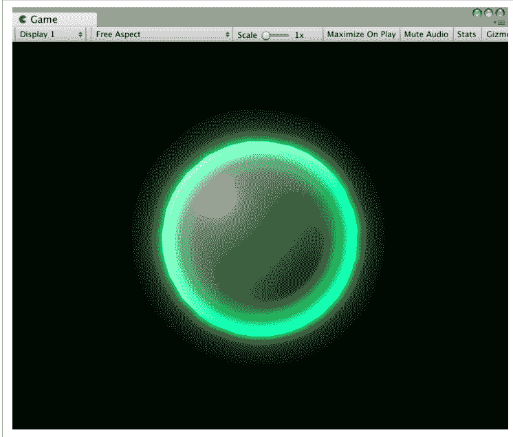

图 6-15。应用于场景中物体的光晕效果

### 6.12 Exposing Properties from a Shader Graph

#### Problem

你想要从着色器图中公开一个属性，以便在不创建和使用全新着色器的情况下修改使用该着色器的材质。

#### Solution

要定义一个属性，首先需要使用 Blackboard 面板创建它。Blackboard 列出了与着色器关联的所有属性：

- 1. 如果尚未打开，请通过点击 Shader 编辑器右上角的 Blackboard 按钮打开 Blackboard。
- 2. 点击着色器中 Blackboard 面板右上角的 + 按钮（图 6-16）。
- 3. 选择要创建的属性类型。将会创建一个新属性；你可以将其拖出到着色器图中，它将作为一个节点出现。

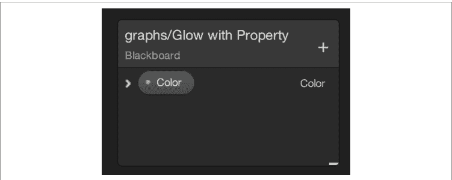

图 6-16。场景图中 Blackboard 面板

一旦属性节点进入你的着色器图，你就可以将其连接到任何其他节点的输入并像使用任何其他值一样使用它。唯一的区别是属性可以从材质中控制。

#### Discussion

属性会出现在使用此着色器的任何材质的 Inspector 中。它们是自定义材质外观的主要方式；如果没有属性，你的着色器使用的所有值都将是固定的且不可编辑的。


你可以通过在 Blackboard 面板中双击它来重命名任何属性。

你也可以右键单击着色器图中任何现有的 Input 节点并将其转换为属性节点（图 6-17）。这使得构建着色器更容易，因为你可以先使用固定值，然后再决定是否要将其公开为属性。

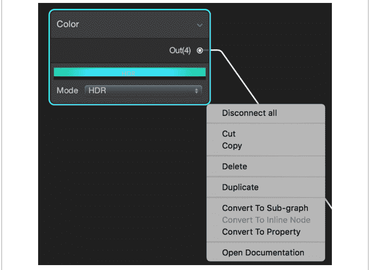

图 6-17。将 Input 节点转换为属性

### 6.13 Animating a Shader over Time

#### Problem

你想要创建一个随时间自动动画的着色器。例如，你想要创建一个明暗交替的光晕效果。

#### Solution

使用 Time 节点，该节点公开了自游戏开始以来经过的时间的各种表示：

- 1. 从图 6-10 中创建的 Glow 着色器开始。
- 2. 添加一个 Time 节点（Input → Basic → Time）。

Time 节点公开了一个 Sine Time 输出，即当前时间（以秒为单位），经过 Sine 函数处理（产生从 -1 到 1 的正弦波）。

为了创建一个从 0.2 到 1 的淡入淡出效果（即轻微光晕到完全光晕），我们将使用一个 Remap 节点：

- 1. 添加一个 Remap 节点（Math → Range → Remap）。
- 2. 将其 In Min Max 值设置为 -1 和 1。（这是它期望接收的值范围。）
- 3. 将其 Out Min Max 值设置为 0.2 和 1。（这是它将发出的值范围。）
- 4. 将 Time 节点的 Sine Time 输出连接到其 In 端口。
- 5. 创建一个新的 Multiply 节点。
- 6. 将 Remap 节点和原始 Multiply 节点（即乘以 Color 和 Fresnel 效果的节点）连接到新的 Multiply 节点。
- 7. 将新的 Multiply 节点连接到 Fragment 节点的 Emission 插槽。

完成后，图应如下图 6-18 所示。

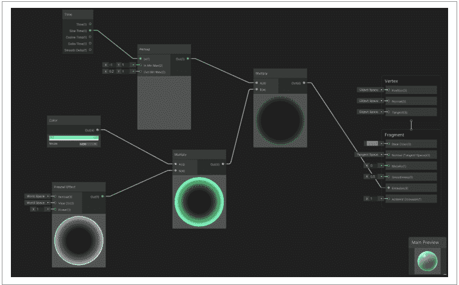

图 6-18。随时间动画完成的着色器图

当你播放游戏时，光晕会随时间明暗交替。

#### Discussion

在此着色器中，Remap 节点是必要的，因为 Sine Time 节点产生的值范围为 -1 到 1，而 Emission 值期望的值为 0 或更高。虽然可以提供负数，但看起来会非常糟糕。为了解决这个问题，Remap 可以调整值，使其落在 0 到 1 之间。

对于此着色器，我们还采用了艺术上的自由，将最小值设置为 0.2 而不是 0，因为我们觉得完全没有光晕看起来很奇怪。Shader Graph 工具最有用的功能之一就是能够调整和微调你的着色器，直到获得所需的结果，因此不要害怕尝试。

### 6.14 Controlling the Speed of an Animated Shader

#### Problem

你有一个使用 Time 节点随时间改变值的动画着色器，并且你想要使其更快或更慢。

#### Solution

要控制动画着色器的速度：

- 1. 如图 6-18 中使用 Time 节点。
- 2. 创建一个新的 Multiply 节点。
- 3. 将 Time 节点的 Time 输出——不是 Sine Time，也不是其他输出——和一个 Float 输入或属性连接到 Multiply 节点。如果想使其更快，将 Float 设置为大于 1；如果想使其更慢，将其设置为小于 1；如果想使其反向，将其设置为小于 0。
- 4. 将 Multiply 节点的输出连接到一个新的 Sine 节点（Math → Trigonometry → Sine）。
- 5. 将你的 Sine 节点的输出用作任何其他动画一样使用。

#### Discussion

在 Shader Graph 工具中，Vector1 属性与浮点数相同——它是一个只有一个分量的向量，与普通数字相同。

在此着色器中，我们将时间——即自游戏开始以来的秒数——乘以一个常数值，然后取其正弦。Time 节点提供了一个 Sine Time 输出，但我们不能将其用于相同目的——如果我们将该值乘以一个常数，它不会振荡得更快，而是会跨越更宽的范围。这在图 6-19 中有所说明，其中虚线为时间的正弦（y = sin(t)），以正常范围和速率振荡；实线为 2 倍时间的正弦（y = sin(2t)），以正常范围但双倍速率振荡；点线为时间的正弦的 2 倍（y = 2 * sin(t)），以宽范围和正常速率振荡。


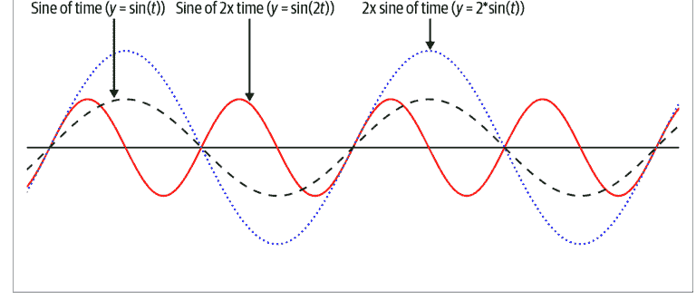

Figure 6-19. Oscillation ranges and rates

### 6.15 Using a Subgraph to Reuse Graph Components

#### Problem

You want to simplify your shader graphs by reusing common patterns of nodes.

#### Solution

Use a subgraph, which is a collection of nodes that you can store in a file and reuse in other graphs. Subgraphs appear as a single “node” in your graphs.

To create a subgraph, follow these steps:

- 1. Open the Assets menu, and choose Create → Shader Graph → Sub Graph.
- 2. Open the Graph Inspector by clicking the Graph Inspector button at the top right of the Shader Graph window.
- 3. Add outputs to the Output node by clicking the + button and creating new outputs.
- 4. Construct your nodes just as if you were making a shader. The difference is that, rather than the output being sent to a Fragment node to perform lighting calculations, the result will be exposed as outputs of the node when the subgraph is embedded in another shader. When you drag and drop the output of a node onto a slot, the slot will take on the type of the incoming value.

To use the subgraph, save it, open a shader that you want to use it in, and press the space bar to open the Node menu. Type the name of your subgraph, and it will appear as a new node.

#### Discussion

It’s very easy for a node-based system to become overly complicated, and subgraphs are essential for keeping things organized.


Subgraphs can have properties, just like other shaders. Any properties that you create will appear as inputs to the subgraph.

For example, Figure 6-20 shows a subgraph that generates a solid color that fades between black and white, with a speed that’s configurable via a property. Figure 6-21 shows the subgraph in use within another shader. The subgraph node is at the lower left; as it has a Speed property, that value appears as input to the node.

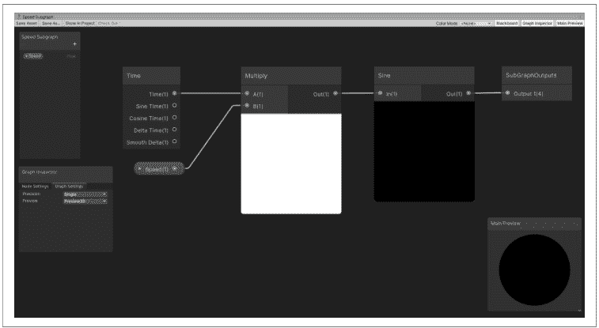

Figure 6-20. A subgraph that generates a solid color fading between black and white

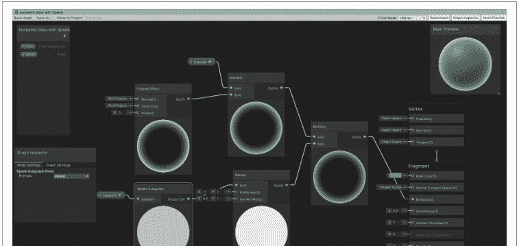

Figure 6-21. The subgraph in use within another shader

### 6.16 Implementing a Dissolve Effect Using a Shader Graph

#### Problem

You want to create an effect in which parts of the object gradually disappear. You want the edges of the effect to glow.

#### Solution

Follow these steps to construct a shader in the Shader Graph tool that achieves this effect:

- 1. Create a new Lit URP shader graph by following the instructions in Recipe 6.10. Name the new shader graph “Dissolve.”
- 2. Open the Graph Inspector, and go to the Graph Settings tab. Scroll down to Surface Type, and change it from Opaque to Transparent. Next, turn on Alpha Clipping.

This will add two new ports to the Fragment node, called Alpha and Alpha Clip Threshold. When the Alpha value of a fragment is below Alpha Clip Threshold, the fragment will not be rendered.

- 3. Create three properties (see Recipe 6.12): a Color called Edge Color, a Float called Dissolve Amount, and a Float called Edge Thickness. Drag all three properties out into the graph, so that each has its own node.
- 4. Select the Dissolve Amount property, and in the Node Settings tab of the Graph Inspector, set its Default value to 0.5.
- 5. Select the Edge Thickness property, and set its Default value to 0.05.
- 6. Select the Edge Color property, and set its Default value to a bright blue with an alpha value of 100.
- 7. Create a Simple Noise node (Procedural → Noise → Simple Noise). Connect its Out slot to the Alpha slot of the Fragment node, and set its Scale to 50.
- 8. Connect the Dissolve Amount to the Alpha Clip Threshold slot of the Fragment node.

When you increase the Dissolve Amount value, parts of the object will disappear.

The next steps create the glowing edge effect:

- 1. Create an Add node (Math → Basic → Add).
- 2. Connect the Edge Thickness and Dissolve Amount properties to it.
- 3. Create a Step node (Math → Round → Step).
- 4. Connect the Simple Noise’s Out slot to the Step’s Edge input.
- 5. Connect the Add node’s Out slot to the Step’s In input.

If you were to connect the Step’s out slot to the Fragment node’s Emission input, you’d see a white edge around the dissolved parts of the object. To provide control over the color, we’ll multiply this edge with a color:

- 1. Create a new Multiply node.
- 2. Connect its output to the Emission slot of the Fragment node, and the Step and Edge Color properties to its input.

Your dissolve shader is now complete; the finished graph should look something like Figure 6-22.

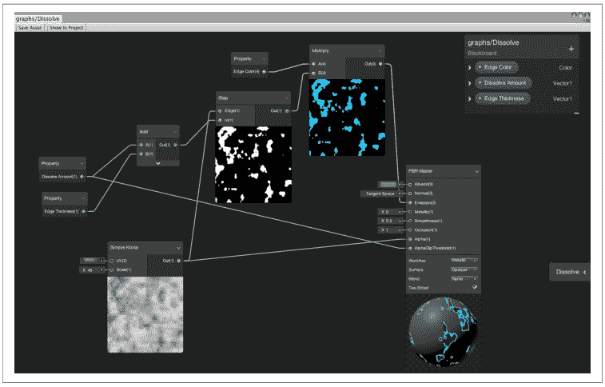

Figure 6-22. The shader graph for the dissolve effect

You can now create a new material that uses this shader; as you change the Dissolve Amount value from 0 to 1, the object will slowly dissolve (Figure 6-23).

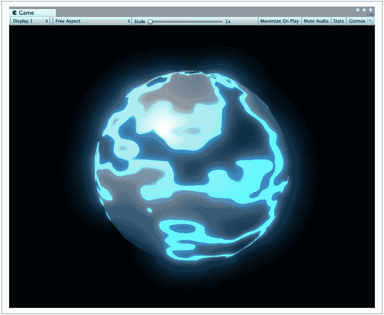

Figure 6-23. The image dissolving: we've also set up the camera to use a bloom effect

#### Discussion

A shader's Surface mode can be either Opaque or Transparent. When the shader is in Transparent mode, the Alpha value it receives is used to control the opacity of the surface; when it's in Opaque mode, all pixels that are drawn are fully opaque.

This doesn't mean that Alpha is ignored, however. In this shader, we use the Alpha Clip Threshold value in conjunction with the Alpha value to determine which parts of the surface are not rendered at all. Any pixel whose Alpha value is below the Alpha Clip Threshold is completely discarded and not drawn at all. Because the Alpha value varies depending on the Simple Noise node, different parts of the object have an Alpha value above or below the threshold. By varying the Alpha Clip Threshold, you can make more or less of the object appear.

The Simple Noise node generates a smoothly varying two-dimensional noise pattern. If you modify the scale of the node, you'll get more or less detail in the result, which means finer or coarser pieces. Try it and see!

Finally, to create the outline effect, we first add the Edge Thickness property to the dissolve amount, which advances the border of the dissolve effect slightly. We then use the Step node to create an image that draws a line of the specified thickness around the edge of the border, and we multiply it by the Edge Color property. This is then used as the Emission property on the Fragment node, creating a glowing edge around the dissolved area.


If you set up your camera to use a bloom post-processing effect (see Recipe 6.6), and make the Edge Color an HDR color by setting its mode to HDR, you can get a nice-looking glow on your dissolve effect.

You can tune the effect by modifying the Edge Thickness and Color properties.


A fire-like effect is pretty easy to achieve if you use an orange color.

### 6.17 Using Baked Lighting and Real-Time Lighting

#### Problem

You want to use Unity’s baked lighting system, which lets you create high-quality shadows and reflected light.

#### Solution

Unity will automatically calculate a baked lighting solution for your scene if there’s at least one object that’s marked as contributing to the scene’s *global illumination* (GI) data. To do this, follow these steps:

- 1. Select the object (or objects) that you want to be lightmapped.
- 2. At the top-right corner of the Inspector, click the drop-down menu, and choose Contribute GI.

Unity’s lightmapper will begin calculating the baked lighting in the scene. This might take some time, depending on the complexity of your scene.


Objects that contribute to global illumination aren't allowed to move, because if they do, the lighting won't adjust to account for it. If an object needs to be able to both move around and act like it's receiving light from static objects, you'll need to use light probes; see Recipe 6.20.

#### Discussion

*Baked lighting* is the process of calculating ahead of time how light bounces around an environment. Unlike real-time lighting, which has to work as quickly as possible, baked lighting has the luxury of taking as much time as it needs to—often minutes or hours. Because it has this extra time, it's able to perform path-tracing of virtual photons as they leave the light sources in your scene and bounce around the level. As these calculations are performed, textures are generated that store the amount of light that the various parts of the objects are receiving; at runtime, these textures are used to simulate the lighting.

Baked lighting tends to look better than real-time lighting (see Figure 6-24 for an example), but it's less flexible. Because the texture is generated before gameplay and takes significant time to create, it can't be modified during gameplay. If an object that casts a baked shadow moves, the shadow won't move with it.

In Figure 6-24, we see the cube on the left is real-time lit, and the cube on the right uses baked lighting. Notice how the shadow of the cube on the right is more realistic; it's sharper near the base of the cube and blurrier further away, while the real-time-lit cube's shadow has the same fuzziness at all points around the edge.

There are multiple Static modes besides Contribute GI. If you know that an object will never move—perhaps it's fixed scenery in the level—you can click the Static checkbox at the top right of the Inspector, and *all* static modes are enabled at once. This means that Unity can enable additional optimizations, including the ability to render multiple objects that share a material at the same time, in a single batch.


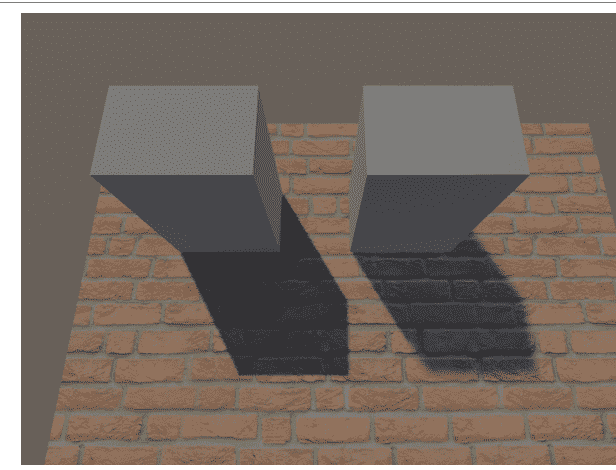

图 6-24. 实时光照与烘焙光照

### 6.18 使用烘焙自发光源

#### 问题
你希望在烘焙光照的场景中创建会发光的物体。例如，你希望在场景中创建一个灯具。

#### 解决方案
创建一个具有自发光颜色的材料。将自发光 HDR 颜色的强度设置为 1 或更高。将此材料应用到设置为参与 GI 的物体上。当光照贴图计算光照时，自发光物体会照亮其他静态物体。在图 6-25 中，场景中唯一的灯光来自中央的自发光物体。摄像机上的泛光效果完成了明亮物体的效果。

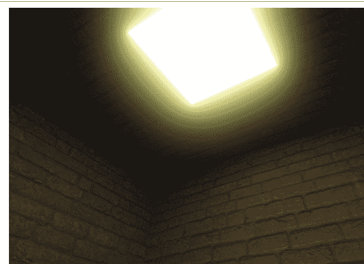

图 6-25. 自发光照明

#### 讨论
除了投射漂亮的阴影并产生吸引人的光线反弹外，只要它们是静态的，你就可以通过自发光物体为场景引入光照。但请不要忘记，光线是“假的”——它不会影响不参与全局光照的物体。如果你希望实时物体对这种烘焙光做出反应，你需要使用光探针（参见配方 6.20），或添加仅影响实时光照物体的实时灯光（参见配方 6.22）。

### 6.19 使静态物体在动态物体上投射阴影

#### 问题
你有一个静态物体（即它参与全局光照），你希望它在不参与 GI 的物体（即它们是动态的）上投射阴影。例如，参见图 6-26，其中三个立方体和球体放置在砖面表面上。左侧，静态立方体投射出高质量的阴影，但不影响球体。中间，实时立方体投射出质量较低的阴影，但会影响球体。右侧，一个静态立方体和一个形状大小相同且设置为仅渲染阴影的立方体位于同一位置，因此阴影质量很高，并且球体上仍会应用部分阴影。

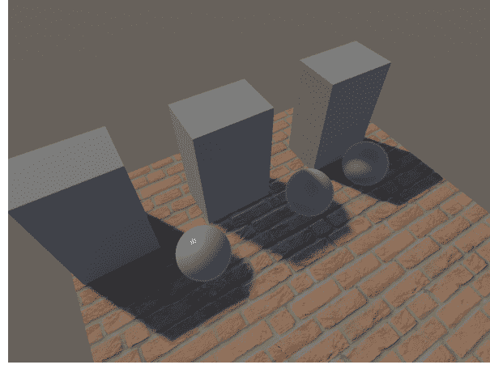

图 6-26. 三个投射阴影的立方体

#### 解决方案
要使静态物体在动态物体上投射阴影：
- 1. 选择你希望投射实时阴影的网格，并复制它。确保它的大小、形状和位置与原物体相同。（考虑将其设为原物体的子物体。）
- 2. 关闭 Contribute GI 以使其投射实时阴影。
- 3. 移除除 MeshRenderer 之外的所有组件。
- 4. 将 MeshRenderer 的 Cast Shadows 属性设置为 Shadows Only。这意味着它不会出现在场景中，但会向其他物体投射阴影。

#### 讨论
另一种解决方案是使用光探针。将光探针放置在阴影区域内部和外部的区域；这会使进入阴影区域的物体变暗，但你看不到阴影的边缘（它只是均匀变暗）。看起来没有那么好，但渲染成本更低。

另一种选择是设计场景布局，使静态物体根本不会在实时物体上投射阴影。

### 6.20 使用光探针影响光照

#### 问题
你希望使用光探针，以便实时物体能够被烘焙光照物体反射的光照照亮。

#### 解决方案
通过打开 GameObject 菜单并选择 Light → Light Probe Group 来创建光探针组。这会创建一个探针组；你可以选择每个单独的探针并重新定位它。

光探针同时受实时光照和烘焙光照影响。实时物体将使用附近的光探针来计算它们应如何被照亮。在图 6-27 中，场景中没有实时灯光；相反，靠近光源的光探针捕获光线在每个点如何影响物体，并且圆柱体正在使用该信息来为自己着色。图 6-28 显示了在此处设置的灯光探针。

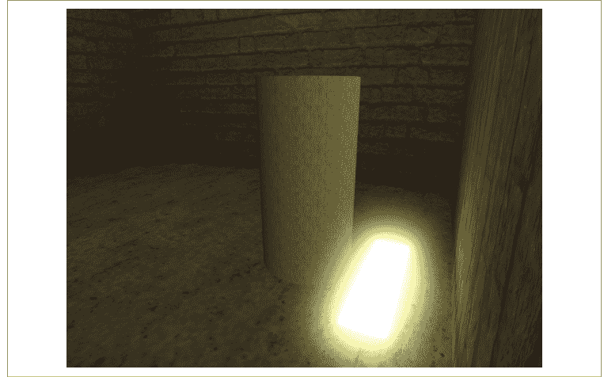

图 6-27. 一个由烘焙自发光物体照亮的实时圆柱体

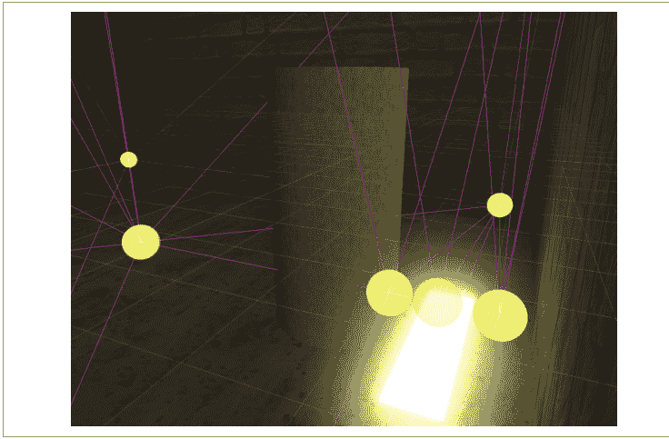

图 6-28. 图 6-27 中使用的光探针

#### 讨论
不参与全局光照的物体无法接收烘焙光，因为在游戏过程中光线“实际上并不存在”——相反，光线被写入纹理，静态物体从纹理中读取以模拟光线落在它们上面。这意味着实时光照物体看起来会与周围环境格格不入，因为在没有光照信息的情况下，它只会被全局环境（例如天空盒或环境光源）照亮。为了解决这个问题，你可以为每个烘焙灯光创建一个实时灯光，或将每个灯光设置为混合（意味着它有效地同时作为烘焙灯光和实时灯光发挥作用），但这会带来性能损失——尤其是在你有很多灯光，并且在低功率设备上渲染时，该设备无法使用延迟渲染（一种显著降低多灯光成本的渲染技术）。


> 本书不涵盖延迟渲染，但你可以在 Unity 文档中了解更多信息。

光探针是解决此问题的方案，允许你的实时光照物体近似它们在光照被烘焙时所经历的光照条件。光探针通过在烘焙过程中测量给定点通过的烘焙光量并将其存储来实现这一点；在游戏过程中，你的实时光照物体从一组光照探针中采样，并将其自身渲染为仿佛附近有灯光。


为了获得最有效的结果，请将光探针放置在你期望实时物体出现的地方，以及光照强度发生突然变化的区域附近。

### 6.21 使用反射探针

#### 问题
你希望使用反射探针，以便反射材质看起来更逼真并反射周围的场景。

#### 解决方案
创建反射探针不需要很多步骤，并且可以显著改善你的闪亮和反射物体，因为它们将能够反射周围的世界：
- 1. 首先，通过打开 GameObject 菜单并选择 Light → Reflection Probe 来创建反射探针。
- 2. 接下来，将探针放置在你希望有反射的区域的中心位置。


你可以创建多个反射探针。如果这样做，附近的反射物体将在它们之间混合。

要测试探针，请按照以下步骤创建一个闪亮的金属球体：
- 1. 通过打开 GameObject 菜单并选择 3D Object → Sphere 来创建一个新球体。
- 2. 将球体放置在反射探针附近（或将反射探针移动到球体附近）。
- 3. 通过打开 Assets 菜单然后选择 Create → Material 来创建一个新材质。
- 4. 将新材质命名为“Shiny metal”。
- 5. 将材质拖放到你添加的球体上。
- 6. 选择材质，并将 Smoothness 值增加到约 0.8。随着你进行此操作，球体会变得闪亮并反射附近的物体，通过采样反射探针所见的视图。图 6-29 显示了一个闪亮的金属球体，反射了周围的房间。它的反射来自附近的一个反射探针（未显示）。我们还添加了一点纹理，以获得更美观的外观。

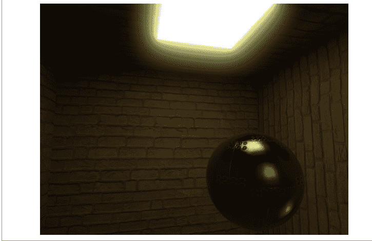

图 6-29. 一个闪亮的金属球体，反射了周围的房间

#### 讨论
在实时渲染中，准确的反射具有挑战性。在现实世界中，反射发生在光线均匀地从光滑表面反射时，这意味着可以实现对焦图像。这意味着在光线追踪渲染器中反射很容易，因为它们追踪光线在场景中反弹的路径。然而，大多数实时渲染器不追踪光线，主要是因为所需的计算能力。相反，它们进行近似：而不是让虚拟光子从物体上反弹，它们将其划分为多边形，计算多边形点相对于摄像机位置的位置，并确定该多边形重叠的像素位置。然后，渲染器求解渲染方程，这是用于确定点的颜色和亮度的几种简化近似之一，给定其位置、材质和附近光源的信息。


所有这些都说明了反射计算起来具有挑战性，对于在普通硬件上的实时性能，通常都是伪造的。有几种方法可以伪造反射。一种方法由 1990 年代末的游戏如《Deus Ex》流行，采用了一种创新方法，即将浴室镜子和光亮的地板做成半透明的，在另一侧创建一个翻转的房间复制品，并进行一些技巧操作，以确保“反射”世界中的所有物体都与“真实”世界中的位置相同。在图 6-30 中，抛光石地板看起来具有反射性，但它实际上是半透明的，下面还有另一个翻转的相同房间的复制品。这样做足够有效，但很难令人信服地实现，而且小错误很容易非常明显——著名的是，《Deus Ex》中主角的手从未与他的反射手保持在同一位置。此外，由于房间的反射版本实际上存在，这限制了关卡设计师的灵活性——例如，你不能在另一个房间上方有一个带有光亮石地板的房间。

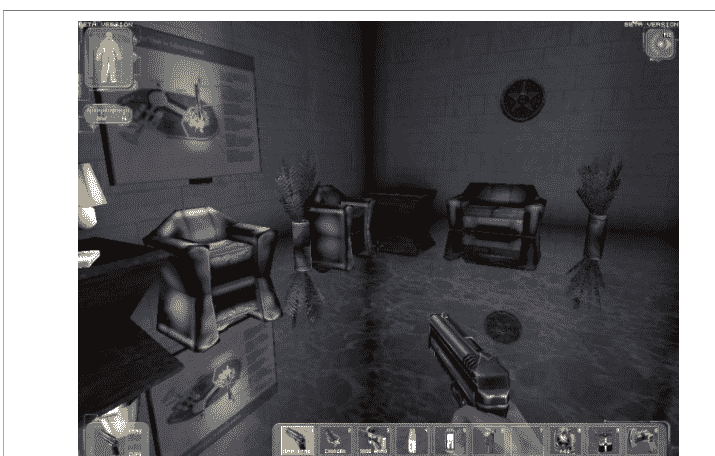

图 6-30. 《Deus Ex》中的反射（Ion Storm Austin/Eidos Interactive）

更准确的方法是渲染场景两次——一次用于主视图，一次从反射表面的另一侧翻转渲染（如《Uncharted 4》中所做；见图 6-31）。这更好，因为它避免了重复几何体的问题，但它也有一个相当糟糕的副作用，即在镜子出现在视野中的每一帧都要渲染相同的场景两次。这意味着具有镜子的场景需要非常仔细地构建，以最小化性能损失。

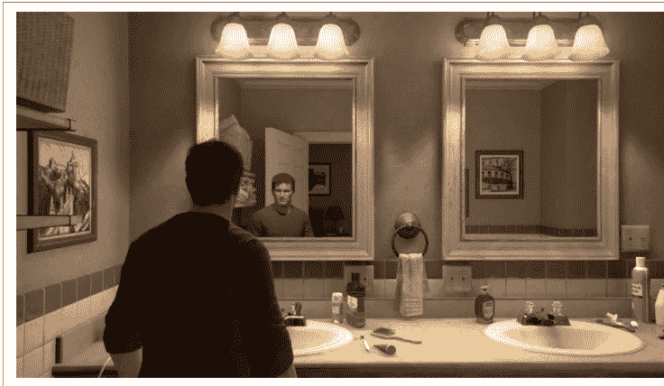

图 6-31. 《Uncharted 4: A Thief’s End》中的镜面反射（Naughty Dog/Sony Interactive Entertainment）

然而，并非游戏中所有的反射都是镜子。有时，你只需要一个光泽表面，或一个湿地板，或一块玻璃的模糊反射，而这块玻璃本意是供透视而不是观看。在这种情况下，反射的细节不需要完全精确，因为表面粗糙意味着清晰的图像本来就不会清晰。

这意味着反射可以提前生成，并且可能从不同的位置生成。所有需要做的就是从一个点向所有方向渲染一个快照。只要拍摄快照的点与进行反射的物体足够接近，看起来就会很好。如果反射确实需要更改，你也可以将反射探针的更新模式更改为实时更新，但会付出性能代价。


渲染场景多次的成本也是为什么为虚拟现实设计的游戏需要更谨慎地处理性能的原因。当为 VR 头显渲染时，每个眼睛都需要看到场景的不同视图，这意味着整个场景需要为每个眼睛分别渲染。

### 6.22 伪造动态自发光物体

#### 问题

你有一个实时物体具有自发光颜色，并且希望它能照亮其他物体。

#### 解决方案

伪造它。创建一个实时光源，并将其作为子对象添加。使其颜色与自发光相同，并且，如果放置得当，玩家不会意识到自发光并不是照亮其他物体的原因。图 6-32 显示了一个具有发光效果的物体，其内部有一个点光源，照亮了静态墙壁和旁边的实时物体。图 6-33 显示了同一物体但光源被禁用。效果要差得多。

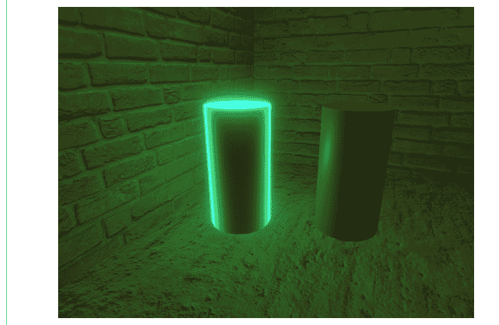

图 6-32. 一个具有发光效果的物体，其内部有一个点光源

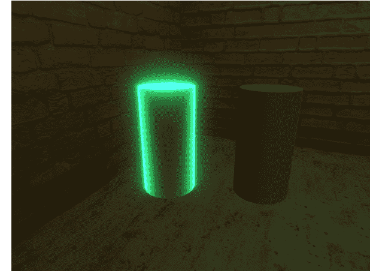

图 6-33. 同一物体，光源被禁用

#### 讨论

记住，所有不是试图物理模拟光线弹跳的计算机图形学都只是彻头彻尾的造假。对玩家来说，真正正确和看起来正确的物体之间没有区别。

### 6.23 渲染到纹理

#### 问题

你想将摄像机的视图渲染到纹理并在场景中使用该纹理。

#### 解决方案

渲染纹理可以作为资源创建。游戏未运行时它们没有任何有用的内容，但你可以使用它们是资源这一事实作为一种方便的方式来确保组件使用正确的纹理。

一旦拥有了渲染纹理，你就可以配置摄像机以渲染到它（渲染到渲染纹理的摄像机不会渲染到屏幕）：

- 1. 通过打开 Assets 菜单并选择 Create → Render Texture 创建一个新的渲染纹理。
- 2. 为新的渲染纹理命名你喜欢的名称。
- 3. 通过打开 GameObject 菜单并选择 Camera 创建一个新的摄像机。
- 4. 将新的摄像机命名为“Render Texture Camera”，以便与主场景摄像机区分开。
- 5. 将渲染纹理资源拖到 Render Texture Camera 的 Target Texture 槽上。

Render Texture Camera 现在将渲染到纹理，而不是屏幕；纹理现在可以像其他纹理一样使用。例如，你可以将此纹理用作材质的一部分；任何使用此材质的渲染器都会绘制 Render Texture Camera 的视图。要实现此效果，请按以下步骤操作：

- 1. 通过打开 Assets 菜单然后选择 Create → Material 创建一个新的材质。
- 2. 为新的材质命名你喜欢的名称。
- 3. 选择材质。
- 4. 将你之前创建的渲染纹理资源拖到材质的 Albedo 槽上。

最后，我们将创建一个游戏对象来渲染材质：

- 1. 通过打开 GameObject 菜单并选择 3D Object → Quad 创建一个新的四边形来渲染材质。
- 2. 将材质拖到你刚创建的四边形上。

四边形将显示摄像机所见的视图（见图 6-34 和 6-35）。尝试移动 Render Texture Camera 来查看变化。

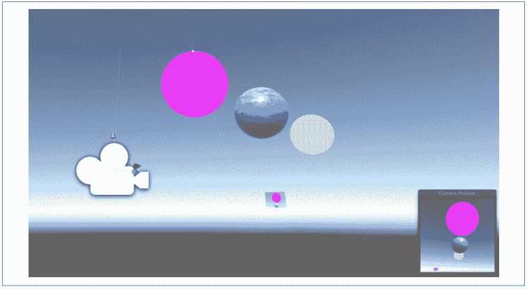

图 6-34. 设置为渲染到纹理的摄像机

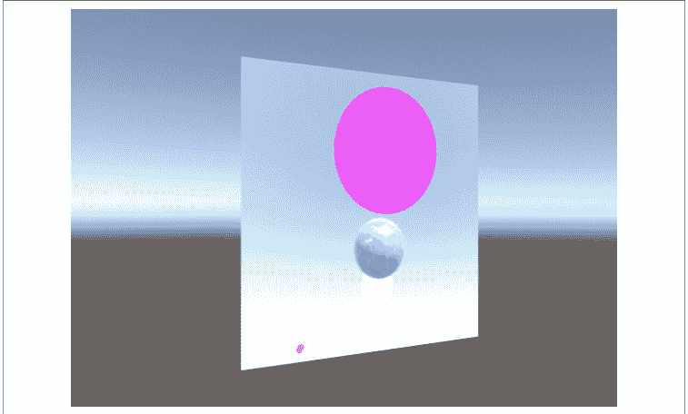

图 6-35. 渲染纹理应用于场景中的物体；从摄像机可见的物体被绘制到物体表面

#### 讨论

渲染纹理的默认分辨率为 256×256，但你可以通过选择资源并在 Inspector 中修改其大小来更改它。

不要忘记渲染纹理会消耗内存——纹理越大，占用的内存越多。
