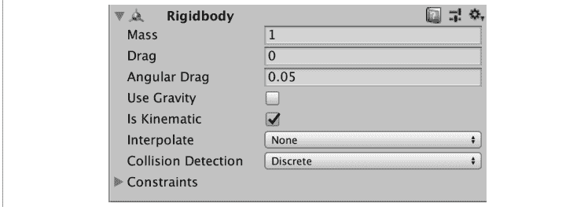

## 3D 物理和角色控制

物理是许多电子游戏的关键组成部分。无论你的游戏是 2D 还是 3D，或介于两者之间，你总会在某个时候依赖某种物理力模拟。

物理模拟最有趣的事情之一是，你可以免费获得很多有趣的游戏玩法机会。人类生活在物理的三维世界中，当游戏具有“机制”与他们每天互动时，玩家很容易与游戏产生共鸣。

为此，我们将在本章中研究构建游戏系统的方法，以允许在物理模拟的 3D 环境中进行角色控制，特别关注第一人称控制。


Unity 有两个物理系统：一个用于 2D 物理，我们在第 5 章讨论，另一个用于 3D 物理。本章是关于 3D 物理系统。

### 7.1 以每秒特定次数运行代码

#### 问题

你想编写每秒运行固定次数的代码。

#### 解决方案

将代码放在脚本的 FixedUpdate 方法中。

#### 讨论

在你的脚本中，Update 方法每帧调用一次，这使其非常适合几乎所有需要定期更新的内容。

Update 不是以规律的节奏调用；它取决于渲染每一帧所需的时间。如果场景变得更复杂，每秒的 Update 调用次数会发生变化。

相比之下，FixedUpdate 每秒调用固定次数。这使其非常适合物理模拟，因为物理模拟在时间在物理模拟更新之间保持不变时表现更好。


这并不意味着 FixedUpdate 调用之间会经过相同量的真实世界时间；Unity 只保证每秒会发生相同数量的 FixedUpdate 调用。

如果你想以与物理相同的速率更新某些内容，请将代码放在 Fixed Update 中。如果与物理对象交互的对象不是以与物理对象相同的速率更新，你可能会得到奇怪的抖动行为，而且感觉不好。

### 7.2 允许玩家使用鼠标环顾

#### 问题

在第一人称风格的游戏中，你希望能够通过鼠标控制玩家注视的方向。

#### 解决方案

允许玩家使用鼠标控制第一人称视图传统上被称为 mouselook。


Mouselook 有时也称为 freelook，因为它不必明确绑定到鼠标控制：它可以应用于 D-pad、操纵杆、模拟摇杆或类似设备的控制。

实现 mouselook 涉及旋转两个独立的物体：身体和头部。身体围绕 y 轴旋转（也称为“偏航”轴——从下到上的线），而头部围绕 x 轴旋转（从左到右的线）。在第一人称游戏中，摄像机附着在头部，如下所示：


+   1. 创建一个新的、空的游戏对象。将其命名为“Player。”
+   2. 找到主 Camera 对象。如果没有，请打开 GameObject 菜单并选择 Camera。
+   3. 将 Camera 对象拖入 Player 对象中，并将其重命名为“Head。”
+   4. 将 Head 对象放置在你想要头部所在的位置。为获得最佳效果，不要修改位置的任何分量，除了 y 分量；其他分量应为 0。这意味着摄像机将直接位于身体中心的正上方。
+   5. 创建一个新的 C# 脚本，命名为 MouseLook.cs，并添加以下代码：

```
// Implements mouseloook. Horizontal mouse movement rotates the body
// around the y-axis, while vertical mouse movement rotates the head
// around the x-axis.
public class MouseLook : MonoBehaviour
{

    // The speed at which we turn. In other words, mouse sensitivity.
    [SerializeField] float turnSpeed = 90f;

    // How far up the head can tilt, measured in angles from dead-
    // level. Must be higher than headLowerAngleLimit.
    [SerializeField] float headUpperAngleLimit = 85f;

    // How far down the head can tilt, measured in angles from dead-
    // level. Must be lower than headLowerAngleLimit.
    [SerializeField] float headLowerAngleLimit = -80f;

    // Our current rotation from our start, in degrees
    float yaw = 0f;
    float pitch = 0f;

    // Stores the orientations of the head and body when the game
    // started. We'll derive new orientations by combining these
    // with our yaw and pitch.
    Quaternion bodyStartOrientation;
    Quaternion headStartOrientation;

    // A reference to the head object–the object to rotate up and down.
    // (The body is the current object, so we don't need a variable to
    // store a reference to it.) Not exposed in the interface; instead,
    // we'll figure out what to use by looking for a Camera child object
    // at game start.
    Transform head;

    // When the game starts, perform initial setup.
    void Start()
    {
```

```
// Find our head object
head = GetComponentInChildren<Camera>().transform;

// Cache the orientation of the body and head
bodyStartOrientation = transform.localRotation;
headStartOrientation = head.transform.localRotation;

// Lock and hide the cursor
Cursor.lockState = CursorLockMode.Locked;
Cursor.visible = false;
}

// Every time physics updates, update our movement. (We do this in
// FixedUpdate to keep pace with physically simulated objects. If
// you won't be interacting with physics objects, you can do
// this in Update instead.)
void FixedUpdate()
{
    // Read the current horizontal movement, and scale it based on
    // the amount of time that's elapsed and the movement speed.
    var horizontal = Input.GetAxis("Mouse X")
                    * Time.deltaTime * turnSpeed;

    // Same for vertical.
    var vertical = Input.GetAxis("Mouse Y")
                   * Time.deltaTime * turnSpeed;

    // Update our yaw and pitch values.
    yaw += horizontal;
    pitch += vertical;

    // Clamp pitch so that we can't look directly down or up.
    pitch =
        Mathf.Clamp(pitch, headLowerAngleLimit, headUpperAngleLimit);

    // Compute a rotation for the body by rotating around the y-axis
    // by the number of yaw degrees, and for the head around the
    // x-axis by the number of pitch degrees.
    var bodyRotation = Quaternion.AngleAxis(yaw, Vector3.up);
    var headRotation = Quaternion.AngleAxis(pitch, Vector3.right);

    // Create new rotations for the body and head by combining them
    // with their start rotations.
    transform.localRotation = bodyRotation * bodyStartOrientation;
    head.localRotation = headRotation * headStartOrientation;
}
}
```

+   6. 将 MouseLook 组件附加到身体上。
+   7. 播放游戏。移动鼠标将旋转身体和头部。

#### Discussion

通过分离头部和身体的旋转，这种定向玩家视角的方法避免了“滚动”视图的问题——如果一个物体向下俯仰然后向侧面“偏航”，就会发生这种情况，这会产生绕前轴旋转的朝向。


如果你希望你的 mouseloook 为反向，只需将 Input.GetAxis("Mouse Y") 的值乘以 −1 即可。

### 7.3 控制 3D 角色

#### Problem

你想要在 3D 空间中控制一个角色。

#### Solution

你通常希望先实现 mouseloook，因为如果没有转向能力，你只能向前、向后和左右移动。我们假设你已按照 Recipe 7.2 中的步骤操作。

一旦你实现了 mouseloook，我们将添加一些功能：

+   1. 在你的 Player 对象上添加一个 CharacterController 组件。
+   2. 将 Head 对象移动到 CharacterController 的顶部。
+   3. 创建一个新的 C# 脚本，命名为 Movement.cs，并向其中添加以下代码：

```
// Implements character controller movement.
public class Movement : MonoBehaviour {

    // The speed at which we can move, in units per second.
    [SerializeField] float moveSpeed = 6;

    // The height of a jump, in units.
    [SerializeField] float jumpHeight = 2;

    // The rate at which our vertical speed will be reduced, in units
    // per second.
    [SerializeField] float gravity = 20;

```

```
// The degree to which we can control our movement while in midair.
[Range(0, 10), SerializeField] float airControl = 5;

// Our current movement direction. If we're on the ground, we have
// direct control over it, but if we're in the air, we only have
// partial control over it.
Vector3 moveDirection = Vector3.zero;

// A cached reference to the character controller, which we'll be
// using often.
CharacterController controller;

void Start()
{
    controller = GetComponent<CharacterController>();
}

// We do our movement logic in FixedUpdate so that our movement
// can happen at the same pace as physics updates. If it didn't,
// we'd see jitter when we interact with physics objects that can
// move around.
void FixedUpdate () {

    // The input vector describes the user's desired local-space
    // movement; if we're on the ground, this will immediately
    // become our movement, but if we're in the air, we'll
    // interpolate between our current movement and this vector, to
    // simulate momentum.
    var input = new Vector3(
        Input.GetAxis("Horizontal"),
        0,
        Input.GetAxis("Vertical")
    );

    // Multiply this movement by our desired movement speed
    input *= moveSpeed;

    // The controller's Move method uses world-space directions, so
    // we need to convert this direction to world space
    input = transform.TransformDirection(input);

    // Is the controller's bottommost point touching the ground?
    if (controller.isGrounded)
    {
        // Figure out how much movement we want to apply in local
        // space.
        moveDirection = input;

        // Is the user pressing the jump button right now?
```

```
if (Input.GetButton("Jump"))
{
    // Calculate the amount of upward speed we need,
    // considering that we add moveDirection.y to our height
    // every frame, and we reduce moveDirection.y by gravity
    // every frame.
    moveDirection.y = Mathf.Sqrt(2 * gravity * jumpHeight);
} else {
    // We're on the ground, but not jumping. Set our
    // downward movement to 0 (otherwise, because we're
    // continuously reducing our y-movement, if we walk off
    // a ledge, we'd suddenly have a huge amount of
    // downward momentum).
    moveDirection.y = 0;
}
} else {
    // Slowly bring our movement toward the user's desired
    // input, but preserve our current y-direction (so that the
    // arc of the jump is preserved)
    input.y = moveDirection.y;
    moveDirection = Vector3.Lerp(moveDirection, input,
        airControl * Time.deltaTime);
}

// Bring our movement down by applying gravity over time
moveDirection.y -= gravity * Time.deltaTime;

// Move the controller. The controller will refuse to move into
// other colliders, which means that we won't clip through the
// ground or other colliders. (However, this doesn't stop other
// colliders from moving into us. For that, we'd need to detect
// when we're overlapping another collider, and move away from
// them. We'll cover this in another recipe!)
controller.Move(moveDirection * Time.deltaTime);
}
```

+   4. 将 Movement 组件附加到你的 Player 对象上。

+   5. 播放游戏。按下方向键或 W、A、S 和 D 键将移动玩家（除非你已自定义输入系统）。你也可以通过按空格键跳跃。

#### Discussion

完全可以为你的游戏实现一个完全物理正确的控制设置，其中玩家被模拟为刚体并通过对该物体施加力来移动。然而，为了获得最佳手感的控制，在游戏中最好使用自己的代码来管理玩家的移动，而不是


在物理上实现它。这是因为创建一个响应玩家输入且感觉灵敏愉悦的控制方案非常具有挑战性。

一些手感最好的游戏拥有极不真实的物理效果，甚至声称追求真实的游戏也不是物理上真实的。*马里奥*系列平台游戏中每一款都有极不真实的物理效果，但当目标是带来愉快的游戏体验时，这并不重要。现代动作冒险游戏如 *古墓丽影* 系列也具有物理上不合理的移动方式。没关系；重要的是玩家与游戏控制之间的交互。为此，直接控制玩家的速度和惯性，而不是让物理系统为你处理，能让你更好地掌控玩家的体验。


关于游戏手感的一个绝佳资源是 Steve Swink 所著的 *Game Feel: A Game Designer’s Guide to Virtual Sensation* by Steve Swink (CRC Press)。

本食谱中介绍的设置将在本章的多个其他食谱中使用，因为它是一个良好的基础。

### 7.4 与开关和物体交互

#### Problem

你希望玩家能够用第一人称控制器瞄准世界中的物体，并按下使用键。某些物体应以这种方式被交互时做出反应。


本食谱假设你已按照 Recipes 7.2 和 7.3 设置了玩家。

#### Solution

与物体交互需要从摄像机发射不可见的射线来检测你正在看什么。射线会在范围内遇到第一个碰撞体时停止；我们需要确保永远不会击中 CharacterCollider：

- 1. 打开 Edit 菜单，并选择 Project Settings → Tags & Layers。
- 2. 将其中一个空白用户 Layer 设置为“Player。”
- 3. 选择你的 Player 对象——包含 CharacterController 的那个。

4. 打开 Inspector 右上角的 Layers 菜单，并选择 Player。系统提示是否也要设置子对象的层时，点击“Yes, change children。”

5. 创建一个新的 C# 脚本名为 Interactable.cs。添加以下代码：

```
// Implements being interacted with by an Interacting component.
// Requires a collider, because Interacting objects find their targets
// by casting rays that hit colliders.
[RequireComponent(typeof(Collider))]
public class Interactable : MonoBehaviour {

    public void Interact(GameObject fromObject) {
        Debug.LogFormat("I've been interacted with by {0}!", fromObject);
    }
}
```

6. 将此组件附加到你想要交互的物体上。该物体必须具有某种碰撞体。

7. 创建一个新的 C# 脚本名为 Interacting.cs。添加以下代码：

```
// Implements interacting with Interactable objects
public class Interacting : MonoBehaviour {

    // The key to press to interact with an object.
    [SerializeField] KeyCode interactionKey = KeyCode.E;

    // The range at which we can interact with objects.
    [SerializeField] float interactingRange = 2;

    void Update () {

        // Did the user just press the interaction key?
        if (Input.GetKeyDown(interactionKey)) {

            // Then attempt to interact.
            AttemptInteraction();
        }
    }

    void AttemptInteraction() {

        // Create a ray from the current position and forward direction
        var ray = new Ray(transform.position, transform.forward);

        // Store information about the hit in this variable
        RaycastHit hit;

        // Create a layer mask that represents every layer except the
        // players
```

```
var everythingExceptPlayers =
    ~(1 << LayerMask.NameToLayer("Player"));

// Combine this layer mask with the one that raycasts usually
// use; this has the effect of removing the player layer from
// the list of layers to raycast against
var layerMask = Physics.DefaultRaycastLayers
                & everythingExceptPlayers;

// Perform the raycast out, hitting only objects that are on
// layers described by the layer mask we just assembled
if (Physics.Raycast(ray, out hit, interactingRange,
                    layerMask)) {

    // Try to get the Interactable component on the object
    // we hit
    var interactable = hit.collider
                        .GetComponent<Interactable>();

    // Does it exist?
    if (interactable != null) {

        // Signal that it was interacted with.
        interactable.Interact(this.gameObject);
    }
}
}
```

- 8. 将此组件附加到你的 Head 对象。游玩游戏；当你注视附近具有 Interactable 组件的物体并按下交互键时，Interactable 组件将记录它已被交互。

你现在可以基于此构建交互行为，例如在游戏中按下按钮时使物体出现。

#### Discussion

Unity 中的每个游戏对象都可以分配到一个层，这将它们分组。层在 Unity 的多个部分中使用；例如，摄像机可以配置为仅渲染特定层上的对象。

层也可以用于控制物理系统。在此案例中，我们使用层来确保射线永远不会击中玩家，这会造成问题。

### 7.5 拾取和放下物体

#### Problem

你希望能够将物体拉向自己，如果足够近则拾取。你希望能够扔出正在持有的物体。


本食谱假设你已按照 Recipes 7.2 和 7.3 设置了玩家。你还需要按照 Recipe 7.4 设置 Player 层。

#### Solution

为了拉取、抓取、持有和扔出物体，我们将首先创建一个新的 C# 脚本名为 Grabbing.cs，并添加以下代码：

```
// Implements pulling, grabbing, holding, and throwing.
// A rigidbody is required because we need one to connect our
// grabbing joint to
[RequireComponent(typeof(Rigidbody))]
public class Grabbing : MonoBehaviour {

    // The range from this object at which an object can be picked up.
    [SerializeField] float grabbingRange = 3;

    // The range from this object at which an object can be pulled
    // toward us.
    [SerializeField] float pullingRange = 20;

    // The location at which objects that are picked up will be placed.
    [SerializeField] Transform holdPoint = null;

    // The key to press to pick up or drop an object
    [SerializeField] KeyCode grabKey = KeyCode.E;

    // The key to press to throw an object
    [SerializeField] KeyCode throwKey = KeyCode.Mouse0;

    // The amount of force to apply on a thrown object
    [SerializeField] float throwForce = 100f;

    // The amount of force to apply on objects that we're pulling toward
    // us. Don't forget that objects we're pulling will have friction
    // working against us, so the value might need to be higher than
    // you think.
    [SerializeField] float pullForce = 50f;

    // If the grab joint encounters this much force, break it.
```

```
[SerializeField] float grabBreakingForce = 100f;

// If the grab joint encounters this much torque, break it.
[SerializeField] float grabBreakingTorque = 100f;

// The joint that holds our grabber object. Null if we're not
// holding anything.
FixedJoint grabJoint;

// The rigidbody that we're holding. Null if we're not holding
// anything.
Rigidbody grabbedRigidbody;

private void Awake()
{
    // Do some quick validity checks when we start up

    if (holdPoint == null) {
        Debug.LogError("Grab hold point must not be null!");
    }

    if (holdPoint.IsChildOf(transform) == false) {
        Debug.LogError(
            "Grab hold point must be a child of this object"
        );
    }

    var playerCollider = GetComponentInParent<Collider>();

    playerCollider.gameObject.layer = LayerMask
        .NameToLayer("Player");
}

private void Update()
{
    // Is the user holding the grab key, and we're not
    // holding something?
    if (Input.GetKey(grabKey) && grabJoint == null) {

        // Attempt to perform a pull or a grab
        AttemptPull();

    }
    // Did the user just press the grab key, and we're holding
    // something?
    else if (Input.GetKeyDown(grabKey) && grabJoint != null) {
        Drop();
    }
    // Does the user want to throw the held object, and we're
    // holding something?
    else if (Input.GetKeyDown(throwKey) && grabJoint != null) {
        // Now apply the throw force


Throw ();
}
}

// 抛出持有的物体
void Throw()
{
    // 如果没有持有任何东西就不能抛出！
    if (grabbedRigidBody == null) {
        return;
    }

    // 在 Drop 重置它之前，先保留对我们正在持有的物体的引用
    var thrownBody = grabbedRigidBody;

    // 计算要施加的力
    var force = transform.forward * throwForce;

    // 并施加它
    thrownBody.AddForce(force);

    // 在抛出之前我们需要先放下正在持有的物体
    Drop();
}

// 尝试拉取或拾取此物体正前方的物体。当此脚本附加到摄像机时，它将尝试获取摄像机视野正中间的物体。（你可能想在 GUI 上添加一个准星来帮助玩家知道屏幕精确中心的位置。）
private void AttemptPull()
{
    // 执行射线检测。如果我们击中了具有刚体且不是运动学刚体的物体，则拾取它。

    // 创建一条从当前位置出发，沿当前方向射出的射线。
    var ray = new Ray(transform.position, transform.forward);

    // 创建一个变量来存储我们击中的结果。
    RaycastHit hit;

    // 创建一个层掩码，表示除玩家层之外的所有层
    var everythingExceptPlayers =
        ~(1 << LayerMask.NameToLayer("Player"));

    // 将此层掩码与射线检测通常使用的层掩码结合；这将从要进行射线检测的层列表中移除 Player 层
var layerMask = Physics.DefaultRaycastLayers
    & everythingExceptPlayers;

// 执行使用此层掩码以忽略玩家的射线检测。我们使用拉取范围，因为它是最长的；如果物体实际上在我们（较短的）抓取范围内，我们将抓取它而不是拉取它。
var hitSomething =
    Physics.Raycast(ray, out hit, pullingRange, layerMask);

if (hitSomething == false)
{
    // 我们的射线检测在拉取范围内没有击中任何东西。
    return;
}

// 我们击中了某物！是可以拾取的吗？
grabbedRigidBody = hit.rigidbody;

if (grabbedRigidBody == null || grabbedRigidBody.isKinematic)
{
    // 我们无法拾取它；它要么没有刚体，要么是运动学的。
    return;
}

// 我们现在有一个在拉取范围内的物体。

// 该物体是否也在抓取范围内？
if (hit.distance < grabbingRange) {

    // 我们可以拾取它。

    // 将物体移动到我们的抓取位置。
    grabbedRigidBody.transform.position = holdPoint.position;

    // 创建一个将保持其位置的关节，并进行配置
    grabJoint = gameObject.AddComponent<FixedJoint>();
    grabJoint.connectedBody = grabbedRigidBody;
    grabJoint.breakForce = grabBreakingForce;
    grabJoint.breakTorque = grabBreakingTorque;

    // 确保此被抓取物体不会与此碰撞体或其父级中的任何碰撞体发生碰撞，这可能会导致问题
    foreach (var myCollider in
        GetComponentsInParent<Collider>())
    {
        Physics.IgnoreCollision(myCollider, hit.collider, true);
    }
}
} else {
    // 它不在抓取范围内，但在拉取范围内。
    // 将其拉向我们，直到进入抓取范围。

    var pull = -transform.forward * this.pullForce;

    grabbedRigidBody.AddForce(pull);

}
}

// 掉落物体
private void Drop()
{
    if (grabJoint != null)
    {
        Destroy(grabJoint);
    }

    // 如果我们持有的物体已不再存在，则退出
    if (grabbedRigidBody == null)
    {
        return;
    }

    // 重新启用此物体与其碰撞体之间的碰撞
    foreach (var myCollider in GetComponentsInParent<Collider>())
    {
        Physics.IgnoreCollision(
            myCollider,
            grabbedRigidBody.GetComponent<Collider>(),
            false);
    }

    grabbedRigidBody = null;
}

// 绘制持点的位置
private void OnDrawGizmos()
{
    if (holdPoint == null) {
        return;
    }
    Gizmos.color = Color.magenta;
    Gizmos.DrawSphere(holdPoint.position, 0.2f);
}

// 当附加到此组件所在游戏对象的关节断裂时调用。
private void OnJointBreak(float breakForce)
{
    // 当我们的关节断裂时，调用 Drop 以确保我们清理好自己。
    Drop();
}
}

接下来，我们将设置 Player 物体以使用此 Grabbing.cs 脚本：

+   1. 将此组件附加到 Head 物体。
+   2. 为 Head 物体创建一个新的子物体。将其命名为“Grab Point”。这将是物体相对于玩家头部被持有的位置。
+   3. 将 Grab Point 物体的位置设置为略低于 Head 物体，并在其前方一段距离。位置 (0, −0.25, 1.25) 可以很好地工作。
+   4. 再次选择 Head 物体，并将 Grabbing 组件的 Hold Point 字段设置为你刚刚创建的 Grab Point 物体。
+   5. 在 Head 物体的 Rigidbody 组件上打开 Is Kinematic 选项。

现在我们创建一个可以抓取的立方体：

+   1. 通过打开 GameObject 菜单并选择 3D Object → Cube 来创建一个新立方体。
+   2. 将其比例设置为 (0.25, 0.25, 0.25)。
+   3. 为立方体添加一个 Rigidbody 组件。

当你播放游戏时，你将能够通过按 E 键将立方体拉向你。当它在范围内时，你将抓取它。按住鼠标左键来抛出你持有的物体。

#### Discussion

这是一个系统，非常类似于在半条命 2 后半部分（Valve Corporation）中占据重要地位的重力枪。

一旦你在场景中使其正常工作，你可能想尝试以下几件事：

+   - 尝试直接设置被抛出物体的速度。
+   - 尝试不同的拉取和抓取范围。
+   - 尝试只能拾取低于某一质量的物体（例如，你不能拾取一块巨大的岩石）。


你可以通过先获取其 Rigidbody 组件，然后访问其 mass 属性来找到物体的质量。

### 7.6 检测物体是否接触另一个物体

#### Problem

你想检测两个物理物体是否正在接触。

#### Solution

将 OnCollisionEnter、OnCollisionExit 和 OnCollisionStay 方法添加到你的脚本中：

```
private void OnCollisionEnter(Collision collision)
{
    Debug.LogFormat("Object {0} started touching {1}!",
        collision.gameObject.name, this.name);
}

private void OnCollisionExit(Collision collision)
{
    Debug.LogFormat("Object {0} stopped touching {1}!",
        collision.gameObject.name, this.name);
}

private void OnCollisionStay(Collision collision)
{
    Debug.LogFormat("Object {0} remained touching {1}!",
        collision.gameObject.name, this.name);
}
```

#### Discussion

这些方法会为任何具有 Collider 和 Rigidbody 组件的游戏对象调用：

OnCollisionEnter
当物体开始接触另一个物体时调用

OnCollisionExit
当物体停止接触另一个物体时调用

OnCollisionStay
在两个物体保持接触的每一帧都调用

这三个方法都接收一个 Collision 参数，其中存储有关碰撞的信息，包括碰撞发生的速度，以及物体在世界中接触的点。


只有当两个碰撞物体中至少有一个具有非运动学刚体时，才会检测到碰撞。运动学刚体是施加力于其他物体但自身不响应力的刚体。例如，一个不响应重力的浮动平台可以使用运动学刚体设置。要使刚体变为运动学，请在 Inspector 中勾选 Is Kinematic 框（参见图 7-1）。



图 7-1. 在刚体上启用 Is Kinematic 选项

### 7.7 检测物体是否在触发区域内

#### Problem

你想检测物体是否进入了标记为触发器的碰撞体。

#### Solution

将 OnTriggerEnter、OnTriggerExit 和 OnTriggerStay 方法添加到你的脚本中：

```
private void OnTriggerEnter(Collider other)
{
    Debug.LogFormat("Object {0} entered trigger {1}!",
        other.name, this.name);
}

private void OnTriggerExit(Collider other)
{
    Debug.LogFormat("Object {0} exited trigger {1}!",
```


```
other.name, this.name);
}
private void OnTriggerStay(Collider other)
{
    Debug.LogFormat("Object {0} remained in trigger {1}!",
        other.name, this.name);
}
```

#### Discussion

当碰撞体被标记为触发器时，在其检查器上选择 Is Trigger 复选框会使其在场景中的行为不同。触发器碰撞体不会与其他对象发生碰撞；相反，它们允许任何物体穿过它们。因为它们不发生碰撞，所以它们不会生成在 Recipe 7.6 中讨论的 OnCollision 消息。相反，它们会生成 OnTrigger 消息。

OnTrigger 消息的工作方式与 OnCollision 消息类似，即当对象进入、离开并停留在触发器碰撞体内时，会调用 OnTriggerEnter、OnTriggerExit 和 OnTriggerStay。

这两个方法组之间一个显著的区别是，OnTrigger 方法接收的参数是 Collider，而不是 Collision。这是因为没有碰撞需要报告；唯一有用的信息是另一个碰撞体的身份。


只有当涉及的碰撞体中至少有一个附加了刚体时，才会发送触发器事件。

### 7.8 实现移动平台

#### Problem

你希望对象从一点移动到另一点。

#### Solution

要使对象从一点移动到另一点，你需要三样东西：要在其间移动的空间点列表、对象当前正在移动到的点的索引，以及将对象向当前点移动的代码，并在接近足够时循环到下一个点：

1. 创建一个新的 C# 脚本名为 MovingPlatform.cs，并向其中添加以下代码：

```
// Moves an object at a fixed speed through a series of points.
public class MovingPlatform : MonoBehaviour {

    // The positions that the platform will move through, stored in local
    // position.
    [SerializeField] Vector3[] points = {};

    // The speed at which it will move between them.
    [SerializeField] float speed = 10f;

    // The index into the 'points' array; this is the point we're trying
    // to move toward
    int nextPoint = 0;

    // Where the platform was when the game started
    Vector3 startPosition;

    // How fast this platform is currently moving, in units per second
    public Vector3 velocity { get; private set; }

    // Use this for initialization
    void Start () {
        if (points == null || points.Length < 2) {
            Debug.LogError("Platform needs 2 or more points to work.");
            return;
        }

        // All of our movement points are defined relative to where we
        // are when the game starts, so record that (since
        // transform.position will change over time)
        startPosition = transform.position;

        // Start our cycle at our first point
        transform.position = currentPoint;
    }

    // Returns the point that we're currently moving toward.
    Vector3 currentPoint {
        get {
            // If we have no points, return our current position
            if (points == null || points.Length == 0) {
                return transform.position;
            }
            // Return the point we're trying to get to
            return points[nextPoint] + startPosition;
        }
    }
}
```

```
// Update every time physics updates
void FixedUpdate () {

    // Move toward the target at a fixed speed
    var newPosition = Vector3.MoveTowards(
        transform.position, currentPoint, speed * Time.deltaTime);

    // Have we reached the target?
    if (Vector3.Distance(newPosition, currentPoint) < 0.001) {
        // Snap to the target point
        newPosition = currentPoint;

        // Move to the next target, wrapping around to the start if
        // necessary
        nextPoint += 1;
        nextPoint %= points.Length;
    }

    // Calculate our current velocity in units per second
    velocity =
        (newPosition - transform.position) / Time.deltaTime;

    // Update to our new location
    transform.position = newPosition;

}

// Draw the path that the platform will follow
private void OnDrawGizmosSelected()
{
    if (points == null || points.Length < 2) {
        return;
    }

    // Our points are stored in local space, so we need to offset
    // them to know where they are in world space.
    Vector3 offsetPosition = transform.position;

    // If we're playing, our transform is moving, so we need to use
    // the cached start position to figure out where our points
    // are in world space.
    if (Application.isPlaying) {
        offsetPosition = startPosition;
    }

    Gizmos.color = Color.blue;

    // Loop over all the points
    for (int p = 0; p < points.Length; p++) {

```

```
// Get this point and the next one, wrapping around to the
// first
var p1 = points[p];
var p2 = points[(p + 1) % points.Length];

// Draw the point
Gizmos.DrawSphere(offsetPosition + p1, 0.1f);

// Draw the line between the points
Gizmos.DrawLine(offsetPosition + p1, offsetPosition + p2);
}
```

- 2. 创建一个新的立方体，并向其添加 MovingPlatform。
- 3. 根据需要添加尽可能多的点。它们将在场景视图中显示。
- 4. 播放游戏。对象将按电路移动到每个点。

#### Discussion

如果没有额外的代码，平台将穿过玩家移动。这是因为平台不知道玩家在哪里，玩家也不知道平台在哪里。如果没有检测这些重叠对象的机制，你最终会得到对象相互穿过的现象。这在 Recipe 7.9 中得到修复。

还请注意，移动代码在 FixedUpdate 方法中执行。这是为了确保平台移动与场景中所有其他移动发生的速率相同，包括刚体和玩家角色控制器的移动。


本配方中的代码存储了平台的速度；这在本配方中并未直接使用，但在 Recipe 7.9 中使用。

### 7.9 实现平台乘坐

#### Problem

你希望你的角色控制器能够站在 Recipe 7.8 中实现的移动平台上。你还希望角色控制器在移动平台从侧面移动到它时被推开。

#### Solution

本配方在 Recipe 7.8 的步骤基础上构建，用于创建移动平台。如果你尚未遵循该配方，你应该先执行它。

我们将添加一个新的脚本，将其附加到玩家，并增加支持让玩家随其接触的任何平台一起移动。因此，如果他们站在平台上，他们将被平台携带，如果平台从除向上以外的任何方向推向他们，他们将被移开：

- 1. 创建一个新的 C# 脚本名为 PlatformRiding.cs，并向其中添加以下代码：

```
// Implements platform riding (standing on a moving platform means we’ll
// move with the platform), and pushing (if an object moves into us, it
// will push us away)
[RequireComponent(typeof(CharacterController))]
public class PlatformRiding : MonoBehaviour {

    // The CharacterController on this object.
    CharacterController controller;

    private void Start()
    {
        // We’ll be checking our character controller a lot. Cache a
        // reference to it.
        controller = GetComponent<CharacterController>();
    }

    // Every time physics updates, check to see if our collider is
    // overlapping something, and if it is, push ourselves out of it.
    private void FixedUpdate()
    {
        // First, we’ll handle pushing the character collider out of the
        // way if another object moves into it.

        // A character collider's physical shape is a capsule. We need
        // to ask the physics system if this capsule is overlapping
        // anything else; to do this, we need to figure out the values
        // that define this capsule.

        // You can think of a capsule as a cylinder with two spheres
        // on either end, where the spheres have the same radius as the
        // the cylinder. This means that a capsule can be defined by
        // three values: the locations of the centers of the two spheres,
        // and the radius.

        // Given that a character collider exposes its total height
        // (including spheres!) and the radius, we can use this
        // to figure out the location of the two capsule points
        // in world space.
```


// The center of the sphere at the top of the controller's
// capsule
var capsulePoint1 = transform.position + new Vector3(
    0, (controller.height / 2) - controller.radius, 0);

// The center of the sphere at the bottom of the controller's
// capsule
var capsulePoint2 = transform.position - new Vector3(
    0, (controller.height / 2) + controller.radius, 0);

// The list of colliders we may be overlapping. We're unlikely
// to overlap more than 10 colliders, so make the list that
// long. (Adjust this if you're encountering lots of overlaps.)
Collider[] overlappingColliders = new Collider[10];

// Figure out which colliders we're overlapping. We pass in the
// overlappingColliders array, and when this function returns,
// the array will be filled with references to other colliders.
// The function returns the number of colliders that overlap
// the capsule.
var overlapCount = Physics.OverlapCapsuleNonAlloc(
    capsulePoint1, capsulePoint2,  // the centers of the spheres
    controller.radius,  // the radius of the spheres
    overlappingColliders);

// (Note: we _could_ have used OverlapCapsule, which returns a
// brand-new array, but that requires the function to allocate
// the memory for it on the heap. Because we don't use this
// array after this function ends, the array would turn into
// garbage. More garbage means the garbage collector will run
// more often, which means performance hitches. By creating our
// array locally, we ensure it's stored on the stack; data on
// the stack doesn't get turned into garbage when it goes away,
// but it can't stay around after this function returns,
// which is fine for this case.)

// For each item we were told the capsule overlaps...
for (int i = 0; i < overlapCount; i++) {

    // Get the collider the capsule overlaps
    var overlappingCollider = overlappingColliders[i];

    // If this collider is our controller, ignore it
    if (overlappingCollider == controller) {
        continue;
    }

    // We need to compute how much movement we need to perform
    // to not overlap this collider.

// First, define some variables to store the direction and
// distance.
Vector3 direction;
float distance;

// Next, provide information about both our collider and the
// other one. Our direction and distance variables will be
// filled with data.
Physics.ComputePenetration(
    controller,  // our collider
    transform.position, // its position
    transform.rotation, // its orientation
    overlappingCollider, // the other collider
    overlappingCollider.transform.position,  // its position
    overlappingCollider.transform.rotation,  // its
                                            // orientation
    out direction, // will hold the direction we should
                   // move in
    out distance   // will contain the distance we should
                   // move by
);

// Don't get pushed vertically; that's what 1. gravity and
// 2. moving platforms are for.
direction.y = 0;

// Update our position to move out of the way.
transform.position += direction * distance;
}

// Next, we'll handle standing on a moving platform.

// Cast a ray down to our feet. If it hit a MovingPlatform,
// inherit its velocity.

// (We don't need to worry about avoiding the character
// controller here, because the raycast starts inside the
// controller, so it won't hit it.)

var ray = new Ray(transform.position, Vector3.down);
RaycastHit hit;

// The maximum distance we want to look for.
float maxDistance = (controller.height / 2f) + 0.1f;

// Cast the ray. Did it hit anything?
if (Physics.Raycast(ray, out hit, maxDistance)) {

// It did!

// Did it have a MovingPlatform component?
var platform = hit.collider.gameObject
    .GetComponent<MovingPlatform>();

if (platform != null) {
    // If it did, update our position based on the
    // platform's current velocity.
    transform.position +=
        platform.velocity * Time.deltaTime;
}
}

+   2. 将 PlatformRiding 组件添加到玩家角色上——即拥有 CharacterCollider 的对象。
+   3. 运行游戏，并跳到带有 MovingPlatform 组件的对象上。你的角色会随平台一起移动。此外，如果你离开平台后又站在其移动路径上，平台移动时会将你推开。

#### 讨论

本配方执行了两种不同的测试，以判断 CharacterCollider 是否需要移动：

+   1. 首先，它计算 CharacterCollider 所占用的胶囊体的大小，然后要求 Unity 的物理系统检查是否有其他碰撞体也占用了这块空间。如果平台正推向角色，两个碰撞体将会相交，尽管相交量很小。
+   
+   如果碰撞体相交，则我们要求物理系统计算脱穿透向量。这就是将玩家移动到使两个物体不再重叠所需移动的量。然后只需按该向量移动玩家即可，这意味着它会“移出”平台；净结果是玩家被推离平台。
+   2. 接下来，它从 CharacterCollider 的中心向下射出一道射线，到碰撞体底部下方的一小段距离。如果此射线击中带有 MovingPlatform 的 Collider，则玩家会以与平台相同的方式移动：通过将平台当前速度乘以 delta 时间。
+   
+   请注意，由于此代码在 FixedUpdate 方法中运行（这意味着它以与所有其他物理更新相同的速率执行），我们不使用

Time.deltaTime，而是使用 Time.fixedDeltaTime——自上次调用 FixedUpdate 以来经过的时间。

需要注意的是，由于玩家是手动移动的，因此不会产生动量。如果你在快速向上移动的平台上，平台突然停止，你不会因惯性而被抛向空中。

### 7.10 响应被物体推动

#### 问题

你希望角色碰撞体能够推动刚体。

#### 解决方案

如果角色碰撞体是手动移动的，这是本章配方中的情况，物理引擎不会自动对玩家撞到的其他物体施加推动力，即使该物体可移动且无论其质量如何。相反，角色碰撞体会注意到重叠并拒绝移动进去，这会让人感觉该物体巨大、沉重且不可移动。

因此，要实现推动，我们需要手动施加力，或直接设置速度。在本配方中，我们将实现一个脚本，允许两种选项：

+   1. 创建一个新的 C# 脚本，命名为 Pushing.cs。向其中添加以下代码：

```
// Implements pushing rigidbodies from a character collider.
public class Pushing : MonoBehaviour {

    // Defines the possible types of pushing we can apply.
    public enum PushMode
    {
        // Don’t allow any pushing
        NoPushing,

        // Push by directly setting the velocity of things we hit
        DirectlySetVelocity,

        // Push by applying a physical force to the impact point
        ApplyForces
    }

    // The type of pushing we've selected.
    [SerializeField] PushMode pushMode = PushMode.DirectlySetVelocity;

    // The amount of force to apply, when push mode is set to
    // ApplyForces.
[SerializeField] float pushPower = 5;

// Called when a character collider on the object that this script
// is attached to touches any other collider.
private void OnControllerColliderHit(ControllerColliderHit hit)
{
    // Immediately exit if pushing is disabled
    if (pushMode == PushMode.NoPushing)
    {
        return;
    }

    // Get the rigidbody attached to the collider we hit
    var hitRigidBody = hit.rigidbody;

    // Is this rigidbody something we can push?
    if (hitRigidBody == null || hitRigidBody.isKinematic == true)
    {
        // Either it doesn't have a rigidbody, or the rigidbody
        // is kinematic (that is, it doesn't respond to
        // external forces).

        // Since we're going to apply a force to it, we should
        // respect its settings.
        return;
    }

    // Get a reference to the controller that hit the object, since
    // we'll be making references to it often.
    CharacterController controller = hit.controller;

    // Calculate the world position of the lowest point on the
    // controller.
    var footPosition = controller.transform.position.y
        - controller.center.y
        - controller.height / 2;

    // If the thing we've hit is underneath us, then we don't want
    // to push it; it would make it impossible for us to walk on
    // top of it, because it would be "pushed."
    if (hit.point.y <= footPosition) {
        return;
    }

    // Apply the push, based on our setting.
    switch (pushMode)
    {
        case PushMode.DirectlySetVelocity:
            // Directly apply the velocity. Less realistic, but can
            // feel better.


```
hitRigidBody.velocity = controller.velocity;
break;
case PushMode.ApplyForces:
    // Calculate how much push force to apply
    Vector3 force = controller.velocity * pushPower;
    
    // Apply this force to the object we're pushing
    hitRigidBody.AddForceAtPosition(force, hit.point);
    break;
}
}
```

+   2. 将推挤（Pushing）组件添加到场景中挂载了角色控制器（Character Controller）的对象上。
+   3. 将一个立方体（cube）添加到场景中，并为其添加刚体（RigidBody）组件。
+   4. 运行游戏，并撞击该立方体。立方体会受到撞击而被推开。尝试以 DirectlySetVelocity 和 ApplyForces 两种模式运行脚本，并观察游戏体验上的差异。

#### 讨论

当挂载了 CharacterCollider 组件的游戏对象接触 Collider 时，该游戏对象上实现了 OnControllerColliderHit 方法的脚本会收到通知。此方法接收一个 ControllerColliderHit 参数，其中包含有关“碰撞”的信息。这并不是真正的碰撞，因为可能并不涉及刚体，但可以访问有关该事件的类似信息。
