## 动画与移动

本章标题可以有很多不同的含义，但它主要关注理解什么是动画及其行为，并将这些知识应用于 Unity 动画系统。在 Unity 中，几乎任何东西都可以进行动画处理。


我们强烈建议您阅读本章，并结合第 5、6 和 7 章的内容，以便更完整地理解移动、动画以及它们与 Unity 中图形的关系。

Unity 拥有一个极其强大的动画系统，对于许多简单的游戏来说，这个系统可能有点“大材小用”。但正因为其强大、灵活且遍布 Unity 各个角落，因此对几乎所有事物进行动画处理都非常容易。动画系统可以对对象、参数、角色以及介于两者之间的一切进行动画处理。它甚至支持在 Unity 外部创建的动画！


如果您查阅 Unity 动画系统的文档，您可能会注意到它偶尔被称为 “Mecanim”。这是它的旧称，现已不再使用。但 “Mecanim” 和 “Unity 动画系统” 基本上是互换使用的术语。

在 Unity 中制作动画的工作流程围绕 *动画片段（animation clips）* 展开，它们描述了对象随时间变化的位置、旋转和其他属性。

每个动画片段实际上都是对希望各属性随时间变化的不同参数值的记录。

### 8.1 为对象添加动画

#### 问题

您希望为某样东西添加单个动画。

#### 解决方案

在电子游戏中，简短的单次动画随处可见，学习如何为单个对象添加简单动画是开始理解 Unity 动画系统的好方法。我们将创建一个立方体，并为其添加一个简单的弹跳动画：

+   1. 打开 GameObject 菜单并选择 3D Object → Cube，以创建一个新的立方体。
+   2. 打开 Assets 菜单并选择 Create → Animator Controller，以创建一个新的动画控制器（animator controller）资源。
+   3. 将 Animator 组件添加到立方体中，方法是使用 Component 菜单（Component → Miscellaneous → Animator）或将动画控制器资源拖放到层级视图中的立方体上。
+   4. 打开 Window 菜单并选择 Animator，以打开 Animator 标签页。

您经常会发现，在 Unity 中对物体进行动画处理并不需要任何代码！

+   5. 打开 Assets 菜单并选择 Create → Animation，以创建一个新的动画资源。将新资源命名为 “Bounce”。
+   6. 将 Bounce 动画拖入 Animator 组件。这将创建一个使用 Bounce 动画的新动画状态。因为它是第一个状态，所以它会被标记为默认状态（即，当游戏开始时，动画控制器将从 Bounce 状态开始）。图形现在应如图 8-1 所示。

#### 图 8-1. 动画控制器的状态

接下来，我们将设置动画本身。我们将通过动画化 y 轴上的局部位置来使动画上下弹跳：

+   1. 打开 Window 菜单并选择 Animation，以打开 Animation 面板。


Animation 面板不同于 Animator 面板！

+   2. 选中立方体。在 Animation 面板中，确保顶部下拉菜单中选中了 Bounce 动画。
+   3. 点击 Add Property 按钮。选择 Transform → Position。

+   4. 点击 Add Keyframe 按钮，即包含菱形的小按钮。这将记录立方体在动画此时刻处于该位置这一事实。
+   5. 通过点击并拖动 Animation 面板顶部的条，或在 Animation 面板左上角的文本框中输入 60，将时间移动到动画的 1 秒位置。再次点击 Add Keyframe。
+   6. 移动到第一个和第二个关键帧的中间位置。
+   7. 点击 Record 按钮，它是 Preview 按钮右侧的红点。Unity 将进入记录模式，这意味着您对物体所做的任何更改都会创建一个新的关键帧。
+   8. 在场景中向上移动立方体。将创建一个新的关键帧。
+   9. 再次点击 Record 按钮以禁用记录模式。

Animation 面板现在应如图 8-2 所示。这种展示动画的风格称为 dope sheet（动作记录表/ dope sheet）。

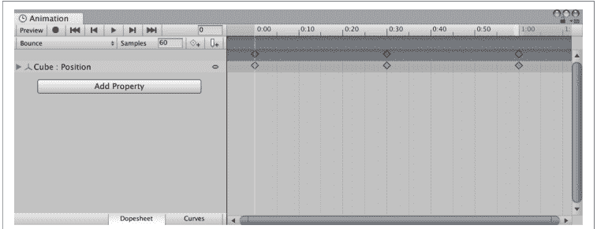

图 8-2. Animation 面板，显示动画的关键帧

我们现在可以测试动画了：

+   1. 点击 Animation 面板中的 Play 按钮，立方体将上下移动。这为您提供了一种预览动画效果的良好方式。
+   2. 运行游戏，动画将在游戏开始时立即播放。

#### 讨论

动画系统最重要的组件之一是动画控制器（animator controller）。动画控制器允许您控制当前播放的动画片段，并以流程图形式的图表结构来组织每个动画片段何时以及如何播放。


动画控制器是一个状态机。有关状态机和动画的更多信息，请参阅 Unity 手册。

即使只有一个或两个片段（如我们刚刚为立方体添加动画的情况），您也需要使用动画控制器，因为它使管理和控制动画的行为变得更加容易。动画控制器中的每个节点可以代表特定的动画，或者另一个嵌套的动画控制器。使用此系统您可以创建不同的行为，提供了近乎无限的可能性！

动画控制器管理的具体动画片段可以是导入的——例如，来自动作捕捉系统或来自艺术家在其他软件（例如，Maya）中创建的动画——也可以是在 Unity 内部创建的，如我们在此处所做的那样。

在动画片段内部，可以有任意数量的属性可以动画化——例如位置、颜色、旋转和缩放——并且这些属性可以具有动画曲线。动画曲线决定了该属性随时间的变化方式。图 8-3 展示了 Curves 面板的一个示例。

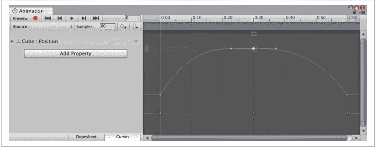

图 8-3. Curves 面板

本章中的其他示例进一步剖析了动画系统的工作方式，而 Unity 的文档也相当全面。

### 8.2 基本角色移动

#### 问题

您希望让角色根据其速度播放不同的动画。您希望该动画控制角色的移动。


在这个示例以及本章中的许多其他示例中，我们将使用 Unity 发布的免费动作捕捉动画，这些动画在线可用。该包还包含一个简单的角色模型，我们将用它来演示动画。

#### 解决方案

首先，我们将创建一块供角色行走的地面：

+   1. 打开 GameObject 菜单并选择 3D Object → Cube，以创建一个新的立方体。
+   2. 将立方体的缩放（scale）设置为 (20, 1, 20)。这使其变得宽而平。


如果您愿意，可以为立方体添加纹理材质（参见示例 6.1）。这不会影响您的动画行为，但它可以让您更容易在视觉上辨别角色是否在移动。

为了讨论如何为角色添加动画，我们现在需要一个角色！因此，让我们从将角色添加到场景中并设置一个简单的动画控制器开始：

+   1. 下载并导入 Raw Mocap Data 包。


有关导入和管理资产的提醒，请参见第 1 章。

+   2. 找到 DefaultAvatar 模型，并将其添加到您的场景中（参见图 8-4）。
+   3. 创建一个新的动画控制器，并将其添加到 DefaultAvatar 上。


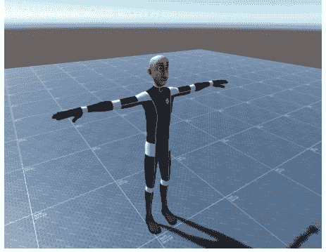

图 8-4. DefaultAvatar 模型

接下来，我们将为角色添加默认状态，该状态将是一个闲置动画：

+   1. 通过在 Project 选项卡中搜索来定位 Idle_Neutral_1 动画。你会找到两个同名项：动画本身以及动画导入的文件。将动画拖入动画控制器中（它有一个灰色图标，中间有一个播放符号，如图 8-5 所示）。
+   2. 播放游戏。角色将播放其闲置动画。

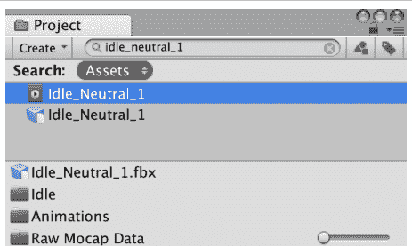

图 8-5. 定位 Idle_Neutral_1 动画

接下来，我们将在控制器上创建一个参数，该参数将控制角色处于哪个动画状态：

+   1. 打开 Parameters 选项卡，点击 + 按钮。选择 Float。将会添加一个新参数。
+   2. 将新参数命名为“Speed”。

我们现在将制作一个新脚本来控制动画控制器的 Speed 参数：

+   1. 创建一个名为 CharacterMovement.cs 的新 C# 脚本，并将以下代码添加到其中：

```
// Allows the control
public class CharacterMovement : MonoBehaviour {

    // The animator whose parameters we are controlling
    Animator animator;

    [SerializeField] float speed = 1f;

    // Use this for initialization
    void Start () {
        animator = GetComponent<Animator>();
    }

    void Update () {

        animator.SetFloat("Speed",
            Input.GetAxis("Vertical") * speed);
    }
}
```

这会创建一个新的 Animator，将 speed 字段暴露给 Inspector，并使用 Update 函数根据“Vertical”输入轴（有关使用 Unity Input System 的详细信息，请参阅第 3 章）是否被使用来设置速度。简单来说：这设置了如果角色被要求向前移动，则播放正确的动画。

+   2. 向角色添加一个 CharacterMovement 组件。

接下来，我们将为角色添加另一个动画状态并设置它们之间的转换：

+   1. 选择角色，并进入 Animator 面板。
+   2. 定位 Run_Impulse 动画，并将其拖入 Animator。将会创建一个新状态。

3. 右键单击 Idle_Neutral_1 状态，选择 Make Transition。单击 Run_Impulse 状态。将会创建一条连接它们的线。

我们现在需要配置此转换，使其在 Speed 参数高于某个阈值时应用：

+   1. 选择该线，并进入 Inspector 底部 Conditions 列表。
+   2. 点击 + 按钮，将会添加一个新条件。控制器中只有一个参数，因此它会自动被选中。确保模式设置为 Greater，并将值设置为 0.1。这意味着当 Speed 参数大于 0.1 时，此转换将应用。
+   3. 关闭 Has Exit Time 设置。这意味着此转换可以在任何时候应用，而无需等待当前动画完成。

完成后，Inspector 应该看起来像图 8-6。

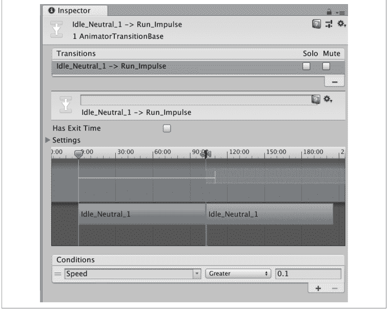

图 8-6. 从闲置动画到奔跑动画的转换设置

我们现在将设置当速度降至 0.1 以下时发生的转换：

+   1. 右键单击 `Run_Impulse` 状态，选择 Make Transition。单击 `Idle_Neutral_1` 状态。
+   2. 选择你刚刚创建的新转换，并像上一个一样设置它。不过，这次将条件的模式设置为 Less，而不是 Greater。这将使转换在速度降至 0.1 以下时发生。
+   3. 播放游戏。按住上箭头键或 W 键，角色将开始向前行走。

#### Discussion

我们在此使用的 Speed 参数称为 *动画参数*。动画参数只能有四种类型：整数、浮点数、布尔值或触发器。触发器是一个布尔值，只是它在被设置为 true 的下一帧后会自动返回到 false 状态（使其非常适合一次性触发，如跳跃或死亡）。

正如我们在本示例中演示的那样，动画参数可以从脚本中设置。在此例中，我们使用 `SetFloat` 从脚本访问 Speed 参数。你经常会发现自己从脚本修改动画参数，以应对诸如用户输入（正如我们在此所做的）或游戏世界中的碰撞等情况。

你可能已经注意到角色在动画播放时在场景中移动了，即使我们从未明确要求它移动。这不是魔法：它被称为 *根运动*，它涉及动画本身移动被动画化的对象。这保证了对象以正确的速度移动。

在旧的动画系统中，有时使用一种称为 *跑步机运动* 的技术，其中动画播放，被动画化的对象始终保持在其原点，你会使用脚本以正确的速度和方法移动对象。根运动消除了这样做的麻烦，因为动画本身可以控制对象需要移动多远。


根运动可能有点难以理解，但它实际上只是几个相互协作组件的结果。你可以在 Unity 手册中了解更多关于根运动的信息。

### 8.3 Inverse Kinematics

#### Problem

你想要使用逆向运动学使角色的手臂或脚指向空间中的某一点。

#### Solution

为了演示这一点，我们将设置场景以包含一个播放闲置动画的角色。逆向运动学动画将叠加在闲置动画之上。


本食谱使用了 Recipe 8.2 中使用的 Raw Mocap Data 包和地面。

要使用逆向运动学：

+   1. 添加一个地面到场景中，按照 Recipe 8.2 中的相同步骤进行。
+   2. 将 DefaultAvatar 对象添加到你的场景中。将其重命名为“IK Character”（inverse kinematics 的缩写，我们稍后会解释）。
+   3. 打开 Assets 菜单，选择 Create → Animator Controller。将新资源命名为“IK Movement。”
+   4. 选择 IK Character，并将你刚刚创建的 IK Movement 控制器拖入 Animator 组件的 Controller 槽中。
+   5. 在 IK Character 仍被选中的情况下，通过打开 Window 菜单并选择 Animation → Animator 来进入 Animator 选项卡。
+   6. 定位你导入的 Idle_Neutral_1 动画剪辑，并将其拖放到 Animator 中。
+   7. 通过按 Play 按钮测试你的角色。角色将站立并执行闲置动画。

我们现在准备将逆向运动学添加到动画设置中。首先，我们需要启用当前层的 IK：

+   1. 打开你的动画控制器，并进入 Layers 选项卡。
+   2. 点击基础层的齿轮图标。
+   3. 打开 IK Pass。图层列表现在应该看起来像图 8-7。

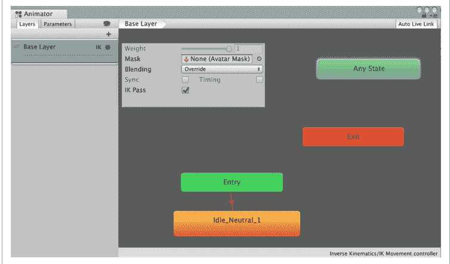

图 8-7. 在动画控制器的基础层上启用 IK Pass

接下来，我们将创建一个脚本来告诉动画控制器要伸向什么，以及用什么伸向：

+   1. 创建一个名为 IKReach.cs 的新 C# 脚本，并将以下代码添加到其中：

```
// Updates the positions and weights used for a specified IK goal.
// The Animator attached to the object this script is on must have a
// layer that has an IK pass enabled. Otherwise, OnAnimatorIK won't
// be called.
[RequireComponent(typeof(Animator))]
public class IKReach : MonoBehaviour {

    // The object we're reaching toward.
    [SerializeField] Transform target = null;

    // An IK goal is a foot or hand that's reaching to a target.
    [SerializeField] AvatarIKGoal goal = AvatarIKGoal.RightHand;
```

```
// The strength with which we're reaching our goal toward the
// target. 0 = don't reach at all; 1 = the goal must be at the same
// point as the target, if it's within range.
[Range(0, 1)]
[SerializeField] float weight = 0.5f;

// The animator that's controlling the positions.
Animator animator;

// Cache the reference to the animator on start.
private void Start()
{
    animator = GetComponent<Animator>();
}

// Called every time the animator is about to apply inverse
// kinematics, which will bend the various joints to try to reach
// the goals toward their targets. This is our opportunity to
// provide it with updated information.
private void OnAnimatorIK(int layerIndex)
{
    // Set the position that the goal is trying to reach.
    animator.SetIKPosition(goal, target.position);

    // Set the weight for the goal.
    animator.SetIKPositionWeight(goal, weight);
}
```

此脚本允许我们定义将要伸向的对象，以及模型的哪一部分在进行伸展，并执行所需的动画以使模型始终适当朝向目标对象移动。

+   2. 向角色添加一个 IKReach 组件。

+   3. 在场景中创建一个球体，并将其缩小到网球大小左右。将它放置在角色附近（图 8-8）。

+   4. 使 IKReach 组件的 Target 字段引用你刚刚添加的球体。

播放游戏。角色将伸向目标。当你在 Scene 视图中移动目标时，角色的姿势会发生变化。


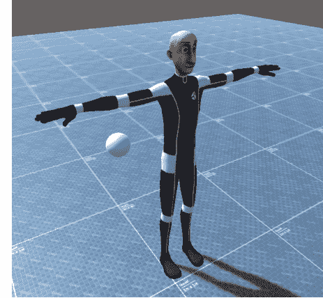

Figure 8-8. The scene setup for this recipe: the avatar, with a sphere placed within reach

#### Discussion

*Kinematics* refers to the movement of points and objects. Traditional animation in video games starts at a parent (joint), and then flows outward to the remainder of the connected elements, through the joints. This is called *forward kinematics*.

*Inverse kinematics* is the opposite: you want the outermost element to be in a specific place, so what needs to be done to align the entire system there? This is useful in video games when you want a character to correctly stand on the floor, navigate stairs and ramps, or hold or touch objects that might move around the world.

Unity’s animation system supports inverse kinematics for any humanoid character that’s correctly configured for the system.

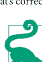

Inverse kinematics can be very complicated if you’re implementing it from scratch. Unity’s animation system abstracts away many of the details. Learn more about how it works in the Unity manual.

Inverse kinematics is a valuable technique for building characters that can interact realistically with their world. It’s not useful solely for humanoids (though it is built for them!), so you could also create inverse kinematics for tentacles, or multilegged robots, or anything that needs to reliably and realistically interact with the rest of a game world.

### 8.4 Masked Movement

#### Problem

You want to play an animation that applies only to certain body parts. For example, you might want a humanoid character to wave its hands around while running.

#### Solution

To demonstrate this, we’ll build upon the character that can run around, and then we’ll add another animation that affects only the arms:

- 1. Follow the steps in Recipe 8.2. We’ll also modify one animation that comes with the Raw Mocap Data asset pack. In this example, we’ll create an animation clip in which the character reaches out and grabs something in front of it with its right arm. To do this, we’ll trim an existing clip to include only the motion we want.
- 2. Locate the IdleGrab_Neutral asset in the downloaded assets, and select it.
- 3. In the Inspector, go to the Animation tab.
- 4. Set the animation Start and End frames to 151 and 253, respectively (Figure 8-9). This is the range of the animation clip that contains the motion we want.
- 5. Click the Apply button at the bottom of the Inspector.
- 6. Select the character, and go to the Animator tab by opening the Window menu and choosing Animation → Animator.


You may see a notice about warnings found when importing the rig. These can be safely ignored in this case—they don’t affect the work we’re doing here.

#### Inspector

#### IdleGrab_Neutral Import Settings

Model Rig Animation Materials

Import Constraints

Import Animation

> Warning(s) found while importing rig in this animation file. Open "Rig" tab for more details.

Bake Animations

Anim. Compression Keyframe Reduction

Rotation Error 0.5

Position Error 0.5

Scale Error 0.5

Rotation error is defined as maximum angle deviation allowed in degrees, for others it is defined as maximum distance/delta deviation allowed in percents

Animated Custom Pro

| Clips | Start | End |
| IdleGrab_Neutral | 151.0 | 253.0 |

IdleGrab_Neutral

Length 3.400 30 FPS

Start 151 End 253

Loop Time

Loop Pose

Cycle Offset 0

Root Transform Rotation

Bake Into Pose

Based Upon Body Orientation

Offset 0

Figure 8-9. The import settings for the IdleGrab_Neutral animation

- 7. Create a new parameter by going to the Parameters tab and clicking the + button. Click Trigger in the menu that appears. Name the new trigger “Grab.”
- 8. Create a new layer by going to the Layers tab and clicking the + button. Name the new layer “Arms.” Click the Gear icon, and set the weight to 1.
- 9. Create a new state by right-clicking in the controller and choosing Create State → Empty. Name this new state “Passive.”
- 10. Drag and drop the IdleGrab_Neutral animation into the Animator.
- 11. Right-click the Passive state, and choose Make Transition. Select the Idle Grab_Neutral animation, and a new transition will be made from Passive to IdleGrab_Neutral. Repeat the process in the other direction: make a transition from IdleGrab_Neutral to Passive.
- 12. Select the transition from Passive to IdleGrab_Neutral, and in the Inspector, turn off Has Exit Time. This will make the transition happen immediately.
- 13. While you’re here, add a new condition to the transition by clicking the + button in the Conditions area and selecting the Grab parameter.

What we’ve done here is set up a layer that contains two animations: an empty animation named Passive, and an animation in which the character performs a grabbing motion. The grabbing motion is performed when the Grab trigger is used.

However, there’s a problem: the IdleGrab_Neutral animation affects not just the arm, but the whole body. This means that we can’t blend a grabbing animation with anything else, like walking. To make it so that the grabbing animation affects only the arm, we use an avatar mask to make the layer apply only to certain body parts:

- 1. Create a new avatar mask by opening the Assets menu and choosing Create → Avatar Mask.
- 2. Select the new mask, and click anywhere outside the figure of a person to deselect all body parts. Next, select the right arm. (This is on the left side of the image; pretend that the figure is facing you.) See Figure 8-10 for what the avatar settings should look like.
- 3. Go to the Arm layer in the Animator, and set the Mask property to the avatar mask you just created (Figure 8-11). This will make any animations playing on this layer affect only the specified body parts.
- 4. Test the animation by playing the game. As usual, you can move the character; when you select the Grab trigger parameter (by opening the Animator, selecting the Parameters pane, and clicking the Grab trigger), the character will extend its arm, and this will combine with other parts of the animation.

Inspector

Grab Mask

Humanoid

Open

Transform

Asset Labels

Figure 8-10. The avatar mask, with everything but the character's right arm selected

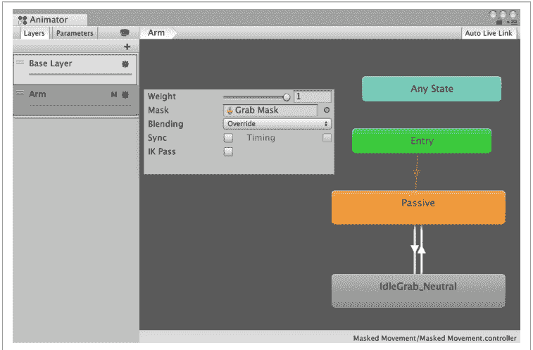

Figure 8-11. The Arm layer of the animator controller, configured to use the avatar mask

#### Discussion

Animation layers can be used to override or add to earlier layers. The different weights that can be set on each animation layer allow you to control how much influence that layer has over the final pose.

You can run multiple animations at the same time by creating multiple layers. Animation masks are used to control which parts of the rig are affected by which layers, and by adjusting the weight of different layers you can allow multiple animations to affect the same parts of the rig.

An avatar is a mapping of common components, such as arms or legs, to specific bones in the animation rig. This allows you to reuse animations across different meshes, even if the bones aren’t quite the same.

### 8.5 Blended Movement

#### Problem

You want to blend between multiple animations. For example, you have a walking animation and a running animation, and you want to smoothly blend between the two as a character’s speed increases.

#### Solution

Use a blend tree, which is an animation state that blends between two or more animation clips:

- 1. Add a floor to the scene, following the same steps as in Recipe 8.2.
- 2. Add the DefaultAvatar object to your scene. Rename it “Blended Movement Character.”
- 3. Open the Assets menu, and choose Create → Animator Controller. Name the new asset “Blended Movement.”
- 4. Select the Blended Movement character, and drag the Blended Movement controller that you just created into the Animator component’s Controller slot.
- 5. With the Blended Movement character still selected, go to the Animator tab by opening the Window menu and choosing Animation → Animator.
- 6. Add a new Float parameter to the controller by going to the Parameters tab, clicking the +, and choosing Float. Name the new parameter “Speed.”
- 7. Right-click in your animator controller, and choose Create State → From New Blend Tree.
- 8. Double-click the new state, and you’ll be taken to the details of the blend tree.
- 9. Select the Blend Tree node, and set its parameter to “Speed.” This is the parameter that the blend tree will use to decide which animation clips to use.
- 10. Drag the following animation clips into the blend tree’s Inspector, and use the specified thresholds and speeds. When you’re done, the Inspector should look like Figure 8-12, and the controller should look like Figure 8-13.
  - WalkFWD; threshold: -1.5, speed: -1
  - Idle_Neutral_1; threshold: 0, speed: 1


+   - WalkFWD; threshold: 1.5, speed: -1
+   - Run_Impulse; threshold: 5, speed: -1

11. 通过按 Play 按钮测试游戏。按住上箭头键使角色向前行走。当角色的速度为 0 时，角色会保持空闲状态。随着速度的增加，角色会从行走动画过渡到奔跑动画。


调整 Character Movement 脚本中的 Speed 变量，并观察它对动画的影响。

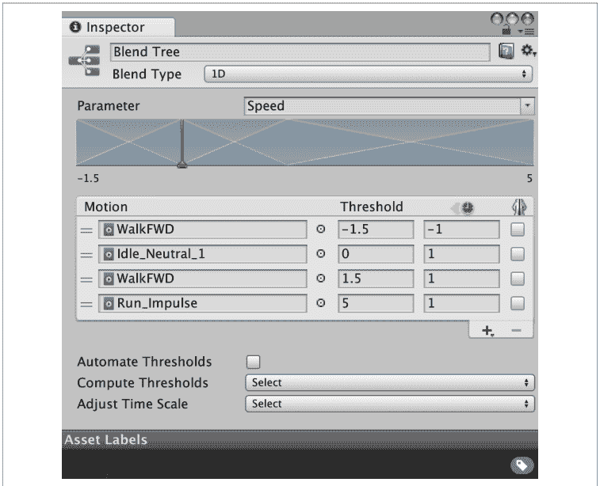

图 8-12。四个状态的 blend tree

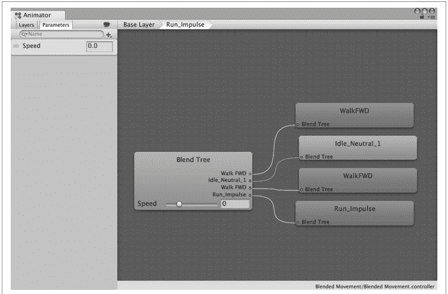

图 8-13。blend tree 的控制器

#### Discussion

Blend trees 与动画控制器上的一个参数协同工作。根据参数的值，blend tree 会混合不同的动画片段。在图 8-12 中，你可以看到一个包含四个片段的 blend tree，可实现向后行走、站立不动、向前行走和向前奔跑。

blend tree 有多种类型，包括 2D blend trees。当你想要移动的两个方向时，这很有用（例如，前后和左右）。图 8-14 中的 2D blend tree 的示例；该 blend tree 使用两个参数，一个用于前后运动，一个用于侧向运动。当角色仅施加向前运动时，会播放常规的奔跑动画；当角色仅施加侧向运动时，会播放转身动画；当两者同时施加时，会播放边跑边转的动画。

图 8-14。具有两个独立控制参数的 2D blend tree

### 8.6 Navigation and Animating in Sync

#### Problem

你已设置一个使用导航网格的角色，并且希望角色的动画系统能够响应导航代理在世界中的移动，使角色看起来更逼真。

#### Solution

你可以获取导航代理如何移动的信息，并将其用于为动画控制器的参数提供信息：

+   1. 执行 Recipe 8.5 中的步骤，设置一个支持前后和左右移动的角色。
+   2. 通过遵循 Recipe 10.3 中的步骤，设置你的角色使其使用导航网格工作。
+   3. 创建一个新的 C# 脚本，命名为 NavigationAnimator.cs，并向其中添加以下代码：

```
using UnityEngine.AI;

// Uses the NavMeshAgent to drive parameters on the Animator.
[RequireComponent(typeof(NavMeshAgent))]
[RequireComponent(typeof(Animator))]
public class NavigationAnimator : MonoBehaviour
{
    // Selects what the final position of the object is controlled by.
    enum Mode {
        // The agent directly controls the object's position. More
        // accurate, but causes foot sliding (because the animator isn't
        // moving at the exact speed of the agent).
        AgentControlsPosition,

        // The animator's root motion controls the object's position.
        // Looks better, but less accurate because the motion that
        // results won't precisely match what the agent wants to do.
        AnimatorControlsPosition
    }

    // The mode that this script is operating in.
    [SerializeField] Mode mode = Mode.AnimatorControlsPosition;

    // The names of the parameters that this script will control.
    [SerializeField] string isMovingParameterName = "Moving";
    [SerializeField] string sidewaysSpeedParameterName = "X Speed";
```
```
[SerializeField] string forwardSpeedParameterName = "Z Speed";

// Cached references to components we'll be accessing every frame.
Animator animator;
NavMeshAgent agent;

// Stores the movement we did last frame, so that we can smooth out
// our movement over time.
Vector2 smoothDeltaPosition = Vector2.zero;

void Start()
{
    // Cache references to the animator and the nav mesh agent.
    animator = GetComponent<Animator>();
    agent = GetComponent<NavMeshAgent>();

    // The animator will potentially be in charge of our position,
    // not the agent. Disable the agent's ability to directly set
    // this object's position. (The agent will retain the ability
    // to rotate the object.)

    agent.updatePosition = false;
}

void Update()
{
    // The agent stores where it wants to move next in
    // agent.nextPosition.

    // Calculate how far we currently are from where the agent
    // wants to be, in world space.
    Vector3 worldDeltaPosition =
        agent.nextPosition - transform.position;

    // Convert this to local space; we need to know how much of a
    // movement in the x and z planes this would be.
    float xMovement =
        Vector3.Dot(transform.right, worldDeltaPosition);
    float zMovement =
        Vector3.Dot(transform.forward, worldDeltaPosition);

    Vector2 localDeltaPosition = new Vector2(xMovement, zMovement);

    // Smooth out this movement by interpolating from the last
    // frame's movement to this one.
    float smooth = Mathf.Min(1.0f, Time.deltaTime / 0.15f);
    smoothDeltaPosition = Vector2.Lerp(smoothDeltaPosition,
        localDeltaPosition, smooth);
```

```
// Figure out our velocity.
var velocity = smoothDeltaPosition / Time.deltaTime;

// We need to tell the animator that we're moving when our
// velocity exceeds a threshold, and we're not too close
// to the destination.
bool shouldMove = velocity.magnitude > 0.5f &&
            agent.remainingDistance > agent.radius;

// We now have all the information we need to tell the animator
// what to do. Update its parameters; the animator controller
// will play the right animation. This updates the animation's
// root position as well, which we can optionally use to control
// or influence the object's position.

// We're providing three parameters here.
// - 'Moving' is a bool that unambiguously indicates whether we
//   want to be idle or moving.
// - X and Z speed are intended to control a 2D blend tree.
// - Z speed is forward and backward, while X speed is left and
//   right.

// This can also work with a 1D blend tree, where Z speed is the
// only parameter, but if you do this, you should use this
// script in AgentControlsPosition mode.
//
// This is because if your animator controller doesn't have any
// animations that move the root position sideways, the animator
// will find it difficult to make the kinds of turns that the
// agent may try, and the result will be the visible object
// jumping around onscreen as a result of repeatedly moving too
// far from the agent. Play with your blend trees and
// animations to get good-feeling movement.

animator.SetBool(isMovingParameterName, shouldMove);
animator.SetFloat(sidewaysSpeedParameterName, velocity.x);
animator.SetFloat(forwardSpeedParameterName, velocity.y);

// Is the animator controlling our position, instead of
// the agent?
if (mode == Mode.AnimatorControlsPosition) {

    // If the animator is controlling our position, the agent
    // will start drifting away from the object. If this happens,
    // you'll start seeing visual glitches caused by the
    // navigation logic not matching the visible object onscreen.

    // To fix this, we'll detect if the object is significantly
    // far from the agent. "Significantly" means it's more
    // than one agent-radius away from the agent's position
```

```
// (that is, the object is outside the agent's cylinder).

// When this happens, we'll start bringing the object closer
// to the agent's position. This reduces animation realism
// slightly, because it's movement that's not reflected in
// the motion of the character, but it prevents larger
// errors from accumulating over time.

// Is the object's position far from where the agent wants
// to be?
if (worldDeltaPosition.magnitude > agent.radius)
{
    // Bring us closer to where the agent wants to be
    transform.position = Vector3.Lerp(transform.position,
        agent.nextPosition,
        Time.deltaTime / 0.15f);
}
}

void OnAnimatorMove()
{
    // Which mode is this script in?
    switch (mode)
    {
        case Mode.AgentControlsPosition:
            // Move the object directly where the agent wants
            // to be.
            transform.position = agent.nextPosition;
            break;
        case Mode.AnimatorControlsPosition:
            // Update our position to where the animation system has
            // placed us, following the animation's root movement.

            // Override the movement in the y-axis to where the
            // agent wants to be (otherwise, we'll just pass through
            // hills, stairs, and other changes in ground height).

            Vector3 position = animator.rootPosition;
            position.y = agent.nextPosition.y;
            transform.position = position;
            break;
    }
}
```

+   4. 向该对象添加一个 NavigationAnimator 组件。


当导航代理开始移动到另一个位置时，它会更新动画控制器的参数。

#### 讨论

让导航代理在移动时进行动画涉及一些事情。最重要的方面是，每一帧都会检查对象的模式是代理控制其位置，还是动画师控制位置。然后根据模式触发正确的动画系统。

### 8.7 影院式摄像机追踪

#### 问题

你想要创建一个影院风格的摄像机，并设置它始终保持某个对象在视野中。

#### 解决方案

最好的方法是使用 Cinemachine 包。Cinemachine 是一个程序化摄像机系统，旨在提供影院风格的摄像机控制系统。

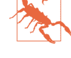

如果你阅读 Unity 的文档，你可能会发现有关从 Unity Asset Store 获取 Cinemachine 的引用。最新版本很久以前就已从 Unity Asset Store 迁移到 Unity Package Manager，但有关 Cinemachine 的一些文档仍包含从 Asset Store 获取它的说明；不要这样做！Asset Store 中的版本虽然仍然可用，但不是最新版本，不会更新，并且不一定包含你期望或需要的功能。务必始终从 Package Manager 获取 Cinemachine 的副本。有关 Package Manager 的复习，请参阅第 1 章。

首先，安装 Cinemachine 包：

- 1. 打开 Window 菜单，并选择 Package Manager。
- 2. 在 All 选项卡中，找到 Cinemachine 包，并点击 Install。

接下来，我们将设置一个 Cinemachine 虚拟摄像机：

- 1. 打开 Cinemachine 菜单，并选择 Create Virtual Camera（图 8-15）。
  这将创建并选择一个新的虚拟摄像机。
- 2. 将虚拟摄像机放置在场景中的某个位置。
- 3. 将你想要摄像机注视的对象拖入虚拟摄像机的 Look At 槽中（图 8-16）。
- 4. 运行游戏。摄像机将注视目标！

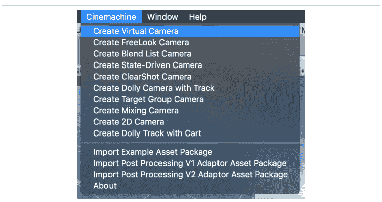

图 8-15. 创建虚拟摄像机

图 8-16. 配置虚拟摄像机以注视目标

#### 讨论

Cinemachine 使用虚拟摄像机，它们并不是真正的摄像机：它们的行为更像现实世界中的摄像机操作员，并控制真实摄像机的位置、方向、镜头设置等。虚拟摄像机本身不进行渲染。Cinemachine 虚拟摄像机由——听起来有点不祥的——Cinemachine 脑控制。

Cinemachine 脑将真实的 Unity 摄像机与虚拟的 Cinemachine 摄像机连接起来。因为在大多数影院场景中很可能存在多个虚拟摄像机，所以大脑会根据你分配的优先级监控情况，并在必要时在摄像机之间进行混合，将虚拟摄像机的状态应用到真实摄像机上，如图 8-17 所示。

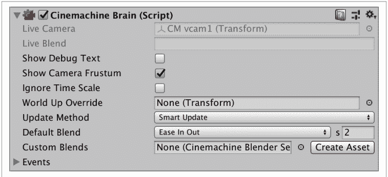

图 8-17. 配置摄像机大脑


你可以通过阅读 Cinemachine 文档和 Unity 的 Cinemachine 教程系列来了解更多关于 Cinemachine 的信息。

### 8.8 自动切换摄像机

#### 问题

场景中有多个摄像机，你希望 Cinemachine（参见配方 8.7）自动在它们之间切换，以便目标对象始终保持在视野中。

#### 解决方案

这里的解决方案是使用 Cinemachine ClearShot 摄像机：

- 1. 打开 Cinemachine 菜单，并选择 Create ClearShot Camera。
- 2. 选择 ClearShot 对象，并将你想要保持视野的目标拖入 Look At 字段。
- 3. 将任意数量的虚拟摄像机作为 ClearShot 组的子对象添加。

#### 讨论

ClearShot 是一个具有一个或多个虚拟摄像机作为其子对象的对象，并配置为注视某个目标。它会从其不同的子对象中选择哪个摄像机对目标的拍摄效果最佳。


在 Unity Scripting API 参考中了解更多关于 ClearShot 摄像机的信息。

### 8.9 保持多个对象在视野中

#### 问题

场景中有多个对象，你希望摄像机尝试同时将它们全部保持在视野中。

#### 解决方案

要同时保持大量对象在视野中，你需要使用 Cinemachine Look At Group。要创建 Look At Group：

- 1. 创建一个新的空游戏对象，并将其命名为“Look At Group。”
- 2. 向其添加一个新的 CinemachineTargetGroup 组件。
- 3. 在目标列表中，你可以指定你希望 Look At Group 引用的 Transform 列表（图 8-18）。
- 4. 当你希望摄像机注视整个组时，将摄像机的 Look At 属性设置为引用 Look At Group，而不是目标本身。

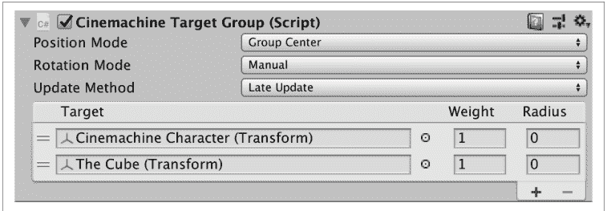

图 8-18. 创建 Look At Group

#### 讨论

这基本上就是字面上的意思。你可以在 Unity Scripting API 参考中了解更多信息。

### 8.10 推拉摄像机

#### 问题

你希望摄像机移动以保持对象在画面中，但你希望确保摄像机仅沿固定轨道移动。这称为轨道摄像机。

#### 解决方案

要创建轨道摄像机：

- 1. 打开 Cinemachine 菜单，并选择 Dolly Camera with Track。
  这将创建两个对象：一个摄像机和一个供其跟随的轨道。摄像机将始终位于轨道上的某个位置，尽管它可以自由旋转以注视其 Look At 目标。它将沿轨道重新定位以靠近其 Follow 目标。
- 2. 配置摄像机的 Look At 和 Follow 属性以引用你想要跟踪的对象（图 8-19）。
- 3. 选择 Dolly Track，并配置你希望轨道从何处到何处。你也可以在起点和终点之间创建点以创建弯曲的轨道（图 8-20）。

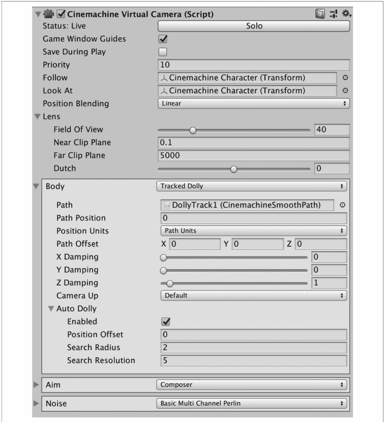

图 8-19. 配置虚拟摄像机的 Look At 和 Follow 属性，使其跟随轨道

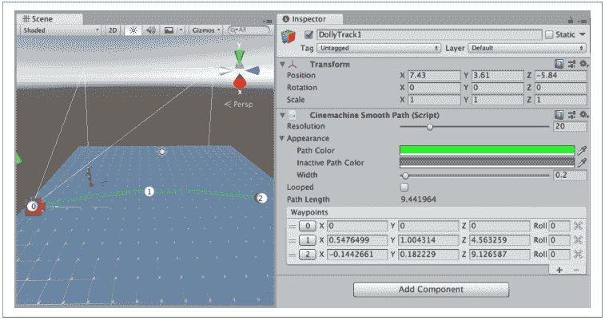

图 8-20. 为摄像机构建要跟随的轨道

#### 讨论

“轨道摄像机”是电影制作中的术语：轨道车是一种带轮子的手推车，真实的物理摄像机被放置其上以创建平滑的水平移动。轨道摄像机在你想要平滑地经过某物或在游戏中营造更具电影感的效果时很有用。


你也可以使用轨道摄像机来创建推拉变焦效果，即摄像机在移动接近某物的同时同时进行拉远变焦。这使得焦点中的对象看起来保持相同的大小，而其他一切都发生透视扭曲。我们很喜欢它，因为它在《战星战舰》电视剧中被用得非常出色，当飞船跳跃时！
