## 逻辑与游戏玩法

逻辑和游戏玩法有许多不同的形式，可能意味着许多不同的东西：从让某物表现得像一辆汽车，到让玩家用鼠标选择对象，到摄像机行为。在本章中，我们将提供配方和解决方案，解决我们在 Unity 开发人员中发现自己一次又一次地在项目中或游戏中构建的一些功能。这些是许多 Unity 项目的基本构建块，但不一定由 Unity 提供。


本章远非包含你所需的所有游戏玩法解决方案！Game Developer 上游戏开发者发布的文章是获取更多此类内容的绝佳资源。在你的游戏开发职业生涯中，你会发现自己一次又一次地在游戏中反复实现本章中的许多配方。

### 9.1 加载新的场景文件

#### 问题

你想要加载一个新的场景文件。


加载新的场景文件是加载游戏不同关卡的好方法！但这是一种通用技术，不只适用于关卡。因为场景可用于任何事物，包括菜单、记分板等，转换到新场景并不总是意味着加载新关卡。


#### 解决方案

要加载一个场景，你首先需要告诉 Unity 你希望将该场景包含在你的项目中。如果不这样做，该场景将不会包含在任何构建版本中，并且你将无法加载它。

要管理项目中的场景列表，请打开 File 菜单并选择 Build Settings。Build Settings 屏幕将会出现（图 9-1）。要将场景标记为可加载，请从 Project 选项卡中的 Assets 文件夹将其拖放到屏幕顶部列表中。

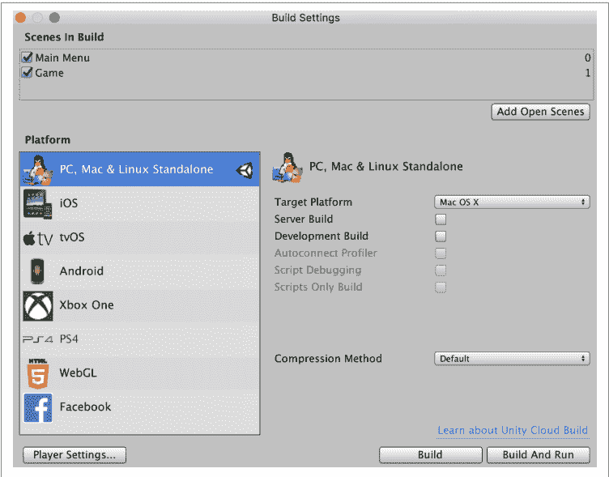

图 9-1。Build Settings 屏幕中的场景列表，其中添加了两个场景

现在你可以编写加载场景的代码了。要使用负责为你处理场景加载的 SceneManager 类，你需要在脚本顶部包含以下 using 指令：

```
using UnityEngine.SceneManagement;
```

加载新场景就像调用 SceneManager.LoadScene 并提供场景名称一样简单。Unity 然后会加载新场景并卸载当前场景：

```
// Loads the scene named "Game," replacing the current scene; stops the
// game until loading is done (so don't load big scenes this way!)
SceneManager.LoadScene("Game");
```

重要的是要记住，如果你以这种方式加载场景，你的项目会在新场景加载时暂停。如果加载需要一段时间，这可能会让用户感到烦恼，他们可能会认为项目已冻结或崩溃。

为了避免这种情况，你可以在后台加载场景。使用 SceneManager 类的 LoadSceneAsync 方法，它会在后台开始加载场景并返回一个对象，你可以使用它来衡量加载需要多长时间，以及是否已完成加载：

```
public void LoadLevelAsync() {
    // Start loading the scene; we'll get back an object that represents
    // the scene loading operation

    var operation = SceneManager.LoadSceneAsync("Game");

    Debug.Log("begin load...");

    // Don't proceed to the scene once loading has finished
    operation.allowSceneActivation = false;

    // Start a coroutine that will run while the scene loads, and will run
    // some code after loading finishes
    StartCoroutine(WaitForLoading(operation));
}

IEnumerator WaitForLoading(AsyncOperation operation)
{
    // Wait for the scene load to reach at least 90%
    while (operation.progress < 0.9f)
    {
        yield return null;
    }

    // We're done!

    Debug.Log("Done load.");

    // Enabling scene activation will immediately start loading the scene
    operation.allowSceneActivation = true;
}
```

你的项目可以同时加载多个场景。例如，你可能有一个场景包含重要的对象，如逻辑或游戏管理器、输入系统和 UI，然后再为游戏关卡单独设置一个场景。

要在另一个场景之上加载一个场景，请在调用 LoadScene 时指定 LoadSceneMode 为 Additive。这将加载场景并将其添加到当前已加载的场景之上。你可以加载尽可能多的场景，只要内存允许：

```
public void LoadLevelAdditive() {
    // Load the scene in addition to the current one
    SceneManager.LoadScene("Game", LoadSceneMode.Additive);
}
```

你也可以卸载通过 additive 方式加载的关卡，从项目中移除它及其内容。方法是调用 UnloadSceneAsync：

```
public void UnloadLevel() {
    // Unloading a scene is an async operation, much like loading can be
    var unloadOperation = SceneManager.UnloadSceneAsync("Game");

    // If you want to run code after the unloading has completed, start a
    // coroutine (again, just like loading)
    StartCoroutine(WaitForUnloading(unloadOperation));
}
```

```
IEnumerator WaitForUnloading(AsyncOperation operation) {
    yield return new WaitUntil(() => operation.isDone);

    // Unloading has completed, and all objects that were in the scene
    // have been removed. However, Unity will not unload the assets that
    // those objects referred to, like the textures. These stay in memory
    // for later use by other objects; to free up the memory, do this:

    Resources.UnloadUnusedAssets();
}
```

#### 讨论

你也可以在编辑器中加载多个场景。要做到这一点，右键单击你想要打开的场景并选择 Open Scene Additive。附加场景将出现在 Hierarchy 中（图 9-2）。当两个场景打开时，你可以在它们之间拖放对象。

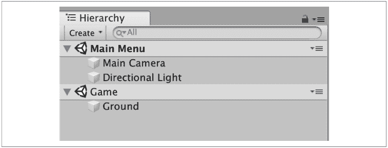

图 9-2。Hierarchy 选项卡，同时加载了两个场景

### 9.2 管理生命值

#### 问题

你希望对象在被另一种类型的对象击中时受到伤害。当它们受到足够多的伤害时，它们会被销毁。

#### 解决方案

解决方案的第一部分是创建三个脚本：

- 1. 创建一个新的 C# 脚本名为 DamageReceiver.cs，它可以接收对象已受损的信号，并具有可以减少的生命值数量：

```
public class DamageReceiver : MonoBehaviour {
    UnityEngine.Events.UnityEvent onDeath;
    [SerializeField] int hitPoints = 5;
    int currentHitPoints;
    private void Awake()
    {
        currentHitPoints = hitPoints;
    }
}
```

```
public void TakeDamage(int damageAmount)
{
    currentHitPoints -= damageAmount;

    if (currentHitPoints <= 0)
    {
        if (onDeath != null)
        {
            onDeath.Invoke();
        }

        Destroy(gameObject);
    }
}
```

- 2. 接下来，创建一个新的 C# 脚本名为 DamageGiver.cs，它检测一个对象是否与另一个对象发生碰撞；如果该其他对象上有 DamageReceiver，则通知它已受到伤害：

```
public class DamageGiver : MonoBehaviour {

    [SerializeField] int damageAmount = 1;

    // Called when the object collides with another
    private void OnCollisionEnter(Collision collision)
    {
        // Does the object we hit have a damage receiver?

        var otherDamageReceiver = collision
            .gameObject.GetComponent<DamageReceiver>();

        if (otherDamageReceiver != null) {
            // Tell it to take damage.
            otherDamageReceiver.TakeDamage(damageAmount);
        }

        // Destroy this projectile
        Destroy(gameObject);
    }
}
```

- 3. 为了测试这一点，我们将创建一个创建并发射投射物的脚本。创建一个全新的 C# 脚本名为 ProjectileShooter.cs，并添加以下代码：

```
public class ProjectileShooter : MonoBehaviour {

    // The projectile to instantiate copies of
    [SerializeField] GameObject projectilePrefab = null;

    // The amount of time to wait before creating another projectile
    [SerializeField] float timeBetweenShots = 1;

    // The speed that new projectiles should be moving at
    [SerializeField] float projectileSpeed = 10;

    // On start, begin shooting projectiles
    void Start() {
        // Start creating projectiles
        StartCoroutine(ShootProjectiles());
    }

    // Loop forever, creating a projectile every 'timeBetweenShots'
    // seconds
    IEnumerator ShootProjectiles() {
        while (true) {
            ShootNewProjectile();

            yield return new WaitForSeconds(timeBetweenShots);
        }
    }

    // Creates a new projectile and starts it moving
    void ShootNewProjectile() {

        // Spawn the new object with the emitter's position and rotation
        var projectile = Instantiate(
            projectilePrefab,
            transform.position,
            transform.rotation
        );

        // Get the rigidbody on the new projectile
        var rigidbody = projectile.GetComponent<Rigidbody>();

        if (rigidbody == null) {
            Debug.LogError("Projectile prefab has no rigidbody!");
            return;
        }

        // Make it move away from the emitter's forward direction at
        // 'projectileSpeed' units per second
        rigidbody.velocity = transform.forward * projectileSpeed;

        // Get both the projectile's collider and the emitter's
        // collider
        var collider = projectile.GetComponent<Collider>();
        var myCollider = this.GetComponent<Collider>();


// If both of them are valid, tell the physics system to ignore
// collisions between them (to prevent projectiles from
// colliding with their source)
if (collider != null && myCollider != null) {
    Physics.IgnoreCollision(collider, myCollider);
}

Now, we’ll set up some objects that demonstrate the system in action:

+   1. Create a cube, name it “Damage Receiver,” and attach the *DamageReceiver.cs* script to it.
+   2. Create a sphere, and name it “Projectile.”
+   3. Attach a `Rigidbody` component to the sphere. Disable gravity on the `Rigidbody`.
+   4. Attach a `DamageGiver` component to the sphere.
+   5. Drag the sphere from the Hierarchy into the Project tab. This will create a prefab.
+   6. Delete the original sphere from the scene.
+   7. Create a cylinder, and name it “Shooter.”
+   8. Attach the *ProjectileShooter.cs* script to the cylinder.
+   9. Drag the Projectile prefab into the cylinder’s Projectile Prefab field.
+   10. Position and orient the cylinder so that its forward direction—that is, its blue arrow—is aimed at the Damage Receiver.
+   11. Start the game. The shooter will fire spheres at the target. After enough of them hit it, the target will be removed from the scene.

#### Discussion

Our hit point system is only one possible way this behavior could be implemented. You could globally keep track of all objects with hit points in a grand central list of some kind and manage it there, for example.


Repeatedly instantiating objects that you know will be destroyed later can be inefficient, because you’re continuously allocating and freeing memory. We’re doing it in this recipe for the sake of keeping the demo simple, but for a real game, consider using an object pool, which we discuss in Recipe 2.8.

### 9.3 Creating a Top-Down Camera

#### Problem

You want to create a camera system that looks down at the world. You want to be able to move the camera around, and limit the range that it can move around in.

#### Solution

Top-down cameras usually look best when they’re looking down at an angle, not when they’re aiming straight down the y-axis. However, we want the camera to move around only on the x and z directions, parallel to the ground:

+   1. Create an empty game object, and call it “Camera Rig.”
+   2. Move the main Camera object into the Camera Rig.
+   3. Set the local position of the main Camera object to (0, 0, 0) so that it’s at the same location as the Camera Rig.
+   4. Rotate the camera (not the Camera Rig!) around the x-axis so that it’s looking down at the world.

Next, we’ll add the code that moves the camera:

+   1. Create a new C# script called TopDownCameraMovement.cs, and add the following code to it:

```
// Allows for limited top-down movement of a camera.
public class TopDownCameraMovement : MonoBehaviour {

    // The speed that the camera will move, in units per second
    [SerializeField] float movementSpeed = 20;

    // The lower-left position of the camera, on its current X-Z plane.
    [SerializeField] Vector2 minimumLimit = -Vector2.one;

    // The upper-right position of the camera, on its current X-Z plane.
    [SerializeField] Vector2 maximumLimit = Vector2.one;

    // Every frame, update the camera's position
    void Update()
    {
        // Get how much the user wants to move the camera
        var horizontal = Input.GetAxis("Horizontal");
        var vertical = Input.GetAxis("Vertical");

        // Compute how much movement to apply this frame, in world space
        var offset = new Vector3(horizontal, 0, vertical)
* Time.deltaTime * movementSpeed;

        // Figure out what our new position would be.
        var newPosition = transform.position + offset;

        // Is this new position within our permitted bounds?
        if (bounds.Contains(newPosition)) {
            // Then move to it.
            transform.position = newPosition;
        } else {
            // Otherwise, figure out the closest point to the boundary,
            // and move there instead.
            transform.position = bounds.ClosestPoint(newPosition);
        }
    }

    // Computes the bounding box that the camera is allowed to be in.
    Bounds bounds {
        get {
            // We'll create a bounding box that's zero units high, and
            // positioned at the current height of the camera.
            var cameraHeight = transform.position.y;

            // Figure out the position of the corners of the boxes in
            // world space
            Vector3 minLimit = new Vector3(minimumLimit.x,
                cameraHeight, minimumLimit.y);
            Vector3 maxLimit = new Vector3(maximumLimit.x,
                cameraHeight, maximumLimit.y);
            // Create a new Bounds using these values and return it
            var newBounds = new Bounds();
            newBounds.min = minLimit;
            newBounds.max = maxLimit;
            return newBounds;
        }
    }

    // Draw the bounding box.
    private void OnDrawGizmos()
    {
        Gizmos.color = Color.red;
        Gizmos.DrawWireCube(bounds.center, bounds.size);
    }
}
```

+   2. Attach a TopDownCameraMovement.cs script to the Camera Rig. A red rectangle will appear on the same level as the camera (see Figure 9-3).

+   3. Adjust the minimum and maximum points in the Inspector so that they cover the area that you want the camera to move around in.
+   4. Play the game. The camera will move when you press the arrow keys, and won’t leave the red rectangle. If the camera is outside the rectangle before the game starts, it will move inside it.

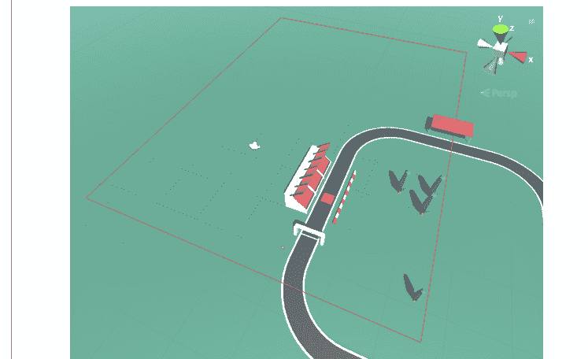

Figure 9-3. Positioning a top-down 2D camera above an example game level

#### Discussion

There’s not much to say here. In each frame, we check how much the player wants to move the camera, figure out how much we need to move in a frame, calculate a new position within our allowed bounds, and move the camera there. Our top-down camera system, again, is only one possible way of implementing this sort of behavior! You could also use a more advanced system, such as Cinemachine.


We use a gizmo as an aid in figuring out what’s going on in the Scene view. Gizmos are elements in the Scene view that help you navigate it or understand what’s going on.

### 9.4 Managing Quests

#### Problem

You want to manage a quest structure, where the player needs to complete certain objectives to finish a quest.

As part of your quest structure, you want some objectives to be optional, and some objectives to not be presented to the player until they’re achieved. If an objective fails and it isn’t optional, then the entire quest fails.

#### Solution

Before we can manage a quest structure, we need a quest.

First, let’s define a simple quest: we’ll position the camera in front of some colored blocks, and say that the player has to click them to complete the quest. However, one of the blocks is forbidden, and clicking it will fail the quest (Figure 9-4).

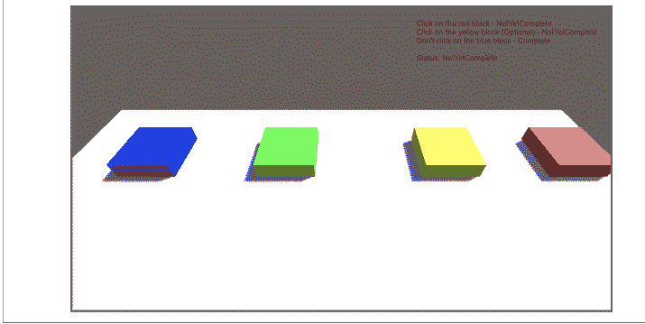

Figure 9-4. Clicking the forbidden block will fail the quest

We’ll need to create the scene for our quest:

+   1. Create four cubes, and place them in front of the camera.
+   2. For each of the cubes, create a material and add it by dragging and dropping it onto the cube in the Scene view.
+   3. Change the color of the material for each cube. Make one red, one green, one yellow, and one blue. (If any of these colors are hard to tell apart, change the colors to whatever suits you best.)

Now the cube is set up (Figure 9-5).

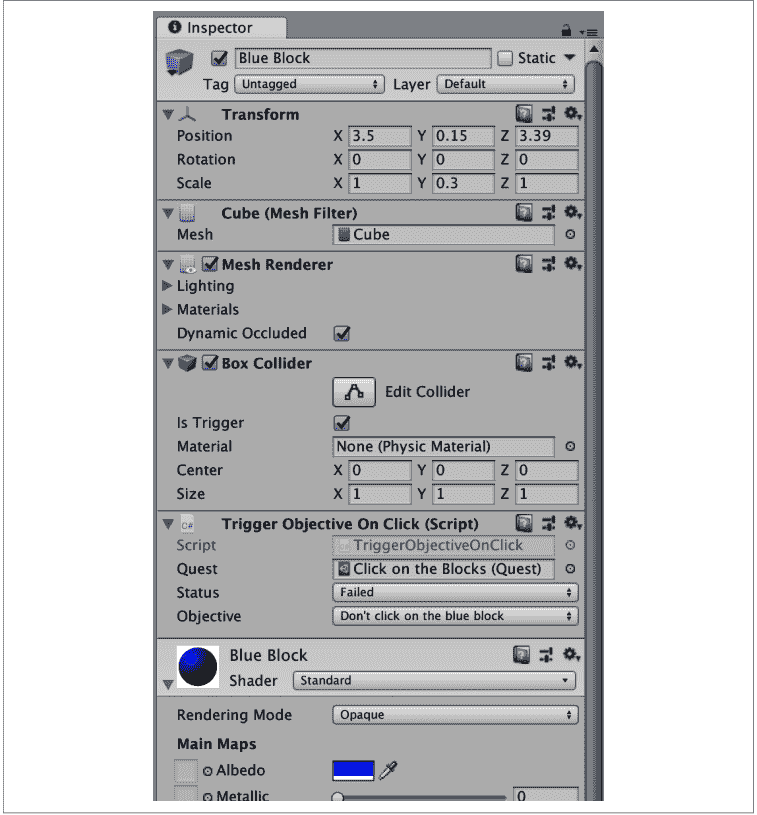

Figure 9-5. The setup of one of our cubes

Next, we’ll handle displaying the status of the quest and its objectives:

+   1. Select the main Camera object, and add a Physics Raycaster to it.
+   2. Create a new canvas that displays the status of the quest and its objectives.
+   3. Add a game object with a Text component in it.
+   4. Resize this object so that it can comfortably contain a paragraph of text.


现在我们来设置存储任务信息的对象类型。创建一个新的 C# 脚本命名为 Quest.cs，并添加以下代码：

```
#if UNITY_EDITOR
using UnityEditor;
#endif

// A Quest stores information about a quest: its name and its
// objectives.

// CreateAssetMenu makes the Create Asset menu contain an entry that
// creates a new Quest asset.
[CreateAssetMenu(fileName = "New Quest", menuName = "Quest", order = 100)]
public class Quest : ScriptableObject
{
    // Represents the status of objectives and quests
    public enum Status {
        NotYetComplete, // the objective or quest has not yet been
                         // completed
        Complete,        // the objective or quest has been successfully
                         // completed
        Failed           // the objective or quest has failed
    }

    // The name of the quest
    public string questName;

    // The list of objectives that form this quest
    public List<Objective> objectives;

    // Objectives are the specific tasks that make up a quest.
    [System.Serializable]
    public class Objective
    {
        // The visible name that's shown to the player
        public string name = "New Objective";

        // If true, this objective doesn't need to be complete for the
        // quest to be considered complete.
        public bool optional = false;

        // If false, the objective will not be shown to the user if
        // it's not yet complete. (It will be shown if it's Complete
        // or Failed.)
        public bool visible = true;

        // The status of the objective when the quest begins. Usually
        // this will be "not yet complete," but you might want an
        // objective that starts as Complete, and can be Failed.
        public Status initialStatus = Status.NotYetComplete;
    }
}
```

```
#if UNITY_EDITOR
// Draw a custom editor that lets you build the list of objectives.
[CustomEditor(typeof(Quest))]
public class QuestEditor : Editor {

    // Called when Unity wants to draw the Inspector for a quest.
    public override void OnInspectorGUI()
    {

        // Ensure that the object we're displaying has had any pending
        // changes done.
        serializedObject.Update();

        // Draw the name of the quest.
        EditorGUILayout.PropertyField(
            serializedObject.FindProperty("questName"),
            new GUIContent("Name")
        );

        // Draw a header for the list of objectives
        EditorGUILayout.LabelField("Objectives");

        // Get the property that contains the list of objectives
        var objectiveList = serializedObject.FindProperty("objectives");

        // Indent the objectives
        EditorGUI.indentLevel += 1;

        // For each objective in the list, draw an entry
        for (int i = 0; i < objectiveList.arraySize; i++)
        {
            // Draw a single line of controls
            EditorGUILayout.BeginHorizontal();

            // Draw the objective itself (its name and its flags)
            EditorGUILayout.PropertyField(
                objectiveList.GetArrayElementAtIndex(i),
                includeChildren: true
            );

            // Draw a button that moves the item up in the list
            if (GUILayout.Button("Up", EditorStyles.miniButtonLeft,
                GUILayout.Width(25)))
            {
                objectiveList.MoveArrayElement(i, i - 1);
            }

            // Draw a button that moves the item down in the list
```

```
if (GUILayout.Button("Down", EditorStyles.miniButtonMid,
    GUILayout.Width(40)))
{
    objectiveList.MoveArrayElement(i, i + 1);
}

// Draw a button that removes the item from the list
if (GUILayout.Button("-", EditorStyles.miniButtonRight,
    GUILayout.Width(25)))
{
    objectiveList.DeleteArrayElementAtIndex(i);
}

EditorGUILayout.EndHorizontal();
}

// Remove the indentation
EditorGUI.indentLevel -= 1;

// Draw a button that adds a new objective to the list
if (GUILayout.Button("Add Objective"))
{
    objectiveList.arraySize += 1;
}

// Save any changes
serializedObject.ApplyModifiedProperties();
}
}
#endif
```


有关我们用来将任务信息存储为资源 的 ScriptableObject 类的更多信息，请参阅 Recipe 2.9。

我们现在可以创建一个任务资源：

- 1. 打开 Assets 菜单，选择 Create → Quest。将新任务命名为“Click on the Blocks。”
- 2. 点击 Add Objective。将新目标命名为“Click on the red block。”打开 Visible 复选框。

- 3. 再重复此过程两次——分别针对绿色和黄色方块。让其中一个为可选，另一个为可选且不可见。
- 4. 再添加一个目标，用于蓝色方块。对于这个目标，将其名称设置为“Don’t click on the blue block。”将其 Initial Status 设置为“Complete。”

完成后，Inspector 应该看起来像图 9-6。

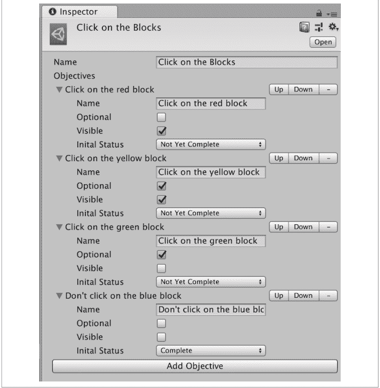

图 9-6. 任务资源的 Inspector，其中配置了多个目标

我们现在来设置管理任务的代码：

- 1. 创建一个新的 C# 脚本命名为 QuestManager.cs，并添加以下代码：

```
// Represents the player's current progress through a quest.
public class QuestStatus {

    // The underlying data object that describes the quest.
    public Quest questData;

    // The map of objective identifiers.
    public Dictionary<int, Quest.Status> objectiveStatuses;

    // The constructor. Pass a Quest to this to set it up.
    public QuestStatus(Quest questData)
    {
        // Store the quest info
        this.questData = questData;

        // Create the map of objective numbers to their status
        objectiveStatuses = new Dictionary<int, Quest.Status>();

        for (int i = 0; i < questData.objectives.Count; i += 1)
        {
            var objectiveData = questData.objectives[i];

            objectiveStatuses[i] = objectiveData.initialStatus;
        }
    }

    // Returns the state of the entire quest.
    // If all nonoptional objectives are complete, the quest is complete.
    // If any nonoptional objective is failed, the quest is failed.
    // Otherwise, the quest is not yet complete.
    public Quest.Status questStatus {
        get {

            for (int i = 0; i < questData.objectives.Count; i += 1) {

                var objectiveData = questData.objectives[i];

                // Optional objectives do not matter to the overall
                // quest status
                if (objectiveData.optional)
                    continue;

                var objectiveStatus = objectiveStatuses[i];

                // This is a mandatory objective
                if (objectiveStatus == Quest.Status.Failed)
```

```
{ // If a mandatory objective is failed, the whole // quest is failed return Quest.Status.Failed; } else if (objectiveStatus != Quest.Status.Complete) { // If a mandatory objective is not yet complete, // the whole quest is not yet complete return Quest.Status.NotYetComplete; } } // All mandatory objectives are complete, so this quest is // complete return Quest.Status.Complete; } } // Returns a string containing the list of objectives, their // statuses, and the status of the quest. public override string ToString() { var stringBuilder = new System.Text.StringBuilder(); for (int i = 0; i < questData.objectives.Count; i += 1) { // Get the objective and its status var objectiveData = questData.objectives[i]; var objectiveStatus = objectiveStatuses[i]; // Don't show hidden objectives that haven't been finished if (objectiveData.visible == false && objectiveStatus == Quest.Status.NotYetComplete) { continue; } // If this objective is optional, display "(Optional)" after // its name if (objectiveData.optional) { stringBuilder.AppendFormat("{0} (Optional) - {1}\n", objectiveData.name, objectiveStatus.ToString()); } else { stringBuilder.AppendFormat("{0} - {1}\n",


```
objectiveData.name,
objectiveStatus.ToString());
}
}

// Add a blank line followed by the quest status
stringBuilder.AppendLine();
stringBuilder.AppendFormat(
    "Status: {0}", this.questStatus.ToString());

return stringBuilder.ToString();
}
}

// Manages a quest.
public class QuestManager : MonoBehaviour {

    // The quest that starts when the game starts.
    [SerializeField] Quest startingQuest = null;

    // A label to show the state of the quest.
    [SerializeField] UnityEngine.UI.Text objectiveSummary = null;

    // Tracks the state of the current quest.
    QuestStatus activeQuest;

    // Start a new quest when the game starts
    void Start () {
        if (startingQuest != null)
        {
            StartQuest(startingQuest);
        }
    }

    // Begins tracking a new quest
    public void StartQuest(Quest quest) {
        activeQuest = new QuestStatus(quest);
        UpdateObjectiveSummaryText();
        Debug.LogFormat("Started quest {0}", activeQuest.questData.name);
    }

    // Updates the label that displays the status of the quest and
    // its objectives
    void UpdateObjectiveSummaryText() {
string label;

if (activeQuest == null) {
    label = "No active quest.";
} else {
    label = activeQuest.ToString();
}

objectiveSummary.text = label;
}

// Called by other objects to indicate that an objective has changed
// status
public void UpdateObjectiveStatus(
    Quest quest, int objectiveNumber, Quest.Status status) {

    if (activeQuest == null) {
        Debug.LogError(
            "Tried to set an objective status, but no quest" +
            "is active"
        );
        return;
    }

    if (activeQuest.questData != quest) {

        Debug.LogWarningFormat("Tried to set an objective status " +
            "for quest {0}, but this is not the active quest. " +
            "Ignoring.",
            quest.questName);

        return;
    }

    // Update the objective status
    activeQuest.objectiveStatuses[objectiveNumber] = status;

    // Update the display label
    UpdateObjectiveSummaryText();
}
}

- 2. 在一个空的游戏对象上创建一个新的 QuestManager 组件。
- 3. 将你创建的任务资源拖到其“起始任务”字段中。
- 4. 将你之前设置的文本对象拖到其“目标摘要”字段中。

5. 接下来，我们将设置一个类来表示对目标状态的更改，并在发生某些事情时应用它。创建一个名为 Objective Trigger.cs 的新 C# 脚本，并添加以下代码：

```
#if UNITY_EDITOR
using UnityEditor;
using System.Linq;
#endif

// Combines a quest, an objective in that quest, and an objective
// status to use.
[System.Serializable]
public class ObjectiveTrigger
{
    // The quest that we're referring to
    public Quest quest;

    // The status we want to apply to the objective
    public Quest.Status statusToApply;

    // The location of this objective in the quest's objective list
    public int objectiveNumber;

    public void Invoke() {
        // Find the quest manager
        var manager = Object.FindObjectOfType<QuestManager>();

        // And tell it to update our objective
        manager.UpdateObjectiveStatus(quest,
            objectiveNumber,
            statusToApply);
    }
}

#if UNITY_EDITOR
// Custom property drawers override how a type of property appears in
// the Inspector.
[CustomPropertyDrawer(typeof(ObjectiveTrigger))]
public class ObjectiveTriggerDrawer : PropertyDrawer {

    // Called when Unity needs to draw an ObjectiveTrigger property
    // in the Inspector.
    public override void OnGUI(Rect position,
        SerializedProperty property,
        GUIContent label)
    {
        // Wrap this in Begin/EndProperty to ensure that undo works
        // on the entire ObjectiveTrigger property
        EditorGUI.BeginProperty(position, label, property);

        // Get a reference to the three properties in the
        // ObjectiveTrigger.
        var questProperty =
            property.FindPropertyRelative("quest");
        var statusProperty =
            property.FindPropertyRelative("statusToApply");
        var objectiveNumberProperty =
            property.FindPropertyRelative("objectiveNumber");

        // We want to display three controls:
        // - An Object field for dropping a Quest object into
        // - A pop-up field for selecting a Quest.Status from
        // - A pop-up field for selecting the specific objective from;
        //   it should show the name of the objective.
        //
        // If no Quest has been specified, or if the Quest has no
        // objectives, the objective pop-up should be empty and
        // disabled.

        // Calculate the rectangles in which we're displaying.
        var lineSpacing = 2;

        // Calculate the rectangle for the first line
        var firstLinePosition = position;

        firstLinePosition.height =
            base.GetPropertyHeight(questProperty, label);

        // And for the second line (same as the first line, but shifted
        // down one line)
        var secondLinePosition = position;
        secondLinePosition.y = firstLinePosition.y +
            firstLinePosition.height + lineSpacing;
        secondLinePosition.height =
            base.GetPropertyHeight(statusProperty, label);

        // Repeat for the third line (same as the second line, but
        // shifted down)
        var thirdLinePosition = position;
        thirdLinePosition.y = secondLinePosition.y +
            secondLinePosition.height + lineSpacing;
        thirdLinePosition.height =
            base.GetPropertyHeight(objectiveNumberProperty, label);

        // Draw the quest and status properties, using the automatic
        // property fields
        EditorGUI.PropertyField(firstLinePosition, questProperty,
            new GUIContent("Quest"));
        EditorGUI.PropertyField(secondLinePosition, statusProperty,
new GUIContent("Status"));

// Now we draw our custom property for the object.
// Draw a label on the lefthand side, and get a new rectangle
// to draw the pop-up in
thirdLinePosition = EditorGUI.PrefixLabel(thirdLinePosition,
    new GUIContent("objective"));

// Draw the UI for choosing a property
var quest = questProperty.objectReferenceValue as Quest;

// Only draw this if we have a quest, and it has objectives
if (quest != null && quest.objectives.Count > 0)
{
    // Get the name of every objective, as an array
    var objectiveNames =
        quest.objectives.Select(o => o.name).ToArray();

    // Get the index of the currently selected objective
    var selectedObjective = objectiveNumberProperty.intValue;

    // If we somehow are referring to an object that's not
    // present in the list, reset it to the first objective
    if (selectedObjective >= quest.objectives.Count) {
        selectedObjective = 0;
    }

    // Draw the pop-up, and get back the new selection
    var newSelectedObjective = EditorGUI.Popup(thirdLinePosition,
        selectedObjective,
        objectiveNames);

    // If it was different, store it in the property
    if (newSelectedObjective != selectedObjective)
    {
        objectiveNumberProperty.intValue = newSelectedObjective;
    }
} else {
    // Draw a disabled pop-up as a visual placeholder
    using (new EditorGUI.DisabledGroupScope(true)) {
        // Show a pop-up with a single entry: the string "-".
        // Ignore its return value, since it's not interactive
        // anyway.
        EditorGUI.Popup(thirdLinePosition, 0, new[] { "-" });
    }
}

EditorGUI.EndProperty();
}
```

// Called by Unity to figure out the height of this property.
public override float GetPropertyHeight(SerializedProperty property, GUIContent label)
{
    // The number of lines in this property
    var lineCount = 3;

    // The number of pixels between each line
    var lineSpacing = 2;

    // The height of each line
    var lineHeight = base.GetPropertyHeight(property, label);

    // The height of this property is the number of lines times the
    // height of each line, plus the spacing between each line
    return (lineHeight * lineCount) +
           (lineSpacing * (lineCount - 1));
}
#endif
```

最后，我们将设置立方体，以便在点击时完成或失败目标：

- 1. 创建一个名为 TriggerObjectiveOnClick.cs 的新 C# 脚本，并添加以下代码：

```
using UnityEngine.EventSystems;

// Triggers an objective when an object enters it.
public class TriggerObjectiveOnClick :
    MonoBehaviour, IPointerClickHandler {

    // The objective to trigger, and how to trigger it.
    [SerializeField] ObjectiveTrigger objective = new ObjectiveTrigger();

    // Called when the player clicks on this object
    void IPointerClickHandler.OnPointerClick(PointerEventData eventData)
    {
        // We just completed or failed this objective!
        objective.Invoke();

        // Disable this component so that it doesn’t get run twice
        this.enabled = false;
    }
}
```


+   2. 为每个立方体添加一个 TriggerObjectiveOnClick 组件。对于每个立方体，将任务资源拖到其 Quest 字段中，并为目标选择合适的状态（即，将蓝色立方体设置为 Failed，其余设置为 Complete）。

图 9-7 显示了红色立方体的 TriggerObjectiveOnClick 脚本在配置后的示例。


如果不禁用文本作为射线投射目标，画布本身可能会阻挡你的射线投射。

+   3. 运行游戏。任务的状态显示在屏幕上，并在你点击不同立方体时发生变化。

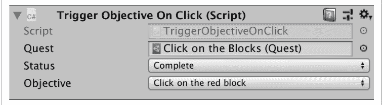

图 9-7. TriggerObjectiveOnClick 的检查器

#### Discussion

所以这是一个很长的部分！别担心，讨论不会像解决方案那样长。


你可以在第 12 章了解更多关于 UI 的内容。

在此创建任务系统涉及创建作为任务的对象（立方体）、显示任务状态的 UI，然后是实际的任务。在构建此类系统时，重要的是要考虑对象可能涉及的各种状态组合。想想一个调皮的、恶意的、困惑的或不幸的玩家可能会做什么：他们可能会乱序进行、跳过内容，或找到你的代码未预期的操作方式。

### 9.5 Dragging a Box to Select Objects

#### Problem

你想要点击并拖动鼠标在屏幕上创建可见的矩形。松开鼠标时，你想要知道哪些对象在该矩形内。

#### Solution

首先，我们将创建绘制框的画布，以及框对象本身：

+   1. 打开 GameObject 菜单，并选择 UI → Canvas。
+   2. 从 GameObject 菜单中选择 UI → Image。
+   3. 将新图像命名为“Selection Box。”

接下来，我们将创建一个在被选中时输出消息的脚本：

+   1. 创建一个新的 C# 脚本名为 BoxSelectable.cs，并添加以下代码：

```
// Handles the input and display of a selection box.
public class BoxSelectable: MonoBehaviour {

    public void Selected() {

        Debug.LogFormat("{0} was selected!", gameObject.name);

    }
}
```

+   2. 创建一些对象——是什么并不重要；立方体即可——并放置它们使摄像机可以看到它们。
+   3. 将 BoxSelectable.cs 脚本添加到每个对象。

现在我们将创建一个脚本来更新选择框的位置和大小，并报告哪些对象被选中：

+   1. 创建一个新的 C# 脚本名为 BoxSelection.cs，并添加以下代码：

```
// Handles the input and display of a selection box.
public class BoxSelection : MonoBehaviour
{
    // Draggable inspector reference to the Image GameObject's
    // RectTransform.
    public RectTransform selectionBox;

```
// This variable will store the location of wherever we first click
// before dragging.
private Vector2 initialClickPosition = Vector2.zero;

// The rectangle that the box has dragged, in screen space.
public Rect SelectionRect { get; private set; }

// If true, the user is actively dragging a box
public bool IsSelecting { get; private set; }

// Configure the visible box
private void Start()
{
    // Setting the anchors to be positioned at zero-zero means that
    // the box's size won't change as its parent changes size
    selectionBox.anchorMin = Vector2.zero;
    selectionBox.anchorMax = Vector2.zero;

    // Setting the pivot point to zero means that the box will pivot
    // around its lower-left corner
    selectionBox.pivot = Vector2.zero;

    // Hide the box at the start
    selectionBox.gameObject.SetActive(false);
}

void Update()
{
    // When we start dragging, record the position of the mouse, and
    // start showing the box
    if (Input.GetMouseButtonDown(0))
    {
        // Get the initial click position of the mouse. No need to
        // convert to GUI space since we are using the lower left as
        // anchor and pivot.
        initialClickPosition =
            new Vector2(Input.mousePosition.x,
                        Input.mousePosition.y);

        // Show the box
        selectionBox.gameObject.SetActive(true);
    }

    // While we are dragging, update the position and size of the
    // box based on the mouse position.
    if (Input.GetMouseButton(0))
    {
        // Store the current mouse position in screen space.
        Vector2 currentMousePosition =
            new Vector2(Input.mousePosition.x,
```

```
Input.mousePosition.y);

// Figure out the lower-left corner, and the upper-right
// corner
var xMin =
    Mathf.Min(currentMousePosition.x,
        initialClickPosition.x);

var xMax =
    Mathf.Max(currentMousePosition.x,
        initialClickPosition.x);

var yMin =
    Mathf.Min(currentMousePosition.y,
        initialClickPosition.y);

var yMax =
    Mathf.Max(currentMousePosition.y,
        initialClickPosition.y);

// Build a rectangle from these corners
var screenSpaceRect = Rect.MinMaxRect(xMin, yMin,
    xMax, yMax);

// The anchor of the box has been configured to be its
// lower-left corner, so by setting its anchoredPosition, we
// set its lower-left corner.
selectionBox.anchoredPosition = screenSpaceRect.position;

// The size delta is how far the box extends from its anchor.
// Because the anchor's minimum and maximum are the same
// point, changing its size delta directly changes its
// final size.
selectionBox.sizeDelta = screenSpaceRect.size;

// Update our selection box
SelectionRect = screenSpaceRect;

}

// When we release the mouse button, hide the box, and record
// that we're no longer selecting
if (Input.GetMouseButtonUp(0))
{
    SelectionComplete();

    // Hide the box
    selectionBox.gameObject.SetActive(false);

    // We're no longer selecting
    IsSelecting = false;
}
}
```

```
// Called when the user finishes dragging a selection box.
void SelectionComplete()
{
    // Get the component attached to this scene
    Camera mainCamera = GetComponent<Camera>();

    // Get the bottom-left and top-right corners of the screen-space
    // selection view, and convert them to viewport space
    var min = mainCamera.ScreenToViewportPoint(
        new Vector3(SelectionRect.xMin, SelectionRect.yMin));
    var max = mainCamera.ScreenToViewportPoint(
        new Vector3(SelectionRect.xMax, SelectionRect.yMax));

    // We want to create a bounding box in viewport space. We have
    // the x and y coordinates of the bottom-left and top-right
    // corners; now we'll include the z coordinates.
    min.z = mainCamera.nearClipPlane;
    max.z = mainCamera.farClipPlane;

    // Construct our bounding box
    var viewportBounds = new Bounds();
    viewportBounds.SetMinMax(min, max);

    // Check each object that has a Selectable component
    foreach (var selectable in FindObjectsOfType<BoxSelectable>()) {

        // Figure out where this object is in viewport space
        var selectedPosition = selectable.transform.position;

        var viewportPoint =
            mainCamera.WorldToViewportPoint(selectedPosition);

        // Is that point within our viewport bounding box? If it is,
        // they're selected.
        var selected = viewportBounds.Contains(viewportPoint);

        if (selected) {
            // Let them know.
            selectable.Selected();
        }
    }
}
```

+   2. 将 BoxSelection 组件附加到主摄像机。
+   3. 将 Selection Box 图像拖到 Selection Box 字段上。

4. 运行游戏。你可以点击并拖动来创建框。松开鼠标时，所有在矩形内且具有 BoxSelectable 组件的对象都会记录它们被选中。

#### Discussion

此解决方案最有趣的部分是使用视口空间，它是归一化的且相对于摄像机。


如果使用切片精灵，你的选择框可以有边框。

### 9.6 Creating a Menu Structure

#### Problem

你想要创建一个菜单页面集合，其中一次只有一个菜单可见。

#### Solution

要创建菜单页面集合：

+   1. 创建一个名为 Menu.cs 的新脚本：

```
// Contains UnityEvent, which this script uses
using UnityEngine.Events;

public class Menu : MonoBehaviour {

    // Invoked when a menu appears onscreen.
    public UnityEvent menuDidAppear = new UnityEvent();

    // Invoked when a menu is removed from the screen.
    public UnityEvent menuWillDisappear = new UnityEvent();

}
```

+   2. 创建一个名为 MenuManager.cs 的新脚本：

```
public class MenuManager : MonoBehaviour {

    [SerializeField] List<Menu> menus = new List<Menu>();

    private void Start()
```


{ // Show the first menu on start ShowMenu(menus[0]); }
public void ShowMenu(Menu menuToShow) { // Ensure that this menu is one that we're tracking. if (menus.Contains(menuToShow) == false) { Debug.LogErrorFormat("{0} is not in the list of menus", menuToShow.name ); return; } // Enable this menu, and disable the others foreach (var otherMenu in menus) { // Is this the menu we want to display? if (otherMenu == menuToShow) { // Mark it as active otherMenu.gameObject.SetActive(true); // Tell the Menu object to invoke its "did appear" // action otherMenu.menuDidAppear.Invoke(); } else { // Is this menu currently active? if (otherMenu.gameObject.activeInHierarchy) { // If so, tell the Menu object to invoke its "will // disappear" action otherMenu.menuWillDisappear.Invoke(); } // And mark it as inactive otherMenu.gameObject.SetActive(false); } } }

接下来我们创建一个示例菜单。它将有两个屏幕——主菜单和选项菜单：

+   1. 创建一个新的游戏对象，并将其命名为“Menu Manager。”
+   2. 将 MenuManager.cs 脚本添加到此对象。
+   3. 创建一个画布。
+   4. 创建一个名为“Main Menu”的新子游戏对象。这将作为菜单控件的容器。
+   5. 将 Menu.cs 脚本添加到此对象。
+   6. 在 Main Menu 对象中添加一个按钮游戏对象。将此按钮命名为“Show Options Menu Button。”
+   7. 将其文本设置为“Options Menu。”
+   8. 复制 Main Menu 对象，并将其重命名为“Options Menu。”
+   9. 将其“Show Options Menu Button”文本重命名为“Show Main Menu Button。”
+   10. 将其文本更改为“Back。”
+   11. 选择 Menu Manager 对象。
+   12. 将 Main Menu 对象拖到 Menus 槽上。
+   13. 将 Options Menu 对象拖到 Menus 槽上。

接下来，我们将使按钮显示适当的菜单：

+   1. 选择 Main Menu 对象内的“Show Options Menu Button”。
+   2. 在按钮的 On Click 事件中添加一个新条目。
+   3. 将 Menu Manager 拖入对象字段。
+   4. 在 Function 下拉菜单中，选择 MenuManager → ShowMenu。
+   5. 将 Options Menu 对象拖入参数字段。
+   6. 完成后，On Click 事件应如下图 9-8 所示。
+   7. 选择 Options Menu 对象内的“Show Main Menu Button”。
+   8. 在按钮的 On Click 事件中添加一个新条目。
+   9. 将 Menu Manager 拖入对象字段。
+   10. 在 Function 下拉菜单中，选择 MenuManager → ShowMenu。
+   11. 将 Main Menu 对象拖入参数字段。
+   12. 完成后，On Click 事件应如下图 9-9 所示。

13. 运行游戏。主菜单将会出现。点击 Options 按钮会隐藏它并显示选项菜单，点击 Back 按钮会返回主菜单。

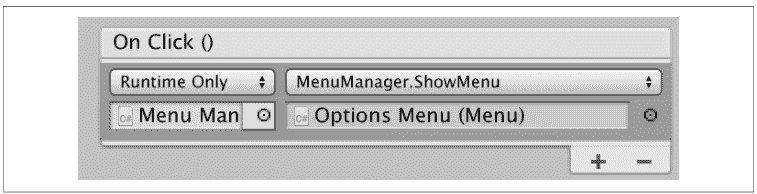

图 9-8. 配置 Show Options Menu 按钮的 On Click 事件

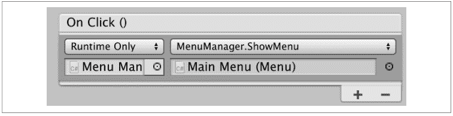

图 9-9. 配置 Show Main Menu 按钮的 On Click 事件

#### 讨论

你也可以为每个菜单添加其他函数调用；参见图 9-10。

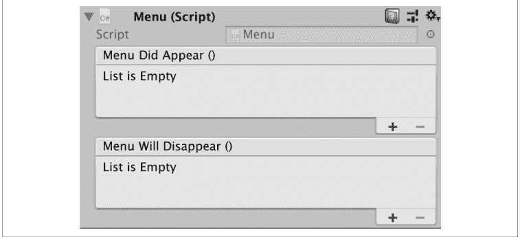

图 9-10. Menu Did Appear 和 Menu Will Disappear 事件，你可以向其添加函数调用

### 9.7 创建带轮车辆

#### 问题

你想要实现一辆带轮的车辆，比如汽车。

#### 解决方案

要创建带轮车辆：

+   1. 创建一个名为“Vehicle”的空对象。
+   2. 为其添加一个刚体。
+   3. 将其质量设置为 750，阻力设置为 0.1。
+   4. 如果你有汽车网格可以使用，将其作为 Vehicle 对象的子对象添加。如果没有网格，添加一个立方体作为子对象并缩放使其成为汽车合适的形状和大小。如果你这样做，请确保移除立方体自带的盒状碰撞体。在任何情况下，请确保可见对象的坐标位置为 (0, 0, 0)，以便其位于正确位置。
+   5. 创建一个空的游戏对象作为子对象，并将其命名为“Colliders。”
+   6. 在“Colliders”下添加一个空游戏对象，并命名为“Body。”
+   7. 向 Body 对象添加一个盒状碰撞体。
+   8. 点击 Edit Collider，并点击拖动盒子使其紧密贴合可见的汽车对象。
+   9. 在 Colliders 下创建一个新的空子对象，并命名为“Wheel Front Left。”
+   10. 向此新对象添加一个轮碰撞体。
+   11. 将其放置在你想要前左轮所在的位置附近。如果使用汽车网格，请将其放置在可见轮胎的中间。
+   12. 调整轮子的半径到你想要的大小。 （轮碰撞体进入车身碰撞体内部是可以的。）
+   13. 复制该轮三次——每个其他轮胎各一个。将每个轮移动到其他轮胎的位置，并相应重命名。完成后，碰撞体应如下图 9-11 所示。

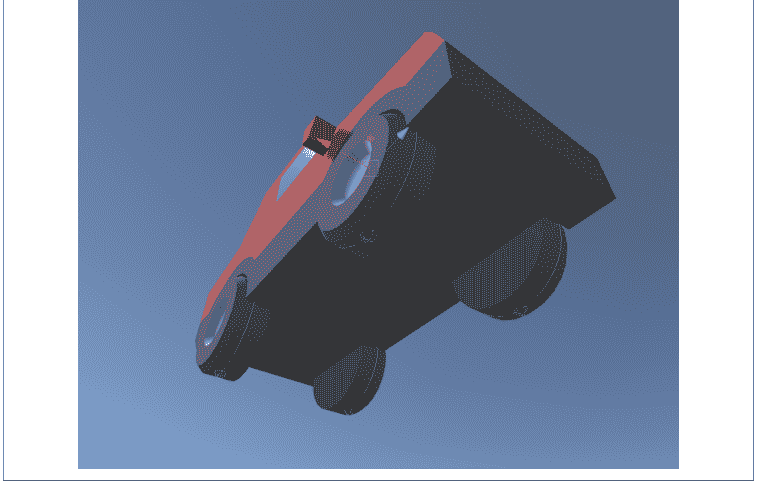

图 9-11. 放置车辆的轮子

14. 创建一个新脚本，并命名为 Vehicle.cs。向其中添加以下代码：

```
// Configures a single wheel's control parameters.
[System.Serializable]
public class Wheel {
    // The collider this wheel uses
    public WheelCollider collider;

    // Whether this wheel should be powered by the engine
    public bool powered;

    // Whether this wheel is steerable
    public bool steerable;

    // Whether this wheel can apply brakes
    public bool hasBrakes;
}

// Controls the power, braking, and steering applied to wheels.
public class Vehicle : MonoBehaviour {

    // The list of wheels on this vehicle
    [SerializeField] Wheel[] wheels = {};

    // The settings used for controlling the wheels:
```

```
// Maximum motor torque
[SerializeField] float motorTorque = 1000;

// Maximum brake torque
[SerializeField] float brakeTorque = 2000;

// Maximum steering angle
[SerializeField] float steeringAngle = 45;

private void Update() {

    // If the vertical axis is positive, apply motor torque and no
    // brake torque. If it's negative, apply brake torque and no
    // motor torque.
    var vertical = Input.GetAxis("Vertical");

    float motorTorqueToApply;
    float brakeTorqueToApply;

    if (vertical >= 0) {
        motorTorqueToApply = vertical * motorTorque;
        brakeTorqueToApply = 0;
    } else {
        // If the vertical axis is negative, cut the engine and step
        // on the brakes.

        // We use Mathf.Abs here to ensure that we use the positive
        // value of "vertical" (because applying negative braking
        // torque would lead to weirdness).
        motorTorqueToApply = 0;
        brakeTorqueToApply = Mathf.Abs(vertical) * brakeTorque;
    }

    // Scale the maximum steering angle by the horizontal axis.
    var currentSteeringAngle =
        Input.GetAxis("Horizontal") * steeringAngle;

    // Update all wheels

    // Using a for loop, rather than a foreach loop, because foreach
    // loops allocate temporary memory, which is turned into garbage
    // at the end of the frame. We want to minimize garbage, because
    // the more garbage that gets generated, the more often the
    // garbage collector has to run, which causes performance
    // problems.
    for (int wheelNum = 0; wheelNum < wheels.Length; wheelNum++) {

        var wheel = wheels[wheelNum];
```

```
// If a wheel is powered, it updates its motor torque
if (wheel.powered) {
    wheel.collider.motorTorque = motorTorqueToApply;
}

// If a wheel is steerable, it updates its steer angle
if (wheel.steerable) {
    wheel.collider.steerAngle = currentSteeringAngle;
}

// If a wheel has brakes, it updates its brake torque
if (wheel.hasBrakes) {
    wheel.collider.brakeTorque = brakeTorqueToApply;
}
```

+   15. 将 Vehicle.cs 脚本添加到 Vehicle 对象。
+   16. 选择 Vehicle 对象，并向 Wheels 列表添加四个条目。
+   17. 对于每个条目：
+       a. 添加一个轮碰撞体。
+       b. 如果是后轮，打开 Powered。
+       c. 如果是前轮，打开 Steerable。
+       d. 打开 Has Brakes。
+   18. 播放游戏。你应该能够驾驶汽车。

#### 讨论

你也可以考虑添加一个环绕摄像机来跟随车辆移动，如配方 9.10 所示。

构建车辆时，考虑当所有轮子都可转向，或全部提供动力时会发生什么。


尝试修改车辆的质量或扭矩值。看看会发生什么！

在 Unity 中，轮碰撞体定义了自己的悬挂参数。尝试调整它们以获得有趣的效果。


### 9.8 防止汽车翻车

#### 问题
你希望汽车在急转弯时不会翻车。

#### 解决方案
汽车翻车是因为它绕着质心旋转，而质心太高。当质心更低时，围绕它的任何旋转都会让车轮更用力地压向地面，而不是把整辆车翻过去。

要防止汽车翻车：
- 1. 创建一个新的 C# 脚本，命名为 AdjustCenterOfMass.cs，并添加以下代码：

```
[RequireComponent(typeof(Rigidbody))]
public class AdjustCenterOfMass : MonoBehaviour {

    // How far the center of mass should be moved from its default
    // position
    [SerializeField] Vector3 centerOfMass = Vector3.zero;

    private void Start()
    {
        // Override the center of mass, to enhance stability
        GetComponent<Rigidbody>().centerOfMass += centerOfMass;
    }

    // Called by the editor to show "gizmos" in the Scene view. Used to
    // help visualize the overridden center of mass.
    private void OnDrawGizmosSelected()
    {
        // Draw a green sphere where the updated center of mass will be.
        Gizmos.color = Color.green;

        var currentCenterOfMass =
            this.GetComponent<Rigidbody>().worldCenterOfMass;

        Gizmos.DrawSphere(currentCenterOfMass + centerOfMass, 0.125f);
    }
}
```
- 2. 将此组件添加到包含车辆刚体的游戏对象上。
- 3. 将质心的 y 坐标向下移动一点，使其刚好位于车辆底部。质心越低，车辆越稳定。

#### 讨论
在 Unity 中，刚体通常根据其碰撞体计算质心，但你可以覆盖它。

在现实生活中，汽车的质心很低，因为变速箱和发动机等重物位于地板下方。我们在这里实现的方式（也是游戏中通常的实现方式）不太真实，但能带来更好的游戏体验。

### 9.9 创建速度加速区

#### 问题
你希望在赛道上创建物体，当车辆驶过时可提供临时速度加速。

#### 解决方案
首先，创建速度加速的可见组件。在本例中，我们将采用简单、卡通化的外观：
- 1. 创建一个新的材质，并命名为“Speed Boost。”
- 2. 将其 albedo 颜色设置为红色。
- 3. 打开 GameObject 菜单，选择 3D Object → Plane。
- 4. 在赛道上适当放置和缩放该对象。
- 5. 将对象命名为“Speed Boost。”
- 6. 将 Speed Boost 材质拖放到其上。
- 7. 从对象上移除网格碰撞体。
- 8. 添加一个盒状碰撞体。
- 9. 打开 Is Trigger。
- 10. 调整大小和位置以创建足够容纳汽车的体积（例如，参见图 9-12）。

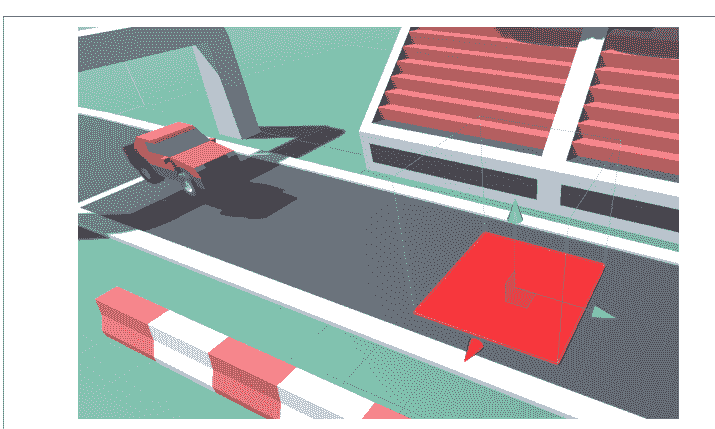

图 9-12. Speed Boost 对象，其盒状碰撞体足够大，可容纳汽车

- 11. 创建一个新的 C# 脚本，命名为 SpeedBoost.cs，并添加以下代码：

```
public class SpeedBoost : MonoBehaviour {

    // The amount of time the boost should apply
    [SerializeField] float boostDuration = 1;

    // The amount of force to apply in the forward direction
    [SerializeField] float boostForce = 50;

    // Called when a rigidbody enters the trigger
    private void OnTriggerEnter(Collider other)
    {
        // Ensure this collider has a rigidbody, either on itself
        // or on a parent object
        var body = other.GetComponentInParent<Rigidbody>();

        if (body == null) {
            return;
        }

        // Attach a ConstantForce component to it
        var boost = body.gameObject.AddComponent<ConstantForce>();

        // Make the ConstantForce boost the object forward by the
        // specified amount
        boost.relativeForce = Vector3.forward * boostForce;
```

```
// Remove this ConstantForce after boostDuration seconds
Destroy(boost, boostDuration);
}
}
```
- 12. 将 SpeedBoost 组件附加到 Speed Boost 对象上。
- 13. 测试游戏。当车辆进入加速区域时，它将在短时间内向前加速。

#### 讨论
我们的速度加速区并不复杂：只是一个带有碰撞体和触发器的对象，以及对物理系统的一次调用，对需要加速的对象施加一些力。加速！

### 9.10 创建围绕目标轨道旋转的摄像机

#### 问题
你希望创建一个摄像机，以固定距离围绕目标位置旋转。

#### 解决方案
要创建轨道摄像机：
- 1. 向场景中添加一个摄像机。
- 2. 创建一个新的 C# 脚本，命名为 OrbitingCamera.cs，并用以下代码替换其内容：

```
public class OrbitingCamera : MonoBehaviour
{

// The object we're orbiting around
[SerializeField] Transform target;

// The speed at which we change our rotation and elevation
[SerializeField] float rotationSpeed = 120.0f;
[SerializeField] float elevationSpeed = 120.0f;

// The minimum and maximum angle of elevation
[SerializeField] float elevationMinLimit = -20f;
[SerializeField] float elevationMaxLimit = 80f;

// The distance we're at from the target
[SerializeField] float distance = 5.0f;
[SerializeField] float distanceMin = .5f;
[SerializeField] float distanceMax = 15f;
```

```
// The angle at which we're rotated around the target
float rotationAroundTarget = 0.0f;

// The angle at which we're looking down or up at the target
float elevationToTarget = 0.0f;

// Use this for initialization
void Start()
{
    Vector3 angles = transform.eulerAngles;
    rotationAroundTarget = angles.y;
    elevationToTarget = angles.x;

    if (target) {
        // Take the current distance from the camera to the target
        float currentDistance =
            (transform.position - target.position).magnitude;

        // Clamp it to our required minimum/maximum
        distance = Mathf.Clamp(
            currentDistance, distanceMin, distanceMax);
    }
}

// Every frame, after all Update functions are called, update the
// camera position and rotation
//
// We do this in LateUpdate so that if the object we're tracking has
// its position changed in the Update method, the camera will be
// correctly positioned, because LateUpdate is always run afterward.
void LateUpdate()
{
    if (target)
    {
        // Update our rotation and elevation based on mouse movement
        rotationAroundTarget +=
            Input.GetAxis("Mouse X")
            * rotationSpeed * distance * 0.02f;

        elevationToTarget -=
            Input.GetAxis("Mouse Y") * elevationSpeed * 0.02f;

        // Limit the elevation to between the minimum and
        // the maximum
        elevationToTarget = ClampAngle(
            elevationToTarget,
            elevationMinLimit,
            elevationMaxLimit
        );

```

```
// Compute the rotation based on these two angles
Quaternion rotation = Quaternion.Euler(
    elevationToTarget,
    rotationAroundTarget,
    0
);

// Update the distance based on mouse movement
distance = distance - Input.GetAxis("Mouse ScrollWheel") * 5;

// And limit it to the minimum and maximum
distance = Mathf.Clamp(distance, distanceMin, distanceMax);

// Figure out a position that's "distance" units away
// from the target in the reverse direction to where
// we're looking
Vector3 negDistance = new Vector3(0.0f, 0.0f, -distance);
Vector3 position = rotation * negDistance + target.position;

// Update the position
transform.position = position;

// Update the rotation so we're looking at the target
transform.rotation = rotation;
}
}

// Clamps an angle between "min" and "max," wrapping it if it's less
// than 360 degrees or higher than 360 degrees.
public static float ClampAngle(float angle, float min, float max)
{
    // Wrap the angle at -360 and 360
    if (angle < -360F)
        angle += 360F;
    if (angle > 360F)
        angle -= 360F;

    // Clamp this wrapped angle
    return Mathf.Clamp(angle, min, max);
}
}
```
- 3. 向场景中添加一个立方体。
- 4. 选择摄像机，并将层级中立方体的条目拖入 Target 字段。
- 5. 运行游戏。随着鼠标移动，摄像机将围绕目标旋转。


#### Discussion

这种摄像机有时被称为“追踪摄像机”。我们在这里在 LateUpdate 函数中完成大部分工作，因为我们希望确保如果被追踪对象在 Update 函数中改变了位置，摄像机处于正确的位置。LateUpdate 总是在 Update 之后运行。


你可以在 Unity 手册中了解事件的执行顺序。

### 9.11 创建一个不会穿墙的环绕摄像机

#### Problem

你想要检测摄像机和目标之间是否存在物体，并将摄像机移近。


本菜谱基于菜谱 9.10。

#### Solution

要创建一个不会穿墙的摄像机：

- 1. 向 OrbitingCamera 类添加以下变量：
```
// When true, the camera will adjust its distance when there's a
// collider between it and the target
[SerializeField] bool clipCamera;
```
- 2. 向类的 LateUpdate 方法添加以下代码：
```
if (clipCamera) {

// We'll cast out a ray from the target to the position we just
// computed. If the ray hits something, we'll update our
// position to where the ray hit.

// Store info about any hit in here.
RaycastHit hitInfo;
```
```
// Generate a ray from the target to the camera
var ray =
    new Ray(target.position, position - target.position);

// Perform the ray cast; if it hit anything, it returns true,
// and updates the hitInfo variable
var hit = Physics.Raycast(ray, out hitInfo, distance);

if (hit) {
    // We hit something. Update the camera position to where the
    // ray hit an object.
    position = hitInfo.point;
}
```
- 3. 在你的环绕摄像机上打开 Clip Camera，然后播放游戏。

如果摄像机和目标之间存在碰撞体，摄像机现在会更靠近目标移动。

#### Discussion

射线检测只会击中碰撞体。如果有一个阻挡摄像机的物体但没有附加碰撞体，脚本就不会知道要移近。

### 9.12 检测玩家是否完成一圈

#### Problem

你想要检测玩家是否完成了一圈赛道。你还想检测玩家是否走错方向，或通过走太多近路作弊。

#### Solution

你可以通过创建一组玩家必须按顺序通过的检查点来解决这个问题。如果玩家按错误顺序通过检查点，他们就是走错方向了：

- 1. 首先布置你的赛道，这样你和玩家都知道要走的路径。见图 9-13。


本章中用于赛车菜谱的资源来自 Kenney 的赛车套件，该套件免费且采用宽松的 Creative Commons Zero 许可。

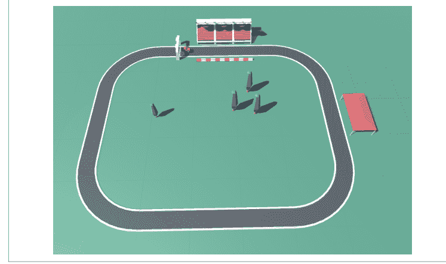

图 9-13. 一个简单的自环赛道的示例

- 2. 向场景中添加一辆车辆，并确保你能够驾驶它绕行（只是为了确保驾驶组件正常工作）。

- 3. 创建一个新的 C# 脚本名为 Checkpoint.cs，并将以下代码添加到其中。注意它包含两个类；其中一个是特殊的、仅编辑器代码，用于在 Inspector 中添加按钮以帮助构建赛道：
```
#if UNITY_EDITOR
// Include the UnityEditor namespace when this class is being used
// in the Editor.
using UnityEditor;
#endif

public class Checkpoint : MonoBehaviour
{
    // If true, this is the start of the circuit
    [SerializeField] public bool isLapStart;

    // The next checkpoint in the circuit. If we're visiting these in
    // reverse, or skipping too many, then we're going the wrong way.
    [SerializeField] public Checkpoint next;

    // The index number, used by LapTracker to figure out if we're going
    // the wrong way.
    internal int index = 0;

    // Checkpoints are invisible, so we draw a marker in the Scene view
    // to make it easier to visualize.
    private void OnDrawGizmos()
    {
        // Draw the markers as a blue sphere, except for the lap start,
        // which is yellow.
        if (isLapStart)
        {
            Gizmos.color = Color.yellow;
        }
        else
        {
            Gizmos.color = Color.blue;
        }

        Gizmos.DrawSphere(transform.position, 0.5f);

        // If we have a next node set up, draw a blue line to it.
        if (next != null)
        {
            Gizmos.color = Color.blue;
            Gizmos.DrawLine(transform.position, next.transform.position);
        }
    }
}
```
```
#if UNITY_EDITOR
// Code that adds further controls for building a track to the
// Checkpoint Inspector.
[CustomEditor(typeof(Checkpoint))]
public class CheckpointEditor : Editor {

    // Called when Unity needs to display the Inspector for this
    // Checkpoint component.
    public override void OnInspectorGUI()
    {
        // First, draw the Inspector contents that we'd normally get.
        DrawDefaultInspector();

        // Get a reference to the Checkpoint component we're editing, by
        // casting 'target' (which is just an Object) to Checkpoint.
        var checkpoint = this.target as Checkpoint;

        // Display a button that inserts a new checkpoint between us and
        // the next one. GUILayout.Button both displays the button and
        // returns true if it was clicked.
        if (GUILayout.Button("Insert Checkpoint")) {

            // Make a new object, and add a Checkpoint component to it
            var newCheckpoint = new GameObject("Checkpoint")
                .AddComponent<Checkpoint>();

            // Make it point to our next one, and make us point to
            // it (in other words, insert it between us and our next
            // checkpoint)
            newCheckpoint.next = checkpoint.next;
            checkpoint.next = newCheckpoint;

            // Make it one of our siblings
            newCheckpoint.transform
                .SetParent(checkpoint.transform.parent, true);

            // Position it as our next sibling in the Hierarchy.
            // Not technically needed, and doesn't affect the game at
            // all, but it looks nicer.
            var nextSiblingIndex =
                checkpoint.transform.GetSiblingIndex() + 1;

            newCheckpoint.transform.SetSiblingIndex(nextSiblingIndex);

            // Move it slightly so that it's visibly not the same one
            newCheckpoint.transform.position =
                checkpoint.transform.position + new Vector3(1, 0, 0);

            // Select it, so that we can immediately start moving it
            Selection.activeGameObject = newCheckpoint.gameObject;
        }

        // Disable this button if we don't have a next checkpoint, or if
        // the next checkpoint is the lap start
        var disableRemoveButton = checkpoint.next == null ||
            checkpoint.next.isLapStart;

        using (new EditorGUI.DisabledGroupScope(disableRemoveButton)) {
            // Display a button that removes the next checkpoint
            if (GUILayout.Button("Remove Next Checkpoint"))
            {
                // Get the node that this next checkpoint was linking to
                var next = checkpoint.next.next;

                // Remove the next one
                DestroyImmediate(checkpoint.next.gameObject);

                // Aim ourselves at what it was pointing at
                checkpoint.next = next;
            }
        }
    }
}
#endif
```
- 4. 创建一个新的空游戏对象，命名为“Checkpoints。”
- 5. 在 Checkpoints 下添加一个新的空游戏对象作为子对象。将其命名为“Checkpoint”，并添加一个 Checkpoint 组件。
- 6. 将此检查点放置在赛道的起点。
- 7. 打开 Is Lap Start。
- 8. 在 Inspector 中点击 Insert Checkpoint。将会添加一个新的检查点并被选中。将它放置在赛道更靠后的位置。
- 9. 继续插入新的检查点。你也可以选择一个较早的检查点并点击 Insert Checkpoint，在两个现有点之间插入新检查点，或通过选择前一个检查点并点击 Delete Next Checkpoint 来删除一个检查点。
- 10. 当你完成赛道后，选择最后一个检查点并将 Lap Start 检查点（带有黄色标记的那个）拖入其 Next 字段。


如果检查点之间的连接出现问题，你可以通过更改检查点的 Next 字段来修复它们。

完成后，赛道应该看起来像图 9-14。

- 11. 将最后一个检查点放置在赛道终点线正好位于第一个和最后一个检查点中间的位置，它们应该非常接近。见图 9-15。


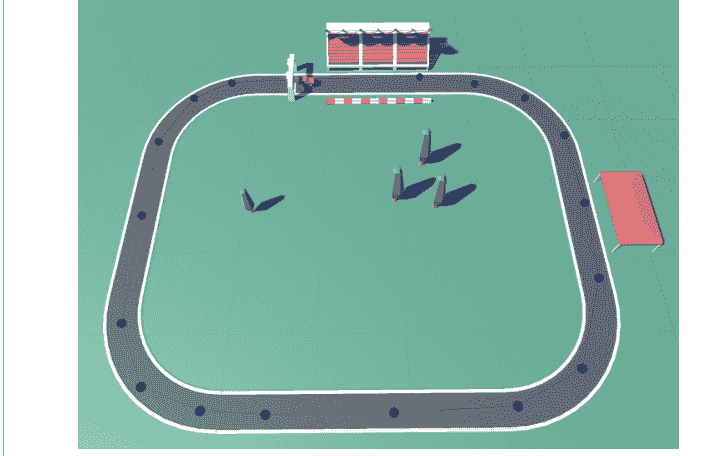

图 9-14. 放置在赛道周围的检查点

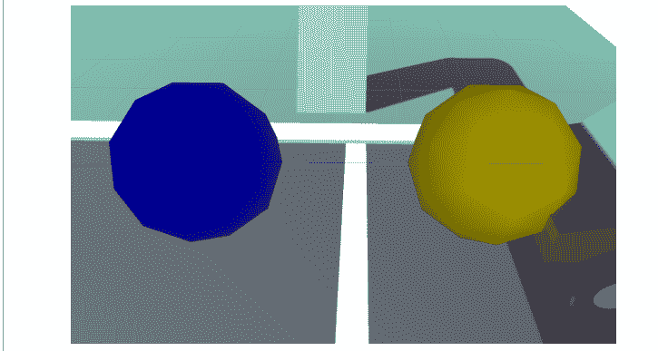

图 9-15. 最后一个检查点，放置位置使终点线位于第一个和最后一个检查点之间

+   12. 将车辆稍微定位在 Lap Start 检查点前方。
+   13. 创建一个画布。
+   14. 创建并添加两个带有 Text 组件的游戏对象。
+   15. 让其中一个显示文本“Wrong Way!” 另一个显示“Lap 1.”
+   16. 创建一个新的 C# 脚本名为 LapTracker.cs，并添加以下代码到其中：

```
// We use LINQ to help figure out the start of the circuit with fewer
// lines of code. Using LINQ allocates memory, which is something we
// try to avoid, but because we only do it once (at scene start), it's
// not as bad.
using System.Linq;

public class LapTracker : MonoBehaviour {

    // The object that we're tracking as it makes laps around the
    // circuit.
    [SerializeField] Transform target = null;

    // The number of nodes in the list we're permitted to skip. This
    // prevents the player from just driving a tiny circle from the
    // start of the track to the end ("I crossed the finish line
    // three times! That means I win!"). Increase this number to permit
    // longer shortcuts. Set this to 0 to forbid any shortcuts.
    [SerializeField] int longestPermittedShortcut = 2;

    // The UI element that appears to let the player know they're
    // going the wrong way.
    [SerializeField] GameObject wrongWayIndicator;

    // A text field that displays the number of laps the player has
    // completed.
    [SerializeField] UnityEngine.UI.Text lapCounter;

    // The number of laps the player has completed.
    int lapsComplete = 0;

    // The checkpoint that the player was near most recently.
    Checkpoint lastSeenCheckpoint;

    // The list of all checkpoints on the circuit. We keep a copy of it
    // here, because we need to use this list every frame, and because
    // using FindObjectsOfType to regenerate the list every frame
    // would be slow.
    Checkpoint[] allCheckpoints;

    // The start checkpoint is the first (and hopefully only) checkpoint
    // that has isLapStart turned on.
Checkpoint StartCheckpoint {
    get {
        // Get the checkpoint marked as the start of the lap
        return FindObjectsOfType<Checkpoint>()
            .Where(c => c.isLapStart)
            .FirstOrDefault();
    }
}

void Start () {
    // Ensure that the counter says "lap 1"
    UpdateLapCounter();

    // The player isn't going the wrong way at the start
    wrongWayIndicator.SetActive(false);

    // Create the list of all checkpoints which Update will make
    // use of
    allCheckpoints = FindObjectsOfType<Checkpoint>();

    // Create the circuit of connected checkpoints
    CreateCircuit();

    // Begin the race at the start of the circuit
    lastSeenCheckpoint = StartCheckpoint;
}

private void Update()
{
    // What's the nearest checkpoint?
    var nearestCheckpoint = NearestCheckpoint();

    if (nearestCheckpoint == null) {
        // No checkpoints! Bail out.
        return;
    }

    if (nearestCheckpoint.index == lastSeenCheckpoint.index) {
        // Nothing to do; the nearest checkpoint has not changed.
    } else if (nearestCheckpoint.index > lastSeenCheckpoint.index) {

        var distance =
            nearestCheckpoint.index - lastSeenCheckpoint.index;

        if (distance > longestPermittedShortcut + 1) {
            // The player has skipped too many checkpoints.
            // Treat this as going the wrong way.
            wrongWayIndicator.SetActive(true);
        } else {

```
// We are near the next checkpoint; the player is going
// the right way.
lastSeenCheckpoint = nearestCheckpoint;

wrongWayIndicator.SetActive(false);
}
} else if (nearestCheckpoint.isLapStart &&
    lastSeenCheckpoint.next.isLapStart) {
    // If the last checkpoint we saw is the last in the circuit,
    // and our nearest is now the start of the circuit, we just
    // completed a lap!

    lastSeenCheckpoint = nearestCheckpoint;

    lapsComplete += 1;
    UpdateLapCounter();
} else {
    // This checkpoint is lower than the last one we saw. The
    // player is going the wrong way.
    wrongWayIndicator.SetActive(true);
}
}

// Calculates the nearest checkpoint to the player.
Checkpoint NearestCheckpoint() {

    // If we don't have a list of checkpoints to use, exit
    // immediately
    if (allCheckpoints == null) {
        return null;
    }

    // Loop through the list of all checkpoints, and find the
    // nearest one to the player's position.
    Checkpoint nearestSoFar = null;
    float nearestDistanceSoFar = float.PositiveInfinity;

    for (int c = 0; c < allCheckpoints.Length; c++) {
        var checkpoint = allCheckpoints[c];
        var distance =
            (target.position - checkpoint.transform.position)
            .sqrMagnitude;

        if (distance < nearestDistanceSoFar) {
            nearestSoFar = checkpoint;
            nearestDistanceSoFar = distance;
        }
    }

return nearestSoFar;
}

// Walks the list of checkpoints, and makes sure that they all have
// an index that's one higher than the previous one (except for
// the start checkpoint)
void CreateCircuit() {
    var index = 0;

    // Start at the start of the checkpoint
    var currentCheckpoint = StartCheckpoint;

    do
    {
        // Update the index for this checkpoint
        currentCheckpoint.index = index;
        index += 1;

        // Move to the checkpoint it's pointing to
        currentCheckpoint = currentCheckpoint.next;

        // We should not reach the end of the list; that means that
        // the circuit does not form a loop
        if (currentCheckpoint == null)
        {
            Debug.LogError("The circuit is not closed!");
            return;
        }

        // loop until we reach the start again
    } while (currentCheckpoint.isLapStart == false);
}

// Update the text that's shown to the user
void UpdateLapCounter()
{
    lapCounter.text = string.Format("Lap {0}", lapsComplete + 1);
}

// Draw a line indicating the nearest checkpoint to the player in
// the Scene view. (Useful for debugging.)
private void OnDrawGizmos()
{
    var nearest = NearestCheckpoint();

    if (target != null && nearest != null) {

Gizmos.color = Color.red;
Gizmos.DrawLine(target.position, nearest.transform.position);
    }
}
}
```

+   17. 创建一个新的空游戏对象，并为其添加 LapTracker 组件。
+   18. 将 Target 字段设置为车辆。
+   19. 将 Wrong Way Indicator 字段设置为显示“Wrong Way!” 的标签
+   20. 将 Lap Counter 字段设置为显示“Lap 1.” 的标签
+   21. 播放游戏。

#### 讨论

当你按正确方向行驶赛道时，圈数计数器会在你通过终点线时增加。如果反向行驶或走捷径过多，“Wrong Way!” 指示器会出现。

我们所做的只是检查是否以相反顺序访问检查点或跳过了太多检查点！魔法般。


这并不会神奇地知道是否存在允许玩家在所有情况下作弊的游戏漏洞。它只是跟踪玩家是否朝正确方向前进，而不是整体探索游戏状态以防止作弊。你仍然需要手动测试你的游戏！
