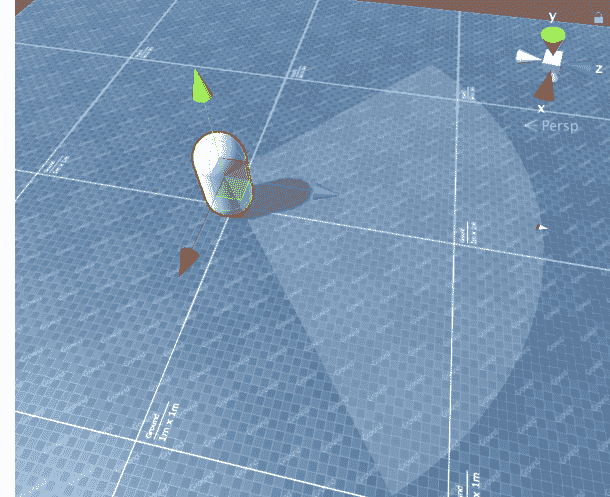
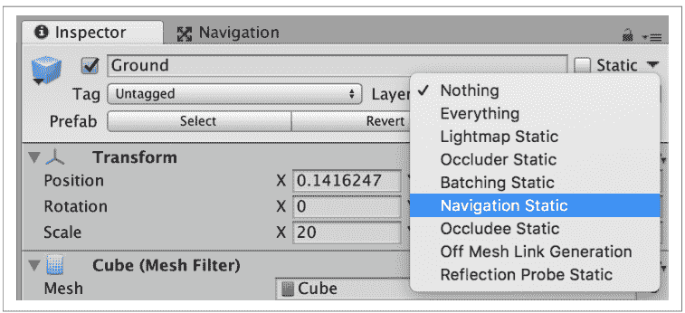
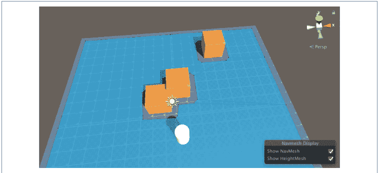
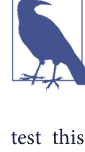
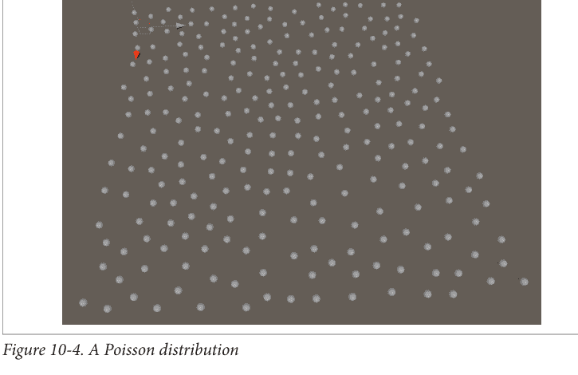
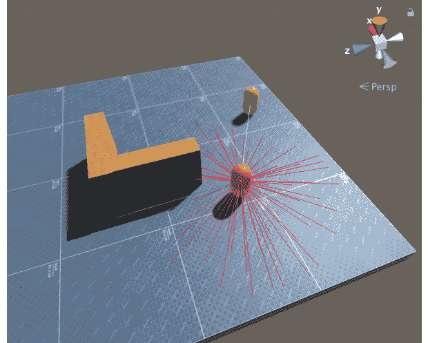
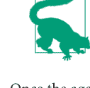

## 行为、模拟和 AI

智能、基于决策的行为的出现是构建引人入胜的世界或游戏的核心方面。视频游戏人工智能不像 AI 领域的其他部分。它主要是伪装、技巧和复杂性的幻觉。你不需要是 AI 或机器学习专家就能为视频游戏构建复杂、引人入胜的行为。在本章中，我们将探讨游戏开发者在为实体赋予行为和 AI 时遇到的最常见问题的解决方案。

我们将使用两种不同的技术：行为编程和机器学习。

> 你可以使用 Unity 来处理真正的 AI 和机器学习！本章最后几个配方探讨了使用 Unity ML-Agents，但这是一个很大的主题。如需了解更多信息，请查看我们的书籍 *Practical Simulations for Machine Learning*（O'Reilly）。

### 10.1 敌人检测何时能看到玩家

#### 问题

你希望一个对象能够检测何时能“看到”其目标；也就是说，目标既足够接近对象，又在对象前方。你希望能够可视化和配置目标可见的区域。

> 显然，使用这种技术的最常见用途是确保敌人能找到需要攻击的玩家！


#### 解决方案

此解决方案从一个脚本开始：

- 1. 创建一个名为 EnemyVisibility.cs 的新脚本，并添加以下代码：

```
#if UNITY_EDITOR
using UnityEditor;
#endif

// Detects when a given target is visible to this object. A target is
// visible when it's both in range and in front of the target. Both the
// range and the angle of visibility are configurable.
public class EnemyVisibility : MonoBehaviour
{
    // The object we're looking for.
    public Transform target = null;

    // If the object is more than this distance away, we can't see it.
    public float maxDistance = 10f;

    // The angle of our arc of visibility.
    [Range(0f, 360f)]
    public float angle = 45f;

    // If true, visualize changes in visibility by changing
    // material color
    [SerializeField] bool visualize = true;

    // A property that other classes can access to determine if we can
    // currently see our target.
    public bool targetIsVisible { get; private set; }

    // Check to see if we can see the target every frame.
    void Update()
    {
        targetIsVisible = CheckVisibility();

        if (visualize) {
            // Update our color: yellow if we can see the target,
            // white if we can't
            var color = targetIsVisible ? Color.yellow : Color.white;

            GetComponent<Renderer>().material.color = color;
        }
    }
}
```

```
// Returns true if this object can see the specified position.
public bool CheckVisibilityToPoint(Vector3 worldPoint) {

    // Calculate the direction from our location to the point
    var directionToTarget = worldPoint - transform.position;

    // Calculate the number of degrees from the forward direction.
    var degreesToTarget =
        Vector3.Angle(transform.forward, directionToTarget);

    // The target is within the arc if it's within half of the
    // specified angle. If it's not within the arc, it's not visible.
    var withinArc = degreesToTarget < (angle / 2);

    if (withinArc == false)
    {
        return false;
    }

    // Figure out the distance to the target
    var distanceToTarget = directionToTarget.magnitude;

    // Take into account our maximum distance
    var rayDistance = Mathf.Min(maxDistance, distanceToTarget);

    // Create a new ray that goes from our current location, in the
    // specified direction
    var ray = new Ray(transform.position, directionToTarget);

    // Stores information about anything we hit
    RaycastHit hit;

    // Perform the raycast. Did it hit anything?
    if (Physics.Raycast(ray, out hit, rayDistance)) {
        // We hit something.
        if (hit.collider.transform == target) {
            // It was the target itself. We can see the target point.
            return true;
        }
        // It's something between us and the target. We cannot see
        // the target point.
        return false;
    } else {
        // There's an unobstructed line of sight between us and the
        // target point, so we can see it.
        return true;
    }
}
```

```
// Returns true if a straight line can be drawn between this object
// and the target. The target must be within range, and within the
// visible arc.
public bool CheckVisibility()
{
    // Compute the direction to the target
    var directionToTarget = target.position - transform.position;

    // Calculate the number of degrees from the forward direction.
    var degreesToTarget =
        Vector3.Angle(transform.forward, directionToTarget);

    // The target is within the arc if it's within half of the
    // specified angle. If it's not within the arc, it's not visible.
    var withinArc = degreesToTarget < (angle / 2);

    if (withinArc == false) {
        return false;
    }

    // Compute the distance to the point
    var distanceToTarget = directionToTarget.magnitude;

    // Our ray should go as far as the target is or the maximum
    // distance, whichever is shorter
    var rayDistance = Mathf.Min(maxDistance, distanceToTarget);

    // Create a ray that fires out from our position to the target
    var ray = new Ray(transform.position, directionToTarget);

    // Store information about what was hit in this variable
    RaycastHit hit;

    // Records info about whether the target is in range and not
    // occluded
    var canSee = false;

    // Fire the raycast. Did it hit anything?
    if (Physics.Raycast(ray, out hit, rayDistance))
    {
        // Did the ray hit our target?
        if (hit.collider.transform == target)
        {
            // Then we can see it (that is, the ray didn't hit an
            // obstacle between us and the target)
            canSee = true;
        }
    }

    // Visualize the ray.
    Debug.DrawLine(transform.position, hit.point);
}
```

```
}
else
{
    // The ray didn't hit anything. This means that it reached
    // the maximum distance and stopped, which means we didn't
    // hit our target. It must be out of range.

    // Visualize the ray.
    Debug.DrawRay(transform.position,
                  directionToTarget.normalized * rayDistance);
}

// Is it visible?
return canSee;

}
}
#if UNITY_EDITOR
// A custom editor for the EnemyVisibility class. Visualizes and allows
// for editing the visible range.
[CustomEditor(typeof(EnemyVisibility))]
public class EnemyVisibilityEditor : Editor {

    // Called when Unity needs to draw the Scene view.
    private void OnSceneGUI()
    {
        // Get a reference to the EnemyVisibility script we're
        // looking at
        var visibility = target as EnemyVisibility;

        // Start drawing at 10% opacity
        Handles.color = new Color(1, 1, 1, 0.1f);

        // Drawing an arc sweeps from the point you give it. We want to
        // draw the arc such that the middle of the arc is in front of
        // the object, so we'll take the forward direction and rotate
        // it by half the angle.

        var forwardPointMinusHalfAngle =
            // rotate around the y-axis by half the angle
            Quaternion.Euler(0, -visibility.angle / 2, 0)
            // rotate the forward direction by this
            * visibility.transform.forward;

        // Draw the arc to visualize the visibility arc
        Vector3 arcStart =
            forwardPointMinusHalfAngle * visibility.maxDistance;
```

```
Handles.DrawSolidArc(
    visibility.transform.position, // Center of the arc
    Vector3.up,                     // Up direction of the arc
    arcStart,                       // Point where it begins
    visibility.angle,               // Angle of the arc
    visibility.maxDistance          // Radius of the arc
);

// Draw a scale handle at the edge of the arc; if the user drags
// it, update the arc size.

// Reset the handle color to full opacity
Handles.color = Color.white;

// Compute the position of the handle, based on the object's
// position, the direction it's facing, and the distance
Vector3 handlePosition =
    visibility.transform.position +
    visibility.transform.forward * visibility.maxDistance;

// Draw the handle, and store its result.
visibility.maxDistance = Handles.ScaleValueHandle(
    visibility.maxDistance,        // current value
    handlePosition,                // handle position
    visibility.transform.rotation, // orientation
    1,                             // size
    Handles.ConeHandleCap,         // cap to draw
    0.25f);                        // snap to multiples of this
                                   // if the snapping key is
                                   // held down
    }
}
#endif

- 2. 通过打开 GameObject 菜单并选择 3D Object → Capsule 在场景中创建两个胶囊体。

- 3. 为其中一个胶囊体添加 EnemyVisibility 组件。使其 Target 字段引用另一个胶囊体。请注意，你可以看到可见性弧线（图 10-1）。

- 4. 运行游戏。带有 EnemyVisibility 组件的胶囊体在能够看到其目标时会变成明亮的黄色。




图 10-1. 显示可见性弧

#### 讨论

我们创建的 EnemyVisibility.cs 脚本设置了这样一种情况：当目标既在物体的一定范围内，又在物体前方时，该目标才可见。每帧都会检查目标是否可见。

我们还为所创建的类创建了一个自定义编辑器，该编辑器既能在编辑器中可视化可见性范围，又允许我们在不进入脚本的情况下对其进行编辑！


你可以在第 12 章了解更多关于自定义编辑器以让你的生活更轻松的内容。

### 10.2 定义 AI 实体和玩家可以跟随的路径

#### 问题

你希望允许游戏中的实体在场景中绕行找到路径。

#### 解决方案

当你的关卡由游戏过程中不期望移动的物体组成时，例如地面、墙壁和其他障碍物，导航网格最容易设置。要定义路径：

- 1. 选择你不期望移动的物体。
- 2. 在 Inspector 右上角，点击下拉箭头并选择 Navigation Static（图 10-2）。



图 10-2. 从 Static 菜单将游戏对象设置为 Navigation Static

至少标记一个对象为 Navigation Static 后，你可以烘焙导航网格：

- 1. 打开 Window 菜单，并选择 Navigation。
- 2. 进入 Bake 选项卡，点击 Bake。导航网格将被生成（图 10-3）。注意网格如何在地面的边缘和标记为 Navigation Static 的障碍物周围停止。



图 10-3. 一个导航网格


你也可以选择 Static 复选框，这将使所选对象对其他用途也标记为静态。

#### 讨论

导航网格本质上定义了游戏环境中可由需要在区域内移动的实体遍历的区域。通常，你的游戏世界的导航网格将定义场景中未被阻挡的部分。例如，在森林场景中，森林的密集部分将不会包含在你的导航网格中。

你可以在配方 10.3 中了解如何使用你创建的导航网格。

### 10.3 让游戏中的实体跟随路径

#### 问题

你希望创建一个对象，该对象可以从当前位置找到一条到给定目的地的路径，避免墙壁和其他障碍物。你希望通过点击世界中的不同位置并让对象尝试移动到你点击的位置来测试此功能。

#### 解决方案

要让对象跟随路径：

- 1. 首先，通过按照配方 10.2 中的步骤确保你的场景具有导航网格。
- 2. 通过打开 GameObject 菜单并选择 3D Object → Cylinder 创建一个新的圆柱体。
- 3. 向圆柱体添加一个 NavMeshAgent 组件。
- 4. 创建一个新的 C# 脚本名为 MoveToPoint.cs，并添加以下代码：

```
using UnityEngine.AI;
// When the player clicks on a part of the world, the NavMeshAgent moves
// to that position.
[RequireComponent(typeof(NavMeshAgent))]
public class MoveToPoint : MonoBehaviour
{
    // The agent we'll be moving around.
    NavMeshAgent agent;

    void Start()
    {
        // Cache a reference to the NavMeshAgent on game start
        agent = GetComponent<NavMeshAgent>();
    }

    // When the user clicks, move the agent.
    void Update()
    {
        // Did the user just click the left mouse button?
        if (Input.GetMouseButtonDown(0))
        {
            // Get the position onscreen, in screen coordinates (i.e.,
            // pixels).
            var mousePosition = Input.mousePosition;

            // Convert this position into a ray that starts at the
            // camera and moves toward where the mouse cursor is.
            var ray = Camera.main.ScreenPointToRay(mousePosition);

            // Store information about any raycast hit in this variable.
            RaycastHit hit;

            // Did the ray hit something?
            if (Physics.Raycast(ray, out hit))
```

```
{
    // Figure out where the ray hit an object.
    var selectedPoint = hit.point;

    // Tell the agent to start moving to that point.
    agent.destination = selectedPoint;
}
}
```

- 5. 向圆柱体添加一个 MoveToPoint 组件。
- 6. 播放游戏。点击世界中的某个位置，圆柱体将开始移动到你点击的位置。

#### 讨论

NavMeshAgent 会尽力找到并跟随一条有用的路径到达它需要去的地方，但它可能并不总是成功。这是一种尽力而为的情况，而不是保证它能找到通往终点的路径。

导航系统的内部工作原理一旦拆解后实际上并不太复杂。如果你有兴趣了解它在 Unity 中的工作原理，请查看 Unity 手册。

### 10.4 找到随机点的良好分布（Poisson Disc）

#### 问题

你希望在给定区域内高效地找到一组随机点。

#### 解决方案

使用 Poisson disc 分布：

- 1. 创建一个新的 C# 脚本名为 PoissonDiscSampler.cs，并添加以下代码到其中：

```
// With thanks to Gregory Schlomoff, who wrote this implementation and
// released it into the public domain, and to Robert Bridson of the
// University of British Columbia, for developing the efficient
// algorithm that this code implements.

// http://gregschlom.com/devlog/2014/06/29/
//          Poisson-disc-sampling-Unity.html
// http://www.cs.ubc.ca/~rbridson/docs/
//          bridson-siggraph07-poissondisk.pdf

// Generates a distribution of 2D points that aren't too close to each
// other. Operates in O(N) time.
public class PoissonDiscSampler
{
    // Maximum number of attempts before marking a sample as inactive.
    private const int k = 30;

    // The rectangle in which points will be placed
    private readonly Rect rect;

    // radius squared
    private readonly float radius2;

    // The cell size of the grid of points
    private readonly float cellSize;

    // The grid of points
    private Vector2[,] grid;

    // The list of locations near which we're trying to add new
    // points.
    private List<Vector2> activeSamples = new List<Vector2>();

    // Create a sampler with the following parameters:
    //
    // - width: each sample's x coordinate will be between [0, width]
    // - height: each sample's y coordinate will be between [0, height]
    // - radius: each sample will be at least `radius` units away from
    //   any other sample, and at most 2 * `radius`.
    public PoissonDiscSampler(float width, float height, float radius)
    {
        rect = new Rect(0, 0, width, height);
        radius2 = radius * radius;
        cellSize = radius / Mathf.Sqrt(2);
        grid = new Vector2[Mathf.CeilToInt(width / cellSize),
                          Mathf.CeilToInt(height / cellSize)];
    }

    // Return a lazy sequence of samples. You typically want to call
    // this in a foreach loop, like so:
    //     foreach (Vector2 sample in sampler.Samples()) { ... }
    public IEnumerable<Vector2> Samples()
    {
        // First sample is chosen randomly
        Vector2 firstSample = new Vector2(Random.value * rect.width,
                                          Random.value * rect.height);

yield return AddSample(firstSample);

while (activeSamples.Count > 0) {
    // Pick a random active sample
    int i = (int) Random.value * activeSamples.Count;
    Vector2 sample = activeSamples[i];

    // Try `k` random candidates between [radius, 2 * radius]
    // from that sample.
    bool found = false;
    for (int j = 0; j < k; ++j) {
        float angle = 2 * Mathf.PI * Random.value;
        float r = Mathf.Sqrt(Random.value * 3 * (2 * radius2));
        Vector2 candidate = sample + r * new Vector2(
            Mathf.Cos(angle), Mathf.Sin(angle));

        // Accept candidates if it's inside the rect and farther
        // than 2 * radius to any existing sample.
        if (rect.Contains(candidate) && IsFarEnough(candidate)) {
            found = true;
            yield return AddSample(candidate);
            break;
        }
    }

    // If we couldn't find a valid candidate after k attempts,
    // remove this sample from the active samples queue
    if (!found) {
        activeSamples[i] = activeSamples[activeSamples.Count - 1];
        activeSamples.RemoveAt(activeSamples.Count - 1);
    }
}

private bool IsFarEnough(Vector2 sample)
{
    GridPos pos = new GridPos(sample, cellSize);

    int xmin = Mathf.Max(pos.x - 2, 0);
    int ymin = Mathf.Max(pos.y - 2, 0);
    int xmax = Mathf.Min(pos.x + 2, grid.GetLength(0) - 1);
    int ymax = Mathf.Min(pos.y + 2, grid.GetLength(1) - 1);


```
for (int y = ymin; y <= ymax; y++) {
    for (int x = xmin; x <= xmax; x++) {
        Vector2 s = grid[x, y];
        if (s != Vector2.zero) {
            Vector2 d = s - sample;
            if (d.x * d.x + d.y * d.y < radius2) return false;
        }
    }
}

return true;

// Note: we use the zero vector to denote an unfilled cell in
// the grid. This means that if we were to randomly pick (0, 0)
// as a sample, it would be ignored for the purposes of
// proximity testing and we might end up with another sample
// too close from (0, 0). This is a very minor issue.
}

// Adds the sample to the active samples queue and the grid before
// returning it
private Vector2 AddSample(Vector2 sample)
{
    activeSamples.Add(sample);
    GridPos pos = new GridPos(sample, cellSize);
    grid[pos.x, pos.y] = sample;
    return sample;
}

// Helper struct to calculate the x and y indices of a sample in the
// grid
private struct GridPos
{
    public int x;
    public int y;

    public GridPos(Vector2 sample, float cellSize)
    {
        x = (int)(sample.x / cellSize);
        y = (int)(sample.y / cellSize);
    }
}
}
```



该脚本并未定义一个新的组件。相反，它定义了一个其他脚本能够使用的类。你不会在添加组件菜单中看到 PoissonDiscSampler，因为它不是 MonoBehaviour 的子类。

2. 为测试此功能，创建一个名为 PoissonDiscDemo.cs 的新 C# 脚本，并添加以下代码：

```
public class PoissonDiscDemo : MonoBehaviour {
    // The area in which we'll place our points
    [SerializeField] Vector2 size = new Vector2(10,10);
    
    // The points won't be any closer than this to each other
    [SerializeField] float cellSize = 0.5f;
    
    // The list of points we'll show
    List<Vector3> points;
    
    // Calculate the points to show when the game starts
    private void Awake()
    {
        // Create a list of points from the sampler
        points = new List<Vector3>();
        
        var sampler = new PoissonDiscSampler(size.x, size.y, cellSize);
        
        foreach (var point in sampler.Samples()) {
            points.Add(
                new Vector3(point.x, transform.position.y, point.y)
            );
        }
    }
    
    // Visualize the points we've calculated
    private void OnDrawGizmos()
    {
        // Early out if we have no list to use
        if (points == null) {
            return;
        }
        
        Gizmos.color = Color.white;
    }
```

```
// Draw each point in the scene
foreach (var point in points) {
    Gizmos.DrawSphere(transform.position + point, 0.1f);
}
}
```

+   3. 创建一个空的游戏对象并为其添加 PoissonDiscDemo 组件。播放游戏，注意它如何创建随机位置的点场。还要注意点分布相当均匀——它们不会聚集成堆，也没有稀疏区域（参见图 10-4）。



#### Discussion

随机噪声是游戏开发中非常有用的工具。随机噪声使事物看起来比原本更不那么人工化，并且可以作为关于诸如寻路之类的事情做出决策的基础。

本教程以相对抽象的方式使用随机噪声，但希望你能看到它对游戏开发和设计的用处。我们将在本书中一两个其他教程中探索随机噪声的其他用途。

### 10.5 Enemies Detecting Where They Can Take Cover

#### Problem

你想要创建一个躲避另一个对象的对象，同时考虑到该对象的视野能力和周围环境。

#### Solution

要创建一个躲避另一个对象的对象：

+   1. 创建一个名为 EnemyAvoider.cs 的新 C# 脚本，并添加以下代码：

```
using UnityEngine.AI;

// Detects if the target can see us, and if it can, navigates to
// somewhere it can't.
[RequireComponent(typeof(NavMeshAgent))]
public class EnemyAvoider : MonoBehaviour {

    // The object that's looking for us. We'll use it to determine if it
    // can see us, and if it can see the places we're considering hiding.
    [SerializeField] EnemyVisibility visibility = null;

    // The size of the area where we're considering hiding.
    [SerializeField] float searchAreaSize = 10f;

    // The density of the search field. Larger numbers means fewer
    // hiding places are considered, but it's more efficient.
    [SerializeField] float searchCellSize = 1f;

    // If true, lines will be drawn indicating where we're considering
    // hiding.
    [SerializeField] bool visualize = true;

    // The navigation agent, which will navigate to the best
    // hiding place.
    NavMeshAgent agent;

    // The Start method is a coroutine; when the game starts, it will
    // start a continuous cycle of avoiding the target.
    IEnumerator Start()
    {
        // Cache a reference to our navigation agent
        agent = GetComponent<NavMeshAgent>();

        // Do this forever:
        while (true) {
```

```
// Can the target see us?
if (visibility.targetIsVisible) {

    // Find a place to run to where it can't see us anymore.
    Vector3 hidingSpot;

    if (FindHidingSpot(out hidingSpot) == false) {

        // We didn't find anywhere to hide! wait a second
        // and try again.
        yield return new WaitForSeconds(1.0f);
        continue;
    }

    // Tell the agent to start moving to this location
    agent.destination = hidingSpot;
}

// Wait a bit, and then check to see if the target can still
// see us.
yield return new WaitForSeconds(0.1f);
}

// Attempts to find a nearby place where the target can't see us.
// Returns true if one was found; if it was, put the position in the
// hidingSpot variable.
bool FindHidingSpot(out Vector3 hidingSpot) {

    var distribution = new PoissonDiscSampler(
        searchAreaSize, searchAreaSize, searchCellSize);

    var candidateHidingSpots = new List<Vector3>();

    foreach (var point in distribution.Samples()) {

        var searchPoint = point;

        // Reposition the point so that the middle of the search
        // area is at (0, 0)
        searchPoint.x -= searchAreaSize / 2f;
        searchPoint.y -= searchAreaSize / 2f;

        var searchPointLocalSpace = new Vector3(
            searchPoint.x,
            transform.localPosition.y,
            searchPoint.y
        );

        // Can it see us from here?
```

```
var searchPointWorldSpace =
    transform.TransformPoint(searchPointLocalSpace);

// Find the nearest point on the navmesh
NavMeshHit hit;

bool foundPoint;

foundPoint = NavMesh.SamplePosition(
    searchPointWorldSpace,
    out hit,
    5,
    NavMesh.AllAreas
);

if (foundPoint == false) {
    // We can't get here. Disregard as a place to hide.
    continue;
}

searchPointWorldSpace = hit.position;

var canSee =
    visibility.CheckVisibilityToPoint(searchPointWorldSpace);

if (canSee == false) {
    // We can't see the target from this position.
    // Return it!
    candidateHidingSpots.Add(searchPointWorldSpace);
}

if (visualize) {
    Color debugColor = canSee ? Color.red : Color.green;

    Debug.DrawLine(
        transform.position, searchPointWorldSpace,
        debugColor, 0.1f);
}

}

if (candidateHidingSpots.Count == 0) {
    // We didn't find a hiding spot.

    // Provide a dummy value
    hidingSpot = Vector3.zero;

    // Indicate our failure
    return false;
```

}

// For each of our candidate points, calculate the length of the
// path needed to reach it.

// Build a list of candidate points, matched with the length of
// the path needed to reach it.
List<KeyValuePair<Vector3, float>> paths;

// For each point, calculate the length
paths = candidateHidingSpots.ConvertAll(
    (Vector3 point) => {

        // Create a new path that reaches this point
        var path = new NavMeshPath();
        agent.CalculatePath(point, path);

        // Store the distance needed for this path
        float distance;

        if (path.status != NavMeshPathStatus.PathComplete)
        {
            // If this path doesn't reach the target, consider it
            // infinitely far away
            distance = Mathf.Infinity;
        }
        else
        {

            // Get up to 32 of the points on this path
            var corners = new Vector3[32];
            var cornerCount = path.GetCornersNonAlloc(corners);

            // Start with the first point
            Vector3 current = corners[0];

            distance = 0;


// 计算每个点的累积距离
for (int c = 1; c < cornerCount; c++)
{
    var next = corners[c];
    distance += Vector3.Distance(current, next);
    current = next;
}

// 构建点和距离的配对
return new KeyValuePair<Vector3, float>(point, distance);
});

// 根据距离对该列表进行排序，使最短路径位于列表前端
paths.Sort((a, b) =>
{
    return a.Value.CompareTo(b.Value);
});

// 返回到达所需最短的点
hidingSpot = paths[0].Key;
return true;
}

- 2. 将 EnemyAvoider.cs 脚本添加到应躲避目标的物体上。
- 3. 确保目标具有 EnemyVisibility 组件（来自 Recipe 10.1）。
- 4. 将 Visibility 字段设置为目标。
- 5. 播放游戏。当避开者能被目标看到时，它会寻找一个看不见的地方并移动过去。在图 10-5 中，红色线指向能被看到的地方，而绿色线指向看不见的地方。



图 10-5. 避开者在寻找藏身之处的过程

#### Discussion

每隔一段时间，该算法会检查目标是否能看到我们。如果目标能看到我们，算法会生成附近的一组随机点，并对每个点判断目标是否能看到该点。任何能被看到的点随后会被丢弃，所有剩余点都会被测试，再次丢弃任何能被看到的点。最后，对每个剩余点测试到达它的路径长度，并选择最短的。


为了获得更好的性能，可以增加 Search Cell Size 以减少需要测试的可能藏身点数量。如果仍然有太多点，也可以减小 Search Area Size 以减少整体可能藏身点的范围。

### 10.6 Building and Using a State Machine

#### Problem

你想要使用一个状态机，这是一种编程模式，可让你管理各种可能的物体状态。

#### Solution

创建一个名为 StateMachine.cs 的新 C# 脚本，并添加以下代码：

```
// Manages a collection of states, which can be transitioned from and to.
public class StateMachine {

    // A single state.
    public class State
    {
        // The state's visible name. Also used to identify the state to
        // the state machine.
        public string name;

        // Called every frame while the state is active.
        public System.Action onFrame;

        // Called when the state is transitioned to from another state.
        public System.Action onEnter;

        // Called when the state is transitioning to another state.
        public System.Action onExit;

        public override string ToString()
        {
            return name;
        }
    }

    // The collection of named states.
    Dictionary<string, State> states = new Dictionary<string, State>();

    // The state that we're currently in.
    public State currentState { get; private set; }

    // The state that we'll start in.
    public State initialState;

    // Creates, registers, and returns a new named state.
    public State CreateState(string name) {

        // Create the state
        var newState = new State();

        // Give it a name
        newState.name = name;

        // If this is the first state, it will be our initial state
        if (states.Count == 0)
        {
            initialState = newState;
        }
```

```
// Add it to the dictionary
states[name] = newState;

// And return it, so that it can be further configured
return newState;
}

// Updates the current state.
public void Update() {

    // If we don't have any states to use, log the error.
    if (states.Count == 0 || initialState == null) {
        Debug.LogErrorFormat("State machine has no states!");
        return;
    }

    // If we don't currently have a state, transition to
    // the initial state.
    if (currentState == null) {
        TransitionTo(initialState);
    }

    // If the current state has an onFrame method, call it.
    if (currentState.onFrame != null) {
        currentState.onFrame();
    }
}

// Transitions to the specified state.
public void TransitionTo(State newState) {

    // Ensure we weren't passed null
    if (newState == null)
    {
        Debug.LogErrorFormat("Cannot transition to a null state!");
        return;
    }

    // If we have a current state and that state has an onExit
    // method, call it
    if (currentState != null && currentState.onExit != null)
    {
        currentState.onExit();
    }

    Debug.LogFormat(
        "Transitioning from '{0}' to '{1}'", currentState, newState);

    // This is now our current state
    currentState = newState;
```

```
// If the new state has an on enter method, call it
if (newState.onEnter != null)
{
    newState.onEnter();
}

// Transitions to a named state.
public void TransitionTo(string name) {
    if (states.ContainsKey(name) == false) {
        Debug.LogErrorFormat("State machine doesn't contain a state" + " named {0}!", name);
        return;
    }
    // Find the state in the dictionary
    var newState = states[name];
    // Transition to it
    TransitionTo(newState);
}
```

这个 StateMachine 类可以这样使用：

```
// Demonstrates a state machine. This object has two states: 'searching'
// and 'aiming'. When the target is in range, it transitions from
// 'searching' to 'aiming'; when the target leaves range, it
// transitions back.
public class Turret : MonoBehaviour {
    // The object we'll rotate to aim
    [SerializeField] Transform weapon;
    // The object we're trying to aim at
    [SerializeField] Transform target;
    // Aim at the target when it's within this range
    [SerializeField] float range = 5f;
    // The arc that we'll turn in while the target is out of range
    [SerializeField] float arc = 45;
    // The state machine that manages this object
    StateMachine stateMachine;
    // Use this for initialization
    void Start() {
        // Create the state machine
```

```
stateMachine = new StateMachine();

// The first state we register will be the initial state
var searching = stateMachine.CreateState("searching");

// Log when we enter the state
searching.onEnter = delegate {
    Debug.Log("Now searching for the target...");
};

// Each frame, animate the turret and also check to see if the
// target is in range
searching.onFrame = delegate {
    // Sweep from side to side
    var angle = Mathf.Sin(Time.time) * arc / 2f;
    weapon.eulerAngles = Vector3.up * angle;

    // Find the distance to our target
    float distanceToTarget =
        Vector3.Distance(transform.position, target.position);

    // Are they in range?
    if (distanceToTarget <= range) {
        // Then transition to the aiming state
        stateMachine.TransitionTo("aiming");
    }
};

// The aiming state runs when the target is in range.
var aiming = stateMachine.CreateState("aiming");

// Every frame, keep the turret aimed at the target. Detect
// when the target leaves range.
aiming.onFrame = delegate {
    // Aim the weapon at the target
    weapon.LookAt(target.position);

    // Transition back to 'searching' when it's out of range
    float distanceToTarget =
        Vector3.Distance(transform.position, target.position);

    if (distanceToTarget > range)
    {
        stateMachine.TransitionTo("searching");
    }
};

//
aiming.onEnter = delegate {
    Debug.Log("Target is in range!");
```

```
};

aiming.onExit = delegate {
    Debug.Log("Target went out of range!");
};
}

void Update () {
    // Update the state machine's current state
    stateMachine.Update();
}
}
```

#### Discussion

当你有一个系统需要绝对保证同一时间只能有一个状态时，状态机非常有用。当你有一组固定的状态时——例如，一个角色可以移动、跳跃或爬行——你永远不希望角色同时处于跳跃和爬行的状态。

### 10.7 Building a Simulation Environment for Machine Learning

#### Problem

你想要创建一个仿真环境，其中包含一个球体，该球体使用强化机器学习学会向平台上的特定目标滚动。

#### Solution

Unity 提供了一个名为 ML-Agents Toolkit 的包，它为你在 Unity 内部使用真正的机器学习创建和训练仿真提供了所需的一切。解决此问题的基本步骤是：

- 1. 在 Unity 中设计并构建一个环境，供智能体在其内部工作。这只是一个 Unity 场景！
- 2. 创建一个 Agent，这需要你继承 Agent（由 Unity ML-Agents 提供），并对其进行脚本编写以观察其环境、执行所需的操作并相应地获得奖励。
- 3. 将 Agent 脚本附加到仿真环境。


构建环境：

+   1. 创建一个新的 3D 项目，并将其命名为“BallAgent。”
+   2. 使用 Unity Package Manager 将 ML-Agents 包添加到项目中。
+   3. 通过向场景中添加一个 Plane 为你的球体智能体创建地面。将其命名为“Floor”，并将其 Position 和 Rotation 设置为 (0, 0, 0)，Scale 设置为 (1, 1, 1)。
+   4. 通过向场景中添加一个 Cube 创建一个目标。将其命名为“Target”，并将其 Position 设置为 (3, 0.5, 3)，Rotation 设置为 (0, 0, 0)，Scale 设置为 (1, 1, 1)。
+   5. 通过向场景中添加一个 Sphere 创建智能体，该智能体将滚动到目标。将其命名为“BallAgent”，并将其 Position 设置为 (0, 0.5, 0)，Rotation 设置为 (0, 0, 0)，Scale 设置为 (1, 1, 1)。
+   6. 使用 Inspector 为球体添加一个 Rigidbody 组件。
+   7. 在 Hierarchy 中将地面、目标和智能体分组到一个新的 GameObject 下，并将其命名为“Training Area”，或类似名称。

接下来，创建智能体脚本：

+   1. 选择 BallAgent，并在 Inspector 中选择 Add Component 按钮。选择 New Script，并将新脚本命名为“BallAgent”，然后单击 Create and Add。
+   2. 打开新脚本，并用以下内容替换代码：

```
using Unity.MLAgent;
using Unity.MLAgent.Sensors;
using Unity.MLAgent.Actuators;

public class BallAgent: Agent
{
    Rigidbody rBody;
    void Start () {
        rBody = GetComponent<Rigidbody>();
    }

    public Transform Target;

    public override void OnEpisodeBegin()
    {
        // If the Agent fell, zero its momentum
        if (this.transform.localPosition.y < 0)
        {
            this.rBody.angularVelocity = Vector3.zero;
            this.rBody.velocity = Vector3.zero;
            this.transform.localPosition = new Vector3( 0, 0.5f, 0);
        }
```

```
// Move the target to a new spot
Target.localPosition = new Vector3(Random.value * 8 - 4,
                                0.5f,
                                Random.value * 8 - 4);
}

public override void CollectObservations(VectorSensor sensor)
{
    // Target and Agent positions
    sensor.AddObservation(Target.localPosition);
    sensor.AddObservation(this.transform.localPosition);

    // Agent velocity
    sensor.AddObservation(rBody.velocity.x);
    sensor.AddObservation(rBody.velocity.z);
}

public float forceMultiplier = 10;
public override void OnActionReceived(ActionBuffers actionBuffers)
{
    // Actions, size = 2
    Vector3 controlSignal = Vector3.zero;
    controlSignal.x = actionBuffers.ContinuousActions[0];
    controlSignal.z = actionBuffers.ContinuousActions[1];
    rBody.AddForce(controlSignal * forceMultiplier);

    // Rewards
    float distanceToTarget = Vector3.Distance(
        this.transform.localPosition, Target.localPosition);

    // Reached target
    if (distanceToTarget < 1.42f)
    {
        SetReward(1.0f);
        EndEpisode();
    }

    // Fell off platform
    else if (this.transform.localPosition.y < 0)
    {
        EndEpisode();
    }
}

public override void Heuristic(in ActionBuffers actionsOut)
{
    var continuousActionsOut = actionsOut.ContinuousActions;
    continuousActionsOut[0] = Input.GetAxis("Horizontal");
```

```
continuousActionsOut[1] = Input.GetAxis("Vertical");
}
```

该类做了一些有趣的事情：

+   - 它继承自 Agent，该 Agent 来自 ML-Agents 包，而不是 MonoBehaviour。
+   - 它扩展了 Agent 类的四个方法，以便在回合开始时知道该做什么（OnEpisodeBegin）、如何收集观察以了解模拟（CollectObservations）、如何采取行动（OnAction Received）以及允许用户驱动智能体（Heuristic）。
+   - 在 OnEpisodeBegin 中，我们为新回合设置模拟环境。回合是智能体尝试解决案例的时期，直到它成功、失败或用完时间为止。OnEpisodeBegin 通过将目标放置在随机位置，并将智能体重置回平台上，如果它在上一回合中掉落的话，来初始化场景。
+   - CollectObservations 向智能体发送有关其环境的<|message|> 信息。在这种情况下，我们发送目标的位置、智能体的位置和智能体的速度。这有助于它到达目标，并帮助它学习操纵其速度以免滚落平台。
+   - OnActionReceived 接收动作，并为该动作分配奖励。该智能体有两个动作：x 轴上施加的力和 z 轴上施加的力。我们还为其分配奖励：如果它到达目标，则奖励为 1.0，并结束回合；如果它从平台上掉落，则无奖励地结束回合。
+   - 最后，Heuristic 允许使用键盘控制来移动智能体以测试模拟。

接下来，我们需要在 Unity 编辑器中设置智能体：

+   1. 选择智能体，并将 Target 从 Hierarchy 拖到 Inspector 中 Target 字段中（该字段来自我们刚刚制作的脚本）。
+   2. 使用 Add Component 按钮添加一个 Decision Requester 组件，并将其 Decision Period 设置为 10。
+   3. 使用 Add Component 按钮添加一个 Behavior Parameters 组件。将其命名为“BallAgent”，并将其 Vector Observation Space Size 设置为 8，其 Continuous Actions 设置为 2。

我们可以通过在 BallAgent 的 Behavior Parameters 组件中将 Behavior Type 选择为 Heuristic Only 来测试智能体。完成此操作后，按 Play 并使用箭头键在场景中驱动球体智能体。如果击中目标，场景（和回合）应会重置，目标位于新位置。

最后，我们将训练智能体：

+   1. 使用您喜欢的文本编辑器，创建一个名为 BallAgentConfig.yaml 的新文件，并添加以下内容：

```
behaviors:
  RollerBall:
    trainer_type: ppo
    hyperparameters:
      batch_size: 10
      buffer_size: 100
      learning_rate: 3.0e-4
      beta: 5.0e-4
      epsilon: 0.2
      lambd: 0.99
      num_epoch: 3
      learning_rate_schedule: linear
      beta_schedule: constant
      epsilon_schedule: linear
    network_settings:
      normalize: false
      hidden_units: 128
      num_layers: 2
    reward_signals:
      extrinsic:
        gamma: 0.99
        strength: 1.0
    max_steps: 500000
    time_horizon: 64
    summary_freq: 10000
```

+   2. 通过运行 mlagents-learn path/tp//BallAgentConfig.yaml --run-id=BallAgent1 来训练智能体。



您可以通过运行 tensorboard --logdir results --port 6006 来使用 Tensorboard 监控训练。

一旦智能体完成训练（这可能需要一些时间，具体取决于您机器的性能），您可以将生成的 .nnx 模型拖到智能体 Inspector 的相应插槽中，并使用训练好的模型再次运行它。
