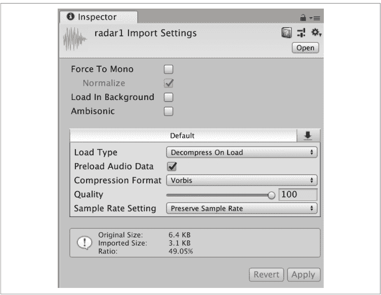
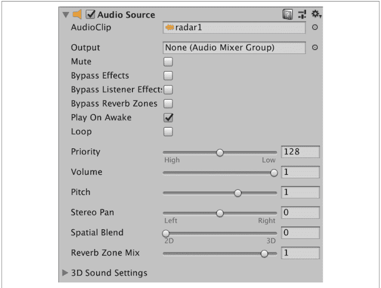
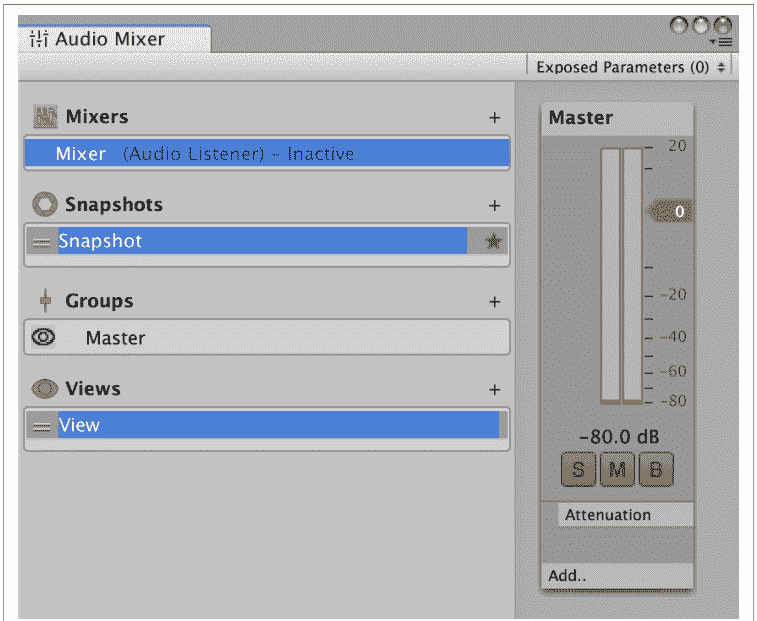
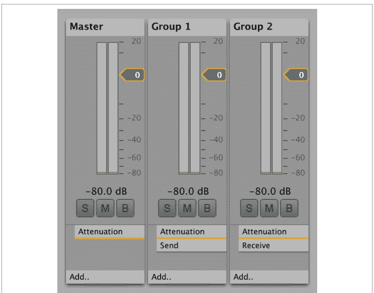
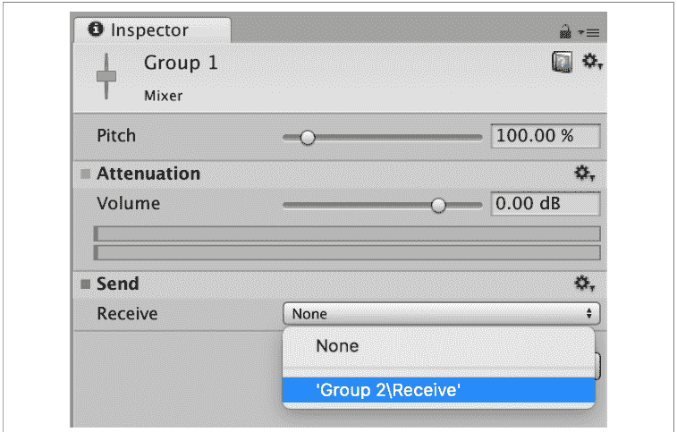
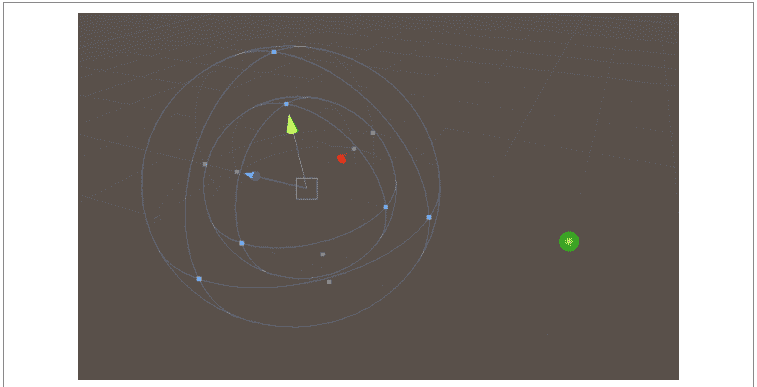
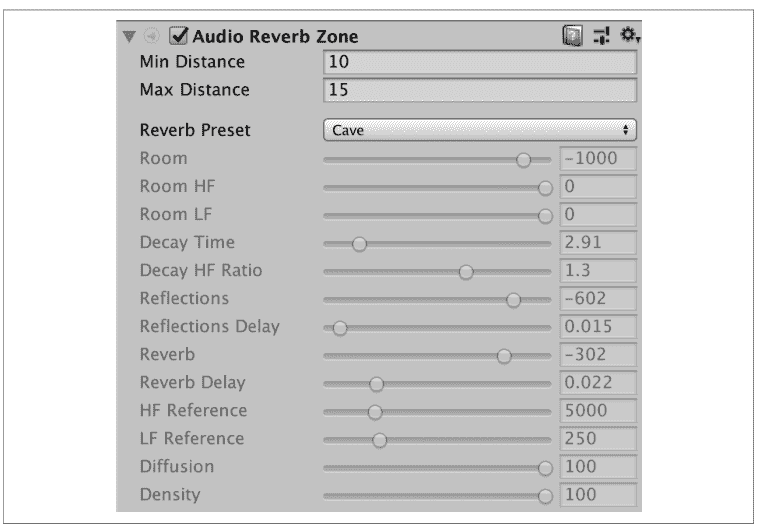
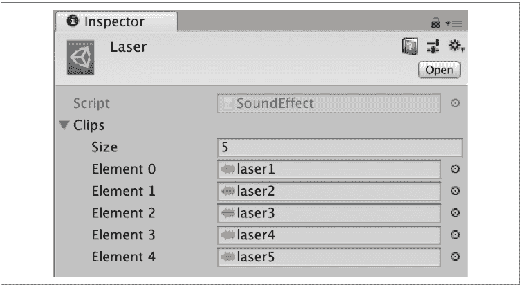
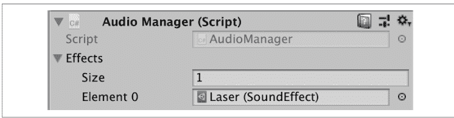

## 声音和音乐

音频可能是交互式体验中最重要的部分之一，尤其是在你构建游戏时。Unity 提供了广泛的工具来设置简单和复杂的音频。在本章中，我们将讨论如何在场景中让音频工作的基础知识，以及更高级的控制项目声音的方法。


> 声音和音乐的重要性远远超过你的想象。如果你正在构建游戏，不要忽略声音、音乐和音频。

与其它章节一样，本章远非涵盖 Unity 中音频所需的一切的详尽食谱集合。相反，我们试图涵盖作为 Unity 开发人员，我们在一次又一次的游戏中、一次又一次的项目中反复实现的东西。

### 11.1 播放声音

#### 问题

你想在项目中播放声音和音乐。

#### 解决方案

要播放音频剪辑，你首先需要一个要播放的音频文件。如果你已经有了一个想法，将其拖放到你的项目中。


如果你需要游戏的音效，有一些地方可以免费找到一些。Kenney 有一个不错的公共领域音效合集；像 Freesound 这样的社区网站有更广泛的材料和质量范围。你也可以自己创建。Bfxr 是一款适用于 Windows 和 Mac 的免费应用程序，可生成复古风格的音效。Humble Bundle 也经常为大型游戏资源合集提供很棒的交易。

一旦你将音频资源添加到项目中，通过选择它并查看 Inspector 来配置 Unity 如何导入它（图 11-1）。Unity 支持 .aif、.wav、.mp3 和 .ogg 音频。它还支持跟踪格式 .xm、.mod、.it 和 .s3m。Unity 会将音频转换为你指定的格式。



图 11-1. AudioClip 资产的导入设置

一旦你导入了音频剪辑，它就可以播放了。在 Unity 中，音频是从附加到游戏对象的 AudioSource 组件播放的。要创建 AudioSource 组件：


+   1. 打开 GameObject 菜单，并选择 Audio → Audio Source。将会创建一个新的游戏对象，并附带一个 AudioSource 组件。


你也可以通过选择游戏对象，点击 Inspector 底部 Add Component 按钮，然后选择 Audio → Audio Source，来为现有对象添加 AudioSource 组件。

+   2. 一旦你有了音频源，通过将 Project 选项卡中的资源拖放到 AudioClip 槽中，附加你想要播放的音频剪辑（图 11-2）。

+   3. 在 Unity 中播放项目。音频将开始播放。



图 11-2. AudioSource 组件的 Inspector


你可以通过启用 Play On Awake 选项来配置音频源是否在对象首次激活时开始播放。

#### Discussion

当一个正在播放音频的 AudioSource 组件在 AudioListener 组件范围内时，玩家扬声器或耳机会播放音频。当你创建一个新场景时，包含在所有对象中的主 Camera 对象都附带了一个 AudioListener 组件。


> 你在场景中一次只能有一个 AudioListener。如果有多个，Unity 会发出警告，并且只有一个会起作用。

### 11.2 Setting Up a Mixer

#### Problem

你希望在中央位置管理项目播放的音频的电平和设置。

#### Solution

你可以通过创建音频混音器资源并在混音器中设置组来管理不同音频源组的音量电平。你可以配置音频源将其音频路由到特定组；每个组可以有自己的音量电平和效果。

创建音频混音器：

+   1. 打开 Assets 菜单，并选择 Assets → Create → Audio Mixer。将会创建一个新的音频混音器资源；将其重命名为你喜欢的名称。 (“Audio Mixer” 很常见；你的项目可能不需要超过一个混音器。)
+   2. 双击新资源。Audio Mixer 面板将打开（图 11-3）。
+   3. 音频混音器管理一组组。组具有音量滑块并且可以附加效果。它们也可以有子项，这意味着更改父级的音量会影响其子项的音量。始终有一个名为 Master 的组；所有其他组都是 Master 的子项。
+   4. 通过点击组右侧的 + 按钮创建新组。（例如，你可以创建一个名为 “Music” 的组，另一个名为 “Sound Effects”。）

5. 为了使用你创建的组，你可以将音频源路由到组。选择音频源，并将混音器面板中 Group 列表中的混音器组拖放到音频源的 Output 槽中。音频源播放的任何音频都将发送到混音器组。



图 11-3. Audio Mixer 面板


大多数游戏引擎的音频子系统，包括 Unity，仍然不幸地使用 Master 术语，因为它借用了音频领域长期使用的该术语。这不是一件好事，我们希望行业能尽快更新该术语。

#### Discussion

除了每个组的音量电平之外，你还可以选择性地控制哪些组处于活动状态：

M（静音）按钮
    静音该组

S（独奏）按钮
    静音所有其他组

B（旁路）按钮
    禁用音频效果（在 Recipe 11.3 中讨论）

### 11.3 Using Audio Effects

#### Problem

你希望应用改变场景中音频声音方式的效果。例如，你希望应用回声效果。

#### Solution

你可以通过添加音频效果来修改音频系统处理音频的方式，这些效果可以过滤声音的频率范围，应用混响等。

你可以在三个不同的位置设置效果：音频混音器组、音频源或音频监听器。

音频源或音频监听器上的效果是组件，就像其他非音频组件一样，例如渲染器或物理碰撞器。要在音频源上添加效果：

+   1. 选择包含你想要修改的音频源的游戏对象，并点击 Add Component 按钮。
+   2. 点击 Audio，并选择你想要添加的效果。组件将被添加，并且音频源播放的任何音频都将被滤波器修改（图 11-4）。

要在音频监听器上添加效果，过程是相同的，只是效果会修改监听器接收到的任何音频（见图 11-5）。

图 11-4. 附加到带有音频源的游戏对象的音频效果组件

图 11-5. 附加到带有音频监听器的游戏对象的音频效果组件


组件的顺序很重要，因为它控制效果应用于音频的顺序。

除了向音频源和监听器添加效果外，你还可以向混音器中的组添加效果：

+   1. 如果你还没有，可以通过按照 Recipe 11.2 中的步骤创建一个混音器组。
+   2. 在组的混音器下，点击 Add 并选择一个效果。
+   3. 在组下选择效果。


混音器组中的 B 按钮会旁路效果，暂时禁用它们。

#### Discussion

有大量可用的音频效果，每个效果都可以配置以支持你想要的效果。其中最有用的包括：

*Reverb effect*
允许你模拟声音在空间中回荡的方式

*Low-Pass Filter effect*
切除高频并产生闷声

*Compressor filter*
减少声音最安静和最响亮部分之间的动态范围，这意味着音频听起来更像是在更一致的电平

### 11.4 Using Send and Receive Effects

#### Problem

你希望一个音频混音器组上的效果能够与来自另一个组的信号一起工作。

#### Solution

在你的音频组上使用 Send 和 Receive 效果：

+   1. 通过按照 Recipe 11.2 中的步骤在音频混音器上设置至少两个混音器组。
+   2. 通过点击组底部的 Add 按钮，在应该接收音频的混音器组上添加 Receive 效果。
+   3. 在应该发送音频的混音器组上添加 Send 效果。你的组现在应该看起来像图 11-6。添加 Send 效果后，你需要设置它发送音频的位置。
+   4. 选择 Send 效果，并在其 Inspector 中，将 Receiver 设置为你添加的 Receive 效果（图 11-7）。
+   5. 播放游戏，并通过具有 Send 效果的组播放一些音频。音频也将通过具有 Receive 效果的组播放，并将被接收组上的任何效果修改。



图 11-6. 一个音频混音器，其中一个组上有一个 Send 效果，另一个组上有一个 Receive 效果



图 11-7. 配置 Send 效果以将音频发送到另一个组上指定的 Receive 效果


默认情况下，Send 效果设置为最低电平。你需要增加发送电平才能将任何音频发送到接收器。

#### Discussion

Send 和 Receive 效果本身并不是非常有用，因为它们所做的只是复制音频信号。当你想要更精细地控制音频路由方式，并且想要应用同时利用多个音频信号的音频效果时，它们变得有用。

一些效果本身就充当接收器——你不需要在它们上添加 Receive 效果。例如，Duck Volume 效果（在 Recipe 11.5 中讨论）可以充当接收器。


### 11.5 降音

#### 问题

你希望在一组声音活跃时使另一组声音变安静。例如，你希望在播放语音时降低音效的音量，以使其更清晰。

#### 解决方案

在 *降音* 效果中，一个信号的电平会导致另一个信号的电平降低。要实现此功能，你需要在应降低音量的组上添加一个 Duck Volume 效果，并向应触发音量降低的组添加 Send 效果。

例如，假设你有一个播放音乐的混音组和一个播放语音的混音组，并且你希望在播放语音时自动降低音乐音量：

- 1. 按照 Recipe 11.2 中的步骤在音频混音器上设置至少两个混音组。将其中一个混音器命名为“Voice”，另一个混音器命名为“Music”。
- 2. 设置两个音频源：使其中一个发送到 Voice 组，另一个发送到 Music 组。为每个源附加你喜欢的音频剪辑，并使发送到 Music 的源循环播放。
- 3. 选择 Music 组，该组应在 Voice 播放时降低其音量，并添加一个新的 Duck Volume 效果。
- 4. 选择 Voice 组，该组应导致 Music 组降低音量，并添加一个 Send 效果。
- 5. 选择 Send 效果，并将其 Receiver 设置为 Duck Volume 效果。
- 6. 将发送电平增加到最大值（0 dB）。

你现在可以开始测试了：

- 1. 播放游戏。你目前还不会听到太多效果；你需要调整设置以确定要设置的值。
- 2. 使 Voice 源播放其声音；例如，你可以使用脚本来控制音频源（请参阅 Recipe 11.7）。
- 3. 选择 Duck Volume 效果，并点击 Inspector 顶部 Playmode 中的 Edit 按钮。
- 4. 在播放时，调整 Threshold 滑块以控制降音何时生效。

#### 讨论

你还可以配置 Ratio 和 Knee 参数以调整 Duck Volume 效果如何修改其音量。此外，Attack Time 和 Release Time 设置可让你控制效果应用的速度以及其消失所需的时间。

### 11.6 使用多个音频区域

#### 问题

你希望创建音频声音不同的区域。例如，你希望玩家走进洞穴时游戏产生深沉的回声。

#### 解决方案

使用 *混响区域* 来创建场景中的区域，这些区域会根据音频监听器在区域内的位置对音频监听器应用不同的混响设置。混响区域会根据监听器在区域内的位置扭曲所听到的声音，并在你希望在玩家进入时逐渐将环境效果应用于某个位置时使用。

要创建混响区域：

- 1. 打开 GameObject 菜单，并选择 Audio → Audio Reverb Zone。
- 2. 将新区域放置在你希望混响应用的区域。
- 3. 点击并拖动两个球体上的点以设置效果的最小和最大半径（图 11-8）。
- 4. 在 Inspector 中（图 11-9），选择你想要应用的效果类型。有多种预设可供选择，包括音乐厅、洞穴、隔音室等。
- 5. 播放项目，并将摄像机移入混响区域。当你进入区域时，效果将开始应用于音频监听器接收到的任何音频。



图 11-8. 场景中的 Audio Reverb Zone



图 11-9. Audio Reverb Zone 的 Inspector

#### 讨论

如果将 Reverb Preset 设置为 Custom，你可以修改单个混响设置并创建更精确地满足你需求的混响效果。

### 11.7 使用脚本播放音频

#### 问题

你希望从脚本触发音频播放。

#### 解决方案

使用 AudioSource 组件上的 Play、PlayDelayed、PlayOneShot 和 Stop 方法来控制音频源：

// Play the AudioClip that's currently set
source.Play();

// Play the AudioClip with a delay, measured in seconds
source.PlayDelayed(0.5f);

// Play a specified AudioClip; the volume scale is optional
source.PlayOneShot(clip, 0.5f); // play at half volume
source.PlayOneShot(clip, 1f); // play at full volume

// Stop playing the current clip
source.Stop();
```

#### 讨论

通常能够在游戏过程中才知道其身份的情况下播放音频剪辑非常有用，因为这意味着你可以在设计时使用适当的音量级别和音频混音器组设置音频源，然后在游戏过程中控制声音本身。

### 11.8 使用声音管理器

#### 问题

你希望构建一个系统，允许从代码中的任意位置触发音效。

#### 解决方案

创建一个系统，允许代码的其他部分请求播放音效。本类中提供的代码是一个简单的示例，但它旨在作为一个基础，以便你可以为项目添加所需的特定功能。

该系统通过定义 SoundEffect 作为 ScriptableObject 类的资源来实现，该类包含对音频剪辑的引用（有关 Scriptable Object 的更多信息，请参阅 Recipe 2.9）。AudioManager 是一个单例，它有一个这些 SoundEffect 资源的列表，可以通过传递效果的名称来请求播放其中一个效果。会随机选择附加到 SoundEffect 资源的一个剪辑，从而实现一些不错的变化。效果可以播放在与监听器相同的位置，也可以将世界中的位置作为参数传递，选定的音频剪辑将在该位置播放。


此脚本使用了我们将在 Recipe 2.6 中讨论的单例类。在继续本教程之前，请先按照该教程中的步骤操作。

开始构建时，我们将首先定义 SoundEffect 资源：

- 1. 创建一个新的 C# 脚本，命名为 SoundEffect.cs，并将以下代码放入其中：

// An asset that contains a collection of audio clips.
[CreateAssetMenu]
public class SoundEffect : ScriptableObject {

    // The list of AudioClips that might be played when
    // this sound effect is played.
    public AudioClip[] clips;

    // Randomly selects an AudioClip from the 'clips' array,
    // if one is available.
    public AudioClip GetRandomClip() {
        if (clips.Length == 0) {
            return null;
        }
        return clips[Random.Range(0, clips.Length)];
    }
}
```


在真正的游戏中，你可能希望从下一次结果中排除最近播放的随机声音，只是为了让游戏感觉比实际更有趣！

- 2. 通过打开 Assets 菜单并选择 Create → Sound Effect 来创建 SoundEffect 资源。将新资源命名为你喜欢的名称。
- 3. 选择新资源，并在 Inspector 中拖放你希望用于此音效的音频资源（参见图 11-10）。



图 11-10. SoundEffect 资源的 Inspector，其中包含添加到其列表中的音频剪辑集合

接下来，我们将创建 AudioManager 类本身。创建一个新的 C# 脚本，命名为 AudioManager.cs，并将以下代码添加到其中：

```
public class AudioManager : Singleton<AudioManager> {

    // The list of references to SoundEffect assets.
    public SoundEffect[] effects;

    // A dictionary that maps the names of SoundEffects to the objects
    // themselves, to make it faster to look them up.
    private Dictionary<string, SoundEffect> _effectDictionary;

    // A reference to the current audio listener, which we use to place
    // audio clips.
    private AudioListener _listener;
```

```
private void Awake() {
    // When the manager wakes up, build a dictionary of named sounds, so
    // that we can quickly access them when needed
    _effectDictionary = new Dictionary<string, SoundEffect>();
    foreach (var effect in effects) {
        Debug.LogFormat("registered effect {0}", effect.name);
        _effectDictionary[effect.name] = effect;
    }
}

// Plays a sound effect by name, at the same position as the audio
// listener.
public void PlayEffect(string effectName) {
    // If we don't currently have a listener (or the reference we had
    // was destroyed), find one to use
    if (_listener == null) {
        _listener = FindObjectOfType<AudioListener>();
    }

    // Play the effect at the listener's position
    PlayEffect(effectName, _listener.transform.position);
}

// Plays a sound effect by name, at a specified position in the world
public void PlayEffect(string effectName, Vector3 worldPosition) {

    // Does the sound effect exist?
    if (_effectDictionary.ContainsKey(effectName) == false) {
        Debug.LogWarningFormat(
            "Effect {0} is not registered.", effectName);
        return;
    }

    // Get a clip from the effect
    var clip = _effectDictionary[effectName].GetRandomClip();

    // Make sure it wasn't null
    if (clip == null) {
        Debug.LogWarningFormat(
            "Effect {0} has no clips to play.", effectName);
        return;
    }

    // Play the selected clip at the specified point
    AudioSource.PlayClipAtPoint(clip, worldPosition);
}
}
```


最后，我们将创建单例实例，并添加我们希望可用的音频剪辑：

- 1. 通过打开 GameObject 菜单并选择 Create Empty 来创建一个新的游戏对象。将新对象命名为“Audio Manager。”
- 2. 选择新对象。
- 3. 将 AudioManager.cs 脚本拖放到 Inspector 上。
- 4. 将你创建的 SoundEffect 资源添加到 Effects 列表中（图 11-11）。



图 11-11. Audio Manager 的 Inspector，其列表中添加了一个 SoundEffect 资源

你现在可以从代码中触发音效。例如，如果你创建了一个名为“Laser”的 SoundEffect，你可以这样触发它：

// Play a sound called "laser" at the same place as the listener
AudioManager.instance.PlayEffect("laser");

// Play the same sound at the origin
AudioManager.instance.PlayEffect("laser", Vector3.zero);

#### Discussion

与任何单例一样，你在初始开发的便捷性和增加的软件复杂性之间做出了权衡。有关更多详细信息，请参阅 Recipe 2.6 的讨论。
