## User Interface

Unity 包含的 UI 系统是构建游戏 UI 的强大而灵活的方式。它可用于构建从显式的基于菜单和基于界面的游戏部分，例如实际的菜单和配置屏幕，到游戏内 UI，以及通过有用的额外 UI 元素扩展 Unity 编辑器环境以简化游戏开发流程。

如果你过去使用过 Unity，你会很高兴地知道 UI 系统在近年已被彻底替换！这里涵盖的所有内容都涉及当前的 UI 系统，在 Unity 文档中有时可能会被称为“新 UI 系统”。

旧的 Unity UI 系统专注于基于程序员的工作流程，而不是所涉及的视觉 UI 元素。它是按程序员可能思考的方式设计的，而不是 UI 需要如何表现：视觉上！新系统修复了这一点，我们因此受益匪浅。

你不需要向整体项目添加任何内容即可开始使用 Unity UI 系统。所有操作都通过属于 UI 系统的游戏对象完成。

Unity UI 系统让你可以为玩家创建 UI，以便开始游戏、修改设置等（例如主菜单），以及游戏内 UI，例如你在虚拟世界中电脑屏幕上可能找到的那些（例如第一人称风格游戏中的电脑控制台）。你可以在 Unity 手册中了解 Unity UI 系统的所有组件。


### 12.1 Working with UI Controls

#### Problem

你想在 Unity 中构建用户界面。

#### Solution

在 Unity 中构建 UI 就像在 Unity 中构建任何东西一样：它是由游戏对象构建而成的。Unity 提供了各种 UI 元素作为游戏对象，如图 12-1 所示。

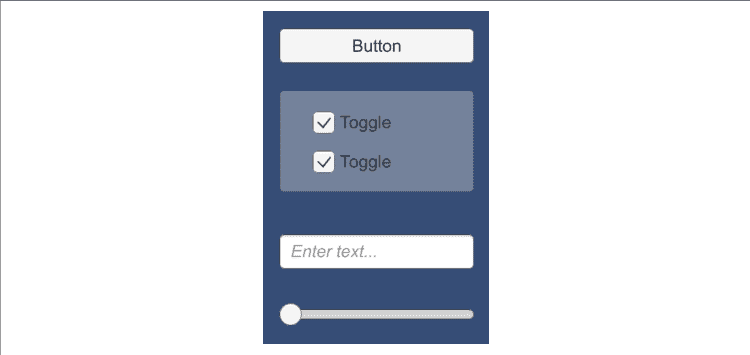

图 12-1. 显示一系列 UI 元素的游戏对象

要在 Unity 中绘制 UI，你需要一个 Canvas 组件。你可以将 Canvas 添加到游戏对象，也可以直接将其添加到场景中以创建放置 UI 的位置：

- 1. 打开 GameObject 菜单，并选择 UI → Canvas。
所有 UI 元素都作为 Canvas 的子对象添加。我们将向 UI 添加一些文本。

- 2. 选择新添加的画布，然后再次打开 GameObject 菜单并选择 UI → Text。Text 对象将被添加到画布中。

- 3. 选择 Rectangle 工具，并拖动 Text 对象以调整其大小和重新定位。

- 4. 选择 Text 对象，并修改其属性以更改其文本。

仅显示一些文本的 UI 并不是很有用，所以现在我们将编写一个脚本将一些文本记录到控制台，然后将脚本附加到按钮上：

- 1. 创建一个新的 C# 脚本名为 ButtonClicked.cs，删除默认创建的两个方法，并向类中添加以下代码：

```
public void ButtonWasClicked() {
    Debug.Log("The button was clicked!");
}
```

这个公共方法 ButtonWasClicked 将连接到我们将添加到 UI 的按钮。它向调试日志发送一条消息，说明按钮已被点击。

- 2. 我们还可以添加一个接受参数的公共方法，允许我们在记录的输出中添加消息。将以下方法添加到类中：

```
public void ButtonWasClickedWithParameter(string parameter) {
    string message =
        string.Format("The button was clicked: {0}", parameter);

    Debug.Log(message);
}
```

我们定义了两个公共方法：ButtonWasClickedWithParameter，它只是记录按钮已被点击，以及 Format，它做同样的事情但包含一个字符串参数，我们可以使用它。

- 3. 顺便说一下，我们还可以添加私有方法，这些方法无法连接到 UI 元素。将以下方法添加到类中：

```
void PrivateButtonWasClicked() {
    Debug.Log(
        "This won’t run as the direct result of a button click!"
    );
}
```


C# 中所有类方法默认都是私有的，因此如果你想创建一个私有方法，就不需要指定保护级别。如果你愿意的话，阻止你包含 private 关键字也没有什么。

现在我们需要将新脚本实际附加到我们一直在构建的 UI 上：

- 1. 将 ButtonClicked 组件（我们的新脚本）附加到 Canvas 对象，或附加到任何其他游戏对象——就本示例而言，哪个对象并不重要。

- 2. 再次打开 GameObject 菜单，并选择 UI → Button。

- 3. 选择你添加的按钮，并点击其 On Click 组件下的 + 按钮。
- 4. 将你在步骤 1 中附加了 ButtonClicked 组件的对象拖到出现的新的对象字段中。
- 5. 在现在出现的函数下拉菜单中，选择 ButtonClicked → ButtonWasClicked。
- 6. 你的 UI 应该类似于图 12-2。运行游戏。当你点击按钮时，文本将出现在控制台中。
- 7. 停止游戏，再次点击 + 按钮。拖入同一个对象，并选择 ButtonClicked → ButtonWasClickedWithParameter。注意此方法如何让你指定在按钮被点击时发送的字符串。

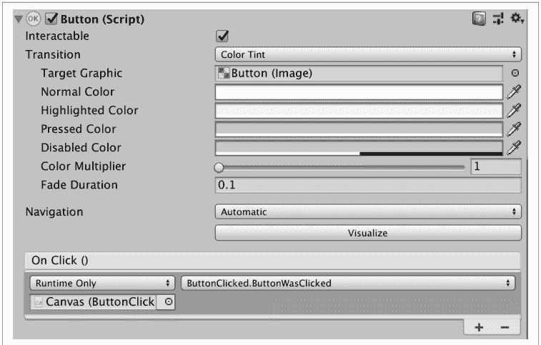

图 12-2. 按钮的 On Click 事件，已配置为调用 ButtonClicked 组件的 ButtonWasClicked 方法


由于它不是公共的，PrivateButtonWasClicked 方法永远不会出现在你可以选择的方法列表中。

#### Discussion

除了明显的输出——我们添加了一个按钮使其发生某些事情——这里还有一些有用的移动部件需要注意。


每个画布都附加了一个 Canvas Scaler 组件，它允许你控制画布内 UI 元素的缩放和像素密度。这对于确保你的 UI 在构建可在多个屏幕分辨率上运行的游戏时按预期行为很有用。有关此组件的更多信息，请参阅 Unity 的文档。

每个 UI 元素都存在于一个画布上，每个 UI 元素都附加了一个 RectTransform 组件。如果你熟悉 Transform 组件（如果需要复习，请参阅第 1 章），那么解释 RectTransform 很简单：它是 UI 元素的 Transform 等价物，它为画布内的 UI 元素提供位置、旋转和缩放。

每个 RectTransform 还有四个小的三角形手柄，称为锚点。这些锚点定义了组件如何锚定到其父对象。你可以移动锚点（或在 Inspector 中操作它们），例如，允许按钮相对于其父容器更改其宽度，同时确保其高度始终保持不变，并且它与容器的底部保持相同的距离。

有一个类似于目标的按钮，显示在图 12-3 左上角，它允许你从预设锚点配置中进行选择。

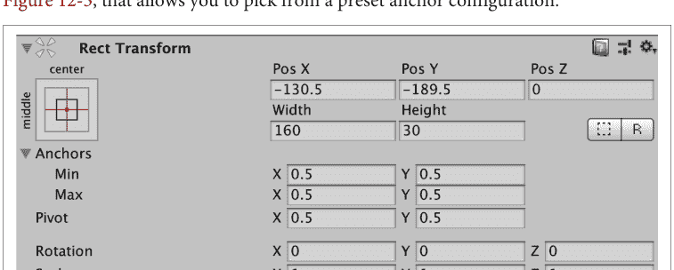

图 12-3. 看起来像目标的按钮允许你从预设锚点配置中进行选择


#### 理解 Canvas

由于使用 Unity UI 系统构建的所有内容都位于 canvas 内，了解其工作原理也很有必要。首先，最重要的是，canvas 有一个渲染模式设置，它决定了 canvas 如何被渲染。可能的模式有：屏幕空间覆盖、屏幕空间摄像机和世界空间。

在屏幕空间方面，覆盖意味着 canvas 会渲染在场景之上。如果屏幕尺寸/分辨率发生变化，canvas 会相应调整大小。屏幕空间摄像机的行为与覆盖类似，但在这种情况下，canvas 会放置在由你指定的摄像机前方，并且所有内容都基于摄像机的设置进行渲染。关于摄像机的回顾，请参考第 8 章。

将 canvas 渲染为世界空间会使 canvas 像场景中的普通对象一样表现：你会使用此模式来显示旨在成为游戏中世界一部分的 UI，例如飞船控制面板，或类似内容。在这种情况下，canvas 的大小取自其 RectTransform 的大小。

### 12.2 主题化控件

#### 问题

你使用自己的美术资源作为控件，而不是 Unity 内置的美术资源。你希望这些美术资源能够随着控件大小变化而缩放，而不会拉伸。

#### 解决方案

在构建游戏美术资源时，尤其是 UI，你需要确保界面元素在游戏最终运行的任何分辨率下都看起来最佳。为此，你需要以特定方式设置用于绘制 UI 的精灵，并告诉 Unity 引擎哪些部分可以在不影响外观的情况下进行缩放：

- 1. 首先导入你想要使用的纹理。


在处理 UI 时，必须确保纹理配置为导入为“Sprite / UI”。关于如何设置资源导入的提醒，请参阅第 1 章。

在本示例中，我们将使用 Kenney 的开源 UI 资源包中的美术资源来自定义一个面板。我们将使用 PNG 文件夹，并将纹理在导入器中设置为精灵。


互联网上有大量免费游戏美术资源。Kenney 制作了一些我们最喜欢的材料，我们在本书中经常引用它！查看它的所有资源包。

- 2. 打开 GameObject 菜单，并选择 UI → Panel 在场景中添加一个面板。
- 3. 选择 Panel 游戏对象，并将其 Source Image 更改为来自 Kenney UI 包的 blue_panel 图像。
- 4. 调整面板大小，你会看到图像被拉伸（图 12-4），而且看起来不太好。我们可以修复它！


图 12-4. 一个拉伸的面板，角部失真

要修复它，我们需要设置面板的精灵，使只有特定区域被拉伸。在此纹理中，除了角部外，其他所有部分都可以缩放而不影响外观，因此我们将据此进行设置：

- 1. 选择 blue_panel 纹理。
- 2. 点击 Sprite Editor 按钮。
- 3. 在 Sprite Editor 中，将出现在屏幕顶部的绿色点向下拖动，直到绿色线位于图像的圆角下方。你也可以手动输入更改，将边框的 T 值设置为 5。
- 4. 对其他三个边缘重复此过程。完成后，Sprite Editor 窗口应如下图 12-5 所示。
- 5. 点击 Apply，并关闭 Sprite Editor。
- 6. 选择 Panel 对象。
- 7. 将 Image 组件的 Image Type 从 Simple 更改为 Sliced。
- 8. 拉伸外观将消失，因为只有精灵的中间区域被允许拉伸，角部的形状将被保留（图 12-6）。

图 12-5. Sprite Editor 窗口，精灵的边框已配置

图 12-6. 来自图 12-4 的同一个拉伸面板，但精灵已配置为仅在中间拉伸

#### 讨论

我们在这里使用的技术有时被称为 9 切片，因为切片过程定义了图像的九个区域。它并不比使用单个图像资源与九个子部分更复杂，每个子部分的行为不同：角部不缩放，而图像的其余部分根据需要拉伸。

你可能会注意到，Image 组件的 Image Type 还有其他选项：Simple、Tiled 和 Filled。

Simple 会将整个精灵等比缩放。Tiled 的行为与我们在这里使用的 Sliced 设置类似，但会重复中心部分而不是拉伸它。Filled 的行为与 Simple 相同，但会从定义的原点以定义的朝向、方法和数量填充精灵。


你可以在 Unity 手册中了解更多关于使用图像来设置 UI 组件样式的信息。

### 12.3 动画化 UI

#### 问题

你想要为用户界面的部分内容做动画。

#### 解决方案

UI 动画在视频游戏中很常见。界面通常需要吸引注意力，或用于让玩家感觉自己完成了特别的事情，或理解他们在游戏中做出的某个行为的影响。Unity 使动画化 UI 元素变得与动画化 Unity 中构建的任何其他内容一样简单：非常简单！


这与我们在第 8 章中采用的动画方法不同。你也可以将我们在那里使用的系统连接到 UI，如果你愿意的话。但我们试图向你展示解决问题的多样化方法。

为了演示，我们将让一个按钮在被点击时旋转。首先，我们需要创建一个新按钮：

- 1. 打开 GameObject 菜单，并选择 UI → Button 在场景中添加一个按钮。


你可能会注意到，创建按钮还会创建一个作为按钮父级的 canvas。由于所有 UI 元素都必须作为 canvas 的子级，如果在添加新 UI 元素时场景中没有 canvas，就会为你创建一个。如果场景中已有 canvas，新 UI 组件将被添加为其子级。有关 canvas 的更多信息，请参阅配方 12.1 和 Unity 手册。

- 2. 接下来，我们需要创建一个脚本来实际为我们执行动画。创建一个名为 SpinButton.cs 的新 C# 脚本，删除类中的内容，并在其中添加以下代码：

```
private IEnumerator StartSpinning()
{
    // Don't do any spinning if spin time is zero or less (
    if (spinTime <= 0) {
        yield break;
    }

    // Keep track of how long we've been spinning.
    float elapsed = 0f;

    while (elapsed < spinTime) {
        elapsed += Time.deltaTime;

        // Calculate how far along the animation we are, measured
        // between 0 and 1.
        var t = elapsed / spinTime;

        // Use this value to figure out how many degrees we should be
        // rotated at on this frame.
        var angle = curve.Evaluate(t) * 360f;

        // Calculate the rotation by rotating this many angles around
        // the x-axis.
        transform.localRotation =
            Quaternion.AngleAxis(angle, Vector3.right);

        // Wait a new frame.
        yield return null;
    }

    // The animation is now complete. Reset the rotation to normal.
```

```
transform.localRotation = Quaternion.identity;
}
```

此代码定义了一个方法 StartSpinning，我们将作为协程调用，它会更新附加了它的对象的旋转。

- 3. 我们还需要为旋转的参数定义一些变量。将以下内容添加到我们刚刚创建的方法中：

```
// The amount of time needed to perform a full spin
[SerializeField] float spinTime = 0.5f;

// Controls the pacing of the animation.
[SerializeField] AnimationCurve curve =
    AnimationCurve.EaseInOut(0, 0, 1, 1);
```

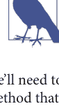

当你使用 SerializeField 属性时，你是在告诉 Unity 这些变量的内容应保存到磁盘，并在 Inspector 中显示为可编辑的值。

- 4. 我们需要添加一个公共方法来启动协程，调用我们刚刚创建的 StartSpinning 方法：

```
public void Spin() {
    // Start a spin.
    StartCoroutine(StartSpinning());
}
```


当协程启动时，它会在每次遇到 yield return 语句时暂停执行并将控制权返回给 Unity。如果你需要关于协程的复习，请查看第 2 章。

- 5. 将 SpinButton 组件附加到我们之前创建的按钮上。
- 6. 点击 On Click 字段中的 + 按钮。
- 7. 将按钮本身拖入该字段。
- 8. 在弹出菜单中，选择 SpinButton → Spin。
- 9. 运行游戏。当你点击按钮时，它会旋转！一件杰作。

你也可以通过我们暴露给编辑器的变量来调整曲线的动画节奏，以及动画的持续时间，如图 12-7 所示。


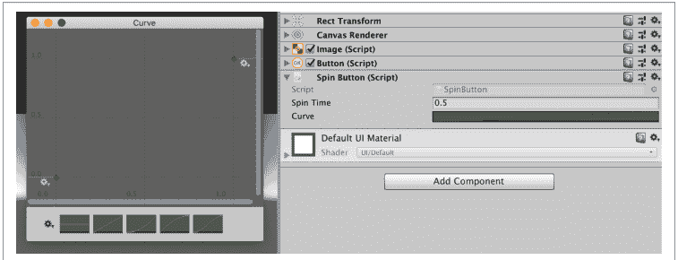

Figure 12-7. Adjusting the curve to control the animation pacing and duration

#### Discussion

An animation curve, used here, stores a collection of keyframes that can be evaluated over time.


> “Evaluating” in this context means sampling from the curve at a requested time in the curve: we’re asking the curve to tell us what’s going on at the specific time for which we’re evaluating.

Using an animation curve for this instead of, say, incrementing the rotation every frame is a much more powerful and flexible way to animate. It removes much of the manual work, and allows us to focus on the desired movement of the UI, rather than coding complex animations.

As we’ve mentioned throughout this cookbook, pretty much any object, including objects on the canvas, can be animated (positioned, rotated, and so on) like everything else in Unity. You can also animate the properties of these objects! (Again, just like everything else in Unity.)

### 12.4 Creating a List of Items

#### Problem

You want to create a scrolling list of UI items.

#### Solution

Lists are a common UI element. You can use them for everything from menus to groups of items in an inventory.

First, we’ll create the container for the list. The container for the list will be one of Unity’s UI components: a scroll view. We’re going to create a simple scrolling list like the one shown in Figure 12-8.

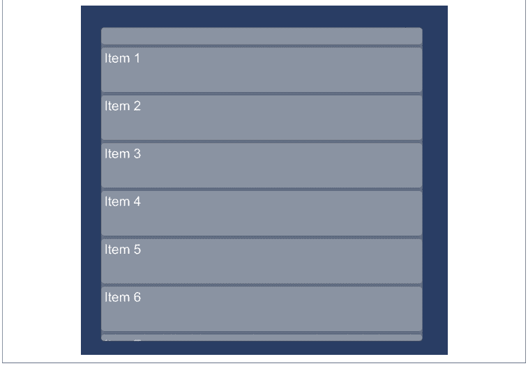

Figure 12-8. Simple scrolling list

Next, we’ll need to do some setup:

- 1. Create a scroll view by opening the GameObject menu and choosing UI → Scroll View.
- 2. Select the Content object in the scroll view.
- 3. Add a Vertical Layout Group to the Content object.
- 4. Turn on the Width checkbox in Child Controls Size. This will make the objects inside the Content object expand their width to fill their parent, while still having control over their own height.
- 5. Add a Content Size Fitter component to the Content object.
- 6. Set the Vertical Fit setting to Preferred Size. This will make the Content object adjust its height to be the total height of its children. It should look like Figure 12-9.

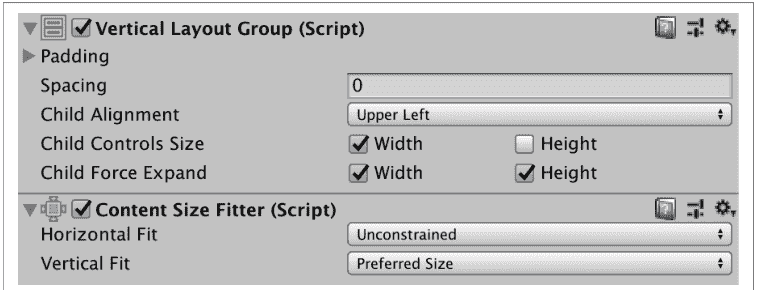

Figure 12-9. Setting Vertical Fit to Preferred Size

Now we’ll create our prototype list item object. We’ll be using the prototype list item as the basic object that gets re-created for each item in our list:

- 1. Create a panel. Name it “List Item.”
- 2. Drag the List Item onto the Content object in the scroll view. It will resize to the width of the Content object.
- 3. Create a new Text object by opening the GameObject menu and choosing UI → Text.
- 4. Make the Text object a child of the List Item.
- 5. Set the Text object’s minimum anchor to (0, 0) and its maximum anchor to (1, 1). This will make it define its size relative to the width and height of its parent.
- 6. Set the Text object’s Left, Top, Bottom, and Right margins to 5. This will inset the Text object by 5 pixels on all edges.

Next, we’ll add some code that lets each list item manage its content:

- 1. Create a new C# script called ListItem.cs. Remove the contents of the class, and add the following code to it:

```
[SerializeField] UnityEngine.UI.Text labelText;
```

This creates a label to store the text that will be used for a list item entry, and exposes it to the Unity Inspector.

- 2. Add the following property:

```
public string Label
{
    get
    {
        return labelText.text;
    }
    set
    {
        labelText.text = value;
    }
}
```

This exposes a string, allowing you to get or set the contents of the label.


For more information on the syntax for creating getters and setters, check out Chapter 2.

Now we need to add the script we’ve just created to the prototype object:

- 1. Add a ListItem script to the List Item.
- 2. Drag the Text object into the Label Text field.
- 3. Drag the List Item object from the Hierarchy into the Project tab. This will create a prefab.
- 4. Delete the List Item from the scene. You no longer need it, as you have the prefab!


For a refresher on prefabs and how they work within Unity, see Chapter 1.

Finally, we’ll add code that populates the list with instances of the List Item:

- 1. Create a new C# script called List.cs. Add the following code to it:
- ```csharp
+   public class List : MonoBehaviour {
+   
+       // The number of items to create
+       [SerializeField] int itemCount = 5;
+   
+       // Each list item will be of this type
+       [SerializeField] ListItem itemPrefab;
+   
+       // The object that new items should be inserted into
+       [SerializeField] RectTransform itemContainer;
+   
+       void Start () {
+   
+           // Create as many items as we need to
+           for (int i = 0; i < itemCount; i++)
+           {
+               var label = string.Format("Item {0}", i);
+   
+               // Create a new item
+               CreateNewListItem(label);
+           }
+       }
+   
+       public void CreateNewListItem(string label)
+       {
+           var newItem = Instantiate(itemPrefab);
+   
+           // Place it in the container; tell it to not keep its current
+           // position or scale, so it will be laid out correctly by the
+           // UI system
+           newItem.transform.SetParent(
+               itemContainer,
+               worldPositionStays: false
+           );
+   
+           // Give it a label
+           newItem.Label = label;
+       }
+   }
+   ```
- 2. Add a List component to the scroll view.
- 3. Drag the List Item prefab into its List Item Prefab slot.
- 4. Drag the Content object into its List Container slot.
- 5. Run the game. The list will now contain a scrollable collection of items! It should look something like Figure 12-10.

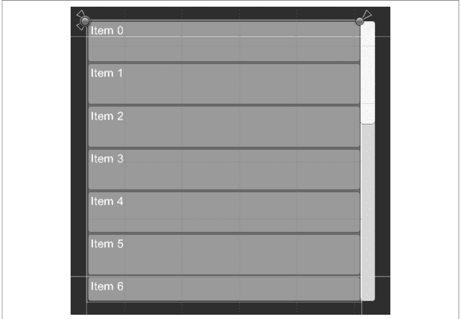

Figure 12-10. Running the game will show a list of scrollable items

#### Discussion

Scroll views are, obviously, really useful when you have content that doesn’t quite fit on the screen. A scroll view is composed of a few pieces—most importantly, a clip area that controls how much is shown of another important piece, a content area.

### 12.5 Fading Out List Items

#### Problem

You want to manage a list of items that fade out some time after being removed.

#### Solution

So you’ve built your lovely list, based on the previous recipe, and now you want to make items vanish from it in a pleasing manner, as they’re no longer needed. Attractive lists that look great as things are removed are very popular in video games.

To make your list cleanly fade items out as they get removed:

- 1. Start with the list example from Recipe 12.4.
- 2. Duplicate the List Item prefab, and name the new prefab “Fading List Item.”
- 3. Select the Fading List Item prefab, and add a Canvas Group component. This will allow you to fade the entire object.
- 4. Configure the List object to use the new Fading List Item.
- 5. Add a new button to the scene, and set its text to read “Add Item.”
- 6. Add a new entry in its On Click list.
- 7. Drag the List object into its object field, and select the List → CreateNewListItem method.
- 8. Type New List Item into the text field.
- 9. Create a new C# script called FadeAfterDelay.cs, remove the body of the class, and then add the following code:
- 10. After the necessary properties are added, add the following method:

```
// The number of seconds before a fade starts
[SerializeField] float delayBeforeFading = 2f;

// The amount of time to take while fading out
[SerializeField] float fadeTime = 0.25f;
```

```
// Notice the return type—this Start method is a coroutine!
IEnumerator Start () {

    // Wait the required amount of time
    yield return new WaitForSeconds(delayBeforeFading);

    // We need a canvas group in order to fade
    CanvasGroup canvasGroup = GetComponent<CanvasGroup>();

    if (canvasGroup == null) {
```


```
Debug.LogWarning("Cannot fade - no canvas group attached!");
yield break;
}

// Fade time must be more than 0 in order for a fade to be
// animated
if (fadeTime <= 0) {
    yield break;
}

// Keep track of how much time we've spent fading
var fadeTimeElapsed = 0f;

// Perform the fade every frame
while (fadeTimeElapsed < fadeTime) {

    fadeTimeElapsed += Time.deltaTime;

    // Calculate the fraction of the fade time (between 0 and 1)
    var t = fadeTimeElapsed / fadeTime;

    // Calculate our alpha; it starts at 1, and goes to 0
    var alpha = 1f - t;

    // Apply the fade
    canvasGroup.alpha = alpha;

    // Wait for the next frame
    yield return null;
}

// Remove this game object from the scene
Destroy(gameObject);
}
```

- 11. 将 FadeAfterDelay 组件附加到 Fading List Item 上。
- 12. 运行程序。当你点击按钮时，一个新的列表项会出现；片刻之后，它会淡出。我们本想截个图给你看，但它已经淡出去了....

#### 讨论

你会注意到 Start 方法是一个协程，所以在它运行并处理淡出和从内存中删除对象时，其他事情仍然可以发生。

### 12.6 创建屏幕位置指示器

#### 问题

你想要显示图标来突出显示屏幕上物体的位置，为玩家提供他们当时可能看不到的物体的一般方向。

#### 解决方案

要显示指示器，我们将使用 Unity 的 GUI 系统。这意味着我们将设置一个画布和一个用作预制体的原型指示器。

你需要一个用于指示器的精灵。如果你没有，Kenney 的游戏图标包里有一个不错的。要创建屏幕位置指示器：

- 1. 通过打开 GameObject 菜单并选择 UI → Canvas 来创建一个新的画布。
- 2. 通过打开 GameObject 菜单并选择 UI → Image 来创建一个新的图像。
- 3. 将图像的精灵设置为你想要用于指示器的精灵。
- 4. 重命名图像为“Indicator”。
- 5. 将 Indicator 图像拖到 Project 选项卡中。这将创建一个预制体。
- 6. 从场景中删除 Indicator 图像。

接下来，我们将创建创建、定位和移除指示器的代码，具体取决于需要：

- 1. 创建一个新的 C# 脚本名为 IndicatorManager.cs，并添加以下代码：

```
public class IndicatorManager : MonoBehaviour {

    // The indicator that appears over each tracked object.
    [SerializeField] RectTransform indicatorPrefab = null;

    // The object that all indicators will go into.
    [SerializeField] RectTransform indicatorContainer = null;

    // The single instance of the indicator manager.
    public static IndicatorManager manager;

    // Maps objects in the world to indicators onscreen.
    Dictionary<TrackedObject, RectTransform> indicators =
        new Dictionary<TrackedObject, RectTransform>();
```

```
private void Awake()
{
    // Set up the singleton variable to refer to this instance.
    manager = this;
}

private void LateUpdate()
{
    // We do this in LateUpdate so that the calculation of the
    // positions can happen after the objects have moved, which
    // prevents jitter.

    // Every frame, for each object that we're tracking, update the
    // position of its indicator.
    foreach (var pair in indicators) {
        TrackedObject target = pair.Key;
        RectTransform indicator = pair.Value;

        // Has the target been removed from the scene?
        if (target == null) {
            // Skip this indicator
            continue;
        }

        // Update the indicator's position in the canvas.
        indicator.anchoredPosition =
            GetCanvasPositionForTarget(target);
    }
}

// Returns the location in canvas space that an indicator should be
// for a given object
private Vector2 GetCanvasPositionForTarget(TrackedObject target)
{
    // Convert the position of the object from world space to
    // viewport space
    var indicatorPoint =
        Camera.main.WorldToViewportPoint(target.transform.position);

    // Viewport coordinates are (0, 0) to (1, 1); (0, 0) is the
    // bottom-left corner of the screen.

    // If a point is outside the screen, we clamp it to the edges.
    indicatorPoint.x = Mathf.Clamp01(indicatorPoint.x);
    indicatorPoint.y = Mathf.Clamp01(indicatorPoint.y);

    // If a point is behind the camera, we force it to the bottom of
    // the screen.
    if (indicatorPoint.z < 0) {
```

```
indicatorPoint.y = 0;

// We also have to flip it on the x-axis for it to appear
// correctly.
indicatorPoint.x = 1f - indicatorPoint.x;
}

// Canvas coordinates are (0, 0) -> (width, height); (0, 0) is
// the bottom-left corner of the canvas.

// This means that we can scale by the canvas size to get the
// position in canvas space.

// Get the canvas
var canvas = indicatorContainer.GetComponentInParent<Canvas>();

// Get its size
Vector2 canvasSize =
    canvas.GetComponent<RectTransform>().sizeDelta;

// Scale it
indicatorPoint.Scale(canvasSize);

// We've now calculated where it belongs in the canvas!
return indicatorPoint;
}

public void AddTrackingIndicator(TrackedObject transform) {

    // Do we already have an indicator for this object?
    if (indicators.ContainsKey(transform)) {
        // Nothing to do; we already have an indicator for this
        // transform
        return;
    }

    // Create our indicator from the prefab
    var indicator = Instantiate(indicatorPrefab);

    // Give it a useful name
    indicator.name = string.Format("Indicator for {0}",
        transform.gameObject.name);

    // Move the indicator into the container
    indicator.SetParent(indicatorContainer, false);
```

```
// Ensure the pivot point is in the center of the object, so
// that the center of the image is right over the object's
// position
indicator.pivot = new Vector2(0.5f, 0.5f);

// Ensure the object doesn't adjust its size and position based
// on the size of its parent
indicator.anchorMin = Vector2.zero;
indicator.anchorMax = Vector2.zero;

// Keep track of the relationship between the target and its
// indicator
indicators[transform] = indicator;

// Place the indicator in the right location
indicator.anchoredPosition =
    GetCanvasPositionForTarget(transform);
}

// Stops tracking a target.
public void RemoveTrackingIndicator(TrackedObject transform) {
    // If we have an indicator for this target object, remove it
    // from the scene
    if (indicators.ContainsKey(transform)) {
        // Destroy the indicator, if it isn't already gone from the
        // scene.
        if (indicators[transform] != null) {
            Destroy(indicators[transform].gameObject);
        }
    }

    // And remove it from the list, if it's present. (The Remove
    // method won't throw an exception if "transform" isn't in the
    // dictionary.)
    indicators.Remove(transform);
}
```

- 2. 创建一个空的游戏对象。将其命名为“Indicator Manager”。
- 3. 向 Indicator Manager 添加一个 IndicatorManager 组件。
- 4. 将画布拖到 Indicator Container 字段中。
- 5. 将 Indicator 预制体拖到 Indicator Prefab 字段中。

接下来，我们将创建一个脚本，在对象首次出现时请求指示器，并在其从场景中移除时删除它。创建一个新的 C# 脚本名为 TrackedObject.cs，并添加以下代码：

```
public class TrackedObject : MonoBehaviour {

    void Start() {
        // When the object first appears, request an indicator.
        IndicatorManager.manager.AddTrackingIndicator(this);
    }

    // Tell the indicator manager to remove our tracking indicator.
    // OnDestroy is called when either the object is removed from the scene,
    // or the scene is being unloaded (including when we exit Play mode).
    private void OnDestroy()
    {
        IndicatorManager.manager.RemoveTrackingIndicator(this);
    }

}
```

最后，我们将创建一个对象，并在其上绘制指示器：

- 1. 通过打开 GameObject 菜单并选择 3D Object → Sphere 来创建一个新的球体。
- 2. 将球体移动到摄像机可以看到的位置。
- 3. 向其添加一个 TrackedObject 组件。
- 4. 运行游戏。指示器将绘制在其上方；当你移动球体时，指示器会跟随它。如果将球体移至摄像机后方，其指示器会移动到屏幕底部；当你删除球体时，指示器也会被移除。你也可以在场景中添加任意数量的 TrackedObject 组件。

#### 讨论

不要忘记当 Unity 编辑器退出 Play 模式时，对象会被销毁！

### 12.7 自定义编辑器

#### 问题

你想要自定义组件的 Inspector。


#### 解决方案

Unity 的编辑器是其最佳功能之一。第一印象可能具有误导性，虽然 Unity 编辑器看起来像许多其他专业软件包，但它实际上是一个灵活、友好的工作场所。

在 Unity 编辑器内可以做的最有用的事情之一就是为游戏中的不同组件创建检查器。你已经看到我们如何将属性变量暴露到检查器中；此技术在此基础上更进一步。

我们将创建一个脚本，当与自定义编辑器配对时，可以快速构建砖墙。当你添加一个 Wall 组件时，你将指定墙的宽度和高度，以及用于砖纹理的预制体。检查器中会出现一个按钮；点击它时，它会创建砖块作为子对象。

首先，我们将创建砖块预制体：

- 1. 创建一个新的立方体，并将其命名为“Brick。”
- 2. 将其比例设置为 (2, 1, 1)。
- 3. 从层级选项卡将其拖到项目选项卡中。这将创建一个新的预制体。
- 4. 删除场景中的原始 Brick 预制体。

接下来，我们将编写墙的代码。此文件将包含两个类——一个用于 Wall 组件，一个用于自定义编辑器：

- 1. 创建一个新的 C# 脚本，命名为 Wall.cs。删除类创建的内容，并将以下代码添加到其中：

```
[SerializeField] public int rows = 5;
[SerializeField] public int columns = 5;

[SerializeField] public Renderer brickPrefab;
```

这些变量是墙所需的属性：行数、列数，以及用于砖墙中每块砖的预制体的存储位置。

- 2. 在同一脚本文件中在其下方添加另一个类。打开你的类，命名为 WallEditor，如下所示：

```
#if UNITY_EDITOR
// The Editor object that will manage the Inspector for Wall components.
[CustomEditor(typeof(Wall))]
public class WallEditor : Editor {
```

这确保它继承自 Editor，而不是 MonoBehaviour。这使我们可以使用编辑器功能。你按如下方式关闭它：

```
}
#endif
```

- 3. 在文件顶部更新包含项，添加以下内容，位于现有包含项下方：

```
#if UNITY_EDITOR
using UnityEditor;
#endif
```

这确保我们可以使用 UnityEditor 命名空间，并且 if 语句确保它仅在脚本在编辑器环境中运行时才包含。有关此语法的更多信息，请参阅第 2 章。

- 4. 在新的 WallEditor 类中，添加以下方法：

```
public override void OnInspectorGUI()
{
    // Make sure that we have the latest data
    serializedObject.Update();

    EditorGUILayout.PropertyField(
        serializedObject.FindProperty("rows"));

    EditorGUILayout.PropertyField(
        serializedObject.FindProperty("columns"));

    EditorGUILayout.PropertyField(
        serializedObject.FindProperty("brickPrefab"));

    serializedObject.ApplyModifiedProperties();

    if (GUI.Layout.Button("Create Wall")) {
        CreateWall();
    }
}
```

此方法由 Unity 编辑器在需要绘制脚本附加到的对象的检查器内容时调用。此处的代码更新对象的副本，将每个属性的 UI 元素添加到检查器面板，并创建一个名为 Create Wall 的按钮，当点击时将调用另一个方法 CreateWall。

- 5. 创建一个名为 CreateWall 的新方法，返回 void。在其中添加：

```
Undo.RegisterFullObjectHierarchyUndo(target, "Create Wall");
```

这会在我们开始对其进行更改之前注册对象的状态，以便用户可以撤消脚本所做的操作。这是对编辑器增强的一般礼貌行为。

6. 添加一些代码以获取我们要工作的墙的引用：

```
var wall = target as Wall;

if (wall == null) {
    return;
}
```

target 是超类 editor 的属性，并为我们提供对当前在检查器中表示的对象的引用。


我们不能在迭代列表时调用 DestroyImmediate，因为在迭代过程中列表的大小会发生变化。相反，我们将引用复制到固定大小的数组中，以便我们可以销毁它。

7. 创建一个临时存储所有当前子对象的临时位置，以便我们可以处理它们：

```
GameObject[] allChildren =
    new GameObject[wall.transform.childCount];

int i = 0;
```

8. 现在我们可以遍历所有子对象并将它们添加到临时存储中：

```
foreach (Transform child in wall.transform)
{
    allChildren[i] = child.gameObject;
    i += 1;
}
```

9. 现在我们可以遍历我们刚刚创建的数组并销毁每个对象：

```
foreach (GameObject child in allChildren)
{
    // Destroy the object, and also record it as an undoable
    // action
    DestroyImmediate(child.gameObject);
}
```

10. 为了用新对象、砖块替换它们，我们需要一个砖块大小的引用，我们将从预制体中获取：

```
var brickSize =
    wall.brickPrefab.GetComponent<Renderer>().bounds.size;
```

11. 然后我们可以使用嵌套循环遍历每一行和每一列，并在那里实例化我们砖块预制体的副本：

```
for (int row = 0; row < wall.rows; row++) {

    // Figure out where the row should be
    var rowPosition = Vector3.zero;
    rowPosition.y += brickSize.y * row;

    for (int column = 0; column < wall.columns; column++)
    {
        // Figure out where the brick should be
        var columnPosition = rowPosition;
        columnPosition.x += brickSize.x * column;

        // Every second row is offset a bit
        if (row % 2 == 0) {
            columnPosition.x += brickSize.x / 2f;
        }

        // PrefabUtility.InstantiatePrefab is like Instantiate, but
        // it remembers that it was a prefab and maintains the
        // connection. (We have to cast it to GameObject because
        // there's no generic version of InstantiatePrefab–the
        // compiler won't figure out the type automatically based
        // on the type that was passed in.)

        var brick = PrefabUtility
            .InstantiatePrefab(wall.brickPrefab.gameObject)
            as GameObject;

        // Give it a name appropriate to its position
        brick.name = string.Format("{0} ({1},{2})",
                            wall.brickPrefab.name,
                            column,
                            row);

        // Place it in the scene
        brick.transform.SetParent(wall.transform, false);

        // Update its position, relative to its parent
        brick.transform.localPosition = columnPosition;

        // Don't rotate it, relative to its parent
        brick.transform.localRotation = Quaternion.identity;
    }
}
```

呼。 这是一段很长的代码。现在我们可以开始使用了：

- 1. 创建一个新的空游戏对象，并将其命名为“Wall。”向其添加一个 Wall 组件。
- 2. 将 Brick 预制体拖到 Brick Prefab 槽中。
- 3. 点击 Create Wall 按钮。砖墙将会出现！你可以在自定义检查器中看到输入的示例，以及图 12-11 中的输出。

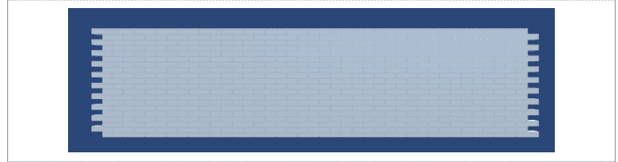

图 12-11. 点击 Create Wall 按钮，砖墙出现

#### 讨论

EditorGUILayout 和 GUILayout 都提供了常见编辑器 UI 元素的类似版本。在设计 Unity 编辑器时，重要的是要考虑你想要使用哪一组控件。


当你自定义 Unity 检查器组件时，你会用你创建的脚本替换默认布局。

### 12.8 属性绘制器

#### 问题

你想要自定义检查器如何绘制某种类型的变量。例如，你有一个自定义类，你想要自定义其外观。

#### 解决方案

我们将通过定义一个名为 MultiValue 的新类型来演示如何做到这一点。它将包含一个字符串列表，其中一个可以在检查器中选择：

- 1. 创建一个新的 C# 脚本，命名为 MultiValue.cs。删除类的内容，然后在标准包含项下方添加以下代码到顶部：
- 2. 接下来，将类更新如下：

```
#if UNITY_EDITOR
using UnityEditor;
#endif
```

这确保我们可以使用 UnityEditor 命名空间，并且 if 语句确保它仅在脚本在编辑器环境中运行时才包含。有关此语法的更多信息，请参阅第 2 章。

```
[System.Serializable]
public class MultiValue {

    // The index of the currently selected value.
    [SerializeField] int _selectedIndex = 0;

    // The list of available options
    [SerializeField] string[] options;

    // Manages the selected index, and keeps it from going out of bounds.
    public int SelectedIndex {
        get {
            return _selectedIndex;
        }
        set {
            value = Mathf.Clamp(value, 0, options.Length);
        }
    }

    // Creates a new chooser, using the specified values.
    public MultiValue(params string[] values) {
        this.options = values;
    }

    // Returns the text of the currently selected value.
    public string SelectedValue {
        get {
            if (options.Length > 0) {
                return options[_selectedIndex];
            } else {
                return null;
            }
        }
    }
```


这段脚本看起来有点令人困惑，但其实相对简单。只是需要更多上下文来解释，所以请继续阅读。

+   3. 添加另一个类，如下所示：

```
#if UNITY_EDITOR
// Overrides how Unity will draw a MultiValue property.
[CustomPropertyDrawer(typeof(MultiValue))]
public class MultiValuePropertyDrawer : PropertyDrawer {

    // Called by Unity when it needs to draw a MultiValue property in
    // the Inspector.
    public override void OnGUI(Rect position,
                            SerializedProperty property, GUIContent label)
    {
        // Ensure that the controls found in the GUI class behave
        // properly. This also tells Unity that any edit to any field in
        // here should be recorded for the purposes of Undoing them.
        EditorGUI.BeginProperty(position, label, property);

        // Get a reference to the variables that store the info we need
        var indexProperty =
            property.FindPropertyRelative("_selectedIndex");

        var valuesProperty = property.FindPropertyRelative("options");

        // Calculate the rectangle to draw the first line in. This will
        // hold our toolbar (our list of buttons).
        var firstLinePosition = position;
        firstLinePosition.height =
            EditorGUI.GetPropertyHeight(indexProperty);

        // Use this to calculate the rectangle to draw the second
        // property in. (This will vary, depending on whether the user
        // has elected to expand the list in the Inspector or not.)
        var secondLinePosition = firstLinePosition;
        secondLinePosition.y += 2 + firstLinePosition.height;
        secondLinePosition.height =
            EditorGUI.GetPropertyHeight(valuesProperty);

        // Display the label in front of the toolbar, and get back a new
        // rectangle to draw the toolbar in.
        firstLinePosition = EditorGUI.PrefixLabel(
            firstLinePosition, new GUIContent(property.displayName));

        // Get every string inside the "options" property, as an array
        string[] labels = new string[valuesProperty.arraySize];
```

```
for (int i = 0; i < labels.Length; i++) {
    labels[i] = valuesProperty.GetArrayElementAtIndex(i).stringValue;
}

// Because Toolbar is not in the EditorGUI class, it won't
// automatically report to the editor that it was updated in a
// way that the editor can track for the purposes of the Undo
// system. So, we use BeginChangeCheck before drawing the
// toolbar, and call EndChangeCheck. If EndChangeCheck returns
// true, the user made a change.
EditorGUI.BeginChangeCheck();
var index = indexProperty.intValue;
var newValue = GUI.Toolbar(firstLinePosition, index, labels);
if (EditorGUI.EndChangeCheck()) {
    // The toolbar was changed.
    indexProperty.intValue = newValue;
}

// Draw the 'options' list as a regular list. This will also
// draw things like the expand arrow, the items in the list,
// and the number of items in the list.
EditorGUI.indentLevel += 1;
EditorGUI.PropertyField(secondLinePosition,
    valuesProperty, true);
EditorGUI.indentLevel -= 1;

// We're done editing this property.
EditorGUI.EndProperty();
}

// Called by Unity to determine the height of the
// MultiValue property.
public override float GetPropertyHeight(SerializedProperty property,
    GUIContent label)
{
    // The height of a MultiValue property is the height of both of
    // its two child properties, plus the spacing between them.
    float lineSpacing = EditorGUIUtility.standardVerticalSpacing;

    // Get the child properties
    var indexProperty =
        property.FindPropertyRelative("_selectedIndex");
```

```
var valuesProperty = property.FindPropertyRelative("options");

// Calculate the height of this property by getting the height
// of both properties (including the strings inside the options,
// if it's been expanded), plus the line spacing
float indexHeight = EditorGUI.GetPropertyHeight(indexProperty);
float optionsHeight =
    EditorGUI.GetPropertyHeight(valuesProperty, true);

return indexHeight + lineSpacing + optionsHeight;
}
}

#endif
```

这段很长的代码创建了一个名为 MultiValuePropertyDrawer 的新 PropertyDrawer，它定义了我们刚刚创建的类型为 MultiValue 的对象在编辑器中如何绘制。代码获取了该属性所需的所有必要部分的引用，然后绘制属性检查器的实际 UI。

我们最先创建的 MultiValue 类定义了 MultiValuePropertyDrawer 实际可以编辑的属性的结构：它包含一个字符串数组作为其可能选项，以及一个 int，指向当前选中的选项。MultiValuePropertyDrawer 中的代码会呈现这些选项，并让用户从检查器中选择一个。

让我们来测试一下：

+   1. 创建一个新的空游戏对象，并将其命名为“Demo。”
+   2. 创建一个新的 C# 脚本，命名为 MultiValueDemo.cs。将以下代码添加到其中：

```
// A simple component to demo the MultiValueChooser property drawer.
public class MultiValueDemo : MonoBehaviour {

    [SerializeField]
    MultiValue multiValue =
        new MultiValue("One", "Two", "Three", "Four", "Five", "Six");
}
```

注意 MultiValue 属性看起来像图 12-12。

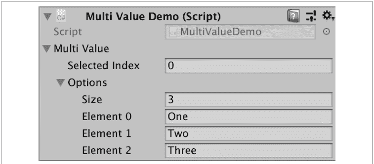

图 12-12. MultiValue 属性的检查器

当你返回 Unity 时，检查器将看起来像图 12-13。你可以从属性顶部的栏中选择一个字符串，也可以修改可用的字符串。如果你在 MultiValueDemo 类中添加更多属性，它们将按预期显示。

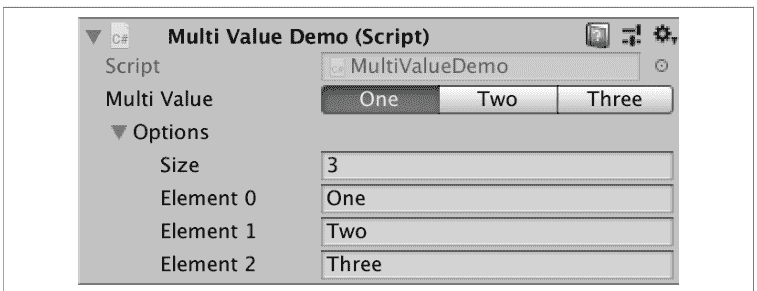

图 12-13. 带有自定义属性绘制器的相同 MultiValue 属性的检查器

#### 讨论

Unity 通常会在检查器中绘制类的子属性。如果你想覆盖此行为，你需要自己完成所有绘制。

属性绘制器不能使用更高级的 EditorGUI.Layout，而必须使用 EditorGUI。这意味着你需要自己计算和绘制矩形，就像我们在本教程中所做的那样。


你可以在 Unity 文档中了解更多关于 Unity Editor API 的信息。

### 12.9 属性绘制器

#### 问题

你希望在某个属性附加到变量时自定义检查器如何绘制该类型的变量。例如，Header 属性会导致 Unity 在检查器中变量上方绘制一个标签。

#### 解决方案

我们将添加一个属性，让你可以在变量上方绘制一个帮助框，如下所示：

```
public class HelpBoxDemo : MonoBehaviour {

    [HelpBox(text = "Here's a help box above the variable!")]
    [SerializeField] int integer;

}
```

此代码会生成图 12-14 所示的检查器。

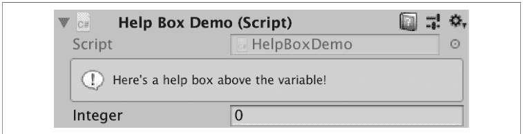

图 12-14. 我们将在本教程中构建的 HelpBox 属性的实际效果

要创建 HelpBox 属性，创建一个名为 HelpBox.cs 的新 C# 脚本，并将内容替换如下：

```
#if UNITY_EDITOR
using UnityEditor;
#endif

// A HelpBoxAttribute can be placed above a variable to make it display a
// help box above it in the Inspector.

// Note how we define the HelpBoxAttribute class outside the #if
// UNITY_EDITOR areas. This is because code that refers to the HelpBox will be
```

```
// compiled outside of the editor context (that is, with UNITY_EDITOR not
// defined), and it will fail to compile if the class doesn't exist.

public class HelpBoxAttribute : PropertyAttribute
{
    // The text that will appear in the help box.
    public string text;
}

#if UNITY_EDITOR
// The code that draws the help box, as well as the original property.
[CustomPropertyDrawer(typeof(HelpBoxAttribute))]
public class HelpBoxAttributePropertyDrawer : PropertyDrawer {
    public override void OnGUI(
        Rect position, SerializedProperty property, GUIContent label)
    {

        // Let's start by calculating the rectangle in which we'll draw the
        // help box.

        // 'position' is the rectangle that we've been given to draw
        // everything to do with this property. It's calculated by taking
        // the width of the Inspector tab, and the height returned by
        // GetPropertyHeight.

        // The help box will be at the top of the property, so we just take
        // the original position, and reduce the height.
        var helpBoxPosition = position;
        helpBoxPosition.height = HelpBoxHeight;

        // Next, we figure out the rectangle we need to draw the property in.
        // We'll start with the entire available area...
        var propertyPosition = position;

        // Shift it down by the help box's height, plus line spacing
        propertyPosition.y += EditorGUIUtility.standardVerticalSpacing +
            helpBoxPosition.height;

        // And update its height to be however tall the property wants to
        // be, including any child properties.
        propertyPosition.height =
            EditorGUI.GetPropertyHeight(property, includeChildren: true);

        // Get the text from the HelpBoxAttribute.
        HelpBoxAttribute helpBox = (attribute as HelpBoxAttribute);
        string text = helpBox.text;

        // Draw the help box itself.
        EditorGUI.HelpBox(helpBoxPosition, text, MessageType.Info);

        // Draw the original property underneath.
        EditorGUI.PropertyField(
```


```csharp
propertyPosition, property, includeChildren: true);
}

public override float GetPropertyHeight(
    SerializedProperty property, GUIContent label)
{
    // Calculate the height of the help box, given the editor width
    // (the text might wrap over multiple lines)

    float lineSpacing = EditorGUIUtility.standardVerticalSpacing;
    float propertyHeight =
        EditorGUI.GetPropertyHeight(property, includeChildren: true);

    return HelpBoxHeight + lineSpacing + propertyHeight;
}

// Calculates the height of the help box.
private float HelpBoxHeight
{
    get
    {
        var width = EditorGUIUtility.currentViewWidth;
        var helpBoxAttribute = attribute as HelpBoxAttribute;
        var content = new GUIContent(helpBoxAttribute.text);
        float helpBoxHeight =
            EditorStyles.helpBox.CalcHeight(content, width);

        // Add a single line's height to ensure that text doesn't get
        // clipped
        return helpBoxHeight + EditorGUIUtility.singleLineHeight;
    }
}
#endif
```

#### Discussion

你也可以在代码中仅将 HelpBoxAttribute 称为 HelpBox，它仍然可以正常工作！

在任何可能被除你之外的人使用的编辑器代码中，使用帮助框都是有礼貌的做法。


你应该假设除了你之外的人会使用你所有的代码，即使你是一个人团队。

### 12.10 资产处理

#### Problem

你想要自定义 Unity 导入某些文件的方式。

#### Solution

让我们设置一个资源后处理器，自动将文件名以 _n、_nrm 或 _normal 结尾的任何纹理设置为法线贴图：

- 1. 创建一个新的 C# 脚本，命名为 NormalMapTextureImporter.cs，并添加以下代码：

```csharp
#if UNITY_EDITOR
using UnityEditor;

public class NormalMapTextureImporter : AssetPostprocessor
{
    // Called before the texture is imported.
    void OnPreprocessTexture() {
        // Get the name of the file.
        var filename = System.IO.Path.GetFileNameWithoutExtension(assetPath);
        // We're looking for texture files that end in any of these
        // suffixes.
        var normalMapSuffixes = new[] { "_n", "_normal", "_nrm" };
        // Check each one
        foreach (var suffix in normalMapSuffixes) {
            if (filename.EndsWith(suffix)) {
                // Get the texture importer that's currently importing
                // this texture
                TextureImporter textureImporter =
                    assetImporter as TextureImporter;
                // Update its type so that Unity is aware that it's a
                // normal map
                textureImporter.textureType =
                    TextureImporterType.NormalMap;
                // Exit here, since we know we don't need to do any more
                // work
                return;
            }
        }
    }
}
```

```
}
}
}
#endif
```

这段代码创建了一个名为 NormalMap TextureImporter 的 AssetPostprocessor 子类，查找我们想要的后缀，检查每个正在导入的文件是否具有该后缀，并将找到的每个文件的纹理类型更改为法线贴图。

- 2. 为了测试它，取一张包含法线贴图的纹理并重命名，使其名称以 _n 结尾。


如果你手头没有法线贴图，你可以在 NormalMap-Online 找到一个有用的在线法线贴图纹理生成器。

- 3. 将此纹理导入你的项目。文件将被导入为法线贴图！

#### Discussion

在游戏开发领域，纹理文件名中有一些常见的事实标准：_d 表示漫反射，_e 表示自发光，_n 表示法线，等等。资源后处理系统允许你基于文件名以及其他参数来处理导入。

你可以使用 OnPreprocessTexture 函数在纹理导入前执行操作，就像我们在这里做的那样。你可能想要更改纹理的某些内容（例如修改其 alpha 值）或更改纹理的压缩格式。


你可以在 Unity 文档中了解更多关于 Unity 的 AssetPostprocessor 类的信息。

还有一个等效的 OnPostProcessTexture 函数，它在资源完成导入时被调用。


处理器不仅适用于纹理，还适用于 Unity 可能导入的任何文件。例如，你可以使用它来重新压缩或重新编码声音文件。

### 12.11 助手向导

#### Problem

你想要在 Unity 编辑器中创建并显示一个窗口，让用户提供一些值，并在用户点击按钮时运行代码。

#### Solution

助手向导，是一种自 1990 年代初就存在的长期用户界面范式，会引导你完成一系列步骤。当你在构建游戏时需要频繁执行重复过程时，向导会很有用。

让我们创建一个向导，它可以创建一个立方体，并同时创建一个使用指定颜色的新材质，只需单击一个按钮即可：

- 1. 创建一个新的 C# 脚本，命名为 CreateCubeWizard.cs，并向其中添加以下代码：

```csharp
#if UNITY_EDITOR
// This entire class only exists in the editor. It doesn't need to be
// included in built games.
using UnityEditor;

// Create a wizard that generates a new cube, as well as a color.
public class CreateCubeWizard : ScriptableWizard {

    // Create a new entry in the GameObject menu, called "Cube with
    // Color." When it's selected, a CreateCubeWizard will appear. Note
    // that this method must be both public and static for
    // MenuItem to work.
    [MenuItem("GameObject/Cube with Color")]
    public static void CreateWizard() {

        // Create and display the wizard.
        DisplayWizard<CreateCubeWizard>("Create Cube");
    }

    // Stores temporary information about the cube that the user wants
    // to make. These variables are drawn in the window, just like
    // variables in a MonoBehaviour component are.
    [SerializeField] Vector3 size = Vector3.zero;
```

```
[SerializeField] Color color = Color.white;

// Run when the Create button is clicked.
private void OnWizardCreate()
{
    // Create a cube
    var newCube = GameObject.CreatePrimitive(PrimitiveType.Cube);

    // Scale it
    newCube.transform.localScale = size;

    // Create a new material, using the Standard shader (which
    // is the default)
    var tintedMaterial = new Material(Shader.Find("Standard"));

    // Give it a color
    tintedMaterial.color = color;

    // Materials need to be saved to disk. To do this, we need to
    // figure out where we can save the file.
    // GenerateUniqueAssetPath will give us a path that's
    // guaranteed to not already have a file present.
    var desiredPath =
        AssetDatabase.GenerateUniqueAssetPath("Assets/Tinted.mat");

    // Create and save the new asset.
    AssetDatabase.CreateAsset(tintedMaterial, desiredPath);
    AssetDatabase.SaveAssets();

    // Visually "ping" the asset, as though we'd selected it in the
    // Editor. This will show the user that a new file has been
    // created, and where to find it.
    EditorGUIUtility.PingObject(tintedMaterial);

    // Finally, make the new cube use this new material.
    newCube.GetComponent<MeshRenderer>().material = tintedMaterial;
}
#endif
```

我们定义了一个名为 CreateCubeWizard 的 ScriptableWizard，它添加了一个名为“Cube with Color”的新菜单项，让我们能够轻松触发向导，然后创建一个新的立方体，要求用户提供 Vector3 的 size 和 Color 的 color。

- 2. 打开 GameObject 菜单，注意你会看到一个新菜单项：Cube with Color。点击它。

- 3. 输入你的立方体大小和颜色，然后点击 Create。

- 4. 一个新的立方体将被添加到场景中，一个新的材质将使用该颜色创建，并且立方体将被设置为使用新的材质。

#### Discussion

创建编辑器工具，例如向导，是更复杂的 Unity 工作流程的重要组成部分。向导是创建自定义 UI 以使你的游戏开发生活更轻松的好方法。

Unity Editor API 让你构建大量有用的东西来使你的常见工作流程更轻松。如果你发现自己做某事超过一小把次数，使用 Unity Editor API 使其更轻松通常是一个好主意。自动化可能性非常广泛！


你可以在 Unity 文档中了解更多关于 Unity Editor API 的信息。有很多可能性，有很多方法可以自动化重复的工作流程。


