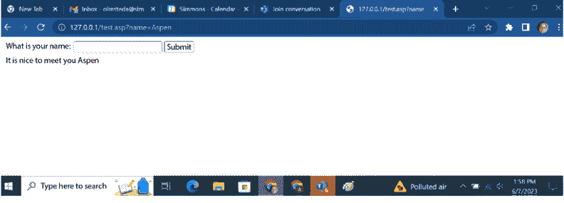
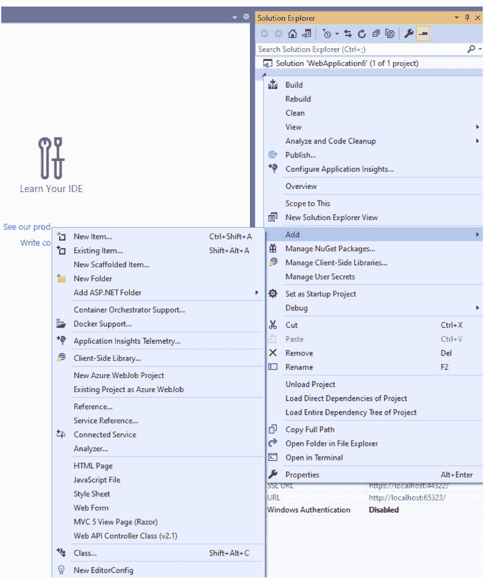

## 第1部分：Visual Basic 编程与脚本

在本书的第一部分，我们将重点教授您编写Visual Basic家族任何成员核心代码所需的基本编程技能。如果您学过任何其他编程语言，这些主题都会很熟悉，因为大多数编程语言都有类似的主题。

本部分包含以下章节：

- [第1章](#)，Visual Basic 编程语言家族
- [第2章](#)，控制台输入与输出
- [第3章](#)，数据类型与变量
- [第4章](#)，决策分支
- [第5章](#)，迭代
- [第6章](#)，函数与过程
- [第7章](#)，项目第一部分

Windows Forms 提供了一组预构建的控件，如按钮、文本框、标签和菜单，可以轻松放置在窗体上以创建用户界面。这些控件可以通过更改颜色、大小和字体等属性进行自定义，并且可以编程以响应用户输入和事件。

Visual Basic.NET 是一种可用于为 Windows Forms 应用程序编写代码的编程语言。它是一种易于学习和使用的高级语言，并提供了开发复杂应用程序的广泛功能。

Visual Basic.NET Windows Forms 的一些功能包括以下内容：

- **快速应用程序开发**：Windows Forms 提供了一种使用可视化设计器创建桌面应用程序的快捷简便方法。
- **数据绑定**：Windows Forms 支持数据绑定，允许开发人员将控件连接到数据源（如数据库或 XML 文件）。
- **高级控件**：Windows Forms 包含一组高级控件，如 `DataGridView` 和 Chart 控件，可用于创建更复杂的用户界面。
- **面向对象编程（OOP）**：Visual Basic.NET 支持 OOP，允许开发人员编写可重用且可维护的代码。

### 面向对象编程（OOP）

*OOP 是一种基于对象概念的编程范式，对象是包含数据和行为的实体。在 OOP 中，对象由类创建，类定义了对象将拥有的数据和行为。OOP 的主要原则包括：*

- **封装**：*该原则涉及将数据和行为捆绑到对象中，并向外界隐藏实现细节。封装有助于确保对象被正确使用，并确保其包含的数据不会以意外方式被修改。*
- **继承**：*该原则涉及通过扩展现有类来创建新类。继承允许新类继承其父类的数据和行为，并允许它们添加自己独特的特性。*
- **多态**：*该原则允许将不同类的对象视为相同的对象类型。多态通过接口或抽象类实现，这些接口或抽象类定义了一组标准方法，所有实现该接口或继承该抽象类的对象都可以使用这些方法。*

*OOP 有许多优点，包括改进代码组织、提高代码复用性和更好的可维护性。*

总体而言，Visual Basic.NET Windows Forms 是在 Windows 平台上创建桌面应用程序的强大工具，由于其易用性和广泛的功能，它成为开发人员的热门选择。

不幸的是，微软已宣布未来不会继续发展 Visual Basic.NET 语言。这一公告并不意味着该语言已死——相反，现有数十亿行生产代码将在未来几十年内继续运行。这只是意味着不会向该语言添加新的语言特性。既然我们已经熟悉了 Visual Basic.NET Windows Forms，让我们来看一个简单的编码示例。

### Visual Basic.NET Windows Forms 中的 Hello, World!

Visual Basic.NET Windows Forms 代码存储在扩展名为 .vb 的文本文件中。以下是示例 Visual Basic.NET Windows Form 代码，将存储在名为 program.vb 之类的文件中。运行该程序将在启动时显示一个消息框，显示 Hello World!：

```
Public Class Form1
    Private Sub Form1_Load(sender As Object, e As EventArgs) Handles MyBase.Load
        MsgBox("Hello, World!")
    End Sub
End Class
```

接下来，我们将了解如何实现此代码。

### 安装 Visual Basic.NET

以下步骤将在 Windows 机器上安装 Visual Basic.NET：

- 1. 从此链接下载 Visual Studio Community Edition：https://learn.microsoft.com/en-us/visualstudio/install/install-visual-studio?view=vs-2022。
- 2. 双击 VisualStudioSetup.exe 引导程序以开始安装。
- 3. 选择“.NET 桌面开发”工作负载。
- 4. 让安装程序完成。

大多数用户将使用 Microsoft Windows 操作系统（OS）和 Microsoft 实现的 Visual Basic.NET，但也有一些项目和产品允许在不同操作系统上安装，我们将在接下来讨论。

### Visual Basic.NET 的替代安装

以下列表显示了使用 Visual Basic.NET 兼容代码的其他选项：

- Mono：Mono 是一个基于 .NET 框架的开源开发平台。它包含一个 Visual Basic.NET 编译器和 VB.NET 运行时。您可以从此处下载 Mono：http://mono-project.com。
- .NET SDK：.NET 软件开发工具包（SDK）是一组用于开发面向 .NET 平台的应用程序的工具、库和组件。它包含构建和部署 .NET 应用程序所需的一切，包括编译器、运行时和各种库。

图 1.1 – 运行您的程序

随着我们继续学习，我们将在不同的 Visual Basic 家族成员中使用相同的应用程序示例。

### 使用 Visual Basic Classic 进行编程

**Visual Basic Classic**（也称为 **VB6**）是一种编程语言和**集成开发环境（IDE）**，由 Microsoft 开发。它于 1998 年发布，广泛用于开发 Windows 操作系统的桌面应用程序。

VB6 是 .NET Framework 引入之前 Visual Basic 编程语言的最后一个版本，其语法与早期版本的 Visual Basic 类似。该语言旨在易于学习和使用，在初学者和经验丰富的开发人员中都很受欢迎。

VB6 应用程序可以使用 Visual Basic IDE 开发，该 IDE 包含可视化窗体设计器、代码编辑器和调试器。该语言支持 OOP 概念，如封装、继承和多态。

尽管 Microsoft 已停止支持 VB6，但许多遗留应用程序仍在使用该语言，并且它仍然是小型 Windows 桌面应用程序开发的热门选择。

### Visual Basic Classic 中的 Hello, World!

Visual Basic Classic 代码存储在扩展名为 `.bas` 的文本文件中：

```
Private Sub Form_Load()
    MsgBox "Hello, World!"
End Sub
```

您接下来将实现此代码。

### 安装 Visual Basic 6

以下步骤旨在将原始 Visual Basic 6 Enterprise 安装到 Windows 机器上。我们建议在虚拟机或 Docker 容器中执行此操作，因为某些支持文件非常陈旧，容易受到遗留攻击。

### 虚拟机（VM）

*虚拟机（VM）是物理计算机或服务器的软件模拟。它允许多个操作系统在单个物理机器上同时运行。每个操作系统都可以访问虚拟硬件资源，如 CPU、RAM 和存储。*


虚拟机（VM）常用于各种场景，包括软件开发、测试和部署、在同一台物理机器上托管多台服务器，以及运行需要特定操作系统的遗留应用程序。

有几款流行的虚拟机软件包，包括 VMware、VirtualBox、Hyper-V 和 KVM，各有优缺点。

- 1. 从 **WinWorldPC** 下载适用于 Visual Basic 6.0 企业版的相应语言/架构版本的 `CD 镜像`：https://winworldpc.com/product/microsoft-visual-basic/60。
- 2. 下载的文件是 **7zip** 格式的压缩归档文件。你可以使用类似于 http://www.7-zip.org 的 ZIP 工具将其解压。
- 3. 将 ISO 镜像挂载为虚拟驱动器，或者将其刻录到 CD。
- 4. 运行 **setup.exe** 程序以安装 Visual Studio。（所需的密钥位于 WinWorldPC 网站上产品链接下方。）
- 5. 安装程序会尝试安装一个旧版 Java VM。你可以允许其安装，也可以参考网上许多博客中介绍的如何欺骗安装程序使其不尝试安装该 VM 的方法。
- 6. 如果你在步骤 5 中安装了 Java VM，安装程序会要求你重新启动。如果程序没有自动继续，只需回到 *步骤 3* 重新开始，它就会从上次中断的地方继续。
- 7. 选择 **Product Install**。
- 8. 选择 **Visual Basic Enterprise**。

再次说明，大多数用户会希望使用 Microsoft 版本的 Visual Basic Classic。还有其他替代方案，我们接下来会探讨。我们将首先介绍一些尝试与 VB6 语法兼容的 Microsoft Visual Basic 6 替代品。

## 替代安装方式

以下列表展示了处理 Visual Basic 6 兼容代码的其他选项：

- **WINE**：这是一个允许你在 Linux 系统上运行 Windows 程序的应用。在撰写本文时，Visual Basic 6 被列为 *silver-level*（银级）兼容性。银级通常意味着会有一些视觉问题，但程序仍能运行。
- **TwinBasic**：TwinBasic 是一种现代 BASIC 编程语言。该语言旨在与现有 VB6/VBA 项目实现 100% 向后兼容。此外，TwinBasic 旨在成为完整的替代开发环境，与 VB6 IDE 相比提供了大量新功能和改进。你可以从这里下载：https://twinbasic.com/。
- **B4X**：B4X 套件包括 **Basic for Android (B4A)**、**Basic for iOS (B4i)**、**Basic for Java (B4J)** 和 **Basic for Arduino (B4R)**。其语法很大程度上受 VB 启发，但并非与 VB6 语法 100% 兼容。从这里下载：https://www.b4x.com/。
- **RAD Basic**：RAD Basic 项目的目标是提供一个 100% 兼容 VB6 的开发环境。你可以从 https://www.radbasic.dev/ 下载。
- **VB6 Installer**：此工具可使原始 Visual Basic 6 在 Windows 10 和 11 上的原生安装更加流畅。从 http://nuke.vbcorner.net/VB6Installer/tabid/125/language/en-US/Default.aspx 下载。

接下来，我们将探讨如何将示例代码插入 Visual Basic 6 并运行程序。

## 运行 Visual Basic 6 Hello, World! 程序

以下步骤将允许你编写并执行一个 Visual Basic 6 版本的 **Hello World!：**

- 1. 启动 **Microsoft Visual Basic 6**。
- 2. 选择 **Standard EXE** 作为项目类型。
- 3. 设计器加载后，双击代表窗体的矩形内部。
- 4. 输入之前代码示例中的 **MsgBox** 行。
- 5. 点击代码上方工具栏中的绿色三角形以运行程序。

接下来，我们来看看 VBA。

## 使用 VBA 编程

VBA 是一种编程语言，用于在 Microsoft Office 应用（如 Excel、Word、PowerPoint 和 Access）中实现任务自动化。VBA 主要用于自动化重复性任务以及与外部应用程序交互。

VBA 是一种功能强大的语言，可以导入和转换数据、自动化计算序列、创建自定义表单和专用报告。这些功能使得 VBA 被处理大量数据并进行复杂分析的金融专业人士和数据分析师所使用。VBA 是一种功能强大的语言，允许用户创建函数、执行错误处理，并应用循环和条件语句等高级编程技术。VBA 也由 Microsoft 授权，或被第三方公司复制。一些承载 VBA 的应用程序的小示例包括 **WordPerfect**、**LibreOffice** 和 **CorelDRAW**。

## VBA 中的 Hello, World!

VBA 代码从宿主导出时，存储在扩展名为 **.bas** 的文本文件中。通常，根据应用程序宿主的不同，代码会存储在宿主文档中。以下是一个示例 VBA 宏代码，宏名为 **test**。运行该宏将显示一个消息框，在启动时显示 **Hello, World!**：

```
Sub test()
MsgBox ("Hello, World!")
End Sub
```

你稍后将实现此代码。

## *安装 VBA*

*VBA 随 Microsoft Office 应用默认安装。其他宿主可能要求你在宿主安装时选择该选项。*

## 从 Excel 编写 VBA Hello, World!

以下步骤将允许你编写并执行一个显示

**Hello World!** 的 VBA 宏：

- 1. 启动 Microsoft Excel。
- 2. 点击 **View** 菜单。
- 3. 点击 **Macros** 按钮，并从下拉菜单中选择 **View Macros**。
- 4. 输入 `test` 作为宏名称。
- 5. 点击 **Create** 按钮。
- 6. 设计器加载后，双击代表窗体的矩形内部。
- 7. 输入之前代码示例中的 **MsgBox** 行。
- 8. 点击代码上方工具栏中的绿色三角形以运行宏。

接下来，我们将介绍用于脚本编写的 Visual Basic 版本。

## 使用 VBScript 编程

VBScript 是一种基于 Visual Basic 编程语言的脚本语言。它主要用于创建在 Windows 环境中自动化任务的简单脚本。

VBScript 是一种轻量级语言，易于学习和使用。它通常用于自动化重复性任务，如文件操作、数据处理和系统管理。它可以用来与 Windows 组件交互，例如注册表、**Windows Management Instrumentation (WMI)** 和 Active Directory。

VBScript 是一种解释型语言，这意味着它由操作系统直接执行，无需编译器。它可以从命令行运行，也可以嵌入到其他应用程序中，如 Microsoft Excel 或 Internet Explorer。

VBScript 受所有现代 Windows 版本支持，并且经常与 PowerShell 和批处理文件等其他脚本语言结合使用。

## VBScript 中的 Hello, World!

VBScript 代码存储在扩展名为 .vbs 的文本文件中。通常，代码存储在将要执行脚本的文件系统中。以下是一个示例 VBScript 代码，存储在名为 test.vbs 的文件中。运行该脚本将显示一个消息框，在启动时显示 Hello, World!：

```
MsgBox "Hello, World!"
```

你稍后将实现此代码。

## 安装 VBSCRIPT

在现代 Windows 版本中，VBScript 是 Windows Script Host 的一部分。默认情况下，新安装的 Windows 中的主要脚本语言是 VBScript。

## 使用记事本编写 Hello, World! VBScript

以下步骤将允许你编写并执行一个显示 Hello World 的 VBScript：

- 1. 启动记事本。
- 2. 输入之前示例中显示的 MsgBox 行。
- 3. 将文件以名称 test.vbs 保存在你的根文件夹中。
- 4. 运行 CMD 以进入命令提示符。
- 5. 输入 cscript test.vbs 并按 Enter 键。

在下一节中，VBScript 将用于 Web 开发的服务器端。

## 使用经典 ASP 编程

经典 Active Server Pages (ASP) 是一种服务器端脚本技术，用于创建动态网页和应用程序。Microsoft 的第一个 ASP 版本出现在 1990 年代末，是 Microsoft ActiveX 技术的一部分。

经典 ASP 默认使用 VBScript 作为其脚本语言，但也可以与其他脚本语言一起使用。其他语言的一些示例包括 JScript 和 PerlScript。VBScript 允许开发人员在 HTML 页面中编写在服务器端运行的脚本。这种脚本允许创建根据环境变量变化的动态内容、处理数据库中的数据，并执行其他服务器端任务。

经典 ASP 在历史上被用于开发运行在 Microsoft Internet Information Services (IIS) 服务器上的 Web 应用程序。经典 ASP 经常与存储在 Microsoft SQL Server、MySQL 或 Oracle 数据库中的数据一起使用。


ASP Classic 默认情况下不会被编译，因为它是一种解释型语言。服务器读取 ASP Classic 代码，对其进行解释，并生成发送到客户端网页浏览器的 HTML 输出。与 C# 或 Java 等编译语言相比，这种解释过程可能会导致性能变慢。

然而，有第三方工具可以将 ASP Classic 代码编译成机器码，从而提高性能并提供其他好处，例如增强安全性以及能够混淆代码。一些流行的编译 ASP Classic 代码的工具包括以下内容：

- **ASP Compiler**：一款商业工具，可将 ASP Classic 代码编译为原生机器码。它还提供代码优化和混淆等功能。
- **SmartAssembly**：一款商业工具，可将 ASP Classic 代码编译为原生 Windows 可执行文件。它还提供代码优化、混淆和错误报告等功能。
- **CodeWall**：一款免费工具，可将 ASP Classic 代码编译为原生 Windows 可执行文件。它提供代码混淆和资源压缩等功能。

值得注意的是，虽然这些工具可以提供性能优势，但它们也可能引入额外的复杂性并要求更改部署流程。因此，在决定使用其中一种工具之前，仔细评估编译 ASP Classic 代码的利弊非常重要。

## 使用记事本编写 Classic ASP Hello, World！

以下步骤将允许你编写和执行一个显示 `Hello World!` 的 VBScript：

- 1. 启动记事本。
- 2. 输入前面代码示例中的所有代码。
- 3. 在根 Web 目录中保存一个名为 `test.asp` 的文件（通常为 `c:\inetpub\wwwroot`）。
- 4. 打开网页浏览器。
- 5. 输入 URL：http://127.0.0.1/test.asp。

接下来，我们将查看来自微软的最新版本的服务器端代码。

## ASP.NET 编程

ASP.NET 是微软开发的 Web 应用程序框架，允许开发人员使用多种编程语言（如 C# 和 Visual Basic.NET）创建动态 Web 应用程序。它提供了多种功能和工具，使构建、测试和部署 Web 应用程序变得更容易。

ASP.NET 允许开发人员使用不同的编程模式构建 Web 应用程序，包括 **Model-View-Controller (MVC)** 和 Web Forms 架构。MVC 模式在架构中的三个主要组件——模型、视图和控制器之间提供了明确的关注点分离。模型代表数据和业务逻辑，视图用于向用户显示数据，控制器处理用户输入并与模型和视图交互。相比之下，Web Forms 提供更多类似桌面开发的方法，允许开发人员创建包含服务器端控件和事件的网页。

ASP.NET 提供了多种功能，使构建健壮且可扩展的 Web 应用程序变得更容易。这些功能包括内置的缓存、会话管理和身份验证支持。ASP.NET 还与 **SQL Server**、**Windows Communication Foundation (WCF)** 和 **Windows Workflow Foundation (WF)** 等其他微软技术集成。

ASP.NET 与包括 Microsoft IIS、Apache 和 nginx 在内的各种 Web 服务器和操作系统兼容。ASP.NET 还支持多种客户端脚本技术，例如 JavaScript 和 Ajax。这些客户端技术允许开发人员创建交互式和响应式的 Web 应用程序。

### ASP.NET 中的 Hello, World！

ASP.NET 代码存储在扩展名为 **.vb** 的文本文件中。该文件是代码隐藏文件，其起始名称与存储在 ASPX 文件中的 HTML 相同。代码存储在 IIS 主持网站的文件系统中。以下是在名为 **WebForm1.aspx.vb** 的文件中存储的示例 ASP.NET 代码。显示网页将以 HTML 消息显示 **Hello, World!** 字样：

```vb
Protected Sub Page_Load(ByVal sender As Object, ByVal e As System.EventArgs) Handles Me.Load
    Response.Write("Hello, World!")
End Sub
```

你将很快实现此代码。

### 安装 ASP.NET

ASP.NET 开发随 Visual Studio Community Edition 一起安装。按照以下步骤安装 ASP.NET 开发功能：

- 1. 从 [https://visualstudio.microsoft.com/vs/older-downloads/](https://visualstudio.microsoft.com/vs/older-downloads/) 下载 Visual Studio Community Edition 2019（2022 版不支持 ASP.NET 应用中的 Visual Basic）。
- 2. 双击 **VisualStudio.Setup.exe** 启动程序以开始安装。

- 11. 从弹出菜单中选择 **New Item**。
- 12. 选择 **Web Form Visual Basic**。
- 13. 单击 **Add** 按钮。
- 14. 右键单击 HTML 编辑器，并从弹出菜单中选择 **View Code** 或从选项卡中选择 **Source**。
- 15. 输入前面代码示例中的 **Response.write** 行。
- 16. 单击代码上方工具栏上的绿色三角形以运行你的程序。

至此，我们对 Visual Basic 的不同家族成员进行了高层次的调查。

## 总结

在本章中，你了解了 Visual Basic 编程相关的六种不同环境。在过去三十年中，程序员一直使用这些方法来使用 Visual Basic 解决业务需求。在未来的章节中，我们将建立你对 Visual Basic 语法和语义的理解，并将该知识应用于这六种不同的环境中。在 *[Chapter 2](#)* 中，我们将专门研究如何从用户那里获取数据作为输入并将信息作为输出发送回给他们。

## 控制台输入和输出

计算中的每个算法都需要接收一些数据作为输入并以某种方式输出结果。在本章中，我们将讨论在每个 Visual Basic 家族成员中与用户简单交互的方法。对于本章中从用户收集输入，我们将重点关注从用户在我们将开发的应用程序客户端上使用的键盘读取数据。对于输出，我们将以行文本加行分隔符的简单模型将原始数据发送回用户屏幕。

在本章中，我们将涵盖以下主要主题：

- 使用 Visual Basic.NET 编程输入和输出
- 使用 Visual Basic Classic 编程输入和输出
- 使用 **Visual Basic for Applications (VBA)** 编程输入和输出
- 使用 VBScript 编程输入和输出
- 使用 Classic ASP 编程输入和输出
- 使用 ASP.NET 编程输入和输出

## 技术要求

请确保完成 *Chapter 1* 中安装和编码 Visual Basic 家族成员的步骤。

## 使用 Visual Basic.NET 编程输入和输出

Visual Basic.NET 中的 `Console` 类允许程序与原始控制台进行输入和输出交互。在上一章中，我们利用项目模板创建了 Windows Forms 应用。本章将使用控制台应用项目模板，以便我们轻松访问 `Console` 类。控制台应用项目可以在 Microsoft Windows、Linux 和 macOS 操作系统上运行。

对于输出，我们可以利用 `Console` 类的 `Write` 和 `WriteLine` 方法将数据输出到屏幕。以下是需要考虑的一些细节：

- `Console.Write` 和 `Console.WriteLine` 方法接受一个字符串参数并将其发送到控制台
- `Console.Write` 方法将光标留在输出末尾，因此后续输出会继续在同一行
- `Console.WriteLine` 将光标发送到下一行

随着我们在本章的进展，你会看到每个 VB 家族成员都有类似的输入和输出方法。

## 使用 Visual Basic Classic 编程输入和输出

VB Classic 没有用于开发控制台应用程序的方法。Visual Basic Classic 设计用于构建仅在 Windows 上运行的应用程序。对于简单的输入和输出，我们可以使用两个函数：

- **InputBox**：显示传递给该方法的字符串，为用户绘制一个输入框以响应提示，并返回输入的值
- **MsgBox**：显示带有传入字符串的消息框

## Visual Basic Classic 中的简单交互

以下是 Visual Basic Classic 中用户与程序之间简单交互的代码：

```vb
Private Sub Form_Load()
    Dim name As String
    name = InputBox("What is your name?")
    MsgBox ("It is nice to meet you " + name)
End Sub
```

代码中的第一行声明一个名为 Name 的变量以存储从键盘返回的值。第二行利用 InputBox 方法为用户绘制一个输入框以输入其姓名。返回值存储在名为 Name 的变量中。第三行将字面字符串 "It is nice to meet you" 与存储在 name 变量中的值组合并在消息框中显示。你将接下来实现此代码。

## 编写 Visual Basic 6 中的简单交互

以下步骤允许你编写和执行 Visual Basic 6 版本的 Hello World：

- 1. 启动 Microsoft Visual Basic 6。
- 2. 选择 **Standard EXE** 作为项目类型。
- 3. 设计器加载后，双击代表你的窗体的矩形。
- 4. 输入上一节示例中的代码。
- 5. 要运行你的程序，请单击代码上方工具栏上的绿色三角形。

在下一节中，我们将处理 VBA 中的输入和输出，其外观与我们在 VB 6 中所做的非常相似。


**Cscript** 和 **WScript** 是 Windows 操作系统中使用来运行用 VBScript 及其他脚本语言编写的脚本的两个脚本引擎。

Cscript 是一个基于命令行的脚本引擎，在命令提示符窗口中运行脚本。它主要设计用于运行不需要用户界面或图形输出的脚本，常用于系统管理任务。Cscript 通常用于在批处理文件或计划任务中运行脚本，因为它提供了对脚本执行的更多控制。

另一方面，WScript 是一个基于 GUI 的脚本引擎，可以显示图形输出，例如消息框和对话框。它主要设计用于运行需要用户交互或向用户显示信息的脚本。WScript 通常用于在图形环境中运行脚本，例如 Windows 桌面或 Windows 资源管理器。

Cscript 和 WScript 都是 **Windows Script Host (WSH)** 环境的一部分，可以运行用 VBScript、JScript 及其他脚本语言编写的脚本。Cscript 和 WScript 之间的选择取决于脚本的要求以及它将在其中运行的环境。对于本章，我们将使用 Cscript。

令人困惑的是，Cscript 和 WScript 都包含一个名为 WScript 的内置对象。WScript 对象包含两个对控制台输入和输出有益的属性。我们将使用的属性如下：

- **StdOut**：此属性是一个对象，表示控制台的标准输出。该对象上的一个名为 **Write** 的方法接受文本作为参数并将文本发送到 **StdOut**。默认情况下，**StdOut** 为屏幕，但在执行时可以重定向到文件或其他输出设备。
- **StdIn**：此属性是一个对象，表示控制台的标准输入。该对象上的一个名为 **ReadLine** 的方法从 **StdIn** 返回数据。默认情况下，**StdIn** 为键盘，但在执行时可以从文件或其他输入设备重定向。

## VBScript 中的简单交互

以下是 VBScript 中用户与程序之间简单交互的代码：

```
Dim name      WScript.StdOut.Write("What is your name?")      name = WScript.StdIn.ReadLine()      WScript.StdOut.Write("It is nice to meet you " & name)
```

代码中的第一行声明一个名为 **Name** 的变量以存储从键盘返回的值。代码中的第二行向用户显示关于其姓名的问题的消息。第三行将等待用户输入值后按 *Enter* 键。最后，第四行将文字字符串 "**It is nice to meet you**" 与存储在名为 **Name** 的变量中的值组合并显示在屏幕上。你将在下一节中实现此代码。

## 使用记事本在 VBScript 中编码简单交互

以下步骤允许你编码并执行一个显示 Hello World 的 VBScript：

- 1. 启动记事本。
- 2. 输入前一节代码示例中的四行。
- 3. 将文件以 `test.vbs` 的名称保存在你的根文件夹中。
- 4. 运行 **CMD** 进入命令提示符。
- 5. 输入 `cscript test.vbs` 并按 *Enter* 键。

我们在接下来的两个部分中从 Web 应用程序的角度思考输入和输出。它可能感觉非常不同，但你会很快掌握。

## 使用 Classic ASP 编程输入和输出

Classic ASP 是一种服务器端脚本语言，允许你为网页生成动态内容。使用 Classic ASP，你可以通过 **HTML** 表单与用户交互并处理用户提交的数据。例如，要通过 HTML 与用户交互，你可以创建收集用户信息并将该数据发送到服务器上 Classic ASP 脚本的 HTML 表单。

## Classic ASP 中的简单交互

为了在 Classic ASP 中实现简单交互示例，我们将出于简单起见使用单个 ASP 页面。HTML 表单可以与接收数据的 ASP 页面分开存储。以下是在单个文件 `test.asp` 中存储的示例 Classic ASP 代码。显示网页将是一个输入框用于输入用户名。提交按钮将回调到同一页面，如果传递了姓名，则会向用户显示问候语：

```
```html
<!DOCTYPE html>
<html>
<body>
<form method="get">
    What is your name? <input name="name">
    <input type="submit">
</form>
<%
    dim name
    name = Request.QueryString("name")
    if name<>"" then
        Response.Write("It is nice to meet you " & name)
    end if
```
```

```
```html
</body>
</html>
```
```

你将在下一节中实现此代码。代码是 VBScript 与 `<% %>` 标签混合，标签外的为 HTML。IIS 将用执行结果替换 `<% %>` 标签中的代码。VBScript 块中的第一行声明一个变量来保存姓名。VBScript 块中的第二行从传递给页面的请求中检索姓名。第三行检查是否传递了姓名的值。第四行仅在传递了姓名值时运行，并将通过连接姓名与字符串文字来显示问候语。

## 使用记事本在 Classic ASP 中编码简单交互

以下步骤允许你编码并执行一个显示 Hello World 的 VBScript：

- 1. 启动记事本。
- 2. 输入前一节代码示例中的所有代码。
- 3. 将文件以 `test.asp` 的名称保存在根 Web 目录中（通常为 `c:\inetpub\wwwroot`）。
- 4. 打开 Web 浏览器。
- 5. 输入 URL：http://127.0.0.1/test.asp。



前面的屏幕截图显示了在 Web 浏览器上可见的期望输出。

在最后一节中，我们将查看 ASP.NET 中使用的类似的输入和输出方法。

## 使用 ASP.NET 编程输入和输出

ASP.NET 利用标签将在 **HTML**、**JavaScript** 和 **CSS** 中呈现的用户界面与在服务器上运行的 Visual Basic 分开。ASP.NET 标签

用于 Microsoft ASP.NET Web 开发框架中创建动态网页。它们嵌入在 ASP.NET 页面的 **HTML** 标记中并执行各种任务，例如从数据库显示数据、创建用户界面元素以及处理用户输入。

一些常见的 ASP.NET 标签包括以下内容：

- **< % % >**：此标签用于在 ASP.NET 页面中嵌入服务器端代码。这些标签内的代码在页面发送到客户端之前在服务器上执行。
- **< % @ % >**：此标签用于指定页面指令，这些指令是用于配置 ASP.NET 页面行为的指令。例如，**< % @ Page % >** 指令设置诸如页面的语言、主题和母版页之类的属性。
- **< asp: % >**：此标签创建 ASP.NET 服务器控件和用户界面元素，可以响应用户事件，例如单击或文本输入。服务器控件的示例包括按钮、文本框和下拉列表。
- **< % = % >**：此标签将动态内容输出到 ASP.NET 页面。这些标签内编写的任何内容在页面请求时都会被计算并呈现为 HTML。

还有许多其他 ASP.NET 标签可用，其使用取决于所开发应用程序的具体需求。

## ASP.NET 中的简单交互

ASP.NET 示例代码将存储在两个文本文件中。用户界面将在 ASPX 文件中，并包含 HTML 和 ASP.NET 标签。代码存储在 IIS 主持网站的文件系统中。以下是在名为 **WebForm1.aspx** 的文件中存储的示例 ASP.NET 代码：

```
<%@ Page Language="vb" AutoEventWireup="false" CodeBehind="WebForm1.aspx.vb" Inherits="WebApplication2.WebForm1" %>
<!DOCTYPE html>
<html xmlns="http://www.w3.org/1999/xhtml">
<head runat="server">
<title></title>
</head>
<body>
<form id="form1" runat="server">
What is your name?
<asp:TextBox id="name" runat="server"/>
<asp:Button text="Submit" runat="server"/>
</form>
</body>
</html>
```

Visual Basic 代码存储在 IIS 主持网站的文件系统中。以下是在名为 **WebForm1.aspx.vb** 的文件中存储的一些示例 VB.NET 代码：

```
Public Class WebForm1
    Inherits System.Web.UI.Page
    Protected Sub Page_Load(ByVal sender As Object, ByVal e As System.EventArgs) Handles Me.Load
        Dim name As String
        name = Request.Form("name")
```


```
If Not name Is Nothing Then
    Response.Write("It is nice to meet you " & name)
End If
End Sub
End Class
```

Page_Load 方法中 VB.NET 代码块的第一行声明了一个用于保存 name 的变量。Page_Load 方法中的第二行从传递给页面的请求中获取 name。Page_Load 方法中的第三行检查是否传入了 name 的值。最后，Page_Load 方法中的第四行仅在传入了 name 值时才运行，它会将 name 与字符串字面量拼接，显示问候语。

接下来你将实现这段代码。

## 使用 Visual Studio 在 ASP.NET 中编写简单交互

以下步骤将帮助你编写并运行一个显示 Hello World 的 ASP.NET 网页：

+   1. 启动 Microsoft Visual Studio 2019。
+   2. 选择**创建新项目**。
+   3. 选择**ASP.NET Web 应用程序**，然后点击“下一步”。
+   4. 接受**默认项目名称**和**解决方案名称**。
+   5. 如果你希望将代码放在不同的文件夹中，可以更改位置。
+   6. 接受默认框架。
+   7. 点击**创建项目**。
+   8. 选择**Web 窗体**。
+   9. 设计器加载后，转到解决方案资源管理器，右键单击解决方案。
+   10. 从弹出菜单中选择**添加**。
+   11. 从弹出菜单中选择**新建项**。



图 2.2 – 向解决方案添加 Web 窗体

12. 选择“Web 窗体 Visual Basic”。

13. 转到“源”选项卡，输入之前的 ASPX 代码。

14. 右键单击 ASPX 源代码，然后从弹出菜单中选择“查看代码”。

15. 输入前一小节代码示例中的 VB.NET 代码。

16. 要运行程序，请单击代码上方工具栏上的绿色三角形。

## 小结

本章介绍了在 VB 编程相关的六种不同环境中进行简单输入和输出的方法。随着本书内容的推进，我们将基于这些工具，让你能够在每种环境中读写完整的程序。

## 数据类型和变量

在 **Visual Basic (VB)** 中，变量声明在变量于程序中使用之前定义其名称、数据类型和初始值（如果有）。变量用于存储赋予它们的值。

在本章中，我们将讨论以下主要主题：

- 选择数据类型
- 理解变量作用域
- 如何命名变量
- 存储多个值
- 家族成员之间数据类型的差异

### 选择数据类型

编程语言通常支持多种数据类型，用于表示不同类型的值。以下是编程语言中一些常见的数据类型：

- **Integer**：此数据类型表示整数，包括正整数和负整数。
- **Float 或 Double**：此数据类型表示小数，也称为浮点数。
- **Boolean**：此数据类型表示逻辑值，即 **true** 或 **false**。
- **Character**：此数据类型表示单个字符或字母，例如 *a* 或 *b*。
- **String**：此数据类型表示字符序列，例如单词或句子。
- **Array**：此数据类型表示存储在连续内存块中的相同数据类型的元素集合。
- **Pointer**：此数据类型表示内存地址，可用于访问存储在内存其他位置的数据。
- **Struct 或 Class**：此数据类型表示可以存储多种数据类型的复合数据类型。
- **Enumerated**：此数据类型表示命名常量列表。
- **Void**：此数据类型表示没有值。

不同的编程语言具有不同的可用数据类型，并且根据其用途和设计，还会有一些更具体的数据类型。尽可能精确地选择你想要存储内容的数据类型，可以通过缩小使用范围来帮助消除程序中的 bug。

以下是 VB 中最常见的数据类型：

- **Integer**：此数据类型表示正负整数，范围为 -2,147,483,648 到 2,147,483,647。
- **Long**：此数据类型表示更大的整数，范围为 -9,223,372,036,854,775,808 到 9,223,372,036,854,775,807。
- **Single**：此数据类型表示单精度浮点数，范围约为 -3.4 x 10^38 到 3.4 x 10^38。
- **Double**：此数据类型表示双精度浮点数，范围约为 -1.7 x 10^308 到 1.7 x 10^308。
- **Decimal**：此数据类型表示十进制数，精度固定，范围约为 +/- 7.9 x 10^28。
- **Boolean**：此数据类型表示逻辑值，即 **true** 或 **false**。
- **Char**：此数据类型表示单个 Unicode 字符。
- **String**：此数据类型表示 Unicode 字符序列。
- **Date**：此数据类型表示日期和时间值。
- **Object**：此数据类型表示对对象的引用。

除了这些基本数据类型之外，许多 VB 家族成员还支持数组、结构和枚举。VB 还允许使用 **Type** 关键字创建用户自定义数据类型。

接下来，我们将讨论隐式变量声明和显式变量声明之间的区别。

## 隐式变量声明与显式变量声明

在 VB 中，你可以使用显式变量声明来指定变量的数据类型。精确的类型声明与隐式变量声明形成对比，隐式变量声明由 VB 根据初始值自动为变量分配数据类型。

要使用显式变量声明，可以在声明变量时使用 **As** 关键字指定变量的数据类型。示例如下：

```
Dim myInteger As Integer
myInteger = 45
```

在此示例中，**myInteger** 变量被显式声明为 **Integer** 数据类型。这意味着 VB 不允许向 **myInteger** 赋予任何其他数据类型。当变量被赋值为 45 时，VB 知道这是一个整数值，并可以执行整数算术运算。

默认情况下，如果你未指定数据类型，VB 会使用隐式变量声明。示例如下：

```
Dim myString = "Hello, world!"
```

在此示例中，**myString** 变量没有显式声明数据类型。但是，由于它使用字符串值初始化，VB 会为其分配 **String** 数据类型。

隐式变量声明可能很方便，但如果将错误的数据类型分配给变量，也可能导致错误。显式变量声明可以通过确保变量始终具有正确的数据类型来帮助防止这些错误。

## 探索 Option Explicit 语句

**Option Explicit** 是 VB 中的一条语句，要求所有变量在代码中使用前都进行显式声明。当启用 **Option Explicit** 时，VB 不允许隐式变量声明，这有助于防止代码中的拼写错误和其他失误。

要启用 **Option Explicit**，必须在模块开头、任何其他代码之前包含此语句。示例如下：

```
Option Explicit
Sub mySub()
    myInteger = 45 ' Error: Variable not declared.
    Dim myInteger As String ' Error: Type mismatch.
    myInteger = "Hello, world!"
    Debug.Print myInteger
End Sub
```

在此示例中，第一行会产生错误，因为 **myInteger** 在使用前尚未声明。第二行会引发错误，因为 **myInteger** 被声明为 **String** 数据类型，但被赋予了整数值。

通过启用 **Option Explicit**，你可以在代码运行之前捕获这些类型的错误，从而节省时间并防止 bug。

接下来，让我们看看变量在程序中可以在哪些位置被引用。

## 理解变量作用域

在 VB 中，变量作用域指的是变量在程序中可以被访问的位置。变量可以在不同的作用域级别声明，其可见性和可访问性取决于声明的位置。

VB 中有三个级别的变量作用域：

- **过程级作用域：** 在过程或函数内声明的变量只能在该过程或函数内访问。过程或函数完成后，这些变量将被销毁，其值也会丢失。示例如下：

```
Sub mySub()
    Dim myInteger As Integer
```


```
myInteger = 45
End Sub
```

在此示例中，**myInteger** 变量是在 **mySub** 过程内声明的。因此，它只能在该过程内访问，并在过程完成时被销毁。

- **模块级作用域**：在任何过程或函数之外声明的变量可在整个模块中访问。它们可用于模块内的任何过程或函数。下面是一个示例：

```
Dim myString As String
Sub mySub()
    myString = "Hello, world!"
End Sub
```

在此示例中，**myString** 变量是在任何过程或函数之外声明的。因此，它可以在 **mySub** 过程以及模块内的任何其他过程或函数中访问。

- **全局级作用域**：在任何模块之外声明的变量可在整个项目中访问。它们可用于项目内的任何模块。下面是一个示例：

```
Public myDouble As Double
Sub mySub()
    myDouble = 3.14159
End Sub
```

在此示例中，**myDouble** 变量是在任何模块之外声明的。因此，它可以在 **mySub** 过程以及项目内的任何其他模块中访问。

需要注意的是，可以在不同的作用域级别声明同名变量。在这种情况下，具有最窄作用域（即在过程或函数内声明的变量）的变量将优先于在更宽作用域中声明的同名变量。

## 最佳实践——命名变量

变量命名是编程的一个重要方面，因为它会影响代码的可读性、可维护性和效率。以下是变量命名的一些最佳实践：

- **使用描述性名称**：选择能够表示变量含义的变量名。例如，使用 **totalPrice** 而不是 **tp**，或使用 **customerName** 而不是 **cn**。

- **使用驼峰式大小写**：使用驼峰式大小写来分隔变量名中的单词。驼峰式大小写是一种约定，即第一个单词小写，后续单词以大写字母开头。因此，例如，使用 **firstName** 而不是 **first_name**。

- **避免使用数字和特殊字符**：不要以数字或特殊字符开头变量名，但下划线（_）字符除外。此外，避免在变量名中使用特殊字符，因为它们会使代码更难阅读和理解。

- **使用单数名词**：除非变量表示集合或数组，否则请为变量名使用单数名词。例如，使用 **book** 而不是 **books**。

- **保持一致性**：在整个代码中使用一致的命名约定，并确保具有相似含义的变量命名一致。例如，使用 `firstName` 和 `lastName` 而不是 `fname` 和 `lname`。

- **使用有意义的前缀或后缀**：使用前缀或后缀来表示变量的数据类型或用途。例如，对于字符串变量使用 `str`，对于整数变量使用 `int`，对于列表变量使用 `lst`。

- **为布尔变量使用可读性强的名称**：为布尔变量使用易于理解的名称。例如，使用 `isFound` 而不是 `flag` 或 `bool`。

- **避免使用保留关键字**：不要将它们用作变量名，因为它们在编程语言中具有特殊含义。例如，在 VB 中不要使用 `Sub`、`Function` 或 `Dim` 作为变量名。

通过遵循这些变量命名的最佳实践，你可以提高代码的可读性、可维护性和效率。

## 存储多个值

数组是相同数据类型变量的集合。在 VB 中，你可以创建数组，将相同数据类型的多个值存储在一个变量中。以下是在 VB 中声明数组的方法：

```
Dim myArray(4) As Integer
```

在此示例中，声明了一个名为 **myArray** 的数组，用于保存五个整数值（0 到 4）。

你还可以在声明时为数组赋值：

```
Dim myArray(2) As String
myArray = {"red", "green", "blue"}
```

在此示例中，声明了一个名为 **myArray** 的数组，用于保存三个字符串值。这些值在声明时被赋值给该集合。

要访问数组中的值，需要使用索引号来指定值在数组中的位置。数组的第一个元素的索引为 0。下面是一个示例：

```
Dim myArray(2) As String
myArray = {"red", "green", "blue"}
Console.WriteLine(myArray(0))
Console.WriteLine(myArray(1))
Console.WriteLine(myArray(2))
```

在此示例中，使用索引号访问 **myArray** 数组中的值。

你还可以使用循环（我们将在*第6章*中详细介绍循环）来遍历数组中的值：

```
Dim myArray(2) As String
myArray = {"red", "green", "blue"}
For i = 0 To 2
    Console.WriteLine(myArray(i))
Next
```

在此示例中，使用 For 循环遍历 myArray 数组中的值，然后将它们显示到控制台。

VB 中的数组最多可以有 2,147,483,647 个元素（Integer 数据类型的最大值）。VB 还支持多维数组，即具有多个维度的数组。多维数组有助于以表格式存储数据或处理矩阵。

接下来，让我们看看 VB 不同家族成员之间数据类型的细微差别。

## 不同家族成员之间的数据类型差异

在数据类型方面，不同的 VB 家族成员基本相同。有一些细微差别，我将在此节中逐项进行比较。

### VBScript 与 VB6 之间的数据类型差异

VBScript 与 VB6 之间的一些数据类型差异包括：

- 与 VB6 相比，VBScript 的数据类型集更有限。例如，VBScript 没有单独的 Integer 和 Long 整数数据类型，而是使用一个称为 Integer 的数据类型来表示这两种类型的值。

- VBScript 没有单独的十进制值数据类型。相反，十进制值以精度有限的浮点数形式存储。

- VBScript 没有像 VB6 那样的 Variant 数据类型。相反，VBScript 使用 Empty 关键字来表示未定义值的变量。

- VBScript 不像 VB6 那样支持用户定义的数据类型。这意味着你不能在 VBScript 中使用 Type 语句定义自己的数据类型。

- VBScript 支持 Null 值，它表示没有值。此值在 VB6 中不受支持。

- 与 VB6 相比，VBScript 对数组的支持更有限。例如，VBScript 不支持多维数组或用户定义的数组类型。

总体而言，与 VB6 相比，VBScript 的数据类型系统更为有限且更简化。这使得编写简单脚本和自动化任务更加容易，但对于习惯了 VB6 中更复杂数据类型的开发人员来说，可能需要进行一些调整。

### VBA 与 VB6 之间的数据类型差异

VBA 与 VB6 之间的一些数据类型差异包括：

- VBA 和 VB6 具有相似的内置数据类型，例如 **Boolean**、**Integer**、**Long**、**Single**、**Double**、**Currency**、**Date**、**String** 和 **Variant**。

- VBA 和 VB6 在声明变量方面略有不同规则。在 VB6 中，可以使用 **Dim** 语句声明变量而无需显式数据类型，数据类型将根据变量的上下文推断。在 VBA 中，必须使用 **Dim** 语句显式声明数据类型。

- VBA 支持使用 **Type** 语句定义用户自定义数据类型，允许你使用命名字段定义自己的数据类型。VB6 也支持使用 **Type** 语句定义用户自定义数据类型。

- VBA 和 VB6 在过程之间传递变量方面略有不同规则。在 VB6 中，变量默认通过引用传递，但可以使用 **ByVal** 关键字按值传递。在 VBA 中，变量默认通过引用传递，但可以使用 **ByVal** 关键字按值传递，或使用 **ByRef** 关键字按引用传递。

- 与 VB6 相比，VBA 在处理数组方面略有不同规则。例如，VBA 数组默认始终从零开始索引，而 VB6 数组可以从零或从一开始索引，具体取决于 **Option Base** 语句。

总体而言，VBA 和 VB6 具有相似的数据类型系统，但在声明和使用变量的语法与规则上存在一些差异。熟悉 VB6 的开发人员应该能够相对较快地学习 VBA，但可能需要适应略有不同的语法和规则。

### VB6 与 VB.NET 之间的数据类型差异

VB6 与 VB.NET 之间的一些数据类型差异包括：

- 在 VB6 中用于存储任何数据类型值的 **Variant** 数据类型在 VB.NET 中已被弃用。相反，VB.NET 有其他几种可以存储特定数据类型值的数据类型，例如 **Object**、**String**、**Integer**、**Decimal**、**Double** 等。

- VB.NET 具有 VB6 中不存在的几种新数据类型，包括 **Boolean**、**Char**、**Date** 和 **Byte**。这些数据类型分别存储特定类型的值，例如 **true/false** 值、字符、日期和字节值。

- 在 VB6 中，变量使用 **Dim** 语句声明，其数据类型由上下文确定。在 VB.NET 中，变量使用 **Dim** 语句显式声明数据类型，或使用 **Option Infer** 语句让编译器根据变量的初始值推断数据类型。


- VB.NET 对变量声明和作用域的规则比 VB6 更严格。例如，在 VB.NET 中，变量必须使用数据类型显式声明，并且其作用域必须使用 `Private`、`Public`、`Friend` 等关键字显式定义。
- VB.NET 支持具有强类型元素的数组和集合，这意味着数组或集合中的元素必须为特定数据类型。
- VB.NET 内置支持枚举和用户定义数据类型，允许你定义一组命名常量。

与 VB6 相比，VB.NET 具有更现代且强类型的[content]

- VB.NET 对变量声明和作用域的规则比 VB6 更严格。例如，在 VB.NET 中，变量必须使用数据类型显式声明，并且其作用域必须使用 `Private`、`Public`、`Friend` 等关键字显式定义。
- VB.NET 支持具有强类型元素的数组和集合，这意味着数组或集合中的元素必须为特定数据类型。
- VB.NET 内置支持枚举和用户定义数据类型，允许你定义一组命名常量。

与 VB6 相比，VB.NET 具有更现代且强类型的数据类型系统，使编写安全可靠的代码变得更容易。然而，两种语言之间数据类型变化可能需要熟悉 VB6 的开发人员进行一些调整。

## 摘要

本章介绍了 Visual Basic 编程相关的六种环境中的数据类型和变量。随着我们在本书中的进展，我们将在此基础上构建这些工具，以便你可以在每个环境中阅读和编写完整的程序。在下一章中，我们将深入研究决策分支，允许你根据运行时信息控制执行的代码路径。

## 决策分支

决策分支是一种编程结构，允许程序根据条件或一组要求执行不同的指令集。在编程语言中实现决策分支有多种方法，但最常见的方法包括 If 语句、switch 或 Case 语句以及三元运算符。

在本章中，我们将涵盖以下主要主题：

- If 语句
- Case 语句
- 三元运算符
- VB.NET OrElse 运算符
- VB.NET AndAlso 运算符

## If 语句

在 Visual Basic 中，If 语句在条件为真时执行代码块。Visual Basic 中 If 语句的基本语法如下：

```
If condition Then
' code to execute if condition is true
End If
```

例如，以下 VB6 代码检查一个数字是否为正数：

```
Dim test As Integer = 12
If test > 0 Then
    MsgBox ("The number is positive")
End If
```

你也可以使用 Else 语句在条件为假时执行不同的代码块。Visual Basic 中 If-Else 语句的基本语法如下：

```
If condition Then
' code to execute if condition is true
Else
' code to execute if condition is false
End If
```

例如，以下 VB6 代码检查一个数字是正数还是负数：

```
Dim test As Integer = -12
If test > 0 Then
MsgBox("The number is positive")
Else
    MsgBox("The number is negative")
End If
```

你也可以使用 ElseIf 语句检查附加条件。Visual Basic 中 If-Elseif-Else 语句的基本语法如下：

```
If condition1 Then
    ' code to execute if condition1 is true
ElseIf condition2 Then
    ' code to execute if condition2 is true
Else
    ' code to execute if neither condition1 nor condition2 is true
End If
```

例如，以下 VB6 代码检查一个值是正数、负数还是零：

```
Dim test As Integer = 0
If test > 0 Then
    MsgBox("The number is positive")
ElseIf test < 0 Then
    MsgBox("The number is negative")
Else
    MsgBox("The number is zero")
End If
```

接下来，我们将查看使用 Case 语句修改程序流程的替代方法。

## Case 语句

VB 中的 Case 语句用于根据变量或表达式的值执行不同的操作。它允许你将表达式与多个可能的值进行比较，并根据表达式匹配的值执行不同的代码。

以下是 VB 中 Case 语句的基本语法：

```
Select Case expression
    Case value1
        ' Code to execute if expression matches value1
    Case value2
        ' Code to execute if expression matches value2
    Case value3
        ' Code to execute if expression matches value3
    Case Else
        ' Code to execute if expression doesn't match any of the
          above values
End Select
```

让我们看一个在 VB.NET 中使用 Case 语句的示例：

```
Dim var1 As Integer
var1 = 3
Select Case var1
    Case 1
        Console.WriteLine("The number is one.")
    Case 2
Console.WriteLine("The number is two.")
Case 3
    Console.WriteLine("The number is three.")
Case Else
    Console.WriteLine("The number is not 1, 2, or 3.")
End Select
```

在前面的示例中，**var1** 变量被赋值为 3；使用 **Case** 语句检查 **var1** 的值并执行适当的代码块。由于 **var1** 等于 3，因此执行 **Case 3** 的代码块，将“**The number is three.**”输出到控制台。

接下来，我们将查看一个允许在表达式内使用条件语句的特定运算符。

## 三元运算符

在 VB 中，三元运算符允许你为评估单个值的条件语句编写更简洁的代码。三元运算符是编写 **If-Then-Else** 语句的简写形式，该语句根据条件将值分配给变量。

VB 中三元运算符的语法如下：

```
variable = If(condition, trueValue, falseValue)
```

在此语法中，**variable** 是三元运算符结果被赋值的变量名，**condition** 是被评估的条件，**trueValue** 是条件为真时设置为 **variable** 的值，而 **falseValue** 是条件为假时分配给 **variable** 的值。

以下是 VB.NET 中使用三元运算符的示例：

```
Dim var1 As Integer = 5
Dim var2 As Integer = 10
Dim largestNum As Integer = If(var1 > var2, var1, var2)
Console.WriteLine("The largest number is: " & largestNum)
```

在此示例中，三元运算符将两个数字 **var1** 和 **var2** 中较大的一个分配给 **largestNum** 变量。如果 **var1** 大于 **var2**，则 **var1** 被分配给 **largestNum**，否则 **var2** 被分配给 **largerNum**。最后，使用 **Console.WriteLine** 方法将最大数字输出到控制台。

我们现在将继续介绍 VB.NET 的一个新运算符，该运算符允许更快地执行。

## VB.NET OrElse 运算符

在 VB.NET 和 ASP.NET 中，**OrElse** 运算符是与 **If** 语句一起使用的逻辑运算符，用于评估多个条件。**OrElse** 运算符类似于 Or 运算符，但提供短路求值。短路求值意味着在某个条件求值为真后，测试可以停止。

在 If 语句中使用 OrElse 运算符的基本语法如下：

```
If condition1 OrElse condition2 Then
' code to execute if either condition is true
End If
```

在前面的示例中，如果 condition1 或 condition2 为真，则代码块将被执行。然而，与 Or 运算符不同，OrElse 运算符提供短路求值，这意味着如果 condition1 为真，则 condition2 将不会被评估。短路可以提高性能，尤其是在考虑 condition2 昂贵或耗时时。

以下是演示 OrElse 运算符用法的示例：

```
Dim var1 As Integer = 4
Dim var2 As Integer = 8
If var1 > 4 OrElse var2 < 8 Then
' This code block will not be run.
End If
If var1 >= 4 OrElse var2 < 4 Then
' This code block will be executed.
End if
```

在此示例中，第一个 If 语句不会执行代码块，因为 condition1 (var1 > 4) 为假。第二个 If 语句将执行代码块，因为 condition1 (var1 >= 4) 为真。由于在两个 If 语句中都使用了 OrElse 运算符，如果 condition1 为真，则 condition2 (var2 < 4) 将不会被评估，这可以提高性能。通过只比较一个条件并继续执行下一条语句，性能得到改善，因为它仅凭一次比较就知道整个表达式的结果。

我们现在将继续介绍 VB.NET 的一个新运算符，该运算符允许在必须为真的多个条件下更快地执行。

## VB.NET AndAlso 运算符

在 VB.NET 中，AndAlso 运算符是与 If 语句一起使用的逻辑运算符，用于评估多个条件。AndAlso 运算符类似于 And 运算符，但它提供短路求值。

在 If 语句中使用 AndAlso 运算符的基本语法如下：

```
If condition1 AndAlso condition2 Then
' code to execute if both conditions are true
End If
```

在前面的示例中，如果 condition1 和 condition2 都为真，则代码块将被执行。然而，与 And 运算符不同，AndAlso 运算符

提供了短路求值，这意味着如果 `condition1` 为 false，则 `condition2` 不会被求值。在 `condition2` 代价高昂或耗时的情况下，短路可以提高性能。

下面是一个演示 **AndAlso** 运算符用法的示例：

```
Dim var1 As Integer = 4
Dim var2 As Integer = 8
If var1 >= 4 AndAlso var2 < 8 Then
    ' 此代码块不会执行。
End If
If var1 = 4 AndAlso var2 <= 8 Then
    ' 此代码块会执行。
End If
```

在此示例中，第一个 `If` 语句不会执行代码块，因为 *condition2*（`var2 < 8`）为 false。第二个 `If` 语句会执行代码块，因为两个条件（`var1 >= 4` 和 `var2 <= 8`）都为 true。由于两个 `If` 语句都使用了 **AndAlso** 运算符，因此如果 *condition1* 为 false，则不会对 *condition2* 求值，这样可以提高性能。

### GoTo 语句

在 VB 中，**GoTo** 语句将控制转移到代码中的特定行或标签。虽然现代编程实践通常不鼓励使用 **GoTo** 语句，但 Visual Basic 在某些特定场景下仍支持该语句。

Visual Basic 中 **GoTo** 语句的基本语法如下：

```
goto line_or_label
```

这里，`line_or_label` 指的是你希望将控制转移到的行号或标签。要了解 **GoTo** 的用法，请看以下示例：

```
Sub GotoProc()
    Dim num1 As Integer = 20
    If num1 > 10 Then
        GoTo Label1
    Else
        GoTo Label2
    End If
Label1:
    Console.WriteLine("The number is above 10.")
    GoTo EndLabel
Label2:
    Console.WriteLine("The number is equal or under 10.")
    GoTo EndLabel
EndLabel:
    Console.WriteLine("Program execution finished.")
End Sub
```

在此示例中，我们有一个名为 **GotoProc** 的子程序，它根据 `num1` 变量的值使用 **GoTo** 语句转移控制。如果 `num1` 大于 10，控制转移到 **Label1**，并显示一条消息。否则，控制转移到 **Label2**，并显示另一条消息。最终控制到达 **EndLabel**，在两种情况下都会显示一条完成消息。

**GoTo** 语句的历史与决策分支密切相关。**GoTo** 语句是一种控制转移语句，它允许程序执行跳转到代码的不同部分。它是 **FORTRAN** 和 **BASIC** 等早期编程语言中的基本构造。

然而，**GoTo** 语句的广泛使用导致了非结构化和难以维护的代码。结果，程序员经常使用 **GoTo** 语句来创建“意大利面条式代码”，使得程序流程变得不可预测且难以理解。这种做法后来被称为“**GoTo** 意大利面条”。

在 20 世纪 60 年代末和 70 年代初，结构化编程作为一门学科出现，以解决不受控制地使用 **GoTo** 语句所导致的问题。结构化编程强调使用循环和条件语句等结构化控制流结构，以提高代码的可读性和可维护性。

结构化编程的引入引发了一场反对 **GoTo** 语句的运动。Edsger Dijkstra 等有影响力的计算机科学家认为，应避免使用 **GoTo** 语句，因为它们可能导致无法管理的代码。Dijkstra 于 1968 年发表的著名论文 *《GoTo 语句有害》* 极大地改变了人们对 **GoTo** 语句的看法。

因此，现代编程语言和编码实践不鼓励甚至彻底消除 **GoTo** 语句的使用。相反，使用条件语句、循环和子程序等结构化控制流结构，以更有条理、更易管理的方式实现决策分支。此外，这些结构提供了更高的清晰度和可维护性，使程序员更容易理解其代码的行为。

总的来说，决策分支是编程中的一个基本概念，它允许根据条件执行不同的代码路径。然而，**GoTo** 语句的历史表明，编程语言和实践是如何演进的，以促进结构化控制流，并阻止不受控制地使用 **GoTo** 语句。

### 小结

本章介绍了使用 **If** 语句、**case** 语句和三元运算符进行决策分支。决策分支用于根据条件测试执行代码块。这允许根据输入或外部条件在代码中产生不同的路径。在下一章中，我们将继续学习迭代。

## 迭代

在编程中，迭代是指多次重复执行一组指令的过程。支持迭代的编程语言提供了一种重复执行代码块的方式，无论是固定次数还是直到满足特定条件。

大多数编程语言都提供某种形式的迭代控制结构，例如 for 循环、while 循环、do-while 循环或 foreach 循环，使程序员能够以结构化的方式执行迭代。

VB 是一种支持多种迭代形式的编程语言，包括 For 循环、While 循环和 Do 循环。这些循环允许你重复执行代码块特定次数，或直到满足特定条件。VB 还支持在迭代过程中改变循环流程的语句。

在本章中，我们将介绍以下主要内容：

- For 循环
- While 循环
- Do 循环
- Exit 和 Continue 语句
- VB.NET 与其他家族成员之间在循环中的类型安全差异
- 无限循环

### For 循环

For 循环是一种控制结构，允许你以固定次数重复执行代码块。VB 中 For 循环的基本语法如下：

```
For cntr As Integer = start To end Step stepValue
    '要执行的代码
Next
```

在此语法中，cntr 是用于控制循环的循环变量。循环从 start 的值开始，到 end 的值结束，每次循环执行时变量递增 stepValue。stepValue 是可选的，如果未指定，则默认为 1。

以下是一个 VB.NET 代码示例，它将在一定范围的数字上循环并将每个数字打印到控制台：

```
For x As Integer = 1 To 7
    Console.WriteLine(x)
Next
```

此代码会将数字 1 到 7 赋给变量 x，然后将其打印到控制台。

For 循环也可以有自定义步长值，例如：

```
For cntr As Integer = 1 To 20 Step 2
    Console.WriteLine(cntr)
Next
```

此代码将通过每次循环时将循环变量 cntr 递增 2 来打印从 1 到 20 的奇数。这些数字包括 1、3、5、7、9、11、13、15、17 和 19。

接下来，我们将了解基于条件测试执行零次或多次的循环。

### While 循环

在计算机编程中，带有前置条件的循环是一种控制流结构，它会在执行循环体之前，根据特定条件是否为 true 来重复执行一组语句。这种循环类型称为 while 循环，因为条件是在运行循环体之前检查的。由于循环可能永远不会执行，我们说前置条件循环总是执行零次或多次。

当你希望重复执行一段代码直到某个特定条件不再为 true 时，带有前置条件的 While 循环非常有用。While 循环通常用于无法预先知道需要重复循环次数的情况。通常，这是因为代码依赖于接收特定输入。

VB 中 while 循环的基本语法如下：

```
While test_condition
    '要运行的代码
End While
```

这里，test_condition 是在每次循环迭代之前求值的布尔表达式。如果 test_condition 为 true，循环将继续执行代码块。当 test_condition 变为 false 时，循环终止，并继续执行循环之后的语句。

以下是 VB 中 while 循环的一个示例。此示例迭代数字 1 到 20，并将每个数字打印到控制台：

```
Dim x As Integer = 1
While x <= 20
    Console.WriteLine(x)
```


```
x += 1
End While
```

接下来，我们将了解根据条件测试执行一次或多次的循环。

## Do 循环

后条件循环是计算机编程中的一种控制流结构，它在执行完循环体后，根据是否满足特定条件来决定是否重复执行代码块。与前条件循环不同，后条件循环会先执行循环体，再判断条件以确定是否继续迭代。由于首先执行了第一次迭代，后条件循环至少会执行一次。

在 VB 中，Do 循环是实现后条件循环的一种控制结构。VB 中 Do 循环的基本语法如下：

```
Do
    'code to run
Loop While test_condition
```

在此示例中，如果 `test_condition` 为 true，循环就会运行代码块。在执行完循环体后，Do 循环会在每次迭代结束时评估 `test_condition`。如果 `test_condition` 为 false，则循环终止，程序继续执行循环之后的语句。

下面是一个 VB.NET 中 Do 循环的示例，该循环读取用户输入，直到输入有效的整数为止：

```
Dim sentinel As Boolean = False
Console.WriteLine("Enter test scores. Enter -1 to stop.")
Do
    Dim input As String = Console.ReadLine()
    If input = "-1" Then
        sentinel = True
    End If
Loop While Not sentinel
```

在编程中，哨兵值（sentinel）是一种特殊的值或字符，用于表示序列或输入数据的结束。当列表长度在循环开始时未知时，使用哨兵值来标记列表的结尾。通常选择的哨兵值不会与有效数据值混淆。

在前面的示例中，程序从用户那里读取一系列整数，并以值 -1 作为结束。程序使用 -1 作为哨兵值来指示输入的结束。

接下来，我们将了解如何修改循环执行方式。

## Exit 和 Continue 语句

在 VB 中，Exit 和 Continue 语句用于修改循环和条件语句中的执行流。

Exit 语句会立即退出循环或 Select Case 语句。当执行到 Exit 语句时，控制权会传递给循环或 Select Case 语句之后的下一条语句。

下面是一个 VB.NET 示例，它在循环中搜索特定值，如果找到则退出循环：

```
Dim test_value As Integer = 7
Dim found As Boolean = False
For x As Integer = 1 To 20
    If x = test_value Then
        Found = True
        Exit For
    End If
Next
If found Then
    Console.WriteLine("The search value was found.")
End If
```

Continue 语句用于立即跳到下一次循环迭代。当执行 Continue 语句时，循环会直接进入下一次迭代，而不会执行循环体中后续的任何语句。

下面是一个 VB.NET 示例，它计算循环中所有奇数的和：

```
Dim sum As Integer = 0
For x As Integer = 1 to 20
    If x Mod 2 = 0 Then
        Continue For
    End If
    sum += x
Next
Console.WriteLine("Sum of even numbers: " & sum)
```

在此示例中，循环使用 Mod 运算符来测试数字是否能被 2 整除。如果可以，Continue 语句将跳到下一次迭代。

接下来，我们讨论一下 VB.NET 中循环的一些变化。

## VB.NET 与其他 VB 家族成员在循环中的类型安全差异

VB.NET 是一种强类型语言，这意味着你需要声明变量的数据类型。而较旧的 VB 家族成员则不需要类型。例如，在 VB.NET 中，你需要这样声明 For 循环中的计数器变量：

```
For counter As Integer = start To end Step increment
```

在其他的 VB 家族成员中，你会使用以下写法：

```
For counter = start To end Step increment
```

## 无限循环

无限循环是一种没有终止条件、会无限持续下去的循环。这种无限循环可能是意外发生的，也可能是程序逻辑的一部分。无限循环可能导致程序无响应、消耗过多系统资源或崩溃。

下面是一个 VB 中无限循环的示例：

```
While 1=1
    'code to run
End While
```

在此示例中，1=1 条件始终评估为 true，因此循环将无限期地继续下去。要跳出这个循环，你需要手动中断程序的执行，例如按 Ctrl + C。

虽然无限循环通常不是预期的，并且被认为是 bug，但在某些情况下，故意创建无限循环可能很有用。例如，在服务器应用程序中，可以使用无限循环来持续监听和处理客户端请求。

确保循环条件定义得当并最终会评估为 false 以避免意外无限循环，这一点至关重要。此外，在循环内部使用 exit 或 return 等循环控制语句，可以在特定条件下提供退出循环的方式。

## 小结

本章介绍了使用 For、While 和 Do 循环进行迭代。迭代用于多次执行代码块。我们还讨论了跳出循环的特殊语句。在下一章中，我们将继续探索模块化代码，使代码更易于复用。

## 函数与过程

过程和函数是编程中的重要概念，它们允许开发者将复杂的任务分解成更小、更易于管理的代码块，并在整个程序中复用。

过程（procedure）是一段命名的代码，用于执行特定任务。过程不返回值，通常修改程序中的数据。过程用于将相关任务分组，例如输入/输出操作或数据验证，并且可以从程序的其他部分调用。

函数（function）是一段命名的代码，返回一个值。它可能会也可能不会修改程序中的数据。函数用于执行特定的计算或操作，并且可以从程序的其他部分调用。

过程和函数都可以接受参数；输入被传递给代码块以执行任务。例如，参数可以用于向代码块提供必要的数据或修改代码块的行为。

在本章中，我们将涵盖以下主要内容：

- 在函数中模块化代码
- 在过程中模块化代码
- 理解函数和过程中的参数

### 在函数中模块化代码

VB 提供了数百个内置函数。这些函数可用于执行标准计算、操作字符串和数组，以及与程序的用户界面交互。这些开箱即用的函数本质上是为你编写并测试好的代码，供你复用。以下是 VB 中一些常用函数：

- **Abs**：返回一个数字不带符号的绝对值。
- **Date**：返回程序运行时的当前日期。
- **CInt**：将参数转换为整数。
- **Format**：将数值或日期值格式化为字符串。
- **InStr**：返回字符串中某个子字符串首次出现的位置。这类似于文字处理软件中的**查找**功能。
- **Int**：返回数字的整数部分。
- **LCase**：将字符串转换为小写。
- **Left**：从字符串开头提取指定数量的字符。这类似于**Mid**函数，但只从字符串的左侧开始提取。
- **Len**：返回字符串的长度。字符串中的每个字符计为一个值。
- **Mid**：从字符串中的固定位置开始提取指定数量的字符。这类似于**Left**和**Right**函数，但可以从字符串中的任意位置开始。
- **MsgBox**：显示一个带有消息和可选按钮的消息框。
- **Now**：返回程序执行时的当前日期和时间。
- **Replace**：将字符串中的一个子字符串替换为另一个子字符串。
- **InStr**：返回字符串中某个子字符串首次出现的位置。这类似于文字处理软件中的**替换**功能。
- **Right**：从字符串末尾提取指定数量的字符。这类似于**Mid**函数，但只从字符串的右侧开始提取。
- **Rnd**：返回一个介于 0 和 1 之间的随机数。该值可以乘以整数以生成更大的随机值。
- **Time**：返回当前时间。
- **Trim**：移除字符串开头和结尾的空格。
- **UCase**：将字符串转换为大写。

除了内置函数之外，VB 还允许开发者创建自定义函数，以在程序中执行特定任务。自定义函数使用 **Function** 关键字定义，后面依次是函数名称、它接受的参数（如果有的话），以及调用函数时应执行的代码。下面是一个示例：

```
Function mySum(n1 As Integer, n2 As Integer) As Integer
    Dim s As Integer
    s = n1 + n2
    mySum = s
End Function
```

该函数接受两个整数参数（**n1** 和 **n2**），计算它们的和，并将结果作为整数返回。**As Integer** 语句表示该函数返回一个整数值。

要调用该函数，你可以使用其名称并传入所需参数：

```
Dim s As Integer
s = mySum(7, 8)
MsgBox("The sum of the two numbers is " & s)
```

在此示例中，将参数 7 和 8 传递给 **mySum** 函数后，结果变量被赋予该函数返回的值。**MsgBox** 语句显示一个带有计算结果的消息框。

自定义函数可用于封装复杂的计算或操作，并可在需要时从程序的任何部分调用。因此，开发者可以

通过定义自定义函数，编写更易于阅读、理解和维护的代码。

接下来，我们将了解如何利用**过程**将代码块模块化。

## 在过程中模块化代码

除了自定义函数之外，VB 还允许开发人员创建自定义过程，以在程序中执行特定任务。过程使用 **Sub** 关键字定义，后跟过程名称、它接受的任何参数（如果有），以及调用过程时应执行的代码。下面是一个示例：

```
Sub dspMsg(msg As String)
    MsgBox msg
End Sub
```

该过程接受一个字符串参数 msg，并使用 **MsgBox** 函数在消息框中显示它。**Sub** 关键字表示该过程不返回值。

要调用该过程，可以使用其名称并传入所需的参数：

```
dspMsg("Hello and welcome!")
```

在此示例中，调用 **dspMsg** 过程时传入参数 **“你好，欢迎！”**，该参数显示在消息框中。

自定义过程可用于封装复杂的任务或操作序列，并可在需要时从程序的任何部分调用。通过定义自定义过程，开发人员可以编写更易于阅读、理解和维护的代码。此外，过程可用于对相关任务进行分组，从而使管理和修改代码更加容易。

接下来，我们将研究参数如何在函数和过程中传递和使用。

## 理解函数和过程中的参数

在 VB 中，参数用于在调用函数或过程时将值或对象传递给它。参数在函数或过程定义中指定，用于定义函数或过程所需的输入。下面是一个带有两个参数的函数示例：

```
Function myMult(n1 As Integer, n2 As Integer) As Integer
    Dim m As Integer
    m = n1 * n2
    myMult = m
End Function
```

在此示例中，**myMult** 函数接受两个整数参数 n1 和 n2。该函数使用这些参数将它们相乘，并以整数值形式返回结果。

调用带有参数的函数或过程时，必须传入所需的值或对象。下面是一个调用 **myMult** 函数的示例：

```
Dim res As Integer
res = myMult(7, 8)
Console.WriteLine("Result: " & res)
```

在此示例中，使用参数 7 和 8 调用 **myMult** 函数。这些值分别作为 n1 和 n2 参数传入。计算结果存储在结果变量中。

VB 支持以下几种类型的参数：

- **ByRef**：传递对变量的引用，允许被调用的函数或过程修改其值。
- **ByVal**：传递变量的副本，允许被调用的函数或过程使用其值，但不能修改它。
- **Optional**：允许在调用函数或过程时省略参数。除 VBScript 之外的所有系列成员都支持可选参数。
- **ParamArray**：允许向函数或过程传递各种参数。除 VBScript 之外的所有系列成员都支持 **ParamArray** 参数。

在 VB 中使用参数可以实现更灵活、更可重用的代码，因为函数和过程可以根据程序的需要设计为使用不同的输入。

## Return 语句

在 VB 中，**Return** 语句用于退出函数或 Sub 过程，并将控制权返回给调用代码。如有必要，它用于向调用方返回结果或值。**Return** 语句可以在不同的上下文中使用，具体取决于您处理的是函数还是过程。

下面是在 VB 函数中使用 **Return** 语句的示例：

```
Function myMult(n1 As Integer, n2 As Integer) As Integer
    Dim m As Integer
    m = n1 * n2
    Return m
End Function
```

在此示例中，**Return** 语句将 n1 和 n2 两个数字相乘的结果返回给调用方。我们之前看到，也可以通过为函数名赋值来设置返回值。与 Return 语句（它会立即返回到调用代码）相比，第二种方法不会在此时停止执行。

下面是在 VB 过程中使用 Return 语句的示例：

```
Sub DisplayMessage()
    Console.WriteLine("Welcome")
    Return
End Sub
```

在此示例中，Return 语句用于退出 Sub 过程并将控制权返回给调用方，而无需提供特定值。

值得注意的是，Return 语句在过程或函数中都不是必需的。如果省略 Return 语句，当过程或函数结束时，控制权会自动返回给调用方。

除了 Return 语句之外，VB 还提供 Exit Sub 和 Exit Function 语句，可用于提前退出 Sub 过程或函数，而无需执行其余代码。

## 总结

本章介绍了函数和过程，以将代码模块化以便重用。一旦我们将代码模块化，就可以重用它，而无需多个代码副本。这可以减少代码中的错误，并且使代码更可重用。在下一章中，我们将在项目中运用目前所学的技能。

## 项目第一部分

在我们的第一个项目中，我们希望利用所学的技能为每个 VB 系列成员构建一个简单的计算器。计算器应允许用户输入简单的数学运算，如加法、减法、乘法或除法。计算器还应允许用户输入计算中使用的两个操作数。然后，计算器将显示结果，并允许进行另一次计算。

在本章中，我们将介绍以下主要内容：

- 在 VB.NET 控制台中开发计算器
- 在 VB6 中开发计算器
- 在 Visual Basic for Applications (VBA) 中开发计算器
- 在 VBScript 中开发计算器
- 在 Classic ASP 中开发计算器
- 在 ASP.NET 中开发计算器

### 技术要求

请完成第 1 章中安装 Visual Basic (VB) 系列成员并使用其进行编码的步骤。本章的代码可在本书的 GitHub 仓库中获取：https://github.com/PacktPublishing/Learn-Visual-Basics-Quick-Start-Guide-/tree/main/ProjectPartI。

### 在 VB.NET 控制台中构建项目

这个用 VB.NET 编程语言编写的简单控制台应用程序对两个输入的数字执行基本的算术运算。

程序首先导入 System 命名空间。然后，它定义了一个名为 program 的模块，其中包含一个名为 Main 的 Sub，该 Sub 接受一个 String 参数数组。

在 Main 方法中，程序声明了五个变量：n1、n2、类型为 String 的 oper，一个初始化为空字符串的 String 类型 res，以及一个初始化为 False 的 String 类型 sentinel。

程序进入 Do-While 循环，直到 sentinel 设置为 True。在循环内，程序提示用户输入第一个数字或输入 x 退出。如果用户输入 x，则 sentinel 变量设置为 True，循环结束。否则，程序提示用户输入第二个数字和算术运算符。

然后，程序使用 Select Case 语句根据用户输入执行相应的算术运算。例如，如果运算符是 +，程序将两个数字相加；如果是 -，程序从第一个数字中减去第二个数字；如果是 *，程序将两个数字相乘；如果是 /，程序将第一个数字除以第二个数字，并注意检查除以零的情况。最后，如果运算符不是这些运算符之一，程序将显示错误消息。

然后，程序显示算术运算的结果。循环继续，直到用户输入 x 退出：

```
Imports System
Module Program
    Sub Main(args As String())
        Dim n1, n2, oper As String
        Dim res As String = ""
        Dim sentinel As String = False
        Do
            Console.WriteLine("Enter the first number or X to quit:")
            n1 = Console.ReadLine()
            If n1 = "X" Then
                sentinel = True
            Else
                Console.WriteLine("Enter the second number:")
                n2 = Console.ReadLine()
                Console.WriteLine("Enter the operator (+, -, *, /):")
                oper = Console.ReadLine()
                Select Case oper
                    Case "+"
                        res = CInt(n1) + CInt(n2)
                    Case "-"
                        res = n1 - n2
                    Case "*"
                        res = n1 * n2
                    Case "/"
                        If n2 = 0 Then
                            Console.WriteLine("Cannot divide by zero!")
                        Else
                            res = n1 / n2
                        End If
                    Case Else
                        Console.WriteLine("Invalid operator!")
                End Select
                Console.WriteLine("The result is: " & res)
            End If
        Loop While Not sentinel = True
    End Sub
End Module
```

可以对这个程序做许多小的改动，使其更完善。请尝试用一些想法进行实验，看看如何改进这个程序。

### 编写 Visual Basic.NET 控制台计算器

以下步骤允许您编写并执行 Visual Basic.NET Windows Forms 版本的 Hello World：

1. 启动 Microsoft Visual Studio。


-   2. 选择 **Create New Project**。
-   3. 选择 **Console (.NET Framework)**，然后单击 **Next**。
-   4. 接受默认的项目名称和解决方案名称。
-   5. 如果你希望将代码放在其他文件夹中，可更改位置。
-   6. 接受默认框架。
-   7. 单击 **Create Project**。
-   8. 输入上一节中的代码示例。
-   9. 若要运行程序，请单击代码上方工具栏上的绿色三角形。

下一节我们将处理 Visual Basic 6 中的计算器示例。

## 在 VB6 中构建项目

我们现在将为简单的计算器程序构建 Visual Basic 6 代码。程序在应用程序启动时会加载一个窗体。该窗体包含一个循环，提示用户输入两个数字和一个运算符，然后对这两个数字进行运算。循环会一直提示用户，直到用户输入 x 退出。最后，程序在消息框中显示运算结果。例如，如果用户尝试除以零，消息框会显示“**Cannot divide by zero!**”。程序使用 **Cint** 函数将输入的数字转换为整数，并使用消息框处理错误：

```
Private Sub Form_Load()
    Dim n1, n2, res, operator, sentinel As String
    sentinel = False
    Do
        n1 = InputBox("Enter the first number or X to quit:")
        If n1 = "X" Then
            sentinel = True
        Else
            n2 = InputBox("Enter the second number:")
            operator = InputBox("Enter the operator (+, -, *, /):")
            Select Case operator
                Case "+"
                    res = Cint(n1) + Cint(n2)
                Case "-"
                    res = n1 - n2
                Case "*"
                    res = n1 * n2
                Case "/"
                    If n2 = 0 Then
                        MsgBox ("Cannot divide by zero!")
                    Else
                        res = n1 / n2
                    End If
                Case Else
                    MsgBox ("Invalid operator!")
            End Select
            MsgBox ("The result is: " & res)
        End If
    Loop While Not sentinel = True
End Sub
```

同样，想一想你可以对这个程序做哪些小修改，然后试一试。

## 编写 Visual Basic 6 计算器

以下步骤可让你编写并执行 Visual Basic 6 版本的 Hello World：

-   1. 启动 **Microsoft Visual Basic 6**。
-   2. 选择 **Standard EXE** 作为项目类型。
-   3. 当设计器加载后，双击表示窗体的矩形内部。
-   4. 输入上一节示例中的代码。
-   5. 若要运行程序，请单击代码上方工具栏上的绿色三角形。

在下一节中，我们将处理 VBA 中的计算器示例。

## 在 VBA 中构建项目

下面是一个简单计算器的 VBA 代码，允许用户输入两个数字和一个运算符，然后对这两个数字执行相应的算术运算。

代码先初始化一些变量，然后进入一个 Do-While 循环，该循环允许用户执行多次计算，直到选择退出。在循环内，代码显示输入框，让用户输入第一个数字、第二个数字和运算符。

用户输入值后，代码使用 Select Case 语句检查输入的是哪个运算符，并执行相应的计算。如果用户输入无效的运算符或尝试除以零，代码会显示包含错误消息的消息框。如果计算成功，则结果会在消息框中显示。

循环持续进行，直到用户输入 x 退出，此时 sentinel 变量被设置为 True，循环结束：

```
Option Explicit
Sub VBACalc()
Dim n1, n2, res, operator, sentinel As String
sentinel = False
Do
    n1 = InputBox("Enter the first number or X to quit:")
    If n1 = "X" Then
        sentinel = True
    Else
    n2 = InputBox("Enter the second number:")
    operator = InputBox("Enter the operator (+, -, *, /):")
    Select Case operator
        Case "+"
            res = CInt(n1) + CInt(n2)
        Case "-"
            res = n1 - n2
        Case "*"
            res = n1 * n2
        Case "/"
            If n2 = 0 Then
                MsgBox ("Cannot divide by zero!")
```
```
Else
    res = n1 / n2
End If
Case Else
    MsgBox ("Invalid operator!")
End Select
MsgBox ("The result is: " & res)
End If
Loop While Not sentinel = True
End Sub
```

## 在 Excel 中编写 VBA 计算器

以下步骤可让你编写并执行一个显示 Hello World 的 VBA 宏：

-   1. 启动 **Microsoft Excel**。
-   2. 显示 **View** 菜单。
-   3. 单击 **Macros** 按钮，然后从下拉菜单中选择 **View Macros**。
-   4. 在宏名称中输入名称 **test**。
-   5. 单击 **Create** 按钮。
-   6. 当设计器加载后，双击表示窗体的矩形内部。
-   7. 输入上一节中的代码示例。
-   8. 单击代码上方工具栏上的绿色三角形来运行宏。

我们现在转向 VBScript 中的输入和输出，它与你之前看到的内容既相似又不同。在程序流程方面是相似的，但在用户输入和输出嵌入 VBA 宿主的方式上有所不同。在本示例中，VBA 宿主是 Microsoft Excel。

在下一节中，我们将处理 VBScript 中的计算器示例。

## 在 VBScript 中构建项目

以下 VBScript 程序提示用户输入两个数字和一个运算符，执行指定的算术运算，并显示结果。

**Option Explicit** 语句强制显式声明变量，有助于防止因变量名拼写错误或输入错误而导致的错误。

程序使用带有 **sentinel** 变量的循环，允许用户输入多组数字和运算符，直到选择退出。**sentinel** 变量初始设置为 **False**。

程序提示用户输入第一个数字或输入 **x** 退出。如果用户输入 **x**，则 **sentinel** 变量设置为 **True**，程序退出循环。如果用户输入数字，程序会提示他们输入第二个数字和运算符。

然后，程序使用 `Select Case` 语句根据用户输入的运算符来确定要执行哪个算术运算。最后，如果运算符不是指定选项（+、-、* 或 /）之一，程序会显示错误消息。

如果运算符是除法 (/) 且第二个数字为 0，程序会显示错误消息。否则，程序执行算术运算并在消息框中显示结果。

循环持续进行，直到用户输入 x 退出：

```
Option Explicit
Dim n1, n2, res, operator, sentinel
sentinel = False
Do
    n1 = InputBox("Enter the first number or X to quit:")
    If n1 = "X" Then
        sentinel = True
    Else
        n2 = InputBox("Enter the second number:")
        operator = InputBox("Enter the operator (+, -, *, /):")
        Select Case operator
            Case "+"
                res = CInt(n1) + CInt(n2)
            Case "-"
                res = n1 - n2
            Case "*"
                res = n1 * n2
            Case "/"
                If n2 = 0 Then
                    MsgBox("Cannot divide by zero!")
                Else
                    res = n1 / n2
                End If
            Case Else
                MsgBox("Invalid operator!")
        End Select
        MsgBox("The result is: " & res)
    End If
Loop While Not sentinel
```

## 使用记事本编写 VBScript 计算器

以下步骤可让你编写并执行前面运行计算器程序的 VBScript：

-   1. 启动 **Notepad**。
-   2. 输入上一节中的代码。
-   3. 将文件以 **VBScriptCalc.vbs** 名称保存到根文件夹中。
-   4. 运行 **CMD** 打开命令提示符。
-   5. 键入 `cscript VBScriptCalc.vbs`，然后按 **Enter** 键。

在下一节中，我们将处理 Classic ASP 中的计算器示例。


## 在经典 ASP 中构建项目

下面是一个经典 ASP 程序，它会提示用户输入两个数字和一个运算符，执行指定的算术运算，并显示结果。

这个 HTML 表单允许用户输入两个数字和一个运算符，执行指定的算术运算，并显示结果。

该表单使用 HTTP GET 方法将用户的输入发送到服务器。表单包含三个输入字段：n1 用于输入第一个数字，n2 用于输入第二个数字，以及一个下拉菜单 operator 用于选择算术运算。

当用户点击“提交”按钮时，输入字段的值将作为 URL 查询字符串的一部分发送到服务器。

`<% %>` 标签内的代码是服务器端 VBScript 代码，它使用 `Request.QueryString` 方法从查询字符串中检索输入字段的值。然后使用 Select Case 语句根据用户选择的运算符来确定要执行哪种算术运算。

如果运算符是除法（/）且第二个数字为 0，程序将使用 `Response.Write` 方法在网页上显示一条错误信息。

如果输入的第一个数字的长度大于 0，程序将使用 `Response.Write` 方法在网页上显示算术运算的结果。

这段代码创建了一个简单的基于 Web 的计算器，允许用户对两个数字执行算术运算：

```
<!DOCTYPE html>
<html>
<body>
<form method="get">
Enter the first number: <input name="n1">
Enter the second number: <input name="n2">
Enter the operator:
<select name="operator">
<option value="+">+</option>
<option value="-">-</option>
<option value="*">*</option>
<option value="/">/</option>
</select>
<input type="submit">
</form>
<%
Dim n1, n2, res, operator
n1 = Request.QueryString("n1")
n2 = Request.QueryString("n2")
operator = Request.QueryString("operator")
Select Case operator
Case "+"
    res = CInt(n1) + CInt(n2)
Case "-"
    res = n1 - n2
Case "*"
    res = n1 * n2
Case "/"
If n2 = 0 Then
    Response.Write("Cannot divide by zero!")
Else
    res = n1 / n2
End If
End Select
If len(n1) > 0 then
    Response.Write("The result is: " & res)
End if
%>
</body>
</html>
```

## 使用记事本编写经典 ASP 计算器

以下步骤将帮助你编写并执行一个 VBScript，以显示本项目中开发的计算器：

- 1. 打开**记事本**。
- 2. 输入上一节中的所有代码。
- 3. 将文件命名为 **ClassicASPCalc.asp** 并保存在 Web 根目录中（通常是 `c:\inetpub\wwwroot`）。
- 4. 打开 Web 浏览器。
- 5. 输入此 URL：**http://127.0.0.1/ClassicASPCalc.asp**。

在下一节中，我们将在 ASP.NET 中处理计算器示例。

## 在 ASP.NET 中构建项目

下面是一个用 VB.NET 编写的 ASP.NET Web Forms 页面，它为用户提供了一个简单的 UI，用于对两个输入数字执行基本的算术运算。

第一行是一个服务器端指令，用于指定页面的语言、事件处理方式和代码隐藏文件。**Language** 属性设置为 **vb**，表示该页面是用 VB.NET 编写的。**AutoEventWireup** 属性为 **false**，意味着页面上控件的事件处理程序将在代码隐藏文件中显式定义。**CodeBehind** 属性指定页面代码隐藏文件的名称和路径。最后，**Inherits** 属性指定代码隐藏文件中提供页面事件处理逻辑的类的完全限定名。

其余代码是定义页面上 UI 元素的 HTML 标记。**asp:** 前缀表示这些元素是在服务器端处理的 ASP.NET 服务器控件。

**<form>** 元素具有值为 **form1** 的 **id** 属性和值为 **server** 的 **runat** 属性，这表示该表单将在服务器端处理。

如果 n1 变量的长度大于 0，这意味着用户已经输入了第一个数字的值，则使用 `Response.Write` 方法在页面上显示运算结果。

如果 n1 变量为 null，这意味着页面刚刚加载，用户尚未提交表单，则页面上不会显示任何内容。

总的来说，这段代码定义了页面加载事件的事件处理程序，从表单中检索输入值，根据选定的运算符执行算术运算，并在页面上显示结果：

```
Public Class ASPENTCalc
    Inherits System.Web.UI.Page
    Protected Sub Page_Load(ByVal sender As Object, ByVal e As System.EventArgs) Handles Me.Load
        Dim n1, n2, oper As String
        Dim res As String = ""
        n1 = Request.Form("n1")
        n2 = Request.Form("n2")
        oper = Request.Form("oper")
        If Not n1 Is Nothing Then
            Select Case oper
                Case "+"
                    res = CInt(n1) + CInt(n2)
                Case "-"
                    res = n1 - n2
                Case "*"
                    res = n1 * n2
                Case "/"
                    If n2 = 0 Then
                        Response.Write("Cannot divide by zero!")
                    Else
                        res = n1 / n2
                    End If
            End Select
            If Len(n1) > 0 Then
                Response.Write("The result is: " & res)
            End If
        End If
    End Sub
End Class
```

## 使用 Visual Studio 编写 ASP.NET 计算器

以下步骤将帮助你编写并执行一个显示 Hello World 的 ASP.NET 网页：

- 1. 启动 Microsoft Visual Studio 2019。
- 2. 选择“创建新项目”（Create New Project）。
- 3. 选择“ASP.NET Web 应用程序”并单击“下一步”（Next）。
- 4. 接受默认的项目名称和解决方案名称。
- 5. 如果你希望将代码放在不同的文件夹中，可以更改位置。
- 6. 接受默认框架。
- 7. 单击“创建项目”（Create Project）。
- 8. 选择 **Web Forms**。
- 9. 当设计器加载后，导航到解决方案资源管理器，右键单击解决方案。
- 10. 从弹出菜单中选择**添加项**（Add Item）。
- 11. 选择 **Web Form Visual Basic**。
- 12. 切换到“源”选项卡，输入之前的 ASPX 代码。
- 13. 右键单击 ASPX 源代码，从弹出菜单中选择**查看代码**（View Code）。
- 14. 输入前面代码示例中的 VB.NET 代码。
- 15. 要运行程序，请单击代码上方工具栏中的绿色三角形。

现在，你已经看到了一个很好的示例，它涵盖了迄今为止所学的 Visual Basic 家族不同成员。请尝试回顾我们目前讨论的每个主题，以及我们如何在本章中使用它们。

## 总结

在本章中，我们运用所学技能为 VB 家族的每个成员构建了一个交互式计算器。请确保你能在你感兴趣的 VB 家族成员中运行这些代码。在下一章中，我们将深入探讨格式化数据和修改数据。
