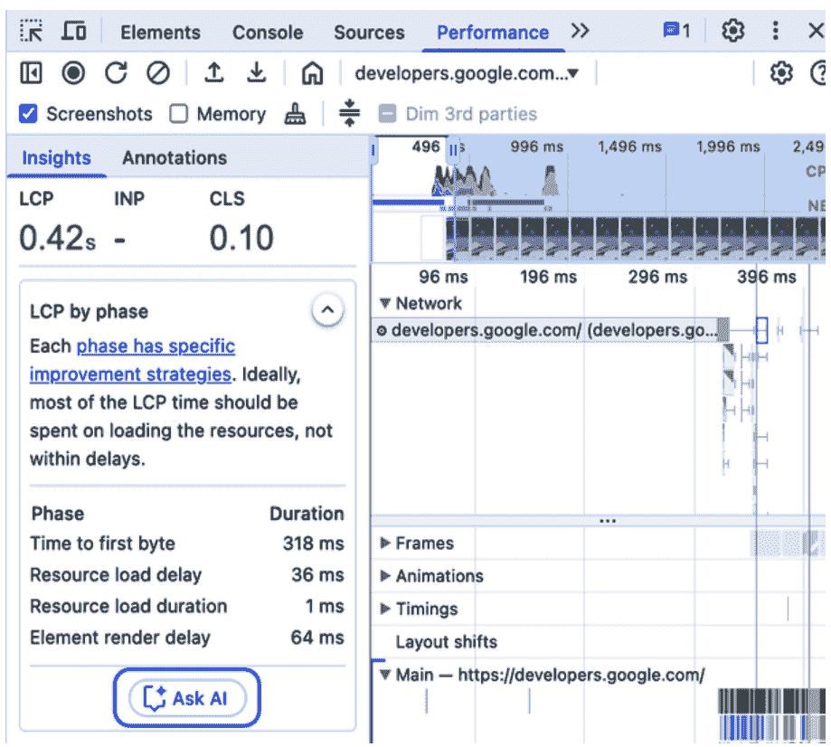
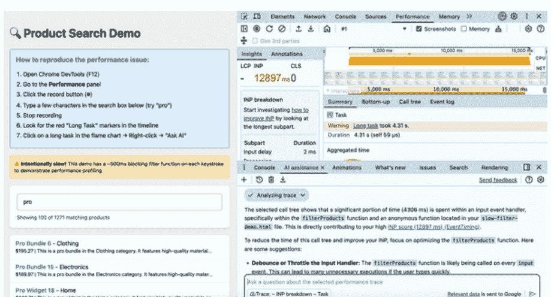
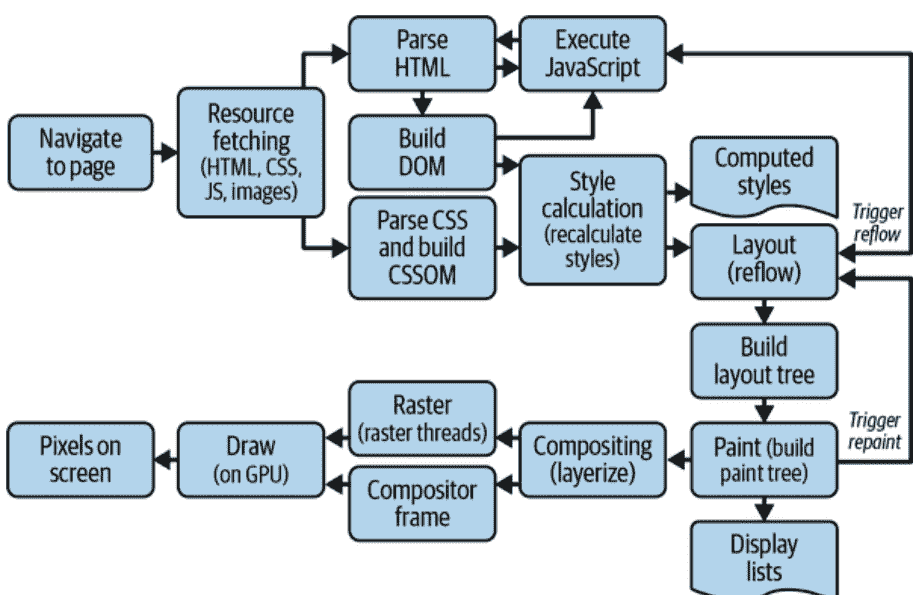
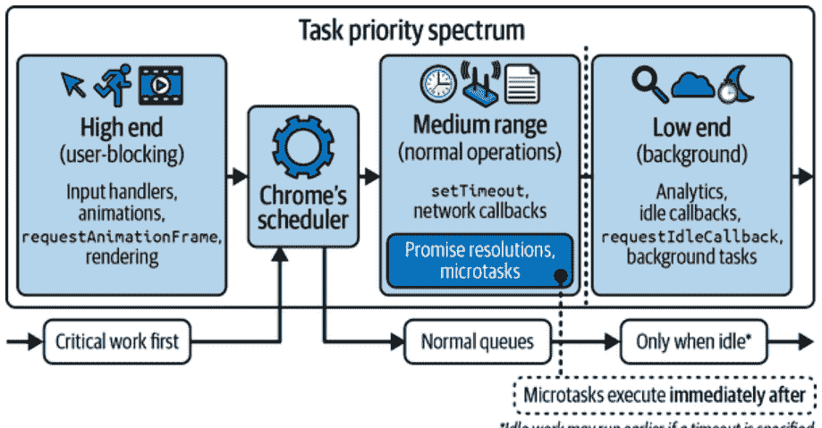

## 第五部分，“Web 性能的未来”

展示了最近（2021–2025）的真实案例研究。这些案例展示了不同垂直领域（电子商务、媒体、旅游、金融）的公司如何成功实施性能优化、改善其核心网页指标并取得显著的业务成果——通常在采用 AI 工具并在生产环境中处理 AI 生成代码的同时。

### O’Reilly 在线学习

NOTE

40 多年来，*O’Reilly Media* 一直为公司提供技术和商业培训、知识和见解，帮助企业取得成功。

我们独特的专家和创新者网络通过书籍、文章和我们的在线学习平台分享知识和专业知识。
O’Reilly 的在线学习平台为您提供按需访问实时培训课程、深入学习路径、交互式编码环境，以及来自 O’Reilly 和 200 多家其他出版商的庞大文本和视频集合。有关更多信息，请访问 *https://oreilly.com*。

### 如何联系我们

请将有关本书的评论和问题发送给出版商：

O’Reilly Media, Inc.

141 Stony Circle, Suite 195

Santa Rosa, CA 95401

800-889-8969（美国或加拿大境内）

707-827-7019（国际或本地）

707-829-0104（传真）

support@oreilly.com


https://oreilly.com/about/contact.html

我们为本书准备了一个网页，在上面列出勘误以及任何补充信息。您可以在 https://oreil.ly/web-performance-engineering 访问该页面。

如需了解我们书籍和课程的新闻和信息，请访问 https://oreilly.com。

在 LinkedIn 上关注我们：https://linkedin.com/company/oreilly-media。

在 YouTube 上观看我们：https://youtube.com/oreillymedia。

### 致谢

本书之所以成为可能，得益于网页性能社区的集体知识。我要感谢 Chrome 团队的同事们，其中包括 Annie Sullivan，她领导着 Chrome 的 Speed Metrics 团队（Core Web Vitals 背后的团队），并孜孜不倦地致力于让以用户为中心的性能指标成为网页开发的基石。我还要感谢 Paul Irish、Elizabeth Sweeny、Victor Porof 和 Tze Yi Tan，他们长期以来主导了 Chrome Performance Tooling 的许多工作。感谢像 Philip Walton 和 Jeremy Wagner 这样的 Google 网页性能倡导者，他们撰写了本书中引用的许多指南，并开发了 web-vitals 库，使衡量真实用户性能变得更简单。

我也对 Google 外的性能专家心怀感激。Yoav Weiss 在资源提示和优先级优化方面的工作（以及他对 Priority Hints 等标准做出的贡献）影响了关于加载优化的部分。感谢 WebPageTest 的创建者 Pat Meenan，他开创了真实世界的性能测试，并提供了每个 webperf 工程师都在使用的工具。我还借鉴了 Tim Kadlec 和 Tammy Everts 的见解，他们长期宣扬性能对业务和用户体验的影响。Barry Pollard 关于优化 Core Web Vitals 的研究和写作（包括关于 LCP 和 CLS 的详尽指南）

从用户登陆网站或网页应用的那一刻起，性能就开始塑造他们的看法。*速度本身*就是一种功能——通常是用户首先注意到的功能。人机交互研究表明，即使是微小的延迟也可能打断用户的“流”并增加挫败感。来自 UX 研究的一个经典经验法则是，响应时间存在某些阈值决定了用户的感知：当系统在约 0.1 秒内做出反应时，感觉是即时的；1 秒的响应延迟仍能让交互感觉无缝；但超过几秒就会感觉迟缓，让用户明显意识到等待。超过约 10 秒后，大多数用户会感到沮丧并可能完全放弃任务。

本书面向的是中级到高级的软件工程师，他们可能精通编码或构建功能，但尚未完全将性能作为 UX 基石来拥抱。我将以专业而又轻松的语气，探讨速度与可用性之间的科学和原则，并引用学术研究和行业案例研究，量化性能如何影响用户满意度、参与度和业务成功。我不仅提供指标和数据，还提供一个结构化的叙述，说明性能为何对良好的 UX 至关重要，以及如何在实践中评估它。

我将首先从人类层面审视速度为何对用户重要。随后我将深入探讨帮助我们从用户角度衡量网页性能的指标和模型，包括新的 Core Web Vitals。我将讨论为各种设备和网络条件设计，确保即使在低端硬件或网络不稳定环境下的用户也能获得愉悦体验。我将介绍 RAIL 等框架以及 Lighthouse 和 Chrome 用户体验报告（CrUX）等工具，它们可以指导我们的性能审计。

与其关注低级优化技术，我最初将保持在原则、指标和结果的层面——将更快的网站与更快乐的用户联系起来。

本书的后半部分将在此基础上展开。第二部分深入浏览器渲染的技术细节以及优化 Core Web Vitals 的具体技术。第三部分深入探讨与 JavaScript 相关的性能成本以及如何有效管理。第四部分专门关注优化无处不在的第三方脚本的挑战和解决方案。最后，第五部分通过展示性能工程在各个行业中的影响的真实案例研究来强化这些概念，并提供在组织中建立以性能为先文化的建议。

在整个过程中，您会发现引用了 Google 等机构的研究来支持我的建议，并听到我基于在 Chrome 性能团队工作经历形成的观点。到最后，我希望能说服您，性能就是用户体验，构建快速的网络是取悦客户的关键。

### 缓慢的代价：第一印象与用户满意度

速度不仅仅是“锦上添花”：它与跳出率、转化率和参与度等业务指标密切相关。众多行业研究都强调了这一点。BBC 在 2018 年观察到，其网站每多加载一秒，就会流失 10% 的用户。这种损失会迅速累积；几秒钟的延迟就可能几乎让你的受众减半。即使是一秒的延迟也可能削减可观的转化率（沃尔玛发现页面加载时间每改善 1 秒，转化率就会提高 2%，而 COOK 通过将页面加载时间减少 0.85 秒提高了 7% 的转化率）。这些真实世界的数字令人信服地证明，性能与业务成功和用户忠诚度密不可分。

由于性能是立即感受到的，它极大地影响了用户的第一印象。快速流畅的体验可以向用户传达专业性和可靠性，而缓慢、卡顿的体验则暗示着疏忽，并可能损害信誉。用户的期望随着时间的推移而提高——他们期望网站快速响应，常常将网页体验与原生应用相比较。耐心非常匮乏：一项调查发现，许多用户在移动设备上尤其不愿等待内容超过几秒。延迟还会引起焦虑：“我的点击是否已注册，还是应用已冻结？”

将 *速度视为用户体验的支柱* 内化于心。性能改进不仅仅是为了炫耀的技术任务——它们直接转化为更快乐的用户、更好的参与度，甚至积极的品牌认知。采用这种心态可以让你“从用户需求倒推技术”，始终以用户的需求（快速反馈、最小等待）为指导原则。

那么，对用户来说，究竟什么才算 *快速* 的体验？什么才算 *太慢*？

一个经典法则，最初由 Robert B. Miller 等研究人员在 1968 年研究响应时间时提出，后来由 Jakob Nielsen 普及，认为用户以分层的方式感知延迟：

#### *0.1 秒或更少*

在十分之一秒内完成的操作感觉是即时的。这是交互如点击按钮或切换 UI 元素感觉完全没有延迟的阈值。它保持了直接操控的幻觉：用户感觉自己掌控一切，因为界面立即做出反应。

#### *大约一秒*

大约一秒的延迟足够短，用户仍能保持流畅，但他们开始注意到延迟。它是无缝继续思考的大致阈值，因为它感觉像自然的停顿。再长一点，他们可能会觉得界面正在处理某些事情。

#### *两到九秒*

延迟延长到几秒开始考验用户的耐心。研究表明，随着等待时间增加到这一范围，用户满意度下降。人们的确切容忍度因上下文而异（例如，用户可能愿意为视频加载等待稍长时间，而不是搜索结果），但通常在这个范围内，进度指示器或反馈变得必不可少，以向用户保证正在发生某些事情。

#### 10 秒或更长

如果在约 10 秒后仍看不到进展，大多数用户会放弃正在做的事情并离开或尝试不同的方法。即使他们不离开，他们的注意力也被打断：他们可能会切换任务或分心，严重降低体验质量。

### 等待的心理学

让我们将这些时间阈值与认知和情绪反应联系起来。为什么超过一秒的延迟会让人如此沮丧？你可能熟悉 *心流* 的概念：用户完全沉浸在任务中的专注状态。中断会打破用户的流，让他们记住自己在做什么并抵制分心的冲动。

用户容忍度也可能取决于上下文：像查找紧急信息这样紧急的任务可能会让任何延迟都难以忍受，而休闲浏览会话可能不会考验用户的耐心。性格也起作用。没有适用于所有人的单一“神奇数字”。相反，你希望对尽可能多的用户尽可能快，并且肯定要保持在挫败感飙升的范围以下。

性能问题不仅仅是小麻烦——它们可能从根本上破坏用户体验，导致错误、重复提交或导航到错误页面。其中一种现象就是“愤怒点击”——当用户因界面无响应而反复点击或轻触以示沮丧时。Akamai 的一项 UX 研究发现，愤怒点击往往发生在用户尝试与 *看起来* 已准备好但实际上尚未可交互的页面交互时。事实上，许多用户在页面完全可交互之前就开始交互；在所研究的案例中，超过 30% 的情况下页面在 onload 事件触发后仍不可用，约 15% 的用户尝试在页面视觉渲染完成和变为可交互之间点击。当网站最终跟上时，它可能会注册多次点击或非预期操作。例如，如果购买按钮


延迟时，用户可能会因挫败而重复点击两次，无意中购买了两件商品。

布局不稳定也会导致错误：如果内容因广告或图片缓慢加载而突然移动，用户可能会点击错误的东西（比如移动的链接或按钮），从而偏离其预期的任务。

如果你的应用响应缓慢，用户会注意到——而且很多人会采取行动，无论是猛击界面、离开你的网站，还是在心理上放弃。这就是为什么你需要仔细衡量和改进性能。

### 评估 UX 性能：关键指标

没有单一的指标能讲述页面加载的完整故事。用户的体验是一个时刻的进展，而非某一瞬间。历史上，开发者会查看像 *onload*（所有资源完成加载的时刻）或简单的秒表计时这样的指标，但这些往往无法捕捉用户真正关心的东西。例如，一个页面在技术上可能在 5 s 内完成加载，但如果内容在 2 s 内可见且可用，那么用户的 *感知* 性能就比 onload 时间所暗示的要好得多。相反，一个页面可能在 2 s 时显示出内容，但由于 JavaScript 负载过重，直到 10 s 才响应，体验就会很糟糕。

本节提供性能指标是什么以及为什么它们重要的快速高层概述。第 2 章将更深入地探讨该主题的细节，包括在此简要命名的各种指标的定义。

开发者过去主要关注性能的技术衡量，但这些并不总是反映用户的体验。我通过查看加载体验中的四个关键时刻来处理这个问题，这些时刻对应于页面加载时用户的直觉问题：

*它发生了吗？*

网站是否响应了，还是我的连接死了？这是最早的阶段。用户点击了链接或输入了 URL 并希望

也许需要 200 ms 来执行，所以总共大约 2.2 s。在中端手机的 3G 或不稳定的 4G 或 5G 网络上，同样的 2 MB 可能需要 8 到 10 s 下载，以及 2 秒或更长时间执行。现在我们看到在可交互之前需要 12 s 或更长时间——完全不同的体验。设备在这种负载下可能会 literally 过热或 CPU 降频，随着时间的推移情况会更糟。用户的上下文会极大地改变性能包络（你的网站必须在可接受范围内运行的条件范围）。

想想你的用户的 *尾部*。也许第 90 百分位的用户（较慢的情况之一）使用的是五年前旧手机且连接不佳。即使“平均”用户没问题，如果 *这个* 用户必须等待 10 秒或更长时间，这对相当大的一部分受众来说就是 UX 失败。我建议在设定性能预算时考虑到这些尾部场景（我将在本书第二部分对此进行扩展）。

移动网络通常具有高延迟（往返数百毫秒），这会严重减慢资源加载速度，尤其是如果网站需要许多顺序请求时，这对于握手或资源未优化的情况可能是关键的。带宽限制吞吐量；大图片或视频在有限带宽下尤其缓慢。

根据一些移动 UX 研究，移动用户 *似乎* 稍微更有耐心：一个来源表明许多移动用户会在放弃页面前等待 6 到 10 s，可能因为他们习惯了移动端较慢。但这并不意味着你应该以 6 s 为目标；这更像是最后的容忍度。事实上，Google 的移动基准数据显示，如果页面加载超过 3 s，53% 的移动网站访问会被放弃。耐心因人而异，但最安全的做法是在移动端也尽可能快。

在一些国家，数据成本高昂，大多数发展中国家的用户主要通过低端移动设备访问网络。一个缓慢的网站迫使用户多次重新加载或下载可能会给用户带来财务成本。对于这些用户来说，5 MB 的网站或重量级的 Web 应用可能实际上无法使用。

尊重你的用户意味着也要考虑这些因素。真正的 UX 卓越意味着为 *所有* 用户提供良好的服务，而不仅仅是拥有最新设备的人。设定性能预算和期望时要考虑到移动和全球用户。性能是相对的，取决于用户在哪里以及如何访问你的网站——优秀的工程师和 UX 从业者会考虑这种可变性。

### 以性能为先的设计

本节介绍一些从一开始就以性能为出发点进行设计和构建的高层原则。这里的建议更多是关于思维方式和指导方针，而非具体的优化。它是关于将性能考虑融入设计和架构阶段，而不是最后再调整。

### RAIL 模型：以用户为中心的性能框架

在第 2 章讨论 Google 的 Core Web Vitals 之前，我想向你介绍它的前身。RAIL 是指导 UX 性能、动画、空闲和加载的稍旧模型。RAIL 的优势在于它将性能目标与用户在不同场景下的感知联系起来。让我们看一下每个组成部分：

#### *Response*

当用户发起操作（点击按钮、开始动画）时，网站应快速响应该输入。RAIL 的指导原则是在约 50 ms 内处理事件，并在约 100 ms 内更新 UI，以便用户感觉它是即时的。我建议设计师避免在输入事件上直接进行繁重的工作，以免延迟反馈。如果用户正在进行表单提交等操作，至少要立即确认点击（视觉反馈），并可能显示加载指示器以传达操作正在进行。如果你

无法在 100 ms 内完全响应，至少要在该时间内确认，然后在后台完成其余工作。

#### Animation

对于滚动、动画或过渡等事物，目标是保持流畅——理想情况下每秒 60 帧。这意味着每个帧必须在 16 ms 或更短时间内生成。卡顿的动画和不流畅的 UI 过渡会降低原本快速应用的体验。RAIL 提醒我们也要考虑加载后的交互。

#### Idle

明智地利用空闲时间。RAIL 的这一部分是关于在用户未积极交互时进行后台工作，以免干扰响应性。例如，在主要加载后，如果用户正在阅读文章，应用可能会悄悄预加载下一页或在小块中进行其他低优先级工作，以便如果用户突然交互，应用可以停止后台工作并做出响应。不要用持续的工作占用线程；将任务拆分，以便应用保持响应。用户重视 *持续* 感觉敏捷的应用。

#### Load

旨在快速提供有用的内容。RAIL 建议移动加载约为一秒；在实践中，对于复杂网站，一秒在移动端很难，但原则是尽快加载和渲染核心内容。在 2 到 5 s 内，内容应完全可交互（取决于上下文）。这些是努力追求的目标；每多一秒都会造成伤害。

表 1-1 显示了 RAIL 的关键性能目标。

表 1-1. 关键 RAIL 性能目标

| RAIL 组件 | 性能目标 | 研究依据 |
|---|---|---|
| Response | <100 ms 对用户输入做出响应 | 基于 Jakob Nielsen 关于感知即时性的指导原则 |
| Animation | 60 fps（每帧 16 ms） | 基于人类视觉系统平滑跟踪运动的能力 |
| Idle | 在 ≤50 ms 块中使用空闲期 | 允许浏览器保持对用户输入的响应 |
| Load | 在平均设备上 <1 s 到有用的内容 | 基于 Robert Miller 关于保持用户流程和注意力的研究 |

每个目标都由用户研究支持，研究了延迟如何影响感知和整体用户体验。

RAIL 提供了一个心理模型，帮助工程师、开发者和设计师在思考性能时关注用户。

### 从一开始就为性能设计

设定性能预算是一个良好的设计原则：即限制页面或应用允许的“重量”，以便满足你的性能目标。这可能看起来像“我们的主页初始加载的关键 JavaScript/CSS 不应超过 150 KB，图片不应超过 100 KB。” 具体数字在这里并不重要，但实践很重要。你将使用你的指标（第 2 章中介绍）来推导此预算。如果一个


某些脚本或功能会让你超出预算并拖慢速度，这就是重新考虑或寻找另一种方法的信号。将性能视为设计约束，而非事后考虑：就像你不会设计一个在常见屏幕尺寸上不合适的 UI 一样，也不要设计一个只在顶级设备或连接上才能工作的 UI。

*渐进增强* 和 *优雅降级* 是实现普遍可接受性能的策略。*渐进增强* 意味着为旧浏览器或非常慢的客户端提供简单的布局和功能，然后如果客户端能够处理更多就进行增强。*优雅降级* 是互补的方法：你首先为现代、功能强大的浏览器设计，但确保体验在旧设备或功能较弱的设备上能优雅降级（保持功能，但功能较少）。这样，每个人都能得到一些东西，而不是有些人什么都得不到（或得到极其缓慢的体验）。从 UX 角度来看，拥有一个简化但快速的体验，远好于一个花哨但无法使用的体验。

### 示例

想象你正在设计一个旅游预订网站的搜索结果页。性能优先的方法意味着只立即加载前几个结果（足以快速显示）。你会延迟加载图像，直到需要或进入视口时再加载，并为地图等内容显示占位符，而不是提前加载。思考用户*首先*需要什么并快速交付，然后再加载任何额外的花哨功能。

你也可以使用设计评审来讨论性能。在评审新功能时，询问它将如何影响加载时间或交互性。如果一个建议的功能会增加 1 MB 的脚本，请考虑替代方案：它能否在服务器端完成或在初始加载后完成？这关乎文化，而不仅仅是技术：在所有层面的决策中都将性能作为标准。（有关性能文化的更多信息，请参阅第 11 章。）

有了这些指导原则和思维模型来帮助你构建快速体验，我希望你不仅能够衡量和诊断，还能主动为速度而设计。性能不是

*实验室测试* 是在受控环境中测试网站性能：例如，通过像 Lighthouse 这样的工具运行它（参见“实验室工具”），它可以模拟不同的设备和网络。实验室测试对于可重复性和调试非常有用，因为它们消除了真实世界条件的可变性。你可以对你的网站运行 Lighthouse 审核并获得一致的性能分数和指标。在开发期间使用实验室测试是及早发现问题并为改进设定基线的绝佳方式。

*现场监控* 是关于从野外的真实用户那里收集数据。Chrome 用户体验报告（CrUX）是一个真实用户指标的公共数据集，提供了你在网站上真实 Chrome 用户的汇总性能统计数据。它可通过 PageSpeed Insights 或 BigQuery 等工具访问。CrUX 为你的网站用户（如果流量足够）提供 LCP、INP 和 CLS 的月度汇总统计数据。这对于基准测试很有用。如果，例如，只有 50% 的用户具有良好的 LCP，你就知道一半的用户体验不佳，这就是改进的动力。

你也可以通过 Web Vitals JavaScript 库（本章后面会介绍）或另一个真实用户监控（RUM）解决方案运行自己的分析，以从实际访客那里捕获指标。RUM 指的是在生产环境中从实际用户与网站交互时收集性能数据的实践，让你了解网站在不同设备、网络和位置上的表现。其他优秀的工具包括 WebPageTest 用于更深入的分析（如胶片条和 CPU 配置文件）以及 DevTools 性能面板用于分析运行时性能。

现场数据是用户体验的真实衡量标准，捕捉了设备、网络和用户行为的全部范围。它可能与实验室结果不同：例如，你的 Lighthouse（实验室）LCP 可能是 2.0 s（很棒），但你的现场数据可能显示许多用户为 4 s，也许是因为你的许多用户使用的是比实验室工具假设更慢的手机。实验室提供理想（或至少标准化）的条件，而现场就是现实，带有所有由此带来的可变性。

精明的性能工程师使用实验室工具进行诊断，使用现场工具进行验证。设置某种方式持续收集这些指标，以便你可以查看，例如，新部署是否导致用户的 LCP 飙升或某个地区变慢。

### CWVs：关键指标

Google 对数百万次页面展示的分析发现，实现所有三个 CWV 的良好分数平均减少了 24% 的放弃率，在新闻和电子商务网站等不同站点类别中也有类似的改善。这三个 CWV 指标并非随意选择；它们对应于用户行为和满意度的实际改善。当我们在 Google 定义这些指标时，我们回顾了现有文献并进行了自己的用户研究。

这些指标可在浏览器中进行现场测量，这意味着它们可以从真实用户那里收集，而不仅仅是实验室模拟。当时，这标志着我们判断性能方式的巨大转变：它关乎真实的 UX，而不仅仅是理论上的加载时间。现代浏览器（尤其是 Chrome）公开 API 来衡量这些指标，因此开发人员可以在生产环境中跟踪它们。CrUX 还在整个网络上收集这些指标的匿名数据，Google 甚至已将页面体验作为排名因素（如果你需要进一步的激励来关心 CWV 的话）。让我们更详细地看一下每一个。

### 最大内容绘制（LCP）：快速查看内容

目标：以用户 75 分位数的标准，力求 LCP 低于 2.5 s。

LCP 从用户的角度衡量加载速度。更具体地说，它标记的是视口中最大内容块（可能是主要文章文本、图像或功能元素）已在屏幕上渲染的时刻。为什么是最大的？因为通常用户就是在等待它：大图像或主要标题和文本块。快速的 LCP 意味着页面令人放心地迅速显得有用；用户可以

快速页面可以对每次交互做出视觉响应。较低的 INP 分数是好的，表明网站在*所有*用户操作中始终感觉灵敏。较高的 INP 分数表明网站偶尔会滞后或卡顿，造成令人沮丧的时刻。

INP 的推荐目标是保持大多数（75 分位数）交互低于 200 ms，根据研究表明，超过约 100 到 200 ms，界面开始感觉迟缓。当页面忙于解析大型 JavaScript 包或在主线程上处理长时间任务时，交互可能会排队，导致 INP 更高。通过衡量 INP，开发人员可以看到这些减速发生的频率并优先修复它们。衡量并降低 INP 可确保网站始终感觉响应迅速，让用户无缝完成任务。

如果 INP 显示较高值，它可能测量了你的某个事件处理程序花费了很长时间或输入被延迟。但在实验室测试中，默认情况下交互并不多——因此 Lighthouse 可能会在加载后对第一个内容元素合成一次交互来估计 INP。如果它很高，就像总阻塞时间（下面讨论）一样对待，保持主线程繁忙。

在实践中，INP 建立在从 FID 中吸取的经验教训之上——突出显示主线程臃肿、大脚本和其他因素如何破坏响应能力。但与 FID 在初始交互后结束不同，INP 照亮了随后的每一次交互，为团队提供了更完整的真实用户体验图景。通过保持 INP 较低，你可以降低在任何时候突然出现 UI 停顿的风险，帮助你的网站真正“随时准备好做出反应”。

### 累积布局偏移（CLS）：视觉稳定性

*目标：* 实现 75% 的页面加载的 CLS 分数小于 0.1。

CLS 是许多开发人员对这三个概念中的最新一个，因为它解决了历史上未被加载时间或速度指标捕获的一种 UX 问题。它衡量页面布局在加载期间（甚至更晚）意外移动的程度。它是一个累积的分数


每次东西在屏幕上跳动时。布局不稳定会造成严重的挫败感，甚至可能意外点击到错误的元素。

CLS 的计算很简单：它会查看屏幕上移动的部分以及移动的距离，然后累积得分。小幅移动或屏幕外元素的位移几乎不计分，但大而明显的跳动会产生更高的分数。目标是让 75% 的页面加载的 CLS 分数低于 0.1。实际上，这意味着几乎没有明显的意外位移。如果达到此目标，你的页面在视觉一致性方面很可能非常稳定且对用户友好。如果超过 0.1，请查看元素以找到并修复原因。Lighthouse 是否列出了顶部位移的元素？DevTools 时间线或 WebPageTest 的会话胶片是否显示任何卡顿的动画？

CWVs 提炼了 Google 关于性能最关键的 UX 方面的建议。理解它们将帮助你确定优先修复或优化的内容。

### 其他重要指标

其他重要指标但不属于 CWVs 包括：

#### *Total blocking time (TBT)*

一种仅限实验室的指标，汇总 FCP 与 TTI 之间运行时间 >50 ms 的任务总时长。它是主线程有多忙的代理指标。如果它很高，INP 可能也有问题。你可以通过优化 JavaScript 来降低 TBT（参见第 7 章）。例如，如果你的 TBT 为 600 ms，你可能有一大块脚本阻塞主线程。

#### *Speed index (SI)*

这种有些晦涩的指标衡量内容在视觉上填充的速度（使用胶片工具）。它不是 Core Web Vital，但属于 Lighthouse 分数的一部分。如果 LCP 正常，通常 SI 也正常。如果 SI 很高，你可能存在渐进式渲染问题（内容开始出现较晚）。

#### *Time to interactive (TTI)*

它衡量页面空闲到足以可靠响应的时间。如果你优化 TBT 和 JavaScript，TTI 会下降。TTI 有时会超过 LCP，如果你有大量后加载 JavaScript。如果 TTI 远在 LCP 之后，这意味着用户看到内容但无法在之后完全与其交互——这可能与大量 JavaScript 占用资源有关。

### 解释和利用报告

如果 Lighthouse 说你的网站交互性很高（比如八秒），这很可能意味着用户看到内容但在之后的八秒内无法使用它：这是一个明显的 UX 问题。如果 CLS 被标记为“需要改进”，请追查哪些元素导致布局跳动。如果你的工具没有告诉你，也许是缺少尺寸的图片或广告位。

考虑每个指标并从用户角度考虑。你的测量结果是否与反馈或会话录像（如果有）一致？“我点击了但什么都没发生”是一个表明交互性问题的线索；“页面到处跳动”告诉你需要深入研究 CLS 问题。

考虑闭环：测量、发现问题、修复它们，然后再次测量。性能工作是迭代的。一个团队设置了性能预算，并在营销添加了一个巨大的第三方脚本时发现他们已超出预算。多亏了监控，他们及时发现并与营销合作以不同方式加载它，UX 指标没有退化。通过将性能指标作为错误日志或正常运行时间一样纳入监控，你的团队可以始终将 UX 放在首位。在 Chrome 团队和其他 Google 团队中，我们将某些性能指标视为关键成功标准。在 Chrome 本身，我们不断跟踪页面加载和响应的速度，因为任何退化都可能影响我们数十亿用户。

总之，衡量你所珍视的。性能至关重要；你现在知道如何在日常开发和生产中保持对其的关注。通过结合实验室和现场结果并将性能检查集成到常规工作流程中，你可以使性能可持续且可操作。

本章的其余部分将更详细地介绍如何使用特定的实验室和现场测量工具。

### 实验室工具

实验室测试是可重复的，可以让你快速测试更改。它们通过允许更深入的调试来补充现场数据。本节的目标是向你展示如何使用这些工具来捕获回归并验证改进。每个工具都有其细微差别。这里涵盖的所有工具都可以模拟移动设备并应用网络节流以近似真实用户条件。你的结果可能会因运行而异，尤其是 LCP（由于网络时序的变异）和 TBT（由于模拟）。始终运行工具几次，或进行三次运行并报告中位数分数。你的环境也可能导致变化。DevTools 和 Lighthouse 使用你的机器，但它们可能会对其进行节流；PageSpeed Insights 使用数据中心。

让我们深入了解如何充分利用每个工具。

### Lighthouse：性能审计

Lighthouse 是由 Google Chrome 团队开发的用于性能审计的流行开源工具。Lighthouse 在受控环境中根据你指定的设备和网络约束加载你的页面，并收集性能指标。然后它给出 0 到 100 的性能分数（分数越高越好），这是一个加权综合指标。Lighthouse 主要关注页面加载性能。

要有效使用 Lighthouse，请在关键页面上运行它并检查它列出的改进机会，例如“减少未使用的 JS”或“启用文本压缩”。这些是有价值的提示，说明可能是什么减慢了加载速度。Lighthouse 可以引导你找到主要问题所在，例如大图像、缓慢的服务器响应或繁重的脚本。它还以实验室形式标记你的 CWVs。它集成在 Chrome DevTools 中（转到 Audits 或“Lighthouse”面板）并且也通过命令行界面可用

- 特定项目，如 LCP 元素、其加载时间以及导致它的资源

主要使用 Lighthouse 来查看你的指标值并捕获明显问题。不要痴迷于单一分数。试图优化到完美的 100 可能会导致收益递减或不自然的模式。例如，Lighthouse 可能会说你“减少了未使用的 CSS”，这是好的，但过度拆分层叠样式表（CSS）可能会通过导致额外请求而实际损害真实用户。

在做出更改之前和之后运行 Lighthouse 是验证更改是否达到预期改进的好方法。假设你决定通过压缩图像并添加尺寸来优化页面的图像。如果你先运行 Lighthouse，然后在更改后运行，你可能会期望看到以下结果：

- 如果图像是原因，CLS 应该下降到大约 0。Lighthouse 可能会删除“图像元素没有明确的宽度/高度”警告。
- 如果图像因压缩而加载更快，LCP 可能会改善。
- 除非你同时删除了繁重的 JavaScript，否则 TBT 或 INP 可能不会改变。在这种情况下，TBT 应该下降。

Lighthouse 还有一个工具可集成到你组织的 CI/CD 管道中。它可以在性能分数或特定指标退化超过某个阈值时提醒你。你可以设置它在每次提交后对代表性页面运行。它还添加了用户流程，因此你可以脚本化用户可能执行的操作，然后让它播放。

总之，Lighthouse 是你的快速审计工具，用于大致了解页面性能并获得一些修复指导。它通常是你对新站点运行的第一件事。

以通俗语言发出警告。例如，如果你的 AI 生成的代码抛出类似 “[Deprecation] Some API is deprecated” 的警告，控制台的“解释”功能可以使用 AI 告诉你这意味着什么以及如何更新它。在处理 AI 不熟悉的输出时，这是一个巨大的福音：有时 AI 使用其训练数据中看到的过时方法，而 DevTools 可能会警告它，因此你知道要现代化那段代码。



图 2-1. Chrome DevTools 性能面板现在包含一个 AI 助手（Gemini），可以分析记录的配置文件

要使用这些功能，请确保你使用的是最新版本的 Chrome，或者至少是包含 Gemini 的 Chrome DevTools 版本（Chrome 111+ 开始预览引入这些 AI 工具）。对于性能，工作流程是：


利益相关者：“你看，它空白了三秒钟，然后才显示内容。”

- WPT 的界面还会指出诸如长时间阻塞请求等问题。它甚至会显示一个优化清单（类似 Lighthouse，但侧重网络）。
- 你可以轻松测试不同的场景：带身份验证的、慢速连接的、在不同设备上等等。

WPT 还可以通过脚本模拟用户流程，类似于 Lighthouse flows。这对于测试需要身份验证的页面或多步骤交互尤其有用。下面是一个示例脚本，演示了登录然后导航到仪表板的流程：

```
navigate https://example.com/login
setValue name=username user1
setValue name=password secret
submitForm id=loginForm
waitForComplete
navigate https://example.com/dashboard
```

该脚本使用表单凭据登录网站，等待登录完成，然后导航到仪表板页面并计时其加载时间。这种功能对于测试 Lighthouse CLI 无法在没有额外脚本基础设施的情况下轻松处理的已认证流程或多步骤用户旅程特别有价值。

PageSpeed Insights 比 WPT 更易于使用，它结合了 Lighthouse（实验室）数据和 CrUX（现场）数据。WPT 更详细，但需要你做更多解读。通常我先使用 PageSpeed Insights 快速获取 Lighthouse 分数，然后使用 WPT 详细验证这些发现。

HTTP Archive（由 Rick Viscomi 和团队运营）每月收集数千个网站的 WPT 数据。像 Web Almanac 这样的工具使用这些数据报告趋势，例如中位 LCP。它不是你用于单站点测试的工具，但对于基准测试很有趣。

要将这些工具一起使用，你的实验室测试工作流程可能如下所示：

- 使用 Lighthouse 快速了解情况并列出问题。
- 使用 DevTools Performance 精确定位这些问题的根本原因。
- 使用 WPT 在真实网络条件下确认改进的实际效果，为利益相关者生成视觉证明，并捕捉 Lighthouse 可能遗漏的问题。

### 第三方工具和集成

除了 WPT、Chrome DevTools 和 Lighthouse 等免费工具外，还有商业和托管服务，它们基于类似的引擎构建，并增加仪表板、警报、协作功能和长期历史记录：

#### *SpeedCurve 和 Calibre*

SpeedCurve 和 Calibre 是完整的网页性能平台，它们将合成实验室测试与 RUM 相结合，因此你既可以看到受控的测试运行，也可以看到真实用户在生产环境中体验你的网站的方式。它们使用真实浏览器从多个区域运行测试，跟踪 CWV，并经常融合 CrUX 数据以显示你与来源和竞争对手基准的比较。除此之外，它们提供仪表板、性能预算、警报和趋势，面向整个团队，将一次性 Lighthouse 或 WPT 运行转变为持续的监控和治理工作流程。

#### *DebugBear 和 YellowLabTools*

DebugBear 是一个托管监控服务，运行计划的 Lighthouse 审计和其他合成测试，存储每次运行以便获得历史图表、差异视图，并在分数或 CWV 退化时发出警报。它还引入现场数据，例如 CrUX 和可选的 RUM，帮助你将指标变化与特定的部署、URL 或代码路径联系起来，而不是将每个 Lighthouse 报告孤立对待。相比之下，YellowLabTools 是一个免费的开源分析器，专注于前端代码质量，扫描诸如过大的 DOM 树、沉重的 JavaScript、复杂的 CSS 等问题，以及在页面甚至渲染之前通常会损害性能的其他模式。

#### *Puppeteer 和 Chrome DevTools Protocol*

Puppeteer 是一个 Node.js 库，通过 Chrome DevTools Protocol（CDP）控制 Chrome 或 Chromium，在无头和有头模式下为你提供可脚本化的真实浏览器访问。你
可以脚本化关键用户旅程，捕获性能跟踪和指标，并导出 Chrome 跟踪文件以便在 DevTools 或 Perfetto 中进行更深入的分析，这使其对于构建超出 Lighthouse 开箱即用提供的自定义性能检查非常有用。一个模式是将 Puppeteer 与 Lighthouse Node 模块或 DevTools Performance API 在你的持续集成（CI）管道中结合起来，以便每个拉取请求或发布都对关键流程运行可重复的、浏览器级别的性能测试。

请记住，Chrome DevTools 本身会影响性能结果：在 DevTools 界面中运行配置文件或 Lighthouse 会使标签页保持可见，消耗额外内存，并略微改变工作调度方式。PageSpeed Insights 中的 Lighthouse、Lighthouse CI 和大多数第三方平台改为在无头 Chrome 中使用固定设置运行测试，而基于 WPT 或类似实验室工具构建的服务在受控环境中执行以获得更可重复的数字。Lighthouse 在 DevTools、PageSpeed Insights 和托管监控器之间存在细微差异；使用 DevTools 进行本地调试，但将 CI 和监控仪表板中的脚本化、无头运行视为预算和回归的规范来源。

展望未来，最佳实践是结合合成监控和 RUM，而不是二选一。合成测试提供确定性基线，即使流量较低时也能运行，并且非常适合在暂存或生产环境中保护关键流程并发出警报。RUM 捕获真实用户在不同设备、网络和区域看到的内容，使其更适合优先考虑真正推动 CWV 和业务指标的工作；大多数现代平台允许你并行运行两者，以便及早检测回归并仍然验证其现实世界的影响。

通过掌握实验室工具，你可以在开发中尽可能优化网站。但仅靠实验室测试是不够的；真正的证明在于
页面正在被卸载，例如当用户导航离开、关闭标签页或切换到另一个应用程序时，以在页面会话结束前捕获最终的指标值。它应用必要的 polyfill 或修复，例如为尚未原生支持 INP 的浏览器提供支持，并提供一个简单的回调，其中包含指标值和一些元数据。

要使用 web-vitals，运行以下脚本：

```
<script src="https://unpkg.com/web-vitals@3/dist/web-vitals.iife.js"></script>

<script>
  webVitals.getCLS(console.log);
  webVitals.getLCP(console.log);
  webVitals.getINP(console.log);
</script>
```

这会将指标记录到控制台。要将它们发送到服务器，运行以下内容：

```
function sendToAnalytics(metric) {
  const body = JSON.stringify(metric);
  // Use navigator.sendBeacon for efficient async send that doesn't block unload
  navigator.sendBeacon('/analytics', body);
}

webVitals.getCLS(sendToAnalytics);
webVitals.getLCP(sendToAnalytics);
webVitals.getINP(sendToAnalytics);
```

每个指标对象都有 name（“CLS”）、value（0.07）、entries（任何相关的 PerformanceEntry 实例）等属性，以及可能 id（指标实例的 ID）。

重要的是要等待指标最终确定。LCP 通常在加载时或刚加载后确定，但如果用户将页面置于后台然后返回，它可能会更新。库会处理此问题，并在值最终确定时（或在页面隐藏时）调用你的回调。CLS 会累积，直到页面被卸载或隐藏（或在最大会话间隔后）。库会在页面卸载时或在输入后稳定时报告它。INP 在页面卸载时或在没有输入事件五秒后报告。web-vitals 提供的 INP 值通常应与 CrUX 计算的值一致，因为两者遵循相同的 methodology。然而，CrUX 跨多个用户聚合数据并报告第 75 百分位数，而 web-vitals 为你提供单个会话值。计算 methodology 一致，但你需要聚合自己的 RUM 数据才能直接与 CrUX 百分位数进行比较。

一旦你捕获了指标，就需要将它们发送到某个地方进行分析。常见方法包括：

- 服务器上的自定义端点（例如上一个代码示例中的 `/analytics`）。从那里，你可以将其存储在数据库中或转发到监控系统。
- 直接发送到 Google Analytics（GA4）作为自定义指标，例如 `event("web_vital", { name: 'LCP', value: 2500 })`。Google 有一些关于在 Google Analytics 中衡量 CWV 的指南。web-vitals 文档也提供了集成示例。
- 专门的 RUM 分析服务，例如 SpeedCurve 的 LUX、Akamai mPulse、NewRelic Browser 或 Datadog RUM。许多服务开箱即用地提供 Web Vitals 跟踪。如果你已经使用其中一项服务进行其他 RUM（例如 JS 错误日志记录），请查看它是否可以跟踪 CWV。


```
}
});
po.observe({type: 'largest-contentful-paint', buffered: true});
```

该代码对于布局偏移也是类似的，每个偏移都有 entry.value。web-vitals 库处理了大量边缘情况，例如在多次偏移后正确捕获 CLS 并对其进行分组，或等待页面生命周期事件。因此，使用它可以节省时间并确保与 Google 计算方式保持一致。

事件时序 API（用于驱动 INP 测量的 API）在现代版本的 Chrome（109 及更高版本）以及其他基于 Chromium 的浏览器中得到广泛支持。web-vitals 库优雅地处理浏览器差异，并在需要时提供 polyfill。由于 CWV 主要通过 CrUX 反映 Chrome 用户体验数据，因此 Chrome 的支持对于生产环境监控最为关键。

### 利用 CrUX 和外部数据

你已经了解到 CrUX 是一个公开的数据集，包含数百万个来源的真实用户体验指标，数据收集自选择同步浏览历史且未设置某些隐私限制的 Chrome 用户。它按来源聚合，也按“体验类型”聚合（如移动端与桌面端）。可通过 BigQuery（面向高级 SQL 用户）、PageSpeed Insights API 以及 PageSpeed Insights UI 和 Search Console 访问。Search Console 的 CWV 报告基本上是对你已验证网站的 CrUX 视图，突出显示 75 分位是否通过。

CrUX 数据非常适合把握整体情况。你的洞察可能看起来像 Web Almanac 中的这条：“在过去 28 天里，我们 68% 的移动用户 LCP 良好（<2.5s），23% 需要改进，9% 很差。” 它也可能分解百分位值：p75 LCP = 2.8 s（因此分数不及格）。CrUX 还会显示这相比之前的
在这些地区部署内容分发网络（CDN）接入点（PoP）以降低延迟。如果你的 RUM 显示大多数用户 INP 良好，但一小部分用户 INP 很差，请调查原因。如果是由于旧设备导致，尽可能为这些设备放弃繁重的特效。

不要忘记将发现反馈到你的实验室测试中。如果 RUM 显示你的 p75 LCP 为 3 s，但实验室测试始终显示为 1.5 s，也许你的实验室条件过于乐观。调整它们以更好地匹配真实条件，例如增加节流或在更慢的 CPU 上测试。然后你可以在实验室中更好地复现这些真实世界问题。

### 设置性能预算和告警

一旦你的 RUM 数据开始流动，就建立目标阈值并为任何回归创建告警：

*你的 CWV 预算*

也许你的 CWV 性能预算看起来像这样：“我们的目标是：移动端 p75 LCP < 2.5 s，p75 INP < 200 ms，p75 CLS < 0.1。” 你可以设置 Search Console 在任何指标变差超过预算值时提醒你，以便采取行动。例如，如果许多 URL 降至“差”，它会标记问题。

*资源预算*

许多团队在 CWV 之外强制执行预算，例如任何页面不应发送超过 X KB 的 JavaScript 或 CSS，或任何图像不应大于 Y。 使用 webpack-bundle-analyzer 检查包大小，Lighthouse CI 可以检查“JavaScript 总字节数”（Lighthouse 也有该审计）。

*CI 阻塞*

如前所述，将性能测试集成到 CI 中。例如，在构建过程中对关键页面运行 Lighthouse。如果分数或特定

### 结论

你现在已经走过了浏览器的渲染管道，并探索了一套全面的优化 CWV 的技术：LCP、INP 和 CLS。你也看到了使用实验室工具和 RUM 衡量这些改进的重要性。通过理解浏览器内部机制（参见第 5 章）并应用有针对性的优化——从资源加载策略到高效渲染和交互处理（参见第 6 章）——你可以显著提升用户体验。

在第 3 章，我将通过探讨 AI 生成代码的兴起如何影响性能来完成第一部分。

1 INP 报告在 Lighthouse 10 中添加，并且从 Lighthouse 11 开始，它作为 CWV 的一部分包含在性能分数计算中，取代了 FID。

AI 模型优先生成在功能上正确的代码，满足提示的要求。如果该模式的大多数示例都未进行性能优化，AI 的基线建议也不会。AI 模型不会固有地考虑性能优化、可访问性标签或精致的用户体验等非功能性需求，除非明确要求。它们没有固有的效率感，除非效率与训练数据中的某些信号相关（如受欢迎程度或点赞数——而受欢迎并不总是等于性能）。

结果是，AI 会很乐意生成一个 React 组件或 HTML 页面，其渲染通过基本测试，但实现可能充斥着低效之处。例如，AI 可能会选择暴力方法或为一项任务引入重量级库，而该任务存在轻量级、优化的解决方案——仅仅因为暴力方法在其训练数据中很常见。代码*能工作*，乍一看甚至是惯用的，但执行起来可能很慢或资源密集。

因此，开发人员应继续依赖分析和测试工具。如果 AI 编写了一段代码，请在现实条件下对其进行分析。如果没问题，很好。如果不行，就像处理任何有问题的代码一样：迭代并优化它，直到达到你的标准。

同样令人担忧的是，AI 生成的代码通常缺乏可访问性和 UX 考虑。AI 不太可能在未被提示的情况下添加适当的 ARIA 角色、图像的 alt 文本或键盘导航支持，因为这些细节在其学习代码中经常被省略。它也可能忽略响应式设计、错误处理或加载状态等 UX 细节。结果是代码*能运行*，但为用户提供的体验很差——尤其是使用慢速设备或依赖辅助技术的用户。简而言之，AI 通常只提供 70% 的解决方案；最后的 30%——包括性能调优和可访问性等关键方面——留给开发人员自行解决。

最近的证据表明，我们应谨慎假设 AI 辅助的净收益。2025 年对经验丰富的开发人员进行的一项随机对照试验
发现他们使用 AI 工具完成任务的速度比不用时慢 19%，即使他们*认为*自己工作更快。性能工程继承了同样的悖论：“更快写出更多代码”不等于“为用户提供更快的代码”。我们的工作是让结果与 Core Web Vitals 和真实设备保持一致，而不是感知速度。

### AI 生成代码的隐藏成本

那“最后 30%”的润色和优化不是可选的。性能和质量不佳会削弱快速 AI 辅助开发的好处。越来越明显的是，如果不加以解决，AI 生成的代码可能隐藏着抵消其生产力收益的成本。最近的研究和案例研究正在揭示这些问题可能有多严重：

*性能陷阱*

虽然大语言模型擅长生成可工作的代码，但它们在生成高效代码方面挣扎。AI 工具公司于 2025 年发表的一项大规模实验发现，令人震惊的是，领先大语言模型建议的 90% 代码优化要么错误地改变了代码行为，要么根本没有改善性能。换句话说，当被要求使代码更快时，AI 的大多数建议都是无用或甚至有害的。这并不完全令人惊讶——优化是一项复杂的任务，需要运行时洞察和基准测试，而大语言模型缺乏这些。它们在静态模式的真空中运行。AI 通常会实现满足要求的第一个方法，而不一定是最快或最可扩展的方法。如果你随后要求它“优化”该代码，它通常会进行表面上的调整，听起来合理但实际上并不能推动进展（更糟的是，还可能破坏某些功能）。其后果是，如果开发人员在没有人工性能审查的情况下依赖 AI 输出，他们可能会发布使用远超必要的 CPU、内存或网络资源的代码。影响体现在用户浏览器中表现为加载时间变慢、交互卡顿和帧率低下。


### 可访问性问题

在许多公共代码库中找到的代码中，可访问性通常是事后才考虑的问题，而大语言模型也反映了这一差距。实证评估已突出显示，AI 生成的 UI 往往存在重大的可访问性违规。在一项 2024 年的研究中，88 名开发者让 ChatGPT 构建网站，然后用自动化的可访问性工具检查它们。结果显示，大多数 ChatGPT 生成的网站（84%）都包含多个可访问性问题。

常见问题包括图像缺少替代文本、为屏幕阅读器缺乏语义化 HTML 结构、颜色对比度不足，以及缺少键盘导航支持。研究作者不得不使用越来越具体的提示来修复这些问题——只有有经验的开发者才会知道这样做。明确的结论是，你不能指望聊天机器人生成可投入生产的无障碍代码。AI 例如可能会创建一个视觉上吸引人的按钮，但忘记为屏幕阅读器添加所需的 ARIA 标签，或者以视觉上合理但线性化给盲人用户时不连贯的方式布局内容。这些疏忽可能会疏远一部分用户，并在可访问性法规严格的地区带来法律风险。

### 较差的 UX 和打磨

除了原始指标和可访问性合规性之外，AI 经常忽略的还有许多微妙的 UX 方面。例如，AI 生成的表单可能不包含客户端验证或有用的错误消息，从而让用户感到沮丧。或者它可能没有正确实现响应式设计，导致布局在移动设备上崩溃。

另一个例子是缺乏面向性能的 UX 考量：AI 可能会获取一个大型数据集并一次性全部渲染为单个列表，而没有任何加载旋转器或渐进式加载。面对空白屏幕的用户可能会认为应用已冻结，而人类开发者很可能会实现加载指示器或骨架 UI 以获得更好的感知性能。同样，AI 可能不会考虑使用内容占位符来预留空间（防止布局偏移），或将长时间任务拆分为更小的块以避免冻结界面。这些都是源于开发者直觉和经验的 UX 改进——AI 本身并不会固有地具备。

### 代码膨胀和未使用的功能

如果不加注意，代码生成会导致代码膨胀。AI 可能会建议使用大型库或包含 polyfill、额外日志或你不需要的场景支持，只是因为它经常看到这些模式。这会导致向用户发送更多 JavaScript，并且可能加载不必要的更多功能。这有点像初级开发者过度设计解决方案。例如，AI 可能会看到一个模式并想，“哦，这里用 `lodash.debounce`”，然后添加一个导入——而你可能只需几行原生 JavaScript 就能实现相同结果。如果照单全收，这可能会让你的 bundle 因新依赖而膨胀。

作为循环中的人类，你应该质疑：*我们真的需要那个库，还是可以用原生 JS 实现？* 如果依赖确实有帮助并且在其他地方已在使用，那也没问题——但要警惕不必要的添加。

### AI 复制过时或低效的模式

AI 可能会输出十年前常见但后来已被更好方法取代的代码（例如使用更快或更安全的现代 API）。例如，它可能会使用 `document.write()` 或老式的 `XMLHttpRequest` 而不是现代的 `Fetch` 或 `async/await` 模式，这取决于训练时看到的内容。这些方法可能仍然有效，但可能不是最优的或存在已知问题。工程师需要确保所有 AI 代码都符合当前最佳实践。

随着热情采用 AI 助手的团队，AI 生成代码的这些隐藏成本开始显现为真正的痛点。例如，Harness 在 2024 年底进行的一项调查报告称，52% 的工程领导者观察到其软件的性能问题直接源于 AI 生成代码使用量的增加。换句话说，超过一半的技术领导者注意到，在集成 GitHub Copilot 等工具后，生成的代码损害了应用的速度或效率。这是一个严厉的提醒：开发速度并不等于交付应用的速度。

为什么这些问题如此频繁发生？从根本上说，大语言模型缺乏性能工程所需的上下文感知和前瞻性。性能优化通常需要理解代码如何与真实的浏览器、设备、网络和用户交互——这些是离线代码生成器根本不具备的上下文。AI 不会运行你的代码；它无法*感觉*到某个循环很慢或某张图片加载太慢。它没有网络延迟的概念，也不知道布局在手机与桌面上的显示差异。它也不固有地知道 time to first byte 或 first contentful paint 等指标的重要性，除非被告知。简而言之，大语言模型存在性能盲点：它们优先选择阻力最小的路径（给出一个可工作的答案），并且缺乏在运行时环境中验证或基准测试其输出效率的能力。

例如，假设你让 AI “按键过滤对象数组中的重复项”。它可能会生成使用双重嵌套循环的解决方案，这可行但为 O(n²)——对于 100 个项目来说没问题，对于 100,000 个项目则灾难性。注重性能的人类开发者可能会改用 set 或字典来跟踪已见键，达到 O(n) 时间。AI 不*知道*你的性能需求；它只是从典型模式给出一个合理的解决方案。如果你不仔细审查，你可能会引入显著的缓慢。

另一个例子，假设你想以某种方式操作 DOM。AI 可能会生成在循环内部重复查询 DOM 的代码，这比缓存引用要慢得多。或者它可能不会批量 DOM 更新，导致布局抖动。有经验的开发者会发现并调整它，但除非特别指示，否则 AI 很可能不会。

第一点很明确：*AI 生成的代码并非固有地经过优化。*

### 对质量和性能负责

鉴于这些局限性，很明显 *开发者必须对 AI 生成代码的质量负责。* 在 AI 辅助的工程工作流中，人类开发者的角色比以往任何时候都更关键——不是作为代码打字员，而是作为评审者、测试者和性能工程师。
要采用的座右铭是：*将 AI 生成的代码视为由初级开发者编写的代码。* 这意味着在代码到达生产用户之前进行严格的代码评审、分析、审计和优化。AI 可能会帮你起步，但开发者需要问：*这段代码是否在做任何浪费的事？它是否遵循性能和可访问性的最佳实践？我能在这里改进什么？* 拥抱这种心态对于在不落入其盲点的情况下获得 AI 益处至关重要。

在实践中，承担责任始于彻底的代码评审和审计。就像你不会在不阅读的情况下合并新开发者的代码一样，你也应该在信任 AI 生成的代码之前仔细阅读并理解它。注意明显的低效：N+1 数据库查询、无界循环、缺乏缓存、为琐碎任务导入重量级库等。即使是前端代码，也要检查 AI 生成的 DOM 结构或 React 组件树——是否嵌套了太多元素？是否使用了任何过时的模式？是否生成了内联样式或导致大量不必要的重新渲染？这些都是有经验的开发者通常一眼就能发现的问题。

初步审计后，下一步是在真实条件下分析并测试代码。运行应用程序（或组件）并使用性能分析工具查看其行为至关重要。测量加载所需时间、JavaScript bundle 的大小以及负载下的表现。许多性能问题只有在模拟真实用户场景时才会显现。例如，AI 可能会生成一个完全正确但


function to render a list of items, but if that list is 10,000 items long, only by profiling it will you notice that the rendering locks up the main thread for several seconds. It’s the developer’s responsibility to catch that and then refactor the code (perhaps implementing virtualization or pagination, in this scenario).

Moreover, developers must close the loop by *optimizing* the AI output. Where the AI stops, the engineer’s work begins: adding missing accessibility attributes, refactoring for better performance, and enhancing the UX. Fortunately, the same developer who uses AI to get a jump-start can also use modern tools (and even AI *within* those tools) to guide their optimization. You’ve already begun to explore some concrete techniques for pinpointing issues, from using Chrome’s performance panel and Lighthouse audits to leveraging new AI-powered features in DevTools. The key point is that *AI assistance does not absolve developers from thinking*. On the contrary, it should shift your thinking to a higher level: you spend less time writing boilerplate and more time scrutinizing and fine-tuning the results.

It’s worth noting that these performance and quality concerns aren’t limited to frontend code. While our focus here is on web apps, AI-generated backend code can also be problematic. Server-side AI-generated code might introduce inefficient algorithms or security vulnerabilities. I’ve seen cases of AI-generated SQL queries that miss needed indexes, or chatbot-written API code that makes serial requests where batching is needed. All of these can hurt performance and scalability on the backend. The common theme is that AI models are not (yet) experts in optimization or architecture—the AI provides a raw solution, and the human must refine it. For web developers, this means *owning* your app’s performance and quality from end to end, regardless of which parts were AI-generated.

AI-assisted engineering offers incredible gains in developer productivity, but it also changes the developer’s job description. We become more like performance coaches and quality assurance guardians for the code that AIs generate. By approaching AI-generated code with a critical eye and the right techniques, developers can harness the speed of AI *without* sacrificing the performance and user experience that users ultimately care about.

2025, it still requires human review and verification with Lighthouse or RUM to avoid overfitting or regressions.

### Impact on the Overall Performance Landscape

Because it’s so easy to generate code with AI, AI assistance could lead to *more* code being produced overall, inadvertently making apps heavier. If you don’t carefully prune your AI outputs, you could end up with a lot of extra code. For example, an AI might implement edge cases or add configuration options you didn’t ask for explicitly, simply because its training examples often did so. That could mean delivering more JavaScript or CSS to users.

On the other hand, AI might also produce more consistent code patterns, which could make it easier for humans to follow up with manual optimizations. If AI tends to output a common structure for certain tasks, browser engines or tools might eventually optimize for those patterns (this is speculative but possible).

For now, the pragmatic approach is to *treat AI-generated code like code from a junior teammate: it needs thorough code review and testing.* Check its performance implications. If you integrate AI-written code, run Lighthouse or WebPageTest on your app and see if any metrics regressed or if bundle size jumped. It’s also wise to incorporate linting and analysis tools in your workflow when using AI. For example, run ESLint (perhaps with performance-focused rules) or a bundle size analyzer after adding AI-written code. These can catch obvious issues, like including a huge library or using a very inefficient DOM method.

It’s worth noting that industry surveys confirm these cautionary perspectives. Over half of developers (and engineering leaders) report that increased AI-generated code has led to more performance problems in their applications. So while AI can accelerate coding, it doesn’t absolve us from our performance engineering responsibilities.

### The Human Role in the AI Era

AI can accelerate coding, but the human developer’s role shifts more toward verification, integration, and making higher-level decisions. When it comes to performance, *humans still need to set the goals and judge the outcomes*. AI might one day autonomously optimize algorithms (there’s research, for example, on AI optimizing compiler output or finding micro-optimizations in code), but in typical app development, we’re not there yet.

In a sense, AI is just another tool—like a more advanced Stack Overflow. And just as you wouldn’t copy-paste an answer from Stack Overflow without understanding it (one hopes!), you shouldn’t blindly trust AI answers. The advantage with AI is that you can iteratively prompt it (“now make it faster,” “now use a binary search,” etc.), which can be educational for the developer and can yield better code after a few rounds. But it’s a dialogue, not a one-shot solution.

### A Concluding Thought on AI and Performance

As AI becomes a more prevalent part of writing frontend code, you can adapt by including performance criteria in your AI usage. For example, if using Copilot or ChatGPT, occasionally stop and ask: “Is there a more efficient approach here?” You can even prompt the AI for it: “Can we do this with less time complexity or memory usage?” Sometimes it will respond with a better solution.

In summary, AI-generated code can impact performance positively or negatively depending on how it’s used. It’s not a replacement for performance expertise. If misused or unvetted, it could lull teams into shipping heavier or slower code under the false sense of security that “the AI wrote it, so it must be fine.” Use AI to handle the boilerplate and mundane parts of your code, while you focus on critical thinking about resource usage and user experience.

The key is to maintain a performance-review mindset. Automated and AI assistance don’t absolve us from profiling and testing our applications. We must continue to measure outcomes and enforce standards. The end user doesn’t care if code was written by an AI or a human—they only care how fast and smooth the experience is. It’s our job to ensure that AI is a help, not a hindrance, to that end goal.

Now that Part I of this book has given you a high-level overview of what’s at play in web performance in the AI age, Part II gets into the specifics of optimization.

[OceanofPDF.com](OceanofPDF.com)

### Chapter 4. Optimizing AI-Generated Frontends

Speed and responsiveness are core to user satisfaction in web applications. When working with AI-generated frontend code, performance engineering becomes a deliberate exercise. In this chapter, we explore how to ensure that applications created with LLM assistance meet the high bar for web performance and quality. We’ll use Core Web Vitals (CWVs) as a framework to understand key aspects of performance, identify common pitfalls in AI-generated React code, and walk through practical examples of diagnosing and fixing issues. We’ll also see how modern tools—from Chrome DevTools (now augmented with an AI “Ask Gemini” assistant) to Google Lighthouse—can assist in this optimization process. The goal is to empower you, the developer, to turn an AI-generated baseline into a finely tuned, user-centric web application.

### CWVs and AI-Generated Code

As covered in Chapter 2, Google’s CWVs—largest contentful paint (LCP), interaction to next paint (INP), and cumulative layout shift (CLS)—provide a framework for measuring user experience in terms of performance. These metrics zero in on what users feel most: *Does it load quickly? Is it responsive? Is it stable?*

When working with AI-generated code, these metrics take on special significance. AI-generated apps often inadvertently create performance issues that directly impact CWVs:

*LCP issues*

An AI might unknowingly make choices that bloat loading performance, such as not compressing images, loading too much data


提前加载，或未能优先处理关键的 CSS 和 JavaScript。

### INP 问题

AI 生成的代码在主线程上执行繁重工作会使应用无响应。例如，一个常见问题是 AI 编写了一个缓慢的 JavaScript 循环或一个阻塞线程的大型 JSON 解析，导致用户点击按钮时，几秒钟内没有任何反应。确保交互流畅通常意味着拆分长任务、使用 Web Worker 处理繁重计算，或推迟非关键工作——这些策略通常需要人工干预才能实现。

### CLS 问题

AI 生成的代码经常忽略防止布局偏移的细微之处。例如，AI 可能会插入一个  而不指定其宽度和高度或包含占位空间，这意味着当图像加载时，它会突然推动周围的文本。或者它可能会获取数据并在现有内容上方注入项目列表，导致一切重新流动。

在审查 AI 生成的应用时，你应该立即问：这将如何影响 LCP？它是否会因任何繁重的计算或大型同步任务而损害交互性？它是否会因缺乏预防措施的动态文档对象模型（DOM）更改而引入布局偏移？通过牢记这些问题，你可以系统地查找和修复问题。

正如你在第 2 章中所见，现代工具如 Google Lighthouse 可以模拟页面加载并给出 LCP、CLS、INP 和其他分数，通常会标记特定的问题区域。对你的 AI 生成页面运行 Lighthouse 审核是了解其现状的良好起点。从本质上讲，CWVs 充当了衡量 AI 生成代码质量的定量透镜。接下来，我将讨论导致分数不佳的典型问题模式以及如何解决它们。

document.querySelector 在 effect 中）：此类代码可能会绕过 React 的虚拟 DOM 差异比较并导致意外的布局变化（大多数 AI 生成的 React 代码坚持使用 React 范式，但布局偏移仍可能发生）。关键是为内容预留空间并避免突然的 DOM 注入导致现有元素偏移。

### 膨胀的包和缓慢加载（LCP 不佳）

另一个常见陷阱是 AI 生成的代码可能会无意中创建大型 JavaScript 包或加载过多的资源，从而损害 LCP。例如，如果你要求 AI 实现某个 UI 组件，它可能会为小功能导入一个重量级库。我见过 AI 在尝试创建日期选择器或图表时，因为它“知道”那是一种解决问题的方法，而引入了整个 Moment.js 或 D3 等库。结果是增加了数百千字节的 JavaScript，增加了下载和解析时间并延迟了最大元素的渲染。经验丰富的开发人员可能会用更轻量的方法解决相同问题，或通过代码拆分将重量级组件拆分以仅在需要时加载。AI 不太可能这样做，除非被提示。

另一个例子是未推迟非关键工作。AI 可能会将数据获取或昂贵的计算直接放在组件的初始化或顶层 effect 中，而不考虑延迟它。如果该代码在页面加载时立即执行，它可能会延迟主要内容的渲染。此外，AI 可能不会在生成的 HTML 文档中为关键资源添加 <link rel="preload"> 或对非关键脚本使用 async/defer，而熟练的性能工程师会使用这些方法来改善加载时间。

为了对抗 AI 生成应用中的缓慢加载，请分析网络和包。使用 Webpack 包分析器等工具查看 AI 是否意外包含了过大内容。检查 Chrome DevTools 中的 Network 面板以观察进行了多少请求及其大小。并不少见，AI 解决方案会进行多次顺序 API

调用，而一次批量请求就足够了，或加载全分辨率图像而缩略图就足够了。通过捕获这些情况，你可以重构。你可能会拆分代码，使用 React 的 lazy() 和 <Suspense> 仅在需要时加载重量级组件或库；删除或用更轻的替代品替换重量级库；并适当压缩或调整图像大小。

运行 Lighthouse 审核也会指出诸如巨大的网络负载或未使用的 JavaScript 等问题，这些问题通常直接指向 AI 引起的膨胀。如果你的 AI 生成页面 LCP 不佳，这些审核会提供线索——也许有一个大型脚本阻塞了渲染或一张大图未被优化。

现代构建工具和模块打包器（Webpack、Rollup、Parcel 等）允许我们将 JavaScript 拆分为更小的块。不要使用包含所有内容的单一庞大包（这会增加初始下载和解析成本），你可以创建多个包并按需加载其中一些。最简单的例子是基于路由的拆分：对于单页应用，每个路由（页面）的代码可以拆分，仅在用户导航到该路由时加载。如果你的主页和仪表板有完全不同的代码，为什么要让主页负担可能永远不会在该会话中使用的仪表板代码？

代码拆分可以大幅减少初始页面加载所需的 JavaScript 数量。经验法则，性能专家通常建议，如果你的包超过 ~50–100 KB（压缩后），就值得拆分。随着 HTTP/2 和 HTTP/3，多个小文件的开销减少了（多路复用和头部压缩的功劳），因此“文件太多”的旧担忧已不那么严重。重点是加载“足够”代码来首先渲染用户需要的内容。运行 Chrome V8 JavaScript 引擎的团队直言不讳地说：“避免只有一个大型包；如果一个包超过 ~50–100 kB，请将其拆分为多个较小的包。”在移动设备上，由于网络更慢和解析时间更长，阈值甚至更低。

如何实现代码拆分？你可以实际操作，通常通过在 JavaScript 中使用动态 import() 或框架中的懒加载功能来实现。

假设你要求一个根据用户输入过滤项目列表的组件，AI 集成该逻辑：

```
function FilteredList({ items, query }) {
  const filteredItems = items.filter((item) => matchesQuery(item, query));
  // ... then maps filteredItems to JSX ...
}
```

这看起来很直接，但如果 items 很大并且该组件频繁重新渲染（例如 query 绑定到用户输入的文本框），它可能会成为性能噩梦。每次按键，整个列表（也许数千个项目）都会在主线程上被过滤。这可能导致明显的输入延迟，甚至在列表足够大的情况下冻结。人类开发人员可能会立即想到对过滤进行防抖或将繁重计算移至 Web Worker，但 AI 提供的代码不会这样做，除非明确说明。同样，AI 可能会在渲染路径中排序数据、执行大型对象的深度复制，或在循环中更新状态——所有这些模式都可能导致阻塞 UI 的长任务。

此类模式的结果通常是在实验室测试中总阻塞时间（TBT）很高，而在实地中交互到下一次绘制（INP）较差。用户体验到的是 UI 卡顿或对点击和按键无响应。在极端情况下，如果 JavaScript 函数运行时间过长且未中断，浏览器甚至可能会抛出“页面无响应”警告。注意任何在主线程上执行繁重同步工作的 AI 生成代码。

分析运行时性能是关键。在与页面交互时，使用 Chrome DevTools Performance 面板记录时间线。火焰图会显示是否有长任务，例如 300 毫秒或 500 毫秒的 JavaScript 函数阻塞主线程。如果你看到与 AI 生成函数相对应的大块活动，那就是危险信号。

那么我们如何解决这个问题？通过拆分工作进行优化，使用 requestAnimationFrame 等技术将其分块到多个帧，或将其卸载，也许使用 Web Worker 处理繁重计算


总而言之，AI 生成的 React 代码通常只覆盖了“happy path”——即最简单的场景，一切都能正常加载且不会出错——但却忽略了这些关键的 UX 应急情况。开发者需要填补这些空白，才能交付真正精致的产品。这意味着要添加加载指示器、焦点管理、ARIA 属性、错误处理以及其他 UX 增强功能，以确保所有用户（包括使用辅助技术或网络状况不佳的用户）都能获得流畅的体验。

在列举了这些陷阱之后，让我们转向一个更具体的视角——改进一个实际的 AI 生成组件。这将说明开发者应采用的过程和思维方式。

### Improving an AI-Generated Component

假设你向 LLM 提问：

> Create a React component that displays a list of articles with a title, image, and summary. It should fetch the list from an API and include a search filter to find articles by title.

这是一个简单内容 feed 页面的现实提示。AI 可能会生成类似这样的代码：

// AI-generated ArticleList component (simplified)
function ArticleList() {
  const [articles, setArticles] = useState([]);
  const [search, setSearch] = useState("");

  useEffect(() => {
    fetch("/api/articles")
      .then((res) => res.json())
      .then((data) => setArticles(data));
  }, []);

  const filtered = articles.filter((article) =>
    article.title.toLowerCase().includes(search.toLowerCase())
  );

  return (
    <div>
```

The <h2> and <p> text might move down or around when the image above them appears, which is exactly the kind of CLS issue we discussed.

### Main-thread blocking filter

The filtering logic articles.filter(...) runs on every keystroke in the search input. If there are a thousand articles, every character typed will cause a refiltering of all articles. In React, updating the search state on every keypress triggers a rerender and recomputation. This could become sluggish as the list grows. Also, the filter comparison uses toLowerCase() on each title for each keystroke. That much string manipulation is fine for small lists, but across hundreds or thousands of items, it can add up, scaling linearly to make typing feel laggy.

### No code-splitting or heavy-library concerns

In this particular example, the AI didn’t use any large external library, which is good. But what if the summary needed Markdown rendering and the AI pulled in a hefty Markdown parser library? That’s not the case here, but it’s always something to watch for in AI-generated code. Here, the bundle size might be OK, but it’s worth checking if any polyfills (like for fetch) might be needed for older browsers. That’s a minor point in this example.

Now, how can you improve this code? Let’s walk through some optimizations step by step:

### Add a loading state to improve UX and avoid layout jank

You can introduce a piece of state like isLoading and set it to true before the fetch and false after data arrives. While loading, instead of rendering nothing, it will render a placeholder—maybe some skeleton cards or at least a spinner, so users aren’t left guessing. It also reserves space for the content, preventing a big shift when the real articles load. Also, what if the API call fails? You should handle that by perhaps

setting an error state and displaying a message or a retry button. The AI did none of that.

### Prevent uncontrolled rerendering during filtering

You can debounce the filter input to avoid filtering on every single keystroke. For instance, you can use a useRef or a small debounce hook so it only filters after the user has paused typing for, say, 300 ms. Alternatively, if you expect a huge list, consider moving the filtering to a web worker (this is probably overkill unless the dataset is very large).

Another easy optimization is to memoize the filtered results, so that if search changes quickly or toggles back and forth, it’s not recomputing everything from scratch each time. You could use useMemo for the filtered list:

```
import React, { useMemo } from 'react';

// ...inside your component
const filteredArticles = useMemo(() => {
  // Return all articles if the search is empty
  if (!search) {
    return articles;
  }

  // Otherwise, return filtered articles
  return articles.filter(article =>
    article.title.toLowerCase().includes(search.toLowerCase())
  );
}, [articles, search]);
```

In this case, debouncing is usually more effective than memoization for rapid typing. The key point is that the filtering logic doesn’t make the UI sluggish.

### Optimize the images for CLS and performance

Set explicit widths and heights (or CSS aspect ratios, via styles) on the  elements. If the API provides image dimensions, use them. If not, at least set a fixed size for thumbnails. Additionally, add loading="lazy" to defer loading images that might be below the fold. Lazy loading images can dramatically improve LCP if many images are present, because the browser then only fetches the ones needed for the initial viewport. Also, consider using srcset for responsive images or a low-quality placeholder technique. This is beyond the initial AI’s scope, but a human can layer it on.

### Consider splitting out large content or heavy computations

If the list of articles is very long, an advanced optimization would be to use windowing or virtualization libraries so only the visible items are in the DOM, rather than rendering all of them at once. An AI is very unlikely to implement list virtualization by itself. It’s an enhancement you might add if profiling shows that rendering a thousand <div>s is too slow or memory-intensive.

After implementing some of these changes, your improved component might look like this:

```
import React, { useState, useEffect, useMemo } from 'react';

const SkeletonCard = () => (
  <div className="skeleton-card">
    <div className="skeleton-img"></div>
    <div className="skeleton-text"></div>
    <div className="skeleton-text short"></div>
  </div>
);

function ArticleList() {
```

```
const [articles, setArticles] = useState([]);
const [search, setSearch] = useState("");
const [isLoading, setIsLoading] = useState(false);
const [error, setError] = useState(null);

useEffect(() => {
  setIsLoading(true);
  fetch("/api/articles")
    .then(res => res.json())
    .then(data => {
      setArticles(data);
      setIsLoading(false);
    })
    .catch(err => {
      console.error(err);
      setError("Failed to load articles");
      setIsLoading(false);
    });
}, []);

// Debounce the search input value
const [debouncedSearch, setDebouncedSearch] = useState("");
useEffect(() => {
  const handler = setTimeout(() => setDebouncedSearch(search), 300);
  return () => clearTimeout(handler);
}, [search]);

const filtered = useMemo(() => {
  if (!debouncedSearch) return articles;
  return articles.filter(article =>
    article.title.toLowerCase().includes(debouncedSearch.toLowerCase())
  );
}, [articles, debouncedSearch]);

return (
  <div>
    <h1>Articles</h1>
    <input
      type="text"
      placeholder="Search..."
      value={search}
      onChange={e => setSearch(e.target.value)}
    />

  {/* 3. Removed all backslashes '\' from JSX tags and
```

implementation with performance and quality in mind. Each fix applied here is a known best practice that an experienced engineer would carry out almost by reflex. The AI, however, lacks those instincts. It doesn’t feel the pain of a slow site. We do (or at least our users do), which is why we must be proactive.

### Performance Profiling and the New AI-Assisted DevTools

Once you have an AI-generated app (or any app) running, the best way to uncover performance problems is to profile it with real tools. Chrome DevTools is the workhorse for this. By using the Performance panel in Chrome, you can record a session of your site running—capturing all the JavaScript execution, rendering, layout calculations, and network activity that occur. This is incredibly valuable for pinpointing issues. You might discover, for instance, that a single function (maybe an AI-generated data-processing loop) is taking 200 ms of CPU time and causing a visible stall, or that a layout thrash is happening (multiple style recalculations triggered unnecessarily).

Before AI, analyzing these performance profiles required significant expertise. You’d look at the flame graphs and stack traces to deduce what’s slowing things down. However, DevTools itself now offers AI assistance by integrating an “Ask AI” feature, powered by Google’s Gemini model, directly into various panels, including Performance. You can literally ask the browser to interpret the performance profile for you. For example, after recording a performance timeline, you can right-click on a long task in the flame chart and click “Debug with AI” (exact text may differ), and the AI will provide an analysis of that call stack or a summary of what might be causing a slowdown, as shown in Figure 4-1.




图 4-1。Chrome DevTools 性能面板，其中的 AI 分析高亮显示了类似“此长任务是一个在每次按键时运行的数据过滤函数，导致输入延迟，filterProducts 是根本原因”的内容——证实了我们对该过滤器的怀疑

Chrome 的 DevTools AI 集成超出了性能面板，扩展到了其他有用的区域。在 Sources 面板中，你可以询问特定代码（“为什么这个函数慢？”或甚至“为此已弃用的 API 用法建议一个修复方案”），它可以提供建议或解释。Network 面板的 AI 可以解释为什么某个请求失败或变慢（“此请求未被缓存且大小为 5 MB”）。甚至还有一个 Console AI，可以更深入地解释控制台错误和警告。例如，如果你 AI 生成的代码触发了类似 “[Deprecation] Some API is deprecated” 的警告，控制台的“解释”功能就可以利用 AI 告诉你这意味着什么以及如何更新它。在处理不熟悉的 AI 生成代码时，这是一个巨大的助力。如果 AI 使用了在训练数据中看到的过时方法，DevTools AI 助手可能会警告你并指导你将那段代码现代化。

要使用这些功能，你需要一个较新的 Chrome 版本。一旦启用，你通常会在 DevTools 的各个部分看到“AI”图标或“询问 AI”（文字可能有所不同）的上下文菜单。对于性能而言，工作流程是：打开 DevTools 性能面板，点击记录，与你的网站交互（例如加载它、点击周围、在输入框中输入），停止记录，然后检查调用树或摘要。然后你可以提出诸如“什么导致了最大的布局偏移？”或“为什么页面加载缓慢？”等问题并获得答案。在 AI 生成应用的上下文中，这非常棒，因为它有助于找到需要优化的代码确切位置——这些很可能就是 AI 以次优方式编写的部分。例如，AI 分析可能会揭示“布局偏移是由在未指定尺寸的情况下将图像元素添加到 DOM 引起的”——证实了我们之前的怀疑并指导修复。

虽然 DevTools 对于本地环境的深入分析非常出色，但不要忘记自动化工具和外部测试，正如第 2 章所述。

编码代理在看不到其在真实浏览器中的行为的情况下生成代码。新的 Chrome DevTools Model Context Protocol（MCP）服务器去掉了这种盲视。通过 MCP，你的代理可以驱动一个真实的 Chrome 浏览器；记录跟踪并检查 DOM、网络和性能；然后提出有针对性的修复。实际上，这让你可以将代理与你在 DevTools 中使用的相同遥测数据配对，关闭生成与运行时证据之间的循环。

MCP 服务器将 DevTools 功能暴露给诸如 Gemini、Claude、Cursor 或 Copilot 等代理。代理可以启动或附加到一个标签页，运行 Lighthouse，捕获性能跟踪，查询布局和网络瀑布流，并在衡量其效果的同时迭代应用更改。

以下是你可以今天采用的 MCP 服务器的实用工作流程：
- 1. 在本地搭建 DevTools MCP 服务器，同时运行你的应用。
- 2. 提示代理在真实的用户操作期间记录性能跟踪，然后总结长任务以及 INP 和 LCP 的可能原因。
- 3. 让它起草减少长任务或 CLS 来源的候选差异。
- 4. 重新跟踪然后比较前后指标。

你可以通过将性能回归检测集成到持续集成管道中来对此进行门控检查：设置在每次拉取请求或提交时运行的自动化 Lighthouse 审计和脚本化 MCP 跟踪，并配置你的 CI 如果 CWV 指标（LCP、INP、CLS）退化超出可接受阈值则使构建失败。许多团队使用 Lighthouse CI 等工具，它提供命令行界面和 CI 用于运行 Lighthouse 审计并比较结果。你也可以脚本化 MCP 服务器以捕获特定的用户流程并验证关键交互保持快速。关键是将性能作为开发工作流程中的首要关注点——将性能预算视为与功能测试一样重要。

MCP 服务器并不能取代专家分析。它加速了“查找和迭代”循环，并为你提供从怀疑问题到验证改进的可重复、可衡量的路径。

### 在真实设备上测试：最终验证

即使经过所有这些分析和工具，一个基本事实仍然存在：了解你的应用是否性能良好最好的方式是在真实设备上、在真实条件下进行测试。实验室测量和 AI 分析对于定位和修复问题非常有帮助，但必须在现实世界中得到证实。尤其是对于性能，设备速度、网络质量和用户行为的差异可能会揭示合成测试无法发现的问题。

如果你的 AI 生成应用需要在各种设备上运行，请务必在典型的低端智能手机上尝试它，可能是在受限的网络连接上（DevTools 可以模拟慢速 3G，但一台实际的廉价手机在不稳定的网络上通常能提供更全面的画面）。看看应用的*感觉*如何。它加载是否太慢？滚动是否流畅？点击按钮是否能立即反馈？另外，检查是否有明显的无障碍流程。尝试使用屏幕阅读器或仅使用键盘导航，以捕捉 AI 可能遗漏的东西（例如焦点未进入模态，或缺少表单标签）。

为什么要在我们拥有如此多花哨工具的情况下强调这一点？因为用户不会使用 DevTools——他们使用的是实际网站。有时 AI “优化”在理论上看起来不错，但在真实设备上却没有产生预期的好处。相反，某些问题（例如细微的布局偏移或微卡顿）可能不会被指标强烈标记，但对用户来说却非常明显。通过亲自测试应用（最好让一些同事或测试用户尝试），你完成了质量闭环。你可能会发现，例如，AI 选择的图像格式在某些浏览器上不受支持，或者整体内存使用量很高并导致旧手机崩溃——这些都是只有在真实环境中积极使用应用时才会发现的问题。

使用工具收集来自实际用户的性能数据（通常你可以通过分析或 Google 的 CrUX 等服务跟踪 CWV）将告诉你优化是否真正在生产环境中奏效。如果你设置了真实用户监控，在部署任何 AI 生成功能后，请密切关注这些指标。用户是否经历更慢的加载时间或交互？如果是，请回滚或继续优化。在 AI 时代，开发者的角色包括在发布后守护用户体验，而不仅仅是在开发期间。

### 在保持质量的同时拥抱 AI 的速度

本章重点介绍了弥合 AI 生成代码与高性能、高质量 Web 应用之间的差距的具体策略。内容很多：你已将 CWV 视为指导罗盘，剖析了 AI 生成 React 代码中的典型问题，优化了一个示例组件，并利用人类专业知识和 AI 增强工具来改善结果。

总体信息是平衡。拥抱 AI 的生产力提升——能够在几分钟内搭建应用或功能的能力——但用性能工程和质量保证的尽职调查来平衡它。

### 第 5 章。浏览器内部：页面如何加载和渲染

到目前为止，在本书中，你已经了解了*为什么* Web 性能对用户体验和业务成功至关重要，并熟悉了核心 Web 指标等关键指标。在本章中，我将转向技术基础。为了有效优化加载速度、交互性和视觉稳定性，你首先需要对*浏览器如何工作*有扎实的理解。本章深入探讨了 Chrome 等浏览器将代码和资源转变为完全渲染、交互式页面的旅程。这些知识将为后续章节中讨论的具体优化策略奠定基础。

### 浏览器基础

现代 Web 浏览器极其复杂。它们解析 HTML；加载脚本、样式和图像等资源；执行 JavaScript；计算样式和布局；并将像素绘制到屏幕上——同时响应用户输入并努力保持动画流畅。为了优化性能，理解浏览器所经历的步骤以及如何加速或阻塞这些步骤至关重要。本章揭示了浏览器的渲染管道，以及浏览器在 CPU 上的调度如何工作，重点关注 Chrome（Blink 引擎）。虽然我主要关注 Chrome，但基本概念广泛适用于现代浏览器——尽管具体实现细节可能有所不同。Chrome 在市场份额上的主导地位及其完善的文档架构使其成为理想的案例研究，了解 Chrome 有助于你在需要支持的所有浏览器上推理性能。

我将从页面加载的生命周期开始：从导航开始，经过加载和解析，到渲染和交互。然后我将给出


让你一窥 Chrome 的架构，包括一些更高级的概念，如主线程、合成器线程、网络栈，以及任务如何被优先处理。

### 多进程架构与主线程

*线程* 是程序中的一个基本执行单元——可以把它想象成 CPU 可以独立执行的指令序列。单个进程中可以并发运行多个线程，使程序能够同时做几件事，比如在处理用户输入的同时解析 HTML。

Chrome 以及其他现代浏览器使用 *多进程架构* 来实现稳定性和安全性。这意味着浏览器运行多个独立的进程（内存中隔离的程序），每个进程都有自己的线程。如果一个进程崩溃（例如由于有问题的网站），它不会导致整个浏览器崩溃——只有该标签页可能会失败。当你导航到新站点时，Chrome 通常会启动一个新的渲染进程（与其它进程隔离）来处理该页面。*渲染进程* 是 Blink 渲染引擎运行的地方。它包含线程，包括：

- *主线程*，运行 JavaScript 并执行大部分 Document Object Model（DOM）操作
- 一个 *合成器线程*，帮助处理图形图层和流畅滚动
- 用于绘制像素的 *光栅线程*
- 如果你的站点使用 Web Worker 或 Service Worker，则有 *工作线程*

主线程是浏览器活动的协调者。它执行 JavaScript、将 HTML 解析为 DOM、计算 CSS 样式和布局，并处理用户事件。主线程可能成为瓶颈：例如，如果它忙于运行大型脚本，就无法同时响应用户输入或渲染更新。这就是为什么许多性能技术都专注于将工作移出主线程。

Chrome 的架构意味着网络在单独的进程中运行（浏览器进程或专用的网络服务进程），因此 *网络事件*（如响应到达）会异步传递给渲染器。渲染器的主线程必须协调、解析和执行网络数据，如 HTML 和 XML HTTP 请求（XHR）。

了解 *增量渲染* 也很重要：浏览器会尝试尽快显示内容。它们不会等待所有事情完成。这意味着页面可能在接收到部分 HTML 和 CSS 后就绘制一些内容（也许是头部和加载指示器），即使页面其余部分仍在加载。最大内容绘制（LCP）指标通常对应于这些早期渲染之一（理想情况下是第一个有意义的渲染）。

### 渲染管线

在渲染进程中，加载页面的管线大致如 图 5-1 所示。



图 5-1. Chrome 渲染管线，从 HTML 到像素：导航/资源获取、解析、样式化、布局、绘制和合成

它分解为六个步骤：

#### 步骤 1. 导航和资源获取

当你点击链接或输入 URL 时，浏览器会启动导航过程。它执行 DNS 查找，建立连接（TCP 或 QUIC），并发送 HTTP 请求。与此同时，它准备好一个渲染进程。

对于新连接，建立 TCP 涉及三次握手（SYN、SYN-ACK、ACK），这需要一次往返。对于 HTTPS，还有额外的 TLS 握手来设置加密。（在 TLS 1.2 中，这需要另外一到两次往返，但 TLS 1.3 将其减少到一次额外往返。）这些握手会直接影响 TTFB。此外，TCP 使用慢启动：它以保守速率开始传输数据，然后随时间增加。这意味着最初的几千字节数据可能比后续数据块到达得更慢，这就是为什么减少关键资源（例如初始 HTML）的大小并使用像 HTTP/3 这样使用 QUIC 协议的协议（将连接设置和加密合并为更少的往返）会如此有益。

当服务器响应 HTTP 请求时，数据开始流式传输。第一部分通常是页面的 HTML。此初始文档响应至关重要；第一字节到达的时间（TTFB）会贡献于 LCP，如果它很慢，一切都会延迟。

#### 步骤 2：HTML 解析和 DOM 构建

渲染器的主线程接收 HTML 字节并开始将其解析为 DOM 树。解析是增量的：浏览器会逐步解析和渲染，而不是等待所有 HTML 下载完成。随着解析标签，它会创建 DOM 节点。如果它遇到 <script> 标签（没有特殊属性），它会暂停 HTML 解析以获取并执行该脚本，因为脚本可能会 document.write 更多 HTML。这会阻塞进度。

#### 步骤 3：CSS 解析和样式计算

与 DOM 并行，浏览器通过解析 CSS 文件构建 CSS 对象模型（CSSOM），这些文件可能来自 <link> 标签或 @import 规则。现在它可以执行样式计算，为每个 DOM 节点计算样式——在此上下文中意味着将 CSS 规则解析为每个元素的实际样式。它可以在 CSSOM 和 DOM（或至少已解析的 DOM 部分）准备就绪后执行此操作。在 DevTools 中这称为“重新计算样式”。

#### 步骤 4：布局（重排）

使用 DOM 和计算后的样式，浏览器可以确定页面中每个元素的几何形状——它有多大以及在页面上的位置。这为页面提供布局。浏览器生成布局树，这基本上是 DOM，但带有坐标。

布局取决于屏幕大小以及页面的内容和样式。例如，假设浏览器算出你的头部高 80 px 且跨越全宽，并且图像宽 600 px、高 400 px，位于 (X,Y) 位置。<div> 的宽度为 50% 需要先知道父级宽度，才能计算自己的像素宽度。

#### 步骤 5：绘制

布局完成后，浏览器知道每个节点应该是什么样子：其样式、尺寸等。下一步是绘制，或为每个节点绘制像素。这可能涉及绘制文本字形、填充背景、绘制图像、边框和阴影等。绘制通常被分解为绘制命令，例如“在此处绘制一个红色矩形，然后绘制此文本…”

#### 步骤 6：合成

合成涉及组合图层并处理任何 3D 变换（CSS 属性如 transform: translateZ() 或

transform: rotate3d() 或它们之间的透明度。现代浏览器通常将页面分解为多个图层。例如，如果页面有固定定位元素或具有 CSS transform 的元素，它可能位于自己的图层上。合成器线程获取这些已绘制的图层（可能由光栅线程在 GPU 上光栅化）并将它们合成在一起，形成最终显示的图像。输出是每一帧的位图，交给 GPU 在屏幕上显示。

至关重要的是，这些步骤中的许多是迭代发生的并且可以重叠。例如，在 HTML 被解析的同时，如果解析器遇到  标签，它会借助预加载扫描程序并行启动图像网络请求，该扫描程序会提前扫描资源。CPU（执行解析）和网络（获取图像、脚本等）并发工作。然而某些事情会阻塞其他事情。例如：

- 没有 defer/async 的 <script> 会阻塞 HTML 解析；在脚本执行之前渲染会被阻塞。
- <link rel="stylesheet"> 会阻塞其下面的内容渲染。浏览器会延迟绘制 DOM 中 CSS 之后的内容，直到 CSS 加载并处理完毕，以避免显示无样式内容。
- 主线程上大型 JavaScript 执行（来自任何来源，如大型 React 水合例程）会阻塞用户输入处理并延迟布局或绘制更新等操作。

在整个管线中，浏览器受制于加载的关键路径：它不能在至少解析了一些 HTML 并且这些元素的 CSS 准备就绪之前将任何内容渲染到屏幕上。这就是为什么优化关键渲染路径（例如通过内联关键 CSS 和延迟脚本）对于 LCP 如此重要，正如你在第 4 章中所见。


### 示例

让我们分解一个示例来说明这些阶段。假设你的 HTML 最初如下所示：

```
<html>
  <head>
    <link rel="stylesheet" href="style.css">
    <script src="app.js"></script>
  </head>
  <body>
    <h1>Welcome</h1>
    <p>Hello world.</p>
    
    ...
  </body>
</html>
```

当浏览器开始加载此页面时，它会解析 <head> 并看到一个样式表链接。它会发送对 style.css 的请求，并且会在该 CSS 被加载和处理之前阻塞渲染，因为 body 中的内容可能依赖于它。

它还会看到一个用于 app.js 的 script 标签，且没有 defer/async。这将阻塞 HTML 解析，直到脚本被下载并执行为止（解析器会在 HTML 中的这一点停止）。如果 app.js 很大，这可能是一个明显的停顿。（如果它使用 defer 或放在 body 底部，就不会阻塞解析，但这是第 6 章的内容。）

脚本执行后，解析器会继续向下到 <body>。它会遇到 <h1>、<p> 等，并为它们构建 DOM 节点。当它遇到  时，它会触发对该图像的网络请求，然后继续解析。

假设 style.css 现在已经到达，浏览器会构建 CSSOM。现在它可以计算样式了。假设 style.css 定义了 <h1> 的颜色，也许将  的宽度设置为 100%：浏览器会应用这些样式。现在它有足够的信息来进行第一次布局：它知道 <h1> 的文本以及可能的字体，因此可以测量它。（如果这是一个尚未加载的网络字体，浏览器可能会先使用回退字体。）如果 <p> 和  具有固有或指定的尺寸，它也知道这些。浏览器计算布局，将 <h1> 放置在顶部，然后 <p> 放在其下方，依此类推。

接下来，浏览器会绘制它已有的这些元素。如果图像尚未加载，但浏览器已从 HTML 或 CSS 中得知其尺寸，浏览器可能会为其保留一个区域并绘制空白或使用占位符。（如果它不知道图像的尺寸，这会导致布局偏移问题，正如我在第 4 章中讨论的那样。）

在慢速网络下，此初始绘制可能在导航后约 1.5 秒发生。此时用户会看到标题“Welcome”和段落文本，也许还有一个空的图像框。如果 <h1> 是最大的元素，那将是初始内容绘制。但当图像 hero.jpg 最终在 2.0 秒时加载，它更大，因此它成为 LCP。在它完全渲染的那一刻，LCP 时间戳会被记录。

同时，如果 app.js 在其执行期间附加了任何交互事件处理程序，这些处理程序就已就绪。但如果 app.js 还做了一些繁重的工作（例如渲染一个大型交互式小部件或执行数据处理），这会在主线程上花费时间，可能延迟布局和/或绘制。

初始加载后，用户可能会滚动或点击。Chrome 的主线程将处理这些事件。如果没有繁重的工作阻塞，它可以立即响应。但如果 app.js 在加载后立即安排了一些长时间运行的任务（例如解析一个巨大的 JSON 文件），这可能会干扰页面的响应性。这正是交互到下一次绘制

Chrome 的布局模块被重写为 Layout Next Generation（LayoutNG）。这次重写使引擎在处理表格、弹性盒和网格等复杂布局时更加健壮且通常更快。基本上，LayoutNG 是一个更简洁、更模块化的代码库，可以更好地处理边缘情况并更高效地计算布局。例如，它可以将布局工作更好地隔离到 DOM 的特定子树，而不是重新计算整个页面。它的性能仍然取决于 DOM 大小和更改。布局通常与需要布局的元素数量成 O(n)。如果你使整个 DOM 失效，布局成本与 DOM 大小成正比。LayoutNG 尽可能将布局范围限定在子树中。

作为对绘制和合成器的改进的一部分，Chrome 将渲染拆分为图层。某些元素会获得自己的图层，例如视频元素以及具有固定定位或具有特定 CSS（例如 will-change）的元素。这些图层可以独立光栅化。Chrome 将大型图层拆分为图块，并在并行线程中光栅化它们。CSS 在获取后也会在单独的线程上解析，因此解析它不会阻塞主线程，除非它需要执行 JavaScript。

合成器线程协调这些图层。它可以滚动和移动它们：例如，固定头部由合成器保持不动，无需主线程。实际的位图绘制从矢量指令开始发生在光栅线程（图块工作线程）上，通常通过 Skia 图形库利用 GPU。当你有复杂的图像或大型 CSS 模糊效果时，它可以在并行线程上脱离主线程处理。合成器线程随后将光栅化的图层合成到最终图像中，通常每帧应用变换以实现动画。如果主线程不需要重新计算布局或样式，这就很高效。如果你为变换或不透明度设置动画，这些动画仅在合成器线程上运行；主线程可以空闲或做其他事情。这意味着即使主线程繁忙，它们通常也能保持流畅。

部分绘制现在也是一个选项：Chrome 不会在每次更改时重绘整个屏幕，而是跟踪损坏区域，仅重绘无效区域。

强制图层（通过 will-change: transform 或历史上 translateZ(0) hack）可以帮助隔离元素，使其更改不会触发其他元素的重排。但由于每个图层都是一个表面，过量使用图层会消耗内存。请谨慎使用。

### 预加载扫描器和资源优先级

在 HTML 解析器解析时，Chrome 采用了一种巧妙的机制，称为预加载扫描器。这本质上是一个二级解析器，它在传入的 HTML 中提前扫描资源引用，例如  或 <link href> 或 <script src>。一旦找到，它就会在主解析器到达该点之前启动该资源的网络请求。例如，即使 script 标签位于 HTML 底部，预加载扫描器也可以提前开始获取该脚本，这样当主解析器真正到达时，脚本可能已经下载，从而加快执行速度。预加载扫描器是 CSS 放在顶部、脚本放在底部效果良好的原因之一：CSS 会被及早发现并下载，阻塞渲染但至少尽快开始。脚本（使用 defer）也会被及早下载，但稍后执行。

浏览器还会对资源进行优先级排序。例如，浏览器可能会为初始渲染所需的 CSS 和 JS 分配高优先级，而将折叠线以下的图像分配较低优先级，直到需要为止。Chrome 对网络请求有内部优先级方案。例如，图像可能从低优先级开始，但如果它们可能在视口中或被及早发现，其优先级可以被提高。一个新发展是，Chrome 现在允许开发者通过 Priority Hints API（使用 fetchpriority 属性）影响优先级，我将在“常见权衡”中讨论它。

### 脚本和事件循环

浏览器中 JavaScript 的执行发生在主线程的事件循环中。*事件循环*以队列处理任务（实际上现代浏览器中有多个不同优先级的队列）。当脚本被下载并将任务排队执行时，它会运行到完成，然后浏览器才能在该线程上执行其他工作，例如渲染或处理输入。这种“运行到完成”模型意味着长时间运行的脚本可以在其整个持续时间内阻塞线程。脚本执行后，控制权返回到浏览器的渲染管道，后者应用任何更改。

浏览器的事件循环混合了不同类型的任务：用户输入事件、脚本超时、网络回调、渲染任务等。像 Chrome 这样的浏览器实现了复杂的调度，以便高优先级任务（如用户输入处理程序或动画帧）在不太紧急的任务（如后台计时器）之前得到处理。本章后面我将讨论 Chrome 的调度器以及像 `scheduler.postTask()` 这样新的 API，它允许你使用指定的优先级队列（如 `user-blocking`、`user-visible` 或 `background`）发布任务。现在只需知道并非所有任务都相等，浏览器会通过适当处理任务来保持页面响应。

另一个概念是 *微任务*，如 promise 延续，与 *宏任务*，如常规事件和计时器。*事件循环 tick* 指事件循环的一次迭代——浏览器从队列中选择一个任务，运行到完成，然后处理所有排队的微任务。最后，它可能在开始下一个 tick 的另一个任务之前渲染一次更新。

微任务在当前任务之后立即运行，在浏览器可以执行其他工作（如重新渲染）之前。这就是为什么如果你使用 `.then()` 连续安排工作，或在紧密循环中使用 `async/await`，你可能会饿死事件循环并阻塞 UI，因为浏览器必须在渲染单帧之前完成整个微任务队列。如果微任务不断排队另一个微任务（例如递归的 Promise 链），它们就会饿死事件循环。

例如，这段代码会冻结 UI：


```
function recursiveMicrotask() {
  Promise.resolve().then(() => {
    // Do some work
    recursiveMicrotask(); // Immediately queue another microtask
  });
}

recursiveMicrotask(); // This will block the browser indefinitely
```

由于每个微任务在当前 tick 完成前就排队了下一个微任务，浏览器永远没有机会进行渲染或处理用户输入。为避免这种情况，请将工作拆分为使用 setTimeout 或调度器 API 的宏任务，以定期将控制权交还给浏览器。调度器 API 的优先级主要适用于宏任务。微任务总是会立即在下一个运行，除非你跳出它们，所以要避免无界的微任务循环。

### RAIL 模型

你在第 1 章中已经见过 RAIL（响应、动画、空闲、加载）。在这里，你只需将其作为观察微任务和调度工作如何影响主线程的视角。

响应和动画是长微任务链最容易造成伤害的地方。在输入事件后运行的微任务工作仍计入相同的响应窗口，而在 requestAnimationFrame 内部调度的微任务会在绘制前运行。因此保持每次交互的工作量很小（有助于保持在 INP 预算内），并避免将繁重的微任务堆积到需要渲染的帧中。

空闲是你可以安全地移动非紧急工作的地方，否则这些工作会阻塞输入或动画。requestIdleCallback API 让你可以调度这类工作，使其仅在主线程有空闲时运行：

```
const workQueue = [];
```

```
function processWork(deadline) {
  // deadline.timeRemaining() tells you how much time you have
  while (deadline.timeRemaining() > 0 && workQueue.length > 0) {
    const task = workQueue.shift();
    processTask(task);
  }
  // If more work remains, schedule another callback
  if (workQueue.length > 0) {
    requestIdleCallback(processWork);
  }
}
requestIdleCallback(processWork);
```

即使如此，也要将较大的任务拆分为小块并定期让出，以便新的输入和渲染工作可以在空闲切片之间运行。

加载主要在于防止启动工作（包括微任务）延迟主要内容出现并变得可交互的时刻。将 RAIL 作为清单使用：任何对初始响应、动画或加载非关键的内容通常都可以推迟到空闲时间。

### 渲染性能瓶颈

如果你了解管道，就能预见到性能问题可能出现的位置。一些关键的麻烦点是：

- *网络延迟或带宽*

服务器响应缓慢或资源过大（图像、视频、大型 JavaScript 文件）会增加加载时间。如果 HTML 到达缓慢（TTFB 很高），一切都会延迟，影响 LCP。如果关键的

CSS 或 JavaScript 加载缓慢，它会阻塞渲染或交互就绪。

### 解析和脚本执行

大型 JavaScript 包需要时间下载、解析和执行。如果主线程在执行脚本时用户进行交互，该交互将被延迟，影响 INP。如果脚本长时间阻塞解析器，它们会延迟内容出现的时间，影响 LCP。

### 布局和绘制复杂度

深度嵌套的样式或包含数千个 DOM 节点的非常复杂的布局会减慢样式计算和布局速度，从而导致交互卡顿或渲染缓慢。这会影响 INP，并可能导致累积布局偏移（CLS），如果元素缓慢移动。大型重绘，例如重绘大画布或重排巨型表格，也会减慢帧渲染速度。

### 布局抖动

如果 JavaScript 在循环中反复强制布局计算（例如读取 DOM 大小，然后修改 DOM，然后再次读取），浏览器可能会进行多次样式和布局传递，而一次就足够了。这会极大地降低性能。

### 未调度的后台工作

用于分析或广告的脚本通常在计时器上或加载后执行。如果这些脚本处理不当，它们会占用宝贵的主线程时间。例如，分析脚本在页面变得可交互时进行繁重计算，可能会干扰用户的首次交互。

### 视觉稳定性问题

如果在未预留空间的情况下动态插入内容，用户会感受到布局偏移（CLS 较差）。这可能不会减慢 CPU，但会损害用户体验。一些布局偏移，例如在没有尺寸的情况下加载广告或图像，也会触发额外的布局计算。

Chrome 的引擎经过高度优化：RenderingNG 项目重构了其布局、绘制和合成系统，以更高效地处理复杂页面。然而，即使有这些优化，设计不良的内容仍可能使主线程不堪重负。无论引擎多么优化，web 内容如果做得太多仍然会很慢。性能工程师的工作往往是简化并缩短浏览器需要做的工作——或将其推迟到不那么关键的时候。

现在你已经对浏览器在做什么有了高层次的理解，我们可以来看一些更高级的内部机制。

### 高级浏览器内部

本节专门深入探讨 Chrome 的内部架构及其与性能的关系。我将探讨 Chrome 如何在主线程上优先和调度任务，检查 SSR 和水合策略的权衡，并研究网络栈在资源加载中的作用——为你提供浏览器内部机制的完整图景。它探讨了 Chrome 调度器如何优先处理任务，以及网络栈如何处理资源加载和优先级。通过了解这些内部机制，你可以更好地推理性能权衡，并使你的决策与浏览器的行为保持一致。这些知识并不是优化网站所严格必需的（这就是为什么早期章节专注于直接提示），但它为真正专家级的性能工程提供了基础。它有助于诊断奇怪的边缘情况并理解为什么某些优化会产生它们的效果。

### Chrome 的主线程任务调度器和任务优先级

浏览器主线程面临竞争需求，包括执行 JavaScript、响应用户输入以及通过布局和绘制更新屏幕。Chrome 的主线程调度器使用具有不同优先级的多个任务队列，以确保高优先级工作，如处理输入和动画，不会被低优先级任务饿死。该系统通常被称为 Blink 调度器，因为 Blink 是 Chrome 的渲染引擎。

Chrome 在内部对任务进行分类。虽然确切细节是专有的，但通常，用户输入和事件处理任务进入高优先级队列，以便调度器在可能的情况下在其他任务之前运行它们。动画和渲染任务也获得高优先级；例如，为 `requestAnimationFrame` 回调运行的任务被优先处理以保持动画流畅。在图 5-2 中，我们可以看到从高到低的任务优先级范围。



图 5-2. 任务优先级范围

你可以在一个范围上可视化任务优先级：在高端是用户阻塞任务（输入处理程序、动画），中端范围是正常操作（`setTimeout`、网络回调），低端是

后台任务（分析、空闲回调）。Chrome 的调度器使用此优先级层次结构来确保最关键的工作先发生。

获得中等优先级的正常任务包括 `setTimeout`。请注意，promise 解析作为微任务执行，而不是宏任务——它们在当前任务完成后立即运行，在任何其他宏任务之前。然而，当 promise 触发调度新工作（例如获取数据）的回调时，这些新任务进入正常优先级队列。
微任务，如前所述，在每个任务后立即发生，但由微任务触发的任务也会进入队列。像 fetch 回调这样的网络任务通常也是正常优先级，但如果它们触发 UI，它们就成为用户工作流程的一部分。

空闲任务被分配低优先级，例如通过 `requestIdleCallback` 调度或由调度器 API 标记为后台的任务。这些应该仅在没有紧急事情发生时运行。

在更早的 Chrome 版本中，任务大多是“先进先出”（FIFO），这意味着一大块脚本可能会延迟输入处理直到它完成。这就是 RAIL 模型如何应用于调度：确保响应和动画任务及时。例如，如果在 JavaScript 运行期间发生输入，Chrome 无法真正抢占 JavaScript：它是单线程的，除非在 await 或 yield 处，否则无法中断。相反，在下一个机会（任务结束或 await）时，Chrome 可以在恢复其他工作之前优先处理输入处理任务。这就是为什么让出很重要：它给了调度器介入的机会并在接下来选择更重要的任务。因此，调度器的能力主要在于任务排序，而不是中断正在运行的任务，尽管新的研究未来可能会改变这一点。

`scheduler.postTask` API 为开发者提供了进入这些优先级的钩子：

```
scheduler.postTask(myFunc, { priority: 'user-blocking' });
```

当你调用此 API 时，它会将 myFunc  post 到为用户阻塞任务指定的队列中，该队列具有最高优先级。这有效地类似于


把 `myFunc` 当作输入处理器或关键任务来运行。将其用于那些会立即影响 UX 的事情。相反，如果你使用 `priority: 'background'`，它将被放入低优先级队列。

作为经验法则，对于必须在用户能够交互之前完成的工作，使用 `'user-blocking'`；对于影响屏幕上内容的工作，使用 `'user-visible'`（默认值）；对于分析、预取或其他非关键任务，使用 `'background'`。如果有用户输入到来，Chrome 可以先运行该输入的任务（如果输入任务是 user-blocking），并且仅在空闲时运行后台任务。使用 `scheduler.yield()` 可以获得更精细的控制：你可以用特定的优先级提示来恢复。

此调度程序仅用于主线程。Web Worker 有自己的线程和消息队列。它们不能直接操作 DOM，但非常适合处理繁重的工作。有效使用 Worker 的含义是把更少的繁重任务放在主线程上，这从根本上提高了其处理输入的能力。

### 服务端渲染 (SSR) 和水合

虽然谨慎的任务调度有助于管理主线程负载，但另一种强大的方法是减少首先需要的客户端工作量——这就是 SSR 的用武之地。

加载更少的 JavaScript 是一方面；更早地渲染是另一方面。提高 Web 应用感知性能最有效的方法之一是在服务器上做工作，以便用户更快地看到有意义的内容。这就是 SSR 的理念：你在服务器上运行 UI 生成逻辑以生成 HTML 并发送到浏览器，以便它可以在无需等待所有 JavaScript 加载的情况下显示内容。对于 JavaScript 密集型应用，SSR 可以显著改善 LCP 等指标，因为服务器通常可以比浏览器下载、解析和执行 JavaScript 来完成相同工作更快地渲染基本 HTML。

然而，SSR 带来了后续成本：水合。水合是指客户端 JavaScript 接管服务器渲染的页面、附加事件监听器并使页面可交互的过程。基本上，在
页面之后，页眉导航下拉菜单和评论区可能可以交互，但文章文本是静态的。你可以提供所有 HTML，但随后*仅水合导航和评论组件*，其余保持静态。这显著降低了 JavaScript 成本，因为你没有水合不需要的组件。

### 渐进式水合

一些框架分块或在空闲时执行水合，并且它们也最后水合页面上最不关键的部分。一种技术是使用 `requestIdleCallback` 在浏览器空闲时水合组件。然而要谨慎：延迟水合太多可能会导致用户在水合完成前尝试交互时交互元素无响应。关键是优先先水合可见的、交互式组件，然后仅推迟真正非关键的元素。Preact 的创建者 Jason Miller 建议采用*增量水合*方法，让主线程先处理用户关键任务，然后在空闲时在后台进行水合。这确保水合任务不会阻塞首次输入。实际上，很少有框架会自动执行此操作，但这是一种开发者可以实现的设计模式。

### 可恢复性

Hevery 的框架 Qwik 采用了一种激进的方法：通过设计框架以在服务器停止的地方精确恢复，从而完全消除水合。Qwik 将应用的状态序列化到 HTML 中（作为 `JavaScriptON` 或脚本），因此客户端无需重新运行组件即可知道状态是什么。它还可以以惰性方式附加事件监听器：而不是在加载时添加所有事件处理程序，Qwik 附加一个单一的全局处理程序，当元素被点击时，可以即时获取该特定监听器的代码。结果是 Qwik 应用可以在启动时不运行任何 JavaScript 的情况下保持可交互，仅在响应用户交互时下载和执行代码。这实现了 Hevery 的零开销水合愿景：可恢复性专注于将所有状态传输到客户端，允许客户端在不急切下载代码的情况下推理应用。只有用户

### 网络栈和资源加载

Chrome 的网络架构在资源加载速度和浏览器处理多个并发请求效率方面起着至关重要的作用。了解网络栈有助于你推理连接池和 HTTP/2 与 HTTP/3 优先级，以及如何通过提示和优化技术影响资源加载。网络与解析密切交互：虽然网络服务在单独线程上下载数据，但主线程仍负责解析这些数据。这意味着繁忙的主线程即使在网络速度足够时也会造成瓶颈。

### 网络服务架构

Chrome 的网络栈在名为 Network Service 的单独进程中运行。在大约 2019 年之前，网络操作在浏览器进程中运行，但当前架构将网络隔离到自己的服务进程中。这种分离提高了安全性和稳定性——如果网络代码遇到问题，不会直接导致渲染引擎崩溃。

当渲染进程需要资源时，它向 Network Service 发送请求，后者管理实际的网络操作：套接字管理、DNS 解析、TLS 协商和数据传输。Network Service 透明地处理协议细节，无论使用 HTTP/1.1、HTTP/2 还是 HTTP/3。

Chrome 的多进程架构也会影响跨源资源的加载方式，不同源由单独进程处理以实现安全隔离。在渲染器内部，除了主线程之外，合成器和光栅线程处理图形操作。你可以通过将繁重的 canvas 渲染卸载到使用 OffscreenCanvas 的 Worker 来利用此架构，这允许光栅线程在不阻塞主线程的情况下完成工作。

`preload` 链接上的 `as` 属性与资源类型匹配以获得正确的优先级。

### 缓存和服务工作者

Chrome 的 HTTP 缓存存储在磁盘上（或对小项目存储在内存中），以 URL 和相关标头为键。在导航或重新加载时，Chrome 可能会重用缓存资源或通过 304 Not Modified 响应与服务器验证它们。有效的缓存会显著改善 LCP 等加载指标，因为缓存资源无需网络等待或仅需最少验证时间。

如果服务工作者控制页面，请求将被拦截并首先路由通过它。这会增加少量开销，尤其是在服务工作者尚未运行且必须启动时。然而，服务工作者可以直接从缓存提供资源，通常使响应比网络请求快得多。作为性能工程师，确保你的服务工作者经过优化，并考虑使用 navigationPreload 以允许网络请求与服务工作者启动并行开始。

### 网络栈与主线程交互

虽然 Network Service 在单独线程上运行——确保下载不会阻塞主线程——但接收到的数据解析发生在主线程上。HTML、CSS、JSON 和其他格式都需要主线程解析。大型 JSON 负载在解析期间会阻塞主线程，可能导致卡顿。你可以通过使用 Streams API（`response.body`）分块解析数据或在 Web Worker 中解析以保持主线程空闲来缓解此问题。

### 客户端提示和自适应加载

网络栈可以公开客户端提示，例如设备的下行速度和有效连接类型，从而允许你根据网络条件调整资源加载。Chrome 之前在用户启用 Lite 模式时会发送 `Save-Data: on` 标头（尽管 Lite 模式已从较新版本的 Chrome 中移除）。如果你收到来自


browsers that support them, you might opt to serve smaller images or defer noncritical resources to respect users’ data constraints.

### Speculative loading and prerendering

Chrome supports advanced speculative loading techniques. The Speculation Rules API and the new <link rel="prerender"> allow Chrome to prerender likely next pages in a hidden context. When the user navigates, the prerendered page can display instantly. This is called Prerender2, an evolution of the original prerendering feature, and it can dramatically improve multipage navigation performance. While not yet widely adopted by developers directly, search engines like Google are already using Speculation Rules to prerender search results. As the browser support and tooling mature, this technique is likely to grow in importance for multipage applications.

### Putting It Together: A Timeline of an Optimized Load

Now that we’ve explored Chrome’s architecture, rendering pipeline, task scheduler, and network stack in detail, let’s walk through a complete, optimized page load from start to finish. This narrative demonstrates how all the concepts we’ve discussed—task scheduling, resource prioritization, efficient rendering, and careful JavaScript execution—work together to create a fast, responsive user experience.

### Navigation start and service worker check

When the user clicks a link or enters a URL, Chrome’s browser process immediately checks whether a service worker controls the target origin. If a service worker is registered and active, it gets the first opportunity to handle the navigation request. An optimized service worker responds quickly—either serving cached content instantly or allowing the request to pass through to the network without introducing delay. To avoid service worker startup latency blocking the network request, you’ve implemented navigationPreload, which allows the network fetch to begin in

The CSS arrives from the network shortly after HTML parsing begins. CSS parsing happens on a worker thread, not blocking the main thread. However, the main thread must wait for the CSS to be processed before rendering content that depends on it—Chrome won’t paint the body of the page until it knows how to style it, preventing a flash of unstyled content.

### Main-thread scheduling and script execution

Our HTML includes a small analytics initialization script in the head with an `async` attribute. As soon as this script is fetched, Chrome queues a task to execute it. The task scheduler assigns it normal priority: it’s not user-blocking, so if critical work like parsing or initial layout were competing, those would go first. However, during initial page load, user input is unlikely, so the script executes without much contention. The script itself is small and completes quickly (under 50 ms), so it doesn’t significantly delay parsing or rendering.

Because you’ve used `defer` for your main application JavaScript bundle, it won’t execute until after the DOM is fully parsed—this keeps it from blocking the critical rendering path.

### Layout, paint, and the LCP element

With CSS parsed and the DOM partially constructed, Chrome can now perform style calculation and layout. The browser computes the geometry of each element—header height, text positioning, and, crucially, the dimensions and position of the hero image.

You’ve been diligent about performance: the `` tag for the hero image includes explicit `width` and `height` attributes, and you’ve added `fetchpriority="high"` to tell Chrome this image is critical. Thanks to Early Hints and `fetchpriority`, the image has been downloading at high priority and arrives quickly. If the image isn’t fully loaded yet when layout happens, the browser reserves the correct space for it (because you provided its dimensions), preventing layout shift when it does arrive.

The first paint occurs around 1.0 s after navigation starts. Chrome paints text content—you’ve also preloaded your web font, which arrives around 0.8 s, so the initial paint likely uses your custom font without a swap. Background colors and basic layout structure appear on screen. This is first contentful paint (FCP).

At 1.2 s, the hero image finishes loading and painting. Because it’s the largest element in the viewport, this moment becomes your LCP. Crucially, no layout shift occurs because you reserved the image’s space in advance—so your CLS remains at zero.

### Post-load interactivity

With the DOM fully parsed, the defer script now executes at around 1.3 s. This script contains your application logic and event handlers, and it’s been architected carefully to split work into chunks. Using scheduler.postTask(), it schedules noncritical analytics initialization as background priority, ensuring it won’t compete with user interactions. Critical event listeners (click handlers, form submissions) are attached immediately and run as user-blocking tasks by default.

If the user clicks an interactive element quickly after LCP, the main thread is free—the heavy analytics work is queued as background and yields periodically. The click handler executes immediately (well under 50 ms), updates the UI, and performs any necessary calculations in a yielded manner, breaking work into chunks to stay responsive. This produces an excellent INP score.

### Smooth scrolling and progressive loading

As the user scrolls down the page, Chrome’s compositor thread handles most of the scrolling work independently of the main thread. You’ve applied content-visibility: auto to below-the-fold content sections, which means Chrome didn’t need to fully render offscreen content during initial layout—this saved memory and improved rendering performance. As content comes into view, it renders just in time. The

compositor leverages GPU-accelerated tile rendering, drawing pieces of the page in parallel.

You’ve attached scroll event listeners with the `passive: true` option (or avoided scroll listeners altogether), so the compositor thread doesn’t need to wait for the main thread to check whether you’ll cancel the scroll. The result is buttery-smooth 60 fps scrolling.

For images further down the page, you’ve implemented lazy loading using `IntersectionObserver`. As images approach the viewport, the observer triggers network requests for them. The Network Service fetches these with lower priority than initial resources, ensuring they don’t compete with more critical work. This reduces initial page weight and speeds up LCP.

### Handling dynamic interactions

Suppose the user triggers an action that requires fetching data from the server—perhaps opening a details panel that loads content via API. Your code responds immediately by showing a loading spinner (instant visual feedback), then calls `fetch()` to retrieve the data. The Network Service reuses the open HTTP/3 connection to the origin, avoiding connection setup overhead and getting data back quickly.

When the response arrives, you have options for handling it efficiently. For large JSON payloads, you can parse in a web worker to avoid blocking the main thread. For smaller payloads, you can process on the main thread but use the Streams API to handle it in chunks, yielding control periodically. Either way, update the UI incrementally, showing progress to the user rather than blocking. The page remains responsive throughout the interaction.

### Zero layout shift

Throughout this entire journey—from initial paint through user interactions—you’ll experience zero layout shift. You’ve been careful about every detail: image dimensions are specified, font metrics are matched between fallback and web fonts, and dynamically loaded content has reserved space

or loads below the fold where it doesn’t push existing content around. Your CLS score remains perfect.

### The harmonious result

All components of Chrome’s architecture—the network stack, the main thread, the compositor, the task scheduler—worked in perfect harmony to deliver this experience. The network stack prioritized critical resources and used protocol features like HTTP/3 and Early Hints efficiently. The main-thread balanced parsing, layout, and script execution without blocking. The compositor enabled smooth animations and scrolling without main-thread involvement. Task scheduling ensured user interactions took priority over background work.

Achieving this level of optimization requires understanding and applying all the concepts you’ve covered: resource hints, priority signals, task yielding, progressive rendering, and careful measurement of real user metrics. It’s not about any single silver bullet—it’s about making dozens of small, informed decisions that compound into a dramatically better user experience.

#### Conclusion

Armed with knowledge of how Chrome schedules tasks and loads resources, you can make better performance decisions:

- You know not to flood the main thread with long tasks and that *yielding*, or breaking up tasks, allows Chrome’s scheduler to do its job (like handling input).
- You know to utilize background threads (workers) for heavy work.
- You understand that certain CSS properties are cheaper (compositor-only) while others are expensive (layout).
- You appreciate how hints and protocol features can speed up loading, and how crucial it is to provide the browser with the


它需要的信息（例如资源提示和尺寸）才能很好地完成工作。

对于好奇的人来说，像 Chrome 的 trace viewer 这样的工具可以显示任务和请求是如何被优先处理和执行的：记录一个性能 trace 并查看“Blink scheduler”和“Network”轨道。你可能会看到一个标记为“user-blocking”的脚本任务，或者如果你使用新的 API，另一个标记为“background”的任务。

通过掌握高层次的最佳实践和低层次的机制，你将成为一名性能工程师——不仅能够实施优化，还能够调试最棘手的性能问题并理解 *为什么* 某件事会有帮助或没有帮助。

[OceanofPDF.com](OceanofPDF.com)

### 第 6 章. 性能优化中的权衡

> *Web 开发是一系列权衡。*
> 
> — Tim Kadlec

每一次性能提升都伴随着成本：增加复杂性、增加维护负担，甚至可能损害其他指标。本章以务实的方式审视改进 JavaScript 性能的策略——以及它们所带来的权衡。目标是帮助你客观地评估优化，在明确的建议和上下文之间取得平衡。正如 Tim Kadlec 明智地指出的那样，Web 开发中很少有“一刀切”的解决方案；我们运作于一个“灰色胶状”的可能性之中。你必须知道自己的优先事项（速度、可访问性、开发人员生产力等），并据此选择优化策略。

### 平衡不同的性能指标

正如你在本书中看到的，性能本身并不是一个指标——而是许多指标。有时你需要以一个指标换取另一个指标。例如，为了改善最大内容绘制（LCP），你可能会延迟某个对交互性所需脚本，这可能会损害交互到下一次绘制（INP），如果用户尝试快速交互的话。或者优化交互时间（TTI）的策略可能会略微增加总加载时间。你必须决定哪些指标对你的场景更重要。

举一个具体例子：如果你的页面上有大量不影响首屏内容的 JavaScript，你可以将其推迟到首次绘制之后。这会改善 LCP，因为图像或文本加载更快；它也可能改善 INP，因为它在开始时让主线程保持空闲。然而，如果用户尝试过早交互，某些功能可能尚未准备就绪。如果这种情况很少发生，那是可以的；如果很常见，你可能需要确保关键的交互处理程序没有被延迟，并可能加载骨架处理程序，在其余部分准备好之前显示加载指示。

这是一场优先级的博弈。确保任何权衡仍然让用户拥有 *稳定良好的体验*。没有人喜欢一个加载非常快但在你点击时无响应的网站。没有人喜欢一个交互性强的网站，却在数秒内什么都看不到。所以目标是快速将内容呈现在屏幕上（优化渲染路径）*并且* 确保没有长时间阻塞用户输入被忽略的情况（优化主线程调度）。

### 客观指标与主观感知

在做出权衡时，依靠数据。使用真实的性能指标：使用核心 Web 指标如 LCP 和 INP 来衡量加载时间和交互时间（参见第 4 章）。如果切换到更轻的框架或移除一个库能在 3G 上将 LCP 改善一秒，那是非常巨大的，值得让开发者的生活稍微困难一些。如果一个优化使实验室测试改变了五毫秒，但每次冲刺都要增加三天的维护工作，那可能就不值得了。

还要考虑你的 *用户分布*。如果 90% 的受众使用高速 Wi-Fi 上的高端企业笔记本，而只有 10% 使用移动设备，你可能会设定与 90% 使用中端手机的情况不同的预算。Alex Russell 的 p75 准则建议至少关注第 75 百分位及以上的设备。根据你的产品，你有时可能会明确针对某些环境。了解谁在使用你的产品以及使用什么设备。

### 常见权衡

在本节中，我将讨论捆绑与拆分、框架抽象与原生 JavaScript 等决策中的权衡，以及何时投入精力进行微优化。然后我们将讨论如何设定性能预算。

### 捆绑大小与网络开销

在第 4 章中，我推荐代码拆分作为减少初始 JavaScript 大小的一种方式。这通常是一个良好的实践，但存在权衡：如果将代码拆分为过多的微小块，可能会产生额外的 HTTP 请求或增加总下载字节数，这是由于捆绑开销或因为你在每个块中重复运行时样板代码。HTTP/2 降低了每次请求的成本，但并未完全消除：例如，如果每个块都有自己的包装器或需要自己的 fetch，100 个微小块可能会产生比 10 个中等大小块更多的开销。

因此存在平衡：你希望隔离可以延迟或按需加载的代码，但你不希望拆分太多以至于初始页面最终拉取数百个文件，这可能会因其他原因导致减速。分析真实用户数据或使用 Webpack 的 Bundle Analyzer 等工具来查看代码如何拆分以及块之间是否存在重复通常很有帮助。让我们看一些例子：

- 有时拆分会导致代码重复。例如，如果两个懒加载块共享一个通用库，它可能会被包含在两者中，增加总字节数。这种情况下的解决方案可能是将通用代码提取到一个单独的共享块中，该块在早期加载或按需加载。
- 假设你的页面上有一个大型表单，使用了 50 KB 的验证库。你可以将其包含在主包中，也可以仅在用户导航到表单并聚焦第一个输入时加载它。提前包含会为每个人的加载增加 50 KB——

### 框架与原生 JavaScript

Web 开发中权衡最大的决策之一是是否使用框架或大型库来加快开发速度，还是手工编写更优化、可能更精简的代码。这最终是优先考虑开发者体验与用户体验的问题。

像 React、Angular 和 Vue 这样的框架提供了巨大的生产力和一致性优势，但一种非常开发者友好的方法——比如使用大量高级抽象或为每个需求使用多个分析脚本——如果使应用臃肿，可能会损害 UX。

然而，正如 Tim Kadlec 的分析所示，使用大型框架的网站通常在 JavaScript 字节数和 CPU 时间方面会产生显著的性能惩罚。为了量化这一点，Kadlec 从 HTTP Archive 中提取了数据。他发现 React 网站的中位脚本时间为移动设备上的约 9.3 秒，而所有网站约为 2.3 秒。这是一个巨大的差异。Angular 和 Vue 的成本同样沉重，而 jQuery 网站则接近平均水平（jQuery 更小且不是完整的 SPA 框架）。

这并不意味着“框架不好”。它凸显了一个权衡：这些框架使构建复杂应用变得更容易，但你用初始性能换取了这种便利。你可以通过树摇或服务器端渲染（SSR）等技术来减轻其成本，但总会有一些开销，因为框架本身的代码和抽象必须运行。

如果原始性能是唯一目标，你可能会用原生 JavaScript 或一个最小的库编写应用，精确地满足你的需求。但这可能需要更长的开发时间，并且对团队来说更难维护。诀窍在于找到平衡。一些需要考虑的选项：

使用框架，但要自律

例如，使用框架用于主要 UI，但不用于简单的落地页——也许该页面可以是大部分静态 HTML。你可以在可能的情况下使用更轻量级的框架，如 Preact、Solid 或 Svelte，以减少运行时开销。你还可以修剪框架中未使用的部分或通过性能


改进，例如对某些任务使用 Web Worker，或对长列表使用虚拟化。

### 拥抱性能预算

如果你选择使用框架，Tim Kadlec 和其他人强烈主张设置性能预算来让自己保持负责。我将在本章后面更详细地讨论性能预算。

### 使用渐进式引导

考虑使用应用外壳架构，其中初始页面是服务器渲染的，并且并非所有功能在需要之前都是活跃的。这样，你可以使用框架，但不会在首次加载时初始化整个应用。

开发者必须为用户发声。正如 Alex Russell 所写，我们需要从“开发者体验口号”思维转向以用户为中心的思维。这并不意味着你永远不应该使用框架——这意味着你应该审慎地使用它们，并意识到成本。

### 微优化与可维护性

很容易对 JavaScript 中的微优化着迷：诸如“for 循环比 forEach 快”或“避免 try/catch 块，因为它们可能使你的代码去优化”或“使用位运算符 ~~ 代替 Math.floor”。得益于最近引擎的改进，其中许多微优化只会带来微小的收益——甚至没有。更糟的是，它们会使代码更难读、更容易出错。

Donald Knuth 在《计算机程序设计艺术》（Addison-Wesley，1968）中著名的论断“过早优化是万恶之源”有点夸张，但核心思想是，你不应该为了微小的性能调整而牺牲清晰的设计，除非有证据表明它会带来回报。重构一个结构良好的代码库以获得大的性能提升，比重构一个布满节省几毫秒的 hack 的混乱代码库更容易。

话虽如此，在热点代码路径中，微优化可能很重要。如果你通过分析确定某个函数被调用数百万次并且是瓶颈，那么，是的，优化它，即使你必须使用更复杂但更快的算法或缓存结果。只要确保你始终衡量影响。例如，你可能会发现消除深层嵌套的闭包或在紧密循环中避免对象分配可以使该函数性能提升 20%，这可能转化为整体性能提升 5%。如果这 5% 有意义（例如，如果你试图将动画从 55 fps 提升到 60 fps），那么它是合理的。如果不是，也许就跳过它。

框架通常会鼓励某些可能不是最高效但更容易推理的模式。例如，在 React 中，常见的做法是更新状态——这会触发组件子树的重新渲染。这可能会重新运行许多组件的渲染逻辑，即使只有一小部分发生了变化。React 团队提供了 Memo 和 useCallback 等工具来帮助优化这一点，但到处使用它们会使代码更复杂。如果你的性能足够好，你可以跳过添加记忆化以保持代码更简单。如果你的分析显示浪费的重新渲染导致性能卡顿，那么再投入这些优化。从某种意义上说，这是在最能产生回报的地方选择性地应用复杂性（例如记忆化或手动 `shouldComponentUpdate`）。

长期可维护性也受到新团队成员理解和修改代码的难易程度的影响。高度优化的代码可能像汇编代码一样——非常快，但很难处理。如果一种稍慢、更清晰的方法意味着更少的错误和更快的迭代，那可能更好。这是一个权衡，人们通常倾向于偏爱可维护性，除非性能影响真正显著。

### 性能预算与文化

设置性能预算是管理权衡的最佳方法之一。预算可能说类似这样的话：

- 我们的主页 JavaScript 不应超过 200 KB，并且在慢速 4G 网络或中端设备上应达到交互时间少于五秒。

每个人都需要就此达成一致，并将每个决策（例如添加新库）与预算进行评估。如果添加某物会破坏预算，团队应该要么找到更轻的替代方案，要么同意提高预算（这应该很少见且经过深思熟虑）。

预算创造了问责文化。它们将性能转变为要求，而不是“锦上添花”。Tim Kadlec 指出，预算对于防止随着功能堆积而性能随时间推移下降至关重要。预算本身也是一个权衡：你有时可能会说，“除非我们放弃功能 X，否则我们无法满足这个预算。可以接受吗？”也许可以，也许不可以。至少进行讨论很重要。

建立性能意识的组织文化（参见第 11 章）还意味着将性能纳入你的“完成”定义或验收标准。你不希望发布产品，然后一个月后发现你的仪表板显示速度变慢。相反，你希望在 PR 审查或测试中捕获这些问题。

关于*何时*优化也存在权衡。如果你遵循敏捷方法，你可能会先让某物工作，然后迭代以优化和提高速度。这通常很实用：为什么要花一周时间对可能在下个冲刺因用户反馈而改变的代码进行微优化？相反，你可以在初始实现后进行测量，然后修复任何瓶颈。这里的风险是，如果等待太久，你会积累更多的“性能债务”，并且更难偿还。理想情况下，从一开始就包含一些基线优化。特别要抓住低垂的果实，例如不必要地加载庞大的东西。然后你可以持续调整性能。

第三方脚本，如分析、广告、标签管理器和 A/B 测试片段，以臭名昭著的性能杀手著称。它们通常会加载额外的资源，甚至可能阻塞主线程或导致布局卡顿。每一种可能都很小，但加起来就很可观。这是一个足够的关注点，以至于

我已将本书的第四部分专门用于此主题，但就目前而言，我想请你注意它们所带来的业务价值与对性能的影响之间的权衡。你如何找到平衡？

有时你必须教育利益相关者，为什么添加那个花哨的聊天小部件会减慢用户访问网站的速度，可能减少的转化率超过聊天增加的部分。这些讨论很棘手，但以用户体验为框架进行论证（“我们可能会因为加载变慢而失去 X% 的用户”）可以帮助你反对纯粹以功能为驱动的冲动。（参见第 11 章，了解更多关于建立性能文化的内容。）

多年以来，第三方代码可能会累积，即使它不再被使用。如果你的网站已经存在一段时间了，一种方法是审计所有第三方脚本并删除任何不再真正提供价值的脚本。对于你想要保留的脚本，你还可以寻找更轻的替代方案或合并——也许使用一个分析平台而不是三个。

最好也使用 async/defer 和其他性能导向的技术在重要内容之后加载第三方代码。例如，你可能会将分析加载放在代码体的末尾使用 defer，并且可能将其包装在 requestIdleCallback 中，以确保它等待主线程空闲。如果是必须尽早运行以避免闪现原始内容的 A/B 测试，请查看是否可以使用服务器端测试或至少一个非常优化的实现。

还有一个新兴的概念，即与第三方提供商签订性能合同。Tim Kadlec 提到围绕第三方性能设置护栏和监控。例如，如果你在使用 PerformanceObserver 时发现第三方脚本导致长任务（根据长任务 API 定义，运行时间超过 50 毫秒的任务）或延迟 TTI，你可能会要求供应商改进其性能，甚至动态卸载表现不佳的脚本。

### 何时停止优化

另一个需要考虑的微妙权衡是你的时间。你可以无限花费时间挤出性能提升吗？可能可以——但你还有其他功能要构建和错误要修复。一旦你的网站对大多数用户来说在可接受的阈值内，进一步的改进可能会产生递减回报。例如，如果你的网站在 Lighthouse 中已经得分 90，追求 100 可能不会明显帮助用户——但它可能消耗大量精力，而这些精力本可以更好地用在其他地方（并且可能损害代码的清晰度）。尤其是在优化需要复杂重构时，它们可能只有在有明确需求时才值得，例如用户投诉或竞争分析显示你的网站落后于竞争对手。

然而，有时性能问题是沉默的杀手——也就是说，用户在不抱怨的情况下离开，所以你永远不会知道问题。依靠你的分析和现场数据（参见第 2 章）。如果 20% 的用户有非常慢的加载时间，那是一个相当大的群体，即使平均值看起来不错，你也可以改进。决定你认为可接受的用户体验水平（Google Chrome 的指南，包括“p75 LCP < 2.5 s”，是一个很好的起点）。一旦大多数指标对大多数用户达到“良好”，你就可以宣布胜利，并且只在定期或添加重大更改时重新审视性能。

### 结论

性能优化并不是以任何代价让一切尽可能快。它是让事情足够快以使用户满意，并且对开发来说是可持续的。通过理解权衡并使用数据来指导决策，你可以在速度和你关心的其他一切之间找到正确的平衡，例如功能、编码的便捷性以及代码清晰度。

再次引用 Tim Kadlec 的建议：“找到一个坚实的基础来构建，确定对项目最重要的考虑因素，并且始终


keep those in mind as you make your decisions about what trade-offs to make.” Keep user experience at the forefront, but also consider the viability of your team’s workflow. The optimizations that stick (and don’t get reverted or bypassed) are usually those that balance these factors well.
