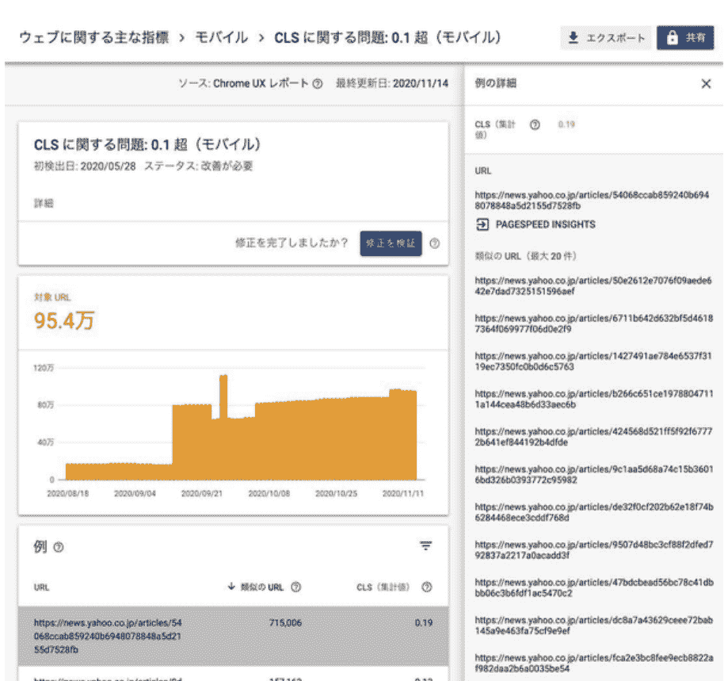

## 第 V 部分。网页性能的未来

OceanofPDF.com

### 第 11 章。建立性能文化

抛开技术和指标不谈，持久的性能提升来自于正确的团队文化和流程。在本章中，我将讨论组织和团队如何确保性能在整个产品生命周期中保持优先——从而 UX 也是如此。作为曾在 Google 的大型团队中倡导性能的人，我将分享我的见解，如何让速度成为各层面的对话内容。

一个重视性能的文化自然会产生更好的 UX。这是一种在每一步都关心用户时间和体验的态度。当从工程到设计再到管理的所有人都达成共识，“快是产品身份的一部分”时，结果将在最终的 UX 中体现出来。维持优化的收益需要一个性能意识的文化和在一段时间内规范第三方使用的流程。在本简短章节中，我将讨论团队如何将良好实践制度化、监控性能、避免回归，并确保在整个产品生命周期中优先考虑性能和 UX。

### 将性能作为一项功能

采用以用户为先的性能思维可以推动项目产生积极变化。这并不总是容易——有时需要说服同事或重新思考现有实践——但在用户满意度和业务成果方面的回报是值得的。

一种思维转变是将性能视为*具有用户价值的功能*，而不仅仅是一个技术细节。问问自己：这次优化是否真正以用户为中心？它是否服务于真实用户的需求和限制，还是仅仅是技术上的完美主义？将用户置于性能决策的中心，确保你的努力转化为他们体验的有意义的改进。这意味着，在规划项目或新页面时，明确将性能目标作为验收标准的一部分。例如，如果你正在构建一个新的结账流程，定义你的性能目标：“结账页面在中端移动设备上的 LCP 应低于两秒”，或“我们将力争 Lighthouse 性能分数至少为 X”。使这些目标明确化，就像可访问性、安全或任何其他功能要求一样，将其带入设计和开发团队的视野。在 Google，一些团队为关键页面的 Core Web Vitals（CWVs）改善设定季度目标与关键结果（OKRs）。这有助于他们为此投入资源，并表明领导层关心 UX 质量指标。

如果出现设计精美但极其沉重的方案，工程师应有权提出异议并找到更平衡的替代方案。同样，产品经理也应理解，更快的网站可以直接改善关键绩效指标，正如你在本书中看到的那样。在向领导层、产品经理或其他利益相关者提出优先考虑性能工作的理由时，将其定位为直接影响用户满意度和业务指标的增长或质量投资，而不仅仅是技术清理。

### 教育和装备团队

在 Chrome 和 CWV 上的工作教会了我，性能中的最小细节都可能对用户产生巨大连锁反应。看到技术改进转化为人们拥有更好的日子是令人满意的，即使只是以小方式，比如节省他们的时间或防止挫败感。这就是性能工作有意义的原因。我鼓励你为通过更快的体验让用户生活变得更轻松而感到自豪。分享成功案例可以强化工作的价值，并保持每个人维持纪律的动力。

除了教育之外，至关重要的是为你的团队配备构建高性能体验所需的正确工具和资源。这包括提供性能监控工具的访问权限、创建为速度优化的可重用组件库，以及建立关于性能最佳实践的清晰文档。现代 AI 驱动的工具可以显著加速这一过程。例如，像 GitHub Copilot 这样的 AI 编码助手可以帮助开发人员通过建议优化模式、实时识别性能反模式，甚至生成性能导向的测试来编写更高效的代码。AI 驱动的代码审查工具可以自动在代码合并前标记潜在的性能问题，例如不必要的庞大 bundle 大小、低效的渲染模式或阻塞脚本。同样，AI 驱动的性能分析工具可以通过分析用户行为模式并基于真实世界数据提出有针对性的改进建议来帮助识别优化机会。通过为你的团队配备这些现代工具——既有传统的性能监控解决方案，也有 AI 增强的开发辅助工具——你使他们能够更高效地构建更快的体验。

为了让整个团队参与进来，分享真实的用户反馈或会话录制，突出缓慢性能的影响。例如，如果用户测试会话显示人们对缓慢的原型感到沮丧，就向利益相关者展示这一点——同理心可以推动改变。有时分享一份性能预算文档也能大有帮助。考虑为设计师和内容撰写人员也举办一次简单的网页性能培训课程：如果你教他们上传超高分辨率图像会损害移动用户，他们就会知道从一开始就考虑优化此类资源。

营销人员尤其有动力添加新的第三方代码，但往往只是不知道技术选项或相关问题，因此弥合这一差距并帮助他们理解。文化上，可能需要接受某些第三方功能为了更大的利益而被移除。这需要领导层的支持，必须向他们展示数据，证明性能改进（导致更多用户参与或转化）超过了该功能的收益。泰晤士报——一家英国报纸——发现教育非技术利益相关者了解每个标签如何减慢其网站并让他们合作决定至关重要

重新设计。没有警惕，很容易让性能随时间退化。这里有一个未优化的图片，那里有一个新脚本，突然一切变慢了。

我还建议定期安排性能审计——也许每隔几个月一次。把它想成一次“调优冲刺”。使用 WebPageTest、Lighthouse 或你正在使用的任何其他工具进行深度分析，并向团队传阅一份报告，突出第三方脚本行为的任何变化。如果你注意到来自 Vendor X 的营销标签现在比上个月多花了 100 ms，团队中的某个人可能会意识到某个更新使其变慢了，你可能会联系供应商或考虑替代方案。

要量化你的第三方脚本的性能成本，请使用 WebPageTest 的 filmstrips 功能比较有和没有它们时你网站的性能。在与利益相关者的会议中展示这种视觉证据会非常有力。

### 将性能集成到你的 CI/CD 流程和工作流中

保持良好的性能比失去后重新获得要容易得多。行业中有一个真理，你可能会听到人们引用：“在设计阶段修复性能比产品发布后修复更便宜。”通过在代码审查或自动化测试中捕获问题，你可以避免以后昂贵的重构。现代 AI 工具正使这一过程变得更加有效：AI 驱动的代码分析可以在代码部署之前预测性能影响，自动建议优化，甚至根据用户行为模式生成性能测试用例。一些团队正在尝试 AI 代理，它们持续监控代码库，并根据代码库中出现的模式主动建议性能改进。将性能测试集成到你的 CI/CD 流程中，这样就不会有人意外合并导致性能大幅下降的东西而团队却没有注意到。这可能包括：

- 如果使用 Lighthouse CI，请包含“Reduce third-party impact”审核，并将其设置为在分数下降或检测到特定重型第三方使用时失败。
- 创建自动化测试以阻止常见错误：例如，一个扫描 HTML 中任何没有 `async/defer` 的 `<script>` 并使构建失败的测试，以确保没有人意外引入阻塞脚本。
- 维护允许的第三方域列表。如果有人添加来自新供应商或域的脚本，则触发审查。像 SpeedCurve 和 Calibre 这样的工具可以解析测试运行的网络请求并将其与白名单进行比较，自动标记未经授权的第三方域。

另一个有效的文化实践是建立第三方脚本的治理政策来支持你的性能预算。这意味着创建关于允许哪些类型的第三方脚本以及在什么条件下允许的指南：也许脚本必须支持异步加载或不得超过 X KB。通过制定此类指南，团队成员学会评估添加任何重要第三方脚本或库的成本。

还值得考虑要求开发人员在添加新的第三方脚本之前获得审查和批准。一些公司设有“标签审查委员会”或要求开发人员提交请求以添加新脚本，解释其必要性并衡量其对性能的潜在影响。这鼓励团队默认进行尽职调查，而不是临时纳入。

让团队养成向第三方提供商询问是否可以提供性能优化选项的习惯。例如，一些分析解决方案允许采样，减少脚本在每个用户上运行的数量。广告网络可能为某些位置提供更轻的标签或新的异步版本。如果脚本特别有问题，请联系供应商的支持团队。团队可能有最佳实践或替代集成模式，例如 webhook 或服务器端 API。如果你不问，就不会知道。

### 利用 AI 推动性能文化

随着 AI 不断改变我们构建和优化 Web 应用的方式，它也在改变团队如何对待性能文化。现代 AI 驱动的工具可以帮助在你的团队中普及性能专业知识，使各个技能水平的开发人员更容易构建快速体验。

AI 编程助手可以在开发过程中充当“性能导师”，提供优化机会的实时建议。例如，当开发人员编写可能影响性能的代码——例如低效的循环、React 中的不必要重渲染或阻塞操作时——AI 工具可以立即标记这些问题并建议更好的替代方案。这种持续的反馈循环有助于开发人员在代码审查或部署后才发现问题之前，有机地学习性能最佳实践。

AI 还可以帮助性能监控和警报。机器学习模型可以为正常性能模式建立基线，并自动检测可能表明退化的异常。与设置静态阈值（可能很脆弱）不同，AI 驱动的监控可以适应你网站的自然模式，并且只有在真正异常的情况下才会提醒你。这减少了警报疲劳并帮助团队专注于真正的问题。

此外，AI 工具可以通过分析用户行为数据来帮助确定性能工作的优先级，以识别哪些优化将产生最大影响。通过了解用户访问最多的页面、他们在何处遇到摩擦以及用户群中最常见的设备类型，AI 可以帮助你更有效地分配资源。这种数据驱动的方法使向利益相关者证明性能投资变得更容易。

然而，重要的是要记住 AI 是一种增强人类判断的工具，而不是取代它。性能文化仍然需要人类领导、清晰的沟通和组织的承诺。AI 可以提供洞察和自动化，但建立真正重视性能的文化需要关心用户体验并在必要时愿意做出艰难权衡的人。

### 结论

Web 技术总是在不断发展。我们将不断获得新的模式、设备、网络基础设施和指标，但用户始终更喜欢更快、更响应的体验。目标是相同的：最小化等待。无论工具如何，你的心态应该是从用户最佳利益出发。

性能是一段旅程，而不是目的地。就像 UX 工作一样，你会不断收集反馈并改进。我们建议通过例如定期以慢速手机用户的方式体验你的网站来保持以用户为中心（像在 DevTools 中限制你的网络或在 100 美元的 Android 设备上使用你的网站这样简单的事情可能会令人大开眼界）。

最好的技术之所以成功，是因为它们服务于人，而不是相反。通过以关注 UX 为起点——其中速度、响应性和稳定性是首要考虑——然后实施技术来实现它，你将构建更好的产品。

Web 可以是一个触及每个人的精彩平台，但只有当我们关心使用它的 *感受* 时才行。所以让我们构建一个对每个设备和连接上的用户都快速、响应迅速且令人愉悦的 Web。当你将性能作为 UX 的一部分来优先考虑时，你就是在尊重用户的时间并使他们能够做更多事情，而这最终是任何产品的目标。

### 第 12 章. Web 性能案例研究和成功故事

理论和技术至关重要，但看到原则在实践中应用可以提供宝贵的背景和动力。本书的这一最后部分从 *如何* 优化转向 *当你这样做时会发生什么*。我将探讨来自 2020 年代上半期的现实案例研究集合，涵盖电子商务、媒体、旅游和金融等不同行业。

每个案例研究都考察了公司如何识别性能瓶颈（通常与 Core Web Vitals 相关），实施了本书记述前部分讨论的具体优化策略，并衡量了由此产生的影响——不仅是技术指标，还包括转化率、用户参与度和收入等关键业务成果。这些故事突出了投资 Web 性能的切实好处，并为你自己的优化工作提供了实用灵感。表 12-1 提供了高层次的总结。

每个案例研究都包括网站概述、目标的 Core Web Vitals（CWV）和其他指标（尤其是 LCP、CLS 和 INP）、组织实施的技术策略以及取得的业务成果。重点在于深入的生产级优化如何产生切实的用户体验和业务改进。

表 12-1. 按垂直领域划分的案例研究摘要

| 垂直领域 | 公司/网站 | 提升的指标 | 关键优化 |
|---|---|---|---|
|  | Vodafone（电信电商） | LCP（5.7 s → 3.9 s，31%更快）；DCL（+15%）ᵃ | 重点通过 A/B 测试改善关键落地页的 LCP。主要变更包括将客户端渲染的小部件移至 SSR 并优化图片。 |
|  | Carpe（D2C 护肤） | LCP（−52%）；CLS（−41%）；TTFB（−1.5 s） | 解决了懒加载问题，将转换的背景图片改为  标签以便预加载，并添加了 fetchpriority="high"。Carpe 还优化了服务器端 liquid 模板逻辑。 |
|  | Sunday Citizen（Shopify D2C） | LCP（−25%）；CLS（−61%）；FCP（−0.3 s） | 预加载英雄图片，移除首屏上方图片的懒加载，并确保使用响应式图片格式。公司还为导航和轮播元素预留空间以修复 CLS。 |
|  | Swappie（翻新手机） | LCP (-55%)；CLS (-91%)；FID (-90%) | 对 CWV 进行全面改造，重点关注移动性能。 |
|  | Ray-Ban（奢侈零售） | （页面预渲染） | 利用 Speculation Rule API 预渲染关键页面以预测用户导航。 |
| 媒体/出版 | *Economic Times*（新闻） | LCP（4.5 s → 2.5 s）ᵇ；CLS（0.25 → 0.09） | 通过延迟非必要脚本并优先加载英雄图片和文章内容来优先处理关键资源。*Economic Times* 还优化了字体，使用了 Brotli 压缩，并实施了 CDN 缓存。 |
|  | Yahoo! JAPAN News | CLS（改善 0.2） | 通过为图片和广告添加占位符和明确尺寸，识别并修复了文章页面的布局不稳定问题。 |
|  | iCook（内容/食谱） | CLS（−15%） | 预留图片槽位并优化广告嵌入的时机以避免位移。 |
| 旅行/酒店 | redBus（在线票务） | INP（关键页面 −72%）；TTI（更快） | 通过在本地管理表单状态，减少搜索输入的昂贵 JavaScript 工作。redBus 还通过更早触发下一批加载并获取更小的数据块来优化无限滚动。 |
|  | Bookaway（旅行预订） | LCP（p75 −15%）；TTFB（2.0 s → 1.24 s） | 迁移到使用 CDN 上 Stale-While Revalidate 缓存的静态预渲染页面。 |
|  | TUI（旅游） | 加载时间（−78%） | 培养公司范围内的性能关注和跨团队协作以精简页面 |
| 社交/社区 | Yelp（本地评论平台） | FCP（3 s → ~1.5 s）；TTI（大幅减少） | 在新广告功能使加载时间翻倍后引入性能预算。Yelp 通过改进服务器响应并消除渲染阻塞资源来优化关键渲染路径。 |
|  | Trendyol（电商市场） | INP（产品列表 −50%） | 专注于大型 React 应用中的运行时交互性能，通过优化组件性能并利用现代浏览器功能。 |
| AI/ML | Vercel（平台） | LCP（−20% 至 −35%） | AI 驱动的图片优化，可根据 ML 模型自动选择格式、压缩级别和响应式断点。 |
|  | Cloudflare（CDN） | TTFB（−15% 至 −25%） | ML 驱动的预测缓存和智能流量管理，以预热边缘缓存。 |
|  | Shopify AI（平台） | LCP（−18%） | AI 驱动的性能分析，优先推荐并为商家商店提供一键自动修复。 |

a DCL = DOM content loaded。在 Vodafone 的案例中，由于将小部件移至 SSR，DCL 略有增加，但 LCP 显著改善。

### Vodafone：更快的落地页，更高的销售额

电信公司 Vodafone 的电商团队与 Google 合作改善关键落地页的 LCP，使用 A/B 测试来衡量变更的业务影响。

##### 问题

目标页面的 LCP 约为 8.3 s，远高于 2.5 s 的“良好”阈值。

##### 优化

Vodafone 团队将重型客户端渲染小部件移至服务器端渲染。服务器端渲染关键 HTML 以实现更快的初始绘制。团队还通过调整大小和压缩文件来优化图片，并使用 CSS 媒体查询避免加载屏幕外图片。

##### 结果

经过这些优化后，Vodafone 的 LCP 改善约 31%，从 8.3 s 降至 5.7 s。Vodafone 还看到：
- 销售额增长 8%
- “线索到访问”率跃升 15%，该指标衡量有多少网站访问者采取初始行动，如提交表单或开始报价请求
- “购物车到访问”率跃升 11%，该指标衡量有多少访问者在会话期间将产品添加到购物车

### Shopify 的商家商店：Sunday Citizen

Shopify 的网页性能团队已发布了多项改善独立商家商店的案例研究。我将在这里介绍其中两个商店：Sunday Citizen 和 Carpe。

Sunday Citizen 是一家制造和销售奢侈床上用品和休闲服的企业。

##### 问题

Shopify 团队发现 Sunday Citizen 的主横幅图片通过 CSS 背景进行懒加载，损害了 LCP 和 CLS。

##### 优化

为改善这些问题，Shopify 实施了多项修复，包括：
- 更早加载图片，将其从 CSS 背景中重构出来，改为使用标准的 HTML  标签
- 使用现代图片增强，例如对响应式加载应用 `srcset/sizes` 并对重要图片使用 `fetchpriority="high"`
- 稳定布局，为导航栏和产品图片库添加明确的图片高度和宽度或 CSS 最小高度

##### 结果

经过这些更改后，Sunday Citizen 看到改善：
- 其 LCP 下降了 1.1 s。
- 其 CLS 由于布局稳定化更改而显著改善，特别是为导航栏和产品画廊添加明确尺寸。
- 其转化率上升超过 6%。
- 跳出率下降 4%。

### Shopify 的商家商店：Carpe

另一家 Shopify 商家 Carpe 销售定制除臭剂和止汗产品。

##### 问题

Carpe 的网站 LCP 较高，TTFB 超过一秒，表明服务器端缓慢。

##### 优化

Carpe 的关键优化包括前端和后端的调整。

在前端，为解决 LCP 和 CLS，Shopify 团队：
- 移除不当的懒加载
- 将 CSS 背景图片转换为正确的  标签

在后端，为解决 TTFB，Shopify 团队：
- 减少 Carpe 主题代码中序列化的數據
- 添加缓存层

##### 结果

因此，Carpe 的 TTFB 下降约 1.5 s，其 LCP 下降约 2.5 s。业务方面，它看到：
- 转化率增长 5%
- 有机流量增加 10%
- 总收入增长 15%

### Ray-Ban：预渲染

在 2025 年，太阳镜品牌 Ray-Ban 的工程团队在浏览器中实施了新的 Speculation Rules API，以预渲染团队预测用户可能下一步点击的页面。

##### 问题

Ray-Ban 的电商网站存在典型的导航性能挑战：用户浏览产品列表时，点击进入产品详情页时会遇到明显延迟。每次页面转换都需要完整页面加载，包括获取 HTML、CSS、JavaScript 和高分辨率产品图片。购物旅程中的这种摩擦意味着潜在客户有时会在找到想要的产品之前放弃浏览会话，直接影响转化率和收入。

##### 优化

通过在后台预渲染下一页，例如当用户在分类列表页时预渲染产品详情页，Ray-Ban 团队确保如果用户点击，页面几乎瞬间加载。

##### 结果

该技术先进，需要谨慎的逻辑以避免错误猜测，但效果显著：Ray-Ban 报告称，在启用预渲染的页面上其转化率翻倍，退出率下降 13%。

本质上，体验近乎即时转换的用户比等待页面加载的用户更有可能完成购买。此案例是尖端示例，说明即使最后几百毫秒也能极大地改善电商中的用户行为，尤其是在使用现代平台功能时。

### 新闻和媒体：以速度提升参与度

在线新闻和媒体网站面临在丰富内容（图片、视频、广告）和性能之间取得平衡的挑战。它们通常为数百万用户提供服务，因此速度的小幅提升可产生巨大的总体效果。以下研究展示了几家媒体公司如何大规模改善其网站的 CWV，从而带来更长的读者会话和更低的跳出率。

#### The Telegraph Media Group

我在这本书中多次提及 *Telegraph* 的历程。简单来说，*Telegraph* 是一家主要的英国新闻出版商，它启动了一个项目来改善网站性能，重点关注用于广告和分析的第三方脚本。

#### Problem

*Telegraph* 发现其自有的第一方代码仅占页面加载期间请求的约 5%。绝大多数请求来自用于广告、分析、社交媒体集成和其他服务的第三方脚本。这些第三方不在团队的直接控制之下，但对网站的加载性能产生了显著的负面影响。挑战还在于组织内不同的团队负责与不同的第三方供应商的关系，使得协调变得困难。

#### Optimizations

*Telegraph* 工程师 Gareth Clubb 强调，最初，团队自身的代码优化仅影响了约“5% 的请求”。其余都是超出其直接控制范围的第三方。这一认识促使 *Telegraph* 工程团队将重点转向更广泛的组织参与。团队创建了一个性能特遣队，并设法延迟了几乎所有第三方脚本。

#### Results

不仅网站速度有所改善，而且 *Telegraph* 的业务指标并未受损。事实上，其案例研究观察到，“我们可以有信心地说，延迟我们的 JavaScript 并没有扭曲任何现有分析，也绝对没有延迟任何广告。通过在广告代码中使用自定义性能标记，延迟 JavaScript 并减少包大小，First Ad Loaded 指标平均提高了四秒。” 这是对加快网站速度不会损害广告收入的有力验证；它可能极大地改善了用户参与度，以至于所有内容仍然可以正常追踪。

*Telegraph* 的方法将技术上的延迟与跨团队协作相结合，以定期审查标签。这是一个文化和技术齐头并进取得成功的典型例子。

#### The Economic Times: Passing CWV at Scale

*Economic Times*（ET）是印度最大的新闻网站之一。

#### Problem

在 2021 年，ET 的许多页面未能通过 Google 的 CWV 标准，这可能会对其搜索排名造成不利影响。ET 的页面内容丰富，并包含广告和社交嵌入等第三方元素。最初，只有约 62% 的页面浏览量处于“良好”的 CLS 范围；约 26% 为“差”（CLS 超过 0.25）。LCP 在第 75 百分位约为 4.5 秒，也很差。团队确定缓慢的服务器响应、未优化的字体和延迟加载的广告是主要问题。

#### Optimizations

在九个月的时间里，ET 的开发团队对网站性能进行了全面改造，包括：

##### Optimizing server response (TTFB)

ET 切换到更快的 DNS 提供商，并在前端模板中添加了缓存层（使用 Redis），以便重复访问或高流量激增时可以从缓存中提供服务，而无需每次都访问源服务器。

##### Putting “critical requests first”

ET 在加载序列中优先考虑关键的 above-the-fold 内容。这涉及延迟初始渲染不需要的脚本，例如分析和 below-the-fold 小部件，以及使用 `<link rel="preload">` 为关键资源（如大图像和关键 CSS）预加载。ET 还通过尽可能打包来减少并发请求的数量，因为浏览器一次只能处理这么多请求。

##### Switching the font-loading strategy

文本渲染因自定义网络字体而延迟。通过将默认 `font-display:auto` 改为 `font-display:swap`，团队允许文本立即以系统字体显示，然后在准备好时切换到自定义字体。这消除了空白文本闪烁，并使内容更快可读，从而改善了 LCP 和 CLS（因为延迟的字体交换可能会导致布局偏移）。

##### Using Brotli compression

在服务器端，ET 团队将文本资产的压缩从 GZip 切换到 Brotli。Brotli 使 JavaScript、HTML、CSS 和字体文件减小了 15% 到 18%，从而减少了下载时间。

##### Preconnecting strategically

团队审计了第三方域名，并为始终需要的域名添加了 `<link rel="dns-prefetch">` 或 `preconnect`。这节省了建立网络连接的宝贵时间。然而，团队谨慎地仅对肯定会使用的域名使用 preconnect，以避免浪费资源。

##### Code splitting and deferring scripts

ET 团队将其 JavaScript 包拆分为更小的块，仅加载初始内容所需的内容，并将剩余内容延迟到以后。ET 还延迟了任何未使用的脚本；例如，重型分析或幻灯片脚本在主要内容之后加载。

##### Reserving space for ads and embeds

ET CLS 问题的主要来源是广告加载并推动内容，因此团队为广告位和其他嵌入容器创建了带尺寸的样式占位符，以防止布局跳动。

##### Adding explicit image dimensions

与广告类似，ET 为所有图像和视频容器添加了明确的宽度和高度属性或 CSS。这对于消除文章页面上许多内联图像逐步加载时的累积偏移至关重要。

##### Optimizing long tasks (FID/INP)

虽然主要关注点是 LCP 和 CLS，但团队还拆分了长时间的 JavaScript 任务以改善交互性（FID）。团队使用了诸如 requestIdleCallback 和将重型循环拆分为更小块等技术。团队在可能的情况下将第三方脚本的加载延迟到用户交互之后，例如延迟加载社交分享按钮。团队还延迟加载 below-the-fold 广告，以便主线程不会在用户尝试交互时被广告加载占用。最后，团队修剪了旧浏览器的 polyfills 以减少 JavaScript 负载。

#### Results

到 2021 年 7 月，ET 已取得了实质性的性能改进：

- 用户参与度指标大幅改善：ET 报告称更改后整体跳出率降低了 43%。换句话说，远 fewer 用户登陆页面后立即离开——可能是因为页面现在加载速度快且没有令人不安的偏移，鼓励用户留下阅读。
- LCP“差”情况下降了 33%，平均 LCP 改善了约 80%，从 p75 的 4.5 秒降至 2.5 秒。
- CLS“差”情况下降了 65%（从 25.9% 的会话降至仅 9%），平均 CLS 从 0.25 降至 0.09，改善了 90%，使该指标完全处于“良好”区域。
- 内部，团队还注意到每次会话的页面数和网站停留时间有所改善。更流畅的体验，尤其是在移动设备上（网络较慢），使读者在网站上停留更长时间。
- 因此，整个网站都通过了所有 CWV 阈值，这对 ET 的 SEO 和 Google 的页面体验更新来说意义重大。

*Economic Times* 的案例表明，通过从整体上解决性能问题（网络、服务器和前端），即使是大型新闻网站也能实现快速、类似应用的性能，并在用户留存方面获得回报。

#### Yahoo! Japan News: Correlating CLS Fixes to Engagement

Yahoo! Japan News 是日本最大的新闻平台之一，每月约有 220 亿次页面浏览。通过修复文章页面的 CLS 问题，公司看到了明显的改善：每次会话的页面浏览量上升 ~15%，会话时长上升 13%，跳出率下降。

#### Problem

通过持续监控，团队注意到 CLS 不佳的页面正在损害用户参与度。使用 Google Search Console 的 CWV 报告，Yahoo 的工程师确定文章详情页模板经常处于 CLS 的“差”区间（图 12-1）。Yahoo 然后使用 Lighthouse 的 CLS 审计（“Avoid large layout shifts”）来查找哪些 DOM 元素在移动。这揭示了某些组件——具体来说是文章标题区域和文章内的广告位——导致了显著的偏移。

Yahoo 还使用 web-vitals JS 库对网站进行仪器化，以在现场测量 CLS 并查看偏移在页面生命周期中发生的确切时间（包括用户滚动触发的偏移）。这种工具组合提供了完整的图景：主要罪魁祸首可能是未预留空间加载的图像或广告。

图 12-1. Google Search Console CWV 报告显示 CLS 状态细分，URL 被归类为良好、需改进或较差，展示了雅虎团队如何识别出有问题的页面模板

##### 优化

根据雅虎的工程博客，团队实施了几项有针对性的修复措施：

- 团队为文章中的所有图片添加了宽度和高度属性或 CSS 宽高比。对于文章头图和内联内容图片，团队确保在图片加载前布局已分配空间，从而消除了图片出现时的位移。

#### 防抖状态更新

团队更改了输入字段逻辑，使其不再在每个字符输入时更新全局状态。相反，团队将输入文本保存在本地，仅在“失焦”（blur）时（用户完成输入或离开字段时）才将其推送到 Redux store。这消除了大量中间渲染。通过“减少调用 reducer 的频率”，团队在用户仍在输入时避免了大型结果列表的不必要重渲染。基本上，输入变得流畅了。

#### 优化无限滚动

redBus 不再等到用户滚动到最底部才开始操作，而是提前在用户位于倒数第二张卡片时预取下一批结果。这样，新结果在用户到达时已准备就绪，避免了长时间等待。redBus 还将每次获取的批次大小从 30 条结果减少到 10 条结果。更小的块意味着内容可增量添加，每次延迟更少，JavaScript 工作量也更少。

#### 减少加载期间的布局抖动

尽管 redBus 并未明确说明，但该公司很可能还确保添加新结果时不会使页面内容异常位移，通过在加载指示器出现时保持一致的容器高度来实现。

##### 结果

实施这些更改后，redBus 报告了显著的改进：

- 搜索页面的 INP 提高了 72%。例如，实验室测试的 INP 从约 344 毫秒（需改进）下降到优化后约 96 毫秒（优秀），响应性大幅提升。
- 整体销售额在改进后增加了约 7%：更快速、更流畅的搜索意味着更多用户能够在没有挫败感的情况下找到并预订机票。

此案例强调了交互性的重要性，而不仅仅是加载速度。虽然之前的案例侧重于加载和布局，但 redBus 表明，如果你的网站具有交互性（大量用户输入、无限滚动等），优化 JavaScript 和输入处理以提高响应性可以带来显著回报。

#### Bookaway：通过静态内容服务全球受众

Bookaway 是一家面向全球用户的国际旅行预订服务。

##### 问题

最初，Bookaway 的网站内容（包含大量列表和搜索结果）是为每个请求动态生成的。但来自世界各地的用户，许多人远离源服务器，由于网络延迟和后端处理，看到的 TTFB 很高。单个用户的体验在首次页面加载后可能尚可，但冷启动很慢。Bookaway 团队在 2023 年审计了其 CWV，并决定主要通过利用缓存和 CDN 来专注于改善 LCP 和 TTFB。

##### 优化

Bookaway 团队实施了使用 stale-while-revalidate 来提供预生成页面并采用静态内容交付方法的策略：

- 团队使用 AWS CloudFront（全球 CDN）从边缘位置提供页面。用户无需每次都访问 Bookaway 服务器，大多数用户会从附近的边缘获取缓存的 HTML 页面。
- 团队通过 stale-while-revalidate 缓存提前生成页面或在首次请求时生成。如果页面尚未更新，CDN 会立即提供可能过时的缓存版本（这样用户无需等待），同时触发后台更新获取以刷新缓存。下一个用户将获得更新后的内容。这对于不需要绝对实时更新的页面非常理想。
- 通过这样做，团队减少了重复访问时的服务器处理量，并利用了地理分布。
- Bookaway 还使用 Next.js 仪器化设置了严格的监控。Bookaway 将数据导入 BigQuery，并在 Looker 中可视化以持续跟踪性能。这帮助 Bookaway 发现了诸如“长尾”页面等问题（Bookaway 有约 70 万个页面，涵盖七种语言，其中一些很少访问），表明 Bookaway 的缓存策略不应尝试预渲染所有内容，而应使用按需缓存来处理这种规模。

##### 结果

这些优化产生了显著效果：

- TTFB 下降近 38%：平均从 2 秒降至 1.24 秒。
- LCP 提高了约 15%。本质上，页面的首字节和首次绘制速度更快，尤其对远距离用户而言。亚洲的读者现在从新加坡缓存获取内容，而非美国服务器。
- Bookaway 的 79% 页面现在提供了良好的页面体验（从之前可能远低于此的水平提升）。
- 尽管他没有引用确切的转化数字，Bookaway 的网络负责人 Liran Cohen（撰写该案例研究的人）报告了 SEO 排名的改善，并有信心更好的 LCP 有助于增加自然流量。

此案例展示了 CDN 边缘缓存和静态渲染对于动态网站的强大作用。通过采用略微更静态的架构（即使只是缓存 HTML 一段时间），你可以大幅改善每个人的加载时间，而不会显著牺牲内容新鲜度。它还展示了前瞻性地采用 stale-while-revalidate 缓存模式，这种缓存模式正变得越来越流行，以实现性能和最新内容之间的平衡。跨区域更流畅的体验意味着 Bookaway 可以为例如在拉丁美洲预订亚洲行程的用户提供服务，摩擦更少。对于全球服务而言，这至关重要。

在旅游业中，每多一秒都可能导致用户流失到竞争对手或在线旅行社（OTA）。因此，许多旅游网站现在正在设置性能预算和监控，以确保新功能不会导致其 CWV 退化。正如德勤的“Milliseconds Make Millions”研究指出，削减旅行网站在竞争市场中 100 毫秒的加载时间，可将转化率提高 0.5% 至 1%。在规模上，这非常巨大——想象一下，航空公司仅通过优化图片和代码就能在全球范围内将预订量提高 1%！因此，旅游公司越来越多地将性能视为其预订平台的首要功能。

#### 金融与金融科技：以速度建立信任

金融科技（fintech）平台，如个人理财工具或银行应用，通常处理复杂数据并必须确保高度安全。有时这些需求会与性能相冲突，因为网站通常使用大量脚本进行加密或用于合规的重型分析。但金融科技用户与其他用户一样，对快速、响应迅速的界面反应良好。速度还能建立可靠性感知，这在金融领域至关重要。

#### Financer.com：加速 WordPress 以提升转化和 SEO

Financer.com 是一个全球个人理财网站，允许消费者在 26 个国家比较贷款和信用卡。

##### 问题

Financer 团队在其 WordPress 设置中遇到了性能问题。团队曾尝试自定义编码优化，但这些优化随着时间推移变得难以维护，且过时并导致冲突。

##### 优化

2021 年，Financer 转向使用性能插件 WP Rocket，并迅速应用了一套最佳实践。这些包括：

- 为回访用户提供缓存的 HTML 页面
- 根据需要通过 WP Rocket 压缩、合并和延迟加载 CSS 和 JavaScript 文件
- 延迟加载图片和 iframe 以推迟折叠线以下内容
- 通过清理瞬态等优化 Financer 的 WordPress 数据库

##### 结果

使用工具快速实施这些标准优化，释放了 Financer 开发人员专注于网站定制需求的时间。团队取得了显著的转变：

- Financer 的移动 PageSpeed Insight 分数从约 40 跃升至 90 以上，接近完美的 PSI 分数，表明关键页面的 LCP/FID/CLS 非常低。
- 转化率增加了 45%。
- 同比收入增长了 110%。

页面加载速度大幅提升后，Financer 实现了显著的业务增长。转化率提升 45% 意味着更多访客最终完成了期望的操作，也许是点击合作伙伴链接或注册。同比收入增长 110% 非常巨大。虽然不能将所有增长都归功于性能（市场因素、营销等

其他方面也起作用），Financier 明确将这些性能提升与更好的 SEO（更多自然流量）和更好的 CRO（转化优化）联系起来。

值得注意的是，更快的网站速度很可能改善了 Financier 的 SEO 排名，因为 Google 的页面体验更新和整体网站质量信号会让 PSI 评分 90+ 的网站优于竞争激烈的细分市场中评分 40 的网站。这会带来更多自然访客，而在以联盟营销为主的金融科技领域，这直接影响收入。

Financier 的案例表明，使用现有的优化技术而不是重新造轮子是值得的。你并不总是需要大规模的工程投入：通常，利用经过验证的解决方案，如缓存插件或 CDN，就能让你达到快速网站的 80%，并获得重大收益。本案例还强调了性能是增长杠杆：改善 CWV 既能提升 SEO 又能提升转化指标，而在金融这样竞争激烈的市场中，这可以转化为数百万美元的收入。

#### AI 与性能：新兴的成功案例

随着人工智能越来越多地融入网页开发和优化工作流程，一类新的案例研究正在涌现。这些故事既突出了 AI 生成代码的挑战，也展示了 AI 驱动工具在改善网页性能方面的机遇。

#### Vercel：大规模 AI 驱动的图像优化

Vercel，即 Next.js 背后的公司，已在托管其平台上数百万个网站时率先使用 AI 进行自动图像优化。

- 随着浏览器支持的扩展，自动适应新图像格式，无需开发人员干预

本案例展示了 AI 如何比手动流程更一致地处理重复的优化任务，同时基于真实世界的反馈持续改进。

#### Cloudflare：机器学习用于性能预测

Cloudflare 已将机器学习集成到其 CDN 和边缘计算平台中，以预测并预先优化内容交付。

##### 问题

传统的 CDN 缓存依赖于静态规则和基于时间的过期。这种方法通常会导致本可预缓存的内容出现缓存未命中，从而导致首次访问页面的用户 TTFB 变慢。此外，如果 CDN 未能预测需求，源服务器在流量高峰期间可能会不堪重负。

##### 优化

Cloudflare 实施了 ML 驱动的预测缓存和流量管理：

*预测性预缓存*

机器学习模型分析历史流量模式，预测哪些页面将被请求，并在流量到达前预热边缘缓存。这对于突发新闻驱动突然流量的新闻网站尤其有效。

*智能机器人检测*

AI 区分合法用户和机器人，确保性能优化优先考虑真实用户，同时防止机器人流量降低缓存效率。

##### 自动性能调优

系统学习每个网站的最佳设置，自动根据测量的性能改进调整压缩级别、HTTP/2 优先级和早期提示。

##### 结果

利用 Cloudflare AI 驱动功能的网站报告：

- 由于缓存命中率提高，TTFB 降低了 15% 至 25%
- 流量高峰期间性能更稳定，第 99 百分位加载时间最多改善 40%
- 源服务器负载降低，使网站无需基础设施升级即可处理三到五倍的流量

#### Google Chrome：AI 辅助推测规则

在 Ray-Ban 案例研究中展示的推测规则 API 的基础上，Google 一直在开发 AI 驱动的预测系统，以自动确定要预渲染哪些页面。

##### 问题

虽然推测规则 API 提供了强大的预渲染功能，但实现有效的推测逻辑需要分析用户行为模式、管理设备上的内存限制，并在错误猜测的成本与正确猜测的好处之间取得平衡。大多数开发团队缺乏实施最佳推测策略所需的分析和专业知识。

##### 优化

Google 的方法使用机器学习来：

- 分析数百万个网站的点击模式，以识别常见的导航行为，例如搜索结果页面
几乎总是会点击结果。
- 构建预测模型，根据当前页面上下文估计每次可能下一步导航的概率。
- 通过限制对内存受限设备的推测，自动管理资源使用。
- 从聚合的匿名用户交互数据中学习，随着时间的推移改善预测。

这种 AI 驱动的推测正在集成到 Chrome 中，可以与开发人员定义自定义的站点特定规则一起使用。

##### 结果

早期实施显示：

- 启用 AI 驱动推测时，多达 30% 至 50% 的导航成功预渲染
- 预测导航的页面切换几乎瞬间完成，对于这些页面加载，LCP 实际上降为零
- 浪费的资源最少，因为 ML 模型预测下一次导航的准确率超过 80%

#### AI 编码助手：性能警示故事

虽然 AI 为性能优化提供了机遇，但 AI 编码助手的快速采用也带来了新的性能挑战。多个组织分享了他们优化 AI 生成代码的经验。

##### 问题

一家大型电商平台发现，在其开发团队广泛采用 AI 编码助手后，其 CWV 评分开始退化。调查发现，AI 生成的代码虽然功能正确，但通常包含：

- 不必要的 npm 依赖项，导致包体积膨胀
- 增加 INP 的未优化 DOM 操作模式
- 缺少图像优化属性（宽度、高度、加载提示）
- 导致过度重新渲染的低效 React 组件结构

AI 助手主要针对正确性和功能进行训练，而非性能最佳实践，导致代码可用但未针对生产环境进行优化。

##### 优化

团队实施了几种策略来解决 AI 生成代码的性能问题：

- 创建针对 AI 助手的自定义提示和上下文，强调性能要求并包含团队的编码标准
- 将自动化性能测试集成到团队的 CI/CD 流水线中，以在部署前捕获退化
- 开发 AI 驱动的代码审查工具，专门标记生成代码中的常见性能反模式
- 建立 AI 辅助代码的性能审查清单，包括包大小分析和 CWV 影响评估

##### 结果

实施这些防护措施后：

- AI 生成代码导致的包体积增加了 60%。
- INP 退化在 95% 的情况下在部署前被捕获。
- 开发人员生产力保持高位，同时性能质量得到改善。
- 团队创建了反馈循环，根据审查中发现的常见问题改进其 AI 助手提示。

本案例凸显了虽然 AI 可以加速开发，但组织需要具备性能意识的流程，以确保 AI 生成的代码符合生产质量标准。

#### Shopify：AI 用于商家商店优化

Shopify 已开始使用 AI 自动识别并修复其托管商家商店中的性能问题。

##### 问题

Shopify 托管着数百万个在线商店，每个商店都有独特的主题、应用和内容。许多商家缺乏优化商店的技术专业知识，而 Shopify 的手动优化服务只能覆盖一小部分商店。性能差的商店转化率较低，这会影响商家和 Shopify 的平台经济。

##### 优化

Shopify 开发了一套 AI 驱动的性能分析和推荐系统，具有以下优化：

- ML 模型分析商店配置、主题代码和已安装应用，以识别性能瓶颈。
- AI 根据预测影响对优化机会进行排名，帮助商家专注于最重要的更改。
- 对于缺少图像尺寸或未优化首屏内容等常见问题，系统提供商家无需编码即可应用的自动修复。

- AI 分析 Shopify 应用对性能的影响，帮助商家做出明智的决策，选择安装哪些应用。

#### Results

与 AI 驱动的推荐互动的商家看到：

- 首月平均 LCP 提升 18%
- 实施推荐修复的商店转化率提高 12%
- 与手动审计相比，诊断性能问题所花费的时间减少 40%
- 随着开发者响应性能评分，应用生态系统质量得到改善

这些以 AI 为重点的案例研究代表了网络性能优化中一个新兴的前沿。随着 AI 工具变得更加复杂，我们可以预期会有更多组织利用机器学习进行从自动化代码优化到预测性内容交付等一切工作。这些早期采用者的关键洞见是，AI 在与明确的性能目标、强大的测量以及人工监督相结合时效果最佳，以确保自动化服务于用户体验而不是破坏它。

#### Key Takeaways

在所有这些垂直领域以及更多领域中，现实世界的性能改进带来更好的用户体验，进而推动业务成功。至关重要的是，这些案例研究并非关于简单的调整，而是关于系统性的、生产级别的变更：像 SSR 和静态缓存这样的架构转变，结合像优化图像、管理脚本加载和简化交互这样的细粒度前端调优。

从这些案例研究中涌现出一些共同主题和经验教训：

改善客户满意度，这在忠诚度、口碑等方面具有长期益处。例如，Yahoo! Japan News 发现使页面稳定后用户阅读量增加，这可能强化了公司使用该网站获取新闻的习惯。

#### Leverage tools and processes

Shopify 的团队使用了 WebPageTest，而 Yahoo! Japan News 使用了 Search Console 和 Lighthouse CI。利用 Lighthouse CI 进行自动化性能测试并设置性能预算，正在这些组织中成为标准做法，以防止回归。辉瑞的营销团队为新页面设定了严格的性能预算，并在遵守预算时看到跳出率下降 20%（如 Conductor 关于企业性能优化的案例研究中所述），这凸显了流程的重要性。

#### Conclusion

本章中的案例研究表明，网络性能优化在各个行业都能带来可衡量且显著的业务影响。从通过预渲染使转化率翻倍的电子商务网站，到通过 CWV 改进使跳出率降低超过 40% 的新闻出版商，证据很明确：更快、更稳定的网站直接转化为更好的用户参与度和收入。

这些成功案例也揭示了共同模式：衡量真实用户指标的重要性、跨职能协作的必要性，以及将性能视为持续实践而非一次性修复的价值。将性能嵌入其文化和工具的组织会随着时间的推移看到持续的改进。

在第 13 章中，我们将展望人工智能如何改变网络性能——从可能无意中引入性能问题的 AI 驱动开发工具，到有望将这些案例研究团队手动完成的大部分工作自动化的新兴 AI 驱动优化技术。这些现实世界的经验教训
