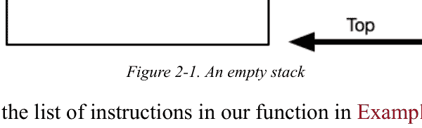
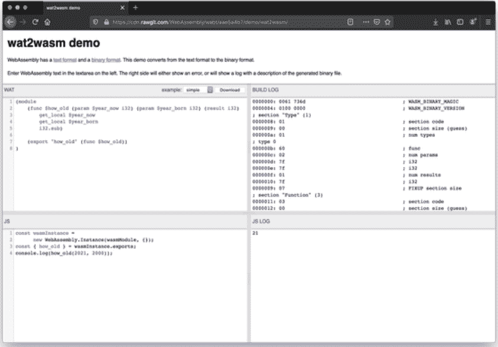

## Chapter 2. “Hello, World!” (Sort of)

### A NOTE FOR EARLY RELEASE READERS

With Early Release ebooks, you get books in their earliest form—the author’s raw and unedited content as they write—so you can take advantage of these technologies long before the official release of these titles.

This will be the 2nd chapter of the final book.

If you have comments about how we might improve the content and/or examples in this book, or if you notice missing material within this chapter, please reach out to the author at wasmbook@bosatsu.net.

> How does it, um-- how does it work?
> —King Arthur

Part of the difficulty in teaching people about WebAssembly is that there are many places to start. If they are a C/C++ developer, that might be a reasonable place to start the frame the discussion. If they are a Rust developer, that would be. But you can also talk about the mechanics of WebAssembly independent of the languages you use to generate it. In this chapter, I am going take that approach. We are going to learn low-level details incrementally over the next few chapters before we start to build up to the connection to higher level languages. These details will seem simplistic and confounding initially, but we are looking at the basic mechanisms which is ultimately not where you will be working. Let’s begin by considering why we cannot start where most programming books do.

In Chapter 1, I introduced the first program most people write in a new programming language or technology when I discussed asm.js. We call that

program a “Hello, World!” example in a nod to the first program used in Kernighan and Ritchie’s seminal book, *The C Programming Language*. Many quality programming books¹ begin with that example because it gives the reader a taste of what is going on without delving too far down into the details. It is fun, empowering and a good way to make sure the reader has her tools set up correctly.

### Example 2-1. The typical “Hello, World!” program as expressed in C.

```
#include <stdio.h>

int main() {
    printf("Hello, World!\n");
    return 0;
}
```

Unfortunately, WebAssembly has no way of printing to the console, so we cannot start that way.

Wait, what?

I will give you a moment to digest that sentence, perhaps re-reading it a few times to make sure it says what you think it says.

Convinced? Confused?

Yes, it is fair to say that there is no way for WebAssembly to print to the console, read a file or open a network connection… unless you give it a way to do so.

If you examine Example 2-1, you will get a hint about what the issue is. In order for that program to work, it needs a working copy of the printf() function which can be found in the standard library. Part of what makes C programs so portable, is the existence of standard libraries such as this on a variety of platforms. So-called *Portable Operating System Interface (POSIX)*² libraries extend these common features beyond printing to the console to include file manipulation, signal handling, message passing and more. An application will write to an API such as POSIX, but the executable will need either a static or a dynamic library that provides the behavior of the invoked methods suitable for running in the target platform.

This will be in the native executable format for the operating system you are planning to use.

This is why I say that WebAssembly makes code portable, but we will need something else to help us make applications portable. We will revisit this topic throughout the book, but for now it is enough for you to know that there is no direct way for WebAssembly to write to the console.

I promise you we will honor Kernighan and Ritchie in Chapter 5 by running that exact program. First, however, we are going to learn about a human-friendly format for WebAssembly and how the low-level instructions interact with the stack machine. I still want you to have a “Hello, World!” experience here, however, so we will pick something else to write and run that is not too challenging but still legitimate. It is “Hello, World!” (sort of).

## WebAssembly Text Format (Wat)

We have mentioned that the binary format (Wasm) is designed to make it faster to transfer, load and verify WebAssembly modules. We will introduce modules more formally in Chapter 3, but for now just think of them as units of deployment like libraries or Jar files in Java. There is also a text format that describes the behavior of a module that is easier for humans to read. While there is nothing stopping you from writing code in the text format by hand, you are unlikely to do so. This format is sometimes also referred to as Wast in writing but that was the original name. Many tools support both flavors and people often confuse the two. We will stick with Wat and its suffix of .wat.

In Example 2-2 we see a fully-formed, valid Wasm module expressed in Wat. This Lisp-like format has functions expressed via their signatures and a collection of stack machine instructions. The WebAssembly abstract machine is a virtual stack machine, a concept I will explain further below. Most compiled software is turned into the executable format of a particular hardware architecture. If you are targeting an Intel x86 machine, the behavior will be converted from a high level language into a series of instructions that will run on that chip. Without some kind of emulator, it

will not run anywhere else. Platforms such as Java and .NET have an intermediate byte code representation that will be interpreted by a runtime environment that has been ported to various platforms. WebAssembly instructions are more like that, but involve manipulation of a stack through a small set of instructions. Ultimately, these instructions will be mapped to a particular chip’s instructions when it executes in a WebAssembly host.

### Example 2-2. A simple WebAssembly text file.

```
(module
    (func $how_old (param $year_now i32) (param $year_born i32)
    (result i32) ①
        get_local $year_now
        get_local $year_born
        i32.sub)
    (export "how_old" (func $how_old)) ②
)
```

① The internal function $how_old

② The exported function how_old

The function shown here is called $how_old and it is not visible outside of this module until we explicitly export it. Note the name distinction. The internal name starts with a $. The exported version does not. It simply executes the inner function if someone calls it externally.

This module has one function defined that takes two integer parameters and returns another integer. As defined in the Minimum Viable Product (MVP) 3, WebAssembly is a 32-bit environment. That restriction is being relaxed over time as you will see. By the time this book is available, it is likely that 64-bit Wasm environments will be available in some form. That being said, WebAssembly supports 32- and 64-bit integers (known as i32 and i64) and 32- and 64-bit floating point numbers (known as f32 and f64). That is it.

At this level, there are no strings, objects, dictionaries, or other data types you would expect. Please do not worry, we will address how to overcome these issues later, but this is among the reasons why we are not doing a


典型的“Hello, World！”应用程序。这里没有字符串！在我们引入更多概念之前，处理数字要容易得多。因此，秉承这种编程风格，我们向你展示足够的内容以使其运行，而不会让你感到不知所措。

这个内部函数的目的是根据出生年份和当前年份计算某人的年龄。此时，你可能不会感到惊讶地听到 WebAssembly 没有日期的概念，也没有默认请求当前时间的能力。我预计你会想知道 WebAssembly 究竟能做什么！好消息是，它可以做数学运算。如果你提供当前年份和某人的出生年份，它绝对可以从一个中减去另一个并产生结果。请不要觉得失望，我们只是将事物隔离以明确清楚地说明系统的哪一部分提供了什么。

如你所知，栈是软件世界中一种方便且广泛使用的数据结构。它通常被描述为像自助餐厅里的托盘堆。工作人员会将干净的托盘放在其他托盘的顶部。顾客会从顶部取一个。

考虑图 2-1 所示的空栈。我们说将某物推到栈顶并从栈顶弹出。我们只 ever 操作这个位置，因此如果需要遍历列表，这不是合适的数据结构。与此同时，我们感兴趣的东西只有一个位置可供查找，因此我们无需指定位置、索引或键。它是一种快速高效的结构来操作。



回顾我们在示例 2-2 中函数的指令列表。第一个是 get_local。WebAssembly 主机环境将检索名为 $year_now 的参数的值，然后将其推到栈上。假设当前年份是 2021，结果如图 2-2 所示。


图 2-2. 包含一个值的栈

此时，WebAssembly 主机环境将进入第二个指令。它也是一个 get_local 指令，将检索名为 $year_born 的参数的值并将其推到栈上。栈上现在有两个值，但栈顶指向最新推入的值。假设调用该函数的人出生于 2000 年，栈将如下图 2-3 所示。


图 2-3. 包含两个值的栈

执行环境将继续，因为还有另一个指令。这个是 i32.sub。它表示一个 i32 值减去另一个 i32 值的算术减法。由于它需要两个值才有意义，它将通过弹出它们来查阅栈顶的两个值，从而导致栈再次变空，如图 2-1 所示。然后它用第一个参数减去第二个参数，并将结果推回栈顶。结果如图 2-4 所示。


图 2-4. 减法结果被推回栈

此时，没有更多指令可执行，我们在栈顶只剩下单个值。在示例 2-2 中，我们看到我们的函数定义了一个 i32 返回值。栈顶上的任何内容都将被作为调用该函数的结果返回。

这看起来像是加两个数字的很多工作，但请考虑我们已以平台中立的方式表达了数学事件序列。当代码最终在运行时主机中转换为原生指令时，值将被加载到 CPU 寄存器中，并且指令将使用 CPU 指令集的机制将它们加在一起。我们不必担心目标平台的细节或怪癖，但在需要时，转换过程将快速且易于进行。然而，在那之前，我们需要将文本格式转换为其二进制表示。

## 将 Wat 转换为 Wasm

任何编程超过短暂时间的人都会注意到我们的实现中存在各种潜在问题。我们没有处理有人颠倒参数导致函数返回负数的情况。出于保持示例简单的目的，我们只是忽略了这些现实。虽然这不是一个超级令人兴奋的函数，但我们已经研究了通过 WebAssembly 原生文本格式表达一些基本行为的机制。下一步是将其转换为其二进制可执行形式。你有几个选择来做到这一点，但我们将重点介绍两种方法。

第一种方法不需要你安装任何东西。事实上，你可以继续调用你的函数来看看它是否有效！如果访问 https://webassembly.github.io/wabt/demo/wat2wasm/index.html 你会看到一个多面板站点。左上角代表一个 .wat 文件。右上角代表编译后的 .wat 文件的带注释的十六进制转储。左下角代表用于调用行为的 JavaScript 代码，我们稍后会更全面地介绍其 API。右下角代表执行代码的输出。

将示例 2-2 中的代码复制并粘贴到标记为 WAT 的左上面板中。这将导致文本格式转换为二进制格式。假设你没有拼写错误，你还可以通过按下同一面板上的下载按钮来下载二进制格式。暂时不用担心那样做。

现在，将示例 2-3 中的代码复制到左下面板。这将调用大多数现代浏览器（和 Node.js）中可用的 WebAssembly JavaScript API。我们稍后会更详细地讨论它，但现在我们正在检索二进制模块的字节（此处通过 wasmModule 变量可用）并获取对 how_old 函数的引用，以便我们可以调用它。如你所见，这个函数可以像任何其他 JavaScript 函数一样被调用。执行它的结果将通过 console.log() 打印到右下面板。

### 示例 2-3. 调用我们函数的一些 JavaScript

```
const wasmInstance = new WebAssembly.Instance(wasmModule, {});
const { how_old } = wasmInstance.exports;
console.log(how_old(2021, 2000));
```

如果一切顺利，你应该会看到类似图 2-5 的屏幕截图。尝试更改当前年份和出生年份参数，确保我们的数学是正确的。



图 2-5. 将 WebAssembly 文本文件转换为二进制文件并执行它

此时，你可以下载文件的二进制版本。默认情况下它将被称为 *test.wasm*，但你可以将其重命名为你喜欢的任何名称。我们将把它称为 *hello.wasm*。

生成此二进制形式的另一个选项是使用 WebAssembly Binary Toolkit（WABT）⁴ 请参阅附录 A，了解安装 WABT 以及我们在全书中使用的其他工具的说明。

随此安装一起提供了一个名为 wat2wasm 的命令。它按其名称所述，将文本文件转换为二进制格式。

```
brian@tweezer ~/g/w/s/ch02> wat2wasm hello.wat
brian@tweezer ~/g/w/s/ch02> ls -alF
total 24
drwxr-xr-x  5 brian  staff   160 Sep 13 12:54 ./
drwxr-xr-x  3 brian  staff    96 Sep 13 12:05 ../
-rw-r--r--  1 brian  staff    76 Sep 13 12:07 hello.c
-rw-r--r--  1 brian  staff    45 Sep 13 12:54 hello.wasm
-rw-r--r--  1 brian  staff   200 Sep 13 12:52 hello.wat
```

仔细看。你的眼睛没有欺骗你。它没做太多，但二进制格式只有 45 字节长！我以前做过很多 Java 编程，并且有类名比这更长。我们现在需要一种在不在浏览器中的情况下执行函数的方法。这很容易用 Node.js 中的 JavaScript API 来完成，但我们将使用不同的方法来展示一系列选择。

## 在 Repl 中运行 Wasm

我在附录 A 中向你展示如何安装的另一个工具是 wasm3，⁵ 一个用 C 编写的 WebAssembly 解释器。它允许你通过命令行或交互模式运行 Wasm 模块和函数，酷孩子们习惯性地称之为“repl”⁶。

一旦我执行以下命令，我就会得到一个 wasm3 提示。我指向了我的 Wasm 文件，因此我只能调用一个函数，但如果


如果模块中还有其他导出的函数，它们也同样可用。

```
brian@tweezer ~/g/w/build> wasm3 --repl $HOME/hello.wasm
wasm3> how_old 2021 2000
Result: 21
wasm3> how_old 2021 1980
Result: 41
wasm3> $how_old 2021 2000
Error: function lookup failed ('$how_old')
wasm3> how_old 1980 2021
Result: 4294967255
wasm3>
```

请注意，我只能调用导出的函数，而不能调用内部函数。另请注意，如果我们像预期那样颠倒参数的顺序，我们会以糟糕的方式失败。当你用高级语言构建 Wasm 模块时，这些语言会让做正确的事情变得更容易（尽管在 .wat 文件中手动编写这种错误检查是完全可能的，但人生太短，不值得做这种无意义的事情）。要退出 repl，你只需输入 CTRL-C 或 CTRL-D。

让我们回顾一下我们刚才做了什么。我们通过针对抽象机器的指令集表达了一些任意功能。我们在浏览器中运行它。它应该在任何主要浏览器上的任何主要操作系统上都能工作。好吧，JavaScript 也应该如此。但我们也把它运行在一个在 macOS 机器上以交互模式运行的 C 可执行程序中。

```
brian@tweezer ~/g/w/build> file wasm3
wasm3: Mach-O 64-bit executable x86_64
```

这里是它在编译为 Linux 二进制的同一应用程序中运行的情况：

```
brian@bbfcfm:~/g/w/build> wasm3 --repl $HOME/hello.wasm
wasm3> how_old 2021 2000
Result: 21
wasm3> ^C
brian@bbfcfm:~/g/w/build> file wasm3

wasm3: ELF 64-bit LSB shared object, x86-64, version 1 (SYSV),
```

```
dynamically linked, interpreter /lib64/ld-linux-x86-64.so.2,
BuildID[sha1]=b5e98161d08d2d180d0725f973b338c2a340d015, for
GNU/Linux
3.2.0, not stripped
```

实际上还有几个用 python、Rust、Scala、OCaml、Ruby 等编写的独立 WebAssembly 环境编写的环境。我们的函数应该在其中任何一个中都可用并且正常工作。

## 在浏览器中运行 Wasm

在下一个演示中，我将向你展示如何使用 JavaScript API 在浏览器中调用该行为。我们暂时不会介绍 API，但你会看到一个基本示例。编译模块和参数化它们的更复杂方法还有很多，但首先我们要爬行，然后走路，然后奔跑。

在示例 2-4 中，我们看到了一段用于实例化 WebAssembly 模块实例的可重用代码。执行此操作的 JavaScript API 在支持 WebAssembly MVP 的任何环境中都可用，但也有一些环境不需要 JavaScript，例如我们刚刚使用的 wasm3 运行时。然而，这段代码将在任何 WebAssembly 友好的浏览器⁷ 或 Node.js 中工作。请注意基于 Promise 的方法的使用。如果你 JavaScript 环境支持 async/await，你当然也可以使用它们。

> NOTE
> 
> 如果你的浏览器支持流式编译函数，示例 2-4 中的代码并不是实例化 WebAssembly 模块的首选方式。我们暂时使用它只是为了让你看到各个步骤，但将在本书后面讨论首选方法。

### Example 2-4. Instantiating a Wasm module in JavaScript

```
function fetchAndInstantiate(url, importObject) {
    return fetch(url).then(response =>
```

```
response.arrayBuffer()
).then(bytes =>
    WebAssembly.instantiate(bytes, importObject)
).then(results =>
    results.instance
);
```

一旦函数可用，从 HTML 中使用它就很容易了。在示例 2-5 中，你可以看到该过程是如何工作的。

### Example 2-5. Instantiating a Wasm module from a web page

```
<!doctype html>
<html lang="en">
    <head>
        <meta charset="utf-8">
        <link rel="stylesheet" href="bootstrap.min.css">
        <title>Hello, World! (Sort of)</title>
        <script src="utils.js"></script>
    </head>
    <body>
        <div class="container">
            <h1>Hello, World! (Sort of)</h1>
            I think you are <span id="age"></span> years old.
        </div>

        <script>
            fetchAndInstantiate('hello.wasm').then(function(instance) {
                var ho = instance.exports.how_old(2021,2000);
                var ageEl = document.getElementById('age');
                ageEl.innerText=ho;
            });
        </script>
    </body>
</html>
```

在这个示例中，我们建立了一个 id 为 "age" 的 <span>。它目前是空的。我们将用调用 WebAssembly 函数的结果填充它。我们的 HTML 文件其余部分没有什么奇怪之处。我们在 <head> 元素中包含了可重用的实例化代码。在此文件的底部，我们看到一个嵌入的 <script> 元素，它调用了 fetchAndInstantiate() 函数。它传入了对 hello.wasm 文件的本地引用，因此我们也必须通过 HTTP 提供该文件。

该函数返回一个 Promise。当它解析时，我们会收到一个实例化的 Wasm 模块实例的副本，并且能够调用通过模块的 exports 部分公开的方法。请注意，我们传入的是普通的 JavaScript 数字字面量，但这些数字完全可以传入函数。数字 21 通过调用过程返回，然后存储在我们之前注意到的空 <span> 的 innerText 中。

我们需要通过 HTTP 提供 HTML、JavaScript 和 Wasm 模块才能在浏览器中运行。你可以用任何你喜欢的方式做到这一点，但使用 **python3**（或在非 Mac 上可能只是 **python**）你可以启动一个服务器并指定要监听的端口。

```
brian@tweezer ~/g/w/s/ch02> python3 -m http.server 10003
Serving HTTP on :: port 10003 (http://[::]:10003/) ...
```

如果你打开浏览器并将其指向 http://localhost:10003/index.html，你应该在浏览器中看到类似于图 2-6 的内容。随意更改嵌入 <script> 元素中的参数并验证它是否继续工作。


Figure 2-6. Invoking an exported WebAssembly module function from JavaScript in a web page

我们显然还有很多东西需要学习，但你现在已经看到了等同于“Hello, World！”的示例，并且希望理解 WebAssembly 可以如何工作的基础知识。

# WebAssembly can work.

- 1 And most WebAssembly tutorials!
- 2 https://en.wikipedia.org/wiki/POSIX
- 3 The details of the design decisions and their motivations for the basic WebAssembly functionality are documented here:
- https://github.com/WebAssembly/design/blob/master/MVP.md
- 4 Pronounced wabbit like that wascal, Bugs Bunny.
- 5 More information about the wasm3 runtime is available here:
- https://github.com/wasm3/wasm3
- 6 If you have never used an environment like this, you should check out:
- https://en.wikipedia.org/wiki/Read–eval–print_loop
- 7 You can see which browser environments support WebAssembly (or other features) here:
- https://caniuse.com/?search=WebAssembly
