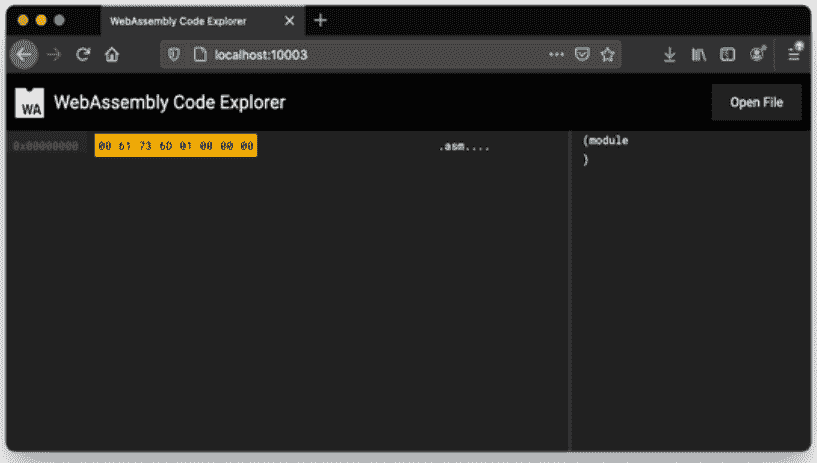
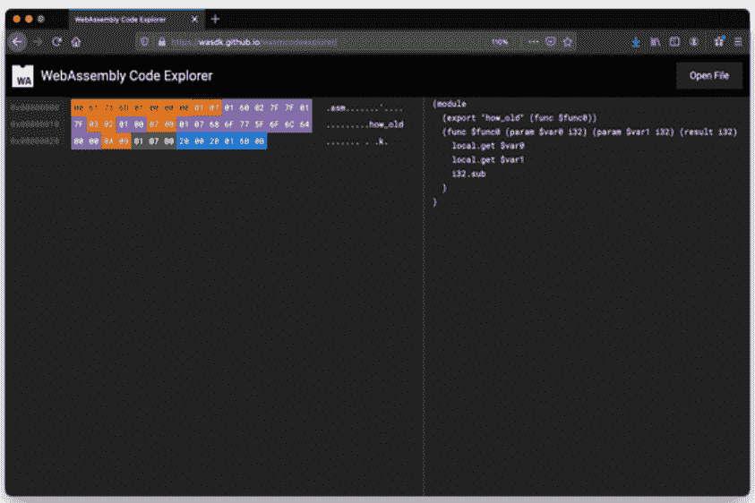
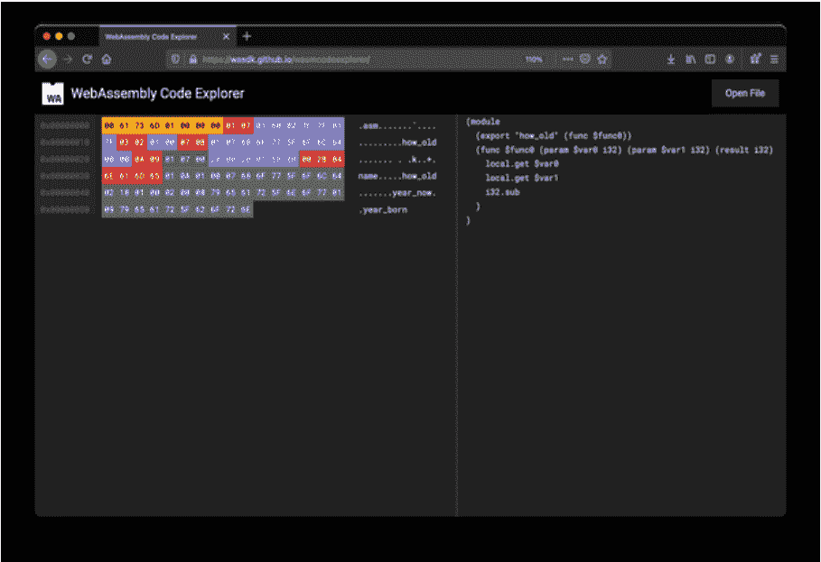
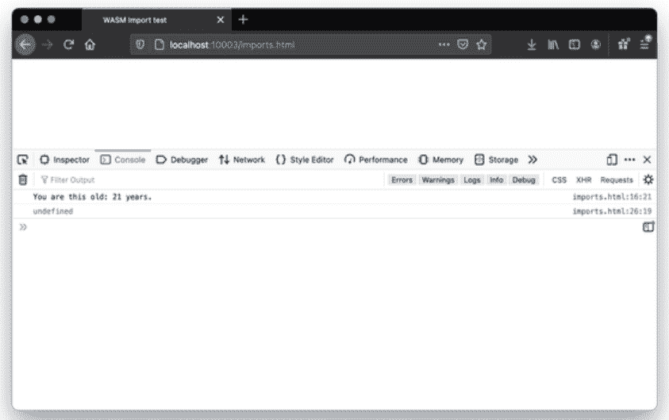

## Chapter 3. WebAssembly Modules

### A NOTE FOR EARLY RELEASE READERS

With Early Release ebooks, you get books in their earliest form—the author’s raw and unedited content as they write—so you can take advantage of these technologies long before the official release of these titles.

This will be the 3rd chapter of the final book.

If you have comments about how we might improve the content and/or examples in this book, or if you notice missing material within this chapter, please reach out to the author at wasmbook@bosatsu.net.

> A place for everything and everything in its place.
> —17th Century Proverb

操作系统通常以编译形式运行程序¹。每个操作系统都有自己的格式，定义了从哪里开始、需要什么数据，以及不同广告功能位的指令实际上是什么。WebAssembly 也不例外。在本章中，我们将研究行为是如何打包的，以及主机将如何知道该怎么做。

软件工程师完全有可能在整个职业生涯中忽略程序如何通过此过程加载和执行。他们的世界始于 `int main(int argc, char **argv)` 或 `static void main(String []args)` 或甚至 `if __name__ == "__main__":`。这些是 C、Java 和 Python 程序中众所周知的入口点，因此程序员假设在此处负责控制流。然而，在程序启动之前和退出之后，


操作系统或程序化运行时需要设置和拆除可执行结构。加载器进程需要知道指令从哪里开始，数据元素如何初始化，需要加载哪些其他模块或库等等。

这些细节通常由可执行文件的性质定义。在 Linux 上，这由可执行和可链接格式（ELF）² 定义，在 Windows 上是便携式可执行（PE）格式³，而在 macOS 上则是 Mach-O 格式⁴。这些显然是用于原生可执行文件的特定于平台的格式。像 Java 和 .NET 这样更可移植的系统使用中间字节码表示，但仍然有定义的<|message|> 结构，并且它们提供类似的目的。

WebAssembly MVP 的主要设计考虑之一是定义模块结构，以便 WebAssembly 主机知道要查找和验证的内容，以及在执行部署单元时从哪里开始。

在第 2 章中，你已经看到了比本章开始时更复杂的模块结构。我们将逐步介绍各节，然后向你展示一些工具来以文本和视觉方式探索 WebAssembly 模块的结构。你在上一章中已经简要处理过二进制结构。它在传输和加载方面紧凑且快速。你可能不会经常花费大量时间查看二进制细节，因为你的重点将放在软件方面。然而，了解模块布局是有用的，所以让我们深入研究。

### 模块结构

最基本的 WebAssembly 模块是一个空模块。没有任何一节是必需的，因此可以有一个有效模块，如你在示例 3-1 中看到的那样。

示例 3-1. 一个空的，但有效的 WebAssembly 模块。

```
(module)
```

显然它没什么好看的，但它可以转换为二进制形式。你将在以下输出中注意到，它至少在什么都不做时也不会占用太多空间。

```
brian@tweezer ~/g/w/s/ch03> wat2wasm empty.wat
brian@tweezer ~/g/w/s/ch03> ls -alF
total 16
drwxr-xr-x  4 brian  staff  128 Dec 21 14:45 ./
drwxr-xr-x  4 brian  staff  128 Dec 14 12:37 ../
-rw-r--r--  1 brian  staff    8 Dec 21 14:45 empty.wasm
-rw-r--r--  1 brian  staff    8 Dec 14 12:37 empty.wat
```

如果你是视觉导向的，你可能会喜欢使用从 wasdk GitHub 仓库⁵ 可用的 WebAssembly 代码浏览器。你可以在线使用浏览器⁶，也可以下载并在克隆的目录中运行 HTTP 服务器。在这种情况下，我将使用我之前使用过的分发的 Python 3 Web 服务器：

```
brian@tweezer ~/g/wasmcodeexplorer> python3 -m http.server 10003
Serving HTTP on :: port 10003 (http://[::]:10003/) ...
```

对于空模块，它现在看起来不会像什么，但一旦我们开始向其中添加更多元素，这将是一个有用的摘要。文件格式通常由操作系统从文件的最初几个字节中识别⁷。它们通常被称为 *魔数*。对于 WebAssembly，字节是 \0asm 编码为 0x00 0x61 0x73 0x6D，表示字符 a、s 和 m 的十六进制值。这后面跟着版本号 1（由字节 0x01 0x00 0x00 0x00 表示）。

在图 3-1 中，你可以看到这些魔数字节，以及表明这是 WebAssembly 文件格式版本 1 的指示，以左侧的黄橙色数字系列高亮显示，右侧为空模块结构。



图 3-1. 在 WebAssembly 代码浏览器中可视化的空模块

对于模块的命令行检查，你有几个选项，但 Wabt 工具包中的 wasm-objdump 可执行文件非常有帮助。请参阅附录 A 以获取有关安装本书中讨论的各种工具的帮助。

如果你在不带开关的情况下运行命令，它会抱怨。正如你很快就会看到的那样，当你有更多细节可供探索时，这些开关会产生更大的差异。

```
brian@tweezer ~/g/w/s/ch03> wasm-objdump empty.wasm
At least one of the following switches must be given:
  -d/--disassemble
  -h/--headers
  -x/--details
  -s/--full-contents
```

现在，我们将只使用 details 开关来验证我们的模块是无用但有效的。这也表明我们正在处理格式的版本 1。

```
brian@tweezer ~/g/w/s/ch03> wasm-objdump -x empty.wasm

empty.wasm:     file format wasm 0x1

Section Details:
```

### 探索模块节

关于我们正在介绍的概念存在循环依赖问题。模块格式必须包含对构成 WebAssembly 的各种元素的支持，但我们也将在后面的章节中介绍其中一些元素。我们将主要关注我们现在已经看到的部分，并承诺很快会重新审视其他节元素。

模块的整体结构基于一系列可选的编号节，每个节都解决 WebAssembly 的特定功能。在表 3-1 中，我们可以看到这些节的快速列表和描述。

表 3-1. WebAssembly 模块节

| Id | Name | Description |
|---|---|---|
| 0 | Custom | 用于第三方使用的调试或元数据信息 |
| 1 | Type | 模块中使用的类型定义 |
| 2 | Import | 模块使用的导入元素 |
| 3 | Function | 模块中函数的类型签名 |
| 4 | Table | 定义模块使用的间接、不可变引用的表 |
| 5 | Memory | 模块使用的线性内存结构 |
| 6 | Global | 全局变量 |
| 7 | Export | 模块提供的导出元素 |
| 8 | Start | 用于启动模块的可选启动函数 |
| 9 | Element | 模块定义的元素 |
| 10 | Code | 模块定义的函数的函数体 |
| 11 | Data | 模块定义的数据元素 |
| 12 | Data Count | 模块定义的数据元素数量 |

这是我们第 2 章中的示例，供参考。

示例 3-2. 一个简单的 WebAssembly 文本文件。

```
(module
    (func $how_old (param $year_now i32) (param $year_born i32)
(result i32) ①
```

```
get_local $year_now
get_local $year_born
i32.sub)
```

```
(export "how_old" (func $how_old)) ②
)
```

① 内部函数 $how_old

② 导出的函数 how_old

我们使用 wat2wasm 工具将其转换为二进制形式。如果我们尝试询问此转换生成的结构，我们将看到以下内容：

```
brian@tweezer ~/g/w/s/ch03> wasm-objdump -x hello.wasm

hello.wasm:     file format wasm 0x1

Section Details:

Type[1]:
  - type[0] (i32, i32) -> i32
Function[1]:
  - func[0] sig=0 <how_old>
Export[1]:
  - func[0] <how_old> -> "how_old"
Code[1]:
  - func[0] size=7 <how_old>
```

请注意，与我们的空模块相比，填充了相当多的节。首先，我们有一个 Type 节，定义了单个签名。它建议一个类型，接受两个 i32 并返回一个 i32。这是我们 how_old 方法的适当签名。类型没有给定名称，但仍可用于设置期望并根据函数配置对其进行验证。

接下来我们有一个 Function 节，将我们的类型（来自 Type 节的类型 0）链接到一个命名函数。因为我们导出函数以使其可用于我们的主机环境或其他模块，所以我们看到内部函数 <how_old> 通过名称 "how_old" 被导出。

最后，我们有一个 Code 节，其中包含我们唯一函数的实际指令。

查看图 3-2，了解我们的模块在 WebAssembly 代码浏览器中的外观。



图 3-2. 在 WebAssembly 代码浏览器中可视化的我们的 Hello, World! 模块

红色表示节边界，但你也可以通过在浏览器中悬停在各个节上获得更多详细信息。例如，Export 节的紫色字节，如果将鼠标放在其中一个字节上，应该会显示导出的函数 how_old 的名称。你可以通过将鼠标悬停在最终 Code 节中的绿色和蓝色字节上看到实际指令。

如果你仔细回看示例 3-2，你会注意到我们的变量名默认不会被保留。wasm-objdump 也强调了这一点。为了调试目的，你需要在 wat2wasm 命令期间指定它们。


```
brian@tweezer ~/g/w/s/ch03> wat2wasm hello.wat -o hellodebug.wasm --debug-names
brian@tweezer ~/g/w/s/ch03> wasm-objdump -x hellodebug.wasm

hellodebug.wasm:           file format wasm 0x1

Section Details:

Type[1]:
  - type[0] (i32, i32) -> i32
Function[1]:
  - func[0] sig=0 <how_old>
Export[1]:
  - func[0] <how_old> -> "how_old"
Code[1]:
  - func[0] size=7 <how_old>
Custom:
  - name: "name"
  - func[0] <how_old>
  - func[0] local[0] <year_now>
  - func[0] local[1] <year_born>
```

注意，wat2wasm 使用 Custom 部分来保留函数和局部变量的详细信息。其他工具也可能出于自身目的使用该部分，但这通常是调试信息被捕获的方式。在图 3-3 中你可以看到，由于这个 Custom 部分，模块中有更多字节。



图 3-3. 我们的 Hello, World! 模块在 WebAssembly Code Explorer 中可视化时保留了调试细节

### 使用模块

一旦你理解了检查 WebAssembly 模块静态二进制结构的流程，你将希望以更动态的方式使用它。我们已在例如示例 2-4 中通过 JavaScript API 实例化模块的基础，但我们还可以做其他事情。

我们的代码在示例 3-2 中生成了一个 Export 部分，但正如我们在表 3-1 中看到的那样，还有一个潜在的 Import 部分用于从宿主环境接收元素。这最终可以包括我们在后续章节中会看到的 Memory 和 Table 实例，但现在我们可以导入一个函数到我们的模块中，让我们能更直接地从 WebAssembly 与控制台窗口通信。请记住我们仍在梳理低级细节，你日常使用这些技术时很可能处于更高层级。

请看示例 3-3。这是迄今为止我们示例的新版本，它导出了第二个函数。更重要的是，它还导入了一个函数。

#### 示例 3-3. 一个导入函数的 WebAssembly 模块。

```
(module
    (func $log (import "imports" "log_func") (param i32)) ①

    (func $how_old (param $year_now i32) (param $year_born i32)
    (result i32) ②
        get_local $year_now
        get_local $year_born
        i32.sub)

    (func $log_how_old (param $year_now i32) (param $year_born i32) ③
        get_local $year_now
        get_local $year_born
        call $how_old
        call $log
    )

    (export "how_old" (func $how_old)) ④
    (export "log_how_old" (func $log_how_old)) ⑤
)
```

① 从宿主导入一个期望单个 i32 参数的函数
② 我们之前相同的 $how_old 函数
③ 一个新的函数，接收两个参数然后调用我们导入的函数
④ 按之前的方式导出我们的旧 how_old 函数
⑤ 导出我们新的 log_how_old 函数

如上所示，我们在模块中有了一个可以调用的新函数，但我们还不能调用它。我们之前的函数仍然可用且没有变化。我们的新函数调用旧函数进行数学计算，但随后期望有一个名为 log_func 的函数可用以调用结果。为了澄清一些差异，让我们生成 .wasm 输出然后转储模块结构。

```
brian@tweezer ~/g/w/s/ch03> wat2wasm hellolog.wat
brian@tweezer ~/g/w/s/ch03> wasm-objdump -x hellolog.wasm

hellolog.wasm:  file format wasm 0x1

Section Details:

Type[3]:
  - type[0] (i32) -> nil
  - type[1] (i32, i32) -> i32
  - type[2] (i32, i32) -> nil
Import[1]:
  - func[0] sig=0 <imports.log_func> <- imports.log_func
Function[2]:
  - func[1] sig=1 <how_old>
  - func[2] sig=2 <log_how_old>
Export[2]:
  - func[1] <how_old> -> "how_old"
  - func[2] <log_how_old> -> "log_how_old"
Code[2]:
  - func[1] size=7 <how_old>
  - func[2] size=10 <log_how_old>
```

这是第一次，我们有一个 Import 部分的条目。它被定义为我们尚未见过的类型。如果你查看 Type 部分，你会看到现在指定了三种类型。一种接收 i32 但不返回任何内容。我们现有的两个 i32 参数和一个 i32 返回值类型。以及另一种新的接收两个 i32 且不返回任何内容的类型。

这三种类型中的第一种定义在我们的导入中。我们期望宿主环境给我们一个可以调用的函数，它将接收一个 i32。该函数的目的是以某种方式打印出参数，而不是返回任何内容，因此它不需要返回类型。我们期望从 JavaScript 侧之前被忽略的 importObject 中找到这个函数。第二种类型与之前相同。第三种类型接收调用我们的 $how_old 函数的参数，但随后会记录结果，因此它也不需要返回值。Import 和 Function 部分展示了函数与签名之间的关联。

要通过 importObject 提供元素，我们需要一些带有如示例 3-4 所示内容的 HTML 代码：

#### 示例 3-4. 一个用于实例化模块并通过 importObject 调用方法的 HTML 文件

```
<!doctype html>

<html>
    <head>
        <meta charset="utf-8">
        <title>WASM Import test</title>
        <script src="utils.js"></script>
    </head>
    <body>
        <script>
            var importObject = {
                imports: {
                    log_func: function(arg) {
                        console.log("You are this old: " + arg + " years.");
                    }
                }
            };

            fetchAndInstantiate('hellolog.wasm', importObject).then(
                function(instance) {
                    console.log(instance.exports.log_how_old(2021, 2000));
                }
            );
        </script>
    </body>
</html>
```

将示例 3-3 中的 import 语句与此对象结构进行比较。注意 imports 命名空间的存在，其中包含一个名为 log_func 的函数。这就是我们的 import 语句指定的结构。

$log_how_old 函数将其两个参数推到栈顶，然后使用 call $how_old 指令调用我们之前的函数。请记住该函数将一个参数从另一个参数中减去，然后将结果返回到栈顶。此时，我们不必重新将该值推到栈上，我们可以简单地调用我们命名为 $log 的导入函数。之前函数的返回值将成为此次新调用的参数。花点时间确保你理解参数、返回值和函数之间的关系。

如果你从上一章复制 *utils.js* 文件（它提供了我们的 `fetchAndInstantiate()` 函数⁸）然后像之前一样通过 HTTP 提供所有内容，你可以在浏览器中加载新的 HTML 文件。你最初不会看到任何内容，因为我们的 `log_func` 只是将其参数转储到 `console.log()`。但是，如果你在浏览器开发者工具中查看控制台，你应该会看到如图 3-4 所示的内容。



图 3-4. 使用导入的 JavaScript 函数调用我们新函数的結果

如果你将 `importObject` 改为如示例 3-5 所示然后在浏览器中重新加载 HTML 文件，你将不再在控制台看到消息，而应该看到一条带有消息的 alert 弹出。

显然我们的 WebAssembly 代码没有任何变化，我们只是从 JavaScript 侧传入了一个不同的函数，因此看到了不同的结果。随着我们深入探讨主题，我们将看到更复杂的交互，但希望你开始看到 WebAssembly 和 JavaScript 代码如何通过 Import 和 Export 部分进行交互。

#### 示例 3-5. 相同的 WebAssembly 模块可以用不同的方法来调用进行实例化

```
var importObject = {
  imports: {
    log_func: function(arg) {
      alert("You are this old: " + arg + " years.");
    }
  }
};
```

实例化模块并调用其函数将是通过 JavaScript API 与之交互的主要方式，但你可以使用额外的行为。如果你想知道模块导入或导出了哪些方法，你可以使用 JavaScript API 来检查已加载的模块。不要从 utils.js 调用 fetchAndInstantiate() 方法，如果你将 HTML 改为包含示例 3-6 所示的代码，你将看到图 3-5 中的结果。

#### 示例 3-6. 我们可以用 JavaScript API 做更多事情，包括流式编译

```
WebAssembly.compileStreaming(fetch('hellolog.wasm'))
  .then(function(mod) {
    var imports = WebAssembly.Module.imports(mod);
    console.log(imports[0]);
    var exports = WebAssembly.Module.exports(mod);
    console.log(exports);
  }
);
```


图 3-5. 通过 JavaScript API  interrogating 模块结构。

一旦我们学习了更多概念并开始使用更高级别的语言来表达我们的行为，WebAssembly 的全部威力将开始显现⁹。

到目前为止，我们一直在使用一个名为 utils.js 的文件中的代码块，其外观如示例 3-7 所示。对于简单的模块来说，这已经足够了，但随着模块变得越来越大，可以消除一些内置的延迟。性能不仅仅是运行时的性能，还包括加载时的性能。

#### 示例 3-7. 我们一直在使用的一种简单的实例化模块方式

```
function fetchAndInstantiate(url, importObject) {
  return fetch(url).then(response =>
    response.arrayBuffer()
  ).then(bytes =>
    WebAssembly.instantiate(bytes, importObject)
  ).then(results =>
    results.instance
  );
}
```

上面的问题是，即使我们使用 promise 来避免阻塞主线程，我们首先将模块读入 ArrayBuffer，然后再实例化它。我们本质上是在等待整个网络传输完成后再编译模块。第一个在 MVP 之后添加的功能之一就是能够在字节仍在跨网络传输时支持编译。模块格式结构非常适合这种优化，所以不使用它很可惜。

虽然没有实例化模块的唯一正确方法（例如，在某些情况下你可能希望实例化模块的多个实例），但大多数情况下，示例 3-8 中的代码是一种稍微更高效的方式。

#### 示例 3-8. 大多数情况下推荐的实例化模块方式

```
(async () => {
  const fetchPromise = fetch(url);
  const { instance } = await
WebAssembly.instantiateStreaming(fetchPromise);
  // Use the module
  const result = instance.exports.method(param1, param2);
  console.log(result);
})();
```

请注意，上文我们没有创建 ArrayBuffer，我们将 fetch() 方法的 Promise 传递给 WebAssembly 对象上的 instantiateStreaming() 方法。这允许基线编译器在函数随着网络出现时开始编译函数。在大多数情况下，代码编译会比网络传输更快，因此在你完成下载代码时，它应该已经通过验证并准备好使用。当 JavaScript 完成下载时，验证过程通常才会开始，因此我们看到了启动时间的改善。

目前还没有正式的方法来缓存 WebAssembly 模块，但这也将成为改善启动时间的一种无缝方式。缓存控制和其他 Web 工件处理将避免不必要的重新下载模块（例如，如果它们已被更新）。

### 未来 ES6 模块集成

虽然能够通过 JavaScript API 工作，如我们所见，这很有用，但它级别较低且重复，这就是为什么我们把它放在可重用的实用脚本文件中。未来，我们预计从 HTML 使用 WebAssembly 模块会变得更加容易，因为它们将作为 ES6 模块可用。

这有点棘手，因为需要顶层异步处理以及模块图在构造、实例化和评估三个阶段加载的方式。基于二进制的 WebAssembly 和 JavaScript 模块验证过程之间存在细微差异，编译发生的时间，以及模块环境记录如何遍历和链接。

有一个提案建议在平台上添加支持以平滑这些差异。在撰写本文时，这处于提案流程的“第 2 阶段”¹⁰。Lin Clark 对这里的复杂性有一个很好的讲解：https://www.youtube.com/watch?v=qR_b5gajwug。

目标是引入一种声明式形式，其外观类似于示例 3-9 所示。

示例 3-9. 加载 WebAssembly 模块的拟议声明式形式

```
import {something} from "./myModule.wasm";

something();
```

这不仅有利于简化 WebAssembly 模块的实例化，还将促进它们参与 JavaScript 模块依赖图。如果它们作为依赖项的管理方式没有区别，开发人员在以多种语言表达的行为之间进行混合时，将更容易创建完整的解决方案。

该提案设计简洁，支持良好，但它需要在 HTML 规范、ES6 模块规范、实现、JavaScript 打包器以及更大的 Node.js 社区之间进行谨慎的编排。我怀疑在该提案上取得进展不会太久。

现在我们已经查看了 WebAssembly 二进制文件的结构元素，你应该能够舒适地检查你自己的和第三方模块，无论是手动还是以编程方式进行。下一步是查看 WebAssembly 模块的更动态元素。我们将首先关注 Memory 实例，作为在更传统的编程运行时中模拟连续内存块的手段。

- 1 为了本次讨论的目的，我忽略了脚本语言，但运行脚本的引擎仍然是某种编译的可执行文件。
- 2 可执行程序的 Linux 文件格式：
+ https://en.wikipedia.org/wiki/Executable_and_Linkable_Format
- 3 可执行程序的 Windows 文件格式：
+ https://en.wikipedia.org/wiki/Portable_Executable
- 4 macOS 可执行程序的文件格式：https://en.wikipedia.org/wiki/Mach-O
- 5 用于探索二进制 WebAssembly 模块的 GitHub 仓库：
+ https://github.com/wasdk/wasmcodeexplorer
- 6 在线 WebAssembly 代码浏览器：https://wasdk.github.io/wasmcodeexplorer/
- 7 许多常见格式（包括 WebAssembly）可以在这里看到：
+ https://en.wikipedia.org/wiki/List_of_file_signatures
- 8 请记住，我们仍然在使用不推荐的实例化模块的方法。一次一件事情！
- 9 在此期间，如果你想进一步探索，API 在这里有文档记录：
+ https://webassembly.github.io/spec/js-api/
- 10 如果你对低级提案细节感兴趣，你可以在这里找到它们：
+ https://webassembly.github.io/esm-integration/js-api/index.html#esm-integration
