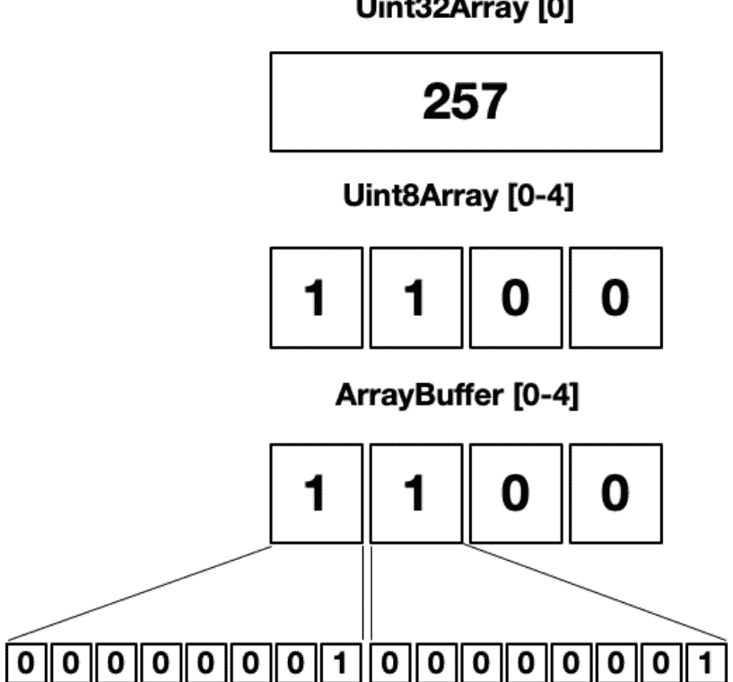
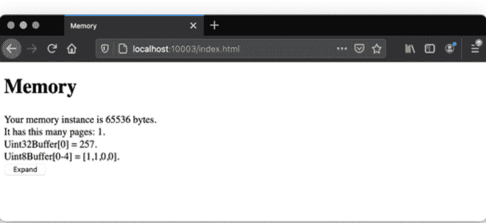
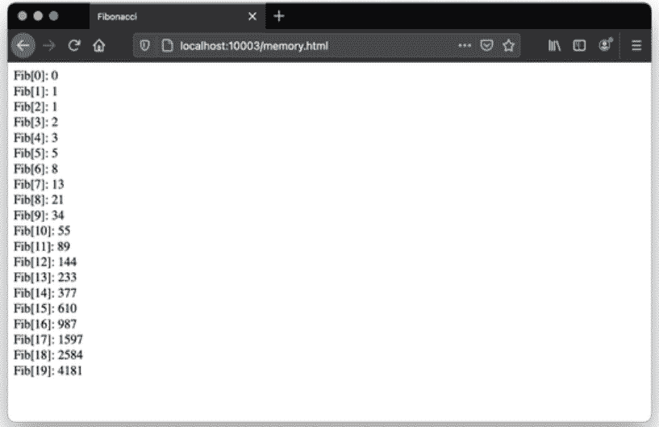

## 第 4 章. WebAssembly 内存

### 早期发布读者的说明

使用 Early Release 电子书，你可以在这些标题正式发布之前很久就利用这些技术——作者在写作时的原始未编辑内容。

这将是最终书籍的第 4 章。

如果你对如何改进本书的内容和/或示例有任何评论，或者如果你注意到本章中缺少材料，请联系作者 wasmbook@bosatsu.net。

> 也许有一天这也会令人愉快地回忆起来。
> —维吉尔

如果 WebAssembly 要像常规的运行时环境一样运行，它需要一种方式为其数据处理活动分配和释放内存。在本章中，我们将向你介绍它如何为效率模拟这种行为，但不会出现 C 和 C++ 等语言中常见的典型内存操作问题（即使我们运行的就是这些语言）。由于我们可能从互联网上下载任意代码，这是一个重要的安全考虑。

计算的整个概念通常涉及某种形式的数据处理。无论我们是在拼写检查文档、操作图像、进行机器学习、测序蛋白质、玩电子游戏、观看电影还是简单地在电子表格中计算数字，我们通常都在与任意数据块交互。其中一个最关键的性能考虑因素是，如何将数据送到需要的地方，以便以某种方式对其进行检查或转换。

中央处理器（CPU）在数据在寄存器¹或片上缓存中可用时工作最快。显然这些容器非常小，因此大型数据集永远不会完全加载到 CPU 上。我们必须花费一些精力将数据移入和移出内存。等待数据加载到这些位置之一的成本在 CPU 时钟时间中是永恒的。这就是它们变得如此复杂的原因之一。现代芯片具有各种多流水线、预测分支和指令重写功能，以便在我们从网络读取到主内存、再到多级缓存并最终到达需要使用的地方时保持芯片忙碌。

传统程序通常有栈内存来管理短期的小型或固定大小的变量。它们使用基于堆的内存来处理长期、任意大小的数据块。这些通常只是分配给程序的内存的不同区域，被不同地对待。栈内存会因执行期间函数调用的起伏而频繁被覆盖。堆内存在使用后在不再需要时被清理。如果程序内存不足，它可以请求更多，但必须合理地使用它。² 如今虚拟分页系统和更便宜的内存使得典型的计算机可能拥有数十 GB 的内存成为完全可能。能够快速高效地访问潜在大型数据集的单个字节是体面软件运行时性能的关键。

WebAssembly 程序需要一种模拟这些内存块的方法，而不会实际给予对计算机内存隐私的无限制访问。幸运的是，这里有一个很好的故事，可以在便利性、速度和安全性之间取得平衡。它从使 JavaScript 能够访问内存中的单个字节开始，但最终会扩展为在主机环境和 WebAssembly 模块之间共享内存的通用方式。


### TypedArrays

JavaScript 传统上无法方便地访问内存中的单个字节。这就是为什么时间敏感的、低级的功能通常由浏览器或某种插件提供。即使是 Node.js 应用程序也经常需要在比 JavaScript 更擅长内存操作的其他语言中实现某些功能。这使情况变得复杂，因为 JavaScript 是一种解释型语言，你需要一种高效的机制在解释型、可移植代码和快速编译代码之间来回切换控制流。这也使部署变得棘手，因为应用程序的一部分本质上是可移植的，而另一部分需要在不同的操作系统上获得原生库支持。

软件开发中通常存在权衡：语言要么快，要么安全。当你需要原始速度时，你可能会选择 C 或 C++，因为它们在数据在内存中的使用和操作上提供了很少的运行时检查。因此，它们非常快。当你想要安全性时，你可能会选择一种对数组引用进行运行时边界检查的语言。速度权衡的缺点是事情要么很慢，要么内存管理的负担落在程序员身上。不幸的是，在忘记分配空间、重用已释放的内存或完成后未能释放空间时，很容易出错。这是这些快速语言编写的应用程序经常出现错误、容易崩溃并成为许多安全漏洞来源的原因之一³。

Java 和 JavaScript 等垃圾回收语言使开发人员摆脱了管理内存的许多负担，但作为权衡，通常会在运行时产生性能负担。运行时的一部分必须不断查找未使用的内存并释放它。性能开销使许多此类应用程序变得不可预测，因此不适合嵌入式应用程序、金融系统或其他时间敏感的用例。

只要创建的内容大小适合你要放入的内容，分配内存并不是一个大问题。棘手的部分是知道何时清理。显然，在程序使用完之前释放内存是不好的，但不再需要时未能释放也是低效的，你可能会耗尽内存。Rust 等语言在便利性和安全性之间取得了很好的平衡。编译器迫使你更清晰地传达你的意图，但当你这样做时，它可以更有效地清理。

运行时如何管理这一切通常是语言及其运行时的一个决定性特征。因此，并非每种语言都需要同等程度的支持。这也是 WebAssembly 设计者没有在 MVP 中过度指定诸如垃圾回收等功能的原因之一。

JavaScript 是一种灵活且动态的语言，但它在历史上并没有使处理大型数据集的单个字节变得容易或高效。这使得使用低级库变得复杂，因为数据必须复制进出 JavaScript 原生格式，这效率低下。Array 类存储 JavaScript 对象，这意味着它必须准备好处理任意类型。Python 的许多灵活容器也同样灵活且臃肿⁴。通过指针快速遍历和操作内存是连续块中数据类型统一的产物。字节是最小的可寻址单元，尤其是在处理图像、视频和声音文件时。

数值数据需要更多努力。16 位整数占用两个字节。32 位整数，四个。字节数组中的位置 0 可能代表数据数组中的第一个这样的数字，但第二个数字将从位置 4 开始。

JavaScript 添加了 TypedArray 接口来解决这些问题，最初是在改善 WebGL 性能的背景下。这些是通过 ArrayBuffer 实例可用的内存部分，可以将其视为特定数据类型的同质块。可用的内存受限于 ArrayBuffer 实例，但它可以以便于传递给原生库的格式内部存储。

#### Example 4-1. Ten 32-bit integers created in a Uint32Array.

```
var u32arr = new Uint32Array(10);
u32arr[0] = 257;
console.log(u32arr);
console.log("u32arr length: " + u32arr.length);
```

The output of the invocation should look like this:

```
Uint32Array(10) [ 257, 0, 0, 0, 0, 0, 0, 0, 0, 0 ]
u32arr length: 10
```

正如你所见，这与你对整数数组的预期一样工作。请记住，这些是 4 字节整数（因此类型名中的 32）。在 Example 4-2 中，我们从 Uint32Array 中检索底层 ArrayBuffer 并将其打印出来。这显示其长度为 40。接下来我们用 Uint8Array 包装缓冲区，表示一个无符号字节数组，并打印其内容和长度。

#### Example 4-2. Accessing the 32-bit integers as a buffer of 8-bit bytes.

```
var u32buf = u32arr.buffer;
var u8arr = new Uint8Array(u32buf);
console.log(u8arr);
console.log("u8arr length: " + u8arr.length);
```

The code produces the following output:

```
ArrayBuffer { byteLength: 40 }
Uint8Array(40) [ 1, 1, 0, 0, 0, 0, 0, 0, 0, 0, ... ]
u8arr length: 40
```

ArrayBuffer 代表原始底层字节。TypedArray 是基于指定类型大小对这些字节的解释性视图。因此，当我们用长度 10 初始化 Uint32Array 时，这意味着十个 32 位整数，需要 40 个字节来表示。分离的缓冲区被设置为这么大，以便它可以容纳所有十个整数。`Uint8Array` 由于其大小定义，将每个字节视为一个单独的元素。

如果你查看 Figure 4-1，你应该能看到发生了什么。`Uint32Array` 的第一个元素（位置 0）只是值 257。这是对 `ArrayBuffer` 中底层字节的解释性视图。`Uint8Array` 直接反映缓冲区的底层字节。图表底部的位模式反映了前两个字节的每字节位数。



Figure 4-1. Representing the value 257.

你可能会惊讶地发现前两个字节中有 1。这是由一个令人困惑的概念——字节序——引起的，该概念在我们将数字存储在内存中时出现⁵。在这种情况下，小端系统首先存储最低有效字节（1s）。*大端*系统会先存储 0s。在大局中，它们如何存储并不重要，但不同的系统和协议会选择其中之一。你只需要跟踪你看到的是哪种格式。

如前所述，`TypedArray` 类最初是为 WebGL 引入的，但从那时起，它们已被 Canvas2D、XMLHttpRequest2、File、Binary WebSockets 等其他 API 采用。注意这些都是低级、性能导向的 I/O 和可视化 API，必须与原生库交互。底层内存表示可以在这些层之间高效传递。出于这些原因，它们对 WebAssembly `Memory` 实例也很有用。

### WebAssembly Memory Instances

WebAssembly `Memory` 是一个与模块关联的底层 `ArrayBuffer`（或稍后我们将看到的 `SharedArrayBuffer`）。MVP 目前将模块限制为单个实例，但这在不久后可能会改变。模块可以创建自己的 `Memory` 实例，也可以从其主机环境获得。这些实例可以像我们到目前为止对函数所做的那样导入或导出。模块结构中还有一个关联的 `Memory` 部分，我们在第 3 章中跳过了，因为我们当时还没有介绍这个概念。我们现在将纠正这一遗漏。

在 Example 4-3 中，我们有一个 Wat 文件，定义了一个 `Memory` 实例并将其导出为名称 "`memory`" 。这代表一个连续的内存块，受特定 `ArrayBuffer` 实例的约束。这是我们模拟 C/C++ 风格的内存中字节同质数组能力的开始。每个实例由一个或多个 64 千字节的内存页组成。在示例中，我们将其初始化为一个页面，但允许其增长到最多 10 个页面，总共 640 千字节，这应该足够任何人用了⁶。你将看到如何稍后增加可用内存。现在，我们只是将字节 1、1、0 和 0 写入缓冲区的开头。`i32.const` 指令加载一个常量


value onto the stack. We want to write to the beginning of our buffer so we use the value 0x0. The data instruction is a convenience for initializing portions of our Memory instance.

#### Example 4-3. Creating and exporting a Memory instance in a WebAssembly module.

```
(module
  (memory (export "memory") 1 10)
  (data (i32.const 0x0) "\01\01\00\00")
)
```

If we compile this file to its binary representation with wat2wasm and then invoke wasm-objdump we see some new details we have not yet encountered:

```
brian@tweezer ~/g/w/s/ch04> wasm-objdump -x memory.wasm

memory.wasm:  file format wasm 0x1

Section Details:

Memory[1]:
  - memory[0] pages: initial=1 max=10
Export[1]:
  - memory[0] -> "memory"
Data[1]:
  - segment[0] memory=0 size=4 - init i32=0
  - 0000000: 0101 0000
```

There is a configured Memory instance in the Memory section reflecting our initial size of one page and maximum size of ten pages. We see that it is exported as "memory" in the Export section. We also see the fact that the Data section has initialized our memory instance with the four bytes we wrote into it.

Now we can use our exported memory by importing it into some JavaScript in the browser. For this example, we are going to load the module and fetch the Memory instance. We then display the buffer size in bytes, the number of pages, and what is currently in the memory buffer.

#### Example 4-4. Display Memory details in the browser.

```
<!doctype html>
<html lang="en">
    <head>
        <meta charset="utf-8">
        <link rel="stylesheet" href="bootstrap.min.css">
        <title>Memory</title>
        <script src="utils.js"></script>
    </head>
    <body>
        <div class="container">
            <h1>Memory</h1>
            <div>Your memory instance is <span id="mem"></span> bytes.
</div>
            <div>It has this many pages: <span id="pages"></span>.</div>
            <div>Uint32Buffer[0] = <span id="firstint"></span>.</div>
            <div>Uint8Buffer[0-4] = <span id="firstbytes"></span>.</div>
        </div>

        <button id="expand">Expand</button>

        <script>
            <!-- Shown below -->
        </script>
    </body>
</html>
```

The basic structure of our HTML file is show in Example 4-4. We have a series of <span> elements that will be populated with the details via a function called showDetails() that will take a reference to our memory instance.

In Example 4-5 we see the JavaScript for our <script> element above. First look at the fetchAndInstantiate() call. It behaves in the same way we have seen before in terms of loading the module. Here we get a reference to the Memory instance through the exports section. We attach an onClick() function for our button that we will address momentarily.

Finally, we call the showDetails() function and pass in our mem variable. This function will retrieve the underlying ArrayBuffer and references to our various <span> elements to display the details. The buffer’s length is stored in the innerText field of our first <span>. The number of pages is this length divided by 64KB to indicate the number of

pages. We then wrap the ArrayBuffer with a Uint32Array which allows us to fetch our memory values as 4-byte integers. The first element of this is shown in the next <span>. We also wrap our ArrayBuffer in Uint8Array and show the first four bytes. After our discussion above, the details shown in Figure 4-2 should not surprise you.

#### Example 4-5. The JavaScript code for our example.

```
function showDetails(mem) {
    var buf = mem.buffer;
    var memEl = document.getElementById('mem');
    var pagesEl = document.getElementById('pages');
    var firstIntEl = document.getElementById('firstint');
    var firstBytesEl = document.getElementById('firstbytes');

    memEl.innerText=buf.byteLength;
    pagesEl.innerText=buf.byteLength / 65536;

    var i32 = new Uint32Array(buf);
    var u8 = new Uint8Array(buf);

    firstIntEl.innerText=i32[0];
    firstBytesEl.innerText= "[" + u8[0] + "," + u8[1] + "," + u8[2] + "," + u8[3] + "]";
};

fetchAndInstantiate('memory.wasm').then(function(instance) {
    var mem = instance.exports.memory;

    var button = document.getElementById("expand");
    button.onclick = function() {
        try {
            mem.grow(1);
            showDetails(mem);
        } catch(re) {
            alert("You cannot grow the Memory any more!");
        };
    };
    showDetails(mem);
});
```



Figure 4-2. Showing the details of our Memory.

The onClick() function calls a method on the Memory instance to grow the allocated size by one page of memory. This causes the original ArrayBuffer to become detached from the instance and the existing data is copied over. If we are successful, we reinvoke the showDetails() function and extract the new ArrayBuffer. If the button is pressed once, you should see that the instance now represents two pages of memory representing 128KB of memory. The data at the beginning should not have changed.

If you press the button too many times, the number of allocated pages will exceed the maximum specified amount of ten pages. At this point, it is no longer possible to expand the memory and a RangeError will be thrown. Our example will pop up an alert window when this happens.

### Using the WebAssembly Memory API

The grow() method we used in the previous example is part of the WebAssembly JavaScript API that the MVP expects all host environments to provide. We can expand our use of this API and go the other direction. We can create a Memory instance in JavaScript and then make it available to a module. Keep in mind the current limit of one instance per module.

In subsequent chapters we will see more elaborate uses of memory, but we will want to use a higher level language than Wat to do anything serious. For now we will keep our example on the simpler side but still try to expand beyond what we have seen.

We will start with the HTML so you can see the whole workflow and then we will dive into the details of the new module. In Example 4-6 you can see that we are using a similar HTML structure to what we have used so far. There is a <div> element with the id of "container" into which we will place a series of Fibonacci numbers⁷. If you are not familiar with these numbers, they are very important in a lot of natural systems and you are encouraged to investigate them on your own. The first two numbers are defined to be "0" and "1". The subsequent numbers are set to the sum of the previous two. So the third number will be "1" (0 + 1). The fourth number will be "2" (1 + 1). The fifth number will be "3" (2 + 1), etc.

#### Example 4-6. Creating a Memory in JavaScript and importing it to the module.

```
<!doctype html>
<html lang="en">
<head>
<meta charset="utf-8">
<link rel="stylesheet" href="bootstrap.min.css">
<title>Fibonacci</title>
<script src="utils.js"></script>
</head>
<body>
<div id="container"></div>
<script>
var memory = new WebAssembly.Memory({initial:10, maximum:100});

var importObject = {
js: { mem: memory }
};

fetchAndInstantiate('memory2.wasm', importObject).then(function(instance) {
var fibNum = 20;
```

```
instance.exports.fibonacci(fibNum);
var i32 = new Uint32Array(memory.buffer);

var container = document.getElementById('container');

for(var i = 0; i < fibNum; i++) {
    container.innerText += `Fib[${i}]: ${i32[i]}\n`;
}
});

</script>
</body>
</html>
```

The actual calculation is written in Wat and shown in Example 4-7 but before we get there, we see the creation of the Memory instance on the first line of the <script> element. We are using the JavaScript API but the intent is the same as our use of the (memory) element in Example 4-3. We create an initial size of one page of memory and a maximum size of ten pages. In this case, we will never need more than the one page but you now see how to do it. The Memory instance is made available to the module via the importObject. As you will see momentarily, the function in the Wasm module will take a parameter indicating how many Fibonacci numbers to write into the Memory buffer. In this example, we will pass in a parameter of 20.

Once our module is instantiated, we call its exported fibonacci() function. We have access to the memory variable from above, so we can retrieve the underlying ArrayBuffer directly after the function invocation completes. Because Fibonacci numbers are integers, we wrap the buffer in a Uint32Array instance so we can iterate over the individual elements. As we retrieve the numbers, we do not have to worry about the fact that they are 4-byte integers. Upon reading each value, we extend the innerText of our "container" element with a string version of the number.

The calculation shown in Example 4-7 is going to be significantly more complicated than any Wat we have seen so far, but by approaching it in pieces you should be able to figure it out.


#### Example 4-7. Fibonacci calculations expressed in Wat.

```
(module
  (memory (import "js" "mem") 1) ①
  (func (export "fibonacci") (param $n i32) ②
    (local $index i32) ③
    (local $ptr i32) ④

    (i32.store (i32.const 0) (i32.const 0)) ⑤
    (i32.store (i32.const 4) (i32.const 1))

    (set_local $index (i32.const 2)) ⑥
    (set_local $ptr (i32.const 8))

    (block $break ⑦
      (loop $top ⑧
        (br_if $break (i32.eq (get_local $n) (get_local $index))) ⑨
        (i32.store ⑩
          (get_local $ptr)
          (i32.add
            (i32.load (i32.sub (get_local $ptr) (i32.const 4)))
            (i32.load (i32.sub (get_local $ptr) (i32.const 8)))
          )
        )
        (set_local $ptr (i32.add (get_local $ptr) (i32.const 4))) ⑪
        (set_local $index (i32.add (get_local $index) (i32.const 1)))
        (br $top) ⑫
      )
    )
  )
```

① The Memory is imported from the host environment.

② The fibonacci function is defined and exported.

③ $index is our number counter.

④ $ptr is our current position in the Memory instance.

⑤ The i32.store function writes a value to the specified location in the buffer.

⑥ The $index variable is advanced to 2 and the $ptr is set to 8.

- 7 We define a named block to return to in our loops.
- 8 We define a named loop in our block.
- 9 We break out of our loop when the $index variable equals the $n parameter.
- 10 We write the sum of the previous two elements to current location of $ptr.
- 11 We advance the $ptr variable by 4 and the $index variable by 1.
- 12 We break to the top of our loop.

Hopefully the numeric notes attached to Example 4-7 make sense, but given its complexity, it warrants a quick discussion. This is a stack-based virtual machine so all of the instructions involve manipulating the top of the stack. In <1> we import the memory defined in the JavaScript. It represents the default allocation of one page which should be enough for now. While this is a correct implementation, it is not an overly safe implementation. Bad inputs could mess up the flow, but we will be more concerned with that after we introduce higher-level language support where it is easier to handle those details.

The exported function is defined to take a parameter $n representing the number of Fibonacci numbers to calculate.⁸ We use two local variables defined at points <3> and <4>. The first represents which number we are working on and it defaults to 0. The second will act as a pointer in memory. It will serve as the index into the Memory buffer. Remember, i32 data values represent 4 bytes so every advance of $index will involve advancing $ptr by 4. We do not have the benefit of TypedArrays on this side of the interaction so we have to handle these details ourselves. Again, higher-level languages will shield us from many of these details.

By definition, the first two Fibonacci numbers are 0 and 1, so we write those into the buffer. `i32.store` writes an integer value to a location. It expects to find those values on the top of the stack, so the next two parts of the statement invoke the `i32.const` instruction which pushes the specified values to the top of the stack. First, an offset of 0 indicates we want to write to the beginning of the buffer. The second one pushes the number 0 to the stack to indicate the value we want to write in position 0. The next line repeats the process for the next Fibonacci number. The `i32` from the previous line takes up 4 bytes so we write value 1 to position 4.

The next step is to iterate over the remaining numbers which are each defined as the sum of the previous two. This is why we need to start the process with the two we just wrote. We advance our `$index` variable to 2 so we will need `$n - 2` iterations of the loop. We have written two `i32` integers so we advance our `$ptr` to 8.

Wat references several WebAssembly instructions that you will be introduced to over the course of the book. Here you can see some of the looping constructs. We define a block at position <7> and give it a label of `$break`. The next step introduces a loop with an entry point called `$top`. The first instruction in the loop checks to see if `$n` and `$index` are equal indicating we have handled all of our numbers. If so, it will break out of the loop. If not, it proceeds.

The `i32.store` instruction at position <10> writes to the `$ptr` location. The values of variables are pushed to the top of the stack with the `get_local`. The value to write there is the addition of the the values of the previous two numbers. `i32.add` expects to find its two addends at the top of the stack as well. So we load the integer location that is four less than `$ptr`. This represent `$n - 1`. We then load the integer stored at location of `$ptr` minus 8 which represents `$n - 2`. `i32.add` pops these addends off the top of the stack and writes their sum back to the top. The stack now contains this value at the top and the location of the current `$ptr` value which is what the `i32.store` is expecting.

The next step advances $ptr by four since we have now written another Fibonacci number to the buffer. We advance $n by one and then break to the top of the loop and repeat the process. Once we have written $n numbers to the buffer, the function returns. It does not need to return anything as the host environment has access to the Memory buffer and can read the results out directly with TypedArrays as we saw earlier.

The result of loading our HTML into the browser and displaying the first twenty Fibonacci numbers is shown in Figure 4-3.



Figure 4-3. Reading the Fibonacci sequence from the Memory instance.

This level of detail would be annoying to deal with regularly, but fortunately you will not have to. It is important to understand how things work at this level though and how we can emulate contiguous blocks of linear memory for efficient processing.

### Strings At Last!

One final discussion before we move on is about how we can finally add strings to our repertoire! There are many more tools coming in later chapters of the book to make things even easier, but we can take advantage of some conveniences in Wat to write strings into Memory buffer and read them out on the JavaScript side.

In Example 4-8 you can see a very simple module that exports a one page Memory instance. It then uses a data instruction to write a sequence of bytes into a location in the module’s memory. It starts at location 0 and writes the bytes in the subsequent string. It is a convenience to not have to convert the multibyte strings into their component bytes although you certainly can if you like. This string has a Japanese sentence and then its translation in English.⁹

#### Example 4-8. A simple use of strings in Wat

```
(module
  (memory (export "memory") 1)
  (data (i32.const 0x0) "私は横浜に住んでいました。I used to live in Yokohama.")
)
```

Once we compile the Wat to Wasm, we see that we have a new populated section in our module. You can see this with the wasm-objdump command.

```
brian@tweezer ~/g/w/s/ch04> wasm-objdump -x strings.wasm

strings.wasm:  file format wasm 0x1

Section Details:

Memory[1]:
  - memory[0] pages: initial=1
Export[1]:
  - memory[0] -> "memory"
Data[1]:
  - segment[0] memory=0 size=66 - init i32=0
    - 0000000: e7a7 81e3 81af e6a8 aa e6 b59c e381 abe4
    ................
    - 0000010: bd8f e382 93e3 81a7 e381 84e3 81be e381
    ................
    - 0000020: 97e3 819f e380 8249 2075 7365 6420 746f .......I
used to
```
```
- 0000030: 206c 6976 6520 696e 2059 6f6b 6f68 616d  live in
Yokoham
  - 0000040: 612e
```

The Memory, Export and Data sections are filled in with the details of our strings written to memory. The instance is intialized this way so when a host environment reads from the buffer, the strings will already be there.

In Example 4-9 you see that we have one <span> for our Japanese sentence and one for our English sentence. To extract the individual bytes, we can wrap a Uint8Array around the Memory instance buffer that we have imported from the module. Notice that we only wrap the first 39 bytes. These bytes are decoded to a UTF-8 string via a TextDecoder instance and then we set the innerText of the <span> designated for the Japanese sentence. We then wrap a separate Uint8Array around the portion of the buffer starting at position 39 and including the subsequent 26 bytes.

#### Example 4-9. Reading strings from an imported Memory instance

```
<!doctype html>
<html lang="en">
  <head>
    <meta charset="utf-8">
    <link rel="stylesheet" href="bootstrap.min.css">
    <title>Reading Strings From Memory</title>
    <script src="utils.js"></script>
  </head>
  <body>
    <div>
      <div>Japanese: <span id="japanese"></span></div>
      <div>English: <span id="english"></span></div>
    </div>
    <script>
      fetchAndInstantiate('strings.wasm').then(function(instance) {
        var mem = instance.exports.memory;

        var bytes = new Uint8Array(mem.buffer, 0, 39);
        var string = new TextDecoder('utf8').decode(bytes);
        var japanese = document.getElementById('japanese');
        japanese.innerText = string;

        bytes = new Uint8Array(mem.buffer, 39, 26);
```


string = new TextDecoder('utf8').decode(bytes);
var english = document.getElementById('english');
english.innerText = string;
});

</script>
</body>
</html>

在图 4-4 中，我们看到从缓冲区读取字节并将其渲染为 UTF-8 字符串的成功结果。


图 4-4. 从 Memory 实例读取字符串。

这些结果虽然很酷，但我们是如何知道要包装多少字节以及在哪个位置查找字符串的呢？一些侦探工作可以帮助。 大写字母“I”表示为十六进制 49。上面的 wasm-objdump 输出为数据段中的每个字节提供偏移量。我们第一次在以 0000020: 开头的行上看到值 49。49 代表第七个字节，因此第二句话从位置 27 开始，即 2 * 16 + 7 十进制，即 39。日文字符串代表 0 到 39 之间的字节。英文字符串从位置 39 开始。

但是，等一下！事实证明我们在英文句子上计数错误，我们出现了差一错误。手动从 WebAssembly 模块中获取字符串似乎是一种麻烦且容易出错的工作。即使以这种低级方式做事，也可以处理得更好。我们将先写出字符串的位置，这样我们就不必自己去[content]

string = new TextDecoder('utf8').decode(bytes);
var english = document.getElementById('english');
english.innerText = string;
});

</script>
</body>
</html>

在图 4-4 中，我们看到从缓冲区读取字节并将其渲染为 UTF-8 字符串的成功结果。


图 4-4. 从 Memory 实例读取字符串。

这些结果虽然很酷，但我们是如何知道要包装多少字节以及在哪个位置查找字符串的呢？一些侦探工作可以帮助。 大写字母“I”表示为十六进制 49。上面的 wasm-objdump 输出为数据段中的每个字节提供偏移量。我们第一次在以 0000020: 开头的行上看到值 49。49 代表第七个字节，因此第二句话从位置 27 开始，即 2 * 16 + 7 十进制，即 39。日文字符串代表 0 到 39 之间的字节。英文字符串从位置 39 开始。

但是，等一下！事实证明我们在英文句子上计数错误，我们出现了差一错误。手动从 WebAssembly 模块中获取字符串似乎是一种麻烦且容易出错的工作。即使以这种低级方式做事，也可以处理得更好。我们将先写出字符串的位置，这样我们就不必自己去弄清楚了。

请看示例 4-10，了解我们如何做得更精细。我们现在有两个数据段。第一个写入第一个字符串的起始位置和长度，然后是第二个字符串的相同信息。因为我们使用相同的缓冲区作为索引和字符串，所以我们必须小心位置。

由于我们的字符串并不很长，我们可以使用单字节作为偏移量和长度。这通常不是一个好策略，但它将展示一些额外的灵活性。因此，我们写出值 4 和值 27。这代表偏移 4 字节和长度 39。偏移量为 4，因为我们在缓冲区的开头有这四个数字（作为单字节），需要跳过它们才能到达字符串。正如你现在所知，27 是 39 的十六进制，表示日文字符串的长度。英文句子将从索引 4 + 39 = 43 开始，即十六进制的 2b（2 * 16 + 11），长度为 27 字节，即十六进制的 1b（1 * 16 + 11）。

第二个数据段从位置 0x4 开始，因为我们需要跳过那些偏移量和长度。

#### 示例 4-10. 在 Wat 中更复杂的字符串使用

```
(module
  (memory (export "memory") 1)
  (data (i32.const 0x0) "\04\27\2b\1b")
  (data (i32.const 0x4) "私は横浜に住んでいました。I used to live in Yokohama.")
)
```

在示例 4-11 中，我们看到读取字符串的另一面。现在它确实更复杂了，但也更少手动，因为模块会准确告诉我们在哪里查找。另一种使用 TypedArrays 的选择是 DataView，它允许你从 Memory 缓冲区中提取任意数据类型。它们不需要像普通 Typed Arrays（例如 Uint32Array）那样是同质的。

#### 示例 4-11. 从 Memory 缓冲区读取我们的索引字符串

```
<!doctype html>
<html lang="en">
  <head>
```
```
<meta charset="utf-8">
<link rel="stylesheet" href="bootstrap.min.css">
<title>Reading Strings From Memory</title>
<script src="utils.js"></script>
</head>
<body>
    <div>
        <div>Japanese: <span id="japanese"></span></div>
        <div>English: <span id="english"></span></div>
    </div>
    <script>
    fetchAndInstantiate('strings2.wasm').then(function(instance)
{
        var mem = instance.exports.memory;

        var dv = new DataView(mem.buffer);
        var start = dv.getUint8(0);
        var end = dv.getUint8(1);

        var bytes = new Uint8Array(mem.buffer, start, end);
        var string = new TextDecoder('utf8').decode(bytes);
        var japanese = document.getElementById('japanese');
        japanese.innerText = string;

        start = dv.getUint8(2);
        end = dv.getUint8(3);

        bytes = new Uint8Array(mem.buffer, start, end);
        string = new TextDecoder('utf8').decode(bytes);
        var english = document.getElementById('english');
        english.innerText = string;
    });
    </script>
    </body>
</html>
```

因此我们用 DataView 实例包装导出的 Memory 缓冲区，并通过在位置 0 和位置 1 各调用一次 getUint8() 函数读取前两个字节。这些代表日文字符串在缓冲区中的位置和偏移量。除了不再使用硬编码数字外，我们之前的其余代码保持不变。接下来我们读取位置 2 和 3 处的两个字节，表示英文句子的位置和长度。这也转换为 UTF-8 字符串，并在图 4-5 中正确更新。


图 4-5. 从 Memory 实例读取索引和字符串。

作为家庭作业，尝试创建一个更灵活的方法，告诉你有多少个字符串需要读取以及它们的位置和长度。读取它的 JavaScript 可以做成一个循环，整个过程应该更灵活。

关于 Memory 实例还有更多需要了解的内容，如你稍后将看到的，但就目前而言，我们已经涵盖了 WebAssembly 基础知识的足够内容，以至于在 Wat 中手动做任何更复杂的事情都会太痛苦。因此，是时候使用更高级别的语言如 C 了！

- 1. 寄存器是一个通常为指令提供其执行所需内容的片上存储位置。
- 2. 我的第一台电脑 Atari 800 最初只有 16 千字节的内存。有一天我爸带回家一个 32 千字节的扩展卡，那天是个大新闻！
- 3. Ryan Levick 在他讨论微软对 Rust 的兴趣时，对这个话题有有趣的讨论：https://youtu.be/NQBVUjdkLAA
- 4. numpy 库通过在 C 数组中重新实现同质存储并对这些结构具有编译形式的数学函数来解决这个问题。
- 5. 这是对 Jonathan Swift《格列佛游记》的一个引用：https://en.wikipedia.org/wiki/Endianness
- 6. 好吧，但不，Bill Gates 从未说过这句话！

7 在这里了解更多关于这些疯狂数字的信息：https://en.wikipedia.org/wiki/Fibonacci_number

8 作为一个思维练习，在我们的 i32 数据类型溢出之前，$n 潜在可以被设置为多少？你如何解决这个问题？

9 这是真的！
