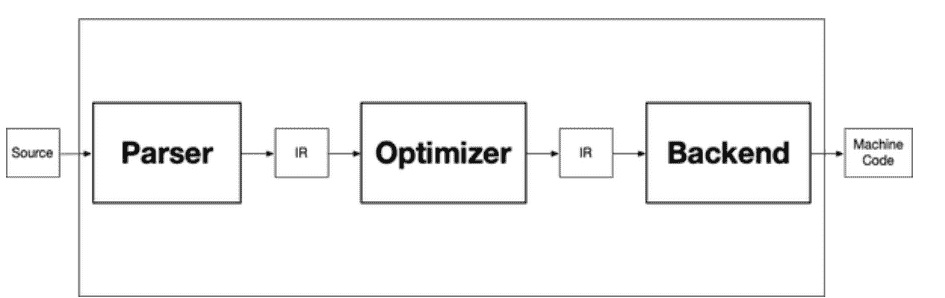
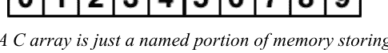
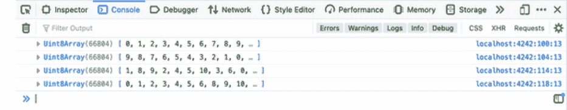
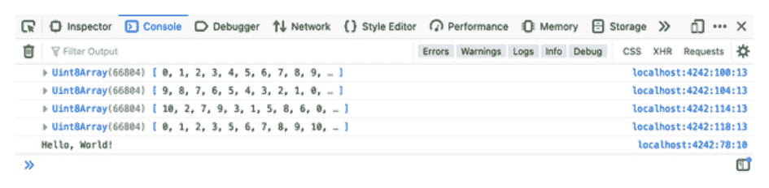

## 第 5 章. 使用 C/C++ 和 WebAssembly

### 早期发布读者的注意

使用 Early Release 电子书，你可以在这些标题的正式发布之前很久就利用这些技术——作者在写作时的原始未编辑内容，以便你可以在这些技术正式发布之前利用它们。

这将是最终书籍的第 5 章。

如果你对我们如何改进本书的内容和/或示例有任何评论，或者如果你注意到本章中缺少材料，请联系作者 wasmbook@bosatsu.net。

> *C 编程语言 — 一种将汇编语言的灵活性与汇编语言的强大功能相结合的语言。*
> 
> —匿名

这在我们的讨论中标志着一个转折点。迄今为止，我们一直完全专注于 WebAssembly 及其直接相关的工具和技术。如我们所见，这是一种探索平台提供的功能的有用方式，但这是一种低效的开发新软件的思考方式。更高级别的编程语言长期以来将我们的职业提升到了处理低级指令集的惯性细节之上。用语法清晰和语义丰富的语言表达逻辑简单得多，也更高效。

为了真正欣赏 WebAssembly 提供的功能，我们需要考虑其中一种编译为它的源语言。重点是并非每个问题都适合用 JavaScript 表达，因此拥有选项


使用另一种语言来提高性能、表达清晰度或简单地重用现有代码是很有吸引力的。

C 语言¹ 是世界上最重要的、最广泛使用的编程语言之一。我在高中时就在我的 Atari ST 电脑上开始玩弄它。我在 *Computer Language* 杂志上读到过它，一位朋友给了我一本同名、开创性的书籍 *The C Programming Language*，作者是 Brian Kernighan 和已故的、伟大的 Dennis Ritchie²。

C 语言有大量的软件可用，其中很多只需重新编译即可移植到 WebAssembly。我们将在第 6 章讨论移植现有库，但现在我们将学习一些 C 语言，以及我们如何利用它来改进迄今为止尝试的一些工作。

### 使用 C 函数

C 函数在许多方面都类似于 JavaScript 函数。它有自己的词法结构，它不附加到类或结构体等更大的单元上。它可能接受参数，也可能不接受参数。它只能返回单个值并且不支持异常，因此错误处理通常比 C++、Java 或 JavaScript 更原始。

在示例 5-1 中，有我们从第 2 章开始的年龄计算函数的 C 实现。注意它在说明正在发生的事情时要简单得多。这个示例甚至有一些基本的错误处理来处理出生年份大于当前年份的错误参数的情况。撇开来自未来的时间旅行访客的出现不谈，这不应该发生，我们应该处理它。更高层的语言只是对人类来说更容易用来表达业务需求的逻辑。

*Example 5-1. A simple C program.*

```
#include <stdio.h>

int howOld(int currentYear, int yearBorn) {

    int retValue = -1;
    
if(yearBorn <= currentYear) {
    retValue = currentYear - yearBorn;
}

return retValue;
}
```

```
int main() {
    int age = howOld(2021, 2000);

    if(age >= 0) {
        printf("You are %d!\n", age);
    } else {
        printf("You haven't been born yet.");
    }
}
```

不幸的是，计算机不理解这些更高层的语言，所以我们需要将它们转换为二进制机器表示以供执行。如果你只做过 JavaScript 编程，这个过程可能有点陌生。作为一种解释型语言，你编写 JavaScript 然后直接运行它。和所有事情一样，有取舍。开发人员方便的东西在运行时通常会显著变慢，而 C 和 C++ 长期以来一直主导着性能³。

鉴于其成熟度和对我们行业的<|message|>重要性，有许多优秀的商业和开源 C 编译器。这包括 GNU/Linux C 编译器 gcc 和 LLVM 的 clang 编译器。我们将重点关注后者，原因很快就会变得清晰。你需要按照附录 A 中所述安装 LLVM 才能运行以下内容。即使在默认使用 clang 的 macOS 上，如果没有安装 LLVM 的 WebAssembly 支持，也并非所有命令都能开箱即用。

在最简单的形式中，我们可以按如下方式将 C 程序转换为可执行文件：

```
brian@tweezer ~/g/w/s/ch05> clang howold.c
brian@tweezer ~/g/w/s/ch05> ls -laF
total 112
drwxr-xr-x  4 brian  staff  128 Feb 14 14:35 ./
drwxr-xr-x  6 brian  staff  192 Feb 14 14:32 ../
```

```
-rwxr-xr-x  1 brian  staff  49456 Feb 14 14:35 a.out*
-rw-r--r--  1 brian  staff     343 Feb 14 14:36 howold.c
```

出于历史原因，生成的可执行文件称为 *a.out*。你稍后会看到如何更改它。现在，我们可以执行程序：

```
brian@tweezer ~/g/w/s/ch05> ./a.out
You are 21!
```

这之所以有效，是因为生成的可执行文件已被转换为 macOS 知道如何运行的合适格式。它是一个针对 64 位平台的 Intel x86 指令集的 *Mach-O* 可执行文件。

```
brian@tweezer ~/g/w/s/ch05> file a.out
a.out: Mach-O 64-bit executable x86_64
```

该程序无法在 Windows 或 Linux 机器上运行。在没有它们新的仿真层的情况下，它甚至无法在苹果新的基于 ARM 的机器上运行。这是因为 CPU 有一个指令集，涉及将值加载到寄存器中、在 CPU 上调用功能并将结果存储在内存中。重新运行 clang 以生成汇编语言输出而不是二进制可执行文件可以让你看到这对于该架构是什么样的：

```
brian@tweezer ~/g/w/s/ch05> clang -S howold.c
```

这会生成示例 5-2 中所示的文件。

#### Example 5-2. Assembly language generated for our simple application

```
.section    __TEXT,__text,regular,pure_instructions
.build_version macos, 11, 0      sdk_version 11, 1
.globl  _howOld                 ## -- Begin function howOld
.p2align        4, 0x90
_howOld:                        ## @howOld
.cfi_startproc
#### %bb.0:
    pushq   %rbp
.cfi_def_cfa_offset 16
.cfi_offset %rbp, -16
movq    %rsp, %rbp
```

```
.cfi_def_cfa_register %rbp
movl    %edi, -4(%rbp)
movl    %esi, -8(%rbp)
movl    $-1, -12(%rbp)
movl    -4(%rbp), %eax
cmpl    -8(%rbp), %eax
jg      LBB0_2
#### %bb.1:
movl    -8(%rbp), %eax
subl    -4(%rbp), %eax
movl    %eax, -12(%rbp)
LBB0_2:
movl    -12(%rbp), %eax
popq    %rbp
retq
.cfi_endproc
#### -- End function
.globl _main                ## -- Begin function main
.p2align 4, 0x90
_main:                      ## @main
.cfi_startproc
#### %bb.0:
pushq   %rbp
.cfi_def_cfa_offset 16
.cfi_offset %rbp, -16
movq    %rsp, %rbp
.cfi_def_cfa_register %rbp
subq    $16, %rsp
movl    $0, -4(%rbp)
movl    $2000, %edi         ## imm = 0x7D0
movl    $2021, %esi         ## imm = 0x7E5
callq   _howOld
movl    %eax, -8(%rbp)
cmpl    $0, -8(%rbp)
jl      LBB1_2
#### %bb.1:
movl    -8(%rbp), %esi
leaq    L_.str(%rip), %rdi
movb    $0, %al
callq   _printf
jmp     LBB1_3
LBB1_2:
leaq    L_.str.1(%rip), %rdi
movb    $0, %al
callq   _printf
LBB1_3:
movl    -4(%rbp), %eax
addq    $16, %rsp
```

```
popq    %rbp
retq
.cfi_endproc
#### -- End function
.section    __TEXT,__cstring,cstring_literals
L_.str:
#### @.str
.asciz  "You are %d\n!"
L_.str.1:
#### @.str.1
.asciz  "You haven't been born yet."
.subsections_via_symbols
```

正如你所见，它比我们的 C 程序冗长得多。诸如函数调用、循环和条件检查等高级构造需要许多低级指令来表达。我们需要一个实际的 Intel x86 芯片来运行，或者至少是一个仿真的芯片。在某种程度上，这在概念上与我们在前几章中看到的 Wat 文件相似。

我们之所以讨论 clang 作为示例 C 编译器，是因为它基于 LLVM 项目，具有现代、可插拔的架构⁴。这在现代世界中竞争指令集数量不断增加的情况下非常重要，例如 X86、ARM、RISC-V，新的编程语言不断出现，例如 Rust、Julia、Swift，以及总体上希望无论源语言如何都能重用通用优化的愿望。

在图 5-1 中，你可以看到这是一个三部分的过程。源代码由前端处理步骤解析。这将是特定于语言的。该步骤的输出是中间表示 IR，即一种假设但不存在的机器的指令集。它以可以由优化层操作的形式捕获所表达的逻辑。该过程涉及应用一个或多个转换，这些转换应具有使代码更快或更高效的效果，纯粹基于所表达的逻辑。循环可能会被展开⁵，未使用的代码可能会被消除，涉及常量的表达式可能会由编译器求值，因此它们无需在运行时求值，等等。最后一步发出针对特定运行时的本地指令集。就我们的目的而言，这显然是 Mach-O x86 64 位架构。



Figure 5-1. The LLVM pluggable compiler architecture

这些层中的任何一个都可以被其他东西替换。如上所述，Rust、Julia 和 Swift 等语言使用 LLVM 基础设施。这可以防止语言作者每次都从头开始。他们需要编写新的前端解析器，但可以利用现有的优化和后端工作。编译器研究人员可以开发新的优化，并在将其用于任意输入语言的 IR 之前在隔离环境中对其进行测试。就我们的目的而言，后端是最重要的可交换层。在 Linux 或 Windows 上，可以使用相同的最初两个层，但也会有机器特定的后端。

你通常可以通过一种称为交叉编译的过程生成与计算机本机运行时不同的后端。这对于定位可能未安装开发工具链的嵌入式系统很有用。这在持续集成和交付系统中也很实用，这样你就可以从同一个构建环境中定位多个平台。否则你可能需要为每个目标平台准备一个单独的构建环境。

Emscripten 工具链是为 asm.js 工作而开发的，并且基于 LLVM 和 clang，因此它只需要发出可优化的 JavaScript 子集，以便 C 程序可以在浏览器中运行。当 WebAssembly 指令集和平台最终被定义时，本质上，他们只需添加一个 WebAssembly 后端来发出它即可。我们将在下一章介绍该工具链，但希望你已经了解了更高层语言如何被编译


转换为可以进一步转换为高效原生表示的通用形式。

我们的 LLVM 安装应原生支持 WebAssembly 作为后端。为双重检查，尝试以下操作：

```
brian@tweezer ~/g/w/s/ch05> llc --version
LLVM (http://llvm.org/):
    LLVM version 11.0.1
Optimized build.
Default target: x86_64-apple-darwin20.2.0
Host CPU: skylake

Registered Targets:
    aarch64      - AArch64 (little endian)
    aarch64_32   - AArch64 (little endian ILP32)
    aarch64_be   - AArch64 (big endian)
    arm          - ARM
    arm64        - ARM64 (little endian)
    arm64_32     - ARM64 (little endian ILP32)
    nvptx        - NVIDIA PTX 32-bit
    nvptx64      - NVIDIA PTX 64-bit
    ppc32        - PowerPC 32
    ppc64        - PowerPC 64
    ppc64le      - PowerPC 64 LE
    r600         - AMD GPUs HD2XXX-HD6XXX
    riscv32      - 32-bit RISC-V
    riscv64      - 64-bit RISC-V
    wasm32       - WebAssembly 32-bit
    wasm64       - WebAssembly 64-bit
    x86          - 32-bit X86: Pentium-Pro and above
    x86-64       - 64-bit X86: EM64T and AMD64
    xcore        - XCore
```

我已为长度编辑了支持的目标列表（它更长！），但仍想展示大多数主要平台都受支持。为了简化我们的即时使用，我将把程序中独立的 main() 功能替换为仅下面的 age 计算函数。

#### 示例 5-3. 仅 howOld 函数。

```
int howOld(int currentYear, int yearBorn) {
    int retValue = -1;
```
```
if(yearBorn <= currentYear) {
    retValue = currentYear - yearBorn;
}

return retValue;
}
```

要将其编译为 WebAssembly，我们可以使用以下命令：

```
brian@tweezer ~/g/w/s/ch05> clang --target=wasm32 -nostdlib -Wl,--no-entry ↵
-Wl,--export-all howold2.c -o howold.wasm
```

`--target=wasm32` 指令针对 32 位 WebAssembly 平台。`-nostdlib` 告诉它不要链接标准库，因为我们最初并不打算在函数可直接使用的位置运行该函数（即浏览器）。`--no-entry` 和 `--export-all` 指令告诉链接器不要期望 main() 函数并保留所有函数以供导出。没有后者的提示，优化过程可能会消除未使用的函数，因为从技术上讲没有任何东西在调用它们。`-o howold.wasm` 指定输出文件。

我们剩下的是一个可工作的 Wasm 模块，我们知道如何从前几章中探索和使用它。文件中有很多新的噪音，但基本情况保持不变。我们拥有类型、函数、内存以及我们目前将忽略的各种内存管理细节。

```
brian@tweezer ~/g/w/s/ch05> wasm-objdump -x howold.wasm

howold.wasm:    file format wasm 0x1

Section Details:

Type[2]:
  - type[0] () -> nil
  - type[1] (i32, i32) -> i32
Function[2]:
  - func[0] sig=0 <__wasm_call_ctors>
  - func[1] sig=1 <howOld>
Table[1]:
```
```
- table[0] type=funcref initial=1 max=1
Memory[1]:
  - memory[0] pages: initial=2
Global[7]:
  - global[0] i32 mutable=1 - init i32=66560
  - global[1] i32 mutable=0 <__dso_handle> - init i32=1024
  - global[2] i32 mutable=0 <__data_end> - init i32=1024
  - global[3] i32 mutable=0 <__global_base> - init i32=1024
  - global[4] i32 mutable=0 <__heap_base> - init i32=66560
  - global[5] i32 mutable=0 <__memory_base> - init i32=0
  - global[6] i32 mutable=0 <__table_base> - init i32=1
Export[9]:
  - memory[0] -> "memory"
  - func[0] <__wasm_call_ctors> -> "__wasm_call_ctors"
  - func[1] <howOld> -> "howOld"
  - global[1] -> "__dso_handle"
  - global[2] -> "__data_end"
  - global[3] -> "__global_base"
  - global[4] -> "__heap_base"
  - global[5] -> "__memory_base"
  - global[6] -> "__table_base"
Code[2]:
  - func[0] size=2 <__wasm_call_ctors>
  - func[1] size=134 <howOld>
Custom:
  - name: "name"
  - func[0] <__wasm_call_ctors>
  - func[1] <howOld>
Custom:
  - name: "producers"
```

在示例 5-4 中，我们使用新的模块根据 HTML 输入范围设置计算年龄。这显然不是我们必须用 C 编写的函数，但我们暂时保持简单。我们有一个 range `<input>` 元素，其最大值在 WebAssembly 模块加载后设置为当前年份。我们任意将最小值设置为过去 100 年。我们有一个名为 updateLabels 的函数，用于在值更改时设置元素上的值，以及另一个函数用于在滑块值更改时重新计算某人的年龄。监听函数调用我们的模块，使用 currentYear 和滑块的当前值来计算差值。

##### 示例 5-4. 在 HTML 中使用 howOld 函数。

```
<!doctype html>
<html lang="en">
    <head>
        <meta charset="utf-8">
        <link rel="stylesheet" href="bootstrap.min.css">
        <title>How Old Are You?</title>
        <script src="utils.js"></script>
    </head>
    <body>
        <div id="container" class="container" style="width: 80%">
            <h1>How Old Are You?</h1>
            <label for="year" id="yearborn" class="form-label">Year Born</label>
            <input type="range" class="form-range" id="year" name="year" value="0"/>
            <div class="form-label">You are: <span id="age"/></div>
        </div>

        <script>
            var d = new Date();
            var currentYear = d.getFullYear();
            var slider = document.getElementById("year");
            var yearBorn = document.getElementById("yearborn");
            var ageSpan = document.getElementById("age");

            fetchAndInstantiate('howold.wasm').then(function(instance) {
                slider.setAttribute("min", currentYear - 100);
                slider.setAttribute("max", currentYear);

                var updateLabels = function(val, age) {
                    yearBorn.innerText = "Year Born: " + val;
                    ageSpan.innerText = age;
                };

                var listener = function() {
                    var age = instance.exports.howOld(currentYear, slider.value);
                    updateLabels(slider.value, age);
                };

                slider.onchange = listener;
                slider.oninput = listener;
                slider.value = "1972";

                updateLabels(1972, 49);
            });
        </script>
```
```
</body>
</html>
```

渲染后的 HTML 应类似于图 5-2。


图 5-2. 我们用于计算某人年龄的 HTML 应用程序。

### 事情变得复杂

现在你已经看到了使用 C 与 WebAssembly 的基础，现实是，我们并没有使用该语言的太多部分。我向你展示了一个简单的示例，它将几个数字传递给一个仅返回单个数字的函数。这与我们迄今为止所做的事情并没有实质性不同。

更复杂的 C 程序将很难如此简单地映射到你所接触到的平台上。我们已经提到过关于“Hello, World!”程序的问题：浏览器中没有 printf() 函数可供程序使用。还有 C 程序的结构以及内存如何分配和清理的问题。将各种编译的软件文件链接在一起的过程在我们正在探索的这个世界中也是根本不同的。

好消息是，大多数这些问题都可以由工具和运行时平台处理。坏消息是，细节很快变得相当复杂。如果你以前从未做过任何 C 编程，将会有许多新想法。本书无法教你所有内容，但我会尝试突出该语言与 WebAssembly⁶ 之间的特定交互。

想象一个不带参数并返回数组总和的简单函数。示例 5-5 就有这样一个示例。忍耐一下，我暂时任意保持简单。在此代码中，我们没有参数，编译器可以知道数组需要多大，因为我们用前十个数字对其进行初始化。

#### 示例 5-5. 一个简单的 C 函数

```
int addArray() {
    int retValue = 0;
    int array[] = {0, 1, 2, 3, 4, 5, 6, 7, 8, 9};

    for(int i = 0; i < 10; i++) {
        retValue += array[i];
    }

    return retValue;
}
```

如果我们尝试编译此程序，我们可能会收到警告，因为 clang 预计会有 main() 程序。记住，这是操作系统知道从哪里开始的方式，如我们在第 3 章中所讨论的。因为它找不到此名称的方法，所以无法将所有内容链接到独立运行时。

```
brian@tweezer ~/g/w/s/ch05> clang simple.c -o simple.o
Undefined symbols for architecture x86_64:
  "_main", referenced from:
      implicit entry/start for main executable
ld: symbol(s) not found for architecture x86_64
clang-11: error: linker command failed with exit code 1 (use -v
to see invocation)
```


没问题。这是一个简单的修复。我们只需告诉 clang 编译代码但不链接它，使用 -c 选项即可：

```
brian@tweezer ~/g/w/s/ch05> clang -c simple.c -o simple.o
brian@tweezer ~/g/w/s/ch05> ls -laF simple.*
-rw-r--r--  1 brian  staff     170 Feb 19 15:27 simple.c
-rw-r--r--  1 brian  staff    1060 Feb 19 15:43 simple.o
```

这生成了一个包含函数定义的 object 文件。nm 命令⁷ 显示了编译文件中包含的内容：

```
brian@tweezer ~/g/w/s/ch05> nm -a simple.o
                U ___stack_chk_fail
                U ___stack_chk_guard
0000000000000000 T _addArray
                U _memcpy
00000000000000a0 s l___const.addArray.array
```

起初这可能令人困惑，但经过一些解释，思路应该足够清晰。我们的函数 addArray() 在 object 文件中被定义为一个 text 段符号。三个带有 U 符号类型的项目表示它们是未定义的。这些特定符号指的是出于安全原因自动链接的一些缓冲区溢出保护方法和一个用于从一个位置复制内存到另一个位置的函数。要使代码可执行，需要这些函数的定义，但这正是链接阶段和像 libc 这样的可重用库所提供的。

我们最终得到的是一个不完整的可执行文件，但我们函数的二进制表示是正确形成的。如果我们提供一个 main() 方法并链接可执行文件，我们就可以演示它的工作原理。在示例 5-6 中，我们的函数由驱动程序调用。

#### 示例 5-6. 一个用于调用我们函数的 main() 方法。

```
#include <stdio.h>

extern int addArray();

int main() {
    int sum = addArray();
```
```
printf("The array sum is: %d\n", sum);
}
```

请注意，我们必须告诉编译器关于我们 addArray() 函数的定义，因为它未定义在此文件中。extern 关键字提供了一个承诺，即将存在一个名为此且不带参数并返回整数的东西可用。因此，将此函数的结果赋给一个名为 sum 的整数变量是可以的。然后它被传递给 printf() 函数，在那里被格式化为人类友好的输出消息，指示累积的和。

要构建可执行文件，我们编译 simplemain.c 和 simple.c 文件并将结果存储在名为 simplemain 的可执行文件中。因为我们没有包含 -c 选项，所以它会执行链接。这不再抱怨，因为我们确实提供了 main() 方法的定义。

```
brian@tweezer ~/g/w/s/ch05> clang simplemain.c simple.c -o simplemain
brian@tweezer ~/g/w/s/ch05> ls -laF simplemain
-rwxr-xr-x  1 brian  staff  49640 Feb 19 16:01 simplemain*
brian@tweezer ~/g/w/s/ch05> ./simplemain
The array sum is: 45
```

如果我们对最终的可执行文件使用 nm 程序，你会注意到我们这次提供了所需的一切。未定义的符号预计将在程序运行时由动态库提供。它们被排除在二进制之外以保持大小较小。

```
brian@tweezer ~/g/w/s/ch05> nm -a simplemain
                 U ___stack_chk_fail
                 U ___stack_chk_guard
0000000100008018 d __dyld_private
0000000100000000 T __mh_execute_header
0000000100003ea0 T _addArray
0000000100003e70 T _main
                 U _memcpy
                 U _printf
                 U dyld_stub_binder
```

现在我们有一个可工作的程序，让我们回到示例 5-5 中展示的函数。这之所以有效，是因为我们使用了字面语法来初始化数组。我们没有指定数组需要多大，因为编译器可以算出来。在内存中，它已分配了足够内存来容纳那么多整数。此分配是在栈上完成的，因此当我们返回函数时无需额外的清理。我们最终在内存中得到一个足够大的位置来存储我们要求和的数字，如图 5-3 所示。



图 5-3. C 数组只是一个存储我们数据的内存命名部分

如果我们告诉编译器它需要多大，但随后给它比那更多的数字会怎样？在示例 5-7 中，我们告诉编译器我们只期望数组中有五个整数，但随后给了它十个。在某些圈子里这被称为 blivet⁸。通过以下讨论，我希望向你展示编译器如何帮助你在编辑代码时通过对错误的反馈来得出更正确的解决方案。这发生在我们尝试运行代码之前，而在解释型语言中我们通常在那里发现问题。

#### 示例 5-7. 我们函数的损坏版本。

```
int addArray() {
    int retValue = 0;
    int array[5] = {0, 1, 2, 3, 4, 5, 6, 7, 8, 9};

    for(int i = 0; i < 10; i++) {
        retValue += array[i];
    }

    return retValue;
}
```

幸运的是，这也是编译器很容易检测到的。它会指出我们在胡闹并给出一个警告。

```
brian@tweezer ~/g/w/s/ch05> clang -c simple.c -o simple.o
    int array[5] = {0, 1, 2, 3, 4, 5, 6, 7, 8, 9};
```

1 warning generated.

如果我们想从函数返回一个数组会怎样？在示例 5-8 中我们尝试这样做，但很快就会发现它行不通。

#### 示例 5-8. 尝试从函数返回数组但不成功的尝试。

```
int[] generateArray() {
    int array[] = {0, 1, 2, 3, 4, 5, 6, 7, 8, 9};
    return array;
}
```

即使我们所做的看起来合理，编译器再次告知我们我们做得不对。

```
brian@tweezer ~/g/w/s/ch05> clang -c simple2.c -o simple2.o
simple2.c:1:22: error: brackets are not allowed here; to declare an array, place the brackets after the identifier
int[] generateArray() {
  ~~
     ^
     []
simple2.c:1:20: error: function cannot return array type 'int []'
int[] generateArray() {
     ^
simple2.c:3:10: warning: incompatible pointer to integer conversion returning 'int [10]' from a function with result type 'int' [-Wint-conversion]
    return array;
           ^~~~~
simple2.c:3:10: warning: address of stack memory associated with local variable 'array' returned [-Wreturn-stack-address]
    return array;
           ^~~~~
2 warnings and 2 errors generated.
```

数组名在 C 中是特殊的变量。它们是内存中存储这些值的连续块地址的占位符。我们可以引入一个指向整数的指针并将其赋值为数组开头的地址。为了访问该位置的值，我们必须使用解引用运算符，*。

#### 示例 5-9. 使用指向数组的指针

```
#include <stdio.h>

void generateArray() {
    int array[] = {0, 1, 2, 3, 4, 5, 6, 7, 8, 9};
    int * a = array;
    printf("a is %p\n", a);
    printf("The first value is: %d\n", *(a));
    printf("The second value is: %d\n", *(a + 1));
    printf("The third value is: %d\n", *(a + 2));
}

int main() {
    generateArray();
}
```

数组中的第一个值位于数组开头，因此我们可以用 *a 访问它。第二个整数在下一个内存地址上，所以我们在解引用之前先将一加到数组基址上。第三个值在两个位置之后。

编译我们的程序并运行它会显示我们期望的输出。你的 a 的地址值可能不同，但它应该看起来相似。

```
brian@tweezer ~/g/w/s/ch05> clang simple3.c -o simple3
brian@tweezer ~/g/w/s/ch05> ./simple3
a is 0x7ffee f3a9720
The first value is: 0
The second value is: 1
The third value is: 2
```

编译器对示例 5-8 中的代码大喊大叫的原因是我们不能像尝试的那样返回一个数组。相反，你必须返回一个指针。

我们再次尝试在示例 5-10 中返回我们的数组。


#### 示例 5-10. 再次不成功的尝试从函数返回数组。

```
#include <stdio.h>

int * generateArray() {
    int array[] = {0, 1, 2, 3, 4, 5, 6, 7, 8, 9};
    return array;
}

int main() {
    int * a = generateArray();
    printf("a is %p\n", a);
    printf("The first value is: %d\n", *a);
    printf("The second value is: %d\n", *(a + 1));
    printf("The third value is: %d\n", *(a + 2));
}
```

再次，我们失败了。

```
brian@tweezer ~/g/w/s/ch05> clang simple4.c -o simple4
simple4.c:5:10: warning: address of stack memory associated with local variable
'array' returned [-Wreturn-stack-address]
    return array;
          ^~~~~
1 warning generated.
```

这次编译器告诉我们，我们正在返回对栈上内存的引用。如果你还记得我在上面说过的函数返回时发生的事情。我们的指针指向的内存会在我们甚至还没机会使用它之前就被丢弃。

这就是为什么我们需要能够在堆上分配内存的能力。它在我们告诉 C 运行时不再需要它之前一直有效。在堆上分配内存最简单的方法是使用 malloc() 函数。

我们终于在示例 5-11 中有了一个可工作的代码示例。malloc() 函数由标准库提供，因此我们包含另一个带有其定义的头文件。我们需要告诉该函数分配多少内存，所以我们使用整数大小的某个倍数。好消息是

我们现在也可以创建任意大的数组。你可以看到这里我们将大小加倍到 20，然后迭代 0 到 19 之间的数字来填充我们的数组。最后我们返回结果并在 main() 方法中将其捕获为 int *。这与示例 5-9 中的 int * 行为一样，即使我们现在指向的是堆而不是栈。

#### *示例 5-11. 一个成功（但仍有缺陷）的尝试从函数返回数组*

```
#include <stdio.h>
#include <stdlib.h>

int * generateArray() {
    int * array = (int *) malloc(sizeof(int) * 20);
    for(int i = 0; i < 20; i++) {
        array[i] = i;
    }

    return array;
}

int main() {
    int * a = generateArray();
    printf("a is %p\n", a);
    printf("The first value is: %d\n", *a);
    printf("The second value is: %d\n", *(a + 1));
    printf("The third value is: %d\n", *(a + 2));
}
```

编译并运行我们的新程序终于给我们带来了一些喜悦。

```
brian@tweezer ~/g/w/s/ch05> clang simple5.c -o simple5
brian@tweezer ~/g/w/s/ch05> ./simple5
a is 0x7fae22c059e0
The first value is: 0
The second value is: 1
The third value is: 2
```

在你变得太过自在之前，我们的程序仍然存在一个缺陷。因为我们打印出结果然后退出，所以这不是一个大问题，但它是那种会让 C 程序员（以及他们的用户）抓狂的问题。我们忘了释放我们分配的内存！如果这是一个

服务器或长期运行的程序并且我们多次调用我们的函数，我们最终可能会耗尽内存。

为了解决这个问题，我们只需要调用 `free()` 函数来告诉运行时我们已完成对该内存的使用。一旦我们这样做，我们就不能再触碰它了。这突出了你在用 C 编写程序时需要考虑的众多问题之一。

- 在你分配内存之前不要使用内存。
- 不要用你分配的内存创建 blivets。确保它们足够大。
- 在你完成使用后不要忘记释放你的内存。
- 在你释放内存后不要使用你的内存。

忘记其中任何一条规则都可能导致你的程序崩溃或耗尽内存。如果这听起来很麻烦，你会欣赏 Java、Python 和 JavaScript 等语言，它们为你缓解了一些这些问题。缺点是通常存在性能权衡，这就是 Rust 如此有吸引力的原因。它给你像 C 这样的语言的速度，而没有像 C 这样的语言的危险。我们将在第 10 章介绍 Rust。

在此之前，我们需要弄清楚所有这些对 WebAssembly 的含义。

### C/C++ 和 WebAssembly

对于下一节，我将使用一个更复杂的基础设施，它基于 Petter Strandmark⁹ 提供的示例项目，用于将 clang 和 WebAssembly 结合使用。在下一章我们将介绍 Emscripten 工具链以更轻松地将现有代码移植到 WebAssembly。最终，我们将介绍 WebAssembly Services Interface（WASI）来处理这些细节，但在那之前我们需要基础设施来帮助我们克服到目前为止看到的障碍。

这个基础设施有几个部分，但它在很大程度上是自包含的，我认为最终相当清晰。出于目前不值得深入讨论的原因，我们将使用 clang 编译器的 C++ 版本。我们没有时间在本章中教你 C++，所以我不会过多关注细节。有时我们需要让 C++ 代码表现得像 C，所以请在这方面跟随我。

我们将从一些 C/C++ 代码开始。这两种语言关系非常密切，但 C++ 提供了面向对象编程功能，使其更容易使用自然概念（例如订单、账户、用户等）建模域。我们不会关注这些区别，这就是我一直把这些语言放在一起提及的原因。在示例 5-12 中你可以看到我们将要使用的一些功能。为了保持可管理性，我现在不会向你展示所有内容。

#### 示例 5-12. 一些供我们调用的 C/C++ 函数

```
#include "nanolibC/libc.h"
#include "nanolibC/libc_extra.h"

#define WASM_EXPORT __attribute__((visibility("default"))) extern "C"

WASM_EXPORT int* get_memory_for_int_array(int size) {
    return new int[size];
}

WASM_EXPORT void free_memory_for_int_array(int* arr) {
    delete[] arr;
}

WASM_EXPORT void mergeSort(char *p, int length) {
    int c, d, swap;

    for(c = 0; c < length - 1; c++) {
        for( d = 0; d < length - c - 1; d++) {
            if(p[d] > p[d+1]) {
                swap = p[d];
                p[d] = p[d+1];
                p[d+1] = swap;
            }
        }
    }
```

```
WASM_EXPORT void reverse(unsigned char* p, int len) {
    for( int i = 0; i < len / 2; i++ ) {
        unsigned char temp = p[i];
        p[i] = p[len - i - 1];
        p[len - i - 1] = temp;
    }
}
```

首先会引起你注意的是 #include 语句。此代码使用 libc 库的非常小的实现，它为我们提供了 malloc()、free() 甚至 printf() 的工作版本（但先记下这一点）。头文件在 C/C++ 中允许我们广告函数的签名，以便编译器知道期望什么。

正如你在示例 5-13 中看到的，我们有一组可供链接的函数。为了确保它们作为 C 函数可见，我们使用 extern "C" 关键字来防止 C++ 编译器破坏它们的名字¹⁰。

#### 示例 5-13. 一个小型 libc 实现的头文件。

```
#ifndef _NANOLIB_C_H
#define _NANOLIB_C_H
#include <stdarg.h>
#include <stddef.h>

extern "C" {
    void* memcpy(void* dest, const void* src, size_t count);
    void* memset (void * dest, int value, size_t count);

    int puts ( const char * str );
    int printf(const char* format, ...);
    int sprintf(char* buffer, const char* format, ...);
    int snprintf(char* buffer, size_t count, const char* format, ...);
    int vsnprintf(char* buffer, size_t count, const char* format, va_list va);

    void* malloc(size_t amount);
    void* realloc(void *ptr, size_t size);
    void* calloc(size_t num, size_t size);
```

```
void free(void* mem);
}
```

```
#endif
```

回顾示例 5-12，我们有一个名为 get_memory_for_int_array() 的方法，它接受一个 size 参数来告诉我们分配多少内存。如果你仔细查看实现，它正在使用 C++ 的 new 操作符。对于我们的目的，只需假设这意味着与 malloc() 调用相同。free_memory_for_int_array() 函数通过使用 delete 操作符在作用上类似于 free() 调用。

有一个 #define 宏为这些函数提供外部可见性，这将确保它们可供将调用它们的 JavaScript 代码使用。

我们接下来有一个提供归并排序¹¹ 实现的函数，以及另一个反转数字数组的函数。

C/C++ 应用程序和库的构建系统不如例如 Rust 的 cargo 命令那样现代和友好，但它们是坚固且灵活的。我们将使用一个简单的基于 Makefile 的方法。这又是我们没有时间深入介绍的另一个细节，但基本上我们定义了一组规则来构建目标。当源代码更改时，它会导致依赖关系被重新评估并构建需要构建的任何内容。此文件的内容可通过本书的 Git 仓库获得，如果你想了解其工作原理。

要构建我们的代码，我们将使用 make 命令，它会让我们知道进展如何。

```
brian@tweezer ~/g/w/s/c/helloworld> make
... Lots of noise goes by...
brian@tweezer ~/g/w/s/c/helloworld> ls -laF *.wasm
-rwxr-xr-x  1 brian  staff  5309 Feb 19 20:03 library.wasm*
```

我将留给你自行详细探索模块的内容，但我想强调其中一部分的几个要点。注意我们的


module 导出它自己的内存。你可以更改此行为，从 JavaScript 端导入一个 Memory 实例，但我们现在不会这样做。

目前你需要关注的是，我们的 C/C++ 代码有一个 libc 的微小实现，它会从导出的 Memory 实例中分配和释放内存，在第 4 章之后，这应该会让你开始思考。

```
brian@tweezer ~/g/w/s/c/helloworld> wasm-objdump -x library.wasm
...
Export[11]:
  - memory[0] -> "memory"
  - func[1] <get_memory_for_int_array> -> "get_memory_for_int_array"
  - func[14] <_Znam> -> "_Znam"
  - func[3] <free_memory_for_int_array> -> "free_memory_for_int_array"
  - func[16] <_ZdaPv> -> "_ZdaPv"
  - func[5] <debug_dump_memory> -> "debug_dump_memory"
  - func[7] <mergeSort> -> "mergeSort"
  - func[8] <reverse> -> "reverse"
  - func[9] <helloWorld> -> "helloWorld"
  - func[11] <_Znwm> -> "_Znwm"
  - func[15] <_ZdlPv> -> "_ZdlPv"
...
```

接下来我们需要一些 HTML 代码来调用我们的 C/C++ 行为。大部分结构与我们之前看到的类似，但我将在示例 5-14 中突出显示你需要理解的部分。

#### Example 5-14. The relevant portions of our HTML file

```
<script>
let wasm;

...

WebAssembly.instantiateStreaming(fetch('library.wasm'),
importObject).then(
  function(obj) { ①
    wasm = obj; ②

    const ptr = wasm.instance.exports.get_memory_for_int_array(10);
```
```
const memory = new
Uint8Array(wasm.instance.exports.memory.buffer); ④
const nums = memory.subarray(ptr); ⑤

for(var i = 0; i < 10; i++) {
    nums[i] = i;
}

console.log(nums);

wasm.instance.exports.reverse(ptr, 10); ⑥

console.log(nums);

var arr = [0, 1, 2, 3, 4, 5, 6, 7, 8, 9, 10]; ⑦

shuffleArray(arr);

for(var i = 0; i < 10; i++) {
    nums[i] = arr[i];
}

console.log(nums);

wasm.instance.exports.mergeSort(ptr, 10); ⑧

console.log(nums);

wasm.instance.exports.free_memory_for_int_array(ptr); ⑨

...
}
</script>
```

① 模块在 JavaScript 主机中以通常的方式创建。

② 我们希望在模块可用后在其他地方访问模块实例。

③ 在模块中为十个整数初始化足够的空间。我们捕获返回的“指针”。

④ 使用 Uint8Array 包装底层缓冲区。

+   5 创建一个子 Uint8Array，覆盖之前返回的“指针”所引用的部分。
+   6 调用模块中的 reverse() 方法。
+   7 我们依赖 JavaScript 功能来洗牌一些数据。
+   8 使用对“指针”的引用调用 mergeSort() 方法。
+   9 在模块侧释放内存。

我们开始时通过 HTTP 提供 HTML 和 WebAssembly 模块，就像我们之前做过的那样。模块使用与之前相同的实用程序库加载和实例化，即使它是通过完全不同的过程生成的。一旦模块实例可用，我们将变量分配给在该块词法作用域之外定义的另一个变量，以便我们可以在其他地方使用它。

由于我们的 C/C++ 代码一侧并不了解正在发生的事情，我们必须从 JavaScript 侧为其分配足够的内存来存储数据。之前我们只是直接将数据写入导出的 Memory 实例。因为我们要模拟指针，所以我们必须在该侧创建看起来合适的东西。我们调用 get_memory_for_int_array() 函数并要求它为十个整数分配空间。该函数在 C/C++ 侧返回一个指针。从这一侧来看，它更确切地被认为是“指针”。它并不是直接引用堆中的位置，就像你之前看到的那样。相反，它是小型 libc 实现分配数据到的底层缓冲区中的一个索引。我们将使用此引用作为偏移量，当我们将其传回另一侧时。

我们用 Uint8Array 包装器包围底层 ArrayBuffer，以便我们可以轻松地从这一侧写入 8 位整数。如果你回顾示例 5-12 中的代码，你可能会注意到我们的排序和反转函数

接受 char *。C 可以通过在 int、char、地址、布尔值等之间进行自动类型强制转换而非常灵活。它极其灵活，通常也很 buggy。这些字符不能大于 8 位，因此最大大小为 255。我们用 Uint8Array 包装缓冲区是为了方便，不必担心这个问题。

在此之后，为从我们的“指针”开始的部分生成一个 Uint8Array 的子数组。这使我们能够忽略可能在我们的数组之前分配的任何内容，并且我们可以方便地使用 JavaScript 数字写入其中。这些结果被转储到控制台以向你展示正在发生的事情。

下一步是调用 reverse() 函数。此实现是以它只是在内存中交换值的感知编写的，值得注意的是它不需要更改。我们不需要从此函数返回任何值，因为数组已就地反转。这是 C 可以如此快速的原因之一。它避免创建大量不必要的内存，并且检索值和遍历内存位置的开销非常低。在 JavaScript 侧，我们的“指针”仍将指向新反转数组的开头，该数组会被转储到控制台以便更清晰。

为了展示排序功能，我们需要一些洗牌的数据。当然本可以在 C 中编写这样的代码，但我们需要依赖随机数生成器进行洗牌算法。那会使我们的依赖变得复杂，所以我们只是依赖 JavaScript 对随机数生成的支持。你可能会在某些时候决定依赖浏览器的行为，有时又依赖 WebAssembly 模块中表达的代码。

新创建的数组被填充、洗牌并转储到控制台。我们将洗牌后的值写回 C/C++ 数组中由我们的“指针”指示的位置，然后调用 mergeSort() 功能。这也是在假设它可以访问内存中的位置的情况下编写的，因此它能高效地重新排序数据以进行排序。

当我们返回到 JavaScript 时，我们将结果转储到控制台，然后释放我们分配的内存，因为我们不再使用它。

在图 5-4 中，你可以看到我们迄今为止最复杂的示例的惊人结果。我们正在获得在浏览器中以接近原生速度运行的代码的重用好处。对于小型数据集，开销可能仍然不值得，但很容易在其他情况下证明它是值得的。



Figure 5-4. The results of intermixing our JavaScript and C/C++ via WebAssembly

### Finally, “Hello, World!” in WebAssembly

这是一项相当艰巨的努力，但我希望可能性的现实开始变得清晰。我们还有很多东西要向你展示，但，是时候我兑现承诺给你一个“Hello, World!”示例了。为了保持简单，我不会有一个典型的 main() 程序。相反，我将把行为作为我们在 library.cpp 文件中的另一个函数公开。示例 5-15 展示了这有多简单。

#### Example 5-15. Hello, World! as a function in our C/C++ code.

```
WASM_EXPORT void helloWorld() {
    printf("Hello, World!\n");
}
```

如果我在 HTML 中的其他代码之后添加对这个新函数的调用，你可以在图 5-5 中看到结果。



Figure 5-5. The previously-promised Hello, World! results in all of their glory

How the heck did this work!?! And if it was so easy, why did we have to wait until the end of Chapter 5 to see it?

让我向你展示来自示例 5-16 的 HTML 中的更多细节。有一个新的函数调用 get_memory()，它只是返回一个 Uint8Array 实例。解码器和编码器变量可用于在字符串的 UTF-8 表示之间进行转换¹²。有一个名为 charPtrToString() 的函数，它会将“字符指针”（即 C 字符串）转换为 JavaScript 可用的 UTF-8 字符串。

更进一步我们有一个名为 printString() 的函数，它将使用要转储到控制台的 JavaScript 字符串进行调用。我们的 importObject 配置为在其中有一个名为 print_string 的方法，该方法会在调用方法将其转储到控制台之前将“字符指针”转换为字符串。importObject，你会回忆起，允许我们与模块实例共享功能和数据。

#### Example 5-16. Behind-the-scenes machinery to make Hello, World! work

```
<script>
function get_memory() {
  return new Uint8Array(wasm.instance.exports.memory.buffer);
}

const decoder = new TextDecoder("utf-8");
const encoder = new TextEncoder("utf-8");

function charPtrToString(str) {
const memory = get_memory();
let length=0;
for (; memory[str + length] !== 0 ;++length) {}
return decoder.decode(memory.subarray(str, str + length));
```


```
}
let printString = function(str) {
    console.log(str);
};

const importObject = {
    env: {
        print_string: function(str) {
            printString(charPtrToString(str));
        }
    }
};
...
</script>
```

这涵盖了 JavaScript 端。在 C/C++ 端，我们在示例 5-17 中看到 *nanolibC/libc_extra.h* 头文件定义了一个名为 `print_string()` 的函数，它接受一个 `char *`。

#### Example 5-17. Exposing JavaScript functions as C functions.

```
#ifndef _NANOLIB_C_EXTRA_H
#define _NANOLIB_C_EXTRA_H

extern "C" {
    // Will be provided by Javascript.
    void print_string(const char* str);
}

#endif
```

在 *nanolibC* 目录中有一个文件定义了我们的 `printf()` 实例。细节很复杂所以我不想深入，但我会指出它调用 `puts()` 来将 `char *` 输出到输出控制台。通常这是操作系统提供的低级服务，但根据你迄今为止所见，一旦我们在示例 5-18 中连接最后一步，我们的 JavaScript 处理程序会将其路由到其控制台。

#### Example 5-18. Exposing JavaScript functions as C functions.

```
int puts ( const char * str ) {
    print_string(str); ①
```

```
return 0;
}
```

1 puts() 调用 JavaScript 函数并传入一个 char *。

终于，我们看到了这是如何工作的。我们的函数调用 printf()，printf() 调用 puts()，而 puts() 被定义为调用提供的函数。我现在不想描述它是如何连接的，但我希望结果仍然令人满意。关于使用 C/C++ 与 WebAssembly 还有更多需要了解的知识，但那是即将出版的章节的主题。在此之前，你已经跨越了理解 WebAssembly 背后工作原理的重要鸿沟。接下来我们将学习如何将现有软件移植到浏览器中运行。

- 1 C 的历史是我们行业不可分割的一部分，也是现代操作系统开发的一部分。 https://en.wikipedia.org/wiki/C_(programming_language)

- 2 有史以来最受欢迎的编程书籍之一：
+   https://en.wikipedia.org/wiki/The_C_Programming_Language

- 3 以及安全问题的大部分份额！

- 4 LLVM 以前代表 Low-Level Virtual Machine，但现在它只是意味着 LLVM。 在 https://llvm.org 了解更多信息

- 5 循环展开是许多编程语言中常见的优化。
+   https://en.wikipedia.org/wiki/Loop_unrolling

- 6 如果你不介意一些烦人的广告，可以在 https://learn-c.org 找到一个有用的 C 教程。否则，Steve Oualline 的 Practical C Programming 或上述的 The C Programming Language 都是很好的入门书籍。

- 7 nm 是 C 世界中常见的工具，用于打印此类二进制文件的内容。

- 8 有时被称为“五磅袋装十磅粪肥”。装不下！

- 9 你可以在这里找到 Petter 的示例项目： https://github.com/PetterS/clang-wasm

- 10 本书超出范围涵盖这些细节，但如果你感兴趣，可以在这里找到更多信息： https://en.wikipedia.org/wiki/Name_mangling

- 11 Merge Sort 是一种 O(n log n) 复杂度的实用排序算法。实现起来很容易，这就是我选择它的原因。你可以在这里找到更多细节：
+   https://en.wikipedia.org/wiki/Merge_sort

- 12 Petter 在之前列出的 GitHub 仓库中的示例在 JavaScript 和 C 之间做了更多字符串的移动
