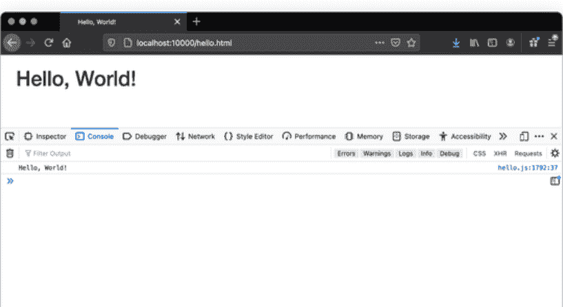
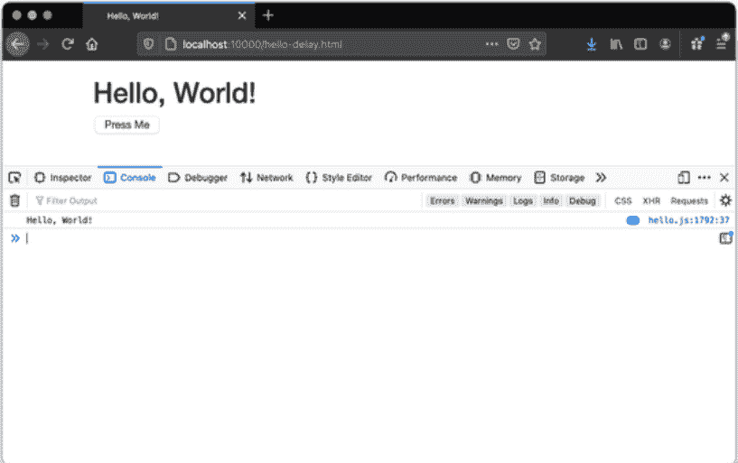
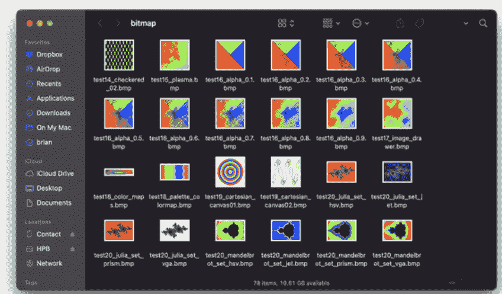
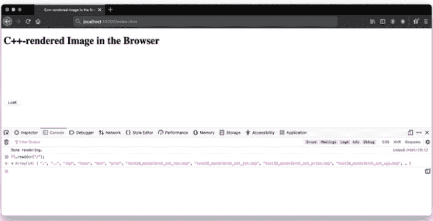
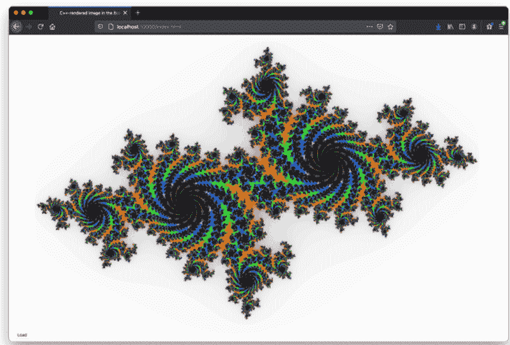
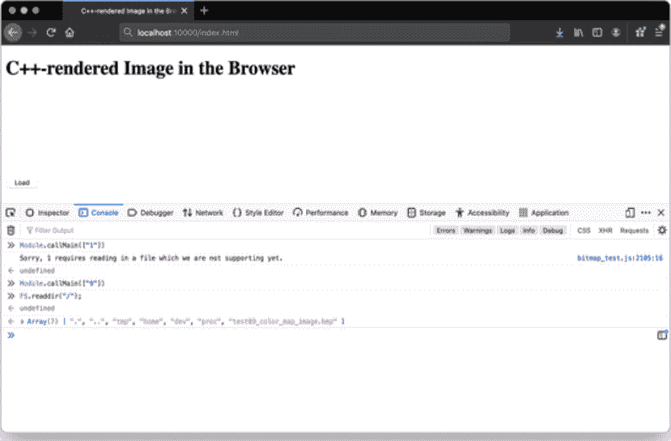
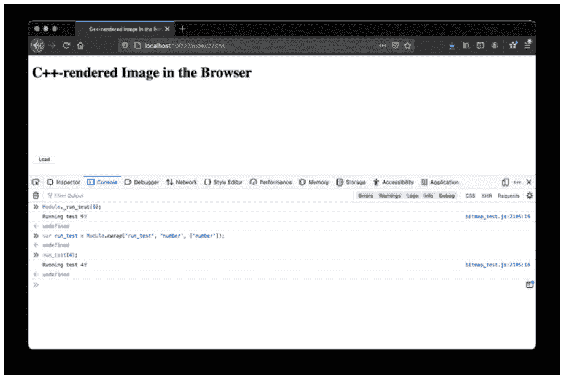

## Chapter 6. Applied WebAssembly : Legacy Code in the Browser

### A NOTE FOR EARLY RELEASE READERS

对于早期发布的电子书，你可以在作者撰写时获得书籍的最早形式——作者的原始未编辑内容，以便你可以在这些技术正式发布之前利用它们。

这将是最终书籍的第 6 章。

如果你对如何改进本书的内容和/或示例有任何评论，或者如果你注意到本章中缺少材料，请联系作者 wasmbook@bosatsu.net。

> 无论你走到哪里，那里都有你。

—Buckaroo Banzai

是时候更仔细地审视在浏览器中调用 C/C++ 代码的过程了。这些语言中的大多数代码从未打算以下载的形式在浏览器中运行。但正如香港骑士队¹的队长在上面的引语中告诉我们的，有时你会发现自己身处意想不到的新地方，但仍然只是你自己在那里。

我们出于各种原因对这样做感兴趣。取代 JavaScript 不是其中之一。至少对大多数人来说不是。相反，我们在外面的 C 和 C++ 等语言中拥有庞大的遗留代码库。其中很多非常有用，能够在我们的 Web 应用程序中访问它们将会很棒。其中一些可能将组织绑定到遗留系统。通过浏览器分发这些代码将是一个巨大的进步！

此外，简单地用 JavaScript 编写并不适合的一些问题。能够在不要求单独运行时机的情况下用另一种语言编写应用程序的该部分是非常有吸引力的。而且，正如我们的最终示例所示，让受信任来源提供的受信任代码为加密算法等敏感和棘手的软件提供出处具有真正的价值。能够简单地重新编译你认识的人编写的现有代码，并且他们知道自己在做什么，这也是一种有用的能力。

在上一章中，我们展示了使用像 clang 这样的常规 WebAssembly 启用的 C 编译器以及一些头文件和库依赖管理来实现基本集成是可能的。然而，手动提供我们自己的标准库版本并将 C 代码链接到提供的 JavaScript 很快就会变得过时。

幸运的是，Emscripten 项目已经为使这个过程比它可能更简单奠定了基础。这并不令人惊讶，因为其主要开发者 Alon Zakai 和 Luke Wagner 在从 asm.js 开始的工作中一直处于领先地位，扩展到 WebAssembly MVP 以及至今仍在进行的规范改进。Emscripten² 工具链在旅程的大部分时间里都在那里。

该项目基于 LLVM 平台。在前面的章节中，我指出它最初有一个自定义后端，发出 asm.js 的可优化 JavaScript 子集。一旦 WebAssembly 平台被定义，一个新的后端就能够发出 Wasm 二进制文件。

不幸的是，这只是解决方案的一部分。还需要支持将数据输入和输出内存、链接模块、包装现有库等。提供用户界面的 C 程序或监听网络请求的程序通常在响应输入活动的相当紧密的循环中旋转。鉴于浏览器默认是单线程环境，这种主循环将存在操作不匹配。Emscripten 工具链已被修改以解决将原生 C/C++ 移植到我们的 Web 环境中运行时可能出现的许多类型问题。与大多数主题一样，这不能是对该项目所做的一切的全面介绍，但我会尝试快速让你入门。

### Proper “Hello, World!”

所以，首先一个坦白：我们本可以在第 2 章就拥有一个在浏览器中工作的、未修改的“Hello, World!”示例。最后一次，我们将在示例 6-1 中向你展示代码。

#### Example 6-1. The typical “Hello, World!” program as expressed in C.

```
#include <stdio.h>

int main() {
    printf("Hello, World!\n");
    return 0;
}
```

使用 Emscripten C 编译器（安装说明可在附录 A 中找到），我们只需要告诉它编译 C 代码并生成一些 JavaScript 脚手架。之后它在 Node.js 中未修改运行。

```
brian@tweezer ~/g/w/s/ch06> emcc hello.c -o hello.js
brian@tweezer ~/g/w/s/ch06> ls -laF
total 520
drwxr-xr-x  7 brian  staff     224 Mar  1 14:45 ./
drwxr-xr-x  7 brian  staff     224 Mar  1 13:02 ../
-rw-r--r--  1 brian  staff  121457 Mar  1 13:05 bootstrap.min.css
-rw-r--r--  1 brian  staff      76 Mar  1 13:02 hello.c
-rw-r--r--  1 brian  staff     388 Mar  1 13:07 hello.html
-rw-r--r--  1 brian  staff  121686 Mar  1 14:45 hello.js
-rwxr-xr-x  1 brian  staff   11711 Mar  1 14:45 hello.wasm*
brian@tweezer ~/g/w/s/ch06> node hello.js
Hello, World!
```

示例 6-2 中的 HTML 文件不是通过此过程生成的，并且与我们之前看到的有 suspiciously 不同。有一个单一的 <script> 元素加载我们生成的 JavaScript。我们没有使用到目前为止使用的 utils.js 文件。相反，我们有一个更长的


上一条命令生成的 JavaScript 文件。看看那个文件列表！它超过 120 千字节！它有超过 2,000 行代码。如果你查看它，你可能会很快迷失方向。这就是为什么我在前几章中不想从那里开始的原因。

#### 示例 6-2. 与我们之前看到的截然不同的 HTML 文件。

```
<!doctype html>
<html lang="en">
    <head>
        <meta charset="utf-8">
        <link rel="stylesheet" href="bootstrap.min.css">
        <title>Hello, World!</title>
    </head>
    <body>
        <div class="container">
            <h1>Hello, World!</h1>
        </div>
        <script src="hello.js"></script>
    </body>
</html>
```

然而，如果我们通过 HTTP 提供此目录，打开浏览器并打开 JavaScript 控制台，你会看到与图 6-1 非常相似的内容。



图 6-1. 你被告知不可能的 Hello, World。

如果你在文件 hello.wasm 上使用 wasm-objdump 命令，你会注意到有一个导出的 main() 函数。生成的代码已经超出了我们能够展示整个文件的能力，因此我将只突出显示导出部分。

```
...
Export[13]:
  - memory[0] -> "memory"
  - func[3] <__wasm_call_ctors> -> "__wasm_call_ctors"
  - func[5] <main> -> "main"
  - func[6] <__errno_location> -> "__errno_location"
  - func[50] <fflush> -> "fflush"
  - func[47] <stackSave> -> "stackSave"
  - func[48] <stackRestore> -> "stackRestore"
  - func[49] <stackAlloc> -> "stackAlloc"
  - func[44] <emscripten_stack_init> -> "emscripten_stack_init"
  - func[45] <emscripten_stack_get_free> -> "emscripten_stack_get_free"
  - func[46] <emscripten_stack_get_end> -> "emscripten_stack_get_end"
  - table[0] -> "__indirect_function_table"
```

```
- func[53] <dynCall_jiji> -> "dynCall_jiji"
...
```

你会看到这里有相当多的生成的脚手架来使这一切工作。细节相当复杂，但如果你想追踪它，我建议使用 wasm2wat 生成相应的 Wat 文件。从那里，追踪 main() 函数（上面编号为 5）。你会看到类似示例 6-3 的内容。

#### 示例 6-3. Wat 中的 main 方法。

```
...
(func (;5;) (type 5) (param i32 i32) (result i32)
  (local i32)
  call 4
  local.set 2
  local.get 2
  return)
...
```

最终你会回到生成的 JavaScript 文件。在其中有一个名为 fd_write 的函数，如示例 6-4 所示。这被添加到一个名为 wasi_snapshot_preview1 的命名空间中。正如名称所暗示的，这是一个预览，我们将在后面的讨论中介绍，但主要目的是 Emscripten 工具链正在生成代码来解决我们在前几章中看到的一些低级麻烦。我们将在第 10 章中 Rust 生态系统中发现类似的工具。

#### 示例 6-4. printf 解决方案的一部分。

```
...
function _fd_write(fd, iov, iovcnt, pnum) {
  // hack to support printf in SYSCALLS_REQUIRE_FILESYSTEM=0
  var num = 0;
  for (var i = 0; i < iovcnt; i++) {
    var ptr = HEAP32[(((iov)+(i*8))>>2)];
    var len = HEAP32[(((iov)+(i*8 + 4))>>2)];
    for (var j = 0; j < len; j++) {
      SYSCALLS.printChar(fd, HEAPU8[ptr+j]);
    }
    num += len;
  }
  HEAP32[((pnum)>>2)] = num
  return 0;
```

}
...

完全没有必要深入细节来了解所有这些是如何工作的。重要的是你要理解，我们实际上并不是以典型的标准库意义上调用 printf()，而是该函数已被重写为调用生成的代码。在浏览器中，它会将字符路由到与开发者工具关联的 JavaScript 控制台。在 Node.js 环境中，它会被路由到底层系统控制台。在这个阶段重要的是，我们的遗留应用程序不需要更改即可在此新环境中运行，但我们也不必担心直接运行原生 C 和 C++ 的可怕前景。我们在可移植性、安全性和性能之间取得了关键平衡，这正是 WebAssembly 的全部意义所在。

生成的代码在 JavaScript 中有一个 Module 对象，它定义了我们的 WebAssembly 代码将占据的运行时环境。JavaScript 文件顶部有注释描述了该对象及其作为两个世界之间接口的作用。为了保持可管理性，我们将专注于其中的一个更小部分。

我们可用的选项之一是使用编译器指令来打开或抑制某些生成的行为。例如，我们可能不希望我们的 C 程序在 JavaScript 代码加载时立即运行。如果你尝试在不使用 INVOKE_RUN=0 指令的情况下编译，你会看到与上面相同的典型问候。在下面的片段中，注意当代码在 Node.js 中加载时，命令行上没有打印任何内容。

```
brian@tweezer ~/g/w/s/ch06> emcc hello.c -o hello.js -s INVOKE_RUN=0
brian@tweezer ~/g/w/s/ch06> node hello.js
brian@tweezer ~/g/w/s/ch06>
```

显然，如果你抑制了自动执行，你将希望能够指示应用程序何时可以执行。这可以用另一个指令完成。

```
brian@tweezer ~/g/w/s/ch06> emcc hello.c -o hello.js ↵
-s INVOKE_RUN=0 -s EXTRA_EXPORTED_RUNTIME_METHODS="
['callMain']"
```

在示例 6-5 中，你可以看到我们在按钮点击时调用 main() 函数。

#### 示例 6-5. 延迟的 main() 方法调用

```
<!doctype html>
<html lang="en">
  <head>
    <meta charset="utf-8">
    <link rel="stylesheet" href="bootstrap.min.css">
    <title>Hello, World!</title>
  </head>
  <body>
    <div class="container">
      <h1>Hello, World!</h1>
      <button id="press">Press Me</button>
    </div>
    <script src="hello.js"></script>
    <script>
      var button = document.getElementById("press");
      button.onclick = function() {
        try {
          Module.callMain();
        } catch(re) {
        }
      };
    </script>
  </body>
</html>
```

在图 6-2 中，友好的消息在按钮被按下时打印到控制台。Firefox 不会显示每个相同的消息，但它显示我已在右侧按下了按钮七次。你的浏览器可能在每次调用时显示一条打印消息。



图 6-2. 按下按钮触发的 Hello, World

### 移植第三方代码

我们现在将深入研究将一些现有代码带入浏览器。这段代码从未打算在网络上运行，并且做了你通常不期望在浏览器中工作的事情，例如写入文件系统。不要担心，我们不会破坏浏览器安全模型，但你会看到这段 C++ 代码如何基本未经修改即可运行。

Emscripten 有大量的选项可以将第三方代码移植到 WebAssembly。有效地有 cc、make 和 configure 的即插即用替代品，这通常使移植过程变得微不足道。实际上，你可能需要处理遇到的各种问题，但你可能会惊讶于过程的简易性。项目的网站³ 有很好的文档来帮助你。我的最爱介绍这个主题的资料是 Robert Aboukhalil 的精彩 Level Up With WebAssembly⁴ 资料。他带你逐步移植几个不同的开源项目到 WebAssembly 以在浏览器中运行

它们包括 Tetris、Pong 和 Pacman 等游戏。与其尝试重现他已经出色完成的工作，我将专注于一个相对简单且干净的项目。

我花了一些时间寻找合适的候选代码。我想要一些有分量但不过于庞大的东西。最终我找到了 Arash Partow 在其网站 https://www.partow.net 上收集的优雅、干净、许可合适且有用的 C++ 代码。如果你去那里，你会发现很多有趣的材料。我最初打算使用计算几何库，但决定 Bitmap 库更适合像这样的书。

首先，从 http://www.partow.net/programming/bitmap/index.html 获取代码。一旦你下载 Zip 文件并解压缩，你会看到三个文件。Makefile 是一个老式的 Unix 构建文件，其中包含组装相关软件的说明。我们稍后会探索该过程。bitmap_image.hpp 文件是主要库，而 bitmap_test.cpp 是一个全面的测试集合，生成大量有趣的 Windows 位图图像。此代码不需要任何平台特定的库。

```
brian@tweezer ~/g/w/s/c/bitmap> ls -alF
total 536
drwxr-xr-x@  5 brian  staff       160 Dec 31  1999 ./
drwxr-xr-x  11 brian  staff       352 Mar  6 13:56 ../
-rw-r--r--@  1 brian  staff       770 Dec 31  1999 Makefile
-rw-r--r--@  1 brian  staff    247721 Dec 31  1999 bitmap_image.hpp
-rw-r--r--@  1 brian  staff     20479 Dec 31  1999 bitmap_test.cpp
```

我已为节省空间删除了示例 6-6 中的一些注释和许可细节。剩下的内容是构建测试应用 bitmap_test 的规则结构。Makefile 通过建立目标、依赖项以及构建目标的规则来工作。作为惯例，通常有一个 all 规则，它指定上面提到的目标文件名。它依赖于 .cpp 和 .hpp 文件。如果任一文件被修改，我们的可执行文件需要重建。为此，make 工具将执行文件


在 COMPILER 变量中使用 OPTIONS 变量中的选项。作为 C/C++ 程序，它还需要链接 LINKER_OPT 变量中指定的库。在本例中，我们希望链接到标准 C++ 库和一组基本的数学函数。这在库方面已经是相当独立的了。clean 目标只是删除派生结果。

#### MAKEFILE TIP

*Makefiles 通常对空格与制表符敏感。请确保使用制表符来开始缩进的规则行。书中仓库里的代码就是这样做的，但如果你以任何方式修改它，你需要确保使用制表符。*

#### Example 6-6. Makefile for our test program

```
COMPILER      = -c++
OPTIONS       = -ansi -pedantic-errors -Wall -Wall -Werror -Wextra -o
LINKER_OPT    = -L/usr/lib -lstdc++ -lm

all: bitmap_test

bitmap_test: bitmap_test.cpp bitmap_image.hpp
	$(COMPILER) $(OPTIONS) bitmap_test bitmap_test.cpp
	$(LINKER_OPT)

clean:
	rm -f core *.o *.bak *stackdump *~
```

只要你安装了可用的 C++ 环境，你就应该能够构建测试程序。

```
brian@tweezer ~/g/w/s/c/bitmap> make
c++ -ansi -pedantic-errors -Wall -Wall -Werror -Wextra -o
bitmap_test bitmap_test.cpp ↵
    -L/usr/lib -lstdc++ -lm
brian@tweezer ~/g/w/s/c/bitmap> ls -alF
total 944
drwxr-xr-x@   6 brian  staff      192 Mar   6 14:35 ./
drwxr-xr-x   11 brian  staff      352 Mar   6 13:56 ../
-rw-r--r--@   1 brian  staff      770 Dec 31  1999 Makefile
```
```
-rw-r--r--@  1 brian  staff  247721 Dec 31  1999 bitmap_image.hpp
-rw-xr-xr-x  1 brian  staff  205032 Mar  6 14:35 bitmap_test*
-rw-r--r--@   1 brian  staff  20479 Dec 31  1999 bitmap_test.cpp
```

现在此测试程序需要在当前目录中有一个示例 *image.bmp* 文件。我在网上找到了一个并以该名称放入。运行命令后，你将得到大量生成的图像，如图 6-3 所示。



Figure 6-3. The images generated by the bitmap_test executable

好吧，它能工作。代码很干净。我不会教你 C++ 或带你逐步了解代码，但我会向你展示一些可供尝试的工作示例，而不必完全理解正在发生的事情。

首先，我们需要修改 *Makefile* 以使用 Emscripten 编译器，而不是你用来构建测试程序的编译器。这只需按 Example 6-7 所示更新 COMPILER 变量即可。

#### Example 6-7. Updating the Makefile for our test program to build with Emscripten

```
...
COMPILER    = -em++
```

Makefile 的 clean 步骤不会删除可执行文件。因此，手动删除 bitmap_test（或更好的是，修改 Makefile！）然后重新运行 make。你应该会看到类似以下的内容。

```
brian@tweezer ~/g/w/s/c/bitmap> make
em++ -ansi -pedantic-errors -Wall -Wall -Werror -Wextra -o bitmap_test ←
    bitmap_test.cpp -L/usr/lib -lstdc++ -lm
brian@tweezer ~/g/w/s/c/bitmap> ls -alF
total 1848
drwxr-xr-x@   8 brian  staff     256 Mar   6 15:21 ./
drwxr-xr-x   12 brian  staff     384 Mar   6 14:47 ../
-rw-r--r--@   1 brian  staff     771 Mar   6 15:20 Makefile
-rw-r--r--@   1 brian  staff  247721 Dec  31  1999 bitmap_image.hpp
-rw-r--r--   1 brian  staff  248314 Mar   6 15:21 bitmap_test
-rw-r--r--@   1 brian  staff   20479 Dec  31  1999 bitmap_test.cpp
-rwxr-xr-x    1 brian  staff  296743 Mar   6 15:21 bitmap_test.wasm*
-rw-r--r--@   1 brian  staff  120054 Mar   6 14:39 image.bmp
```

嗯。那很容易。可惜我们还没有完全完成。虽然它编译了，但由于多种原因它不会工作。第一个原因是库期望能够写入文件系统。很明显这是不可能的。然而，有一个非常酷的文件系统抽象，它写入本地存储，通过添加编译器指令即可使用。现在，就像处理 printf() 调用一样，Emscripten 工具链将模拟一个文件系统。你可以通过在 Makefile 中添加指令 -s FORCE_FILESYSTEM=1 来解锁此支持。我将在下面展示最终形式。

第二个问题是默认生成的 Memory 实例不允许增长。如果我们期望此库在内存中生成相当大的图像，它就需要能够请求足够的内存。因此，我们可以使用另一个指令来允许此操作。这是我在第 4 章中向你展示如何手动完成的事情。这是 Emscripten 可以为我们处理的细节。为了更好地控制过程，我们将告诉 Emscripten 不要自动执行

程序并导出 main() 方法，以便我们可以在需要时调用它。因为我们没有生成独立的二进制文件，我们还希望告诉 Emscripten 编译器生成一个名为 bitmap_test.js 的 JavaScript 文件。bitmap_test 规则的命令现在应如下所示。

> MAKEFILE TIP
> 在下面的代码中，我用回车字符（↩）表示行续行，以便命令适合页面。不要输入这些，只需在文件中继续该行。

#### Example 6-8. Modified Makefile with all of our Emscripten options

```
bitmap_test: bitmap_test.cpp bitmap_image.hpp
    $(COMPILER) $(OPTIONS) bitmap_test.js bitmap_test.cpp
$(LINKER_OPT) ↩
    -s FORCE_FILESYSTEM=1 ↩
    -s ALLOW_MEMORY_GROWTH=1 ↩
    -s INVOKE_RUN=0 ↩
    -s EXTRA_EXPORTED_RUNTIME_METHODS="['callMain']"
```

这解决了会阻止示例工作的特定问题。然而，还有一个剩余问题。此测试运行二十个相对耗时的测试。由于 JavaScript 是单线程环境，在 WebAssembly 模块执行其操作时，浏览器可能会开始抱怨事情花费太长时间。

我们最终会解决这个问题，但就目前而言，我只是要删除对其余测试的调用，只调用我最喜欢的 test20()。

main() 方法现在看起来像 Example 6-9。

#### Example 6-9. Main method to call one test

```
int main()
{
    test20();
    return 0;
}
```

如果你重新运行 make 命令，你应该会看到生成的 Wasm 和 JavaScript 文件。我将为我们生成一些基本的 HTML 骨架。在 Example 6-10 中，你可以看到我有一个按钮和一个 <canvas> 元素，我们将用它来渲染位图。现在，将此文件保存到与你的 Wasm 和 JavaScript 文件相同的目录中，并像本书中一直做的那样通过 HTTP 提供服务。

#### Example 6-10. HTML Scaffolding for our Bitmap generator

```
<!doctype html>
<html lang="en">
    <head>
        <meta charset="utf-8">
        <title>C++-rendered Image in the Browser</title>
    </head>
    <body>
        <div class="container">
            <h1>C++-rendered Image in the Browser</h1>
        </div>
        <button id="load">Load</button>
        <canvas id="output"></canvas>
        <script src="bitmap_test.js"></script>
        <script>
            var button = document.getElementById("load");
            button.onclick = function() {
                Module.callMain();
                console.log("Done rendering.");
            };
        </script>
    </body>
</html>
```

一旦你在浏览器中加载 HTML，打开开发者控制台并按下按钮。这会生成各种文件并将它们写入“磁盘”。这需要一点时间，我完全预计你的浏览器会抱怨这一点。只要它要求你等待多次。完成后，你应该会在控制台看到打印的消息。此时，在控制台中，你可以做一些可能让你惊讶的事情，如图 6-4 所示。



Figure 6-4. Writing files to the “filesystem” in the browser

我们的第三方代码使用标准 C++ 库写入“文件系统”。Emscripten 在浏览器中提供了本地存储的抽象层，使此操作成为可能。从 C++ 中，我们可以轻松地读回它。从 JavaScript 中，它并不难，如 Example 6-11 所示。

#### Example 6-11. JavaScript to read “files” in from “disk” with the filesystem abstraction

```
>> var image = FS.readFile("./test20_julia_set_vga.bmp");
<- undefined
>> image
<- Uint8Array(2880054) [ 66, 77, 54, 242, 43, 0, 0, 0, 0, 0, ... ]
```

我们通过调用 FS.readFile() 函数得到了一个 Uint8Array。这将使处理文件中的字节变得容易。只有一个问题。浏览器不支持显示 Windows 位图文件！

幸运的是，这是一个有文档记录的格式，有人为我们提供了代码来做到这一点。我们本可以依赖一些现有的 C 或 C++ 代码，但只是为了向你展示一些选项，我们将使用提供的 JavaScript 代码⁵。


幸运的是，在阅读完第 4 章后，你将具备理解示例 6-12 中大部分内容的能力。我们将 `FS.readFile()` 函数返回的底层 ArrayBuffer 传递给名为 `getMBP()` 的方法。该方法在缓冲区周围创建一个 DataView，然后提取各种图像细节，最后将它们放入更方便的 JavaScript 表示中。

一旦 Bitmap 文件被读入，我们就通过同一网站上的 `convertToImageData()` 函数将 JavaScript 结构转换为 ImageData 实例。之后我们将 `<canvas>` 的大小设置为与其高度和宽度相匹配，并使用其 `putImageData()` 方法来渲染像素。

#### 示例 6-12. JavaScript 读取我们的 Bitmap 文件并在 `<canvas>` 元素中渲染它

```
<script>
// Code taken from https://tinyurl.com/bitmap-in-javascript
// Written by Ian Elliott
function getBMP(buffer) {
    var datav = new DataView(buffer);
    var bitmap = {};
    bitmap.fileheader = {};
    bitmap.fileheader.bfType = datav.getUint16(0, true);
    bitmap.fileheader.bfSize = datav.getUint32(2, true);
    bitmap.fileheader.bfReserved1 = datav.getUint16(6, true);
    bitmap.fileheader.bfReserved2 = datav.getUint16(8, true);
    bitmap.fileheader.bfOffBits = datav.getUint32(10, true);
    bitmap.infoheader = {};
    bitmap.infoheader.biSize = datav.getUint32(14, true);
    bitmap.infoheader.biWidth = datav.getUint32(18, true);
    bitmap.infoheader.biHeight = datav.getUint32(22, true);
    bitmap.infoheader.biPlanes = datav.getUint16(26, true);
    bitmap.infoheader.biBitCount = datav.getUint16(28, true);
    bitmap.infoheader.biCompression = datav.getUint32(30, true);
    bitmap.infoheader.biSizeImage = datav.getUint32(34, true);
    bitmap.infoheader.biXPelsPerMeter = datav.getUint32(38, true);
    bitmap.infoheader.biYPelsPerMeter = datav.getUint32(42, true);
    bitmap.infoheader.biClrUsed = datav.getUint32(46, true);
    bitmap.infoheader.biClrImportant = datav.getUint32(50, true);
```

```
var start = bitmap.fileheader.bfOffBits;
bitmap.stride = Math.floor((bitmap.infoheader.biBitCount
    *bitmap.infoheader.biWidth + 31) / 32) * 4;
bitmap.pixels = new Uint8Array(buffer, start);
return bitmap;
}

// Code taken from https://tinyurl.com/bitmap-in-javascript
// Written by Ian Elliott
function convertToImageData(bitmap) {
    var canvas = document.createElement("canvas");
    var ctx = canvas.getContext("2d");
    var width = bitmap.infoheader.biWidth;
    var height = bitmap.infoheader.biHeight;
    var imageData = ctx.createImageData(width, height);

    var data = imageData.data;
    var bmpdata = bitmap.pixels;
    var stride = bitmap.stride;

    for (var y = 0; y < height; ++y) {
        for (var x = 0; x < width; ++x) {
            var index1 = (x+width*(height-y))*4;
            var index2 = x * 3 + stride * y;
            data[index1] = bmpdata[index2 + 2];
            data[index1 + 1] = bmpdata[index2 + 1];
            data[index1 + 2] = bmpdata[index2];
            data[index1 + 3] = 255;
        }
    }
    return imageData;
}

var button = document.getElementById("load");
button.onclick = function() {
    Module.callMain();
    var canvas = document.getElementById("output");
    var context = canvas.getContext('2d');

    var image = FS.readFile("./test20_julia_set_vga.bmp");
    var bmp = getBMP(image.buffer);
    var imageData = convertToImageData(bmp);

    canvas.width = bmp.infoheader.biWidth;
    canvas.height = bmp.infoheader.biHeight;

    context.putImageData(imageData, 0, 0);
```

```
console.log(image);
};
</script>
</body>
</html>
```

调用我们的 C++ 应用程序并在通过 JavaScript 读回后将结果渲染到 canvas 中的结果，可以在图 6-5 中看到。



图 6-5. 在 canvas 中渲染我们的 Bitmap 文件的结果

我希望你至少有一点印象深刻。运行这段 C++ 代码在浏览器中所需的工作量之少真是太酷了！在性能和线程方面仍然存在一些问题，但你已经从简单的加法运算走了很远。

我们可以做的一件事是向执行添加一个命令行参数来选择要运行的测试中的哪一个。暂时，我们不会担心读取示例图像的测试⁶。

为了在命令行上接受参数，我们需要将 `main()` 方法修改为示例 6-13 中所示的内容。

## 示例 6-13. 修改后的 main() 方法以接受用于测试选择的<|message|>

```
int main(int argc, char **argv)
{
    int which = 20;

    if(argc > 1) {
        std::string::size_type sz;
        which = std::stoi(argv[1], &sz);
    }

    switch(which) {
    case 0:
    case 1:
    case 2:
    case 3:
    case 4:
    case 5:
    case 6:
    case 7:
    case 8:
    case 10:
    case 11:
    case 12:
    case 13:
    case 16:
        printf("%s requires reading in a file which we don't support yet.\n", argv[1]);
        break;
    case 9:
        test09();
        break;
    case 14:
        test14();
        break;
    case 15:
        test15();
        break;
    case 17:
        test17();
        break;
    case 18:
        test18();
        break;
    case 19:
        test19();
```

```
    break;
    case 20:
        test20();
        break;
    default:
        printf("Sorry, %s is an unknown test number.\n", argv[1]);
    }

    return 0;
}
```

你会注意到的第一件事是 `main()` 的签名已被修改为接受一个表示命令行参数数量的整数，以及一个字符串数组。记住在 C/C++ 中这是作为指向一堆指针的指针实现的，这就是为什么有两个星号。我们可以像对待数组一样对其进行索引。

默认情况下第一个参数将是可执行文件的名称。由于我们从 0 开始计数，因此第一个传入的参数将在位置 1。我们将默认测试号设置为 20，因为我已经指出这是我最喜欢的测试之一。但是，如果你传入一个代表数字的字符串，它将被转换为整数。一旦我们确定是否使用默认值，我们就对该值进行 switch。 如前所述，我们跳过了需要输入图像的测试。仍然有几个其他测试可以运行。

##### MAKEFILE 提示

如果你要在原生代码和 WebAssembly 之间来回切换，此时你可能希望维护两个不同的 Makefile。等你更熟悉后，你可以创建支持两种目标的灵活 Makefile。你可以使用 `-f <file>` 参数指定要使用的文件，如下所示。

如果你愿意，重新编译原生可执行文件并尝试新的参数处理。

```
brian@tweezer ~/g/w/s/c/bitmap> make -f Makefile.orig
c++ -ansi -pedantic-errors -Wall -Wall -Werror -Wextra -o
bitmap_test ↵
```

```
bitmap_test.cpp -L/usr/lib -lstdc++ -lm
brian@tweezer ~/g/w/s/c/bitmap> ./bitmap_test 1
1 requires reading in a file which we don't support yet.
brian@tweezer ~/g/w/s/c/bitmap> ./bitmap_test 9
brian@tweezer ~/g/w/s/c/bitmap> ls -laF
total 7608
drwrxr-xr-x@ 14 brian staff 448 Mar 7 22:55 ./
drwrxr-x 12 brian staff 384 Mar 6 14:47 ../
-rw-r--r--@ 1 brian staff 893 Mar 7 17:42 Makefile
-rw-r--r--@ 1 brian staff 776 Mar 7 20:10 Makefile.orig
-rw-r--r--@ 1 brian staff 247721 Dec 31 1999 bitmap_image.hpp
-rwxr-xr-x 1 brian staff 205264 Mar 7 22:55 bitmap_test*
-rw-r--r--@ 1 brian staff 20954 Mar 7 20:16 bitmap_test.cpp
-rw-r--r-- 1 brian staff 249546 Mar 7 20:16 bitmap_test.js
-rw-r--r--@ 1 brian staff 120054 Mar 6 14:39 image.bmp
-rw-r--r-- 1 brian staff 3127 Mar 7 17:26 index.html
-rw-r--r-- 1 brian staff 3000054 Mar 7 22:55 test09_color_map_image.bmp
```

正如你所见，它有效。传入 9 后，你会看到对应的测试图像被写出。

现在，让我们使用参数从 JavaScript 调用程序。我们需要重建我们的 Wasm 模块和 JavaScript 骨架。

```
brian@tweezer ~/g/w/s/c/bitmap> make
em++ -ansi -pedantic-errors -Wall -Wall -Werror -Wextra -o bitmap_test.js ↵
    bitmap_test.cpp -L/usr/lib -lstdc++ -lm -s FORCE_FILESYSTEM=1 ↵
    -s ALLOW_MEMORY_GROWTH=1 -s INVOKE_RUN=0 ↵
    -s EXTRA_EXPORTED_RUNTIME_METHODS="['callMain']"
brian@tweezer ~/g/w/s/c/bitmap> ls -alF
total 1840
drwrxr-xr-x@ 13 brian staff 416 Mar 7 23:00 ./
drwrxr-x 12 brian staff 384 Mar 6 14:47 ../
-rw-r--r--@ 1 brian staff 893 Mar 7 17:42 Makefile
-rw-r--r--@ 1 brian staff 776 Mar 7 20:10 Makefile.orig
-rw-r--r--@ 1 brian staff 247721 Dec 31 1999 bitmap_image.hpp
-rw-r--r--@ 1 brian staff 20954 Mar 7 20:16 bitmap_test.cpp
-rw-r--r-- 1 brian staff 249546 Mar 7 23:00 bitmap_test.js
-rwxr-xr-x 1 brian staff 257810 Mar 7 23:00 bitmap_test.wasm*
-rw-r--r--@ 1 brian staff 120054 Mar 6 14:39 image.bmp
-rw-r--r-- 1 brian staff 3127 Mar 7 17:26 index.html
```


好消息是，我们不需要对 JavaScript 代码做太多修改！由于签名已经改变，我们现在可以将字符串传递给我们的方法来调用 main() 方法。与其在 HTML 中仅输出略有不同的 JavaScript，不如在图 6-6 中可以看到从开发者控制台使用参数调用可执行文件的结果。



图 6-6. 在浏览器中使用命令行参数调用我们的 Bitmap 生成器

除了基于命令行参数选择测试之外，你可能还想将测试仅作为函数运行。这需要更深入的讨论。

我们将通过向测试文件添加一个名为 run_test() 的方法开始，该方法将接受一个参数。此时无需重复实际代码，因此我们将仅打印出指示请求运行哪个测试的字符串。你可以在示例 6-14 中看到此函数的定义。

#### 示例 6-14. 导出一个可从 JavaScript 调用的函数

```
void run_test(int i) {
    printf("Running test %d!\n", i);
}
```

默认情况下仅导出 main() 方法，因为它是启动程序所需的唯一函数。我们需要按如下方式添加 EXPORTED_FUNCTIONS 指令。函数名称以下划线字符开头。如果你仍希望 main() 可调用，则需要将其包含在内，我们在示例 6-15 中并未这样做。

#### 示例 6-15. 修改 Makefile 以导出额外方法

```
bitmap_test: bitmap_test.cpp bitmap_image.hpp
    $(COMPILER) $(OPTIONS) bitmap_test.js bitmap_test.cpp
$(LINKER_OPT) ←
    -s FORCE_FILESYSTEM=1 ←
    -s ALLOW_MEMORY_GROWTH=1 ←
    -s INVOKE_RUN=0 ←
    -s EXPORTED_FUNCTIONS="['_main', '__run_test']" ←
    -s EXTRA_EXPORTED_RUNTIME_METHODS="['callMain']"
```

不幸的是，这行不通，因为我们使用的是 C++。生成的函数名称会被编译器进一步破坏，原因在此不赘述⁷。为了避免此问题，我们需要告诉编译器抑制此行为并使用 C 链接。要启用此行为，我们需要将函数定义修改为示例 6-16 的样子。

#### 示例 6-16. 使用 C 链接导出一个可从 JavaScript 调用的函数

```
extern "C"
void run_test(int i) {
    printf("Running test %d!\n", i);
}
```

这应该能解决该问题，但我将再做一次更改来向你展示另一个选项。你有一个来自 Emscripten 工具链的便捷方法 cwrap，它会为调用特定 C 函数生成一个 JavaScript 函数。我们在示例 6-17 中将其添加到 EXTRA_EXPORTED_RUNTIME_METHODS 指令中。

#### 示例 6-17. 更新 Makefile 以使用 cwrap

```
bitmap_test: bitmap_test.cpp bitmap_image.hpp
    $(COMPILER) $(OPTIONS) bitmap_test.js bitmap_test.cpp
$(LINKER_OPT) ↵
    -s FORCE_FILESYSTEM=1 ↵
    -s ALLOW_MEMORY_GROWTH=1 ↵
    -s INVOKE_RUN=0 ↵
    -s EXPORTED_FUNCTIONS="['_main', '_run_test']" ↵
    -s EXTRA_EXPORTED_RUNTIME_METHODS="['callMain',
'cwrap']"
```

如果重新构建并重新加载 HTML，你将能够从 JavaScript 开发者控制台调用此函数。参见图 6-7 中执行此操作的结果。



图 6-7. 直接通过 cwrap() 从 JavaScript 调用我们的函数

请注意，cwrap() 调用返回一个适当的 JavaScript 函数，我们可以像往常一样调用它。你可以将 switch 语句移至此方法并具有相同的调用任意测试的能力。

为了进一步练习，尝试添加一个写入名为 image.bmp 的 Bitmap 文件的方法。从 C++ 代码导出此方法并从浏览器调用

它。这随后可以让你在需要时将文件读回以供测试使用。你可以修改 `switch` 语句以允许调用这些方法。

最后，想象一些其他用户界面元素让你选择要运行哪个测试。运行后，想象一个文件列表要在 `<canvas>` 元素中显示。你几乎拥有完成此操作所需的所有组件，所以试试看！

### libsodium

在结束本章之前，我想引起你对一个名为 libsodium 的项目注意。我们不会直接使用它，但它展示了通过 WebAssembly 将诸如 C 和 C++ 之类的语言与浏览器混合的额外动机。

该库基于另一个名为 Networking and Cryptography library (NaCl)⁸ 的库。它是由懂得自己在做什么的人编写的高性能现代加密库。NaCl 的许多功能在 JavaScript 运行时中可能尚未可用。新的密码套件⁹ 包括带附加数据的认证加密 (AEAD) 可能在此出现，而在移植到 JavaScript 或通过操作系统提供给浏览器之前。WebAssembly 的一个令人信服的用例是能够基本上重新编译此类现代支持并立即将其带到浏览器，而无需等待更新。

第二个动机是 NaCl 库的作者知道自己在做什么。用糟糕的实现很容易削弱加密库的有效性。即使是比较两个哈希值是否相同这样微妙的事情，如果实现不正确也会泄露细节。令人沮丧的是，此比较的正确实现将违背开发人员通常比较两个哈希的方式。我的观点是，NaCl 代码库具有来源可追溯性。如果没有背景来理解这些细节的 JavaScript 开发人员尝试实现该功能，很可能会出现这些漏洞。当你拥有一个受信任的代码库时，能够重新编译并直接使用它也是考虑本章主题的另一个原因。

因此，libsodium 基本上是一个旨在通过 WebAssembly 将 NaCl 库导出到 JavaScript 环境的项目，无需重写或在性能上妥协。它旨在作为 WebAssembly 项目维护。我认为一旦人们更好地了解以这种方式使用 WebAssembly 的含义，我们将开始看到更多可以作为原生库或 WebAssembly 模块使用的项目，具体取决于你的配置需求。这将是代码重用的绝佳机会。我们将在第 10 章看到这种方法的另一个示例。

到那时，关于 WebAssembly 仍有更多内容需要学习。

1 “The Adventures of Buckaroo Banzai Across the 8th Dimension” 是有史以来最好的邪典科幻电影之一。更多详情：https://en.wikipedia.org/wiki/The_Adventures_of_Buckaroo_Banzai_Across_the_8th_Dimension

2 该名称是 JavaScript 和 “The Simpsons” 中流行的词 “embiggen” 的语言混合。

3 在此处阅读有关 Emscripten 对构建 C 和 C++ 应用程序的支持的更多信息：https://emscripten.org/docs/compiling/Building-Projects.html

4 查看这个很棒的学习资源：https://levelupwasm.com

5 代码可在此获取：https://tinyurl.com/bitmap-in-javascript

6 这是你的家庭作业，让它工作。

7 如果你想了解更多关于 C++ 名称修饰的信息，请查看此描述：https://en.wikipedia.org/wiki/Name_mangling

8 请注意，这与我们在第 1 章中提到的 Native Client (NaCl) 无关。你可以在此处找到有关此项目的更多详细信息：http://nacl.cr.yp.to

9 密码套件是一组提供加密引擎一组功能的密码学原语
